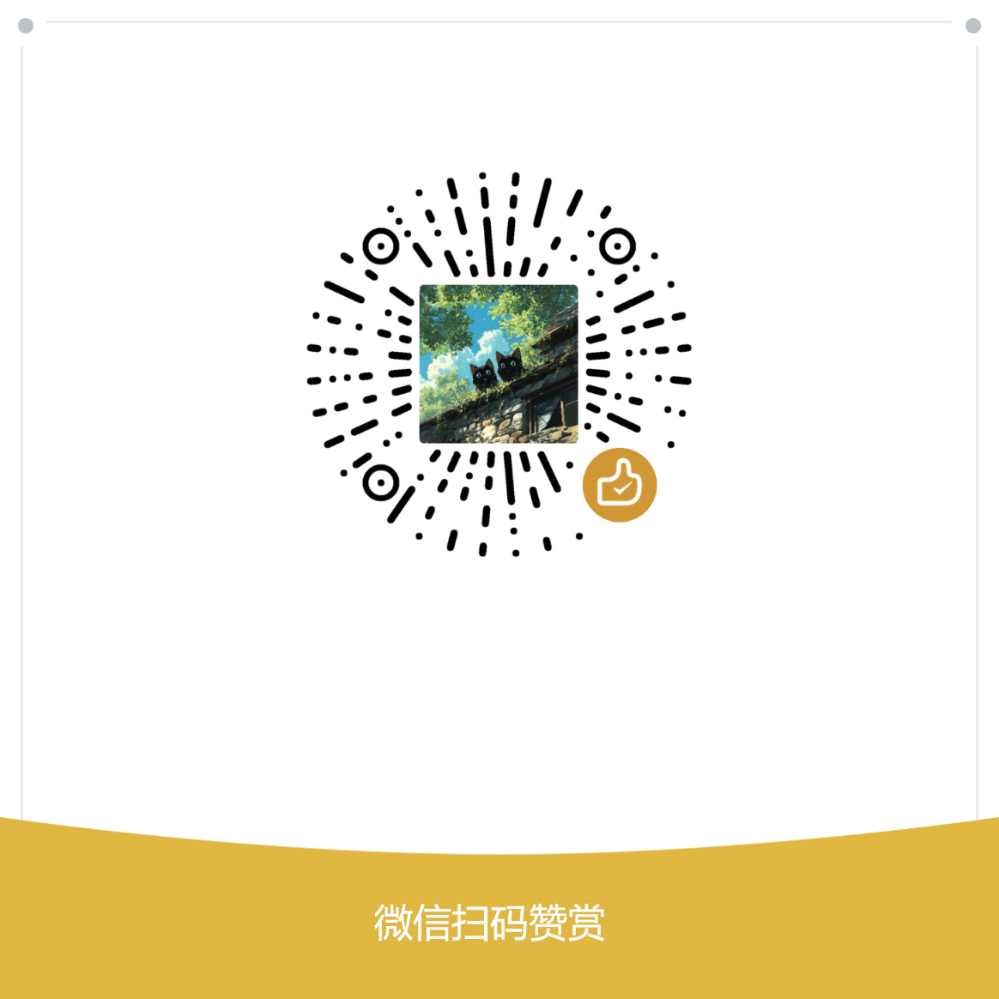

# 红帽认证通关路线（rhel-certification-path）

> 以红帽企业版技术体系为主线，按“认知—部署—命令—脚本—权限—存储—网络—服务—自动化—架构”的能力递进组织，每章独立成篇，配有原理说明、配置示例、验证步骤与自检问题。

## 目录结构

| 路径 | 内容 |
| --- | --- |
| `docs/` | 主干知识库，共二十三个板块，从开源理念与系统部署讲到 LNMP 动态网站架构 |
| `docs/images/` | 主干各章配图 |
| `topics/` | 专项库，收录 Ubuntu、Zabbix、Windows 主机与数据库、网络设备、硬件监测、CentOS 7 兼容性等偏离主干的内容 |
| `topics/images/` | 专项配图 |

## 从哪里开始

先读 `docs/README.md`，其中给出学习路径、板块索引、七段式结构说明，以及 RHCSA（EX200，RHEL 10 版）十大模块与板块的对应关系。之后按板块顺序推进，或在遇到具体问题时从索引直接跳到对应章节。

专项库的使用前提是已掌握主干前六个板块的命令行、权限、服务管理与防火墙基础，每个专项都可独立阅读。

## 版本基线

命令与配置以 RHEL 9 和 RHEL 10 共用的体系为主线，两者的差异在涉及处单独标注，重点包括包管理器、AppStream 模块化、RPM 数据库位置、网络配置格式与加密策略五处。示例中的系统账号与服务账号保持原名，其余账号统一为 `iaoexl`，口令统一为 `iaoexl@7#13`，仅用于隔离的实验环境。

## 许可

本仓库整理内容采用 CC BY 4.0 许可，全文见 `LICENSE`。

## 代码推送与镜像同步说明

本项目的代码推送流程如下：

```text
本地代码 → AtomGit → 自动镜像同步 → 腾讯云 CNB / GitHub / Gitee
```

## 你可以在这些地方找到我 (Find Me Here)

<p align="center">
  <a href="https://gitcode.com/iaoexl/rhel-certification-path.git" target="_blank" rel="noopener">
    &nbsp;GitCode
  </a>
  <span style="color: #999;">&nbsp;/&nbsp;</span>
  <a href="https://atomgit.com/iaoexl/rhel-certification-path.git" target="_blank" rel="noopener">&nbsp;AtomGit
  </a>
  &nbsp;&nbsp;
  <a href="https://cnb.cool/iaoexl/rhel-certification-path.git" target="_blank" rel="noopener">
    &nbsp;腾讯云 CNB
  </a>
  &nbsp;&nbsp;
  <a href="https://github.com/iaoexl/rhel-certification-path.git" target="_blank" rel="noopener">
    &nbsp;GitHub
  </a>
  &nbsp;&nbsp;
  <a href="https://gitee.com/iaoexl/rhel-certification-path.git" target="_blank" rel="noopener">
    &nbsp;Gitee
  </a>
</p>

<!--
## 支持这个项目（Support This Project）

> 如果这个项目为你节省了时间，欢迎支持它的持续维护：
> 
>（If this project saves you time, consider supporting its ongoing maintenance:）

|     微信赞赏码     |       支付宝        |       支付宝红包        |
| :----------------: | :-----------------: | :-----------------: |
|  | | |
-->