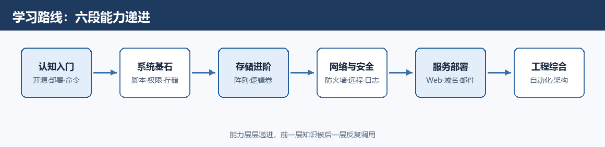
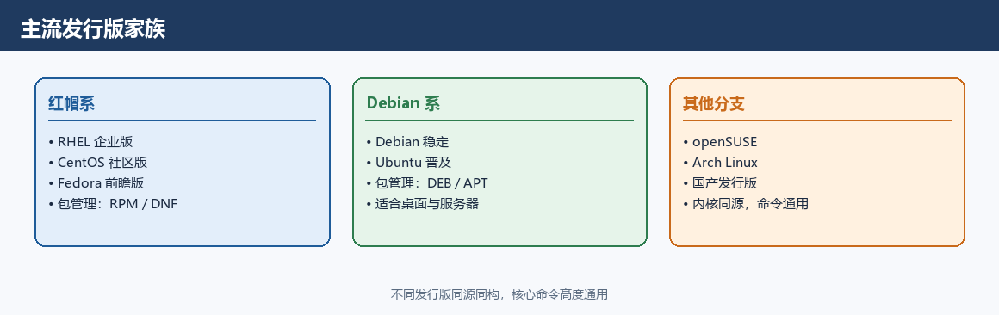

## 板块0 · 开源理念与学习导论

在敲下第一条命令之前，先回答一个容易被跳过的问题：为什么要学习 Linux，以及它为什么会成为今天这样。这个板块不急着讲操作，而是把开源精神的来龙去脉、发行版的家族谱系、学习应有的心态一次讲清。理解这些，后面每一个命令、每一项配置才不再是孤立的记忆点，而是一整套技术价值观的自然延伸。

### 0_1 技术背景与核心原理：一段从"玩具"到基础设施的演进

Linux 的故事始于一次"失败"。二十世纪六十年代中期，贝尔实验室、通用电气与麻省理工学院联合开发 MULTICS，目标是打造能支持多用户同时在线的操作系统。项目过于复杂，进度一再拖延，最终因资金问题在 1969 年终止。参与者 Ken Thompson 为了在一台 PDP-7 小型机上运行自己写的游戏，顺手裁出一套精简系统，同事戏称它为 UNICS——这正是 UNIX 的雏形。一个 hobby 项目，就此埋下改变整个软件行业的种子。

1973 年是一个关键转折点。彼时用汇编写的操作系统内核必须针对每种机器架构重写，移植成本极高。Dennis Ritchie 与 Ken Thompson 决定用 C 语言重写 UNICS，系统从此获得跨平台能力。这一决策的影响极为深远：操作系统第一次可以脱离具体硬件而存在，软件开始真正"可移植"。1979 年，AT&T 收回 UNIX 版权并限制源码传播，崇尚自由分享的技术社区受到冲击，但也正因如此，一股更强的反制力量正在酝酿。

1983 年，Richard Stallman 发起 GNU 计划，目标是重建一个完全自由的操作系统。GNU 是"GNU's Not Unix"的递归缩写，这个名字本身就是对商业化 UNIX 的委婉回应。1987 年 GCC 编译器问世，人们第一次能免费地把 C 代码编译成可执行程序，开源生态由此获得核心工具。随后 Emacs 编辑器与 bash 解释器相继登场，GNU 计划逐渐凑齐了操作系统的大部分组件，唯独缺一个内核。

1991 年，芬兰赫尔辛基大学的学生 Linus Torvalds 用 bash 与 gcc 写出了一个新的系统内核，并在技术论坛上低调发布。他在帖子里说这只是一个"业余爱好，不会像 GNU 那样庞大专业"，却没想到这个内核因为代码质量高、遵循 GPL 开放源码，迅速吸引了全球开发者。Linux 与 GNU 工具的结合，补齐了自由操作系统的最后一块拼图。故事的巧合之处在于：Linux 的吉祥物是一只名为 Tux 的企鹅——技术史上许多看起来随意的选择，后来都成了文化符号。

把这则公告的原文放在这里，能更直观地感受当时的语气——发布者强调的只是"能用的东西"和"大家的反馈"，没有任何宏大叙事：

```
Hello everybody out there using minix -

I'm doing a (free) operating system (just a hobby, won't be big and
professional like gnu) for 386(486) AT clones. This has been brewing
since april, and is starting to get ready. I'd like any feedback on
things people like/dislike in minix, as my OS resembles it somewhat
(same physical layout of the file-system (due to practical reasons)
among other things).

I've currently ported bash(1.08) and gcc(1.40), and things seem to work.
This implies that I'll get something practical within a few months, and
I'd like to know what features most people would want. Any suggestions
are welcome, but I won't promise I'll implement them :-)

Linus torvalds
```

一个"业余爱好"最终长成了支撑全球基础设施的软件，这个反差本身就值得记住：技术影响力并不总来自立项时的宏大目标，有时恰恰来自"先做出来、再听反馈"的朴素循环。

1993 年红帽公司成立，把"技术支持与服务"引入开源商业模式。1998 年前后，IBM、Intel 等巨头相继加入开源阵营，开源从社区亚文化走向主流产业。一个很有说服力的数字是：曾有人拿"18EB"这样的数据量开玩笑，说要让数据坐高铁才能传完——开源技术所承载的数据规模，早已超出单个组织用自有软件能驾驭的量级。

这条脉络里藏着一个反复出现的规律：**每一次重大突破，几乎都源于"降低门槛"而非"堆砌复杂度"**。用 C 重写内核降低了移植门槛，GPL 降低了获取门槛，软件包管理器降低了安装门槛。理解这一点，就能看懂众多技术设计的出发点——它们大多是在回答同一个问题：怎样让复杂的事变得简单可靠。



### 0_2 关键概念：内核、发行版与开源许可证

初学者最容易混淆的是"Linux"这个词到底指什么。严格区分两个概念，能避免后续大量的表述混乱。

Linux 系统内核是由 Linus Torvalds 发起、全球开发者共同维护的操作系统核心程序，负责硬件抽象、磁盘与文件系统控制、内存管理以及多任务调度。内核本身并不是一个能直接使用的完整系统，它只是"发动机"。

Linux 发行版则是以内核为基础，搭配 Shell、桌面环境、软件包、文档等组件组装而成的完整操作系统。如果把内核比作发动机，发行版就是装好发动机、配上车身与内饰、加满油可以直接上路的整车。RHEL、Fedora、Debian、Ubuntu 都是发行版。

开源不等于免费，更不等于"没有规则"。开源许可证规定了源码的使用、修改与再发布方式，常见的几类许可证构成了开源世界的法律骨架。

| 许可证 | 核心特征 | 典型代表 | 对使用者的要求 |
| --- | --- | --- | --- |
| GPL | 强著佐权，衍生作品须同样开源 | Linux 内核、GNU 工具 | 修改并分发时需公开源码 |
| LGPL | 弱著佐权，链接使用相对宽松 | 各类函数库 | 修改库本身时需开源，调用可闭合 |
| BSD | 宽松，几乎不限制再发布 | BSD 系列系统 | 保留版权声明即可 |
| Apache | 宽松，含专利授权条款 | Hadoop、大量云组件 | 保留声明并说明改动 |
| MIT | 极简宽松 | 众多前端与工具库 | 保留版权与许可声明 |
| Mozilla | 平衡著佐权与兼容 | Firefox | 按条款处理源码与商标 |

开源项目要生存，必须有可持续的营利模式。常见的模式有五类：多条产品线（个人版免费推广、企业版授权营利，如数据库双版本）、技术服务型（软件免费，靠文档、培训与定制服务营利）、软硬件结合（硬件销售捆绑系统与技术保障）、技术出版物（围绕开源项目出版图书与教程）、品牌与口碑（企业以开源组件回馈社区，反过来强化自身生态）。这些模式说明，开源与商业并非对立，好的技术同样需要好的运营。

```
开源技术栈的分层关系
┌───────────────────────────────────────────┐
│  应用程序与桌面环境   （用户直接看到的部分） │
├───────────────────────────────────────────┤
│  Shell 与系统工具     （用户与系统的接口）   │
├───────────────────────────────────────────┤
│  Linux 内核           （硬件抽象与资源调度） │
├───────────────────────────────────────────┤
│  硬件                 （CPU、内存、磁盘、网卡）│
└───────────────────────────────────────────┘
        内核之上是发行版，内核之下是通用硬件
```

### 0_3 主流发行版全景与选型依据

全球存在数百个发行版，但底层逻辑相通。按技术血统可以大致归为红帽系与 Debian 系两大阵营，它们在软件包格式与管理工具上的差异，是后续安装软件时必须先弄清楚的前提。

| 发行版 | 血统 | 包名/工具 | 定位与特点 |
| --- | --- | --- | --- |
| RHEL | 红帽系 | RPM / DNF | 企业级稳定性，长期支持，认证考试基准系统 |
| CentOS Stream | 红帽系 | RPM / DNF | 免费，滚动预览下一版 RHEL 特性 |
| Fedora | 红帽系 | RPM / DNF | 新技术试验田，约六个月一个版本 |
| Rocky Linux | 红帽系 | RPM / DNF | 承接 CentOS 停更后的空白，承诺长期免费与兼容 |
| Debian | Debian 系 | DEB / APT | 稳定性与安全性著称，软件仓库庞大 |
| Ubuntu | Debian 系 | DEB / APT | 桌面与服务器兼顾，长期支持版本应用广泛 |
| openSUSE | 独立 | RPM / Zypper | 桌面轻快、服务器稳健，在欧洲影响较大 |
| Kali Linux | Debian 系 | DEB / APT | 预置大量安全测试工具，面向取证与渗透 |
| Gentoo | 独立 | 源码 Portage | 高度可定制，适合有经验的使用者 |
| Deepin | Debian 系 | DEB / APT | 本土化出色，集成常用中文软件 |

选型可以遵循三条经验：追求生产稳定与生态兼容，优先红帽系；偏好新特性与自由定制，关注 Fedora、Gentoo；做安全测试或桌面日常，Kali、Ubuntu、Deepin 各有优势。需要强调的是，发行版之间"界面差别很大、操作细节不同"，但只要基于同一内核，核心原理与绝大多数命令完全通用——这也是本知识库以红帽企业版为主线、结论却能迁移到多数系统的原因。



### 0_4 学习方法与心态建设：把"苦差事"变成复利

有一个流传很广的玩笑：人的 DNA 里或许藏着一个叫 STUDY_LEVEL 的环境变量，值为 1 时痴迷学习，为 0 时享受生活，多数人则在两者之间摇摆。这个比喻之所以好笑又扎心，是因为它点破了一个事实——学习从来不是轻松的事。任何声称"学 Linux 很简单"的说法，都经不起生产环境的检验。

真正有效的不是一时的鸡血，而是把学习变成可积累的复利。三个做法被反复验证有效。其一，**动手优先**：读懂不等于会做，只有亲手敲过命令、看过报错、修过配置，知识才会从"知道"变成"掌握"。其二，**环境一致**：初学阶段尽量使用与教学一致的工具和版本，这样出错时可以先排除环境差异这个干扰因素，更快定位真正的问题；等技术扎实后，自然具备自由选择环境的能力。其三，**记录初心与疑问**：在开始前写下学习动机，疲惫时回看；遇到不懂的地方先记下来，很多疑问会在后续章节自然消解。

一个很有启发的细节来自早期实践者的经历：有人在少年时代就想学 Linux，那时装系统要买光盘，一套至少六张，多次安装都失败，多年后整理房间才发现是第五张光盘被划伤，导致依赖包无法读取。这个迟到了好几年的答案说明——**工具准备齐全后先校验完整性**，往往比盲目重试更能节省时间。这个习惯会在后面每一次下载镜像、校验配置时反复发挥作用。

### 0_5 场景笔记方法：为长期学习建立知识索引

导论阶段的笔记重点不是命令，而是"建立索引"。建议为整个学习过程准备一个总索引条目，记录三件事：当前使用的实验环境（发行版、版本、虚拟机配置）、学习动机与目标、以及各板块笔记的存放位置与进度状态。

环境信息建议单独成条并重点标记，因为它是后续所有实验的基准。记录内容包括发行版名称与版本、内核版本、主机名、网络模式与地址段。这些信息在排错时是第一手依据——很多"命令不存在"或"配置不生效"的问题，根源只是环境版本与预期不符。

| 笔记字段 | 记录示例 | 作用 |
| --- | --- | --- |
| 发行版与版本 | 企业版 10 | 决定包管理器与配置路径 |
| 内核版本 | 由 uname 命令获取 | 判断特性支持情况 |
| 主机名 | iaoexl.com | 保证命令提示符前缀一致 |
| 网络模式 | 仅主机 / NAT / 桥接 | 决定连通性排错方向 |
| 学习进度 | 已完成板块编号 | 形成可检索的进度视图 |

### 0_6 实用验证与排错：确认你的认知起点

导论阶段的"验证"主要是确认环境认知正确，而非配置功能。以下情形都说明需要先回到环境本身，而不是怀疑自己的操作：不同机器上命令输出不一致、教程中的配置文件路径在本地找不到、某个服务名与预期不同。这些几乎都指向发行版或版本差异，而不是操作错误。

**配置示例：采集环境信息建立基准**

动手前先把环境底数摸清：依次确认发行版、内核版本、主机名与地址，建立可对照的基准记录，同时初始化笔记版本库，日后遇到配置不符时能凭这份基准快速定位环境差异。

```
# 查看发行版与版本
root@iaoexl:~# cat /etc/os-release
NAME="Red Hat Enterprise Linux"
VERSION_ID="9"

# 查看内核版本与架构
root@iaoexl:~# uname -r
5.14.0-xx.el9.x86_64
root@iaoexl:~# uname -m
x86_64

# 查看主机名与地址
root@iaoexl:~# hostname
iaoexl.com
root@iaoexl:~# ip addr show | grep inet
inet 192.168.10.10/24

# 初始化笔记版本库（配合全库的笔记方法）
root@iaoexl:~# mkdir notes && cd notes
root@iaoexl:~# git init
Initialized empty Git repository
root@iaoexl:~# git config user.name "learner"
root@iaoexl:~# git config user.email "learner@example.com"
```

```
环境认知自检流程
  确认发行版 ──► 确认版本 ──► 确认包管理器 ──► 确认服务名与配置路径
      │             │              │                  │
   看发行版      看发行版版本    红帽系用 dnf     不同版本服务名可能变化
   标识文件      （而非只看内核） Debian 系用 apt   以本机实际为准
```

一条实用经验：当遇到"教程与本地不符"时，先用发行版标识文件确认系统类型，再确认大版本，最后才去查具体命令。按顺序排查，能在几分钟内排除掉大半的环境类问题。

### 0_7 认证对标与职业进阶路径

开源理念看似不直接考操作，但它决定了认证体系的分工，也划定了日常技术选型的边界。理清各类认证的定位，学习路线才能聚焦而不摇摆：LFCS 面向通用命令行与系统运维，LFCE 侧重网络服务与高级系统管理，LPIC-1 覆盖传统系统管理的完整基础，RHCSA/RHCE 围绕红帽企业版的实操与自动化，CompTIA Linux+ 以考试驱动的方式检验知识广度。

红帽的认证体系在 RHEL 10 这一代分成五条方向，每条都以 EX200 为共同基石。搞清它们的分工，比盲目"从 RHCSA 开始刷题"更有价值——方向选错，投入的时间和岗位需求会错位。

| 方向 | 考试组合 | 考察的是 | 适合谁 |
| --- | --- | --- | --- |
| 企业 Linux | EX200 + EX342 | 系统管理与分层排障 | 传统运维、驻场工程师 |
| Ansible 自动化 | EX200 + EX294 | 用剧本把重复劳动标准化 | 大多数运维岗，资料最全、考场最广 |
| OpenShift 平台 | EX280 + EX380 | 集群与容器平台运维 | SRE、平台工程 |
| 云原生应用 | EX188 + EX288 | 容器构建与应用交付 | 偏开发侧的工程师 |
| AI 平台 | EX267 | OpenShift AI 的部署与使用 | 关注 AI 基础设施者，体系仍在完善 |

EX200 本身有十个模块，覆盖基本工具、软件管理（含新增的 Flatpak 仓库与应用管理）、Shell 脚本、系统运维、本地存储、文件系统、部署维护（含新增的 systemd 定时器）、基础网络、用户与组、安全管理；对照上一版考纲，容器一域已整体删除，增补的是 Flatpak 与定时器。本库每个板块末段的"认证对标"都会指出对应模块，完整的模块与板块映射见总览的考纲对标一节。一个务实的判断是：**EX200 的十个模块全部属于"必须会"，EX294 属于"效率倍增"，其余三条方向属于"选赛道"**。前两者先把底子打牢，再按岗位需要选方向，比一开始就冲平台或云原生更稳。

| 认证体系 | 与本主题相关的考查方向 | 应具备的判断力 |
| --- | --- | --- |
| LFCS | 开源生态、发行版差异、命令行基础 | 说清 GPL 与商业发行的关系 |
| LPIC-1 | Linux 发展史、发行版与许可 | 区分主流发行版及其包管理体系 |
| RHCSA | 红帽生态、环境准备 | 选择与生产环境一致的平台 |
| CompTIA Linux+ | 开源许可、职业方向 | 按场景挑选合适的发行版 |

有个教训流传很广：一支开发团队把某 GPL 项目的核心代码嵌入自家产品，却未公开衍生部分的源码，上线后收到合规警告。团队起初以为"付了费就没事"，后来才明白 GPL 的约束不在收费，而在衍生作品必须开放的义务。这个案例说明许可证不是形式条款，而是会落到交付环节的真实约束。

| 常见认知误区 | 准确认识 | 判断依据 |
| --- | --- | --- |
| Linux 就是内核 | 通常指内核加 GNU 工具与发行版整合的完整系统 | 内核只负责资源调度 |
| 免费等于无约束 | 免费软件同样受许可证约束 | GPL、MIT 等条款各异 |
| 发行版之间命令不通用 | 核心工具与内核一致时，绝大多数命令通用 | FHS 与 POSIX 约定 |
| 证书等于能力 | 认证检验可衡量的知识与操作 | 仍需项目实践沉淀 |

闯关任务按"识别—判断—选择"三级递进，适合零基础在正式动手前自测认知是否到位。

```
  开源认知闯关
  第一关 识别 ──► 第二关 判断 ──► 第三关 选择
  看清发行版      辨明许可证      匹配职业路线
```

- 第一关：在一台尚未登录的机器上判断发行版家族，从包管理工具与系统配置文件入手，记录判断依据。
- 第二关：拿到三种真实软件许可证，判断哪些允许闭源商用、哪些要求衍生作品开源。
- 第三关：为"个人桌面""企业服务器""认证备考"三种场景各选一个发行版，并写出选择理由。

有两个常被忽略的细节值得深挖。其一是内核版本号的读法：主版本号、次版本号与修订号各有含义，次版本号的奇偶曾用于区分开发版与稳定版，理解它有助于判断特性是否已成熟。其二是 GNU 与 Linux 的关系：日常所说的 Linux 系统，多数是 Linux 内核加上 GNU 项目提供的 shell、核心工具与函数库，二者结合才构成完整可用的环境，这正是"GNU/Linux"这一称呼的由来。把这两点想通，很多关于"哪个发行版更纯正"的争论自然就消解了。

### 0_8 要点回顾与能力自检

本板块的关键结论可以浓缩为三句话：Linux 是内核，发行版是内核加组件的完整系统；开源的生命力来自许可证保障与可持续商业模式，而非单纯的"免费"；学习的核心方法是动手、环境一致与持续记录。

自检问题：

1. 内核与发行版的区别是什么？为什么说"只要基于同一内核，命令大多通用"？
2. GPL 与 MIT 许可证在"衍生作品是否必须开源"上的根本差异在哪里？
3. 红帽系与 Debian 系在软件包格式与管理工具上的主要区别是什么？
4. 为什么初学阶段强调使用与教学一致的环境？技术扎实后这一要求为何可以放松？
5. 面对"教程与本地不符"，应按什么顺序排查？
