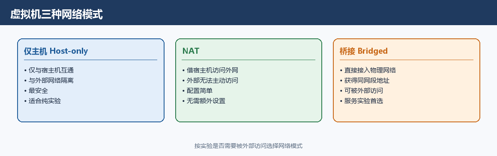
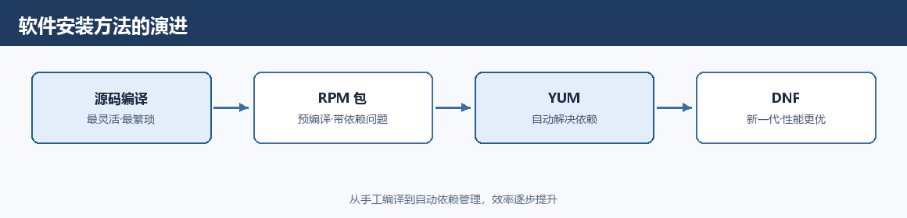

## 板块1 · 系统部署与软件安装

有了正确的认知，下一步是拥有一台真正能用的 Linux 系统。这个板块完整走通"从一台物理机到一台可用虚拟机，再到能自己装软件"的全过程。重点不只是记住安装向导每一步点哪里，而是理解每个选择背后的原因——为什么推荐虚拟机、为什么网络模式要选对、为什么软件安装方式经历了一次次演进。把这些"为什么"想明白，就算换了版本、换了机器，也能自己把系统装起来。装完之后还要解决"从哪儿装软件"的问题：官方源慢甚至失效时如何换源、内网几十台机器如何共用一个自建仓库、仓库版本太旧时如何自己编译——这三件事在同一条主线上。

### 1_1 技术背景与核心原理：为什么从虚拟机开始

学习阶段最不该做的事，就是把 Linux 直接装到主力物理机上。原因很实际：学习过程必然伴随反复折腾，配置出错、误删文件甚至系统崩溃都是常态，在物理机上这意味着数据丢失与漫长的重装。虚拟机的价值在于它把实验环境与真实数据隔离开来，并提供了"快照"这个杀手锏——一旦出错，几秒就能回到正常状态，而物理机重装往往要二十分钟以上。

一个很形象的类比来自教学现场：学做日式寿司，老师用专业柳刃刀，学生却非要拿普通切菜刀，结果寿司切得稀碎。初学阶段保持工具与环境一致，能先排除外在干扰，把精力集中在真正要学的技术上。等技术扎实了，自然能在生产环境里随心选择工具和版本。

虚拟机软件还带来一项被低估的能力：它可以同时模拟多块磁盘和多块网卡。后续要做的磁盘阵列、逻辑卷、网络绑定等实验，在物理机上意味着真金白银买硬件，在虚拟机里只是几次点击。学习成本因此被压到极低。

一个真实的教训值得记住：早期有人想学 Linux，那时装系统要买光盘，一套至少六张，装了好几次都失败，多年后才发现是其中一张盘被划伤，依赖包装不上。这个故事的结论朴素但重要——**拿到系统镜像后先做完整性校验，再开始安装**，能省下大量无谓的排查时间。

### 1_2 关键概念：网络模式、硬件规划与安装来源

创建虚拟机前需要确定几项硬件参数，每一项都对应明确的决策依据。

| 配置项 | 推荐值 | 决策依据 |
| --- | --- | --- |
| 硬件兼容性 | 当前新版本 | 全新安装无须顾虑旧版本兼容 |
| 操作系统类型 | Linux / 对应企业版 64 位 | 仅作分类标识，不影响实验步骤 |
| 磁盘类型 | SCSI | 保证后续磁盘设备名符合预期 |
| 磁盘容量 | 20GB 以上 | 限定最大可用空间，非立即占满 |
| 处理器 | 1 核起步，可后续调整 | 视物理机核心数而定，不影响实验 |
| 内存 | 物理机 8GB 以下给 2GB，以上给 4GB | 超过 4GB 对实验无益且浪费 |
| 安装来源 | 稍后安装操作系统 | 避免默认策略装出精简系统 |

网络模式是初学者最易混淆的一处，三种模式的差别可以用"连通范围"来记：

| 模式 | 连通范围 | 对应虚拟网卡 | 适用场景 |
| --- | --- | --- | --- |
| 仅主机 | 仅与物理主机通信，不访问外网 | VMnet1 | 隔离实验，本板块初始安装 |
| NAT | 经物理主机访问外网，外部不易主动访问虚拟机 | VMnet8 | 需要下载软件包时 |
| 桥接 | 虚拟机像独立主机接入物理网络 | 依物理网卡 | 需要被局域网其他机器访问时 |

安装来源务必选择"稍后安装操作系统"。若一开始就挂载镜像，虚拟机可能按默认策略部署一套最精简的系统，不再询问配置信息，最终环境与实验要求差异很大，后续大量命令会因缺组件而无法执行。

```
虚拟机硬件与宿主机的关系
┌───────────────── 物理主机 ─────────────────┐
│                                            │
│  ┌──────────┐  ┌──────────┐  ┌──────────┐  │
│  │ 虚拟机 A  │  │ 虚拟机 B  │  │ 虚拟机 C  │  │
│  │ CPU/内存  │  │ CPU/内存  │  │ CPU/内存  │  │
│  │ 磁盘/网卡 │  │ 磁盘/网卡 │  │ 磁盘/网卡 │  │
│  └────┬─────┘  └────┬─────┘  └────┬─────┘  │
│       │             │             │         │
│  ┌────▼─────────────▼─────────────▼─────┐   │
│  │  虚拟网络（仅主机 / NAT / 桥接）        │   │
│  └────────────────┬─────────────────────┘   │
└───────────────────┼─────────────────────────┘
                    ▼
                 外部网络
```



### 1_3 实操：部署虚拟机与安装系统

安装向导的核心步骤可以归纳为"建壳—装系统"两个阶段。第一阶段创建虚拟机并配置硬件；第二阶段通过系统安装向导完成语言、时区、软件环境、账户等设置。

安装系统时，几个设置项直接决定后续实验是否顺利：

- **语言与时区**：语言可按习惯选择，命令的功能与英文单词本义无关，不必因为英语而却步；时区选择亚洲对应城市，保证时间显示正确。
- **安装目标**：初次安装采用自动分区即可。文件系统层次标准已经为不同目录定义了功能，手动分区在理解原理之前收益有限。
- **KDUMP**：初学阶段关闭，可节省约 160MB 内存，这些内存留给实验更划算。
- **网络与主机名**：开启连接，主机名设为 iaoexl.com，保证后续命令提示符前缀一致，避免学习中的歧义。
- **软件环境**：选择"带图形用户界面的服务器"。有一则半开玩笑的提醒说，某系统说明书末尾写着"反正你们也不会去看"——总有人忽视提示而选择最小化安装，结果大量命令缺失、服务搭不起来。额外软件包不必此时勾选，留到后续学习逐个安装更有乐趣。
- **管理员与普通账户**：启用管理员账户并设置密码，同时允许其通过 SSH 登录；再创建一个普通账户备用。实验环境密码可以简单，生产环境必须足够复杂。

```
系统安装流程（主线）
  创建虚拟机 ─► 配置硬件 ─► 挂载镜像 ─► 启动安装
                                           │
   ┌───────────────────────────────────────▼───┐
   │ 语言 → 时区 → 安装目标 → KDUMP → 网络主机名 │
   │      → 软件环境 → 管理员密码 → 普通账户     │
   └───────────────────────────────────────┬───┘
                                           ▼
                                    开始安装 → 重启登录
```

安装完成后的第一个动作，是用管理员账户登录。若此时用普通账户登录，后面很多命令会因权限不足而无法执行。权限差异的完整解释在权限板块展开，当前阶段先用管理员身份把命令练熟。

### 1_4 软件安装方法的演进：从源码包到 DNF

软件安装方式的演进，本质上是一部"如何把复杂留给自己、把简单留给用户"的历史。理解这条主线，就不会在各种安装命令之间迷失。

| 阶段 | 方式 | 核心特点 | 主要痛点 |
| --- | --- | --- | --- |
| 早期 | 源码包 | 发布源码，使用者自行编译 | 依赖与编译全靠自己，极易出错 |
| 1995 年前后 | RPM | 统一数据库管理软件包，自带安装脚本，自动记录依赖 | 能查询依赖，但依赖仍需人工解决 |
| 2002 年前后 | YUM | 依据需求自动分析依赖，与软件仓库交互完成安装 | 依赖分析不准、内存占用大、不支持并发 |
| 2015 年前后 | DNF | YUM 的改良版，依赖分析能力与处理速度显著提升 | 基本无硬伤，命令格式与 YUM 保持一致 |

RPM 相当于把"怎么装"的规则预先写好并打包，安装、升级、卸载因此变得规整。常用的 RPM 查询命令如下，初学阶段先混个脸熟即可。

| 命令 | 作用 |
| --- | --- |
| rpm -ivh 文件名.rpm | 安装软件 |
| rpm -Uvh 文件名.rpm | 安装或升级软件 |
| rpm -e 软件名 | 卸载软件 |
| rpm -qpi 文件名.rpm | 查询未安装包的描述信息 |
| rpm -qpl 文件名.rpm | 查询未安装包包含的文件 |
| rpm -qc 软件名 | 查询已安装软件的配置文件 |
| rpm -qR 软件名 | 查询软件依赖关系 |
| rpm -qf 文件路径 | 查询文件属于哪个已安装包 |
| rpm -V 软件名 | 验证软件包是否被修改 |
| rpm -qa | 列出所有已安装的软件包 |

YUM 与 DNF 把依赖关系交给软件仓库处理。一个很贴切的比喻是：软件仓库就像菜品齐全的餐厅，使用者不必自己买鸡胸肉、黄瓜、花生米，也不必纠结先放老抽还是料酒，只要点一份"宫保鸡丁"（给出软件包名），剩下的采购与烹饪都由餐厅完成。

通过 HTTP、FTP 或本地挂载（FILE）方式连接仓库，即可自动下载并安装。常见仓库操作命令如下。

| 命令 | 作用 |
| --- | --- |
| 仓库工具 repolist all | 列出所有仓库 |
| 仓库工具 list all | 列出仓库中所有软件包 |
| 仓库工具 info 包名 | 查看软件包信息 |
| 仓库工具 install 包名 | 安装软件包 |
| 仓库工具 reinstall 包名 | 重新安装软件包 |
| 仓库工具 update 包名 | 升级软件包 |
| 仓库工具 remove 包名 | 移除软件包 |
| 仓库工具 clean all | 清除所有仓库缓存 |
| 仓库工具 group list | 查看已安装的软件包组 |
| 仓库工具 group install 软件包组 | 安装指定软件包组 |

DNF 完整继承了 YUM 的命令习惯：把 `yum` 换成 `dnf` 即可，例如 `dnf install 软件包名`。当前系统通常同时保留两个命令，提示信息也基本一致，感知不到差别。

只有软件包组这一组命令是个例外。旧版 DNF 写成连体的 `grouplist`、`groupinstall`，新一代 DNF5 把它们拆成了两级子命令 `group list`、`group install`；在 DNF5 上执行旧的连体写法会直接报"未知命令"。判断依据很简单：`dnf --version` 显示 5.x 就用拆开的写法，显示 4.x 则两种都能用。

```
软件安装方式演进（复杂度逐步转移）
  源码包 ─► RPM ─► YUM ─► DNF
    │        │      │      │
  全手动   打包+记录依赖  自动解决依赖  更快更准的依赖分析
  易出错   依赖仍手工     串行、占内存   沿用旧命令习惯
```



**配置示例：RPM 与 DNF 的常用操作**

包管理是安装之后最频繁的操作。RPM 负责单个包的安装查询，DNF 在此基础上自动解决依赖：

```
# 查询某个软件包是否已安装
root@iaoexl:~# rpm -qa | grep httpd
httpd-2.4.57-1.el9.x86_64

# 安装本地 RPM 包（不自动解决依赖）
root@iaoexl:~# rpm -ivh package.rpm

# 用 DNF 从仓库安装软件（自动解决依赖）
root@iaoexl:~# dnf install httpd
Dependencies resolved.
Install       1 Package
Complete!

# 更新、卸载与清理缓存
root@iaoexl:~# dnf update
root@iaoexl:~# dnf remove httpd
root@iaoexl:~# dnf clean all

# 列出仓库中可安装的包
root@iaoexl:~# dnf list available | head
```

**装错了怎么办：事务回滚与归属查询**

DNF 的每一次安装、升级、卸载都会被记成一次带编号的事务，整个历史可查、可回滚。这一点在升级内核或某个关键库把系统搞坏时价值极大——不必凭记忆逐个卸载，一条命令退回操作前。

```
# 一、看历史事务，找出要退回的那一步的 ID
root@iaoexl:~# dnf history
ID     | Command line      | Date and time    | Action(s)      | Altered
-----------------------------------------------------------------------
     8 | upgrade httpd     | 2026-11-10 09:12 | Upgrade        |    2
     7 | install nginx     | 2026-11-09 15:40 | Install        |    4

# 二、看清这次事务到底动了哪些包，再决定
root@iaoexl:~# dnf history info 8

# 三、撤销单次事务（把第 7 步装的 nginx 及其依赖卸掉）
root@iaoexl:~# dnf history undo 7

# 四、或整体回退：撤销第 7 步之后的所有事务，回到第 7 步刚完成的状态
root@iaoexl:~# dnf history rollback 7
```

`undo` 针对一次事务做反向操作，`rollback` 把指定事务之后的全部操作一起撤掉，边界是"包含该 ID、不撤销该 ID"。两者都依赖仓库里仍保留着旧版本的包，已经清理过缓存、或包已被仓库下架时，回滚会失败——这也是为什么重要升级前要留一份本地仓库或快照。

与之配套的另一半能力是"反查归属"：手上有个命令或配置文件，想知道它从哪个包装来。

| 想知道 | 命令 | 说明 |
| --- | --- | --- |
| 已安装系统中某文件属于哪个包 | `rpm -qf /usr/bin/dig` | 只看已装包，最快 |
| 仓库里哪个包提供某命令 | `dnf provides */dig` | 路径不确定时用通配 |
| 某包会装哪些文件 | `dnf repoquery -l bind-utils` | 装之前先看清单 |
| 某包从哪个仓库来 | `dnf info bind-utils` | 输出里有 Repository 字段 |

`dnf provides` 的查询对象是"文件路径"而不是"命令名"，所以 `dnf provides dig` 常常查不到，写成 `*/dig` 或完整路径 `/usr/bin/dig` 才准。这个差别是初学者最常卡的一步。

**版本语境：RHEL 9 与 RHEL 10 的包管理差异**

本库以 RHEL 9 与 RHEL 10 共用的命令体系为主线，差异单独标注。两者日常命令基本一致，但有五处会让人"照着旧文档做却不成功"，动手前先确认系统版本（`dnf --version`、`cat /etc/redhat-release`）。

| 变化点 | RHEL 9 | RHEL 10 | 影响 |
| --- | --- | --- | --- |
| 包管理器实现 | DNF 4（Python） | 默认仍为 DNF 4，DNF 5（C++）以附加包提供 | `dnf --version` 看 4.x 还是 5.x；5.x 的 `group`、`history`、`config-manager` 子命令语法有变 |
| 模块化（AppStream） | 可用 `dnf module enable php:8.1` | 不再分发模块化内容，`dnf module` 仅剩弃用警告 | 改用版本化的包名直接安装 |
| filelists 元数据 | 默认下载 | 默认不下载 | `dnf provides */命令` 可能查不到，需加 `--setopt=optional_metadata_types=filelists` |
| RPM 数据库位置 | `/var/lib/rpm` | `/usr/lib/sysimage/rpm` | 做快照、写备份脚本时路径要跟着改 |
| 网络配置格式 | ifcfg 仍可用 | ifcfg 已移除，仅 keyfile | 迁移前先 `nmcli connection migrate` |

若系统已切到 DNF 5，三处语法最需要留意：`dnf history` 必须带子命令（`dnf history list`）；`dnf group install "Development Tools"` 改为按组 ID 安装；`dnf config-manager --add-repo URL` 改为 `dnf config-manager addrepo --from-repofile=URL`。写自动化脚本时把这几条单独抽成变量或判断分支，比事后逐台改省事得多。

仓库要让 DNF 用起来，关键是两步：写一个 `.repo` 文件告诉 DNF 去哪里取包，再把安装介质挂到那个位置。下面以系统光盘作为本地仓库为例，配置完成后即可离线安装软件。

**配置示例：编写 .repo 文件并挂载光盘搭建本地仓库**

没有外网也能装软件——用系统光盘搭建本地仓库：编写 repo 文件指向光盘挂载点，把光驱挂上并写入 fstab 实现开机自动挂载，再用 repolist 确认仓库已识别后即可离线安装。

```
# 进入仓库配置目录，新建仓库文件
root@iaoexl:~# cd /etc/yum.repos.d
root@iaoexl:/etc/yum.repos.d# vim rhel9.repo
[BaseOS]
name=BaseOS
baseurl=file:///media/cdrom/BaseOS
enabled=1
gpgcheck=0

[AppStream]
name=AppStream
baseurl=file:///media/cdrom/AppStream
enabled=1
gpgcheck=0

# 创建挂载点，把光盘设备挂载上去
root@iaoexl:/etc/yum.repos.d# mkdir -p /media/cdrom
root@iaoexl:/etc/yum.repos.d# mount /dev/cdrom /media/cdrom
mount: /media/cdrom: WARNING: device write-protected, mounted read-only.

# 写入 fstab，使下次开机自动挂载
root@iaoexl:/etc/yum.repos.d# vim /etc/fstab
/dev/cdrom /media/cdrom iso9660 defaults 0 0

# 验证：确认两个仓库已被识别，然后尝试安装软件
root@iaoexl:/etc/yum.repos.d# dnf repolist
repo id      repo name
AppStream    AppStream
BaseOS       BaseOS
root@iaoexl:/etc/yum.repos.d# dnf install httpd -y
BaseOS       18 MB/s | 1.7 MB     00:00
AppStream    80 MB/s | 6.3 MB     00:00
Dependencies resolved.
………………
Complete!
```

这里 `baseurl` 写的是 `file://` 开头的本地路径，所以不依赖外网；`enabled=1` 表示启用该仓库，`gpgcheck=0` 表示跳过签名校验。换用 HTTP 或 FTP 仓库时，只需把 `baseurl` 改成对应的网络地址，其余步骤不变。若 `dnf repolist` 看不到仓库，优先检查挂载是否成功、`.repo` 文件路径与内容是否有拼写错误。

### 1_5 镜像源替换与自建 YUM 仓库

官方仓库的地址在境外时，一次 `dnf install` 的等待时间可能比安装本身还长；在老版本系统上，官方镜像停止维护后仓库地址会直接失效，报错"无法下载元数据"。换用国内镜像源，是把"能不能装上"变成"多久装上"的最直接手段。

换源这件事有明显的版本语境，下面以存量的 CentOS 7 环境为主线展开——它是这类问题最集中、也最容易被照抄的场景。较新的系统把 `yum` 换成 `dnf`，镜像地址与仓库名也随之改变（Rocky Linux、AlmaLinux 各有自己的镜像路径），但 `.repo` 的结构与操作逻辑完全一致，对照替换即可。

换源的本质只是替换 `/etc/yum.repos.d/` 下的 `.repo` 文件。`.repo` 里每个 `[段]` 描述一个仓库，`baseurl` 指向 `repodata` 的上级目录，`enabled` 决定是否启用，`gpgcheck` 决定是否校验签名。把这三项弄清楚，换源、加源自建仓库都是同一件事。

```
仓库寻址链路
  /etc/yum.repos.d/*.repo
        │  baseurl
        ▼
  http:// 或 ftp:// 或 file:// ──► 仓库目录
                                   ├── Packages/    rpm 包
                                   └── repodata/    包元数据（索引）
```

**配置示例：为系统启用 EPEL 扩展源**

替换前先备份，出问题能立刻回退；仓库文件必须与系统大版本匹配，安装后重建缓存，否则工具仍在用旧索引。EPEL 提供官方仓库没有的上万个小工具，但它与 Remi、RPM Fusion 等第三方源同时启用时容易出现"谁覆盖谁"的包冲突，不熟悉优先级配置时只留一个第三方源最稳妥。

```
# 一、备份原有仓库配置（保留一份可回退的副本）
root@iaoexl:~# cd /etc/yum.repos.d
root@iaoexl:/etc/yum.repos.d# mkdir backup && mv *.repo backup/

# 二、安装与系统大版本匹配的 EPEL 发布包（RHEL 9 用 latest-9，RHEL 10 用 latest-10）
root@iaoexl:/etc/yum.repos.d# dnf install -y https://mirrors.aliyun.com/epel/epel-release-latest-9.noarch.rpm

# 三、清空旧缓存并重建索引
root@iaoexl:/etc/yum.repos.d# dnf clean all
root@iaoexl:/etc/yum.repos.d# dnf makecache

# 四、确认仓库已被识别，再装一个 EPEL 里才有的工具验证
root@iaoexl:/etc/yum.repos.d# dnf repolist
repo id              repo name
epel                 Extra Packages for Enterprise Linux 9 - x86_64
root@iaoexl:/etc/yum.repos.d# dnf install -y htop
```

版本号必须与系统大版本对齐：给 RHEL 9 装 `latest-10` 的发布包，依赖解析会直接失败。给已停止维护的 CentOS 7 继续用原来的镜像地址，得到的是 404——CentOS 7 于 2024 年 6 月终止支持，软件源迁入 `vault.centos.org`，EPEL 7 同步归档；这类环境要么换用 Rocky、AlmaLinux 等兼容发行版，要么把 `baseurl` 指向 vault。RHEL 接入第三方源时还要处理签名：导入对方的 GPG 公钥并保持 `gpgcheck=1`，比直接关掉校验可靠得多。

**配置示例：自建仓库，供内网多台主机共享**

机房里有几十台机器，每台都去外网拉同一个 rpm 包是浪费。把光盘内容或自收集的包集中放在一台"源服务器"上发布，客户端只改 `baseurl` 即可。光盘自带的 `repodata` 可以直接用；自己收集的包必须用 `createrepo` 重新生成索引，否则客户端看不到任何包。

```
# 一、服务端：把光盘内容发布到匿名可读的 FTP 目录
root@Server:~# dnf install -y vsftpd createrepo
root@Server:~# mkdir -p /var/ftp/rhel9
root@Server:~# cp -rf /media/cdrom/* /var/ftp/rhel9/
root@Server:~# systemctl enable --now vsftpd

# 二、非光盘来源的包，单独建目录并生成索引
root@Server:~# mkdir -p /var/ftp/other
root@Server:~# cp /root/*.rpm /var/ftp/other/
root@Server:/var/ftp/other# createrepo .

# 三、客户端：指向服务端的 repodata 上级目录
root@Client:~# vim /etc/yum.repos.d/internal.repo
[internal-base]
name=Internal BaseOS
baseurl=ftp://192.168.10.10/rhel9
enabled=1
gpgcheck=0

[internal-other]
name=Internal Extra
baseurl=ftp://192.168.10.10/other
enabled=1
gpgcheck=0

# 四、验证客户端能读到服务端的包清单
root@Client:~# dnf clean all && dnf repolist
```

`baseurl` 支持三种协议，选择取决于发布方式：`file:///` 用于本机光盘或已挂载的镜像，`http://` 用于 Web 发布（Apache、Nginx），`ftp://` 用于 FTP 发布。三者填的都是 `repodata` 的**上一级**目录，多写一层或少写一层都会报"no package found"。

| 发布方式 | baseurl 写法 | 适用场景 |
| --- | --- | --- |
| 本机光盘 | `file:///media/cdrom` | 单机实验，离线安装 |
| Web 服务 | `http://192.168.10.10/rhel9` | 内网批量部署，最常用 |
| FTP 服务 | `ftp://192.168.10.10/rhel9` | 已有 FTP 基础设施 |
| 本地目录 | `file:///var/ftp/other` | 自建小仓库，验证阶段 |

内网自建仓库还要注意一件事：`createrepo` 生成的索引在增删 rpm 包后**不会自动更新**，每次调整包集合都要重新执行一次，否则客户端看到的仍是旧清单。

**三种来源的分工：CDN、内网源、本地介质**

同一个 `dnf install`，包可能来自三个完全不同的地方，判断标准是"这台机器能不能连到官方服务"。

| 来源 | 前置条件 | 典型命令 | 适用场景 |
| --- | --- | --- | --- |
| CDN（红帽官方） | 有效订阅并注册 | `subscription-manager register`、`dnf install` | 有订阅的生产机 |
| 内网自建源 | 一台同步了软件包的服务器 | `baseurl=http://内网地址/...` | 大批量机器、隔离网段 |
| 本地介质 | 光盘或 ISO 挂载 | `baseurl=file:///media/cdrom/...` | 无外网、临时救急 |

```
# 一、注册到 CDN 并确认可用仓库（有订阅时最省事的一条路）
root@iaoexl:~# subscription-manager register --username <账号> --auto-attach
root@iaoexl:~# subscription-manager repos --list-enabled
root@iaoexl:~# dnf repolist

# 二、临时只用一个仓库装包（排查"包版本不对"时最有用）
root@iaoexl:~# dnf --disablerepo='*' --enablerepo=BaseOS install httpd

# 三、把包装到本地而不安装，用于离线分发
root@iaoexl:~# dnf download --destdir /tmp/rpms httpd
root@iaoexl:~# dnf install --downloadonly --destdir /tmp/rpms httpd
```

判断"为什么装不上"时，先用 `dnf repolist` 看仓库是否启用、`dnf info 包名` 看它来自哪个仓库。EX200 要求三种来源都能落地，考的其实是"没有外网时怎么把系统补齐"这个真实场景——内网环境里，本地介质与自建源才是常态。

### 1_6 源码编译安装的范式：以 Python 3 为例

仓库里的软件版本往往落后于上游，需要新特性或特定编译参数时只能自己编译。下面以 RHEL 9/10 为例：系统自带的 Python 3 同时是 dnf 的运行基础，所以"装一个新版本"与"替换系统解释器"必须分开看待——前者安全，后者会连带打断包管理器。

源码安装的固定套路是"三步走"：`./configure` 检查环境并生成编译规则、`make` 按规则编译、`make install` 把产物装到 `--prefix` 指定的目录。

```
源码安装三步
  解压源码 ─► ./configure --prefix=安装目录 ─► make ─► make install
                  │ 缺依赖就在这里报错
                  └─ 检查 gcc、make、头文件、库文件
```

`configure` 阶段报错几乎都是缺依赖包，报错信息会明确指出缺哪个库的 `.h` 或 `.so`。真正需要警惕的是解释器替换：RHEL 9 起系统不再提供 Python 2，RHEL 8 也不再默认安装；dnf 由 `/usr/bin/python3` 驱动，把该路径指向自编译版本，dnf 下一次执行就会因找不到 `dnf` 模块而崩溃。

**配置示例：编译安装 Python 3 并保持系统解释器可用**

装完先在新路径下验证版本，再用 `PATH` 让交互式会话优先使用新版本；系统路径 `/usr/bin/python3` 保持不动，需要多版本共存时用 `alternatives` 或直接安装版本化包。

```
# 一、安装编译工具与依赖（缺一个都会在 configure 或 make 阶段中断）
root@iaoexl:~# dnf group install "Development Tools" -y
root@iaoexl:~# dnf install -y zlib-devel bzip2-devel openssl-devel ncurses-devel sqlite-devel readline-devel libffi-devel

# 二、下载并解压源码（版本号按官方当前稳定分支替换）
root@iaoexl:~# curl -O https://www.python.org/ftp/python/3.12.8/Python-3.12.8.tgz
root@iaoexl:~# tar xzf Python-3.12.8.tgz && cd Python-3.12.8

# 三、配置安装路径（--enable-optimizations 会显著拉长编译时间）
root@iaoexl:~/Python-3.12.8# ./configure --prefix=/usr/local/python3 --enable-optimizations

# 四、编译并安装，并发数按 CPU 核数取
root@iaoexl:~/Python-3.12.8# make -j"$(nproc)" && make install

# 五、验证新解释器，再把它的 bin 目录前置到 PATH
root@iaoexl:~# /usr/local/python3/bin/python3 -V
Python 3.12.8
root@iaoexl:~# echo 'export PATH=/usr/local/python3/bin:$PATH' > /etc/profile.d/python3.sh
root@iaoexl:~# source /etc/profile.d/python3.sh
root@iaoexl:~# python3 -V
Python 3.12.8
```

`PATH` 只影响交互式会话与脚本查找，dnf 的首行写的是绝对路径 `/usr/bin/python3`，因此不会被新版本顶掉。反过来，若用 `ln -sf` 覆盖 `/usr/bin/python3`，dnf、firewalld、SELinux 工具等一批 python3 程序会同时失效，恢复只能靠重装 rpm——这是新版系统上比"Python 2 与 yum"更常见的翻车方式。仓库已提供版本化解释器时（如 `dnf install python3.12`），优先用包管理安装，省去编译与后续补丁维护。

| 阶段 | 失败原因 | 定位方法 |
| --- | --- | --- |
| configure | 缺 `-devel` 依赖、编译器缺失 | 看报错的 `checking for ...` 行 |
| make | 内存不足、并发过高 | 降并发 `make -j1`、加 swap |
| make install | `--prefix` 目录无权限 | 用 root 或改 prefix 到可写目录 |

### 1_7 Flatpak：桌面应用与系统包的分离

RPM 与 DNF 管的是"操作系统的一部分"：库、服务、命令行工具，它们共享系统依赖，升级要整机协调。桌面应用不适合这套节奏——一个聊天软件自带几百兆的运行时，依赖版本五花八门，硬塞进系统包体系会互相打架。Flatpak 的思路是把应用连同它的运行时一起打包，在沙箱里独立运行，与系统包互不干扰。桌面版发行版早已提供 Flatpak 支持，服务器版需要自己装；EX200 新版考纲把"配置 Flatpak 仓库并安装、移除 Flatpak 软件"列进了软件管理模块，所以它从"桌面技巧"变成了要考的运维动作。

三个概念要先分清：

| 概念 | 作用 | 类比 |
| --- | --- | --- |
| remote（仓库） | 应用从哪里下载，一个系统可配多个 | DNF 的 `.repo` |
| runtime（运行时） | 应用依赖的公共环境，多个应用共享一份 | 共享库，但按版本隔离 |
| application（应用） | 用户实际启动的程序，沙箱运行 | 独立安装包 |

沙箱不是"更安全的虚拟机"，它靠 bubblewrap 做命名空间隔离，默认只能访问自己的目录与少量系统资源；需要访问摄像头、宿主目录时，由安装时的权限参数（`--filesystem`、`--device`）显式授予。这个模型的好处是卸载干净：删掉应用与运行时，系统里不会留下散落的依赖。

**配置仓库并安装**

```
# 一、确认 flatpak 已安装（桌面版通常自带，服务器版需手动装）
root@iaoexl:~# rpm -q flatpak || dnf install -y flatpak

# 二、添加 Flathub 仓库（最常用的公共源，加一次即可）
root@iaoexl:~# flatpak remote-add --if-not-exists flathub \
  https://dl.flathub.org/repo/flathub.flatpakrepo

# 三、确认仓库列表
root@iaoexl:~# flatpak remotes
Name     Options
flathub  system

# 四、搜索并安装（应用 ID 形如 org.gnome.Calculator，不是包名）
root@iaoexl:~# flatpak search calculator
root@iaoexl:~# flatpak install -y flathub org.gnome.Calculator

# 五、查看已安装、运行、卸载
root@iaoexl:~# flatpak list
root@iaoexl:~# flatpak run org.gnome.Calculator
root@iaoexl:~# flatpak uninstall -y org.gnome.Calculator

# 六、清理不再被任何应用使用的运行时（省空间的关键一步）
root@iaoexl:~# flatpak uninstall --unused
```

几个实操要点。`flatpak install` 的第二个参数是**应用 ID 而不是包名**，用 `flatpak search` 拿到准确 ID 再装，是避免"找不到应用"的最快路径。安装分系统级（`--system`，需 root，所有用户可用）与用户级（`--user`，装在家目录），两者互不可见，排查"我明明装了却找不到"时先 `flatpak list --system` 与 `--user` 各看一遍。离线环境可以先用 `flatpak create-usb` 把应用导出到 U 盘，再到目标机 `flatpak install --from` 安装，这条路径在内网机房比想象中常用。

与 DNF 的分工可以一句话记住：**系统组件、服务、命令行工具用 DNF；面向桌面的图形应用优先用 Flatpak**。反过来做会带来麻烦——用 Flatpak 装命令行工具，它的可执行文件藏在 `/var/lib/flatpak/exports/bin` 下，脚本与 systemd 单元都找不到；用 RPM 装多个版本的图形应用，依赖冲突几乎无解。

### 1_8 systemd 初始化系统：服务的"大管家"

系统启动后，第一个被拉起的用户态进程负责初始化系统并管理此后所有服务。较新的系统采用 systemd 作为初始化系统，它的核心价值是把过去分散的服务启动脚本统一为"单元"模型，并用一条命令完成启动、停止、重启、开机自启等操作。

systemd 管理的对象称为单元，服务单元最为常用。记住下面这张对照表，就能覆盖日常绝大多数服务操作。

| 操作意图 | systemd 命令 |
| --- | --- |
| 启动服务 | systemctl start 服务名 |
| 停止服务 | systemctl stop 服务名 |
| 重启服务 | systemctl restart 服务名 |
| 查看状态 | systemctl status 服务名 |
| 设为开机自启 | systemctl enable 服务名 |
| 取消开机自启 | systemctl disable 服务名 |
| 查看是否自启 | systemctl is-enabled 服务名 |
| 列出已启动服务 | systemctl list-units --type=service |

一个容易踩的坑是区分"本次启动"与"开机自启"：start 只影响当前运行，enable 只影响下次开机，两者互不替代。要让服务"现在能用且重启后依然可用"，必须两条都执行。systemd 还负责日志收集，配合 journalctl 可以按服务、按时间检索日志，这是定位服务故障的重要手段。

两条命令可以用一条代替：`systemctl enable --now 服务名` 等于 enable 加 start，省掉一次敲击，也是脚本里的推荐写法。

**单元文件长什么样**

`systemctl` 管的每个对象背后都是一个文本单元文件，服务类单元放在 `/usr/lib/systemd/system/`（发行版提供）或 `/etc/systemd/system/`（管理员自建）。三段结构是固定的：

```
root@iaoexl:~# vim /etc/systemd/system/myapp.service
[Unit]                                  # 元信息与依赖关系
Description=My demo application
After=network-online.target             # 等网络就绪后再启动
Wants=network-online.target

[Service]                               # 怎么运行
Type=simple                             # 默认类型：ExecStart 起的进程即主进程
ExecStart=/opt/myapp/bin/start.sh
Restart=on-failure                      # 异常退出时自动拉起
RestartSec=5

[Install]                               # enable 时挂到哪个目标下
WantedBy=multi-user.target              # 多用户模式下自启
```

三段的职责不能混：`[Unit]` 只描述"我是谁、我和谁有先后"，`[Service]` 只描述"进程怎么起、怎么停、失败怎么办"，`[Install]` 只回答"enable 时把软链接建到哪个目录"。`Type=simple` 与 `Type=forking` 的差别在于前者认为 `ExecStart` 的进程就是主进程、后者认为它会 fork 出子进程后退出——选错类型，`systemctl status` 会显示"启动成功但服务已退出"这类假象。

**改配置要改对地方**

发行版自带的单元文件属于软件包的资产，升级时会被覆盖。直接编辑 `/usr/lib/systemd/system/` 下的文件，改动会在下次 `dnf update` 时悄悄消失。

正确做法是用 `systemctl edit` 生成一个覆盖片段（drop-in），只写要改的那几行：

```
root@iaoexl:~# systemctl edit httpd
# 编辑器打开 /etc/systemd/system/httpd.service.d/override.conf，写入：
[Service]
LimitNOFILE=65535

root@iaoexl:~# systemctl daemon-reload      # edit 会自动 reload，手工改文件则必须执行
root@iaoexl:~# systemctl restart httpd
root@iaoexl:~# systemctl cat httpd          # 看最终合并结果，确认覆盖生效
```

`systemctl cat` 会把主单元与所有 drop-in 拼在一起显示，是确认"我改的到底生效没有"的唯一可靠办法。任何手工新增或修改单元文件之后都必须 `systemctl daemon-reload`，否则 systemd 仍用内存里的旧定义，表现为"文件明明改了，行为没变"。

**开机慢与启动失败，先看这两个命令**

系统起不来或起得慢，不需要盲猜，systemd 自己记录了每个单元的耗时：

```
# 按耗时排序，看谁拖慢开机
root@iaoexl:~# systemd-analyze blame
8.412s NetworkManager-wait-online.service
3.105s dracut-initqueue.service
...

# 看关键链：哪一步在等哪一步
root@iaoexl:~# systemd-analyze critical-chain

# 列出启动失败的单元——排错的第一站
root@iaoexl:~# systemctl --failed
```

`NetworkManager-wait-online.service` 常年占据耗时榜首，它只是在等网络就绪，本身不做实事；确认业务不依赖"开机即有网"后，`systemctl disable NetworkManager-wait-online` 能立省数秒。`systemctl --failed` 则把所有处于 failed 状态的单元列成一张清单，比逐个 `status` 翻找高效得多。

### 1_9 场景笔记方法：把一次装机变成可复用的清单

部署类实验最容易"当时会了、下次重来"，因为它步骤多、参数杂。建议把装机过程整理成一张"决策清单"笔记，而不是流水账。清单只记录需要做出选择的地方及其依据，跳过一路点"下一步"的部分。

| 记录项 | 记录内容 | 记录要点 |
| --- | --- | --- |
| 环境基准 | 虚拟机版本、系统版本、网络模式 | 注明选择理由，便于复现 |
| 关键选择 | 安装来源、软件环境、KDUMP、主机名 | 只记"非默认"的选项 |
| 账户规划 | 管理员与普通账户及用途 | 密码不写入笔记 |
| 软件安装 | 使用的安装方式与仓库来源 | 记录失败过的命令与原因 |
| 快照节点 | 在哪个阶段保存了快照 | 注明快照对应的系统状态 |

笔记里要特别标注"踩过的坑"：例如因选择最小化安装导致命令缺失、因磁盘类型选错导致设备名变化。这些条目最有复用价值，因为它们是纯粹的经验，无法从文档里直接查到。

### 1_10 实用验证与排错：确认系统真的可用

装完系统不要急着往下学，先用一组命令确认系统处于健康状态。这组检查同时也是对核心命令的预热。

```
root@iaoexl:~# hostname                 # 确认主机名与预期一致
root@iaoexl:~# uname -r                 # 查看内核版本
root@iaoexl:~# ip addr                  # 确认网卡与地址
root@iaoexl:~# dnf repolist             # 确认软件仓库可用
root@iaoexl:~# systemctl status 服务名   # 确认服务管理机制正常
```

常见的失败现象与原因对应关系如下，按顺序排查效率最高：

| 现象 | 优先排查方向 |
| --- | --- |
| 大量命令"command not found" | 是否误选最小化安装 |
| 磁盘设备名与预期不符 | 创建虚拟机时磁盘类型是否选成 SCSI |
| 无法连接软件仓库 | 网络模式是否可达外网、仓库配置是否正确 |
| 服务重启后失效 | 是否只 start 未 enable |
| 主机名前后不一致 | 安装时主机名设置是否被跳过 |

任何破坏性尝试前先保存快照，是这个阶段最值得养成的习惯。快照不是"以防万一"的装饰，而是让学习敢放手试错的底气。

### 1_11 认证对标与进阶实战

部署与软件包管理是各认证体系的必考区，因为它标志着"从会用一台现成机器"转向"能造出一台可用机器"。LFCS 重点考查系统安装、软件包管理与服务控制，LPIC-1 的安装与定制、硬件两大主题直接对应本板块，RHCSA 把软件安装与 systemd 列为基本技能，CompTIA Linux+ 则要求理解引导流程与包的依赖关系。EX200 新版把 Flatpak 仓库配置与应用装卸写进了软件管理模块，这意味着"软件安装"的范围已从系统包扩展到沙箱化的桌面应用。

| 认证体系 | 与本主题相关的考查方向 | 核心能力要求 |
| --- | --- | --- |
| LFCS | 系统安装、包管理、服务管理 | 用 YUM/DNF 完成安装并用 systemctl 控制服务 |
| LPIC-1（101/102） | 安装与定制、硬件、软件包 | 规划分区、配置引导、管理 RPM 与 DEB 包 |
| RHCSA（EX200） | 管理软件：配置 RPM 仓库、安装与移除；配置 Flatpak 仓库 | 离线仓库可用、Flatpak 应用能装能删 |
| RHCSA（EX200） | 部署与维护系统：从 CDN/远程/本地文件系统安装更新 | 三种来源都能落地，且能解释差异 |
| CompTIA Linux+ | 引导流程、包依赖 | 解释 GRUB 到 systemd 的启动链 |

有个真实故事：一位新人给生产服务器安装系统，凭手感把全部空间划给了根目录，运行半年后日志与上传文件把根分区撑满，服务连锁报错。回滚无门，只能停机迁移数据。事后复盘发现，若在装机时单独划出 /home 与 /var，并预留余量，这场故障完全可以避免。分区规划看似装机时最枯燥的一步，恰恰是最难事后补救的一步。

安装与部署环节的高频故障，往往集中在引导、网络与软件源三处。

| 现象 | 根因 | 定位命令 | 处置 |
| --- | --- | --- | --- |
| 安装后无法引导 | 引导装载程序未写入正确磁盘 | 查看biosboot/efi分区、引导顺序 | 重装引导或调整启动顺序 |
| 网卡未被识别 | 驱动缺失或网络模式选错 | ip link、lspci | 更换兼容网卡或加载驱动 |
| DNF/YUM 报"无可用仓库" | 仓库配置或网络不通 | ping、仓库配置文件 | 修正仓库地址、检查连通 |
| 服务重启后失效 | 只 start 未 enable | systemctl is-enabled | 补执行 enable |

闯关任务按"装机—配源—控服务"三段设计，每段都以可验证的结果收尾。

```
  部署能力闯关
  规划分区 ──► 配置软件源 ──► 控制服务
  /home /var   仓库可用       现在可用且重启仍可用
      │            │                 │
   df -h 验证   dnf list 验证   systemctl is-enabled 验证
```

- 第一关：在虚拟机中规划分区，至少分离 /、/home、/var 与 swap，装机后用 `df -h` 核对挂载点。
- 第二关：配置一个可用软件源，用 `dnf list` 能列出包，再安装一个小工具验证解析依赖正常。
- 第三关：安装并启动一个服务，先 `start` 再 `enable`，用 `systemctl is-active` 与 `is-enabled` 分别确认当前状态与自启状态。

装机阶段还有一件容易被跳过的事：**从三种来源装更新**。CDN（`cdn.redhat.com` 订阅源）、远程仓库（HTTP/FTP 自建源）、本地文件系统（光盘或 ISO 挂载），三者的差别只在 `baseurl` 的协议前缀，配置模型完全一致，但适用场景分明——内网机器走本地源、批量交付走自建源、正式补丁走 CDN。EX200 要求三者都能落地，考察的其实是"能不能在无外网环境里把系统补齐"。

启动链的部分在本板块只作为背景，完整展开在后面的系统启动与故障恢复板块：固件、引导加载器、内核与 initramfs、systemd、登录五段，每一段都有对应的干预手段。这里先记住一件事——装机失败与启动失败是两类问题，前者在安装介质里解决，后者在已装系统上解决，混在一起会浪费大量时间。

### 1_12 要点回顾与能力自检

本板块完成了从零到一的跨越：用虚拟机隔离实验风险，用正确的硬件与网络参数搭建环境，用系统化向导完成安装，用 RPM/YUM/DNF 管理软件，用 systemd 管理开机自启服务。软件安装方式的演进始终围绕一个主题——把依赖处理的复杂度从使用者转移到工具。

自检问题：

1. 为什么初学阶段推荐虚拟机而非物理机？快照在其中起什么作用？
2. 仅主机、NAT、桥接三种网络模式的连通范围有何区别？
3. 为什么安装来源要选"稍后安装操作系统"？
4. RPM、YUM、DNF 各自解决了上一阶段的什么问题？
5. Flatpak 的 remote、runtime、application 分别对应什么？为什么 Flatpak 装不了命令行工具？
6. systemctl start 与 systemctl enable 的区别是什么？如何让服务"现在可用且重启后仍可用"？
7. 为什么要用 `systemctl edit` 改服务配置，而不是直接编辑 `/usr/lib/systemd/system/` 下的单元文件？改完必须执行哪条命令？
8. `dnf history undo` 与 `dnf history rollback` 的边界有何不同？什么情况下回滚会失败？
9. 已知一个命令名，怎么查它由哪个包提供？已装系统里查文件归属又该用哪条命令？
10. RHEL 10 上 `dnf provides */命令` 查不到结果，最可能是什么原因？怎么补？
