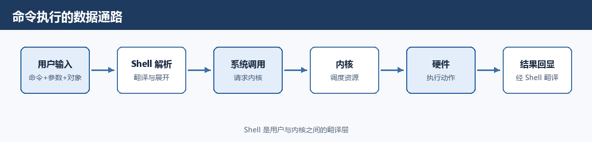
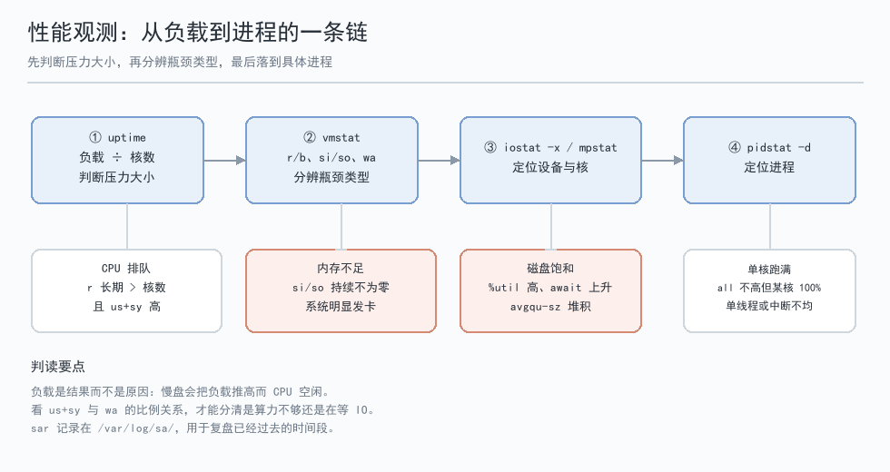
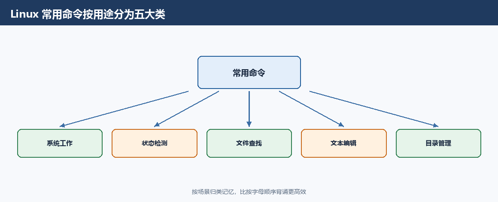

## 板块2 · 核心命令与Shell基础

系统装好了，接下来真正开始与它对话。这个板块是全书命令体系的地基：先讲清命令为什么能执行、Shell 在中间扮演什么角色，再按用途把最常用的命令分成五大类逐一讲透。命令不必死记，理解"命令名 + 参数 + 对象"的结构、熟悉帮助与补全的技巧，剩下的交给重复练习。板块末尾还补上两件事：终端里的多任务调度——如何把长任务丢到后台、如何把它调回来、如何干净地终止它；以及一组性能观测命令，把"机器变慢了"这种模糊描述拆成一条可验证的排查链。

### 2_1 技术背景与核心原理：Shell 是用户与内核之间的"翻译官"

用户并不会直接操作内核，内核也不会理解人类的意图。两者之间需要一个中间层：用户把命令交给它，它把命令翻译成内核能执行的操作，再把结果翻译回来。这个中间层就是 Shell，也常被形象地称为"壳"——它包裹在内核外面，是用户触达系统能力的入口。

Shell 之所以长期胜过图形界面，在于三点：效率、可控、省资源。同样的批量操作，图形界面要反复点击，命令行一条带参数的命令就能完成；命令行能把操作写进脚本重复执行，图形界面的点击很难被精确复现；命令行不需要渲染图形，占用的系统资源更少。有个比喻很贴切：图形界面像按图索骥地点菜，命令行则像直接告诉厨师菜名和火候，后者更快也更可控。

Bash 是当前最主流的 Shell，它的四大优势构成了高效操作的基础：历史命令可以回溯复用，Tab 补全减少输入且防错，批处理脚本把重复劳动自动化，环境变量管理让系统行为可配置。

命令需要严格区分大小写，这是初学者第一个下马威。执行 `Man`、`MAN` 都会得到"command not found"，而 `man` 正确——系统甚至会提示"相似命令是 man"。在命令、参数、文件名上都保持大小写敏感的习惯，能避免大量玄学问题。

### 2_2 关键概念：命令格式、帮助系统与终端效率

绝大多数命令遵循统一结构：命令名 + 参数 + 对象。参数是调节命令行为的旋钮，对象是命令作用的目标。参数分长格式（如 `--help`）与短格式（如 `-h`），短格式可以合并书写。参数与实际场景的关系，就像切寿司要用专用刀、买衣服要选对尺码——同一命令配上不同参数，适用场合大不相同。

帮助系统有三层，深度递增，按"要知道多细"来选。

| 层级 | 用法 | 特点 | 什么时候用 |
| --- | --- | --- | --- |
| 速查 | `命令 --help` | 只列参数与一行说明 | 记得命令名，忘了参数拼写 |
| 手册 | `man 命令` | 完整说明、参数详解、文件与示例 | 学习一个新命令 |
| 详解 | `info 命令` | 带节点跳转的 GNU 文档 | man 写得太简略时 |

`man` 手册按内容性质分成九个章节，同一个名字在不同章节里可能是完全不同的东西——`passwd` 在第 1 章是改密的命令，在第 5 章是密码文件的格式说明。

| 章节 | 内容 | 章节 | 内容 |
| --- | --- | --- | --- |
| 1 | 用户命令 | 6 | 游戏 |
| 2 | 系统调用 | 7 | 杂项与约定 |
| 3 | 库函数 | 8 | 系统管理命令 |
| 4 | 设备文件 | 9 | 内核例程 |
| 5 | 文件格式与配置 | | |

默认按章节顺序从前向后找，所以 `man passwd` 命中的是命令而不是文件格式。要指定章节就写成 `man 5 passwd`，这个写法在配置文件的字段含义上特别有用。忘记命令名、只记得功能时用 `man -k 关键词`（等价于 `apropos`）按描述反查，它查的是手册的索引数据库，刚装完系统索引可能还没建，需要先执行 `mandb`。更完整的软件文档放在 `/usr/share/doc` 下，随包安装，常带官方示例配置。

第一次使用不妨执行 `man man` 查看帮助命令自身的说明，这是一个很有仪式感的起点。养成"遇到陌生命令先查 man"的习惯，比四处搜索更准确，因为手册与本机版本完全一致，而网上的示例往往来自另一个版本。

终端里的按键分三组，各管一件事：编辑当前命令行、复用历史、批量匹配文件名。

| 按键 | 作用 |
| --- | --- |
| Ctrl + A / Home | 光标移到行首 |
| Ctrl + E / End | 光标移到行尾 |
| Ctrl + U | 剪切光标之前的全部内容 |
| Ctrl + K | 剪切光标之后的全部内容 |
| Ctrl + W | 剪切光标前的一个单词 |
| Ctrl + Y | 把刚剪切的内容粘回来 |
| Ctrl + L | 清屏，等价于 `clear` |
| Ctrl + C | 中断当前命令 |
| Ctrl + D | 结束输入，空行时退出 Shell |
| Ctrl + Z | 把当前进程挂起到后台 |
| Ctrl + S / Q | 锁住 / 解锁终端输出 |
| Ctrl + X 再按 U | 撤销刚才的编辑 |
| Esc 后按 . | 取出上一条命令的最后一个参数 |

`Ctrl+U` 加 `Ctrl+Y` 是改长命令的常用组合：整行敲错不必逐字退格，剪掉重打即可。`Ctrl+S` 的锁屏容易误触，看到终端"卡住不输出"先想想是不是按到了它，按 `Ctrl+Q` 即可恢复，不必重启终端。

历史命令除了上下方向键，还有一套以 `!` 开头的展开语法，能在命令行里直接引用过去的命令或其参数。

| 写法 | 含义 |
| --- | --- |
| `!!` | 重复执行上一条命令 |
| `!n` | 执行 `history` 列表中编号为 n 的命令 |
| `!字符串` | 执行最近一条以该字符串开头的命令 |
| `!?字符串` | 执行最近一条包含该字符串的命令 |
| `!-n` | 执行往前数第 n 条命令 |
| `!$` | 取上一条命令的最后一个参数 |
| `Ctrl + R` | 交互式反向搜索历史，输入关键词逐步缩小 |

`!$` 在实际操作中出场率最高：先 `ls /etc/chrony.conf` 确认文件存在，再 `vim !$` 直接打开同一个文件，省去重复输入长路径。它的风险也来自同一处——`!` 展开发生在命令执行之前，眼睛看到的和实际执行的可能不是同一条命令，因此在 `rm`、`dd` 这类破坏性命令前不要用 `!` 展开，先看一眼 `history` 里到底是什么。

文件名批量匹配靠通配符，由 Shell 展开后才交给命令，所以命令本身收到的已经是展开后的真实文件名列表。

| 符号 | 匹配 | 示例 |
| --- | --- | --- |
| `*` | 任意多个字符（含零个） | `*.conf` 匹配所有 conf 文件 |
| `?` | 任意单个字符 | `log?.txt` 匹配 log1.txt |
| `[0-9]` | 指定范围内的单个字符 | `file[0-9]` |
| `[abc]` | 列表中任意一个字符 | `file[abc]` |
| `[^abc]` 或 `[!abc]` | 列表之外的任意一个字符 | `file[^abc]` |
| `{a,b}` | 展开成多个并列项，不是通配 | `{a,b}.txt` 展开为两个文件名 |

`[^abc]` 与 `[!abc]` 是同一含义的两种写法。`{}` 属于花括号展开，与通配符的机制不同：它由 Shell 直接生成多个字符串，即使没有任何文件匹配也会照常展开，因此常用来批量建目录，如 `mkdir -p /data/{conf,log,backup}`。

Tab 补全是另一个必须养成的习惯。输入 `re` 后连按两次 Tab，会列出所有以 re 开头的候选命令；输入 `reb` 后按一次 Tab，会自动补全为 `reboot`。补全不仅能提速，还能在输入时就发现拼错的命令——拼错时 Tab 没有任何反应，这就是提醒。补全对参数同样有效，`systemctl restart ss` 后按 Tab 会补出 `sshd`，比翻手册快得多。

```
命令执行的数据通路
  用户输入 ──► Shell 解析 ──► 系统调用 ──► 内核 ──► 硬件
     ▲                                          │
     └────────── 结果经 Shell 翻译回显 ◄──────────┘
       命令名   参数     对象
       what   how      which
```



### 2_3 常用系统工作命令

这一组命令用于让系统"做事"：输出信息、管理时间、重启关机、下载文件、管理进程。

| 命令 | 作用 | 典型用法 |
| --- | --- | --- |
| echo | 在终端输出字符串或变量值 | echo "hello" |
| date | 显示或设置系统时间 | date "+%Y-%m-%d" |
| timedatectl | 管理时区与时间同步 | timedatectl set-timezone Asia/Shanghai |
| reboot | 重启系统 | reboot |
| poweroff | 关闭系统 | poweroff |
| shutdown | 定时关机或重启，可预告在线用户 | shutdown -h +10 |
| wget | 从网络下载文件 | wget 网址 |
| ps | 查看进程快照 | ps aux |
| pstree | 以树形显示进程关系 | pstree |
| top | 动态监控进程与资源 | top |
| nice | 调整进程优先级 | nice -n 5 命令 |
| pidof | 查询进程 PID | pidof sshd |
| kill | 按 PID 终止进程 | kill -9 PID |
| killall | 按进程名批量终止 | killall httpd |

`shutdown` 与 `poweroff`、`reboot` 的差别不在结果而在过程。后者是直接让 1 号进程切换目标，前者会走完整流程：先按设定时间等待（或立即），期间向所有登录用户广播即将关机的消息，时间到再依次停止服务、卸载文件系统、切断电源。多人共用的服务器上，这个"预告"很重要——`shutdown -h +10` 会明确告诉每个在线终端还有 10 分钟，用户来得及保存工作。

```
root@iaoexl:~# shutdown -h now            # 立即关机
root@iaoexl:~# shutdown -h +10            # 10 分钟后关机，期间广播提醒
root@iaoexl:~# shutdown -h 23:30          # 指定时刻关机
root@iaoexl:~# shutdown -r +5 "系统将重启维护"   # 5 分钟后重启并附自定义消息
root@iaoexl:~# shutdown -c                # 取消已计划的关机
```

`-h` 表示停机并切断电源（systemd 下等价于 `--poweroff`），`-H` 只停机不断电，`-r` 表示重启，`-c` 取消之前的计划。参数里的时间有三种写法：`now` 立即、`+分钟数` 相对、`时:分` 绝对。定时关机一旦下达，可以用 `-c` 撤销，这个设计避免了误操作只能靠重启解决。

几个经过实践检验的技巧值得单独记住。备份文件名带上日期，能天然按时间排序，这靠 `date` 拼接实现。`wget` 配合递归参数可以镜像整个网站。`top` 类似 Windows 的任务管理器，能动态看到 CPU、内存占用最高的进程。终止进程时先用 `pidof` 拿到 PID 再 `kill`，需要批量结束时用 `killall` 按名字操作。当某个进程卡住终端，用 `Ctrl+C` 中断，或用 `kill -9` 强制结束。

时间设置的案例很典型：把时区设为上海用 `timedatectl set-timezone Asia/Shanghai`，手动设定日期时间用 `date -s`。这些操作在配置日志时间戳、计划任务时都会用到。

**配置示例：输出、时间、下载与进程管理命令演示**

把系统工作类命令串起来练手：用 echo 输出、date 与 timedatectl 设定时间时区、wget 下载或镜像网站，再用 nice 调优先级、pidof 配合 kill 与 killall 终止进程。

```
# echo：输出字符串与变量
root@iaoexl:~# echo LinuxProbe.com
LinuxProbe.com
root@iaoexl:~# echo $SHELL
/bin/bash

# date：默认格式、自定义格式与一年中的第几天
root@iaoexl:~# date
<当天日期 星期 时间 时区 年份>
root@iaoexl:~# date "+%Y-%m-%d %H:%M:%S"
<年-月-日 时:分:秒>
root@iaoexl:~# date "+%j"
<一年中的第几天>

# timedatectl：查看状态、设置时区与时间
root@iaoexl:~# timedatectl status
               Local time: <本地时间>
           Universal time: <世界协调时间>
                 RTC time: <硬件时钟时间>
                Time zone: Asia/Shanghai (CST, +0800)
       System clock synchronized: no
                 NTP service: active
             RTC in local TZ: no
root@iaoexl:~# timedatectl set-timezone Asia/Shanghai
root@iaoexl:~# timedatectl set-ntp false
root@iaoexl:~# timedatectl set-time 9:30
root@iaoexl:~# date
<当天 09:30:00>

# wget：下载单个文件，或递归镜像整个网站
root@iaoexl:~# wget https://www.linuxprobe.com/docs/LinuxProbe.pdf
Resolving www.iaoexl.com... 已解析
Connecting to www.iaoexl.com... connected.
HTTP request sent, awaiting response... 200 OK
Length: <文件大小> [application/pdf]
Saving to: 'LinuxProbe.pdf'
LinuxProbe.pdf  100%[===================>]  <大小>  <速度>    in <耗时>
root@iaoexl:~# wget -r -p https://www.linuxprobe.com
Saving to: 'www.iaoexl.com/index.html'
………………省略部分输出信息………………

# nice / pidof / kill / killall：优先级与进程终止
root@iaoexl:~# nice -n -20 bash
root@iaoexl:~# pidof sshd
<PID>
root@iaoexl:~# kill <PID>
root@iaoexl:~# pidof httpd
<多个PID>
root@iaoexl:~# killall httpd
root@iaoexl:~# pidof httpd
root@iaoexl:~#
```

`date` 的格式串里 `%Y` 是四位年份、`%m` 是月份、`%d` 是日期、`%H:%M:%S` 是时分秒、`%j` 是一年中的第几天。备份文件名带上 `date +%F` 的结果，就能天然按日期排序归档。`wget` 的 `-r` 表示递归抓取、`-p` 表示连页面依赖的资源一并下载；`nice -n` 后面跟的数值越小优先级越高，负号需要有相应权限才能设置。

机器里其实有两块表在走时，这是时间问题的第一个坎。系统时钟由内核维护，开机后靠晶振计时，`date` 读的就是它；硬件时钟（RTC）在主板上由电池供电，关机后仍在走，只在开机瞬间被读入内核。两者不一致时，现象是"每次重启时间就错"。判断方向很重要：`date` 与 `hwclock --show` 对不上，说明其中一块需要被校准，而不是两块都乱。

| 命令 | 作用 |
| --- | --- |
| `date` | 查看与设置系统时钟 |
| `hwclock --show` | 读取硬件时钟 |
| `hwclock --systohc` | 把系统时钟写进硬件时钟 |
| `hwclock --hctosys` | 用硬件时钟校准系统时钟 |
| `timedatectl` | 统一查看与设置，新系统的首选 |
| `tzselect` | 交互式选择时区，只输出结果不改配置 |
| `cal` | 查看日历 |

时区的改法在新旧系统上不同。旧系统是替换时区文件再改 `clock` 配置，新系统一条 `timedatectl set-timezone` 就够。`tzselect` 只负责告诉你正确的时区名，落地还得靠上面两种做法之一。

**配置示例：校准两块时钟并设定时区**

先确认现状，再决定同步方向，最后落到时区。这是一组顺序敏感的操作：时区没定就同步时间，等于把一个错的时间写进硬件。

```
# 一、看清两块时钟的差异
root@iaoexl:~# date
<T> <星期> <时间> CST <年份>
root@iaoexl:~# hwclock --show
<T> <星期> <时间> <年份>  -0.35 seconds
root@iaoexl:~# timedatectl status
               Local time: <本地时间>
           Universal time: <世界协调时间>
                 RTC time: <硬件时钟时间>
                Time zone: Asia/Shanghai (CST, +0800)
       System clock synchronized: yes
                 NTP service: active

# 二、设定时区（新系统一条命令，旧系统换软链接）
root@iaoexl:~# timedatectl set-timezone Asia/Shanghai
root@iaoexl:~# tzselect                                  # 只查时区名，不写入
root@iaoexl:~# ln -sf /usr/share/zoneinfo/Asia/Shanghai /etc/localtime   # 旧系统的等价做法
root@iaoexl:~# echo 'ZONE="Asia/Shanghai"' > /etc/sysconfig/clock        # 旧系统还需声明一次

# 三、把系统时钟写回硬件时钟，重启不再丢
root@iaoexl:~# hwclock --systohc
root@iaoexl:~# hwclock --show                            # 两块时钟应当一致

# 四、网络校时：交给 chronyd 持续同步（推荐），不再用 ntpdate 加 cron
root@iaoexl:~# vim /etc/chrony.conf
pool 2.rhel.pool.ntp.org iburst
rtcsync
makestep 1.0 3

root@iaoexl:~# systemctl enable --now chronyd
root@iaoexl:~# timedatectl set-ntp true
root@iaoexl:~# chronyc sources -v
MS Name/IP address         Stratum Poll Reach LastRx Last sample
^* 203.107.6.88                  2   6   377    34   -127us[ -210us] +/-   22ms
root@iaoexl:~# chronyc tracking
Reference ID    : CB076C58 (203.107.6.88)
System time     : 0.000021 seconds fast of NTP time
Leap status     : Normal
```

`hwclock --systohc` 与 `--hctosys` 的方向最容易记反，记法是把选项名读成 `A to B`——左边是源、右边是目标。`--systohc` 即 system to hwclock，把当前系统时间写进硬件时钟；`--hctosys` 即 hwclock to system，反过来用硬件时钟校准系统。日常维护走的是第一条：系统校时成功后写回硬件，重启才不会又变回旧时间。`ntpdate` 加 cron 的老做法如今已不推荐：它每 20 分钟硬跳一次，两次之间仍有漂移，且跳变会让依赖时间单调性的程序出错。`ntpdate` 在较新发行版中被标记为废弃，标准做法是让 chronyd 常驻，用 `timedatectl set-ntp true` 打开系统级同步开关。

chrony 的输出要会读。`chronyc sources` 里每一行前的标记最关键：`^*` 表示当前选中的同步源，`^+` 表示备选，`^?` 表示不可用或尚未完成测量；`Reach` 是最近八次探测的成功位图，`377` 全成功、`0` 全失败。`chronyc tracking` 里的 `System time` 是偏移量，`Leap status` 为 `Normal` 才算同步正常。若偏移量很大又迟迟不收敛，多半是防火墙挡了 UDP 123，或虚拟化平台把宿主的时间同步关了。

`makestep 1.0 3` 这一行决定"要不要跳变"：偏移超过 1 秒且发生在前 3 次同步内，chronyd 会直接把时钟拨正；之后只做缓慢调整，避免时间倒退影响数据库与日志。这个策略是为了兼顾"开机快速对齐"和"运行中不跳变"，理解它就能解释为什么有的机器刚启动时时间一下跳对、之后却慢慢漂。

作为服务端提供时间时，还要在 `/etc/chrony.conf` 里用 `allow 192.168.10.0/24` 放行网段，并让防火墙放行 `ntp` 服务（UDP 123）。客户端指向服务端地址后，用 `chronyc sources` 确认 `^*` 落在服务端上，才算真的生效。

时间这件事值得较真。日志时间戳、`crontab` 的触发时刻、证书有效期校验、主从与集群的心跳判断，全都建立在时钟一致的前提上。一台时间漂了半小时的机器，表现出来的问题往往不是"时间不对"，而是"证书莫名过期""备份在错误时段跑""日志和别的机器对不上"，排查方向很容易被带偏。

### 2_4 系统状态检测命令

这一组命令用于回答"系统现在怎么样"：网卡、内核、负载、内存、登录记录、网络连通性、路由与连接状态。

| 命令 | 作用 |
| --- | --- |
| ip addr | 查看与配置网卡地址 |
| uname | 查看内核与系统信息 |
| lspci | 列出 PCI 设备，`-v` 看详情 |
| lsusb | 列出 USB 设备 |
| lsmod | 列出已加载的内核模块 |
| uptime | 查看系统运行时间与负载 |
| free | 查看内存使用量 |
| who | 查看当前登录用户 |
| last | 查看历史登录记录 |
| ping | 测试网络连通性 |
| tracepath | 追踪到目标主机的路径 |
| ss | 查看网络连接与端口状态 |
| history | 查看命令历史 |
| sos | 生成系统诊断报告 |

`ifconfig`、`netstat`、`route` 属于 net-tools 包，从 RHEL 8 起不再默认安装，功能分别由 `ip`、`ss`、`ip route` 取代。看到只讲这三个命令的旧教程，先确认系统里是否装了 net-tools；即使装了，输出字段与新工具也不完全对应，排错时以 `ip` 与 `ss` 为准。

三条硬件类命令回答"这台机器上到底有什么"：`lspci` 看主板上的 PCI 设备（网卡、显卡、阵列卡），`lsusb` 看外接的 USB 设备，`lsmod` 看内核当前加载了哪些模块。

`lsmod` 的输出分三列：模块名、被引用次数、依赖的其他模块。它在排查"硬件认得到、功能用不了"时最有用——设备能被 `lspci` 列出，说明物理连接与固件层面正常；对应的驱动模块不在 `lsmod` 里，说明内核没加载它，功能自然起不来。此时 `modprobe 模块名` 可手动加载，`modinfo 模块名` 看模块支持的参数，`dmesg | grep -i 关键词` 看加载时报了什么错。这条链路在排查无线网卡、特殊阵列卡、虚拟化增强功能时几乎每次都会用到。

`free` 命令的作用常被英文原义误导——它不是"免费"，而是查看内存使用情况。这提醒我们：Linux 命令的功能来自约定，而非单词本义，即使英语很好也要重新学习命令语义。

`history` 的实用技巧很多：执行 `!3` 可重复第 3 条历史命令，`history -c` 清空历史。命令历史是复盘操作过程的第一手资料，也是笔记的重要来源。

`sos report` 能把系统配置与日志打包成诊断文件，整个过程就像"远程问诊"——把病人的各项检查资料整理成册交给医生。这个命令在寻求技术支持时能显著降低沟通成本。

网络排查有标准顺序：先 `ping` 测连通，不通再用 `tracepath` 看在哪一跳断开，最后用 `ss` 确认本机端口与连接状态。由外到内、由粗到细，是网络排错的通用思路。

**配置示例：查看系统状态与网络连通性**

摸清系统现状的一组检测命令：从网卡与内核信息到运行时长、内存与登录记录，再按 ping、tracepath、ss 的顺序由外到内排查网络，最后用 sos report 打包诊断信息。

```
# ip addr：查看网卡与地址（含回环接口）
root@iaoexl:~# ip addr show
1: lo: <LOOPBACK,UP,LOWER_UP> mtu 65536 qdisc noqueue state UNKNOWN group default qlen 1000
    link/loopback 00:00:00:00:00:00 brd 00:00:00:00:00:00
    inet 127.0.0.1/8 scope host lo
2: ens160: <BROADCAST,MULTICAST,UP,LOWER_UP> mtu 1500 qdisc fq_codel state UP group default qlen 1000
    link/ether <MAC地址> brd ff:ff:ff:ff:ff:ff
    inet 192.168.10.10/24 brd 192.168.10.255 scope global noprefixroute ens160

# uname 与发行版标识文件
root@iaoexl:~# uname -a
Linux iaoexl.com <内核版本> #1 SMP ... x86_64 GNU/Linux
root@iaoexl:~# cat /etc/redhat-release
Red Hat Enterprise Linux release 10.0

# uptime：运行时间与平均负载
root@iaoexl:~# uptime
 <当前时间> up 22 min,  2 users,  load average: 0.06, 0.05, 0.06

# free -h：以易读单位显示内存
root@iaoexl:~# free -h
              total        used        free      shared  buff/cache   available
Mem:           <总量>       <已用>       <空闲>      <共享>      <缓存>       <可用>
Swap:          <总量>       0           <空闲>

# who / last：当前登录与历史登录
root@iaoexl:~# who
root     tty2         <登录时间>
root@iaoexl:~# last
root     tty2         tty2        <登录时间>   still logged in
reboot   system boot  <内核版本>   <开机时间>   still running
wtmp begins <记录起始时间>

# ping：连通与不通两种典型输出
root@iaoexl:~# ping -c 4 192.168.10.10
PING 192.168.10.10 (192.168.10.10) 56(84) bytes of data.
64 bytes from 192.168.10.10: icmp_seq=1 ttl=64 time=0.054 ms
64 bytes from 192.168.10.10: icmp_seq=2 ttl=64 time=0.053 ms
64 bytes from 192.168.10.10: icmp_seq=3 ttl=64 time=0.052 ms
64 bytes from 192.168.10.10: icmp_seq=4 ttl=64 time=0.042 ms
--- 192.168.10.10 ping statistics ---
4 packets transmitted, 4 received, 0% packet loss
rtt min/avg/max/mdev = 0.042/0.050/0.054/0.004 ms
root@iaoexl:~# ping -c 4 192.168.10.20
From 192.168.10.10 icmp_seq=1 Destination Host Unreachable
4 packets transmitted, 0 received, +4 errors, 100% packet loss

# tracepath：逐跳追踪
root@iaoexl:~# tracepath www.iaoexl.com
 1?: [LOCALHOST]   pmtu 1500
 2:  <第二跳地址>   5.954ms asymm  1
 3:  <第三跳地址>   6.256ms asymm  2
 ………………省略部分输出信息………………

# ss：查看监听端口（-t TCP、-u UDP、-l 监听、-n 数字端口）
root@iaoexl:~# ss -tuln
Netid State  Recv-Q Send-Q Local Address:Port  Peer Address:Port
udp   UNCONN 0      0      0.0.0.0:111         0.0.0.0:*
tcp   LISTEN 0      128    0.0.0.0:22          0.0.0.0:*

# ip -s link：查看网卡收发包与错误计数
root@iaoexl:~# ip -s link show ens160
2: ens160: <BROADCAST,MULTICAST,UP,LOWER_UP> mtu 1500 qdisc fq_codel state UP mode DEFAULT group default qlen 1000
    link/ether <MAC地址> brd ff:ff:ff:ff:ff:ff
    RX:  bytes packets errors dropped  missed   mcast
        <字节数>  <数量>      0       0       0       0
    TX:  bytes packets errors dropped carrier collsns
        <字节数>  <数量>      0       0       0       0

# history：复用历史命令；sos report：打包诊断信息
root@iaoexl:~# history
    1  ip addr show
    2  uname -a
    3  cat /etc/redhat-release
    4  uptime
    5  history
root@iaoexl:~# !3
cat /etc/redhat-release
Red Hat Enterprise Linux release 10.0
root@iaoexl:~# sos report
sosreport (version <版本号>)
Press ENTER to continue, or CTRL-C to quit.
………………
Creating compressed archive...
Your sosreport has been generated and saved in:
/var/tmp/sosreport-iaoexl-<日期>-<随机串>.tar.xz
```

`history` 里的 `!3` 表示重新执行第 3 条历史命令，`history -c` 用于清空历史。`sos report` 会把系统配置与日志汇总成一个压缩包，执行中需要按提示连续回车确认；把压缩包交给支持人员，能显著减少来回沟通。

```
网络连通性排查流程
  ping 目标 ──通──► 网络层正常，检查应用层端口（ss）
     │
    不通
     ▼
  tracepath 目标 ──► 定位在哪一跳中断
     │
     ▼
  检查本机网卡（ip addr）与防火墙策略
```

### 2_5 性能观测：从负载到磁盘的一条链

`top` 只能回答"此刻谁在吃 CPU"，而真正的判断往往需要回答"昨天下午三点到底发生了什么"。这一组命令构成一条从粗到细的观测链：先看负载高低，再看是 CPU、内存还是磁盘在拖，最后落到具体进程。

| 层次 | 命令 | 回答的问题 | 所属包 |
| --- | --- | --- | --- |
| 总览 | `uptime` | 负载有多高，趋势是升还是降 | procps-ng |
| 分项 | `vmstat` | 瓶颈落在 CPU、内存还是 IO | procps-ng |
| 磁盘 | `iostat -x` | 每块盘的繁忙度与延迟 | sysstat |
| 单核 | `mpstat -P ALL` | 是不是某一个核被跑满 | sysstat |
| 历史 | `sar` | 过去某个时间点的数据 | sysstat |
| 进程 IO | `pidstat -d 1` | 哪个进程在读写磁盘 | sysstat |
| 进程 | `pmap` | 某个进程的内存花在哪 | procps-ng |



`uptime` 的三个负载值是 1、5、15 分钟的平均值，单位是"处于可运行或不可中断状态的进程数"。它有两个反直觉之处：其一，绝对值没有意义，要除以逻辑核数——四核机器上负载 4.0 意味着刚好跑满，八核机器上 4.0 只用了一半；其二，不可中断状态（D）也算进负载，所以一块慢盘能把负载推到很高而 CPU 其实是空闲的。三个值一起看才有信息量：1 分钟高、15 分钟低，说明是刚起来的突发；反过来则说明压力已经持续一段时间、正在缓解。

`vmstat` 一行输出六段，是判断瓶颈类型最快的手段。

```
procs -----------memory---------- ---swap--  -----io----  -system--  ------cpu-----
 r  b   swpd   free   buff  cache   si   so     bi    bo    in    cs  us sy id wa st
 2  1      0  <空闲> <缓冲> <缓存>    0    0     12    34   120   240   1  1 98  0  0
```

看三个地方就够：`r` 长期大于核数说明 CPU 排队；`b` 与 `si`/`so` 同时不为零说明内存不足已在换页，这是最危险的状态，系统会明显发卡；`wa` 高说明 CPU 在等磁盘。`cs` 上下文切换数突然飙高，通常意味着进程数暴涨或锁竞争。

`iostat -x 1` 每秒刷一遍扩展统计，重点看四列。

| 列 | 含义 | 判读 |
| --- | --- | --- |
| `%util` | 设备有请求在处理的时长占比 | 接近 100% 说明设备饱和 |
| `await` | 单次 IO 的平均等待时间（毫秒） | 机械盘超过 20ms 就该怀疑 |
| `r/s`、`w/s` | 每秒读写次数 | 判断是随机小 IO 还是顺序大 IO |
| `avgqu-sz` | 平均排队长度 | 持续大于 1 说明请求在堆积 |

`%util` 有个版本陷阱：它统计的是"有请求在处理的时间比例"，而 NVMe 与 SSD 能并行处理大量请求，一块已经跑满的固态盘 `%util` 可能只有 60%。新硬件上更该看 `await` 与 `avgqu-sz` 是否同步上升。

`mpstat -P ALL 2` 会逐核输出，用途是识别"整体 CPU 不高但某个核 100%"的情况——单线程程序、中断绑定不均都会造成这种形态，只看总体使用率会误判成"机器很闲"。

`sar` 的价值在于它不只看当下。sysstat 会按周期把数据写进 `/var/log/sa/` 下的文件，事后复盘"昨晚两点为什么慢"靠的就是它，这是 `top` 做不到的。

**配置示例：按一条链走完一次现场诊断**

场景是一台应用响应变慢的机器。顺序不能颠倒：先确认是资源问题还是应用问题，再分辨是哪类资源，最后定位到进程，否则容易一头扎进进程列表里乱翻。

```
# 一、装工具并看总览：负载是核数的几倍
root@iaoexl:~# dnf install -y sysstat
root@iaoexl:~# nproc
4
root@iaoexl:~# uptime
 <时间> up 3 days,  2 users,  load average: 6.12, 5.80, 5.41

# 二、分项：r 高还是 b 高，wa 占多少
root@iaoexl:~# vmstat 2 5
procs -----------memory---------- ---swap--  -----io----  -system--  ------cpu-----
 r  b   swpd   free   buff  cache   si   so     bi    bo    in    cs  us sy id wa st
 7  0      0  <空闲> <缓冲> <缓存>    0    0    180   420  1800  3600  12  6 60 22  0
 6  0      0  <空闲> <缓冲> <缓存>    0    0    160   400  1750  3500  11  6 61 22  0

# 三、磁盘：是哪块盘，延迟多高
root@iaoexl:~# iostat -x 1 3
Device   r/s     w/s   rkB/s   wkB/s  await  %util
sda     120.0   340.0  4800.0 13600.0  18.40  96.20
sdb       0.0     4.0     0.0   160.0   1.20   1.10

# 四、单核：有没有被某个核跑满
root@iaoexl:~# mpstat -P ALL 2 1
CPU    %usr   %sys  %iowait  %idle
all   11.80   6.20    22.10   59.90
  0   12.50   6.00    21.50   60.00
  1   12.00   6.30    21.80   59.90
  2   11.20   6.40    22.40   60.00
  3   11.60   6.10    22.70   59.60

# 五、进程：谁在写盘
root@iaoexl:~# pidstat -d 1 3
UID   PID   kB_rd/s   kB_wr/s  Command
 27  1842      0.00  12800.00  mariadbd

# 六、事后复盘：读取上周某天的历史数据
root@iaoexl:~# sar -f /var/log/sa/sa21 -u
root@iaoexl:~# sar -f /var/log/sa/sa21 -d
```

这组数据指向的结论是：负载 6.12 在四核机器上约为核数的 1.5 倍，偏高；`wa` 稳定在 22%，说明 CPU 有近四分之一的时间在等磁盘；`sda` 的 `%util` 96% 且 `await` 18ms，已经处在饱和与高延迟区间；`pidstat` 指出写盘的是 `mariadbd`。

这里要小心一个误判：`r` 等于 7、大于核数 4，看起来像 CPU 不够用，但 `us` 只有 12%，用户态根本没有吃满算力。7 个可运行进程里绝大多数是刚从 IO 等待中返回、排队等 CPU 的，压力源头在盘上而不在核上。辨别方法是看 `us + sy` 与 `wa` 的比例：算力不足时前两者接近 100%、`wa` 很低；IO 瓶颈时反过来。四条证据连起来，接下来该查的是慢查询与写入量，而不是加 CPU。

**再往下钻一层：进程到底在动哪个文件**

`pidstat` 只告诉你"是 mariadbd"，回答不了"它在写哪个文件、卡在哪个系统调用"。这两步分别有专用工具，不必上重型监控。

```
# 一、按进程聚合的实时 IO 排行，-o 只显示真正在读写、-P 按进程、-a 累计
root@iaoexl:~# iotop -oPa

# 二、看这个进程打开了哪些文件，重点过滤常规文件与目录
root@iaoexl:~# lsof -p 1842 | grep -E 'REG|DIR' | head

# 三、反过来：谁占着这个目录（卸载报 busy 时最常用）
root@iaoexl:~# lsof +D /data

# 四、跟踪系统调用，只看文件相关的那一类
root@iaoexl:~# strace -f -e trace=file -p 1842
```

`lsof` 的输出把"进程—文件—inode"三者连起来，是判断"这个文件到底被谁占着"的终局手段；`umount` 报 device busy、日志文件删了磁盘空间不释放，都要靠它定位。`strace` 更进一步，能看出进程在 `open`、`write`、`fsync` 上各花多久，但它会让目标进程明显变慢——生产环境只在有明确怀疑对象时短时挂载，用 `strace -c -p PID` 先看统计而不是逐条打印，对业务的影响小得多。

`pmap -d PID` 是另一条支线，用于确认某个进程的内存构成：哪一段是代码、哪一段是堆、哪一段是共享库。它在排查"内存只涨不降"时有用，但要注意共享库会被多个进程重复计入，把所有进程的 RSS 直接相加会得出远大于物理内存的总和。

### 2_6 进程优先级与系统调优

观测告诉你"谁在吃资源"，接下来要回答的是"能不能让它少吃一点"。Linux 提供三层手段：调整进程的调度优先级、用 systemd 的 cgroup 给服务设上限、用 tuned 一次性套用整机调优方案。三者的颗粒度依次变粗，适用场景也不同。

**第一层：nice 值与实时优先级**

普通进程按时间片轮转，nice 值决定它"多谦让"：范围 -20 到 19，值越小优先级越高，默认 0。普通用户只能把自己的进程调得更"谦让"（增大 nice 值），降 nice 值需要 root——这条限制防止任何人抢占他人算力。

```
# 一、以较低优先级启动一个吃 CPU 的备份任务（不干扰在线业务）
root@iaoexl:~# nice -n 10 tar -czf /backup/data.tar.gz /data &

# 二、调整已在运行的进程（按 PID、按用户）
root@iaoexl:~# renice -n 15 -p 2481
2481 (process ID) old priority 0, new priority 15
root@iaoexl:~# renice -n 10 -u iaoexl

# 三、确认结果：NI 是 nice 值，PRI 是内核换算后的实际优先级
root@iaoexl:~# ps -o pid,ni,pri,pcpu,comm -p 2481
    PID  NI PRI %CPU COMMAND
   2481  15  25  0.0 tar

# 四、在 top 里直接改：按 r，输入 PID，再输入新的 nice 值
```

`PRI` 与 `NI` 的关系可以记成"PRI 是结果、NI 是调节旋钮"。普通进程的 PRI 大致等于 20 加上 NI，数值越大越靠后。用 `top` 看到的 `PR` 列若显示 `rt`，说明该进程用的是实时调度策略，不受 nice 影响。

实时调度用 `chrt` 设置，优先级范围 1 到 99，数值越大越优先，且**一旦运行就会抢占所有普通进程**。它适合硬实时场景（工业控制、音视频采集），不适合"让我的服务快一点"这种诉求——把 Web 服务设成实时优先级，结果往往是 SSH 都登不进去。

```
# 以实时策略启动（FIFO，优先级 10）
root@iaoexl:~# chrt -f 10 /usr/local/bin/collector

# 查看某进程当前的调度策略与优先级
root@iaoexl:~# chrt -p 3150
pid 3150's current scheduling policy: SCHED_OTHER
pid 3150's current scheduling priority: 0

# 改成轮转实时策略，优先级 20
root@iaoexl:~# chrt -r -p 20 3150
```

**第二层：用 cgroup 给服务设边界**

nice 只影响"抢 CPU 的先后"，管不住"最多能用多少"。要限制一个服务的 CPU 份额、内存上限、IO 带宽，正确入口是 systemd 的 cgroup 接口——它把限制写在单元上，重启后依然有效。

```
# 一、给服务设权重与硬上限（写入 drop-in，立即生效并持久）
root@iaoexl:~# systemctl set-property httpd.service CPUWeight=200 MemoryMax=1G
root@iaoexl:~# systemctl cat httpd.service | grep -A3 "CPUWeight"

# 二、查看限制是否落地以及实际占用
root@iaoexl:~# systemctl show httpd.service -p CPUWeight -p MemoryMax
root@iaoexl:~# systemd-cgtop -m

# 三、取消限制
root@iaoexl:~# systemctl set-property httpd.service MemoryMax=infinity
```

三条边界要分清：`CPUWeight` 是**相对份额**（同层级竞争时按比例分配，空闲时不限制）；`CPUQuota` 是**绝对上限**（如 `80%` 表示最多用一个核的 80%）；`MemoryMax` 是**硬上限**，超过会触发 OOM 杀进程，配它之前先用 `MemoryHigh` 做软限更安全。这三项的组合足以解决绝大多数"某个服务把机器拖垮"的问题，比反复 `renice` 有效得多。

**第三层：tuned 的整机调优档**

调优不是单个参数的事。关掉省电特性、调整脏页回写比例、切换 IO 调度器、设置 CPU 频率策略，这些动作往往要一起做才有意义。tuned 把这些组合打包成"档"（profile），一条命令套用。

```
# 一、安装并启用（一次性动作）
root@iaoexl:~# dnf install -y tuned
root@iaoexl:~# systemctl enable --now tuned

# 二、看当前档、看推荐档、看全部可用档
root@iaoexl:~# tuned-adm active
Current active profile: virtual-guest
root@iaoexl:~# tuned-adm recommend
virtual-guest
root@iaoexl:~# tuned-adm list

# 三、切换档位（立即生效，重启后保持）
root@iaoexl:~# tuned-adm profile throughput-performance

# 四、临时关闭调优，回到系统默认
root@iaoexl:~# tuned-adm off
```

常见档位的选择逻辑很清晰：

| 档位 | 优化目标 | 适用场景 |
| --- | --- | --- |
| `balanced` | 性能与功耗折中 | 通用默认 |
| `throughput-performance` | 吞吐优先，关闭省电 | 数据库、文件服务器 |
| `latency-performance` | 延迟优先，禁止深度省电 | 交易系统、实时计算 |
| `virtual-guest` | 虚拟机内部的最优配置 | 跑在 KVM/VMware 上的系统 |
| `virtual-host` | 宿主机优化 | 运行虚拟化的物理机 |
| `powersave` | 省电优先 | 笔记本、边缘设备 |

`tuned-adm recommend` 会读取虚拟化环境标识给出建议，物理机与虚拟机的推荐值不同——在虚拟机里套用 `throughput-performance` 往往适得其反，因为它会尝试调整一些宿主已经接管的行为。

**贯穿三层的内核参数**

三层手段最终都会落到内核参数上。临时查看与修改用 `sysctl`，持久化写 `/etc/sysctl.d/` 下的文件，不要直接改 `/etc/sysctl.conf`（它在较新系统上只是被包含的文件之一，容易被其他 drop-in 覆盖）。

```
# 临时生效，重启丢失
root@iaoexl:~# sysctl -w net.ipv4.ip_forward=1
root@iaoexl:~# sysctl net.ipv4.ip_forward

# 持久化：按用途分文件，便于追溯与回退
root@iaoexl:~# vim /etc/sysctl.d/99-forward.conf
net.ipv4.ip_forward = 1

# 加载全部 drop-in 并确认
root@iaoexl:~# sysctl --system | tail -5
```

内核参数与内核命令行参数是两件不同的事：前者可在运行中调整（如 `vm.swappiness`、`net.core.somaxconn`），后者只在启动那一刻由引导加载器传入（如 `crashkernel=`、`rd.break`），改法在启动板块。混用会导致"改了没反应"——把 `vm.swappiness` 写进 GRUB 行末，内核根本不认。

### 2_7 查找定位文件命令

这一组命令解决"东西在哪"：从工作目录操作到按名称、属性、索引、命令路径查找。

| 命令 | 作用 | 典型用法 |
| --- | --- | --- |
| pwd | 显示当前工作目录 | pwd |
| cd | 切换工作目录 | cd /etc |
| ls | 列出目录内容 | ls -l |
| tree | 以树形显示目录结构 | tree /etc |
| find | 按条件实时查找文件 | find /etc -name "host*" |
| locate | 基于索引快速查找 | locate 文件名 |
| updatedb | 更新 locate 索引数据库 | updatedb |
| whereis | 查找命令的二进制与手册位置 | whereis bash |
| which | 查找命令的可执行路径 | which man |

路径里有几个符号天天在用，但含义容易含糊。`.` 是当前目录，`..` 是上一级目录，`~` 是当前用户的家目录，`-` 是上一次所在的目录。最后一个最实用：在 `/etc` 和 `/var/log` 之间来回跳，`cd -` 一句就够，不必反复敲长路径。

```
root@iaoexl:~# pwd
/root
root@iaoexl:~# cd /etc && pwd
/etc
root@iaoexl:~# cd -
/root
root@iaoexl:~# cd ../var/log        # 相对路径：从 /root 的上级再进 var/log
root@iaoexl:/var/log# pwd
/var/log
```

文件名本身有几条硬性约定：区分大小写（`File` 与 `file` 是两个文件）、文件名最长 255 个字节（中文按 UTF-8 占 3 字节，实际可用字符数更少）、不能包含 `/`（它是路径分隔符）、以 `.` 开头的文件默认不显示（用 `ls -a` 才看得到）。隐藏文件不是什么特殊类型，只是命名约定——配置文件放在家目录下时习惯加点，正是为了不干扰日常浏览。

`ls -l` 输出的第一列有十个字符，会读它才算真的会用 `ls`。首位是文件类型，其后九位按三位一组分别对应属主、属组、其他人的读、写、执行权限。

| 首字符 | 类型 | 例子 |
| --- | --- | --- |
| `-` | 普通文件 | 文本、二进制、压缩包 |
| `d` | 目录 | `/etc` |
| `l` | 符号链接 | 指向另一路径的快捷方式 |
| `b` | 块设备 | `/dev/sda`，按块随机读写 |
| `c` | 字符设备 | `/dev/tty`，按字符流读写 |
| `p` | 命名管道 | `mkfifo` 创建，用于进程间通信 |
| `s` | 套接字 | 本地进程通信的端点 |

后三种容易让人困惑：设备、管道、套接字都不是"存数据的文件"，却在目录里以文件的形式出现。这正是"一切皆文件"的含义——把硬件与通信端点统一成文件接口，程序就能用 `open`、`read`、`write` 这同一套系统调用去操作它们。往 `/dev/sda` 写数据就是写磁盘，读 `/dev/tty` 就是读终端输入，不需要为每种设备学一套 API。

终端里的文件名还会按类型着色，看颜色就能快速分辨：蓝色是目录，绿色是可执行文件，红色是压缩包，浅蓝是符号链接，红色闪烁表示链接已失效（目标不存在），黄色是设备文件。颜色由 `dircolors` 的配置决定，换一套配色方案可以让它更符合个人习惯，但默认配色的语义在所有发行版上基本一致。

`find` 功能最强但速度相对慢，因为它实时遍历；`locate` 依赖预先建立的索引，速度快但可能不包含刚创建的文件，新建文件后执行 `updatedb` 更新索引即可。两者配合，先 locate 快速定位、再 find 精确筛选，效率最高。

`find` 的条件组合非常灵活：按名称用 `-name`，按权限用 `-perm`，找到后可用 `-exec` 对结果批量处理。例如查找具有特殊权限的文件用 `find / -perm -4000`，找到某个用户的文件并复制走可用 `-exec` 配合 cp。这正是排查安全隐患的基础工具。

**配置示例：find 精确查找、-exec 批量处理与 locate 索引查找**

定位文件分两条路：find 实时遍历，可按名称与权限精确筛选并用 -exec 批量处理；locate 查预建索引更快，但新文件须先 updatedb；whereis 与 which 则用来查命令位置。

```
# 按名称查找：通配符要用引号包住，避免被 Shell 提前展开
root@iaoexl:~# find /etc -name "host*"
/etc/nvme/hostnqn
/etc/nvme/hostid
/etc/host.conf
/etc/hosts
/etc/avahi/hosts
/etc/hostname

# 按权限查找：找出所有带 SUID 位的文件
root@iaoexl:~# find / -perm -4000
/usr/bin/umount
/usr/bin/chage
/usr/bin/gpasswd
/usr/bin/newgrp
/usr/bin/passwd
/usr/bin/mount
………………省略部分输出信息………………

# -exec 对结果批量处理：把某用户的文件集中复制到一个目录
root@iaoexl:~# mkdir /root/findresults
root@iaoexl:~# find / -user iaoexl -exec cp -a {} /root/findresults \;

# locate 依赖索引，先更新数据库再查，速度快
root@iaoexl:~# updatedb
root@iaoexl:~# ls -l /var/lib/plocate/plocate.db
-rw-r-----. 1 root plocate <大小> <时间> /var/lib/plocate/plocate.db
root@iaoexl:~# locate whereis
/usr/bin/whereis
/usr/share/bash-completion/completions/whereis
/usr/share/man/man1/whereis.1.gz

# whereis 查二进制与手册位置，which 只查可执行路径
root@iaoexl:~# whereis ls
ls: /usr/bin/ls /usr/share/man/man1/ls.1.gz
root@iaoexl:~# whereis pwd
pwd: /usr/bin/pwd /usr/share/man/man1/pwd.1.gz
root@iaoexl:~# which locate
/usr/bin/locate
root@iaoexl:~# which whereis
/usr/bin/whereis
```

`-exec` 的写法要记牢：以 `-exec` 开头，后面跟要执行的命令，`{}` 代表 find 找到的每一个结果，命令以 `\;` 结束——分号必须转义，否则会被 Shell 当作命令分隔符。上面这条命令把查到的文件逐个复制进 `/root/findresults`。`find` 实时遍历磁盘，结果准确但较慢；`locate` 查的是预先建立的索引，速度极快，但新建文件后要先执行 `updatedb` 才能查到。

### 2_8 文本文件编辑命令

这一组命令用于"看文本、挑内容、做统计"，是日志分析与脚本处理的主力。

| 命令 | 作用 |
| --- | --- |
| cat | 从头到尾显示文本 |
| more | 分页向下显示 |
| head | 显示开头若干行 |
| tail | 显示末尾若干行 |
| tr | 替换或转换字符 |
| wc | 统计行数、字数、字节数 |
| stat | 查看文件属性与时间戳 |
| grep | 按模式搜索并过滤行 |
| cut | 按列提取文本 |
| diff | 比较两个文件的差异 |
| uniq | 去除相邻重复行 |
| sort | 对文本排序 |

`tail -f` 能实时跟踪日志末尾，是观察服务运行状态的常用手段。`grep` 是过滤的核心，配合管道使用威力最大。统计相关信息可以用组合命令实现，例如过滤出受限登录的账户数量，用 grep 找出 nologin 行再交给 wc 计数。

`diff` 在改配置前后做对比特别有用：改之前先备份一份，改完用 diff 比较，就能确认到底动了哪些行。这个习惯在排错时价值极高。

**配置示例：文本浏览、按列提取、grep 模式匹配与排序去重**

日志分析与文本处理的主力命令：从 cat、more、head、tail 浏览，到 cut 按列提取、grep 按模式过滤，再到 diff 比较、uniq 去重与 sort 排序，组合管道即可完成统计。

```
# cat -n 显示行号；more 分页；head / tail 取头尾
root@iaoexl:~# cat -n anaconda-ks.cfg
     1  # Generated by Anaconda <版本号>
     2  # Generated by pykickstart <版本号>
     3  #version=RHEL9
     4  # Use graphical install
     5  graphical
………………省略部分输出信息………………
root@iaoexl:~# more anaconda-ks.cfg
# Generated by Anaconda <版本号>
# Use graphical install
--More--(48%)
root@iaoexl:~# head -n 10 anaconda-ks.cfg
root@iaoexl:~# tail -n 10 anaconda-ks.cfg
timezone Asia/Shanghai --utc
rootpw --iscrypted --allow-ssh <哈希值>
………………省略部分输出信息………………
root@iaoexl:~# tail -f /var/log/messages
<时间> iaoexl systemd[1]: Starting packagekit.service...
<时间> iaoexl packagekitd[9218]: Skipping refresh of media

# tr 转换大小写；wc 统计行数；stat 查看文件属性
root@iaoexl:~# cat anaconda-ks.cfg | tr 'a-z' 'A-Z'
# GENERATED BY ANACONDA <版本号>
# USE GRAPHICAL INSTALL
………………省略部分输出信息………………
root@iaoexl:~# wc -l /etc/passwd
38 /etc/passwd
root@iaoexl:~# stat anaconda-ks.cfg
  File: anaconda-ks.cfg
  Size: <字节数>   Blocks: 8   IO Block: 4096   regular file
Access: (0600/-rw-------)  Uid: ( 0/ root)  Gid: ( 0/ root)
Access: <访问时间>
Modify: <修改时间>

# cut 按分隔符取列：冒号分隔的第 1 列即用户名
root@iaoexl:~# cut -d : -f 1 /etc/passwd
root
bin
daemon
adm
lp
………………省略部分输出信息………………

# grep：按模式（字符串或正则表达式）匹配，支持反向选择
root@iaoexl:~# grep /sbin/nologin /etc/passwd
bin:x:1:1:bin:/bin:/usr/sbin/nologin
daemon:x:2:2:daemon:/sbin:/usr/sbin/nologin
adm:x:3:4:adm:/var/adm:/usr/sbin/nologin
………………省略部分输出信息………………
root@iaoexl:~# grep -v nologin /etc/passwd | wc -l
3
root@iaoexl:~# grep -rl "root" /etc/ | head

# diff 比较差异；uniq 去相邻重复；sort 排序
root@iaoexl:~# diff --brief diff_A.txt diff_B.txt
Files diff_A.txt and diff_B.txt differ
root@iaoexl:~# diff -c diff_A.txt diff_B.txt
*** diff_A.txt  <时间>
--- diff_B.txt  <时间>
***************
! Welcome to iaoexl.com
! Free Linux Lessons
--- 1,7 ----
! Welcome tooo iaoexl.com
………………省略部分输出信息………………
root@iaoexl:~# uniq uniq.txt
Welcome to iaoexl.com
Red Hat certified
Free Linux Lessons
root@iaoexl:~# sort -n number.txt
3 9 12 24 45 56 67 82 98
root@iaoexl:~# sort -u sort.txt
Free Linux Lessons
Linux Course
Red Hat certified
Welcome to iaoexl.com
```

`grep` 的全称是 Global Regular Expression Print，它按"模式"匹配文本，模式可以是普通字符串，也可以是正则表达式。常用参数中 `-n` 显示匹配行的行号，`-v` 反向选择（列出不含关键词的行），`-c` 只给出匹配行数，`-i` 忽略大小写。上面 `-v nologin` 再交给 `wc -l`，就是一条命令统计出可登录账户数。`sort` 的 `-n` 按数值排序、`-u` 去重，`-t : -k 3` 则以冒号为分隔符按第 3 列排序——处理 `/etc/passwd` 这类冒号分隔文件时非常顺手。

### 2_9 文件目录管理命令

这一组命令用于"创建、复制、移动、删除、打包"，是日常操作中使用频率最高的一组。

| 命令 | 作用 | 典型用法 |
| --- | --- | --- |
| touch | 创建空文件或修改时间戳 | touch file |
| mkdir | 创建目录 | mkdir -p a/b |
| cp | 复制文件或目录 | cp -r src dst |
| mv | 移动或重命名 | mv old new |
| rm | 删除文件或目录 | rm -rf dir |
| dd | 按指定块复制与转换 | dd if=/dev/zero of=file bs=1M count=560 |
| file | 判断文件类型 | file file |
| tar | 打包压缩与解压 | tar czvf a.tar.gz /etc |

`dd` 是一把"瑞士军刀"：可以用 `/dev/zero` 生成指定大小的测试文件，也可以把整个光盘做成 ISO 镜像。`tar` 的参数组合需要理解着记：`c` 创建、`x` 解压、`z` 用 gzip、`v` 显示过程、`f` 指定文件名，组合起来 `tar czvf` 打包压缩、`tar xzvf` 解压。

删除操作要格外谨慎，`rm -rf` 威力巨大且不可恢复。一个保护自己的办法是：删除前先用 `ls` 确认目标路径，删除时不用通配符匹配根目录，重要的配置文件先备份。

**配置示例：创建复制删除、dd 制取镜像与 tar 打包压缩**

日常使用频率最高的一组目录管理命令：touch 与 mkdir 建文件目录，cp、mv、rm 完成复制移动删除；dd 用 /dev/zero 造测试文件或把光盘读成 ISO，tar 负责打包压缩与解包。

```
# touch 创建空文件、追加内容、修改时间戳
root@iaoexl:~# touch install.log
root@iaoexl:~# echo "Visit LinuxProbe.com to learn linux" >> anaconda-ks.cfg
root@iaoexl:~# touch -d "<日期 时间>" anaconda-ks.cfg
root@iaoexl:~# ls -l anaconda-ks.cfg
-rw-------. 1 root root <字节数> <日期> anaconda-ks.cfg

# mkdir -p 一次创建多级目录
root@iaoexl:~# mkdir iaoexl
root@iaoexl:~# cd iaoexl
root@iaoexl:~/iaoexl# mkdir -p a/b/c/d/e
root@iaoexl:~/iaoexl# cd a/b
root@iaoexl:~/iaoexl/a/b# pwd
/root/iaoexl/a/b

# cp 复制、mv 改名、rm 删除（默认会询问，-f 强制）
root@iaoexl:~# cp install.log x.log
root@iaoexl:~# ls
install.log x.log
root@iaoexl:~# mv x.log linux.log
root@iaoexl:~# ls
install.log linux.log
root@iaoexl:~# rm install.log
rm: remove regular empty file 'install.log'? y
root@iaoexl:~# rm -f linux.log
root@iaoexl:~# ls
root@iaoexl:~#

# dd：用 /dev/zero 造测试文件，把光盘做成 ISO 镜像
root@iaoexl:~# dd if=/dev/zero of=560_file count=1 bs=560M
1+0 records in
1+0 records out
587202560 bytes (587 MB, 560 MiB) copied
root@iaoexl:~# dd if=/dev/cdrom of=RHEL-server-9.4-x86_64-LinuxProbe.Com.iso
13554816+0 records in
13554816+0 records out
6940065792 bytes (6.9 GB, 6.5 GiB) copied

# file 判断文件类型
root@iaoexl:~# file anaconda-ks.cfg
anaconda-ks.cfg: ASCII text
root@iaoexl:~# file /dev/sda
/dev/sda: block special (8/0)

# tar：c 创建、x 解压、z 用 gzip、v 显示过程、f 指定文件名
root@iaoexl:~# tar czvf etc.tar.gz /etc
tar: Removing leading `/' from member names
/etc/
/etc/mtab
/etc/fstab
………………省略部分输出信息………………
root@iaoexl:~# mkdir /root/etc
root@iaoexl:~# tar xzvf etc.tar.gz -C /root/etc
etc/
etc/mtab
etc/fstab
………………省略部分输出信息………………
```

`dd` 的 `if` 是输入文件、`of` 是输出文件、`bs` 是块大小、`count` 是块数量，把 `/dev/zero` 作为输入就能快速生成指定大小的空文件；把 `/dev/cdrom` 作为输入则能把整张光盘读成 ISO 镜像。`tar` 的参数组合理解了就不容易混：`czvf` 是"创建 + gzip 压缩 + 显示过程 + 指定文件名"，解包时把 `c` 换成 `x` 即可；`-C` 指定解包到的目标目录。打包时提示 "Removing leading `/'" 是正常现象，表示压缩包内保存的是相对路径，这样解压时不会覆盖系统的绝对路径。

压缩算法不只 gzip 一种，四种常见格式的取舍很清楚：

| 格式 | tar 选项 | 独立命令 | 压缩率 | 速度 | 适用 |
| --- | --- | --- | --- | --- | --- |
| gzip | `-z`（`.tar.gz`） | `gzip` / `gunzip` | 中 | 快 | 通用，兼容性最好 |
| bzip2 | `-j`（`.tar.bz2`） | `bzip2` / `bunzip2` | 较高 | 慢 | 归档长期保存 |
| xz | `-J`（`.tar.xz`） | `xz` / `unxz` | 高 | 最慢 | 发布包、镜像 |
| zstd | `--zstd`（`.tar.zst`） | `zstd` | 较高 | 很快 | 新系统默认，兼顾两者 |

```
# 同一个目录，四种压缩写法只差一个字母
root@iaoexl:~# tar czf etc.tar.gz  /etc
root@iaoexl:~# tar cjf etc.tar.bz2 /etc
root@iaoexl:~# tar cJf etc.tar.xz  /etc
root@iaoexl:~# tar --zstd -cf etc.tar.zst /etc

# 解包时不必记压缩方式：现代 tar 会自动识别
root@iaoexl:~# tar xf etc.tar.xz -C /root/etc

# 只看内容不解包
root@iaoexl:~# tar tf etc.tar.gz | head
```

判断该用哪个，看两个约束：要给别的系统用，选 gzip（哪都认）；要压得小又不赶时间，选 xz；日常备份在较新系统上，zstd 是速度与压缩率的最优折中。`tar xf` 免指定压缩选项是 GNU tar 的特性，值得养成习惯——它同时避免了"用 `-z` 解 `.xz`"这类低级错误。



**配置示例：把命令组合起来解决真实任务**

单条命令解决简单问题，组合命令解决复杂问题。下面几组是运维中最常见的组合：

```
# 找出 /etc 下所有包含 root 的文件名
root@iaoexl:~# grep -rl "root" /etc/ | head -10

# 统计有多少个账户可登录（shell 不是 nologin）
root@iaoexl:~# grep -v "nologin" /etc/passwd | wc -l
3

# 找出当前目录下最大的 5 个文件
root@iaoexl:~# find . -type f -printf "%s %p\n" | sort -nr | head -5

# 打包压缩 /etc 并排除 ssh 目录
root@iaoexl:~# tar czvf /tmp/etc.tar.gz /etc --exclude=/etc/ssh

# 实时查看某服务日志并过滤错误
root@iaoexl:~# journalctl -u sshd -f | grep -i error
```

### 2_10 前后台作业控制：终端里的多任务调度

命令敲下去就占住终端，直到它结束才能敲下一条，这是最朴素的用法。但有些任务要跑很久（打包几十 G 的目录、跑一次全盘扫描），有些任务需要交互却暂时想让它让出终端，这时就要把任务放到后台。

要分清两个概念：**进程**是内核管理的执行单位，**作业**是当前 shell 管理的任务单位。`jobs` 只能看到本 shell 启动的作业，换个终端就看不到了；`ps` 看的是全系统进程，不受 shell 限制。理解这一点，就不会困惑"为什么我在另一个窗口 `jobs` 什么都没显示"。

```
作业状态迁移
  前台运行 ──Ctrl+Z──► 后台暂停(Stopped) ──bg──► 后台运行(Running)
     ▲                      │                        │
     └────────fg────────────┴────────────────────────┘
  命令末尾加 & ──► 直接进入后台运行
```

| 操作意图 | 命令 | 要点 |
| --- | --- | --- |
| 启动即入后台 | `命令 &` | 输出 `[作业号] PID` |
| 查看本 shell 作业 | `jobs -l` | `-l` 附带 PID；`+` 是默认作业，`-` 是上一个 |
| 后台调回前台 | `fg %作业号` | `%` 不能省，省略则调回默认作业 |
| 前台转后台并暂停 | `Ctrl+Z` | 状态变为 Stopped，**不再继续执行** |
| 暂停的作业继续跑 | `bg %作业号` | 只在后台恢复，不回前台 |
| 结束后台作业 | `kill PID` 或 `kill %作业号` | 作业号方式更适合交互操作 |

**配置示例：用三个循环脚本走一遍作业控制全流程**

下面这段实验用同一个脚本启动三个作业，依次演示查看、调回前台、暂停、恢复与终止。脚本只做一件事——每秒打印一行，便于观察状态变化。

```
# 一、准备演示脚本并赋予执行权限
root@iaoexl:~# vim HelloWorld.sh
#!/bin/bash
while true
do
   echo "Hello World!"
   sleep 1
done
root@iaoexl:~# chmod +x HelloWorld.sh

# 二、连续启动三个后台作业，输出重定向到文件避免刷屏
root@iaoexl:~# ./HelloWorld.sh > test1.txt &
[1] 65139
root@iaoexl:~# ./HelloWorld.sh > test2.txt &
[2] 65145
root@iaoexl:~# ./HelloWorld.sh > test3.txt &
[3] 65155

# 三、查看作业：+ 为默认作业，- 为上一个作业
root@iaoexl:~# jobs -l
[1]  65139 Running                 ./HelloWorld.sh > test1.txt &
[2]- 65145 Running                 ./HelloWorld.sh > test2.txt &
[3]+ 65155 Running                 ./HelloWorld.sh > test3.txt &

# 四、把 2 号作业调回前台，用 Ctrl+Z 暂停它
root@iaoexl:~# fg %2
./HelloWorld.sh > test2.txt
^Z
[2]+  Stopped                 ./HelloWorld.sh > test2.txt

# 五、让暂停的作业在后台继续
root@iaoexl:~# bg %2
[2]+ ./HelloWorld.sh > test2.txt &

# 六、两种方式终止：按 PID 与按作业号
root@iaoexl:~# kill 65145
root@iaoexl:~# kill %3
root@iaoexl:~# jobs -l
[1]- 65139 Running                 ./HelloWorld.sh > test1.txt &
[2]  65145 Terminated              ./HelloWorld.sh > test2.txt
[3]+ 65155 Terminated              ./HelloWorld.sh > test3.txt
```

登录 shell 退出时，挂在它下面的后台作业通常会被一起终止，因为 shell 会向自己的作业发挂断信号。要让任务真正脱离终端，用 `nohup 命令 &`（输出自动改写到 `nohup.out`）或 `disown` 把作业从 shell 的作业表中摘掉；但需要长期稳定运行的服务，正确做法是交给 systemd 托管，而不是靠 `&` 撑着。

`kill` 默认发送 15 号信号（TERM），让进程有机会保存数据后退出；进程卡死无响应时才用 `kill -9`（KILL）强制终止，因为 9 号信号不给清理机会，可能留下损坏的文件或未释放的锁。

### 2_11 场景笔记方法：把命令整理成"场景—命令—结果"三栏表

命令学得越多越容易混淆，关键不是背下所有命令，而是建立"遇到某类任务想到哪条命令"的检索能力。建议把命令笔记按任务场景而非字母顺序组织。

| 场景 | 首选命令 | 常用参数 | 一次验证结果 |
| --- | --- | --- | --- |
| 看端口占用 | ss | -lntp | 列出监听端口与进程 |
| 找大文件 | find + du | -size / -h | 按大小排序 |
| 跟踪日志 | tail | -f | 实时滚动输出 |
| 批量替换 | grep + sed | -rl / -i | 匹配行被替换 |
| 打包备份 | tar | czvf | 生成压缩包 |

每条命令记三件事：它能解决什么场景、最常用的参数组合是什么、在本机跑出的结果长什么样。第三项尤其重要——保留一份真实的输出片段，下次看到类似输出就能立刻认出命令是否生效。

`man` 里查到的关键参数、Tab 补全验证过的命令拼写、踩过坑的大小写问题，都应单列成"易错点"条目。这些内容是个人笔记最有价值的部分。

### 2_12 实用验证与排错：用一组小实验巩固手感

命令是否掌握，标准是"不看笔记能独立完成小任务"。下面这组任务覆盖本板块的核心命令，建议逐个执行并记录输出。

```
基础验证任务链
  「1」 man man                            → 能打开帮助并按 q 退出
  「2」 date "+%F %T"                      → 输出当前日期时间
  「3」 ping -c 4 目标地址                 → 收到回包
  「4」 find /etc -name "host*"            → 列出匹配文件
  「5」 grep "nologin" /etc/passwd | wc -l → 输出一个整数
  「6」 tar czvf /tmp/etc.tar.gz /etc      → 生成压缩包
  「7」 history | tail -5                  → 看到刚执行的命令
```

命令报错时的排查遵循三步：先看报错信息本身，多数错误直接说明原因；再用 man 确认参数写法是否正确；最后检查对象路径或进程名是否真实存在。命令、参数、对象三部分逐一核对，问题通常就藏在其中一处。

| 报错现象 | 排查方向 |
| --- | --- |
| command not found | 命令拼写或大小写、是否安装 |
| No such file or directory | 对象路径是否存在 |
| invalid option | 参数格式是否正确 |
| Permission denied | 当前用户权限是否足够 |

### 2_13 认证对标与进阶实战

命令行熟练度是所有认证的共同底座。LPIC-1 的 101 考试把"GNU 与 Unix 命令"单独列为一个主题，LFCS 把命令行操作列为入门门槛，RHCSA 的大部分任务直接在 shell 中完成，CompTIA Linux+ 也要求解释命令语法与文件处理。可以说，本板块的命令掌握程度，直接决定了后续所有板块的学习效率。

| 认证体系 | 与本主题相关的考查方向 | 核心能力要求 |
| --- | --- | --- |
| LPIC-1（101） | GNU 与 Unix 命令、文件处理 | 用 find、grep、sort、cut 完成文本与文件操作 |
| LFCS | 命令行操作、文件管理 | 熟练使用命令选项、管道与帮助系统 |
| RHCSA（EX200） | 基本命令、文件与目录管理 | 在 shell 中独立完成日常管理任务 |
| RHCSA（EX200） | 运行系统运维：识别并终止高资源进程、调整进程调度、管理 tuned | 用 nice/renice/chrt 调优先级，用 tuned-adm 切档 |
| CompTIA Linux+ | 命令语法、文件系统导航 | 解释命令结构并定位可执行文件 |

有个令人印象深刻的事故：一位管理员想清理旧日志，本意是执行 `rm -rf /var/log/app /tmp/cache`，却因为 `rm -rf /` 后面多打了一个空格，瞬间把系统根目录交给删除命令。虽然这条命令因系统保护未酿成最坏结果，但教训极其深刻——带 `rm -rf` 的命令，参数与根路径之间一个空格就能改变全部语义。从此他养成了"删除前先用 echo 打印一遍目标路径"的习惯。这正是命令行"强大且危险"的双面性。

命令使用中的高频问题，多数源于路径、参数与权限三处。

| 现象 | 根因 | 定位命令 | 处置 |
| --- | --- | --- | --- |
| command not found | 命令未安装或 PATH 未含其路径 | which、echo $PATH | 安装软件包或修正 PATH |
| 通配符没按预期展开 | 引号或转义使用不当 | 观察 echo 展开结果 | 区分单双引号、必要时转义 |
| find 结果不含刚建的文件 | locate 索引未更新 | updatedb | 先更新索引再查 |
| 管道后半段没输出 | 前半段无输出或格式不符 | 单独运行前半段 | 分段验证、逐段排查 |

下面这组闯关任务借鉴了游戏化练习的分级思路，每一关都只给出目标，不给出完整命令，逼迫自己检索与组合。

```
  命令闯关（由易到难）
  第1关 找出 /etc 中含 "root" 的所有文件
    │
  第2关 统计 /etc/passwd 中有多少个可登录账户
    │
  第3关 找出当前目录下最大的 5 个文件
    │
  第4关 把上一步结果写入文件并只保留文件名
```

- 第1关：`grep` 递归配合 `-l`，或 `find` 配合 `-exec`，都能做到。
- 第2关：`grep` 过滤 shell 非 nologin 的行，再交给 `wc -l` 计数。
- 第3关：`find` 配合 `-printf` 输出大小，再用 `sort` 与 `head` 取前五。
- 第4关：用重定向写入，再用 `cut` 或 `awk` 只取名字段。

资源管理的三层手段值得单独串一遍：nice 决定"谁先抢"，cgroup 决定"最多能用多少"，tuned 决定"整机按什么策略取舍"。三者解决的不是同一个问题，混用会得到"改了没效果"的错觉——给一个内存泄漏的服务反复 `renice`，内存照样被吃光；给一台虚拟机套 `throughput-performance`，性能反而下降。判断顺序应当是：先用观测定位瓶颈类型，再看瓶颈是"分配不公"还是"总量超限"，前者调优先级、后者设配额，最后才考虑整机档位。

进阶理解命令执行的内部流程，能解释许多"玄学"现象。输入一条命令回车后，Shell 依次完成：读取输入并解析引号与变量、展开通配符与别名、判断是内建命令还是外部程序、若是外部程序则按 PATH 顺序搜索可执行文件、创建子进程并执行。理解这个流程，就能明白为什么修改 PATH 后命令可能找不到、为什么别名在脚本中默认不生效、为什么变量在单引号里不会被展开——这些看似零散的规则，其实都出自同一条执行链。把命令的历史输出随手记进笔记，是复盘这条链最直接的素材。

### 2_14 要点回顾与能力自检

本板块建立了命令体系的地基：Shell 是用户与内核之间的翻译层，命令遵循"命令名 + 参数 + 对象"结构；帮助分 `--help`、`man`、`info` 三层，man 又按内容分成九类章节；终端效率靠编辑快捷键、`!` 历史展开与通配符三组机制；五大类命令覆盖系统工作、状态检测（含性能观测）、文件查找、文本处理与目录管理。

性能问题的判断有固定链路，不靠猜：先用负载除以核数判断整体压力，再用 `vmstat` 分辨瓶颈落在 CPU、内存还是磁盘，用 `iostat` 与 `mpstat` 落到具体设备与核，最后用 `pidstat` 定位进程。时钟是这条链路之外的另一个隐形前提——两块时钟不一致，日志、计划任务与证书校验都会给出误导性的现象。

自检问题：

1. Shell 在用户与内核之间起什么作用？Bash 的四大优势是什么？
2. 命令的一般格式由哪三部分组成？`man 5 passwd` 与 `man passwd` 查到的为什么不是同一个东西？
3. `Ctrl+U`、`Ctrl+Y`、`!$`、`Ctrl+R` 分别解决什么问题？为什么破坏性命令前不宜用 `!` 展开？
4. 机器里的两块时钟分别指什么？`hwclock --systohc` 是从哪一边同步到哪一边？
5. 四核机器上负载 6.0 意味着什么？为什么 `wa` 偏高时要先查磁盘而不是加 CPU？
6. find 与 locate 在查找原理与适用场景上有何区别？
7. tar 的 c、x、z、v、f 参数分别代表什么？
8. nice 值的范围是多少？为什么普通用户只能把进程调得更"谦让"？`PRI` 与 `NI` 是什么关系？
9. `CPUWeight` 与 `CPUQuota` 的区别是什么？给服务设内存硬上限前，为什么建议先用 `MemoryHigh`？
10. `tuned-adm recommend` 为什么会给出与物理机不同的建议？在虚拟机里套 `throughput-performance` 有什么风险？
11. `sysctl` 改的参数与 GRUB 内核行末的参数有何区别？把 `vm.swappiness` 写进 GRUB 会怎样？
