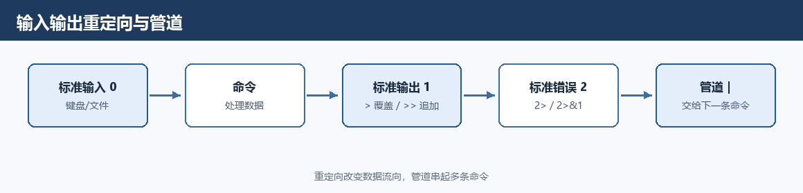

## 板块3 · 输入输出重定向与环境变量

单条命令能做的事有限，真正的效率来自把命令组合起来。这个板块讲三件让命令"连起来工作"的技术：重定向改变输入输出的方向，管道把一个命令的输出交给另一个命令，通配符与转义字符让批量操作成为可能。最后剖析命令执行的完整过程，引出环境变量——它决定了系统"去哪里找命令、把什么当作默认行为"，是从命令使用者迈向脚本编写者的分水岭。

### 3_1 技术背景与核心原理：让数据流按你的意愿流动

默认情况下，命令从键盘读取输入，把结果输出到屏幕，把错误信息也显示在屏幕。这三个通道分别对应标准输入（STDIN）、标准输出（STDOUT）和标准错误输出（STDERR）。重定向要做的，就是改变这三个通道的流向——把输出写进文件、从文件读取输入、把错误信息单独保存。

管道符解决的是另一类问题：把前一个命令的输出直接当作后一个命令的输入。有个动画式的比喻很贴切——管道符就像任意门，把这边的结果瞬间送到那边；也有人说它像烧烤摊的流水线：切肉、串肉、烤制，每一步的产物都是下一步的原料。命令组合之后，每一步只专注做一件事，复杂度被分解，效率却成倍提升。

```
三种数据流与重定向方向
   键盘(STDIN) ──< ── 命令 ──> ── 屏幕(STDOUT)
                       │
                       └──> ── 屏幕(STDERR)

   文件 ──< ── 命令 ──> ── 文件（输出重定向）
                       └──> ── 文件（错误重定向）
```

### 3_2 关键概念：重定向符号与管道符

重定向符号分两类：输出类与输入类，输出类又区分"覆盖"与"追加"，以及"正确输出"与"错误输出"。

| 符号 | 含义 |
| --- | --- |
| 命令 < 文件 | 把文件内容作为命令的标准输入 |
| 命令 > 文件 | 把标准输出覆盖写入文件 |
| 命令 >> 文件 | 把标准输出追加到文件末尾 |
| 命令 2> 文件 | 把标准错误覆盖写入文件 |
| 命令 2>> 文件 | 把标准错误追加到文件末尾 |
| 命令 &>> 文件 | 把标准输出与错误输出一起追加到文件 |

数字 1 代表标准输出、2 代表标准错误输出，这是理解符号写法的关键：`2>` 中的 2 指的就是错误通道，`&>>` 中的 & 表示"两者都算上"。覆盖与追加的区别很实际：覆盖会清空原文件，追加保留原内容——写日志必须用追加，否则历史会被抹掉。

管道符写作 `|`，作用是把左命令的标准输出作为右命令的标准输入。它可以多级串联，形成一条处理流水线。`tee` 命令是个有趣的补充：它在把数据送给下一条命令的同时，还能存一份到文件，相当于流水线上的分流阀。

| 组合写法 | 效果 |
| --- | --- |
| 命令A \| 命令B | A 的输出作为 B 的输入 |
| 命令A \| 命令B \| 命令C | 多级串联处理 |
| 命令A \| tee 文件 | 屏幕显示的同时保存到文件 |

一个典型例子：把帮助文档写入文件用 `man 命令 > 文件`，再用两次 echo 分别演示覆盖与追加的区别。把错误输出单独收集用 `命令 2> stderr.txt`，把正常与错误输出统一保存用 `命令 &>> result.txt`。统计受限登录账户数用 `grep nologin /etc/passwd | wc -l`，一条命令完成"过滤 + 计数"。

```
管道流水线示意
  命令A 的输出 ──|──► 命令B 处理 ──|──► 命令C 处理 ──► 最终结果
   产生数据         过滤/筛选         统计/格式化
                      │
                      └── tee ──► 存档文件（旁路保存）
```



**配置示例：重定向与管道的综合运用**

把三类数据流真正用起来：用 > 覆盖、>> 追加写日志，用 2> 单独收集错误、&>> 合并两类输出，再借管道把过滤与统计串成流水线，用 tee 在显示的同时存档。

```
# 把帮助文档写入文件（覆盖）
root@iaoexl:~# man ls > /tmp/ls_help.txt

# 追加写入日志，保留历史
root@iaoexl:~# echo "backup done" >> /tmp/ops.log
root@iaoexl:~# echo "second run" >> /tmp/ops.log

# 错误输出单独收集
root@iaoexl:~# ls /not-exist 2> /tmp/error.txt
root@iaoexl:~# cat /tmp/error.txt
ls: cannot access '/not-exist': No such file or directory

# 正确与错误输出一起追加
root@iaoexl:~# dnf install nginx &>> /tmp/install.log

# 管道的逐级处理：统计可登录账户
root@iaoexl:~# grep -v nologin /etc/passwd | wc -l
3

# tee 一边显示一边保存
root@iaoexl:~# dmesg | tee /tmp/boot.log | grep -i error
```

### 3_3 命令行的通配符

通配符让一条命令匹配一批文件，是批量操作的利器。

| 通配符 | 匹配规则 |
| --- | --- |
| `*` | 任意长度任意字符，含空 |
| `?` | 单个任意字符 |
| `[0-9]` | 一个数字字符 |
| `[abc]` | 括号内任一字符 |
| `[[:alpha:]]` | 任意一个字母 |

典型用法包括：用 `/dev/sda*` 匹配所有以 sda 开头的设备文件，用 `/dev/sda?` 匹配 sda 后跟单个字符的设备，用 `[0-9]` 或 `[135]` 匹配特定数字编号，用 `/etc/*.conf` 匹配所有配置文件。花括号 `{AA,BB,CC}` 也能展开成多个目标，常用于一次性创建多个文件。

通配符用错的典型后果是"删多了"或"没匹配到"。执行批量删除前，先用 `ls` 加同样的通配符预览匹配结果，确认无误再替换成 rm，是一个成本极低的安全习惯。

**配置示例：通配符与花括号展开**

用通配符让一条命令匹配一批文件：* 匹配任意长度、? 只匹配一个字符，方括号限定字符范围；花括号展开则不依赖文件是否存在，可直接批量生成目标名，删除前先用 ls 预览。

```
# * 匹配任意长度字符（含空）
root@iaoexl:~# ls -l /dev/sda*
brw-rw----. 1 root disk 8, 0 <时间> /dev/sda
brw-rw----. 1 root disk 8, 1 <时间> /dev/sda1
brw-rw----. 1 root disk 8, 2 <时间> /dev/sda2

# ? 只匹配单个字符
root@iaoexl:~# ls -l /dev/sda?
brw-rw----. 1 root disk 8, 1 <时间> /dev/sda1
brw-rw----. 1 root disk 8, 2 <时间> /dev/sda2

# [0-9] 匹配一个数字，[135] 匹配指定数字
root@iaoexl:~# ls -l /dev/sda[0-9]
brw-rw----. 1 root disk 8, 1 <时间> /dev/sda1
brw-rw----. 1 root disk 8, 2 <时间> /dev/sda2
brw-rw----. 1 root disk 8, 3 <时间> /dev/sda3
root@iaoexl:~# ls -l /dev/sda[135]
brw-rw----. 1 root disk 8, 1 <时间> /dev/sda1
brw-rw----. 1 root disk 8, 3 <时间> /dev/sda3

# *.conf 匹配所有配置文件
root@iaoexl:~# ls -l /etc/*.conf | head
-rw-r--r--. 1 root root <大小> <时间> /etc/asound.conf
-rw-r--r--. 1 root root <大小> <时间> /etc/brltty.conf
-rw-r--r--. 1 root root <大小> <时间> /etc/chrony.conf

# 花括号展开：一次创建多个文件，或一次生成多个字符串
root@iaoexl:~# touch {AA,BB,CC}.conf
root@iaoexl:~# ls -l *.conf
-rw-r--r--. 1 root root 0 <时间> AA.conf
-rw-r--r--. 1 root root 0 <时间> BB.conf
-rw-r--r--. 1 root root 0 <时间> CC.conf
root@iaoexl:~# echo file{1,2,3,4,5}
file1 file2 file3 file4 file5
```

`/dev/sda*` 与 `/dev/sda?` 的差别很好地说明了 `*`（任意长度）与 `?`（恰好一个字符）的区别：`*` 会连 `sda` 本身也匹配进来，`?` 只匹配 `sda1`、`sda2` 这类单字符结尾的设备。花括号 `{AA,BB,CC}` 与通配符不同——它不依赖文件是否存在，而是直接把参数展开成多个值，因此常用来批量创建文件。

### 3_4 常用的转义字符

当参数里包含空格、特殊符号或希望命令先执行再代入时，需要转义字符来改变 Shell 的解释方式。

| 转义符 | 作用 |
| --- | --- |
| 反斜杠 `\` | 让后面的单个字符失去特殊含义 |
| 单引号 `' '` | 其中所有字符都按原样，不做任何替换 |
| 双引号 `" "` | 保留空格，但变量与命令替换仍生效 |
| 反引号 `` ` ` `` | 执行其中命令并取其输出 |

一个非常实用的规则是：**参数中包含空格时加双引号**。这样原本会被当作两个参数的内容会被当成一个整体。单引号与双引号的区别可以用变量来验证：定义一个变量 PRICE，用双引号时变量会被展开成值，用单引号时则原样显示变量名。反引号则用于把命令结果嵌入另一条命令，例如把当前日期拼进文件名。

转义写错的常见现象是"参数被拆开"或"变量没有展开"，回到单双引号的差别上检查，通常就能定位。

**配置示例：反斜杠、单双引号与反引号的实际效果**

转义字符决定 Shell 如何解释参数：双引号内变量会展开而单引号原样保留，反斜杠让紧随其后的符号失去特殊含义，反引号先执行命令再代入结果；含空格的参数务必加引号。

```
# 双引号内的变量会被展开成值
root@iaoexl:~# PRICE=5
root@iaoexl:~# echo "Price is $PRICE"
Price is 5

# $$ 是当前进程号；反斜杠让紧跟其后的 $ 失去特殊含义
root@iaoexl:~# echo "Price is $$PRICE"
Price is <当前进程号>PRICE
root@iaoexl:~# echo "Price is \$$PRICE"
Price is $5

# 反引号先执行其中命令，再把输出嵌入当前命令
root@iaoexl:~# echo `uname -a`
Linux iaoexl.com <内核版本> ... x86_64 GNU/Linux

# 空格的处理：不加引号会被拆成多个参数，加双引号则作为一个整体
root@iaoexl:~# echo AA BB CC
AA BB CC
root@iaoexl:~# echo "AA BB CC"
AA BB CC
```

`echo "Price is $$PRICE"` 里的 `$$` 会先被 Shell 替换成当前进程号，紧接着 `PRICE` 作为普通文本输出，所以结果是"<进程号>PRICE"而不是变量值；加上反斜杠变成 `\$` 后，第一个 `$` 被转义成普通字符，第二个 `$PRICE` 才被展开，于是得到 `$5`。把变量放进双引号能展开、放进单引号则原样保留，这正是单双引号最关键的差别。反引号的作用与现代写法 `$(命令)` 类似，都是把命令输出嵌入另一条命令，常用于把当天日期拼进文件名。

### 3_5 重要的环境变量：剖析命令执行过程

理解一条命令从按下回车到执行完成的全过程，才能真正明白环境变量的意义。

```
命令执行的四个步骤
  「1」 判断命令是内部命令还是外部命令
    │
  「2」 外部命令 → 在 PATH 定义的路径中逐个查找可执行文件
    │
  「3」 找到后执行命令，参数与对象按规则解析
    │
  「4」 输出结果，返回执行状态（$? 为 0 表示成功）
```


第一步区分内部命令与外部命令，可用 `type` 查看：`type echo` 显示 echo 是内部命令，`type uptime` 显示它是外部文件。第二步是环境变量发挥作用的核心：PATH 变量保存了一串用冒号分隔的目录，Shell 按顺序在这些目录里找命令。如果把可执行文件放在 PATH 之外的目录，就必须写完整路径才能执行——这正是后面源码编译安装后要把路径加入 PATH 的原因。

常用环境变量及其作用如下。

| 变量 | 作用 |
| --- | --- |
| PATH | 定义命令搜索路径 |
| HOME | 当前用户家目录 |
| SHELL | 当前使用的 Shell |
| LANG | 语言与字符集 |
| PS1 | 命令提示符样式 |
| USER | 当前用户名 |

变量的操作有一组配套命令：用 `变量名=值` 创建变量，用 `export` 把变量导出为全局变量使子进程可用，用 `env` 查看所有环境变量，用 `unset` 取消变量。变量在不同用户下取值可能不同，用 HOME 就能验证——切换用户后 HOME 指向各自的家目录。

`alias` 是变量之外另一个改变命令行为的机制。有人给 rm 设置别名以避免误删，用 `unalias` 就能取消别名恢复原命令。理解别名有助于解释"为什么这条命令在我这里和别人那里表现不同"。

一个必须知道的特殊变量是 `$?`，它保存上一条命令的退出状态，值为 0 表示成功，非 0 表示失败。它是脚本中判断命令是否成功的依据，也是排错时的第一手线索。

**配置示例：查看 PATH、体验变量作用域与 export/unset**

解开变量作用域的疑问：用 type 区分内外命令、查看 PATH 搜索路径，切换用户对比 HOME，观察普通变量为何在子进程失效、export 后如何生效，最后用 unset 取消。

```
# type 区分内部命令与外部命令
root@iaoexl:~# type echo
echo is a shell builtin
root@iaoexl:~# type uptime
uptime is /usr/bin/uptime

# PATH 是一串冒号分隔的目录，可临时追加
root@iaoexl:~# echo $PATH
/root/.local/bin:/root/bin:/usr/local/bin:/usr/local/sbin:/usr/bin:/usr/sbin
root@iaoexl:~# PATH=$PATH:/root/bin
root@iaoexl:~# echo $PATH
/root/.local/bin:/root/bin:/usr/local/bin:/usr/local/sbin:/usr/bin:/usr/sbin:/root/bin

# HOME 随用户而变
root@iaoexl:~# echo $HOME
/root
root@iaoexl:~# su - iaoexl
iaoexl@iaoexl:~$ echo $HOME
/home/iaoexl
iaoexl@iaoexl:~$ exit

# 普通变量不及时 export，切换到子用户后就取不到值
root@iaoexl:~# mkdir /home/workdir
root@iaoexl:~# WORKDIR=/home/workdir
root@iaoexl:~# cd $WORKDIR
root@iaoexl:/home/workdir# pwd
/home/workdir
root@iaoexl:/home/workdir# su iaoexl
iaoexl@iaoexl:/home/workdir$ echo $WORKDIR

iaoexl@iaoexl:/home/workdir$ cd $WORKDIR
iaoexl@iaoexl:~$ pwd
/home/iaoexl
iaoexl@iaoexl:~$ exit

# export 导出为全局变量后，子用户也能使用
root@iaoexl:/home/workdir# cd ~
root@iaoexl:~# export WORKDIR
root@iaoexl:~# su iaoexl
iaoexl@iaoexl:/root$ cd $WORKDIR
iaoexl@iaoexl:/home/workdir$ pwd
/home/workdir
iaoexl@iaoexl:/home/workdir$ exit

# unset 取消变量
root@iaoexl:~# unset WORKDIR
root@iaoexl:~#
```

注意 `su - iaoexl` 与 `su iaoexl` 的差别：前者是登录式切换，会重新加载目标用户的环境，HOME 随之变成 `/home/iaoexl`；后者保留当前环境，连工作目录都不变，所以切换后仍停在 `/home/workdir`。但要区分"环境保留"和"变量可见"：未 `export` 的 `WORKDIR` 只存在于原来那个 shell 里，一旦进入子 shell 就彻底消失——`echo` 出来是空行，而 `cd $WORKDIR` 因为参数为空退化成不带参数的 `cd`，直接回到了用户家目录。这种"目录看着还在、变量一用就露馅"的现象，正是理解变量作用域的好例子。`export` 把变量交给子进程后，子用户才能稳定地拿到这个值；`unset` 则把它彻底取消。

### 3_6 场景笔记方法：把命令组合记成"数据流图"

组合命令比单条命令更难记，因为它涉及数据如何在命令间流动。建议用"数据流图"的方式做笔记：把每个命令画成一个节点，用箭头标注数据从哪来到哪去，再在旁边记录每一步的输出样例。

| 记录项 | 记录内容 | 示例 |
| --- | --- | --- |
| 目标 | 这条组合要解决什么 | 统计远程登录失败次数 |
| 数据流 | 命令A → 命令B → 命令C | grep → awk → sort → uniq |
| 关键参数 | 每步影响结果的开关 | -F 指定分隔符 |
| 输出样例 | 保留一段真实结果 | 便于下次对照 |

重定向类笔记要特别标注"覆盖还是追加"和"是否正确输出"，因为这两点写错会直接造成数据丢失或排查方向错误。变量类笔记要记录变量的生效范围——是当前会话临时有效，还是写入配置长期有效，这决定了换一个终端后是否还成立。

### 3_7 实用验证与排错：用可对照的小实验确认理解

下面这组实验覆盖了本板块的核心概念，每个都有明确的预期结果，便于自查。

```
验证任务链
  「1」 echo "first" > out.txt           → 文件内容为 first
  「2」 echo "second" >> out.txt         → 追加后有两行
  「3」 cat out.txt                      → 确认 first、second 各一行
  「4」 ls /不存在 2> err.txt            → 错误写入 err.txt，屏幕无显示
  「5」 grep nologin /etc/passwd | wc -l → 输出一个整数
  「6」 echo "${PATH}"                   → 显示一长串路径
  「7」 echo $?                          → 上条成功则为 0
```

常见现象与原因分析：

| 现象 | 原因 |
| --- | --- |
| 文件被清空 | 误用 `>` 而非 `>>` |
| 错误信息仍显示在屏幕 | 只重定向了标准输出，未处理错误通道 |
| 管道右侧无输入 | 左侧命令没有产生标准输出 |
| 命令找不到但文件确实存在 | 文件所在目录不在 PATH 中 |
| 换终端后变量失效 | 变量未导出或未写入配置文件 |

一条经验很有价值：怀疑数据没按预期流动时，在管道中间插入 `tee 文件`，把中间结果落盘看一眼。这是定位"到底哪一步丢了数据"最直接的办法。

### 3_8 认证对标与进阶实战

重定向、管道与环境变量贯穿所有认证体系，也是区分"会用命令"与"懂系统"的分水岭。LPIC-1 的 Shell 主题、LFCS 的命令行处理、RHCSA 的 shell 环境配置都会考到，CompTIA Linux+ 更是要求解释标准流与变量的作用域。掌握这一板块，等于掌握了把简单命令组合成解决方案的能力。

| 认证体系 | 与本主题相关的考查方向 | 核心能力要求 |
| --- | --- | --- |
| LPIC-1 | Shell 环境、文本流处理 | 用重定向与管道组合命令、设置环境变量 |
| LFCS | 命令行数据处理 | 区分标准输出与错误输出并分别重定向 |
| RHCSA | shell 环境、变量配置 | 配置 PATH 与用户级环境变量 |
| CompTIA Linux+ | 标准流、变量作用域 | 解释 0/1/2 文件描述符与子进程变量继承 |

一个常见的事故来自对 `>` 的误解。有人想把错误追加到日志，写成 `命令 > 日志 2>&1` 却本意是追加，结果 `>` 先把日志文件截断成空文件，原始日志荡然无存。正确的追加写法是 `>>`。这个案例说明：`>` 是覆盖、`>>` 是追加，两者一字之差，后果天壤之别；改动涉及日志和配置时，优先用追加，或先备份再操作。

流与变量相关的高频问题，集中在"写错地方"和"没生效"两类。

| 现象 | 根因 | 定位命令 | 处置 |
| --- | --- | --- | --- |
| 文件内容被清空 | 误用 `>` 覆盖 | 检查历史命令 | 改用 `>>` 并先备份 |
| 错误输出没被重定向 | 只写了 `>` 未写 `2>` | 分步观察输出 | 用 `2>&1` 合并或分别重定向 |
| 变量在脚本里为空 | 单引号阻止展开 | 检查引号类型 | 需展开时用双引号 |
| 自设变量在新 shell 失效 | 未 export 或写错配置文件 | export -p、echo $变量 | export 后写入 ~/.bashrc |

闯关任务围绕"组合命令解决真实问题"设计，全部要求一条命令完成。

```
  文本流闯关
  「1」 把命令的标准输出和错误输出一起写入文件
  「2」 统计日志中 ERROR 出现的次数并只输出数字
  「3」 把结果同时显示在屏幕和写入文件
  「4」 临时给 PATH 增加一个路径并验证命令可被找到
```

- 第「1」题：`命令 > 文件 2>&1`，注意 `2>&1` 必须写在重定向之后。
- 第「2」题：`grep -c` 直接给出计数，或 `grep | wc -l`。
- 第「3」题：管道接 `tee`，它能在数据流经时复制一份到文件。
- 第「4」题：`export PATH=$PATH:/新路径`，再用 `which` 验证。

进阶要理解文件描述符模型：任何进程启动时都会打开三个流——标准输入 0、标准输出 1、标准错误 2，它们默认连接终端。重定向的本质就是改变这些描述符的指向；`2>&1` 读作"把描述符 2 复制到描述符 1 当前所指之处"，顺序不可颠倒。再往深处，管道的 `|` 是把前一个进程的标准输出接到后一个进程的标准输入，而每一个管道段都在独立的子 shell 中运行——这解释了为什么在管道里给变量赋值，出了管道就读不到。把描述符模型画进笔记，重定向与管道的所有规则都能从这一张图推导出来。

### 3_9 要点回顾与能力自检

本板块把单条命令连成了工作流：重定向改变输入输出方向，区分覆盖与追加、正确与错误通道；管道把前一条命令的输出交给后一条，可多级串联；通配符与转义字符支持批量操作与特殊参数；环境变量尤其 PATH 决定了命令如何被查找与执行。

自检问题：

1. `>` 与 `>>` 有何区别？`2>` 中的 2 代表什么？
2. 管道符 `|` 起什么作用？`tee` 在流水线中有什么独特价值？
3. 参数中包含空格时应如何处理？单引号与双引号的关键区别是什么？
4. 简述命令执行的四个步骤，PATH 变量在哪一步发挥作用？
5. `$?` 的值为什么能反映命令执行是否成功？
