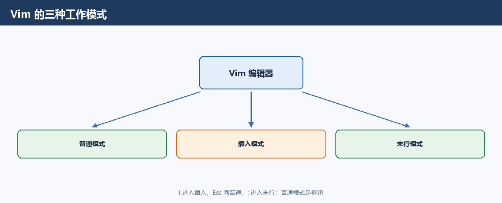

## 板块4 · Vim编辑器与Shell脚本编程

会敲命令之后，两个新能力决定你能不能"批量做事"和"改系统配置"：一是用编辑器修改配置文件，二是把一串命令写成脚本反复执行。这个板块把 Vim 的三种模式讲透，进一步拆解它的编辑语法——操作符加动作、文本对象、寄存器与宏，让批量修改不再靠手速；再用大量实例带你掌握脚本的变量、判断、循环与计划任务。学完这一板块，你就从"命令的使用者"变成了"自动化的编写者"。

### 4_1 技术背景与核心原理：从手敲到自动化的必然

图形界面的编辑器在远程服务器上常常不可用，而 Vim 几乎预装在每一台 Linux 上，且不依赖图形环境。它的设计哲学是"模式化编辑"——不同模式下同一个键含义不同，这既带来了极高的编辑效率，也让初学者在第一次打开时不知所措。理解"模式"是驾驭 Vim 的唯一钥匙。

脚本的价值则来自一个朴素的现实：同一件事做第三次时，人就该考虑把它自动化。有个幽默的调侃说，有人训练小猫半夜去按回车键执行定时任务——与其如此折磨，不如写一条 crontab。脚本把重复劳动固化下来，既能保证每次执行完全一致，又能在出错时只改一处。

还有一个值得记下的创作故事：有人发起过一个"Vim Clutch"实验，用汽车油门和刹车踏板分别控制进入编辑模式和保存文件，用脚开车、用踏板写代码。这个略显疯狂的实验从一个侧面说明，Vim 的模式切换在日常操作中多么频繁——频繁到有人想用脚来分担手指的工作。

### 4_2 关键概念：Vim 三种模式与切换

Vim 有三种核心模式，搞清它们的关系，Vim 就不再是黑洞。

| 模式 | 作用 | 如何进入 | 如何退出 |
| --- | --- | --- | --- |
| 命令模式 | 光标移动、删除、复制、粘贴 | 打开文件默认进入 | 输入 i/a/o 进入输入模式 |
| 输入模式 | 编辑文本内容 | 在命令模式按 i/a/o | 按 Esc 回到命令模式 |
| 末行模式 | 保存、退出、查找、替换、设置 | 在命令模式按 `:` | 执行完命令或按 Esc 返回 |

常用操作按模式归类记忆，效率最高。

| 用途 | 命令 |
| --- | --- |
| 进入输入 | i（光标前）、a（光标后）、o（下方新行） |
| 删除 | dd 删一行、5dd 删五行 |
| 复制粘贴 | yy 复制一行、5yy 复制五行、p 粘贴 |
| 撤销 | u |
| 查找 | `/字符串` 向下、`?字符串` 向上，n/N 切换 |
| 显示行号 | `:set nu`，取消 `:set nonu` |
| 保存退出 | `:w` 保存、`:q` 退出、`:wq!` 强制保存退出、`:q!` 强制退出不保存 |
| 替换 | `:s/旧/新` 替换当前行，`:%s/旧/新/g` 全文替换 |

一个新手最常掉进去的坑：打开文件后直接打字却什么也没写进去，因为此时在命令模式。记住"先按 i 再打字"，就跨过了第一道门槛。

```
Vim 三种模式切换关系
              ┌────────── 输入 i/a/o ──────────►
              │                                  │
        ┌─────▼──────┐                    ┌──────▼─────┐
        │  命令模式   │ ◄────── Esc ───────│  输入模式   │
        │ (默认进入)  │                    │ (编辑文本)  │
        └─────┬──────┘                    └────────────┘
              │
              │ 按 : 
              ▼
        ┌────────────┐
        │  末行模式   │  保存 :w  退出 :q  替换 :%s/旧/新/g
        └────────────┘
```



直接在 Vim 里改配置文件是最常见的用途。修改主机名要编辑 hostname 文件，配置网卡要编辑连接配置文件，配置软件仓库要新建 repo 文件并挂载光盘。每次改完都要用相应命令验证：改主机名用 hostname 查看，改网卡用 nmcli 与 ping 验证，配仓库用 dnf install 验证能否装上软件。这个"改完即验"的习惯，是配置工作的基本准则。

### 4_3 Vim 的编辑语法：操作符加动作

会用 `i`、`Esc`、`:wq` 只算"能编辑"，离"编辑得快"还差一层东西：Vim 把编辑动作拆成了**操作符**与**动作**两段，任何操作符都能与任何动作组合。掌握这套语法，编辑效率不是线性提升，而是组合式提升。

```
  操作符 + 动作/文本对象 = 一条完整命令
    d  c  y  >  <  g~
    │  │  │  │
    │  │  │  └── 缩进
    │  │  └───── 复制
    │  └──────── 改写（删除并进入插入模式）
    └─────────── 删除
               ×  w  iw  i"  a)  /pattern  G
```

举例说明组合的含义：`dw` 删除一个单词，`d2w` 删除两个单词，`di"` 删除引号内的内容，`da"` 连引号一起删，`dt,` 删到逗号之前，`yG` 复制到文件末尾，`>ap` 把整段缩进一级。记住 5 个操作符和 6 类动作，就有 30 种以上可用的编辑命令，而且不必逐个去背。

文本对象是这套语法的精髓：`i` 表示 inner（内容本身），`a` 表示 around（含包裹符号或周围空白）。

| 文本对象 | 选中范围 | 典型用法 |
| --- | --- | --- |
| `iw` / `aw` | 当前单词 / 含空格的单词 | `ciw` 改写变量名 |
| `i"` / `a"` | 引号内 / 含引号 | `ci"` 改写字符串内容 |
| `i(` / `a(` | 括号内 / 含括号 | `di(` 清空函数参数 |
| `i{` / `a{` | 大括号内 / 含大括号 | `>i{` 缩进代码块 |
| `ip` / `ap` | 当前段 / 含空行的段 | `dap` 删掉整段 |
| `it` / `at` | 标签内 / 含标签 | 改 HTML 标签内容 |

**配置示例：一次批量改动，演示查找、替换与宏**

配置文件的批量修改是运维里最常见的编辑任务。下面这组操作依次演示：用 `:%s` 全文替换、用 `:g` 按条件删行、用 `:normal` 对匹配行统一执行命令，最后用宏把重复动作录下来复用。

```
# 一、打开文件，把全文的 192.168.10.10 换成 192.168.10.20
root@iaoexl:~# vim /etc/hosts
:%s/192\.168\.10\.10/192.168.10.20/g

# 二、逐处确认的替换（c 表示 confirm），y 替换、n 跳过、a 全部
:%s/old/new/gc

# 三、删除所有空行与所有以 # 开头的注释行
:g/^\s*$/d
:g/^#/d

# 四、对所有匹配行追加行尾注释（:normal 把普通模式命令批量执行）
:g/^server/normal A   # 由模板生成

# 五、宏录制：qa 开始录制到寄存器 a，q 结束，@a 执行，10@a 执行十次
qa  A;<Esc>j  q
10@a

# 六、寄存器与系统剪贴板
:reg                 " 查看所有寄存器内容
"+yy                 " 复制当前行到系统剪贴板（需编译支持 +clipboard）
:echo has('clipboard')   " 返回 1 才可用

# 七、保存时没权限：借 sudo 写入
:w !sudo tee %
```

分屏与标签页解决"同时看两个文件"的需求，两者的取舍很清楚：分屏适合同一个任务里对照查看，标签页适合在多个独立任务之间切换。

| 意图 | 分屏 | 标签页 |
| --- | --- | --- |
| 新建 | `:sp 文件` / `:vsp 文件` | `:tabnew 文件` |
| 切换 | `Ctrl-w` 加 `h/j/k/l` | `gt` / `gT` |
| 关闭 | `Ctrl-w c` | `:tabc` |
| 适用 | 对照修改同一份逻辑 | 并行处理多份独立文件 |

还有几个日常救命命令：`vim -r 文件` 在异常退出后恢复交换文件里的内容；`vim -d 文件1 文件2` 进入差异对比模式；`:set paste` 关闭自动缩进，避免粘贴代码时层层右移；`:set ff` 与 `:set fenc` 查看换行格式与编码，`:w ++ff=unix` 把 Windows 换行转成 Unix 换行——脚本报 `bad interpreter: ^M` 时就是它。

编辑习惯上值得刻意练三条：行内移动用 `w`、`b`、`e` 而不是猛按 `h`、`l`；改错用插入模式的 `Ctrl-w` 删词；搜索后用 `:nohl` 清掉高亮。这三条每天用几十次，收益最直接。

### 4_4 编写 Shell 脚本：声明、注释与执行

Shell 脚本本质是文本，把要执行的命令按顺序写进去即可。标准结构包含三部分：脚本声明、注释信息、可执行语句。

| 组成部分 | 写法 | 作用 |
| --- | --- | --- |
| 脚本声明 | `#!/bin/bash` | 指定用哪个解释器执行 |
| 注释 | `# 说明文字` | 说明脚本用途，不懂可查 |
| 可执行语句 | 具体命令 | 真正要执行的动作 |

写好脚本后有两种执行方式：用 `bash 脚本名` 直接解释执行，或先 `chmod` 加执行权限再 `./脚本名` 运行。前者不需要执行权限，后者要求文件可执行。


**配置示例：一个带判断的备份脚本**

从零写一个实用备份脚本：用位置参数接收目标目录，if 判断目录是否存在后再决定打包或报错，命名带上当天日期便于归档；最后用 bash -x 逐句跟踪排查逻辑。

```
root@iaoexl:~# vim backup.sh
#!/bin/bash
# 备份指定目录，参数为目标路径
DIR=$1
if [ -d "$DIR" ]; then
  tar czf "/tmp/backup_$(date +%F).tar.gz" "$DIR"
  echo "备份成功：$DIR"
else
  echo "错误：目录 $DIR 不存在"
  exit 1
fi

root@iaoexl:~# chmod +x backup.sh
root@iaoexl:~# ./backup.sh /etc
备份成功：/etc

# 用 -x 参数逐句跟踪，排查脚本逻辑问题
root@iaoexl:~# bash -x backup.sh /etc
+ DIR=/etc
+ '[' -d /etc ']'
+ tar czf /tmp/backup_<当天日期>.tar.gz /etc
+ echo '备份成功：/etc'
```

脚本能接收参数，这让同一个脚本适配不同对象。位置参数的含义如下。

| 变量 | 含义 |
| --- | --- |
| `$0` | 脚本名称本身 |
| `$#` | 参数总个数 |
| `$*` | 所有参数的内容 |
| `$1`、`$2`… | 第 1、第 2 个参数 |
| `$?` | 上一条命令的退出状态 |

判断参数是脚本智能化的基础，常见测试语句有四类：文件测试（判断文件是否存在、是否为目录）、逻辑测试（与、或、非）、整数比较（等于、大于、小于）、字符串比较（相等、为空）。这些判断是后面流程控制的条件来源。

**配置示例：用位置参数让脚本适配不同对象**

让同一个脚本服务不同对象：脚本运行时把参数跟在名称后面，无需改动内容；$0 固定是脚本名，$# 统计个数，$* 汇总全部参数，$1、$2 则按位置依次取值。

```
root@iaoexl:~# vim Example.sh
#!/bin/bash
echo "当前脚本名称为$0"
echo "总共有$#个参数，分别是$*。"
echo "第1个参数为$1，第5个为$5。"

root@iaoexl:~# bash Example.sh one two three four five six
当前脚本名称为Example.sh
总共有6个参数，分别是one two three four five six。
第1个参数为one，第5个为five。
```

`$0` 固定是脚本名本身，`$#` 是参数个数，`$*` 把所有参数连成一个字符串，`$1`、`$2`……依次是各个位置参数。脚本运行时把参数跟在脚本名后面即可，无需修改脚本内容——这是让同一个脚本服务不同对象的关键。

### 4_5 流程控制语句：让脚本会"思考"

流程控制赋予脚本判断与循环能力，是用脚本解决复杂问题的核心。

| 语句 | 结构 | 适用场景 |
| --- | --- | --- |
| if | 单分支、双分支、多分支 | 按条件选择不同动作 |
| for | 从列表逐项取值 | 批量处理已知集合 |
| while | 条件为真时反复执行 | 次数不确定、靠条件退出 |
| case | 匹配取值范围 | 多值分支判断 |

if 语句的实例很直观：检测一台主机是否在线，在线提示成功、不在线提示失败，这是单分支；判断一个分数属于优秀、良好还是及格，用多分支。for 语句的典型用途是批量创建用户、批量检测一组主机，把重复操作写一次循环搞定。while 语句可以用猜价格游戏来练手：反复读取输入、与答案比较，猜中后用 exit 结束循环。case 语句适合判断用户输入是字母、数字还是其他字符，然后给出不同回应。

流程控制的必要性有个生活化比喻：追求心仪对象时，如果聊几句发现不合适就终止后续计划，而不是一条道走到黑——脚本也需要根据条件随时改变执行路径，而不是顺序执行到底。

```
流程控制结构对比
  if（判断）        for（遍历）         while（循环）       case（匹配）
   条件成立?        取下一个值          条件成立?          匹配哪个分支?
    /    \             │                 /    \            /  |  \
  是      否        处理该值            是      否        分支1 分支2 默认
 执行A   执行B          │              执行并回到判断     执行   执行   执行
                     直到取完
```

**配置示例：for 循环读取名单创建用户**

把重复的用户创建交给 for 循环：名单文件一行一个账号，先用 id 判断是否已存在，存在则跳过、否则创建并设密码；名单按行追加即可扩展到多台机器或多批账号，循环让批量操作只写一次逻辑。

```
root@iaoexl:~# vim users.txt
iaoexl

root@iaoexl:~# vim addusers.sh
#!/bin/bash
read -p "Enter The Users Password : " PASSWD
for UNAME in `cat users.txt`
do
        id $UNAME &> /dev/null
        if [ $? -eq 0 ]
        then
                echo "$UNAME , Already exists"
        else
                useradd $UNAME
                echo "$PASSWD" | passwd --stdin $UNAME &> /dev/null
                echo "$UNAME , Create success"
        fi
done

root@iaoexl:~# bash addusers.sh
Enter The Users Password :
iaoexl , Create success

root@iaoexl:~# tail -1 /etc/passwd
iaoexl:x:1001:1001::/home/iaoexl:/bin/bash
```

这个脚本把"从列表逐项取值"和"判断"结合起来：先读取名单，再由 for 依次把每个名字交给 `UNAME`；`id` 检查用户是否已存在——`$?` 为 0 表示存在，跳过创建；否则用 `useradd` 建账户并通过管道设置密码。`&> /dev/null` 把不需要的输出丢弃，让执行结果清爽可读。

**配置示例：for 循环批量检测主机在线状态**

用 for 循环替代手工逐台 ping：把待测地址写进文件由命令替换读出，循环中用 ping 快速探测三个包，再依据 $? 判断在线与否，这是批量巡检的通用套路。

```
root@iaoexl:~# vim ipaddrs.txt
192.168.10.10
192.168.10.11
192.168.10.12

root@iaoexl:~# vim CheckHosts.sh
#!/bin/bash
HLIST=$(cat ~/ipaddrs.txt)
for IP in $HLIST
do
        ping -c 3 -i 0.2 -W 3 $IP &> /dev/null
        if [ $? -eq 0 ]
        then
                echo "Host $IP is On-line."
        else
                echo "Host $IP is Off-line."
        fi
done

root@iaoexl:~# bash CheckHosts.sh
Host 192.168.10.10 is On-line.
Host 192.168.10.11 is Off-line.
Host 192.168.10.12 is Off-line.
```

`$(cat ~/ipaddrs.txt)` 与反引号一样属于命令替换，它把文件内容取出来赋给变量 `HLIST`。for 循环逐个取出地址，用 `ping -c 3 -i 0.2 -W 3` 快速探测：发 3 个包、间隔 0.2 秒、超时 3 秒，再依据 `$?` 判断在线与否。把待测主机写进文件、用循环代替手工逐条 ping，是批量巡检的通用套路。

**配置示例：while 循环实现猜价格游戏**

用猜价格游戏演示 while 的无限循环：先由 $RANDOM 取随机数作答案，每轮读取输入并计数，按大小给出提示，猜中后用 exit 跳出——次数不定的场景正适合 while。

```
root@iaoexl:~# vim Guess.sh
#!/bin/bash
PRICE=$(expr $RANDOM % 1000)
TIMES=0
echo "商品实际价格为0-999之间，猜猜看是多少？"
while true
do
        read -p "请输入猜测的价格数目：" INT
        let TIMES++
        if [ $INT -eq $PRICE ] ; then
                echo "恭喜您答对了，实际价格是 $PRICE"
                echo "总共猜测了 $TIMES 次"
                exit
        elif [ $INT -gt $PRICE ] ; then
                echo "太高了！"
        else
                echo "太低了！"
        fi
done

root@iaoexl:~# bash Guess.sh
商品实际价格为0-999之间，猜猜看是多少？
请输入猜测的价格数目：500
太低了！
请输入猜测的价格数目：800
太高了！
请输入猜测的价格数目：700
太高了！
请输入猜测的价格数目：650
恭喜您答对了，实际价格是 <随机数>
总共猜测了 4 次
```

`$RANDOM` 是系统提供的随机整数，配合 `expr ... % 1000` 得到 0 到 999 之间的价格；`let TIMES++` 每循环一次给计数器加一。`while true` 构成无限循环，靠猜中后的 `exit` 跳出——这正是"次数不确定、靠条件退出"场景的典型写法，`for` 循环不适合这种结构。

**配置示例：case 多分支判断输入类型**

用 case 按输入类型分流：把变量与各分支模式逐一比较，字母、数字分别命中，*) 兜底其余情况；分支以双分号结束、整体用 esac 收尾，分支多时比多层 if 清晰。

```
root@iaoexl:~# vim Checkkeys.sh
#!/bin/bash
read -p "请输入一个字符，并按Enter键确认：" KEY
case "$KEY" in
        [a-z]|[A-Z])
                echo "您输入的是 字母。"
                ;;
        [0-9])
                echo "您输入的是 数字。"
                ;;
        *)
                echo "您输入的是 空格、功能键或其他控制字符。"
esac

root@iaoexl:~# bash Checkkeys.sh
请输入一个字符，并按Enter键确认：6
您输入的是 数字。
root@iaoexl:~# bash Checkkeys.sh
请输入一个字符，并按Enter键确认：p
您输入的是 字母。
root@iaoexl:~# bash Checkkeys.sh
请输入一个字符，并按Enter键确认：<功能键>
您输入的是 空格、功能键或其他控制字符。
```

`case` 会把变量的值依次与各分支的模式比较：`[a-z]|[A-Z]` 用竖线表示"或者"，匹配任意字母；`[0-9]` 匹配数字；最后的 `*)` 是兜底分支，匹配前面都没命中的情况。每个分支以两个分号 `;;` 结束，整个结构用 `esac` 收尾。分支多于两三个时，case 比多层 if 更清晰。

### 4_6 计划任务服务：让系统在指定时间自动做事

计划任务分两类：一次性任务与长期周期性任务。

| 类型 | 工具 | 用途 |
| --- | --- | --- |
| 一次性 | at | 在某个时间点执行一次 |
| 周期性 | crond / crontab | 按固定周期反复执行 |

at 的用法是"时间 + 回车 + 命令"，例如设定在某个时间重启某个服务，或两分钟后执行一条任务。它适合临时安排的一次性工作。

crontab 的周期性配置用五个时间字段加一条命令，字段含义如下。

| 字段 | 含义 | 取值 |
| --- | --- | --- |
| 第 1 位 | 分钟 | 0–59 |
| 第 2 位 | 小时 | 0–23 |
| 第 3 位 | 日 | 1–31 |
| 第 4 位 | 月 | 1–12 |
| 第 5 位 | 周 | 0–7 |
| 命令 | 要执行的任务 | 完整命令路径 |

实用例子包括：每周一、三、五备份网站目录，工作日凌晨清空临时目录。配置时要注意用绝对路径写命令，因为计划任务执行时的环境变量与登录会话不同，相对路径或依赖 PATH 的写法可能失败。

**配置示例：用 at 安排一次性任务**

用 at 安排只执行一次的任务：可写绝对时间或 now +2 MINUTE 这样的相对时间，输入命令后按 Ctrl+D 提交；at -l 查看排队编号，atrm 按编号删除任务。

```
# 指定时间执行：输入命令后按 Ctrl+D 结束
root@iaoexl:~# at 23:30
warning: commands will be executed using /bin/sh
at> systemctl restart httpd
at> <Ctrl>+<d>
job 1 at <当天 23:30:00>

# 查看待执行任务
root@iaoexl:~# at -l
1       <当天 23:30:00> a root

# 通过管道提交，无须进入交互模式
root@iaoexl:~# echo "systemctl restart httpd" | at 23:30
warning: commands will be executed using /bin/sh
job 2 at <当天 23:30:00>
root@iaoexl:~# at -l
1       <当天 23:30:00> a root
2       <当天 23:30:00> a root

# 删除指定编号的任务
root@iaoexl:~# atrm 2
root@iaoexl:~# at -l
1       <当天 23:30:00> a root

# 相对时间：两分钟后执行
root@iaoexl:~# at now +2 MINUTE
warning: commands will be executed using /bin/sh
at> systemctl restart httpd
at> <Ctrl>+<d>
job 3 at <两分钟后时间>
```

`at` 接受"时:分"这样的绝对时间，也接受 `now +2 MINUTE` 这样的相对时间；输入完命令要按 `Ctrl+D` 提交，`at -l` 列出排队中的任务，任务前面的编号是 `atrm` 删除时要用的标识。提示 "commands will be executed using /bin/sh" 说明任务由 sh 解释执行，因此命令里最好不要依赖 bash 专有语法。

**配置示例：用 crontab -e 配置周期性计划任务**

用 crontab 配置周期性任务：五字段依次是分、时、日、月、周，用 whereis 确认命令的绝对路径再写入，避免 cron 环境找不到命令；crontab -r 会清空任务但自动留备份。

```
# 编辑当前用户的计划任务，加入每周一三五的备份
root@iaoexl:~# crontab -e
root@iaoexl:~# crontab -l
25 3 * * 1,3,5 /usr/bin/tar -czvf backup.tar.gz /home/wwwroot

# 先用 whereis 确认命令的绝对路径，再追加工作日清理任务
root@iaoexl:~# whereis rm
rm: /usr/bin/rm /usr/share/man/man1/rm.1.gz
root@iaoexl:~# crontab -e
root@iaoexl:~# crontab -l
25 3 * * 1,3,5 /usr/bin/tar -czvf backup.tar.gz /home/wwwroot
0  1 * * 1-5   /usr/bin/rm -rf /tmp/*

# 清空计划任务：-r 直接删除，不提示、不确认
root@iaoexl:~# crontab -l > /root/crontab.bak    # 删之前自己先留一份
root@iaoexl:~# crontab -r
root@iaoexl:~# crontab -l
no crontab for root

# 想让它先问一句，加 -i（interactive）
root@iaoexl:~# crontab -r -i
crontab: really delete root's crontab? (y/n) n
```

五字段从左到右依次是分、时、日、月、周：`25 3 * * 1,3,5` 表示每月每周一、三、五的 3 点 25 分；`0 1 * * 1-5` 表示工作日凌晨 1 点整。逗号表示离散取值，短横线表示连续区间，星号表示"任意"。写命令时一律用 `/usr/bin/tar`、`/usr/bin/rm` 这样的绝对路径，是因为计划任务的执行环境几乎不加载登录会话的 PATH；写相对路径或裸命令名，往往在终端里手动执行正常、放到 cron 里却失败。

关于 `crontab -r` 有一个流传很广的误解：它**不会**自动备份。`-r` 与 `-e` 在键盘上相邻，误按一次，任务全部消失且没有回收站。较新的 cronie（1.7.0 起，Fedora、RHEL 10、Arch 等）确实会在修改或删除时把上一版存到 `~/.cache/crontab/crontab.bak`，但 RHEL 9 与 Debian 的 cron 都没有这个行为——在这两个系统上，`-r` 之后只能靠日志里的 `CMD (...)` 记录反推曾经跑过什么。

所以稳妥的做法只有两条：删之前先 `crontab -l > 文件` 存一份，或者习惯性加 `-i`（`crontab -r -i`）让它在动手前问一句。真要长期管理，就把 crontab 内容纳入版本控制，部署时用 `crontab 文件` 整体安装——`crontab 文件名` 会先做语法检查再替换，比手工编辑可控得多。

`cron.allow` 与 `cron.deny` 决定谁能使用 crontab：存在 `cron.allow` 时只有名单内的用户可用，只存在 `cron.deny` 时名单内的用户被禁，两个文件都不存在时仅 root 可用。多数发行版默认放一个空的 `/etc/cron.deny`，效果等于人人可用；要收紧就把需要的人写进 `cron.allow`。

**cron 本身不解决的两件事**

cron 有两个先天限制，靠写法绕不过去，必须换机制或加壳。

第一件是**错过不补**。cron 只在守护进程运行时逐分钟比对时间表，若到点时机器关着、或正好在重启，这一次就永久跳过了，恢复后不会补跑。对清理临时文件这类任务无所谓，对备份、账单对账这类任务就是数据缺口。

第二件是**并发重入**。上一次任务还没跑完，下一次已经到点，cron 会毫不客气地再起一份，两份同时写同一个目标文件，轻则日志交错，重则备份包损坏。cron 没有内置的互斥，只能自己在脚本里加锁：

```
# 用 flock 给任务加一把非阻塞锁：拿不到锁说明上一轮还在跑，直接退出
25 3 * * 1,3,5 /usr/bin/flock -n /var/lock/backup.lock /usr/local/bin/backup.sh
```

`-n` 是关键，缺了它会排队等待，任务照样堆起来，只是堆在锁上。

**systemd timer：把任务交给服务管理器调度**

systemd 提供的定时器单元能同时解决上面两个问题，代价是要写两个单元文件：一个 `.service` 描述"做什么"，一个 `.timer` 描述"什么时候做"。

| 对比项 | crontab | systemd timer |
| --- | --- | --- |
| 错过是否补跑 | 不补（需 anacron 辅助） | `Persistent=true` 开机补跑一次 |
| 日志去向 | 邮件或自行重定向到文件 | 自动进 journal，`journalctl -u` 可查 |
| 并发控制 | 需自行加 flock | 同一服务不会并发启动 |
| 依赖顺序 | 无 | `After=network-online.target` 等 |
| 表达"每隔 N 小时" | 需凑字段 | `OnUnitActiveSec=6h` 直接表达 |
| 资源限制 | 无 | `MemoryMax=`、`CPUQuota=` |

```
# 一、服务单元：只描述执行什么，不写时间
root@iaoexl:~# vim /etc/systemd/system/backup.service
[Unit]
Description=Nightly backup of web root
After=network-online.target

[Service]
Type=oneshot
ExecStart=/usr/local/bin/backup.sh
Nice=10

# 二、定时器单元：只描述什么时候触发，并声明触发哪个服务
root@iaoexl:~# vim /etc/systemd/system/backup.timer
[Unit]
Description=Run backup nightly at 03:25

[Timer]
OnCalendar=*-*-* 03:25:00
Persistent=true

[Install]
WantedBy=timers.target

# 三、校验时间表达式，再启用
root@iaoexl:~# systemd-analyze calendar "*-*-* 03:25:00"
  Original form: *-*-* 03:25:00
Normalized form: *-*-* 03:25:00
    Next elapse: <下一次触发时间>
root@iaoexl:~# systemctl daemon-reload
root@iaoexl:~# systemctl enable --now backup.timer

# 四、确认定时器已排期，并手工触发一次验证脚本本身
root@iaoexl:~# systemctl list-timers backup.timer
root@iaoexl:~# systemctl start backup.service
root@iaoexl:~# journalctl -u backup.service -n 20
```

`OnCalendar` 的写法比 cron 五字段更接近自然语言：`*-*-* 03:25:00` 是每天 3 点 25 分，`Mon *-*-* 03:00:00` 是每周一 3 点，`*:0/15` 是每 15 分钟。它容易写错却不会报错——写错的时间表达式只表现为"永不触发"，所以上线前一定用 `systemd-analyze calendar` 打印出下一次触发时间核对。

四个容易踩的点：

- 只 `enable` 了 `.timer` 却没写 `[Install]` 段，`list-timers` 里看不到它，任务永远不跑。
- 改了单元文件忘记 `systemctl daemon-reload`，systemd 仍用内存里的旧定义。
- 服务里用了相对路径。定时器启动的服务工作目录是 `/`，不是脚本所在目录，脚本内的相对路径会全部失效，需要显式写 `WorkingDirectory=`。
- `Persistent=true` 对备份是好事，对"必须准点执行才有意义"的任务（如整点对账）反而是坏事——开机晚了它也会立刻补跑一次。

**三者的分工**

一次性任务用 `at`；需要跨发行版兼容、或团队只熟悉 cron 的场合用 crontab；对可靠性、日志、依赖顺序有要求的周期任务，用 systemd timer。同一个任务不要同时挂在 cron 和 timer 上，否则会出现"两份备份、两倍 IO"，出问题时也说不清是哪套调度在跑。

### 4_7 场景笔记方法：把脚本记成"意图—结构—验证"三段式

脚本比单条命令复杂，笔记要能在日后快速看懂当时写了什么。建议为每个脚本记录三件事：解决什么问题、用了哪些结构与变量、如何验证成功。

| 记录项 | 记录内容 | 示例 |
| --- | --- | --- |
| 脚本意图 | 一句话说明用途 | 批量检测主机在线状态 |
| 关键结构 | 用到的判断/循环与位置参数 | for 遍历 $*，if 判断 ping 结果 |
| 执行方式 | 加权限还是 bash 执行 | chmod +x 后 ./chkhost.sh |
| 验证结果 | 一段真实输出 | 显示各主机 up/down |

Vim 的快捷命令适合做成一张"按键速查卡"单独记录，尤其是保存退出、删除复制、查找替换这几组高频操作。模式切换关系建议画成简图贴在笔记里，因为这是理解 Vim 的关键，也是最容易遗忘的部分。

计划任务的笔记要记清"时间字段 + 命令"的对应关系，并注明命令是否用了绝对路径。踩过的坑——例如相对路径导致任务不执行——要单独标红记录。

### 4_8 实用验证与排错：脚本跑不通怎么办

脚本出错时，按"语法—权限—路径—逻辑"的顺序排查，命中率最高。

```
脚本排错流程
  语法检查 ──► 权限检查 ──► 路径检查 ──► 逻辑检查
  bash -n     是否有执行权限   命令用绝对路径？  条件判断是否写反？
```

bash -n 可以在不执行的情况下检查脚本语法，是第一步。`$?` 的值能告诉你上一条命令是否成功，配合 echo 输出关键变量能快速定位逻辑错误。Vim 编辑后如果保存失败，多半是权限问题，用 `:wq!` 强制保存或用管理员身份编辑。

| 现象 | 排查方向 |
| --- | --- |
| 脚本无反应 | 是否用 bash 执行或加了执行权限 |
| command not found | 命令路径或脚本内拼写 |
| 计划任务不执行 | 命令是否用绝对路径、服务是否运行 |
| 判断永远为真/假 | 测试语句的括号与空格是否规范 |
| Vim 打字没反应 | 是否在命令模式，按 i 进入输入模式 |

一个非常实用的调试技巧：在脚本关键位置插入 echo 输出变量值和执行状态，相当于给脚本装上"仪表盘"，能直观看到程序走到哪一步、变量变成了什么。

### 4_9 认证对标与进阶实战

脚本编写是认证体系从"操作者"迈向"自动化者"的门槛。LPIC-1 的 102 考试把 Shell 脚本、定时任务列为独立主题，LFCS 与 RHCSA 都要求能编写简单脚本完成批量任务，CompTIA Linux+ 也会考查条件判断与循环。Vim 虽不直接出现在考点清单里，却是认证实操和日常运维中编辑配置的必备工具。

| 认证体系 | 与本主题相关的考查方向 | 核心能力要求 |
| --- | --- | --- |
| LPIC-1（102） | Shell 脚本、定时任务 | 编写带条件与循环的脚本、配置 cron |
| LFCS | 脚本基础、文本编辑 | 用脚本批量处理文件、用 Vim 编辑配置 |
| RHCSA（EX200） | 编写简单 Shell 脚本：条件执行、循环、脚本参数、处理命令输出 | 写一个带参数校验与日志输出的脚本，读得懂既有脚本 |
| RHCSA（EX200） | 部署、配置与维护系统：at、cron 与 systemd timer 三种调度 | 按场景选调度方式，写出 `.service` + `.timer` 并用 `list-timers` 验证 |
| CompTIA Linux+ | 脚本逻辑、任务调度 | 解释变量、判断与循环的执行流程 |

有个新手常踩的坑很有代表性：写了个清理脚本，本想删除 `/data/tmp` 下的旧文件，变量 `DIR` 恰好某次为空，脚本变成 `rm -rf /$DIR`，虽然没删根目录，却把 `/tmp` 清空了。原因就是变量未加双引号、且没有对空值做判断。从此他给脚本立了三条规矩：变量引用一律加双引号、删除前打印目标路径、关键操作前判断变量非空。脚本的破坏力往往在变量失控时爆发。

脚本调试的高频问题集中在变量、路径与执行权限三处。

| 现象 | 根因 | 定位命令 | 处置 |
| --- | --- | --- | --- |
| 执行报 Permission denied | 脚本没有执行权限 | ls -l | chmod +x 或用 bash 执行 |
| 变量未按预期展开 | 引号使用不当或赋值有空格 | bash -x 跟踪 | 加双引号、正确赋值 |
| crontab 里脚本不执行 | 环境变量与 PATH 不同、命令未写绝对路径 | 查看邮件日志 | 用绝对路径、显式设 PATH |
| 判断总是走错分支 | 数值与字符串比较符混用 | 加日志打印变量值 | 数值用 -eq、字符串用 = |

闯关任务按"编辑—脚本—调度"三级递进，每关都要求可运行结果。

```
  脚本能力闯关
  第1关 用 Vim 批量给多行配置行首加注释
    │
  第2关 写脚本统计目录中文件数，超过阈值则告警
    │
  第3关 让脚本每天固定时间自动运行并记录日志
```

- 第1关：用 Vim 的可视块模式或直接 `:s/^/#/` 替换命令完成。
- 第2关：`find | wc -l` 取数量，用 `if` 判断，注意数值比较符。
- 第3关：`crontab -e` 配置五个时间字段，命令写绝对路径，输出重定向到日志。

进阶要理解脚本执行的两条路径与 shebang 的作用。直接执行 `./script.sh` 时，内核读取首行 `#!/bin/bash`，据此启动指定的解释器来解释脚本；而用 `bash script.sh` 执行时，shebang 被当作注释忽略，解释器由命令行指定。两者的差异会影响环境变量与行为，写脚本时首行 shebang 不可省略。再进一步，脚本中定义的变量默认只在当前 shell 生效，用 `source` 执行才会在当前 shell 中保留变量——这正是"改了配置想立即生效要 source"的原因。把这三种执行方式的区别记进笔记，能解释大量"脚本单独跑正常、放到 cron 就出错"的问题。

### 4_10 要点回顾与能力自检

本板块完成了从命令到自动化的跨越：Vim 的命令、输入、末行三模式是改配置的基础；脚本由声明、注释、可执行语句构成，能接收位置参数；if、for、while、case 提供判断与循环；at 处理一次性任务，crontab 与 systemd timer 分别代表两代周期性调度方案——前者简单通用，后者在错过补跑、并发控制、日志归集上更可靠。

自检问题：

1. Vim 有哪三种模式？如何在它们之间切换？
2. 脚本中的 `$0`、`$#`、`$1`、`$?` 各代表什么？
3. if、for、while、case 各自适合什么场景？
4. crontab 的五个时间字段分别代表什么？为什么命令要写绝对路径？
5. 机器在计划时间点处于关机状态时，cron 与 systemd timer 分别会怎样？要让备份"开机后补跑一次"，该改哪个参数？
6. cron 任务重叠执行会造成什么后果？两种调度器各自怎么防？
7. `crontab -r` 之后还能找回任务吗？在动手之前应该先做什么？
8. 脚本跑不通时，应按什么顺序排查？
