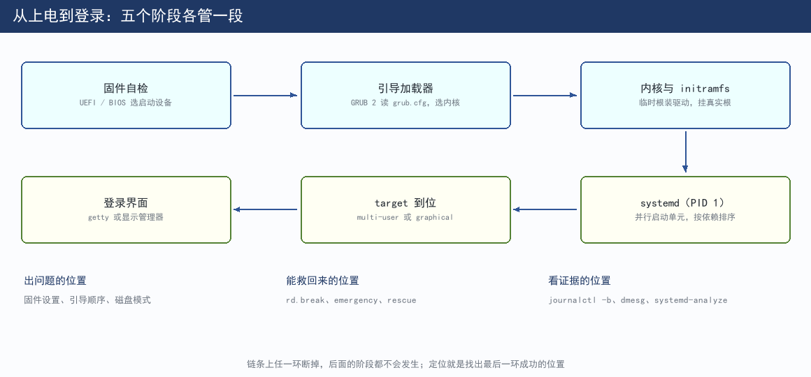
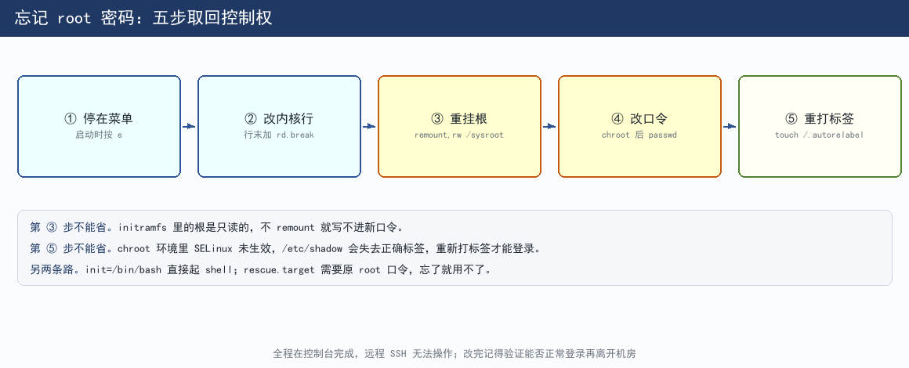

## 板块5 · 系统启动、运行目标与故障恢复

服务器交付之后，真正考验人的时刻往往不是装服务，而是它某天起不来了。启动这件事，从按下电源到出现登录提示符，中间要经过固件、引导加载器、内核、临时根文件系统、初始化系统五道关口，任何一道断掉，表现可能都只是"屏幕黑了"或"卡在某个画面"。会看这条链的人，能在几分钟内判断断点在哪一环；不会看的人，只能重装。这个板块把启动链逐段拆开，讲清运行目标如何决定"启动到什么程度"，再把三种取回控制权的手段——改内核参数、进救援目标、从安装介质 chroot——练成可以闭眼操作的步骤。

### 5_1 技术背景与核心原理：启动是一条链，不是一个开关

早期的机器启动很朴素：固件跳到一个固定地址，那里放着一段引导代码，引导代码把操作系统读进内存就完事。随着磁盘变大、内核变复杂、根文件系统可能位于 LVM、RAID 甚至加密卷上，"谁来加载内核"和"内核怎么找到自己的根"变成了两个必须分开解决的问题。于是形成了今天的五段结构：固件负责找到引导加载器，引导加载器负责加载内核与临时根，内核负责初始化硬件并切换根，初始化系统负责按依赖拉起服务，最后交给登录程序。



这条链有个重要特性：**只向前，不回退**。前一段失败，后一段根本不会被执行，所以现象往往"卡"在某一帧。反过来说，现象本身就在指示断点位置——能进 GRUB 菜单说明固件和引导加载器都在，卡在 `Reached target Basic System` 之后说明内核已接管，问题在服务层。定位的第一动作不是猜，而是确认"最后一环成功的位置"。

另一条设计线索是**可干预性**。启动过程刻意留了多个可以插手的缝隙：GRUB 菜单可以按 `e` 改内核参数，内核参数可以让 systemd 停在某个目标，`rd.break` 可以在切换到真实根之前打断。这些缝隙本来是给排错用的，也意味着物理接触机器的人可以绕过所有口令——这正是机房要上锁、GRUB 要设密码的原因。

### 5_2 关键概念：五个角色各管一段

| 角色 | 具体组件 | 职责 | 出错时的典型表现 |
| --- | --- | --- | --- |
| 固件 | UEFI 或 BIOS | 自检硬件，按启动顺序找到引导设备 | 找不到磁盘、直接进固件设置界面、报 no bootable device |
| 引导加载器 | GRUB 2 | 读配置、显示菜单、加载内核与 initramfs | 停在 `grub>` 提示符、菜单里没有可用条目 |
| 内核 | vmlinuz | 初始化硬件、挂载 initramfs 为临时根 | 卡住无输出、kernel panic、报找不到根设备 |
| 临时根 | initramfs | 装载真实根所需的驱动（存储、RAID、LVM、加密） | 报 `dracut-initqueue timeout`、找不到 /dev/mapper 下的卷 |
| 初始化系统 | systemd | 以 PID 1 身份按依赖并行启动单元 | 停在某个 target、进入 emergency 模式 |

固件这一层最容易被忽略，却最容易出错。UEFI 与 BIOS 的差别不只是新旧：UEFI 从 FAT 格式的 EFI 系统分区加载 `.efi` 文件，BIOS 从磁盘第一个扇区读引导代码。同一块盘按不同模式安装，结果互不兼容——把 UEFI 装的系统塞进只开 Legacy 的机器，现象就是"硬盘里有系统但起不来"。虚拟机上则表现为"装完重启又回到安装界面"，因为光驱优先级高于硬盘。

GRUB 2 的配置在红帽系上有两层。第一层是 `/boot/grub2/grub.cfg`，由工具生成，不要手改；第二层是启动条目，红帽系采用 BLS（Boot Loader Specification）规范，每个内核对应 `/boot/loader/entries/` 下的一个 `.conf` 文件，记录内核路径、initramfs 路径和内核命令行。这意味着改内核参数的正确入口是 `grubby`（直接改条目），改菜单超时这类全局行为才回到 `/etc/default/grub` 重新生成。

```
红帽系的 GRUB 配置分层

  /etc/default/grub            全局默认值：超时、默认命令行
        │  grub2-mkconfig -o /boot/grub2/grub.cfg
        ▼
  /boot/grub2/grub.cfg         由 blscfg 指令汇总条目，不手改
        │  读取
        ▼
  /boot/loader/entries/*.conf  每个内核一个条目 ← grubby 直接改这里
        │
        ▼
  vmlinuz-<版本> + initramfs-<版本>.img
```

`initramfs` 常被误解为"一个小型的救援系统"。它的准确角色是**过渡用的根文件系统**：内核自己不会读 LVM、不会组 RAID、不会解 LUKS，这些能力都以模块形式存在，而模块又存放在根文件系统上——先有鸡还是先有蛋。initramfs 把必要的模块和工具打包成一个压缩镜像，内核先挂它当根，由它装载驱动、激活卷组、解开加密盘，最后 `switch_root` 到真实根。所以换了存储控制器、加了 RAID 卡，必须重建 initramfs，否则新内核起来后找不到根。

### 5_3 运行目标：systemd 对运行级别的重命名

传统 SysV 用运行级别（runlevel）描述"启动到什么程度"，systemd 改用 target，并用"依赖关系"代替"数字顺序"。二者可以对照，但不能混用：`/etc/inittab` 在红帽系早已不存在，改它不会有效果。

| 旧运行级别 | systemd 目标 | 含义 | 典型用途 |
| --- | --- | --- | --- |
| 0 | poweroff.target | 关机 | 停机维护 |
| 1、s、single | rescue.target | 单用户，挂载本地文件系统，基本服务 | 修配置、改口令 |
| 2 | multi-user.target | 多用户，不启动图形 | 服务器缺省 |
| 3 | multi-user.target | 同上（2 与 3 在 systemd 下等价） | 服务器缺省 |
| 4 | multi-user.target | 同上（保留未用） | — |
| 5 | graphical.target | 多用户加图形界面 | 桌面环境 |
| 6 | reboot.target | 重启 | 重启 |
| — | emergency.target | 只挂根为只读，几乎不启服务 | 文件系统损坏、fstab 写错 |

`emergency.target` 是 systemd 新增的一档，比 rescue 更早、更简陋：它只把根以只读方式挂上，不启动任何常规服务，连日志服务都可能没起来。它的价值在于——当 `/etc/fstab` 里有一行写错导致挂载失败时，rescue 也会卡住，而 emergency 能进去把那一行注释掉。

三个命令要分清用途：

```
修改"默认"目标（下次开机生效）    systemctl set-default multi-user.target
切换"当前"目标（立即生效，不重启） systemctl isolate multi-user.target
查看当前与默认                    systemctl get-default
```

`isolate` 会停止不属于目标依赖树的所有单元，等于"关掉图形界面但不重启"，在服务器上把图形环境临时释放内存时很实用。它不会修改默认值，重启后仍回到原目标——这一点常被混淆，改完发现"重启又变回去了"，就是因为只做了 isolate 没做 set-default。

`systemctl --failed` 是启动后第一件该做的事：它列出所有处于 failed 状态的单元，比逐条看日志快得多。再配合 `systemd-analyze blame`（各单元耗时排序）与 `systemd-analyze critical-chain`（关键路径），可以回答"这次启动为什么慢了 40 秒"这类问题。

```
启动耗时分析的三条命令，回答三个不同的问题

  systemd-analyze                    总耗时：固件 + 引导加载器 + 内核 + 用户空间
  systemd-analyze blame              谁最慢：按单元耗时倒序，找拖后腿的服务
  systemd-analyze critical-chain     卡在哪：关键路径上的串行依赖，前面的必然拖后面
```

### 5_4 实操一：GRUB 2、内核参数与内核模块

**实验目标**：在不重装的前提下，给所有内核加一个启动参数，禁用某块不被支持的有问题的设备驱动，并验证参数真的生效。

改内核参数有三条路，按"临时—半永久—永久"排列。

第一条是**当次启动临时改**：开机在 GRUB 菜单按 `e` 进入编辑，找到以 `linux` 开头的那一行，在行末追加参数，按 `Ctrl+X` 启动。退出即失效，适合验证参数是否有效，也是密码重置的入口。

第二条是**改条目（推荐）**：用 `grubby` 直接修改 BLS 条目，不改 `/etc/default/grub`。

```
# 查看当前所有内核条目及其参数
root@iaoexl:~# grubby --info=ALL

# 给所有内核追加参数（禁用某个可疑模块的自动加载）
root@iaoexl:~# grubby --update-kernel=ALL --args="module.blacklist=1"

# 从所有内核中移除某个参数
root@iaoexl:~# grubby --update-kernel=ALL --remove-args="rhgb quiet"

# 只改当前内核
root@iaoexl:~# grubby --update-kernel=/boot/vmlinuz-$(uname -r) --args="audit=1"

# 确认当前启动实际使用的命令行（以 /proc/cmdline 为准，不看配置文件）
root@iaoexl:~# cat /proc/cmdline
BOOT_IMAGE=(hd0,gpt2)/vmlinuz-5.14.0-362.el9.x86_64 root=/dev/mapper/rhel-root ro module.blacklist=1
```

第三条是**改全局默认值**：菜单超时、默认条目这类行为写在 `/etc/default/grub`，改完必须重新生成 `grub.cfg` 才生效。

```
root@iaoexl:~# vim /etc/default/grub
GRUB_TIMEOUT=5
GRUB_CMDLINE_LINUX="crashkernel=1G-4G:192M,4G-64G:256M,64G-:512M rhgb quiet"
GRUB_ENABLE_BLSCFG=true

# BIOS 机器
root@iaoexl:~# grub2-mkconfig -o /boot/grub2/grub.cfg
# UEFI 机器（红帽系两处路径都可写，EFI 分区里那份是存根）
root@iaoexl:~# grub2-mkconfig -o /boot/efi/EFI/redhat/grub.cfg

# 确认默认条目
root@iaoexl:~# grubby --default-kernel
/boot/vmlinuz-5.14.0-362.el9.x86_64
```

内核参数分两类，混淆会白折腾：写在 GRUB 行末的是**内核命令行参数**，只在启动那一刻读取一次；用 `sysctl` 或 `/proc/sys` 调的是**内核运行时参数**，可以随时改、也能持久化。前者如 `rd.break`、`selinux=0`、`crashkernel=`，后者如 `net.ipv4.ip_forward`。

内核模块的管理是另一条线。模块是内核功能的可插拔单元，驱动、文件系统、网络协议栈的许多部分都以模块形式存在。

```
# 看已加载的模块、某个模块的详情、它被谁依赖
root@iaoexl:~# lsmod | head
root@iaoexl:~# modinfo xfs
root@iaoexl:~# lsmod | grep -w xfs

# 手动加载与卸载（卸载前先确认没被使用，否则报 in use）
root@iaoexl:~# modprobe vfat
root@iaoexl:~# modprobe -r vfat
```

要让模块"开机自动加载"或"开机永不加载"，写配置而不是写脚本：

```
# 一、禁止某模块自动加载（常用于冲突驱动，例如 nouveau 与 NVIDIA 专有驱动）
root@iaoexl:~# vim /etc/modprobe.d/blacklist.conf
blacklist nouveau
options nouveau modeset=0

# 二、让某模块开机即加载
root@iaoexl:~# vim /etc/modules-load.d/vfat.conf
vfat

# 三、给模块传参数（重启后生效）
root@iaoexl:~# vim /etc/modprobe.d/bonding.conf
options bonding max_bonds=2 miimon=100 mode=active-backup

# 四、重建模块依赖关系后验证
root@iaoexl:~# depmod -a
root@iaoexl:~# dracut --force
```

最后一条 `dracut --force` 是很多人漏掉的一步：模块配置改了，initramfs 里还是旧的，于是"启动早期"仍然加载旧驱动。凡涉及存储、RAID、加密驱动的改动，都要重建 initramfs。

### 5_5 实操二：忘记 root 密码的取回路径

这是运维现场最常见的一次"紧急操作"，也是考纲里明确列出的考点。核心思路只有一句：在系统真正启动之前打断它，拿到一个不需要口令的 root shell，改完再让它继续启动。



**方法一：`rd.break`（红帽系首选）**

`rd.break` 让启动在 initramfs 阶段、执行 `switch_root` 之前停下来。此时真实根还没挂上，SELinux 也还没生效，因此可以直接改文件。

```
# 1. 重启，在 GRUB 菜单上按 e（若菜单被隐藏，开机时连按 Esc 或 Shift）
# 2. 找到以 linux 开头的那一行，在行末追加 rd.break（前面留一个空格）
linux ($root)/vmlinuz-5.14.0-362.el9.x86_64 root=/dev/mapper/rhel-root ro ... rd.break
# 3. 按 Ctrl+X 启动，出现 switch_root:/# 提示符
switch_root:/# mount -o remount,rw /sysroot
switch_root:/# chroot /sysroot
sh-5.1# passwd root
Changing password for user root.
New password:
Retype new password:
passwd: all authentication tokens updated successfully.
sh-5.1# touch /.autorelabel
sh-5.1# exit
switch_root:/# exit
```

两个动作不能省。`mount -o remount,rw /sysroot` 是因为 initramfs 把真实根以只读方式挂载，不重挂就写不进新口令；`touch /.autorelabel` 是因为此时 SELinux 未生效，改过的 `/etc/shadow` 会带上错误标签，重新打标签后系统才能正常登录。跳过第二步的典型现象是：口令改成功了，但重启后无论输什么密码都登不进去，日志里一片 AVC 拒绝。

重新打标签的耗时与系统文件数量成正比，几十万文件可能要好几分钟，期间屏幕只有进度点，属正常现象。若系统文件极多又赶时间，可以临时在 GRUB 加 `selinux=0` 启动、改完口令后去掉该参数并做一次全盘 `touch /.autorelabel`，但不建议长期以 `selinux=0` 运行。

**方法二：`init=/bin/bash`**

把内核参数 `ro` 之后的初始化程序换成一个 shell，启动更直接，但没有 systemd 帮你挂载文件系统。

```
# GRUB 编辑行末追加
rw init=/bin/bash
# 进入后
bash-5.1# passwd root
bash-5.1# touch /.autorelabel
bash-5.1# exec /usr/lib/systemd/systemd     # 继续正常启动；或 reboot -f 强制重启
```

区别在于这里要写 `rw` 而不是 `ro`，因为不经过 initramfs 的重新挂载逻辑。两种方法效果相同，`rd.break` 更稳，因为它保留了 initramfs 已经做好的卷激活工作。

**方法三：`rescue.target`**

适合"root 密码没忘，但系统起不来"的场景，不适合忘记密码——进入 rescue 目标本身就要输 root 口令。它的价值在于给你一个只启动基础服务的环境，去修那些被 systemd 服务拖住的问题。

口令取回之后，还有一件必须做的事：**给 GRUB 加口令**。否则任何能接触到键盘的人都能重复上述操作，前面所有的账号策略都失去意义。

```
# 设置 GRUB 口令（会提示输入两次，结果写入 /boot/grub2/user.cfg，内容经 PBKDF2 加密）
root@iaoexl:~# grub2-setpassword
Enter password:
Confirm password:

# 确认已生效
root@iaoexl:~# cat /boot/grub2/user.cfg
GRUB2_PASSWORD=grub.pbkdf2.sha512.10000....
```

### 5_6 实操三：起不来时的三档救援

启动失败的现象五花八门，能进的"门"却只有三扇。按由轻到重排列，先试代价最小的。

| 档位 | 进入方式 | 环境能力 | 适用场景 |
| --- | --- | --- | --- |
| 紧急目标 | 内核参数加 `systemd.unit=emergency.target` | 根只读、几乎无服务、需 root 口令 | fstab 写错、文件系统损坏、服务连环失败 |
| 救援目标 | 内核参数加 `systemd.unit=rescue.target` 或旧式 `single` | 挂载本地文件系统、基础服务、需 root 口令 | 修网络配置、修服务单元、改用户 |
| 安装介质 | 用 ISO 引导，选 Troubleshooting → Rescue | 完整工具集，手动挂载并 chroot | 引导加载器损坏、/etc/passwd 损坏、根卷起不来 |

前两档都在本机完成，前提是"内核还能起来、根还能挂上"。第三档要动光盘或 U 盘，是最后的兜底。

**场景一：fstab 写错，开机进 emergency**

```
# 进入后根是只读的，先重挂为可写
root@iaoexl:~# mount -o remount,rw /

# 备份再改，别直接改
root@iaoexl:~# cp /etc/fstab /etc/fstab.bak
root@iaoexl:~# vim /etc/fstab
# 把写错的那一行注释掉，或把挂载选项改为 nofail

# 不重启就验证：-a 会尝试挂载所有条目，报错即说明还有问题
root@iaoexl:~# mount -a
root@iaoexl:~# systemctl reboot
```

`mount -a` 是这个场景里最有价值的一条命令：它按 fstab 逐条尝试挂载，能在重启前就暴露错误，省掉一次"改完还是起不来"的循环。生产环境给非关键挂载加 `nofail` 与 `x-systemd.device-timeout=10s`，可以让单块盘缺席时不至于拖死整个启动。

**场景二：引导加载器损坏**

现象是开机直接进 `grub>` 提示符，或者报 `unknown filesystem`。BIOS 机器需要重装引导代码，UEFI 机器需要补回 EFI 分区里的文件。

```
# BIOS：重装引导代码到第一块盘
root@iaoexl:~# grub2-install /dev/sda
root@iaoexl:~# grub2-mkconfig -o /boot/grub2/grub.cfg

# UEFI：先确认 EFI 分区还在、文件是否齐全
root@iaoexl:~# ls /boot/efi/EFI/redhat/
shimx64.efi  grubx64.efi  grub.cfg
# 缺文件就重装这两个包，再重生成配置
root@iaoexl:~# dnf reinstall -y shim-x64 grub2-efi-x64
root@iaoexl:~# grub2-mkconfig -o /boot/efi/EFI/redhat/grub.cfg

# 若启动项本身丢了，用 efibootmgr 看与补
root@iaoexl:~# efibootmgr -v
root@iaoexl:~# efibootmgr -c -d /dev/sda -p 1 -L "Red Hat Enterprise Linux" -l '\EFI\redhat\shimx64.efi'
```

**场景三：从安装介质 chroot 修复**

当根卷本身起不来（LVM 元数据损坏、initramfs 缺驱动、`/etc/passwd` 被写坏），本机已经无能为力，只能借安装介质的工具集。

```
# 一、用 ISO 引导，选 Troubleshooting → Rescue a Red Hat Enterprise Linux system
#    按提示选择"1) Continue"把系统挂到 /mnt/sysroot
# 二、补齐虚拟文件系统，否则 chroot 里很多命令行为异常
root@rescue:~# mount --bind /dev  /mnt/sysroot/dev
root@rescue:~# mount --bind /proc /mnt/sysroot/proc
root@rescue:~# mount --bind /sys  /mnt/sysroot/sys
root@rescue:~# mount --bind /run  /mnt/sysroot/run

# 三、单独挂 /boot 与 EFI 分区（它们通常是独立分区）
root@rescue:~# mount /dev/sda2 /mnt/sysroot/boot
root@rescue:~# mount /dev/sda1 /mnt/sysroot/boot/efi

# 四、进入修复环境
root@rescue:~# chroot /mnt/sysroot
# 五、修完之后重建引导与 initramfs
root@rescue:~# dracut --force
root@rescue:~# grub2-mkconfig -o /boot/grub2/grub.cfg
root@rescue:~# exit
root@rescue:~# reboot
```

chroot 修复的关键是"补齐四个虚拟文件系统"和"别忘了单独挂 /boot"。少了前者，`passwd`、`dnf` 会出现莫名其妙的错误；少了后者，生成的 `grub.cfg` 写在了根分区而不是 `/boot`，重启后依旧无效。

### 5_7 实操四：重建 initramfs 与配置 kdump

**重建 initramfs** 是解决"换了硬件起不来"的标准动作。换了存储控制器、从 BIOS 换成 UEFI 启动、给根卷加了 LVM 或加密，都要让 initramfs 认识新环境。

```
# 先看现有镜像里到底装了什么
root@iaoexl:~# lsinitrd /boot/initramfs-$(uname -r).img | head -20
root@iaoexl:~# lsinitrd /boot/initramfs-$(uname -r).img | grep -i nvme

# 重建（缺驱动时显式加进去）
root@iaoexl:~# dracut --force
root@iaoexl:~# dracut --force --add-drivers "nvme" /boot/initramfs-$(uname -r).img $(uname -r)

# 重建后确认镜像里有该模块
root@iaoexl:~# lsinitrd /boot/initramfs-$(uname -r).img | grep nvme
```

`kdump` 解决的是另一类问题：内核崩溃（panic）时，机器会直接重启或死机，现场什么都不剩。kdump 用 `kexec` 在内存里预留一块区域，预先放好一个"捕获内核"，主内核崩溃时由捕获内核接管，把内存镜像写成 `/var/crash` 下的 `vmcore` 文件。没有它，内核崩溃就只能靠复现。

```
# 一、确认内核命令行里预留了 crashkernel 内存（数值随内存大小调整）
root@iaoexl:~# grep crashkernel /proc/cmdline
# 没有就用 grubby 补上，然后重启
root@iaoexl:~# grubby --update-kernel=ALL --args="crashkernel=1G-4G:192M,4G-64G:256M,64G-:512M"

# 二、启用服务并确认预留成功
root@iaoexl:~# systemctl enable --now kdump
root@iaoexl:~# kdumpctl status
kdump: Kdump is operational

# 三、确认转储路径与级别
root@iaoexl:~# grep -vE '^\s*#|^\s*$' /etc/kdump.conf
path /var/crash
core_collector makedumpfile -l --message-level 1 -d 31

# 四、只在测试机上做触发验证（会让系统立即崩溃并重启）
root@iaoexl:~# echo c > /proc/sysrq-trigger
# 重启后应出现 /var/crash/<时间戳>/vmcore
root@iaoexl:~# ls /var/crash/
```

`-d 31` 表示丢弃全部可丢弃页（零页、缓存页等），能显著压缩 vmcore 体积；排障时若怀疑是缓存相关问题，可以调小丢弃级别换取更完整的内存快照。分析 vmcore 需要 `crash` 工具，属于进阶内容，这里先把"能抓到、能落盘"这一步做扎实。

### 5_8 实操五：补齐证据链，AIDE 与集中日志

救回系统只是第一步。事后要回答两个问题：**是什么时候坏的**、**哪些文件被动过**。启动日志能回答前者的一部分，文件完整性与集中日志补上剩下的。

**AIDE：给关键文件建一份指纹基线**

AIDE 把指定路径下每个文件的属性做哈希（inode、权限、属主、大小、mtime、SHA 校验和），存成数据库。之后任何一次比对，都会列出"新增、删除、改动"三类差异。它的价值不在"实时拦截"，而在"事后能拿出证据"。

```
# 一、安装与首次建库（必须在系统干净的时点做，否则基线本身就是脏的）
root@iaoexl:~# dnf install -y aide
root@iaoexl:~# aide --init
# 生成的库在 /var/lib/aide/aide.db.new.gz，要改名才被识别
root@iaoexl:~# mv /var/lib/aide/aide.db.new.gz /var/lib/aide/aide.db.gz

# 二、日后比对（输出里 A=新增 D=删除 M=改动）
root@iaoexl:~# aide --check
Summary:
  Total number of entries:      48213
  Added entries:                2
  Removed entries:              0
  Changed entries:              5

# 三、确认变更是预期的之后，把当前状态更新为新基线
root@iaoexl:~# aide --update
root@iaoexl:~# mv /var/lib/aide/aide.db.new.gz /var/lib/aide/aide.db.gz
```

要比对哪些路径由 `/etc/aide.conf` 决定，默认只覆盖 `/etc`、`/bin`、`/sbin`、`/lib` 等关键位置。全盘比对会跑很久，生产环境通常写成每周一次的 timer，把结果发到邮箱而不是盯着终端。

**集中日志：把证据挪到另一台机器**

本机日志有个致命弱点：机器被入侵或被重装，日志一起没了。把日志实时转发到一台日志主机，等于给证据做了异地副本。rsyslog 的转发只要一行配置。

```
# 一、客户端：把全部设施转发到日志主机（@@ 表示 TCP，@ 表示 UDP）
root@iaoexl:~# vim /etc/rsyslog.d/50-forward.conf
*.* @@192.168.10.20:514

root@iaoexl:~# systemctl restart rsyslog
root@iaoexl:~# logger -p local7.info "forward test from server1"     # 造一条日志验证

# 二、服务端：开启接收模块与监听端口
root@loghost:~# vim /etc/rsyslog.conf
module(load="imtcp")
input(type="imtcp" port="514")

root@loghost:~# systemctl restart rsyslog
root@loghost:~# firewall-cmd --permanent --add-service=syslog
root@loghost:~# firewall-cmd --reload

# 三、服务端按来源主机分目录存，便于日后按机器检索
root@loghost:~# vim /etc/rsyslog.d/10-remote.conf
template(name="perHost" type="string" string="/var/log/remote/%HOSTNAME%/%PROGRAMNAME%.log")
*.* ?perHost
```

几条实践经验：TCP 比 UDP 可靠（不会因网络抖动丢包），代价是链路断开时客户端会阻塞，生产上常配 `ActionQueue` 做本地缓存；日志主机要单独规划容量，几十台机器的日志量远超预期；`logger` 是验证链路的利器，比等真实业务日志快得多。

### 5_9 场景笔记方法：把启动问题记成"断点—证据—动作"卡

启动类问题的笔记如果只记"改了 `rd.break`"，下次遇到不同现象仍然无从下手。有效的记法是三段：现象停在哪、用什么证据确认的、做了哪个动作使其前进。

| 栏目 | 记录内容 | 示例 |
| --- | --- | --- |
| 断点 | 屏幕最后一行、能否进菜单、是否有 panic | 卡在 `Reached target Basic System` 之后无输出 |
| 证据 | 日志、命令输出、退出码 | `journalctl -b -1 -p err` 显示 `Failed to mount /data` |
| 动作 | 改了什么、如何验证、是否可回退 | 注释 fstab 中 /data 行 → `mount -a` 无报错 → 重启通过 |

再加一栏"是否可回退"很有必要。启动类修复有个特点：改错一步就可能从"能进救援"变成"连救援都进不去"。凡涉及 `grub.cfg`、`fstab`、`/etc/passwd` 的修改，先 `cp` 一份带日期的备份，笔记里写下备份路径，回退时不用思考。

```
启动故障记录卡（示例）

  现象：重启后停在 emergency 模式，提示 Failed to mount /data
  断点：内核已接管，systemd 挂载阶段失败
  证据：journalctl -b -p err；mount -a 复现同样报错
  根因：/etc/fstab 中 UUID 写成了旧盘的
  动作：blkid 取新 UUID → 改 fstab → mount -a 验证 → reboot
  回退：/etc/fstab.bak.20261118
```

### 5_10 实用验证与排错：按链路逐段确认

定位启动问题的效率，取决于是否把"整机起不来"拆成"哪一段没过去"。下面这张表是现场最常用的判断顺序，从上往下走，命中即停。

| 现象 | 断点位置 | 确认命令 | 处置方向 |
| --- | --- | --- | --- |
| 通电无显示、进固件界面 | 固件 | 看启动顺序、看是否识别磁盘 | 改启动模式与顺序、检查硬盘连接 |
| 直接进 `grub>` 提示符 | 引导加载器 | `ls (hd0,gpt2)/boot` 能否列出文件 | 重装引导代码、重生成 grub.cfg |
| 菜单存在但选后立即重启 | 内核或 initramfs | 菜单按 `e` 加 `rd.debug` 看输出 | 重建 initramfs、补驱动 |
| 报 `dracut-initqueue timeout` | initramfs 找不到根 | 救援环境 `lsblk`、`blkid` 核对 UUID | 修 fstab / 内核参数 root= |
| 卡在某个 target 之前 | 服务单元 | `systemctl --failed`、`journalctl -b -p err` | 禁用或修该单元 |
| 能启动但登录后黑屏 | 图形或会话 | `systemctl get-default`、切 multi-user | 改默认目标、查显卡驱动 |

几条高频误判值得单独记下。

第一，"启动慢"不等于"启动坏了"。`systemd-analyze blame` 排在前面的往往是 `NetworkManager-wait-online.service`（等网络就绪，超时默认 90 秒以上）或某个挂载等待设备。判断方法是看 `critical-chain`：只有出现在关键路径上的耗时才真正拖慢启动，不在路径上的并行任务慢一点无所谓。

第二，`journalctl -b` 只显示本次启动。上次启动失败的证据在 `journalctl -b -1`，更早用 `-b -2`，用 `journalctl --list-boots` 先看有几次可查。若 journal 没有持久化，重启后历史日志全部丢失——这正是要把 `Storage=persistent` 打开的原因，具体配置见远程管理与日志板块。

第三，早期启动阶段的输出不进 journal。内核在 systemd-journald 起来之前的消息只留在环形缓冲区，用 `dmesg -T`（带可读时间）看；如果连内核都没输出，就只能在 GRUB 里加 `earlyprintk=serial` 或 `rd.debug` 让 initramfs 打印细节。

第四，`systemctl isolate` 切错目标会把自己踢下线。远程操作时从 graphical 切到 multi-user 没问题，反过来若机器没装图形环境却 isolate 到 graphical，会落到一个没有登录界面的状态，只能重启。远程改目标前，先 `systemctl list-units --type=target` 确认目标存在。

第五，新版 systemd 提供了 `systemctl soft-reboot`：只重启用户空间，不重启内核，几秒完成。它对"改了系统服务但不想等完整重启"很有用，但它不重新加载内核与 initramfs，所以修驱动类问题仍必须真重启。

### 5_11 认证对标与进阶实战

启动与恢复是 RHCSA 考纲里权重被低估的一块。EX200 的"运行系统运维"模块明确要求：正常启动、重启、关机；手动切换启动 target；**中断启动过程以获取系统访问权**；识别并终止高资源进程；调整进程调度；管理 tuned 调优配置；定位并解读 journal；持久化保存 journal；网络服务的启停与状态检查。这些考点里，有一半落在这个板块。

| 认证体系 | 与本主题相关的考查方向 | 核心能力要求 |
| --- | --- | --- |
| RHCSA（EX200） | 运行系统运维、部署与维护系统 | 切 target、改内核参数、root 密码重置、改 bootloader |
| RHCE（EX294） | 用 Ansible 管理服务与启动 | 用 playbook 设默认 target、管理服务与内核参数 |
| LFCS | 启动流程、systemd 管理 | 解释引导链、用 systemd 排障 |
| RHCE 排障方向（EX342） | 启动与内核层故障、取证 | 定位引导失败、管理内核模块、创建 kdump 转储 |
| RHCE 排障方向（EX342） | 通用排障方法论、诊断数据收集 | 建 AIDE 基线、配集中日志、用 sosreport 收集现场 |

EX342 对这一块的要求明显更深：它不只要求"能救回来"，还要求"能说清为什么坏"——识别影响引导的服务故障、管理内核模块及其参数、创建内核崩溃转储、收集系统信息配合第三方调查。这也是为什么本板块把 `dracut`、`lsinitrd`、`kdump`、AIDE 与日志转发一并写进来：它们构成一条从"现场"到"证据"的链——kdump 留住崩溃瞬间的内存、AIDE 证明哪些文件被动过、集中日志保住被抹掉的时间线。第三方调查介入时，能交出的就是这三样东西。

闯关任务按"切目标—改参数—救系统"三级递进。

```
  启动与恢复闯关
  第1关 把默认目标改为 multi-user 并验证重启后不启图形
    │
  第2关 给所有内核加一个参数，用 /proc/cmdline 证明生效
    │
  第3关 在不知道口令的前提下取回 root 控制权，并解释 autorelabel 的作用
```

- 第1关：`systemctl set-default multi-user.target` 后重启，用 `systemctl get-default` 与 `systemctl list-units --type=target` 双重确认。
- 第2关：`grubby --update-kernel=ALL --args=...`，重启后 `cat /proc/cmdline`；再顺手用 `grubby --info=ALL` 看条目层面的变化。
- 第3关：`rd.break` 全流程，故意跳过一次 `touch /.autorelabel`，观察"口令对了但登不进去"的现象，再补做一次，把两种结果都记进笔记。

进阶方向有两条。一条是**启动性能与可靠性**：用 `systemd-analyze critical-chain` 找出串行依赖里的长尾，用 `systemctl mask` 关掉不需要的单元（`mask` 比 `disable` 更彻底，能挡住被其他单元拉起），用 `nofail` 与 `x-systemd.device-timeout` 给挂载加超时。另一条是**自动化**：把默认目标、内核参数、服务状态写成 Ansible 任务，让"新机器交付即合规"成为默认，而不是靠人记得改。这两条都指向同一个判断——能被自动校验的状态，才不会被忘记。

### 5_12 要点回顾与能力自检

本板块把"开机"这件事拆成一条可诊断的链：固件找引导器、GRUB 加载内核与 initramfs、内核切换根、systemd 按 target 拉起服务、最后交给登录程序。运行目标决定启动到什么程度，`set-default` 改默认、`isolate` 改当前，两者不可互相替代。取回控制权有三条路——`rd.break`、`init=/bin/bash`、安装介质 chroot，其中前两条必须补 `touch /.autorelabel`，否则 SELinux 标签不对会导致登录失败。救援分三档，emergency 最轻、rescue 居中、介质最重，按代价从小到大试。kdump 让"内核崩溃"从不可复现变成可分析，AIDE 与集中日志则让"什么时候被改过"有据可查。

自检问题：

1. 从按下电源到出现登录提示符，五个阶段分别是谁在负责？哪一段失败会导致"能进菜单但选完就重启"？
2. 红帽系为什么改内核参数优先用 `grubby` 而不是直接编辑 `/boot/grub2/grub.cfg`？BLS 条目放在哪里？
3. `systemctl set-default` 与 `systemctl isolate` 的区别是什么？只做后者会有什么后果？
4. `rd.break` 停在了启动链的哪一步？为什么此时改口令不需要原密码？
5. 密码重置后为什么必须 `touch /.autorelabel`？跳过它会出现什么现象？
6. `emergency.target` 与 `rescue.target` 的能力差异在哪？fstab 写错时为什么优先选前者？
7. 从安装介质 chroot 修复时，为什么要 `mount --bind` 四个虚拟文件系统，还要单独挂 `/boot`？
8. 什么情况下必须重建 initramfs？怎么确认新镜像里真的包含所需驱动？
9. `kdump` 依赖哪个机制在崩溃后接管系统？`crashkernel` 参数缺失会有什么表现？
10. AIDE 的基线为什么必须在"干净时点"建立？`aide --check` 报出改动后，正确的处理顺序是什么？
11. 日志转发用 `@` 与 `@@` 有何区别？为什么日志主机要单独规划容量？
12. 启动变慢时，`systemd-analyze blame` 与 `critical-chain` 分别回答什么问题？为什么 blame 排第一的服务未必是元凶？
