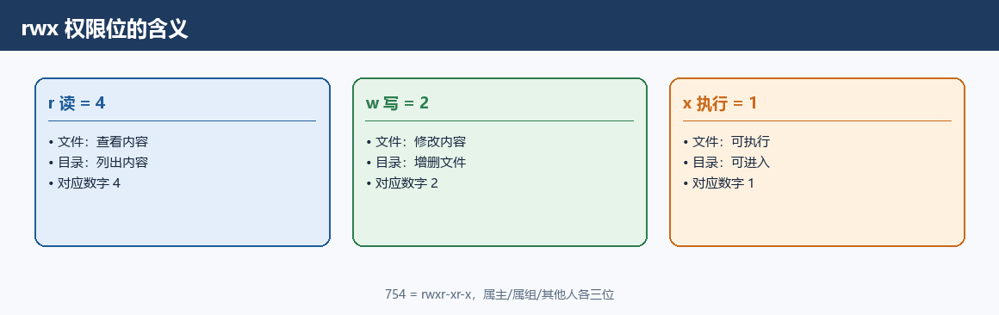
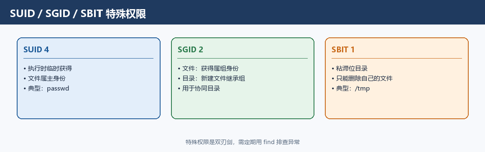

## 板块6 · 用户身份与文件权限

安全的第一道闸门是"谁能做什么"。这个板块系统讲解用户身份与文件权限：从 UID 区分用户类型，到 rwx 权限的读写执行，再到 SUID、SGID、SBIT 特殊权限、隐藏属性、ACL 精细授权，最后用 su 与 sudo 实现"受控提权"（含别名归类与授权边界的判断），并深入 /etc/shadow 看清密码到底被存成什么，从而做到无交互批量改密、账号时效巡检与忘记密码时的应急恢复。这些知识是各类服务配置的地基——任何服务的部署都要考虑以谁的身份运行、能访问哪些文件。

### 6_1 技术背景与核心原理：多用户系统的身份逻辑

Linux 从设计之初就是多用户系统，这意味着必须清楚区分"你是谁"以及"你能碰什么"。身份用 UID 标识，就像每个人的身份证号码。管理员 UID 为 0，拥有最高权限；系统用户占用一段较小的 UID，用于运行各类服务；普通用户从较大的 UID 开始，是日常使用者。

用户分组是为了便于批量授权。每个用户都有一个基本用户组，相当于"原生家庭"，创建时自动归属；还可以加入若干附加用户组，相当于"工作单位",获得额外的权限集合。这种设计让权限管理既有个体的精确性，又有群体的便利性。

学习阶段的实验环境建议直接使用管理员身份，因为虚拟机快照能让任何误操作在几秒内回滚。但生产环境必须遵循最小权限原则：日常用普通账户，只在必要时提权，且只授予完成任务所需的最小权限。这不是束缚，而是防止一次误操作毁掉整个系统的护栏。

### 6_2 关键概念：文件权限与归属

每个文件都有三组权限：所有者（属主）、所属组（属组）、其他人。每组权限由 r（读）、w（写）、x（执行）三个位组成。

| 权限 | 对文件 | 对目录 |
| --- | --- | --- |
| r 读 | 查看内容 | 列出目录内文件 |
| w 写 | 修改内容 | 增删重命名目录内文件 |
| x 执行 | 执行程序 | 进入目录 |

权限有两种表示方法。字符法用九位字符表示，如 `rwxr-xr--`；数字法把每组的 rwx 当作三位二进制，r=4、w=2、x=1，相加得到一位数字，如 754。

```
权限位的数字换算
  r w x   含义          数值
  4 2 1
  ─────────────────────────
  7 = 4+2+1  rwx  读+写+执行
  6 = 4+2    rw-  读+写
  5 = 4+1    r-x  读+执行
  4 = 4      r--  只读
  0 = 0      ---  无任何权限

  例：rwx r-x r--  =  7  5  4  =  754
      属主  属组  其他
```



文件类型也由第一位字符标识：`-` 是普通文件，`d` 是目录，`l` 是链接，`c` 是字符设备，`b` 是块设备。查看属性时用 `ls -l` 就能看到类型、权限、属主、属组、大小与时间。

管理用户与权限的常用命令如下。

| 命令 | 作用 |
| --- | --- |
| id | 查看用户身份与所属组 |
| useradd | 创建用户 |
| groupadd | 创建用户组 |
| usermod | 修改用户属性 |
| passwd | 设置用户密码 |
| userdel | 删除用户 |
| chmod | 设置文件权限 |
| chown | 修改文件属主与属组 |

**配置示例：用户、组与权限的常用操作**

把用户与权限操作串起来：先创建用户并加入附加组、设密码后用 id 核对身份，再分别用数字法与字符法设置权限、用 chown 改归属，最后排查系统中的 SUID 文件。

```
# 创建用户并加入附加组，设置密码
root@iaoexl:~# useradd -G wheel iaoexl
root@iaoexl:~# passwd iaoexl
Changing password for user iaoexl.
New password:
Retype new password:
passwd: all authentication tokens updated successfully.
root@iaoexl:~# id iaoexl
uid=1000(iaoexl) gid=1000(iaoexl) groups=1000(iaoexl),10(wheel)

# 用数字法与字符法设置权限
root@iaoexl:~# chmod 754 script.sh
root@iaoexl:~# chmod u+x,g-w script.sh
root@iaoexl:~# ls -l script.sh
-rwxr-xr-- 1 root root ... script.sh

# 修改属主与属组
root@iaoexl:~# chown iaoexl:wheel /data/report.txt
root@iaoexl:~# chown -R iaoexl:wheel /data/

# 排查系统中的 SUID 文件
root@iaoexl:~# find / -perm -4000 2>/dev/null | head
/usr/bin/passwd
/usr/bin/su
```

**配置示例：useradd 与 usermod 的完整用法**

id 命令用于确认用户身份信息，创建用户后应随时用它核对 UID、基本组与附加组是否正确。

```
# 创建用户：useradd 默认同时创建同名私有组
root@iaoexl:~# useradd iaoexl
root@iaoexl:~# id iaoexl
uid=1001(iaoexl) gid=1001(iaoexl) groups=1001(iaoexl)
root@iaoexl:~# getent group iaoexl
iaoexl:x:1001:

# 已有账户改家目录、UID 与登录解释器（创建时对应 -d、-u、-s）
root@iaoexl:~# usermod -d /home/iaoexl -u 8888 -s /sbin/nologin iaoexl
root@iaoexl:~# id iaoexl
uid=8888(iaoexl) gid=1001(iaoexl) groups=1001(iaoexl)

# 修改附加组：-G 不带 -a 会覆盖原有附加组
root@iaoexl:~# usermod -G root iaoexl
root@iaoexl:~# id iaoexl
uid=8888(iaoexl) gid=1001(iaoexl) groups=1001(iaoexl),0(root)

# 修改 UID
root@iaoexl:~# usermod -u 9999 iaoexl
root@iaoexl:~# id iaoexl
uid=9999(iaoexl) gid=1001(iaoexl) groups=1001(iaoexl),0(root)

# 登录解释器已改为 nologin，切换验证会被拒绝
root@iaoexl:~# su - iaoexl
This account is currently not available.
```

用户生命周期的后半段——改家目录、改名、锁定、删除——各有一步容易漏，漏了不会报错，只会在后面某天突然显形。

| 操作 | 命令 | 容易漏的那一步 |
| --- | --- | --- |
| 迁移家目录 | `usermod -d /data/iaoexl -m iaoexl` | 少了 `-m` 只改配置文件里的路径，旧文件不搬，用户下次登录拿到一个空目录 |
| 修改用户名 | `usermod -l 新用户名 iaoexl` | 家目录名不跟着变，需要另配 `-d -m` 一起做 |
| 锁定账号 | `usermod -L iaoexl` 或 `passwd -l iaoexl` | 只封密码，已经登录的会话仍然有效 |
| 解锁账号 | `usermod -U iaoexl` | 原本密码为空时，解锁后依然登录不了 |
| 修改主组 | `usermod -g 组名 iaoexl` | 只影响之后新建的文件，旧文件属组不变 |
| 删除账号 | `userdel -r iaoexl` | 不加 `-r` 会保留家目录与邮件；加了才一并清掉 |
| 组改名 | `groupmod -n 新名 旧名` | 组改名后，原本靠组名写的脚本要跟着改 |
| 修改 GID | `groupmod -g 2000 组名` | 已存在文件的属组跟着 GID 走，权限判断随之变化 |

`usermod -l` 改用户名时有个硬性前提：该用户不能有正在运行的进程，否则命令直接拒绝执行。这是保护措施——进程的属主信息在启动时就已确定，中途改名会让系统的记账错乱。正确顺序是先让该用户退出登录、确认 `ps -u 用户名` 没有输出，再执行改名。

删除用户时建议分步操作而非一步到位，先清理该用户的进程与文件归属再删除账户，避免留下"无主的残留"——有点像处理旧物时不必急着一次扔光，先确认没有再用到的价值。

### 6_3 文件的特殊权限：SUID、SGID 与 SBIT

三种特殊权限解决普通 rwx 无法覆盖的场景。

| 特殊权限 | 作用对象 | 核心作用 |
| --- | --- | --- |
| SUID | 可执行文件 | 执行时临时获得文件所有者的权限 |
| SGID | 文件或目录 | 执行时获得属组权限；目录中新建文件自动继承属组 |
| SBIT | 目录 | 用户只能删除自己创建的文件，不能删他人的 |

SUID 可以比喻成"钦差大臣持尚方宝剑"：一个普通用户执行某程序时，临时获得程序所有者（通常是管理员）的权限去做一件特定事情，事毕权限即失效。典型例子是修改密码的程序，普通用户需要写密码文件，但绝不能因此获得完整管理员权限，SUID 正好解决这个矛盾。

SGID 在部门共享目录里特别有用：用户在新目录里创建的文件，属组会自动继承为该目录的属组，而不是用户自己的基本组。这样同组成员天然可以协作，不必每次手动改属组。

```
# 建组、建共享目录，设 set-GID 与组内可读写
root@iaoexl:~# groupadd devops
root@iaoexl:~# mkdir -p /data/dev
root@iaoexl:~# chgrp devops /data/dev
root@iaoexl:~# chmod 2770 /data/dev
root@iaoexl:~# ls -ld /data/dev
drwxrws---. 2 root devops 6 /data/dev
```

首位那个 `2` 让目录带上 set-GID，组执行位上出现的 `s` 就是它的标记；组外用户连进入都不允许，比 777 安全得多。这里有一个几乎人人踩过的坑：目录设了 set-GID，只保证"新建文件继承 devops 组"，并不保证"同组能改"——按默认 umask 022 创建的文件是 644，同组人依然只读。要真正协作，还得让 umask 不抹掉组写位（`umask 002`），或改用 ACL 单独授予，这也是考场上最常见的返工点。

SBIT 保护的是共享目录里的"各自为政"。以临时目录为例，所有用户都能在里面创建文件，但设置了 SBIT 后，任何人都不能删除别人创建的文件——这防止了有人出于恶作剧或恶意清空公共目录。



### 6_4 文件的隐藏属性：为关键文件再加一道锁

普通权限之上还有隐藏属性，用 chattr 设置、lsattr 查看。它比 rwx 更"硬"，连管理员也需要先去掉属性才能修改文件。

| 属性 | 作用 |
| --- | --- |
| `+i` | 不可修改，文件不能被删除、改名、写入 |
| `+a` | 只能追加，不能删除也不能覆盖已有内容 |
| `+s` | 删除时数据被填充清零，彻底擦除 |

`+a` 属性常用于保护日志文件：日志只能不断追加新内容，黑客即便攻入系统也无法擦除已有的作案记录。这是审计与取证的重要保障。

`+s` 属性则服务于"彻底删除"的场景。有个生动的参照：某些影视作品里，删除的数据被专业人员从磁盘上恢复出来——因为常规删除只是抹掉索引，数据仍在盘上。设置 `+s` 让系统在删除时用零填充原区域，能显著降低数据被恢复的风险。

```
权限控制的多层防线
  ┌─────────────────────────────────┐
  │ 第4层  ACL：对指定用户/组精确授权   │
  ├─────────────────────────────────┤
  │ 第3层  隐藏属性：+i / +a / +s      │
  ├─────────────────────────────────┤
  │ 第2层  特殊权限：SUID/SGID/SBIT   │
  ├─────────────────────────────────┤
  │ 第1层  基本权限：rwx 三组九位      │
  └─────────────────────────────────┘
       层层叠加，越往上越精细
```

### 6_5 文件访问控制列表 ACL：精确到人的授权

基本权限只能对"属主、属组、其他人"三类对象授权，粒度有限。ACL 提供更精细的控制：可以对指定的某个用户或某个组单独授权，而不影响其他人的权限。

| 命令 | 作用 |
| --- | --- |
| `getfacl 文件` | 查看 ACL |
| `setfacl -m u:用户名:rwx 文件` | 给某个用户单独授权 |
| `setfacl -m g:组名:rx 文件` | 给某个组单独授权 |
| `setfacl -R -m u:用户名:rwx 目录` | 递归授权 |
| `setfacl -x u:用户名 文件` | 只删除这一条 ACL |
| `setfacl -b 文件` | 清空访问 ACL |
| `setfacl -d -m g:组名:rx 目录` | 设默认 ACL，新建文件自动继承 |
| `setfacl --restore=备份文件` | 从文本备份恢复 |

典型场景是：某个目录默认只允许属主访问，现在需要单独放行一位同事。用基本权限只能把目录对所有人开放，而 ACL 可以只给这一位用户开一条通路。例如为某个用户单独授权进入管理员家目录，而不改变该目录对其他用户的限制——这体现了"精确到人"的价值。

ACL 里有一个基本权限模型里不存在的概念：mask。它是"ACL 条目的有效权限上限"，任何人通过 ACL 获得的权限都要与 mask 取交集。`getfacl` 输出里那条 `mask::r-x` 就是这个上限，`ls -l` 显示的组权限位实际上也变成了 mask 的值。

```
root@iaoexl:~# setfacl -m u:iaoexl:rwx /project/report.txt
root@iaoexl:~# getfacl /project/report.txt
# file: project/report.txt
# owner: root
# group: root
user::rw-
user:iaoexl:rwx                  #effective:r--      ← 被 mask 削掉了写与执行
group::r--
mask::r--
other::r--
```

输出的 `#effective` 注释是最有价值的信息，它直接告诉你"你以为给的权限"和"实际生效的权限"差在哪。mask 被削小的原因通常是另一条 `setfacl -m` 不带 mask，工具按所有条目的并集自动重算，或者有人手工改过。要显式指定就写 `setfacl -m m::rwx 文件`。

**配置示例：用 ACL 为一个项目目录分配差异化权限**

这段配置演示三个层次：给个人授权、给组授权、以及让目录下新建的内容自动带上同样的授权。第三层是默认 ACL，只有目录能设，且只对其后新建的内容生效。

```
# 一、给单个用户与单个组分别授权
root@iaoexl:~# mkdir -p /project/data
root@iaoexl:~# chmod 750 /project/data
root@iaoexl:~# setfacl -m u:iaoexl:rx /project/data
root@iaoexl:~# setfacl -m g:iaoexl:rwx /project/data

# 二、查看结果，注意 ls 输出末尾多出的加号
root@iaoexl:~# ls -ld /project/data
drwxr-x---+ 2 root root 4096 <日期> /project/data
root@iaoexl:~# getfacl /project/data
# file: project/data
# owner: root
# group: root
user::rwx
user:iaoexl:r-x
group::r-x
group:iaoexl:rwx
mask::rwx
other::---

# 三、设默认 ACL，此后在该目录下新建的内容自动继承
root@iaoexl:~# setfacl -d -m g:iaoexl:rwx /project/data
root@iaoexl:~# setfacl -d -m u:iaoexl:rx /project/data
root@iaoexl:~# touch /project/data/new.txt
root@iaoexl:~# getfacl /project/data/new.txt
# file: project/data/new.txt
user::rw-
user:iaoexl:r-x                  #effective:r--
group::r-x
group:iaoexl:rwx              #effective:rw-
mask::rw-
other::---

# 四、备份与恢复：ACL 不会随普通拷贝一起走
root@iaoexl:~# getfacl -R /project/data > /root/acl-backup.txt
root@iaoexl:~# setfacl --restore=/root/acl-backup.txt

# 五、删除单条、清空访问 ACL、只清默认 ACL
root@iaoexl:~# setfacl -x u:iaoexl /project/data
root@iaoexl:~# setfacl -b /project/data
root@iaoexl:~# setfacl -k /project/data
```

`ls -l` 权限位末尾那个 `+` 是判断"这个文件有没有 ACL"最快的方法，看不到加号就说明没有额外条目。`setfacl -b` 会清掉全部扩展条目，默认 ACL 也在其中；`setfacl -k` 则只清默认 ACL、保留访问 ACL。两者不是互补关系，按需选一个即可。

默认 ACL 只影响"设置之后新建"的内容，已有的文件不会追溯。这一点常被误解为"设了没生效"，实际是顺序问题——先设默认 ACL 再建文件，顺序反了就要对新文件单独再设一次。

备份要特别注意：`tar` 默认不保留 ACL，`cp` 默认也不保留（`cp -a` 与 `cp -p` 才保留），`rsync` 需要加 `-A` 参数。用这些工具迁移目录之后权限"莫名其妙变了"，原因就在这里。

同一个文件上 ACL 与基本权限同时存在时，判断顺序是：属主匹配 `user::` 条目，属组或 ACL 组匹配对应条目，最后落到 `other::`，每一步都要与 mask 取交集。排错时不要只 `ls -l` 看那九个字符——文件有 ACL 时，那九个字符已经不能完整表达权限了。

### 6_6 su 与 sudo：受控提权的两种路径

su 用于切换用户身份，最直接的用法是 `su - 用户名` 切换到目标用户并加载其环境。从普通用户切换到管理员需要输入管理员密码。

sudo 则更符合最小权限原则：管理员预先通过 visudo 配置"谁可以在哪些主机上以谁的身份执行哪些命令"，被授权的用户用自己的密码执行 sudo，不需要知道管理员密码。

| 配置写法 | 含义 |
| --- | --- |
| 用户 ALL=(ALL) ALL | 该用户可在任意主机以任意身份执行任意命令 |
| 用户 ALL=(ALL) /usr/bin/cat,/usr/sbin/reboot | 只允许执行指定的两条命令 |
| 用户 ALL=(ALL) NOPASSWD: 命令 | 执行指定命令时免密 |
| %组名 ALL=(ALL) 命令 | 整组授权，组名前加百分号 |

一行配置由四段组成：谁、在哪台主机、以什么身份、执行什么。段与段之间用空格或等号分隔，命令必须写绝对路径——写成 `reboot` 而不是 `/usr/sbin/reboot`，sudo 会因为它不在 `PATH` 的可信范围内而拒绝匹配。命令后面还可以跟参数限定，`/usr/bin/systemctl restart httpd` 比不写参数严格得多。

当授权对象变多，逐行写会难以维护，这时用别名归类。四类别名各有用途，定义之后再引用，改一处即可影响全局。

| 别名类型 | 归类对象 | 示例 |
| --- | --- | --- |
| `User_Alias` | 用户 | `User_Alias OPS = iaoexl` |
| `Host_Alias` | 主机 | `Host_Alias WEB = 192.168.10.10` |
| `Cmnd_Alias` | 命令 | `Cmnd_Alias DISKCMD = /usr/sbin/fdisk, /usr/sbin/parted` |
| `Runas_Alias` | 可切换的身份 | `Runas_Alias DBA = mysql` |

**配置示例：用别名收敛一批运维权限**

这段配置的思路是"先归类，再授权"：把磁盘类命令打包成一个别名，把运维人员打包成另一个，最后只写一行生效规则。命令前加感叹号表示显式禁止，它的优先级高于允许项，用来在宽泛的授权里挖掉危险命令。

```
root@iaoexl:~# visudo

User_Alias   OPS = iaoexl
Cmnd_Alias   DISKCMD = /usr/sbin/fdisk, /usr/sbin/parted, /usr/bin/lsblk
Cmnd_Alias   SVCCTL  = /usr/bin/systemctl restart httpd, /usr/bin/systemctl status httpd
Cmnd_Alias   DENY    = /usr/bin/passwd, /usr/sbin/useradd

# 运维组可在本机以 root 身份执行磁盘与指定服务命令，但禁止改密与建号
OPS  ALL=(ALL)  NOPASSWD: DISKCMD, SVCCTL, !DENY

# 数据库备份账号只允许以 mysql 身份执行一条命令
iaoexl  ALL=(mysql)  /usr/bin/mariadb-dump
```

`!DENY` 这处否定容易被误解成"全局禁用"，其实它只在同一行内做减法。sudoers 的匹配规则是**最后命中的那条生效**，不是"任一允许即允许"——所以否定的位置很关键：写在授权它的规则之后才有意义，写在之前会被后面的允许覆盖。

```
# 顺序决定结果：下面两段的实际效果完全不同
iaoexl  ALL=(ALL)  ALL
iaoexl  ALL=(ALL)  !/usr/bin/passwd        # 在后，否定生效，iaoexl 用不了 passwd

iaoexl  ALL=(ALL)  !/usr/bin/passwd
%wheel  ALL=(ALL)  ALL                     # 在后，覆盖上面的否定，iaoexl 属于 wheel 时仍可用 passwd
```

这就是为什么审计权限不能只看有没有"禁止行"——要按顺序读到底，确认最后生效的是哪一条。`sudo -l -U 用户名` 显示的是最终结果，比逐行推理可靠。

授权时最容易犯的错是给了解释器或编辑器。让某人 `sudo vim`，他就能在 vim 里执行 `:!sh` 拿到 root shell；给 `sudo less`，同样可以用 `!sh` 逃逸。给 `systemctl` 全权限约等于给 root，因为可以启动任意自定义的服务单元。判断标准很简单：这条命令能不能间接执行别的命令、能不能写文件到系统目录。能满足任一条，就等于给了全部权限。真正安全的做法是把操作封装成脚本，只授权执行这个脚本，脚本内部再做参数校验。

一个很值得学习的授权思路是"先宽后紧"：刚开始为图方便授予全部权限，验证流程跑通后，逐步收敛到实际需要的最小命令集。例如从 ALL 收敛到只允许 cat 与 reboot 两条命令，这样即便该账户被盗，能造成的破坏也被限制在极小范围内。

visudo 命令自带语法检查，能在保存时拦截错误配置，务必用它而非直接编辑配置文件。还要注意 `sudoers` 里各条规则的生效顺序并不重要，重要的是"有没有一条允许"——所以审计权限时不能只看某一行，要用 `sudo -l -U 用户名` 把该用户最终获得的权限整体列出来。

### 6_7 密码是怎么存的：/etc/shadow 与无交互改密

`passwd` 命令人人会用，但它有个前提——有人坐在终端前输入两遍密码。批量创建账户、自动化装机、云主机初始化脚本这些场景没有人工输入环节，必须绕过交互。绕过的方式不是"想办法把密码传进去"，而是理解密码到底被存成了什么。

系统从不保存明文密码。`/etc/shadow` 里存的是加盐哈希：明文加一段随机盐，一起做单向散列运算，结果不可逆推。同一个人两次设置同一个密码，因为盐不同，密文也完全不同——这就是"加盐"的意义，它让彩虹表失效。

`/etc/shadow` 每行用冒号分成 9 段，其中只有第 2 段是我们要动的：

```
iaoexl:$6$r1jcut3Crl8bSIMo$XfKnrl4...:19638:0:99999:7:::
 │   └──────┬──────────────┘  │   │  │   │
 │          │                 │   │  │   └── 过期前警告天数
 │          │                 │   │  └────── 密码最长可用天数
 │          │                 │   └───────── 最短可用天数（0 表示可立即改）
 │          │                 └───────────── 最后一次修改密码的日期（1970 起算的天数）
 │          └─────────────────────────────── 密码密文
 └────────────────────────────────────────── 用户名
```

密文本身又是三段结构 `$算法代号$盐值$哈希结果`，算法代号决定强度：

| 代号 | 算法 | 说明 |
| --- | --- | --- |
| `1` | MD5 | 早期系统，已不安全 |
| `5` | SHA-256 | glibc 2.7 后支持 |
| `6` | SHA-512 | 长期作为发行版默认 |
| `$y$` | yescrypt | 较新发行版的默认，抗 GPU 破解 |

部分系统还会写成 `$6$rounds=10000$盐$哈希`，中间的 `rounds` 指定迭代次数，迭代越多越慢、越难暴力破解，代价是登录校验也更慢。

**配置示例：生成合规密文并批量设置密码**

两种可靠做法：用 `openssl passwd -6` 直接生成 SHA-512 密文，或用 `chpasswd` 从标准输入读入"用户:密码"批量提交。二者都不需要交互，适合写进脚本。**不要**试图用 `echo 密码 | passwd` 这种写法，`passwd` 特意从终端读取而非标准输入，正是为了防止密码出现在管道和进程列表里。

```
# 一、生成 SHA-512 密文（-salt 可指定盐，不指定则随机）
root@iaoexl:~# openssl passwd -6 -salt S0meS4lt 'iaoexl@7#13'
$6$S0meS4lt$Q9Yh3kP7vR2mXcT...（完整密文约 100 字符，此处截断）

# 二、批量无交互设置密码（chpasswd 从标准输入读，格式为 用户:明文）
root@iaoexl:~# echo 'iaoexl:iaoexl@7#13' | chpasswd

# 三、发放初始密码后，要求首次登录强制改密
root@iaoexl:~# chage -d 0 iaoexl

# 四、验证：确认密文算法与密码状态
root@iaoexl:~# grep '^iaoexl:' /etc/shadow | cut -d: -f2 | cut -c1-3
$6$
root@iaoexl:~# chage -l iaoexl | head -3
Last password change                                    : password must be changed
```

`chage -d 0` 把"最后修改日期"置为 0，系统据此判定密码已过期，用户下次登录必须先改密码——这是发放初始密码时的标准动作，比口头叮嘱可靠。

**配置示例：忘记 root 密码时的应急恢复**

物理机或虚拟机控制台上的 root 密码丢失，只要有引导菜单的编辑权限就能救回来：在启动参数里把根文件系统挂成可写，并让内核直接启动一个 shell，此时系统还没进入正常的多用户状态，`passwd` 不需要旧密码。

```
# 一、重启，在 GRUB 菜单上按 e 进入编辑，找到 linux 开头那行
#    把 ro 改为 rw，并在行尾追加 init=/sysroot/bin/sh，然后 Ctrl+X 启动

# 二、此时根目录挂在 /sysroot，先切进去
switch_root:/# chroot /sysroot/

# 三、中文环境下密码可能显示为方块，先切英文
sh-4.4# LANG=en

# 四、重设密码
sh-4.4# passwd root
Changing password for user root.
New password:
Retype new password:
passwd: all authentication tokens updated successfully.

# 五、开启 SELinux 的系统必须打重标记，否则重启后无法登录
sh-4.4# touch /.autorelabel

# 六、退出并重启
sh-4.4# exit
switch_root:/# reboot
```

第五步是最容易漏的一步。以 `init=/sysroot/bin/sh` 启动时 SELinux 处于未启用状态，这一步修改的文件拿不到正确的安全上下文；不打 `/.autorelabel`，重启后 SELinux 会拒绝登录程序读取关键文件，表现为"密码明明改对了却登不进去"，而且第一次重启还会额外花时间做全盘重标记。

新版系统更推荐用 `rd.break` 方式：在启动参数末尾加 `rd.break`，进入 initramfs 的紧急 shell，先 `mount -o remount,rw /sysroot` 再 `chroot /sysroot` 改密码，其余步骤相同。两种方式的差别在于前者由内核直接起 shell、后者在 initramfs 阶段中断启动流程，后者的挂载状态更可控。

### 6_8 PAM：认证流程的插槽

前面几节讲的是"权限给了谁"，这一节讲"凭什么相信你是你"。登录、`su`、`sudo`、`ssh`、改密码，这些动作看着各干各的，底层都调同一套框架——PAM（可插拔认证模块）。它的设计思想是把"认证"拆成一串可拼接的步骤：账号是否存在、密码是否正确、账号是否过期、是否允许在这个时段登录、要不要做二次验证。每个步骤是一个模块，串起来就是一条认证栈。

配置文件在 `/etc/pam.d/` 下，一个服务一个文件。每行四列：类型、控制标志、模块、参数。

```
# 看 sshd 的认证栈（节选）
root@iaoexl:~# grep -vE '^\s*#|^\s*$' /etc/pam.d/sshd
auth       required     pam_env.so
auth       substack     password-auth
auth       include      postlogin
account    required     pam_nologin.so
account    include      password-auth
password   include      password-auth
session    required     pam_selinux.so close
session    required     pam_loginuid.so
```

四个类型各管一段：`auth` 验身份，`account` 查账号是否可用（过期、时段、锁定），`password` 管改密码时的规则，`session` 在登录前后做准备（挂载家目录、设置 SELinux 上下文、记审计 ID）。

控制标志决定"这一步失败了怎么办"，四个值必须分清：

| 标志 | 失败时的行为 | 典型用途 |
| --- | --- | --- |
| `required` | 失败后仍继续执行后续模块，但整体最终失败 | 绝大多数检查，避免暴露"哪一步错了" |
| `requisite` | 立即返回失败，不再执行后续 | 前置硬条件，如账号禁用 |
| `sufficient` | 成功即通过（前提是此前没有失败），失败则忽略 | 备用认证方式，如指纹、令牌 |
| `optional` | 成功失败都不影响整体 | 记录、环境准备 |

`required` 与 `requisite` 的差别是个高频考点，也是个安全细节：`required` 故意不在失败时立刻中断，是为了不让攻击者通过响应时间或提示差异判断"密码对了但账号过期"。理解这一点，就不会觉得它"绕"。

三条实用规则：改任何 PAM 文件前先 `cp` 备份；改完保留一个已登录的 root 会话，用新会话验证；`authconfig`、`authselect` 这类工具会覆盖手改内容，要么全程用工具，要么全程手改，不要混着来。

```
# 一、用 authselect 看当前配置（红帽系推荐的管理入口）
root@iaoexl:~# authselect current
Profile ID: sssd
Enabled features:
- with-sudo

# 二、密码复杂度由 pwquality 控制
root@iaoexl:~# grep -vE '^\s*#|^\s*$' /etc/security/pwquality.conf
minlen = 8
minclass = 3

# 三、登录失败锁定：faillock（RHEL 9 起取代 pam_tally2）
root@iaoexl:~# faillock --user iaoexl
iaoexl:
When                Type  Source           Valid
2026-11-18 09:12:03 RHOST 192.168.10.50      V
root@iaoexl:~# faillock --user iaoexl --reset

# 四、认证失败去哪看
root@iaoexl:~# tail -20 /var/log/secure
root@iaoexl:~# journalctl -u sshd -p err -n 20
```

排错的顺序很固定：先看 `/var/log/secure` 里的具体模块报错（它会写清是哪个 `pam_*` 拒绝的），再看 `/etc/pam.d/` 对应服务文件里的引用链（`include`、`substack` 会把你带到 `password-auth`、`system-auth`），最后才动手改。直接凭印象改 `system-auth` 是把自己和所有用户一起锁在门外的经典做法。

### 6_9 账号巡检：时效、锁定与一致性校验

`/etc/shadow` 从第 3 段起的六个字段不是装饰，它们决定一个账号在什么时间点失效。理解这几个字段的相互关系，才能把"密码策略"落成可执行的规则，而不是写一句"密码三个月一换"了事。

| 字段（从第 3 段起） | 含义 | 常用取值 |
| --- | --- | --- |
| 第 3 段 | 最后一次修改密码的日期（1970 起算的天数） | 由系统自动写 |
| 第 4 段 | 最短可用天数，0 表示可立即再改 | `0` 或 `1` |
| 第 5 段 | 最长可用天数，到期强制改密 | `90`、`99999`（永不过期） |
| 第 6 段 | 到期前多少天开始警告 | `7` |
| 第 7 段 | 到期后多少天账号被禁用 | `30`，留空表示不禁用 |
| 第 8 段 | 账号失效日期（绝对天数） | 留空表示不设 |

关键区别在于"密码过期"与"账号过期"是两件事。密码过期后用户仍能登录，但登录时被强制改密；账号过期（第 8 段）则直接拒绝登录，改密也进不去。临时账号、外包人员账号该用第 8 段设一个明确的终止日，而不是依赖密码过期。

`chage` 是管理这些字段的专用命令，比手工改 shadow 安全得多。

| 命令 | 作用 |
| --- | --- |
| `chage -l 用户` | 列出该账号的完整时效信息 |
| `chage -M 90 用户` | 设密码最长可用 90 天 |
| `chage -m 1 用户` | 设最短 1 天，防止改完立刻改回 |
| `chage -W 7 用户` | 到期前 7 天开始提醒 |
| `chage -I 30 用户` | 过期 30 天后禁用账号 |
| `chage -E 2026-12-31 用户` | 设账号终止日期 |
| `chage -d 0 用户` | 把最后改密日归零，强制下次登录改密 |

`chage -d 0` 是批量建号时最常用的一招：新建账号给统一初始密码，同时把改密日归零，用户首次登录必须先改成自己的密码，初始密码因此只在很短的时间窗内有效。

**配置示例：一次完整的账号时效巡检**

巡检的目标是回答三个问题：谁的密码该换了、谁的账号已经僵死、账号文件有没有对不上的地方。

```
# 一、看单个账号的完整时效
root@iaoexl:~# chage -l iaoexl
Last password change                                    : <日期>
Password expires                                        : <日期>
Password inactive                                       : <日期>
Account expires                                         : never
Minimum number of days between password change          : 0
Maximum number of days between password change          : 90
Number of days of warning before password expires       : 7

# 二、批量排查：从 shadow 里筛出密码已过期或从未改过的账号
root@iaoexl:~# awk -F: '$2=="!!" || $2=="" {print $1" 从未设密码"}' /etc/shadow
root@iaoexl:~# awk -F: '{if($3+$5 < systime()/86400) print $1" 密码已过期"}' /etc/shadow

# 三、锁定与解锁：临时停用而不删除
root@iaoexl:~# passwd -l iaoexl
root@iaoexl:~# passwd -S iaoexl
iaoexl LK <日期> 0 99999 7 -1
root@iaoexl:~# passwd -u iaoexl

# 四、文件一致性校验：passwd 与 shadow、group 与 gshadow 是否对得上
root@iaoexl:~# pwck
root@iaoexl:~# grpck

# 五、看谁长期没登录过，作为清理依据
root@iaoexl:~# lastlog | grep -v "Never logged in"
root@iaoexl:~# lastlog -b 90
```

`passwd -S` 输出的第二列是状态：`PS` 表示已设密码可用，`LK` 表示已锁定，`NP` 表示空密码可直接登录。`NP` 是最危险的状态，任何本地用户都能 `su` 进去。`awk` 那两条命令用 `systime()` 取当前时间，是 `gawk` 的扩展函数，在 `mawk` 上要换成 `date +%s` 的结果预先传入。

`pwck` 与 `grpck` 只报告不修改，加 `-r` 才会交互式让你逐条修正。它们查的是文件之间的引用关系：`/etc/passwd` 里某个用户的主组在 `/etc/group` 里不存在、某个组的成员列表指向了已删用户、家目录路径重复，这类问题不会让系统立刻报错，却会在批量脚本与权限判断里埋下隐患。

清理账号时有个顺序问题：先 `passwd -l` 锁定、观察一段时间确认无人使用，再 `userdel`。直接删号会让该用户创建的文件变成孤儿——文件的属主 UID 还在，但已没有对应用户名，`ls -l` 只能显示数字，之后新建的同 UID 账号会意外继承这些文件的权限。所以删号前先用 `find / -uid UID` 找出遗留文件，决定是转移属主还是保留。

### 6_10 场景笔记方法：把权限设计记成"对象—权限—理由"表

权限配置一旦复杂，很容易出现"当时知道为什么这么设，过段时间就忘了"的情况。建议用一张三列表记录每一项授权。

| 对象 | 权限设置 | 设置理由 |
| --- | --- | --- |
| 共享目录 | SGID | 让组内新建文件自动继承属组 |
| 日志目录 | chattr +a | 防止日志被擦除 |
| 临时目录 | SBIT | 防止用户互删文件 |
| 某协作用户 | ACL 单独授权 | 只放行一人，不影响其他人 |
| 运维账户 | sudo 限定命令 | 最小权限，降低误操作风险 |

特殊权限的笔记要配一张"数字表示"对照：SUID=4、SGID=2、SBIT=1，写在普通权限数字之前，例如 4755 表示带 SUID 的 755。这个写法在看别人配置时会经常遇到。

### 6_11 实用验证与排错：确认权限真的生效

权限配置完成后，必须切换到对应用户实际验证，而不是只看配置。因为在管理员身份下，很多权限限制会被绕过，验证结果失真。

```
权限验证流程
  设置权限 ──► 切换到目标用户 ──► 实际执行操作 ──► 观察成功/拒绝
      │                                              │
      └──────────── 权限不达预期时回到设置环节 ◄───────┘
```

验证 SBIT 时，用两个普通用户在同一目录各建一个文件，确认彼此不能删除对方的文件；验证 SGID 时，确认新文件属组与目录一致；验证 sudo 时，用被授权用户执行允许的命令成功、执行未授权的命令被拒。

| 现象 | 排查方向 |
| --- | --- |
| 权限设了但用户仍无法访问 | 上级目录是否有 x 权限可进入 |
| 用户能删除他人文件 | 目录是否忘了设 SBIT |
| 新建文件属组不对 | 目录是否设了 SGID |
| sudo 提示不在 sudoers 文件 | 是否用 visudo 正确配置 |
| 连管理员都改不了文件 | 是否设置了 +i 隐藏属性 |

一条经验非常重要：权限问题排查要从路径的最上层开始逐层向下看。即便目标文件权限正确，只要路径中某一级目录缺少进入权限（x），用户依然无法到达目标——这是权限排错中最常见的"隐藏关卡"。

### 6_12 认证对标与进阶实战

用户与权限是认证考试的高频核心，也是安全根基。LPIC-1 把用户与组管理、权限管理分别列为独立主题，LFCS 与 RHCSA 都把账户与文件权限列为必考操作，CompTIA Linux+ 更是把访问控制当作重点。可以这么说：权限没学透，任何服务部署都会埋下安全隐患。

| 认证体系 | 与本主题相关的考查方向 | 核心能力要求 |
| --- | --- | --- |
| LPIC-1 | 用户与组管理、权限管理 | 创建账户组、设置 rwx 与特殊权限 |
| LFCS | 用户管理、文件权限 | 用 chmod/chown 精确控制访问 |
| RHCSA（EX200） | 管理用户与组：本地账户、密码老化、组成员、sudo 特权访问 | 建号设期、配 sudoers、能解释"最后命中生效" |
| RHCSA（EX200） | 创建与配置文件系统：set-GID 协作目录、诊断并修复权限问题 | 建一个组内可协作的共享目录，说清为何是 2770 而非 777 |
| RHCE 排障方向（EX342） | 身份认证问题（含 PAM）、本地账户策略 | 从 `/var/log/secure` 反推是哪个模块拒绝的 |
| CompTIA Linux+ | 访问控制、特殊权限 | 解释 SUID/SGID/SBIT 的作用与风险 |

一个因权限配置不当引发的事故值得记住：管理员为了让应用能写日志，图省事执行了 `chmod 777 /data`，结果任何用户都能读写删除该目录内容，一处配置让整个目录失去保护。正确的做法是精确授权——把应用用户加入特定组，目录设为 775 或 770，只给必要的写权限。权限管理的核心原则是"最小够用"：只授予完成任务所需的最小权限，多一点都是风险。

权限问题的高频故障，往往表现为"明明配了却还是拒绝访问"。

| 现象 | 根因 | 定位命令 | 处置 |
| --- | --- | --- | --- |
| 提示 Permission denied | 用户对文件/上级目录无执行或读权限 | ls -ld、namei | 逐层检查路径权限、补执行位 |
| 用户无法进入某目录 | 目录缺少 x（执行/进入）权限 | ls -ld | 给目录补 x 权限 |
| 文件属主改了仍无权 | 父目录权限或 SELinux 限制 | ls -ld、getenforce | 检查上层目录与 SELinux |
| sudo 提示不在 sudoers | 用户未加入 wheel 组或未授权 | id、visudo -c | 用 visudo 精确授权 |

闯关任务按"账户—权限—提权"三级递进，全部要求验证结果。

```
  权限闯关
  第一关 创建用户并加入指定附加组，验证其组身份
    │
  第二关 设置目录权限，使组内可写、其他人只读
    │
  第三关 用 sudo 授权某用户仅能执行指定命令
```

- 第一关：`useradd` 加 `-G` 指定附加组，用 `id` 验证。
- 第二关：换算 rwx 对应的数字权限，用 `chmod` 设置后 `ls -ld` 确认。
- 第三关：用 `visudo` 添加授权条目，切换到该用户验证可执行与不可执行的区别。

进阶要理解 umask 与特殊权限的底层逻辑。新建文件默认权限由"基础权限减去 umask"得到：目录基础 777、文件基础 666，umask 抹去相应位，所以常见的 022 会带来 755 目录与 644 文件。理解这一点，就能解释"为什么新建文件默认不能执行"。特殊权限方面，SUID 让执行者临时获得文件属主身份（如 passwd 改密码时临时获得 root 写 shadow 的能力），SGID 让新建文件继承目录的组，SBIT 让粘滞目录中用户只能删自己的文件（如 /tmp）。这三位是"双刃剑"——用好了解决实际问题，用错了就是提权漏洞，审计时可用 `find / -perm -4000` 排查异常的 SUID 文件。把权限位换算表与特殊权限的风险点并列记入笔记，是最实用的复习方式。

PAM 这层则解释了"为什么改对了密码还是登不上"。认证不是一步，而是一串：账号存在性、密码正确性、账号有效期、来源限制、会话准备，任一环节拒绝，表现都是"登录失败"。定位的关键是先看 `/var/log/secure` 里到底是哪个 `pam_*` 模块给的结果，再回到 `/etc/pam.d/` 顺着 `include`、`substack` 找出完整链路。跳过这两步直接改 `system-auth`，是把自己锁在门外的标准姿势。

### 6_13 要点回顾与能力自检

本板块建立了完整的权限体系：UID 区分身份，rwx 控制基本访问，SUID/SGID/SBIT 处理特殊场景，chattr 隐藏属性提供额外保护，ACL 实现精确到人的授权（mask 决定上限、默认 ACL 让新文件自动继承），sudo 用最小权限原则完成受控提权（别名归类、禁止项在同一行内做减法）。密码一侧则是另一条线：shadow 存加盐哈希与时效字段，chage 管理时效，pwck 与 grpck 校验账号文件之间的引用关系。

自检问题：

1. UID 如何区分管理员、系统用户与普通用户？基本组与附加组有何区别？
2. rwx 对文件与对目录的含义有何不同？权限 754 表示什么？
3. SUID、SGID、SBIT 各自解决什么问题？
4. 隐藏属性 +a 为什么能保护日志？ACL 相比基本权限的优势是什么？
5. 为什么推荐用 visudo 而非直接编辑配置？sudo 授权"先宽后紧"的思路是什么？
6. ACL 的 mask 是什么？为什么给了 `rwx` 却只显示 `#effective:r--`？
7. 默认 ACL 为什么对已存在的文件无效？为什么用 `tar` 迁移目录后权限会"莫名其妙变了"？
8. `chage -d 0` 为什么能强制下次登录改密？密码过期与账号过期分别会发生什么？
9. 把 `sudo vim` 授权给一个用户，为什么等于给了他 root 权限？
10. PAM 的四种类型（auth/account/password/session）各管什么？`required` 与 `requisite` 失败时的行为差别在哪，为什么要这样设计？
11. 用户密码正确却登录失败，`/var/log/secure` 里能看出什么？为什么不能直接改 `system-auth`？
