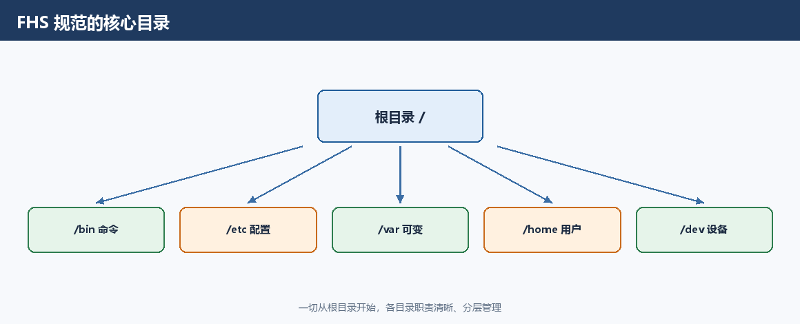
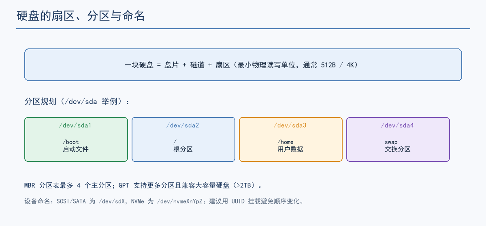
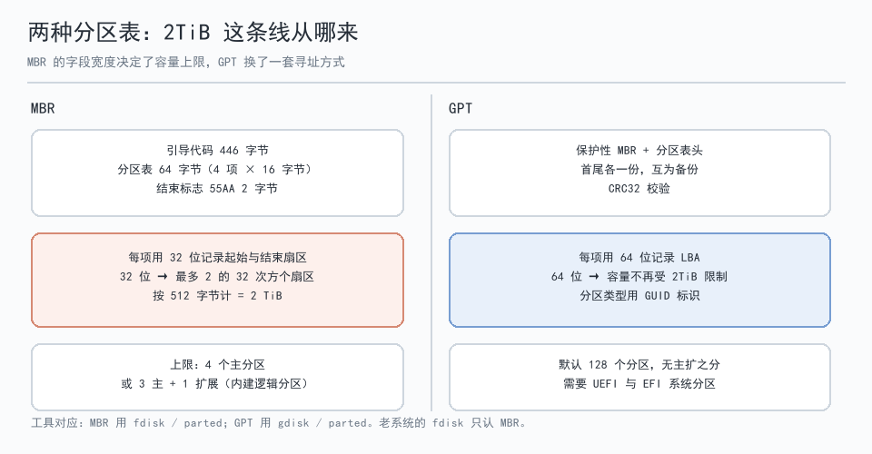
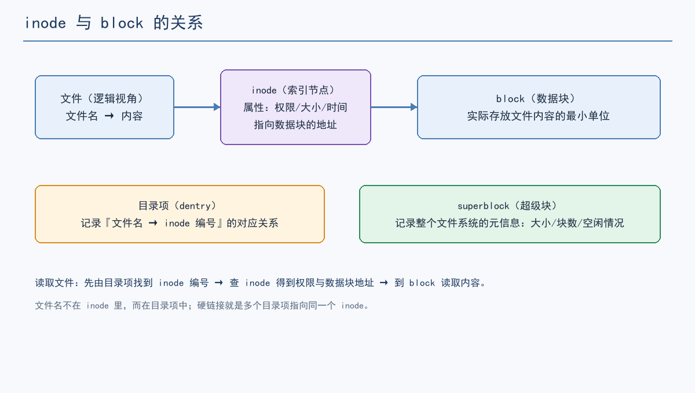
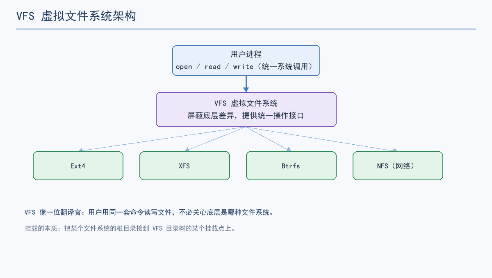
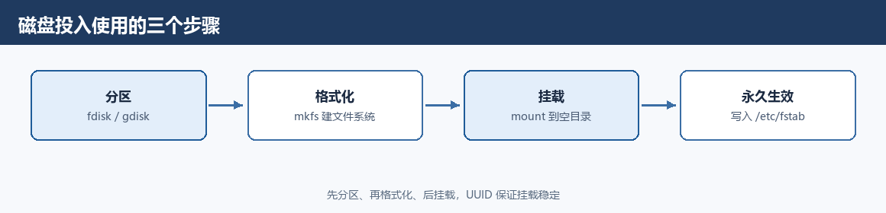
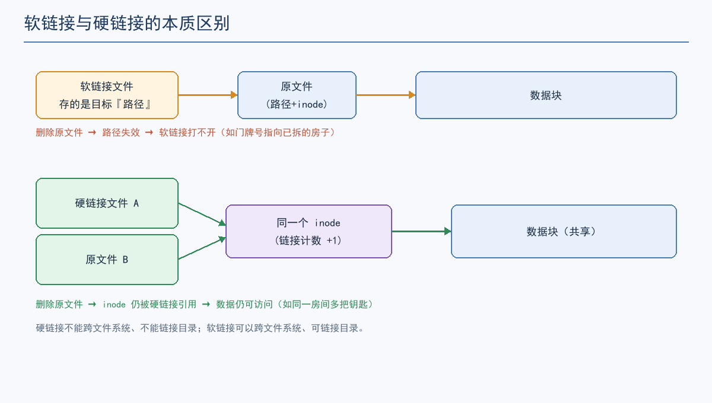

## 板块7 · 存储结构与磁盘管理

理解了权限，接下来理解数据放在哪里、怎样组织。这个板块从根目录"/"讲起，讲清 Linux 的目录规范、设备命名、MBR 与 GPT 两种分区表的能力边界、文件系统与挂载机制，再动手完成添加硬盘、GPT 分区、交换分区与交换文件、磁盘配额与软硬链接，并覆盖光盘、U 盘、NTFS 移动硬盘这些外来介质的挂载与安全卸载。存储是系统最实在的部分——命令错了还能重敲，磁盘规划错了可能付出数据代价，因此每一步都要既懂原理又会验证。

### 7_1 技术背景与核心原理：一切从根目录开始

Windows 用盘符（C、D、E）组织存储，Linux 则完全不同：所有文件都挂在一棵以根目录"/"为起点的树上，即便有多块磁盘、多个分区，最终也都成为这棵树上的某个目录。这种设计的好处是路径统一、组织清晰，也带来一个关键动作——"挂载"：把一块设备关联到某个目录，之后访问该目录就等于访问那块设备。

目录的用途由文件系统层次标准（FHS）规范。它规定 /etc 放配置、/var 放变化数据、/home 放用户家目录、/dev 放设备文件、/boot 放启动文件等。理解这套规范，就能回答"为什么软件装到这些位置""为什么日志在 /var/log"这类问题。



绝对路径从根目录"/"写起，相对路径从当前目录写起。有个很生活化的比喻：外国游客在潘家园问洗手间在哪，指路人可以说"从这里往前两个路口右转"（相对路径，简洁但依赖当前位置），也可以说"某某街某某号"（绝对路径，普适但繁琐）。两者各有适用场景。

磁盘使用要经过三步，可以用"裁纸、画格、使用"类比：新磁盘像一整卷白纸，先要裁成合适的页数（分区），再在每张纸上画好格子以便规范书写（格式化，建立文件系统），最后装订进本子才能翻用（挂载到目录）。这三步对应 fdisk、mkfs、mount 三个命令，是磁盘管理的骨架。

```
磁盘投入使用的三步
  物理磁盘 ──分区(fdisk)──► 分区 ──格式化(mkfs)──► 文件系统 ──挂载(mount)──► 目录访问
     │                      │                       │                      │
   整卷白纸               裁成页                  画好格子              装订进本子
```

### 7_2 关键概念：设备命名、文件系统与挂载

udev 负责规范 /dev 下的设备名称。常见设备名中，sda 表示第一块 SCSI 类磁盘，sdb 表示第二块，以此类推。分区编号用数字表示，如 sda1、sda2。



两个容易误解的点值得强调。其一，设备名由内核识别顺序决定，而非主板插槽位置——不要以为插在第一个槽就一定是 sda。其二，分区编号不等于分区数量，sda3 只表示编号为 3 的分区，不代表存在三个分区。理解这两点，才能在多磁盘环境里不搞错对象。

分区有主分区、扩展分区与逻辑分区之分，编号规则是：主分区与扩展分区占用 1–4，逻辑分区从 5 开始。这也是为什么有时看不到 sda4 却能直接有 sda5。

这套"主分区 + 扩展分区 + 逻辑分区"的编号规则属于 MBR 分区表。磁盘上记录分区信息的方式还有另一种——GPT，两者的差别不是风格问题，而是硬限制。

| 对比项 | MBR | GPT |
| --- | --- | --- |
| 最大可管理容量 | 2 TiB | 远大于当前任何单盘 |
| 分区数量 | 4 个主分区，或 3 主 + 1 扩展 | 默认 128 个，无主扩之分 |
| 引导方式 | BIOS + 引导代码 | UEFI + EFI 系统分区 |
| 分区表备份 | 无 | 首尾各一份，可互相恢复 |
| 分区标识 | 分区类型 ID（如 82 表示 swap） | 分区类型 GUID |
| 常用工具 | fdisk、parted | gdisk、parted |



2 TiB 这个上限来自 MBR 的字段宽度：分区表里记录起始与结束位置的字段各 32 位，按 512 字节扇区计算，最大只能表示 2 的 32 次方个扇区，也就是 2 TiB。超过这个容量，多出来的空间在 MBR 下根本表达不出来，不是"用不满"而是"看不见"。

选择工具的逻辑因此很直接：容量在 2 TiB 以内且是 BIOS 引导，`fdisk` 足够；超过 2 TiB 或系统按 UEFI 引导，必须用 GPT，`parted` 或 `gdisk`。较新版本的 `fdisk` 已经支持 GPT，但老系统上的 `fdisk` 只认 MBR，不能想当然。

文件系统负责在磁盘上组织数据。常见的几种及其特点如下。

| 文件系统 | 特点 |
| --- | --- |
| Ext2 | 早期版本，无日志功能 |
| Ext3 | 加入日志，可靠性提升 |
| Ext4 | 当前主流，性能与兼容性好 |
| XFS | 适合大文件与大容量，扩展性强 |

文件系统内部依靠几个核心结构工作：super block 记录整个文件系统的元信息，inode 记录每个文件的属性与数据块位置，block 是实际存放数据的最小单位。有个比喻很贴切：文件系统像带格子的本子——单线本、田格本、作文纸提供不同的书写格式约束，文件系统则为磁盘数据提供组织格式，让杂乱的字节变成有序的文件。



VFS（虚拟文件系统）是屏蔽差异的关键层。它把不同文件系统的操作统一成同一套接口，让用户用同样的方式读写文件，而不必关心底层是 Ext4 还是 XFS。它像一位翻译官，也像一个太稳定而常被忽视的器官——正因为工作得无声无息，人们几乎感觉不到它的存在。



挂载是把设备与目录关联的动作，可以比作"结婚登记"：只有登记之后两者才建立正式关系，路径访问才指向设备。设备不能重复挂载到多个目录，一个目录也不宜同时挂多块设备。

| 命令 | 作用 |
| --- | --- |
| mount | 挂载设备，查看已挂载 |
| umount | 卸载设备 |
| blkid | 查看设备 UUID 与文件系统类型 |
| lsblk | 以树形列出块设备 |
| df | 查看磁盘空间使用 |
| du | 查看目录占用空间 |
| fdisk | 磁盘分区 |
| partprobe | 同步分区表 |
| mkfs | 格式化建立文件系统 |
| mkswap / swapon | 创建与启用交换分区 |
| xfs_quota / edquota | 配置磁盘配额 |
| ln | 创建链接 |

`mkfs` 只是入口，真正建文件系统的是一组按类型分发的辅助命令：`mkfs.ext4`、`mkfs.xfs` 各自独立，`mkfs -t ext4` 只是帮你转调前者。格式化之后还有几件事要做，各由专门的命令负责。

| 命令 | 作用 | 用在什么时候 |
| --- | --- | --- |
| `mkfs -t ext4 设备` | 建 ext4 文件系统 | 分区刚建好 |
| `mkfs.xfs 设备` | 建 XFS 文件系统 | 大文件、大容量场景 |
| `xfs_growfs` | 扩容 XFS | XFS 只能扩不能缩 |
| `e2label 设备 卷标` | 设置 ext 系卷标 | 想用 LABEL 挂载时 |
| `dumpe2fs -h 设备` | 看 super block 概要 | 确认块大小、inode 数量 |
| `xfs_info 设备` | 看 XFS 结构信息 | 对应 XFS |
| `blkid` | 读 UUID 与类型 | 写 fstab 之前 |
| `fsck -y 设备` | 检查并修复 ext 系 | 非正常关机后 |
| `xfs_repair 设备` | 修复 XFS | XFS 不能用 fsck |

两个容易踩的坑。其一，XFS 没有 `fsck`，用 `fsck` 去修 XFS 只会提示"不做任何事"，必须用 `xfs_repair`；其二，`fsck` 与 `xfs_repair` 都要求设备已卸载，对一个正在挂载的根分区直接跑修复，轻则拒绝执行，重则把文件系统搅乱——根分区需要在救援模式下或重启时由系统自动检查。

`/etc/fstab` 里为什么更推荐写 UUID 而不是 `/dev/sda1`，原因就在 `blkid` 的输出里：设备名由内核识别顺序决定，加一块硬盘、换一次插槽，`sda` 与 `sdb` 就可能互换，而 UUID 是在格式化时写进文件系统超级块的，与插在哪无关。卷标（LABEL）也可用于挂载，但它由人指定、可能重复；UUID 由系统生成，唯一性有保证。

**配置示例：为一块 3TB 磁盘建 GPT 分区并格式化**

超过 2 TiB 的磁盘必须用 GPT，老版本的 `fdisk` 在这里无能为力。`parted` 的 `mklabel` 会重写整张分区表，对已有数据的盘等同于清空，执行前务必用 `lsblk` 确认盘符没有选错。

```
# 一、先确认盘符与容量，别选错盘
root@iaoexl:~# lsblk
NAME   MAJ:MIN RM  SIZE RO TYPE MOUNTPOINT
sda      8:0    0   20G  0 disk
├─sda1   8:1    0    1G  0 part /boot
└─sda2   8:2    0   19G  0 part /
sdc      8:32   0  3.0T  0 disk

# 二、建 GPT 分区表并划分一个占满全盘的分区
root@iaoexl:~# parted /dev/sdc
(parted) mklabel gpt
(parted) mkpart primary 0% 100%
(parted) print
Model: <磁盘型号>
Disk /dev/sdc: 3001GB
Partition Table: gpt
Number  Start   End     Size    File system  Name     Flags
 1      1049kB  3001GB  3001GB               primary
(parted) quit

# 三、格式化：一个分区只能放一种文件系统，下面两条路径二选一
# 路径 A · XFS，适合大文件与高并发写入
root@iaoexl:~# mkfs.xfs /dev/sdc1
root@iaoexl:~# xfs_info /dev/sdc1                       # 核对块大小与扇区尺寸

# 路径 B · ext4，可在格式化时直接给卷标，也可事后用 e2label 补
root@iaoexl:~# mkfs -t ext4 -L backup /dev/sdc1
root@iaoexl:~# dumpe2fs -h /dev/sdc1 | head -20          # 核对卷标、块大小、inode 数量
root@iaoexl:~# e2label /dev/sdc1 backup                  # 事后改卷标的写法

# 四、取 UUID，写进 fstab 之前先看一眼
root@iaoexl:~# blkid /dev/sdc1
/dev/sdc1: LABEL="backup" UUID="<UUID>" TYPE="ext4"

# 五、挂载并验证容量
root@iaoexl:~# mkdir -p /backup && mount /dev/sdc1 /backup
root@iaoexl:~# df -h /backup
Filesystem      Size  Used Avail Use% Mounted on
/dev/sdc1       2.7T   24K  2.7T   1% /backup
```

`mkpart primary 0% 100%` 里用百分比而不是具体扇区，是为了不必关心磁盘的扇区总数与对齐参数。旧教程常写成 `mkpart primary ext3 120MB 200MB`，其中 `ext3` 这个位置参数在新版 `parted` 里已被废弃——它只是给分区打一个提示标签，并不真的格式化，写了会收到一条"文件系统类型参数已无意义"的警告，不必紧张。真正的格式化永远由 `mkfs` 完成。

注意 `df -h` 显示的 2.7T 小于标称的 3.0T 是正常现象：厂商按 10 进制算容量（1TB = 10¹² 字节），而 `df -h` 按 2 进制换算（1TiB = 2⁴⁰ 字节），再扣掉文件系统元数据占用，差值就在这个量级。

需要重读分区表而不重启时用 `partprobe`。它对正在使用的磁盘无效——根分区所在磁盘改了分区表，内核无法在不重启的情况下接受新表，这是设计使然，不是命令失效。

### 7_3 实操一：添加一块新硬盘

添加硬盘是存储管理的第一个完整实验，走通"分区—格式化—挂载—永久生效"的全流程。

操作步骤：

1. 在虚拟机中添加一块新磁盘，容量可设为 20GB。添加后重启或用命令扫描，确认系统识别到新设备。
2. 用 fdisk 对磁盘分区，创建一个 2GB 的主分区，保存并退出。
3. 执行 partprobe 同步分区表，让系统识别新分区。
4. 用 mkfs 把分区格式化为 XFS 文件系统。
5. 创建挂载目录（如 /newFS），用 mount 挂载分区。
6. 用 df 确认挂载成功、空间可用。
7. 编辑 fstab 配置文件，写入挂载信息，实现开机自动挂载。

永久挂载强烈推荐用设备的 UUID 而非设备名。因为设备名可能随内核识别顺序变化，而 UUID 是唯一且稳定的标识。用 blkid 查询 UUID 后写入 fstab，可以避免"重启后挂载错位"这种难以排查的问题。这个经验在网络存储场景中同样是关键原则。



**配置示例：新硬盘的分区、格式化与永久挂载**

新盘上线要依次完成识别设备、分区、格式化与挂载，最后写入 fstab 实现开机自动挂载。全程用 lsblk、df 逐步验证，永久挂载务必用 UUID 而非设备名，避免识别顺序变化导致错位。

```
# 1) 确认新磁盘设备名
root@iaoexl:~# lsblk
NAME   MAJ:MIN RM  SIZE RO TYPE MOUNTPOINT
sda      8:0    0   20G  0 disk
sdb      8:16   0   20G  0 disk

# 2) 分区：创建 2GB 主分区
root@iaoexl:~# fdisk /dev/sdb
Command (m for help): n
Select: p
Partition number: 1
Last sector: +2G
Command (m for help): w

# 3) 同步分区表并格式化
root@iaoexl:~# partprobe
root@iaoexl:~# mkfs.xfs /dev/sdb1

# 4) 查询 UUID 并挂载
root@iaoexl:~# blkid /dev/sdb1
/dev/sdb1: UUID="c1e2...ab34" TYPE="xfs"
root@iaoexl:~# mkdir /newFS
root@iaoexl:~# mount /dev/sdb1 /newFS
root@iaoexl:~# df -h /newFS
Filesystem      Size  Used Avail Use% Mounted on
/dev/sdb1       2.0G   47M  2.0G   3% /newFS

# 5) 用 UUID 写入 fstab 实现永久挂载
root@iaoexl:~# vim /etc/fstab
UUID=c1e2...ab34  /newFS  xfs  defaults  0 0
root@iaoexl:~# mount -a
```

### 7_4 实操二：添加交换分区、配额与链接

交换分区（SWAP）用一部分磁盘空间模拟内存，当物理内存不足时把暂时不用的数据换出到磁盘，缓解内存压力。实验可创建一个 5GB 的交换分区，用 mkswap 格式化、swapon 启用后，用 free 查看 Swap 容量从原值增加——这是最直观的验证。

磁盘配额（quota）用于限制用户或用户组能使用的磁盘容量与文件数量，防止个别用户占满整个磁盘。配额分软限制与硬限制：软限制是警告线，超过后仍可写入一段时间；硬限制是红线，超过即刻拒绝。实验中给用户设置配额后写入 5MB 文件成功、8MB 文件失败，调整限额后再次成功，能完整展示配额的作用。

链接分软链接与硬链接，区别是理解文件系统 inode 概念的好机会。



| 类型 | 本质 | 原文件删除后 | 能否跨文件系统 | 能否链接目录 |
| --- | --- | --- | --- | --- |
| 软链接 | 记录目标路径 | 失效 | 可以 | 可以 |
| 硬链接 | 共享同一 inode | 仍可访问 | 不可以 | 不可以 |

软链接像一个指向门牌号的指引牌，原房子拆了指引牌就失效；硬链接则像给同一个房间多配一把钥匙，房子还在，用哪把钥匙都能进去。删除原文件后，软链接打不开而硬链接仍可访问，这是验证两者区别的经典实验。

```
软链接与硬链接的本质差异
  软链接：  链接文件 ──记录路径──► 原文件 ──► 数据块
            （原文件删除后路径悬空，链接失效）

  硬链接：  链接文件 ┐
                    ├── 共享同一个 inode ──► 数据块
            原文件  ┘
            （删除原名，数据块仍被另一名字引用）
```

**配置示例：添加交换分区（mkswap / swapon / fstab）**

交换分区用磁盘空间模拟内存，缓解内存不足。新建 5GB 分区并改类型为 swap，用 mkswap 格式化、swapon 启用，再以 free 对比启用前后容量变化，最后写入 fstab 实现开机自动启用。

```
# 1) 用 fdisk 新建一个 5GB 分区并把类型改为 swap（ID 82）
root@iaoexl:~# fdisk /dev/sdb
Command (m for help): n
Partition number (2-4, default 2): 敲击回车
Last sector, +/-sectors or +/-size{K,M,G,T,P}: +5G
Created a new partition 2 of type 'Linux' and of size 5 GiB.
Command (m for help): t
Partition number (1,2, default 2): 2
Hex code or alias (type L to list all): 82
Changed type of partition 'Linux' to 'Linux swap / Solaris'.
Command (m for help): w
The partition table has been altered.

# 2) 格式化为交换分区
root@iaoexl:~# mkswap /dev/sdb2
Setting up swapspace version 1, size = 5 GiB (5368705024 bytes)
no label, UUID=cd6c8f9d-0af2-4020-96bc-02509c118b5c

# 3) 启用前后用 free 对比 Swap 容量变化
root@iaoexl:~# free -m
              total        used        free      shared  buff/cache   available
Mem:            3879        1535        1563          14        1125        2344
Swap:           2047           0        2047
root@iaoexl:~# swapon /dev/sdb2
root@iaoexl:~# free -m
              total        used        free      shared  buff/cache   available
Mem:            3879        1540        1558          14        1126        2339
Swap:           7167           0        7167

# 4) 写入 fstab，实现开机自动启用
root@iaoexl:~# vim /etc/fstab
/dev/sdb2   swap   swap   defaults   0 0
```

磁盘上已经没有空余分区可切时，交换空间也可以用一个普通文件顶上，效果等价，代价是多一层文件系统的开销，性能略低于独立分区。云主机与容器环境里这种用法很常见，因为扩容磁盘比重新分区容易。

**配置示例：用文件扩充交换空间**

关键动作只有一条容易被漏掉——改权限。`swapon` 会检查交换文件的权限，其他用户可读时会直接拒绝启用，因为交换空间里可能有密码与密钥的明文残留。

```
# 1) 创建一个 2GB 的文件，全部填零
root@iaoexl:~# dd if=/dev/zero of=/swapfile bs=1M count=2048
2048+0 records in
2048+0 records out
2147483648 bytes (2.1 GB) copied, <耗时> s, <速度> MB/s

# 2) 权限收紧到只有 root 可读写，否则 swapon 拒绝启用
root@iaoexl:~# chmod 600 /swapfile
root@iaoexl:~# ls -l /swapfile
-rw-------. 1 root root 2147483648 <日期> /swapfile

# 3) 格式化为交换区并启用
root@iaoexl:~# mkswap /swapfile
Setting up swapspace version 1, size = 2 GiB (2147479552 bytes)
no label, UUID=<UUID>
root@iaoexl:~# swapon /swapfile
root@iaoexl:~# swapon -s
Filename        Type       Size       Used  Priority
/dev/sdb2       partition  5242876    0     -2
/swapfile       file       2097148    0     -3

# 4) 写入 fstab 开机生效，不需要时用 swapoff 关闭
root@iaoexl:~# echo '/swapfile  swap  swap  defaults  0 0' >> /etc/fstab
root@iaoexl:~# swapoff /swapfile
```

`dd` 那一步要等一会儿，因为它真的在写 2GB 数据。也可以用 `fallocate -l 2G /swapfile` 瞬间分配，但它在部分文件系统上会生成"稀疏文件"，空洞区域在写入时才真正占盘，`mkswap` 之后仍能工作，只是不如 `dd` 稳妥。

交换空间给多大没有统一答案，取决于用途而不只是内存大小。经验区间是：内存小于 2GB 时给内存的两倍；2GB 到 8GB 之间给等量；超过 8GB 时给 4GB 到 8GB 即可。真正需要大交换空间的是休眠（挂起到磁盘），休眠要把整个内存镜像写入交换区，此时交换空间必须不小于物理内存，否则休眠会失败。服务器一般不开休眠，所以不必按这个比例给。

`/proc/sys/vm/swappiness` 控制内核"有多愿意"把内存页换出去，默认 60。数据库服务器通常调到 10 甚至 1，避免热数据被换出后查询时再换回来形成抖动。这个值可以临时改也可以写进 `/etc/sysctl.d/` 持久化，改完用 `sysctl -p` 加载。

在固态盘上开交换空间要权衡寿命：交换写入是随机小 IO，会加快闪存磨损。内存充足的机器宁可不配交换空间，或者只留一个小的应急额度，配合 `swappiness` 调低使用倾向。

**配置示例：磁盘容量配额（xfs_quota / edquota）**

配额限制用户的磁盘容量与文件数，分软限制（警告）与硬限制（拒绝）。开启 /boot 用户配额后用 xfs_quota 设限，切到测试用户写入不同大小文件验证超限，再用 edquota 调高限额重试。

```
# 1) 在 fstab 中为 /boot 开启用户配额，重启后生效
root@iaoexl:~# vim /etc/fstab
UUID=4cf8ecae-bcb6-4b1e-8001-968b33643a8a  /boot  xfs  defaults,uquota  0 0
root@iaoexl:~# reboot

# 2) 确认配额已挂载，创建测试用户并放开目录写权限
root@iaoexl:~# mount | grep boot
/dev/sda2 on /boot type xfs (rw,relatime,seclabel,attr2,inode64,logbufs=8,logbsize=32k,usrquota)
root@iaoexl:~# useradd iaoexl
root@iaoexl:~# chmod -R o+w /boot

# 3) 用 xfs_quota 设置容量（软 3MB/硬 6MB）与文件数（软 3/硬 6）限额
root@iaoexl:~# xfs_quota -x -c 'limit bsoft=3m bhard=6m isoft=3 ihard=6 iaoexl' /boot
root@iaoexl:~# xfs_quota -x -c report /boot
User quota on /boot (/dev/sda2)
                        Blocks
User ID    Used   Soft   Hard  Warn/Grace
root      225552      0      0  00 [--------]
iaoexl            0   3072   6144  00 [--------]

# 4) 切换到 iaoexl 写入测试：5MB 成功，8MB 超出硬限制失败
root@iaoexl:~# su - iaoexl
iaoexl@iaoexl:~$ cd /boot
iaoexl@iaoexl:/boot$ dd if=/dev/zero of=/boot/iaoexl bs=5M count=1
5242880 bytes (5.2 MB, 5.0 MiB) copied
iaoexl@iaoexl:/boot$ dd if=/dev/zero of=/boot/iaoexl bs=8M count=1
dd: error writing '/boot/iaoexl': Disk quota exceeded

# 5) 用 edquota 把硬限制调高到 8MB，再次写入成功
iaoexl@iaoexl:/boot$ exit
root@iaoexl:~# edquota -u iaoexl
Disk quotas for user iaoexl (uid 1001):
  Filesystem   blocks   soft   hard  inodes   soft   hard
  /dev/sda2      4096   3072   8192        1      3      6
root@iaoexl:~# su - iaoexl
iaoexl@iaoexl:~$ cd /boot
iaoexl@iaoexl:/boot$ dd if=/dev/zero of=/boot/iaoexl bs=8M count=1
8388608 bytes (8.4 MB, 8.0 MiB) copied
```

**配置示例：软链接与硬链接（ln -s / ln）**

软链接记录目标路径、硬链接共享同一 inode，删除原文件后前者失效、后者仍可访问。实验分别创建两种链接，通过删除原文件并 cat 链接文件，直观对照二者的本质差异。

```
# 软链接：删除原文件后链接失效
root@iaoexl:~# echo "Welcome to iaoexl.com" > old.txt
root@iaoexl:~# ln -s old.txt new.txt
root@iaoexl:~# cat old.txt
Welcome to iaoexl.com
root@iaoexl:~# cat new.txt
Welcome to iaoexl.com
root@iaoexl:~# ls -l old.txt
-rw-r--r-- 1 root root 26 ... old.txt
root@iaoexl:~# rm -f old.txt
root@iaoexl:~# cat new.txt
cat: new.txt: No such file or directory
root@iaoexl:~# rm -f new.txt

# 硬链接：删除原文件后链接仍可访问
root@iaoexl:~# echo "Welcome to iaoexl.com" > old.txt
root@iaoexl:~# ln old.txt new.txt
root@iaoexl:~# cat new.txt
Welcome to iaoexl.com
root@iaoexl:~# ls -l old.txt
-rw-r--r-- 2 root root 26 ... old.txt
root@iaoexl:~# rm -f old.txt
root@iaoexl:~# cat new.txt
Welcome to iaoexl.com
```

### 7_5 挂载实战：光盘、U 盘与外来文件系统

前几个实操都是"给固定硬盘分区再挂载"，而运维现场更多是临时接入的介质：装系统要挂光盘，拷数据要挂 U 盘，从 Windows 拿来的移动硬盘要认 NTFS。这类操作有个共同点——设备名不固定、文件系统类型不由你决定、用完必须安全卸载。

挂载的通用语法是 `mount [-t 类型] [-o 选项] 设备 挂载点`。`-t` 可以省略，现代系统会读超级块自动识别；但外来介质建议显式指定，避免识别错导致挂载失败或只读挂载。挂载点必须是一个已存在的空目录——往非空目录上挂，原有内容会被临时遮住，卸载后才重新可见，这个特性常被误认为"数据丢了"。

```
挂载与卸载的生命周期
  接入设备 ─► 识别设备名(lsblk/blkid) ─► 建挂载点 ─► mount ─► 读写 ─► umount
                  │                                    │              │
             /dev/sdb1 等                        类型与选项       必须先退出该目录
```

**配置示例：挂载光盘、U 盘与 NTFS 移动硬盘**

三种介质的处理差异集中在文件系统类型上：光盘是只读的 `iso9660`，U 盘多为 `vfat`（FAT32），Windows 移动硬盘是 `ntfs`，Linux 需要 `ntfs-3g`（或内核的 `ntfs3`）才能读写。

```
# 一、光盘：只读介质，挂载后无法写入
root@iaoexl:~# mkdir -p /media/cdrom
root@iaoexl:~# mount -t iso9660 /dev/sr0 /media/cdrom
mount: /media/cdrom: WARNING: device write-protected, mounted read-only.

# 二、U 盘：先确认设备名与文件系统，再挂载
root@iaoexl:~# lsblk -f
NAME   FSTYPE LABEL UUID                                 MOUNTPOINT
sdb    vfat   KINGSTON 3E1C-5A2F
└─sdb1 vfat   KINGSTON 3E1C-5A2F
root@iaoexl:~# mkdir -p /mnt/usb
root@iaoexl:~# mount -t vfat /dev/sdb1 /mnt/usb

# 三、NTFS 移动硬盘：安装 ntfs-3g 后按类型挂载
root@iaoexl:~# dnf install -y ntfs-3g
root@iaoexl:~# mount -t ntfs-3g /dev/sdc1 /mnt/usb

# 四、卸载前先离开挂载点，否则报 device is busy
root@iaoexl:~# cd / && umount /mnt/usb

# 五、给已有挂载点追加安全选项（不必卸载重挂）
root@iaoexl:~# mount -o remount,noexec /home
root@iaoexl:~# mount | grep ' /home '
/dev/mapper/vg0-lvhome on /home type xfs (rw,noexec,relatime)
```

`remount` 是排查现场问题的一把快刀：怀疑某目录被放了可执行文件，用 `noexec` 直接掐断执行权限；想让某个分区只读保护，用 `remount,ro` 立刻生效，且不影响正在运行的进程。

有几条经验值得写进笔记。**不要把 U 盘和光盘写进 `/etc/fstab` 做开机自动挂载**——设备不在时 `mount -a` 会失败，某些配置下甚至拖慢启动进入紧急模式；临时介质用手动挂载更稳。`umount` 报 busy 时，先用 `lsof +D 挂载点` 或 `fuser -vm 挂载点` 查出谁占着，必要时先停相关进程，而不是反复重试。NTFS 分区若显示"只读挂载"，多半是上次未安全弹出留下的脏标志，Windows 下执行一次磁盘检查即可。

| 介质 | 文件系统 | 典型设备名 | 关键点 |
| --- | --- | --- | --- |
| 安装光盘 | iso9660 | /dev/sr0、/dev/cdrom | 只读，无法写入 |
| U 盘 | vfat / exfat | /dev/sdb1 | exfat 需额外驱动包 |
| Windows 移动硬盘 | ntfs | /dev/sdc1 | 需 ntfs-3g 或 ntfs3 |
| 网络共享 | cifs / nfs | //IP/共享名 | 见板块14 |

**把目录挂到另一个路径：bind 挂载**

有时要挂的不是一块设备，而是一个已存在的目录。典型场景是老应用写死了 `/data/uploads`，而磁盘空间在 `/var/storage` 上；或者要在 chroot、容器里复用宿主机的某段目录树。`mount --bind` 把源目录"镜像"到目标路径，两边看到的是同一份数据，目标路径原来的内容被遮住。

```
# 把 /var/storage 挂到 /data/uploads，让老应用照原路径读写
root@iaoexl:~# mount --bind /var/storage /data/uploads
root@iaoexl:~# df -h /data/uploads
Filesystem      Size  Used Avail Use% Mounted on
/dev/sdb1       200G   12G  188G   6% /var/storage
```

注意 `df` 显示的是源设备——bind 挂载不产生新的文件系统，只是把同一个挂载点暴露在两个路径上。写进 fstab 的写法与普通设备不同，源和目标都要写，类型写 `none`、选项写 `bind`：

```
/var/storage  /data/uploads  none  bind  0 0
```

`bind` 挂载在 `umount` 时只卸载目标路径，不影响源目录。它不能跨文件系统做"扩容"，只是换个入口——误以为绑一下就能解决空间不足，是最常见的误解。

### 7_6 创建文件系统、卷标与在线扩容

分区只是划出边界，真正能存数据还得在上面建文件系统。三种文件系统各有适用面，命令不同、能力边界也不同，混用会带来麻烦。

| 文件系统 | 创建命令 | 典型用途 | 关键限制 |
| --- | --- | --- | --- |
| XFS | `mkfs.xfs` | 红帽系默认，大文件、大目录、高并发 | **不能缩容**，只能备份重建 |
| ext4 | `mkfs.ext4` | 通用、兼容性好、可缩可扩 | 超大文件系统性能不如 XFS |
| VFAT | `mkfs.vfat` | U 盘、EFI 分区、跨平台交换 | 单文件上限 4GB，无权限位 |

```
# 一、XFS：红帽系的默认选择，-f 用于覆盖已有文件系统（会清空数据）
root@iaoexl:~# mkfs.xfs -f -L DATA /dev/sdb1
meta-data=/dev/sdb1              isize=512    agcount=4, agsize=1310720 blks
data     =                       bsize=4096   blocks=5242880, imaxpct=25
...

# 二、ext4：需要缩容能力时选它
root@iaoexl:~# mkfs.ext4 -L APPDATA /dev/sdb2

# 三、VFAT：-F 32 指定 FAT32，-n 指定卷标（最长 11 字符）
root@iaoexl:~# mkfs.vfat -F 32 -n USBSTICK /dev/sdc1

# 四、确认结果：类型、卷标、UUID 一次看全
root@iaoexl:~# blkid /dev/sdb1 /dev/sdb2 /dev/sdc1
/dev/sdb1: LABEL="DATA" UUID="6f1a...c2" TYPE="xfs"
/dev/sdb2: LABEL="APPDATA" UUID="a3b8...91" TYPE="ext4"
/dev/sdc1: LABEL="USBSTICK" UUID="3E1C-5A2F" TYPE="vfat"
```

卷标可以后改，但三个工具不通用：XFS 用 `xfs_admin -L 新名 设备`（长度上限 12），ext 系用 `e2label 设备 新名`（上限 16），VFAT 用 `fatlabel 设备 新名`（上限 11）。改卷标后要同步改 fstab，否则下次开机挂不上。

**按卷标或 UUID 挂载**

设备名（`/dev/sdb1`）由内核按探测顺序分配，插拔一块盘就可能变。fstab 里写设备名，是"开机进紧急模式"的头号原因。两种稳定标识各有取舍：

| 标识 | 写法 | 优点 | 缺点 |
| --- | --- | --- | --- |
| UUID | `UUID=6f1a...c2` | 全局唯一，克隆盘也不冲突 | 不可读，抄错一位就挂不上 |
| LABEL | `LABEL=DATA` | 可读、好记 | 可重复，多块盘同名会歧义 |

```
# 临时按卷标挂载
root@iaoexl:~# mount LABEL=DATA /data

# 写入 fstab（推荐 UUID，卷标作为可读性补充）
root@iaoexl:~# vim /etc/fstab
UUID=6f1a...c2   /data   xfs   defaults,nofail   0 0

# 不重启验证：-a 逐条尝试，报错即说明还有问题
root@iaoexl:~# mount -a
root@iaoexl:~# findmnt /data
```

**非破坏性扩容：从分区到文件系统的一条链**

"磁盘满了"最危险的处理方式是重新分区——那意味着数据全丢。正确的做法是逐层扩大，每一步都不破坏现有数据：扩容分区 → 扩容物理卷 → 扩容逻辑卷 → 扩容文件系统。四层缺一层，`df` 都不会变大。

```
# 一、扩容分区（虚拟机在线加盘后，把 /dev/sda 的空间给第 3 个分区）
root@iaoexl:~# growpart /dev/sda 3
CHANGED: partition=3 start=... old: ... new: ...

# 二、让 LVM 感知分区变大（这一步最容易被漏掉）
root@iaoexl:~# pvresize /dev/sda3
  Physical volume "/dev/sda3" changed
  1 physical volume(s) resized or updated

# 三、扩容逻辑卷，-r 表示同时扩容其上的文件系统
root@iaoexl:~# lvextend -r -l +100%FREE /dev/vg0/lvdata
  Size of logical volume vg0/lvdata changed from 20.00 GiB to 50.00 GiB
  Logical volume vg0/lvdata successfully resized.
  meta-data=/dev/mapper/vg0-lvdata isize=512 ...

# 四、验证四层是否一致
root@iaoexl:~# lsblk /dev/sda
root@iaoexl:~# pvs; vgs; lvs
root@iaoexl:~# df -h /data
```

`lvextend -r` 会自动判断文件系统类型并调用对应工具：XFS 走 `xfs_growfs`，ext4 走 `resize2fs`。不加 `-r` 就得手动执行，且 **XFS 只能扩不能缩**——`xfs_growfs` 没有反向操作，要缩小只能备份、重建、回灌。

```
# 未加 -r 时的手动补刀
root@iaoexl:~# xfs_growfs /data          # XFS：对挂载点操作
root@iaoexl:~# resize2fs /dev/vg0/lvapp  # ext4：对设备操作，可缩可扩
```

ext4 缩容有严格顺序，顺序错就是数据损坏：先 `umount`，再 `e2fsck -f` 检查，再 `resize2fs` 缩文件系统，最后 `lvreduce` 缩逻辑卷。反过来（先缩 LV）会把文件系统截断。

**交换空间的非破坏性调整**

swap 也常遇到"不够用"。两种加法：加一个 swap 文件（最快，不动分区表），或扩一个 swap 逻辑卷（需要先关掉它）。

```
# 方式一：用文件做 swap（适合临时救急，也可写进 fstab 长期使用）
root@iaoexl:~# dd if=/dev/zero of=/swapfile bs=1M count=2048
root@iaoexl:~# chmod 600 /swapfile
root@iaoexl:~# mkswap /swapfile
root@iaoexl:~# swapon /swapfile
root@iaoexl:~# vim /etc/fstab
/swapfile  none  swap  defaults  0 0

# 方式二：扩 swap 逻辑卷（mkswap 会重建签名，必须先 swapoff）
root@iaoexl:~# swapoff /dev/vg0/lvswap
root@iaoexl:~# lvextend -l +100%FREE /dev/vg0/lvswap
root@iaoexl:~# mkswap /dev/vg0/lvswap
root@iaoexl:~# swapon /dev/vg0/lvswap

# 确认
root@iaoexl:~# swapon --show
NAME      TYPE       SIZE USED PRIO
/swapfile file         2G   0B   -2
```

`/swapfile` 的权限必须是 600，否则 `swapon` 会拒绝——这是防止普通用户读取内存换出的敏感数据。另外，swap 文件不能放在 XFS 上做"原地扩容"，XFS 不支持文件级的空洞扩展，需要扩就关掉重建一个更大的。

### 7_7 场景笔记方法：把存储操作记成"设备—步骤—验证"链

存储操作一旦对象搞错，后果比命令错误严重。笔记必须把"当前操作的是哪块设备、哪个分区"记录得极其明确。

| 记录项 | 记录内容 | 示例 |
| --- | --- | --- |
| 设备标识 | UUID 与设备名同时记录 | sdb1 / UUID=xxxx |
| 操作意图 | 本次对设备做什么 | 格式化为 XFS |
| 关键命令 | 完整命令写法 | mkfs.xfs /dev/sdb1 |
| 验证结果 | 用哪条命令看到什么 | df -h 显示 /newFS |
| 回滚方式 | 出错如何恢复 | 卸载、重新分区 |

每条存储笔记都要记录对应的验证命令，形成"操作—验证"成对出现的结构。永久挂载的笔记要特别标注用了 UUID 还是设备名，并附上 fstab 中的完整行，因为这是重启后能否正常挂载的关键。

配额实验的笔记要记录软限制与硬限制的具体数值、测试文件的大小，以及成功与失败时的输出差异。这些是复现实验、排查"配额没生效"问题的直接依据。

### 7_8 实用验证与排错：存储问题的定位顺序

存储问题排查遵循"识别—分区—格式化—挂载"的顺序，逐层确认，哪一环断了一目了然。

```
存储排查流程
  设备是否识别 ──► 分区是否存在 ──► 文件系统是否建立 ──► 是否成功挂载
   lsblk            fdisk -l           blkid              df / mount
```

| 现象 | 排查方向 |
| --- | --- |
| 找不到新磁盘 | 是否重启或扫描总线 |
| 设备名与预期不符 | 内核识别顺序变化，改用 UUID |
| 挂载失败提示类型错误 | 是否忘记格式化 |
| 重启后挂载丢失 | fstab 是否配置正确、是否用 UUID |
| 配额不生效 | 是否针对正确文件系统与用户 |

一个必须养成的习惯：格式化与删除分区前，反复确认设备名。把 sda 写成 sdb、把系统盘当成数据盘，是最危险的操作之一。执行前先用 lsblk 看清设备树，确认目标设备没有挂载系统关键目录，再动手。

**磁盘不会突然坏：读 SMART 的早期信号**

机械盘与固态盘都内置了自监测机制（SMART），厂商预留了少量备用扇区，当出现坏道时自动顶替。备用扇区开始被消耗，就是磁盘走向失效的第一个信号——此时数据还在，但已经在倒计时。读 SMART 不需要停业务，代价只有一条命令。

```
# 安装工具（smartmontools 提供 smartctl 与 smartd）
root@iaoexl:~# dnf install -y smartmontools

# 一、先看总体健康结论，PASSED / FAILED 是最粗的一档
root@iaoexl:~# smartctl -H /dev/sda
SMART overall-health self-assessment test result: PASSED

# 二、看关键属性，重点盯下面几项
root@iaoexl:~# smartctl -A /dev/sda | egrep 'Reallocated|Pending|Uncorrect|Wear|Power_On'
  5 Reallocated_Sector_Ct   0x0033   100   100   010    Pre-fail  Always  -  0
197 Current_Pending_Sector  0x0012   100   100   000    Old_age   Always  -  0
198 Offline_Uncorrectable   0x0010   100   100   000    Old_age   Offline -  0
177 Wear_Leveling_Count     0x0013   099   099   000    Pre-fail  Always  -  12
  9 Power_On_Hours          0x0032   060   060   000    Old_age   Always  -  35210
```

| 属性 | 含义 | 判断 |
| --- | --- | --- |
| 5 Reallocated_Sector_Ct | 已被备用扇区顶替的坏道数 | 非 0 且持续增长即准备换盘 |
| 197 Current_Pending_Sector | 待重映射的疑似坏道 | 非 0 说明读写出过错，需重点观察 |
| 198 Offline_Uncorrectable | 离线扫描中无法纠正的扇区 | 非 0 基本等于盘已不可靠 |
| 177 Wear_Leveling_Count | SSD 磨损均衡计数（部分 NVMe 用 Percentage_Used 表示已耗寿命） | 数值持续下降或已用百分比上升表示寿命在消耗 |
| 9 Power_On_Hours | 累计通电小时数 | 结合厂商 MTBF 判断是否超期服役 |

`PASSED` 只代表"还没跌破厂商阈值"，不代表健康：一块已经重映射了几十个扇区的盘，结论照样是 PASSED。真正要看的是属性 5、197、198 是否非零、以及一周之内有没有增长。建议把 `smartctl -a` 加进巡检脚本，或直接启用 `smartd` 守护进程，让它在属性越界时主动告警——等 `df` 报错、系统卡死时，往往已经晚了。

```
# 让 smartd 常驻，越界时写日志（默认配置已覆盖多数场景，改完重启生效）
root@iaoexl:~# systemctl enable --now smartd
root@iaoexl:~# journalctl -u smartd -n 20
```

U 盘、移动硬盘通过 USB 桥接芯片转接时，SMART 命令常常透不过去，需要显式声明设备类型：`smartctl -d sat -a /dev/sdb`；仍报 "Unsupported" 就是桥接芯片不支持，这种情况下只能靠 `dmesg` 里的 I/O 错误判断。

**fstab 写错导致开不了机，怎么救**

`/etc/fstab` 是开机挂载的唯一依据，写错一个 UUID 或加一个不支持的选项，系统会卡在启动阶段，屏幕上出现 `Welcome to emergency mode` 或者反复提示某个 device 找不到。这不是系统坏了，是它在等你修。

```
# 一、按提示输入 root 密码进入紧急模式（此时根分区通常是只读的）
Give root password for maintenance:

# 二、把根分区重新挂成可写，否则改不了文件
root@iaoexl:~# mount -o remount,rw /

# 三、注释掉出错的那一行，或把 UUID 改对
root@iaoexl:~# vi /etc/fstab

# 四、让 systemd 重新读取 fstab，再重启
root@iaoexl:~# systemctl daemon-reload
root@iaoexl:~# reboot
```

三种常见错误各有特征：UUID 写错或设备被拔掉，表现为"dependency failed"或等待超时；文件系统类型写错（把 xfs 写成 ext4），表现为 mount 报 `wrong fs type`；选项拼错（`defualts`），表现为 `bad option`。判断依据就在启动日志里，`journalctl -xb` 能从上次启动的记录中翻出具体是哪一行、哪个设备。

预防比抢救省事得多，两条规则足够：

```
# 一、改完 fstab 必先模拟挂载一次，不重启就能发现错误
root@iaoexl:~# mount -a
mount: /backup: can't find UUID=xxxx.

# 二、非关键挂载加 nofail，设备不在时跳过而不是卡住启动
UUID=c1e2...ab34  /backup  xfs  defaults,nofail  0 0
```

`mount -a` 会按 fstab 逐条尝试挂载，已经挂上的会跳过，没挂的会真挂——这是最接近"重启会发生什么"的验证。`nofail` 适合移动硬盘、备份盘、网络存储这类"不在也应该能开机"的设备；系统盘与根分区绝对不能加，加了会让真正的故障被静默吞掉。网络存储还应配 `x-systemd.device-timeout=10s`，把默认 90 秒的等待压短，否则一次网络抖动就能让开机多等一分半。

### 7_9 认证对标与进阶实战

存储是所有认证的必考基础。LPIC-1 把"硬盘与文件系统"列为独立主题，LFCS、RHCSA 都要求能分区、格式化、挂载并配置开机自动挂载，CompTIA Linux+ 也会考查 FHS 目录结构与设备命名。存储知识扎实与否，直接决定了后续 RAID、LVM、网络存储能否顺利理解。

| 认证体系 | 与本主题相关的考查方向 | 核心能力要求 |
| --- | --- | --- |
| LPIC-1 | 硬盘、分区、文件系统 | 用 fdisk 分区、mkfs 格式化、配置挂载 |
| LFCS | 存储管理、文件系统 | 创建并挂载文件系统、配置 fstab |
| RHCSA（EX200） | 配置本地存储：MBR 与 GPT 分区、PV/VG/LV、按 UUID 或 label 挂载、非破坏性新增 | 分区、建卷、扩容、写 fstab 全流程不断数据 |
| RHCSA（EX200） | 创建与配置文件系统：VFAT/ext4/XFS 的创建、挂载、卸载 | 三种文件系统都能建能挂，说清能力边界 |
| CompTIA Linux+ | FHS、设备命名 | 解释目录用途与 sd/nvme 命名规则 |

一个因设备名漂移引发的故障很有教育意义：管理员在 fstab 里用 `/dev/sdb1` 挂载数据盘，某次开机后系统识别顺序变化，原来的 sdb 变成了 sdc，fstab 把系统盘分区挂到了数据目录，导致服务读写错乱。改用 UUID 后问题彻底消失。这个案例说明：设备名由内核按识别顺序分配，可能变化；UUID 是文件系统的唯一标识，稳定不变，永久挂载必须用它。

存储配置的高频故障集中在挂载与容量两处。

| 现象 | 根因 | 定位命令 | 处置 |
| --- | --- | --- | --- |
| 重启后挂载失效 | fstab 条目写错或设备名漂移 | blkid、mount -a | 改用 UUID、验证 fstab 语法 |
| 挂载报 wrong fs type | 文件系统类型指定错误 | blkid、df -T | 修正 fstab 中的类型字段 |
| 磁盘写满 | 大文件或日志未轮转 | df -h、du -sh | 定位大文件、清理或扩容 |
| swap 未生效 | 未启用或未写入 fstab | swapon -s | swapon 启用并配置自动挂载 |

闯关任务按"识别—分区—挂载"三级递进，全部在虚拟机中完成。

```
  存储闯关
  第一关 识别新盘并说出其设备名与容量
    │
  第二关 分出一个主分区并格式化为指定文件系统
    │
  第三关 用 UUID 永久挂载并验证重启后仍生效
```

- 第一关：`lsblk` 看清磁盘与分区树，确认新盘未被使用。
- 第二关：`fdisk` 分区后 `partprobe` 刷新，`mkfs` 格式化，`blkid` 取 UUID。
- 第三关：把 `UUID=...` 写入 fstab，`mount -a` 验证无报错，重启后再 `df -h` 确认。

扩容这件事有一条固定的四层链值得背下来：分区、物理卷、逻辑卷、文件系统，缺一层 `df` 就不会变。现场最常见的三个失败点是：忘了 `pvresize`（`vgs` 显示可用空间没变）、`lvextend` 没加 `-r`（`lvs` 变大了但 `df` 没变）、以及想缩 XFS（根本做不到）。判断当前卡在哪一层，只看三条命令：`lsblk` 看分区、`vgs` 看卷组余量、`df -h` 看文件系统。

进阶要理解挂载的本质与 FHS 的设计意图。Linux 没有 Windows 的盘符概念，所有存储设备都被挂到目录树中的某个空目录，访问该目录即访问设备内容，这个"接入点"就是挂载点。FHS 规范正是为这棵统一的目录树约定各目录用途：`/bin` 放基本命令、`/etc` 放配置、`/var` 放可变数据、`/home` 放用户数据，分层清晰才能做到"数据与系统分离"，这也是装机时分分区的依据。再看文件系统选择：Ext4 成熟通用、XFS 擅长大文件与大容量、Btrfs 支持快照与校验，理解各自特性才能按场景选型。把这三点——挂载机制、FHS 分层、文件系统选型——串成一条线，存储知识就从零散命令变成了体系。

### 7_10 要点回顾与能力自检

本板块讲清了 Linux 以根目录"/"为起点的树形存储结构、FHS 目录规范、udev 设备命名、MBR 与 GPT 两种分区表的能力边界、常见文件系统与 VFS、挂载机制，并完成了添加硬盘、GPT 分区、交换分区与交换文件、磁盘配额、软硬链接几组实操，最后落到两件运维现场必须会的事：用 SMART 读磁盘的早期失效信号，用紧急模式救回被 fstab 写坏的系统。三种文件系统的创建与卷标管理、按 UUID 或 LABEL 挂载、以及从分区到文件系统的四层扩容链，构成"磁盘满了怎么办"的标准答案。贯穿全程的两条经验是"设备用 UUID 标识"与"每步操作都要验证"。

自检问题：

1. Linux 与 Windows 在存储组织方式上的根本区别是什么？什么是挂载？
2. FHS 规范了什么？绝对路径与相对路径各适用什么场景？
3. 磁盘投入使用必须经过哪三步？分别对应什么命令？
4. 为什么永久挂载推荐用 UUID 而非设备名？
5. 软链接与硬链接在本质、原文件删除后的表现上有何区别？
6. MBR 的 2TiB 上限是怎么算出来的？超过它必须换成哪种分区表、用哪些工具？
7. XFS 能用 `fsck` 修复吗？为什么两者都要求设备处于卸载状态？
8. 交换分区与交换文件在性能、适用场景上有什么差别？什么需求会逼着你把交换空间配到不小于内存？
9. SMART 结论显示 PASSED 就说明磁盘健康吗？真正该盯的是哪几个属性？
10. fstab 写错导致开机进不了系统，进入紧急模式后第一步要做什么？改完之后用什么命令验证，可以不重启就发现问题？
11. `mount --bind` 能解决什么问题？为什么它不能用来"扩容"？
12. `mkfs.xfs`、`mkfs.ext4`、`mkfs.vfat` 三者在能力边界上最关键的区别是什么？哪个不能缩容？
13. UUID 与 LABEL 都能稳定标识文件系统，为什么 fstab 里更推荐 UUID？卷标的长度上限各是多少？
14. 在线扩容的四层顺序是什么？漏掉 `pvresize` 会看到什么现象？
15. 扩 swap 逻辑卷前为什么必须先 `swapoff`？swap 文件为什么权限必须是 600？
