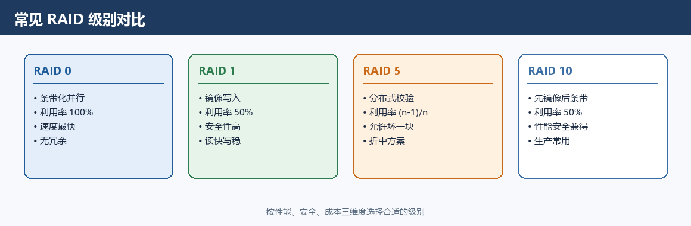
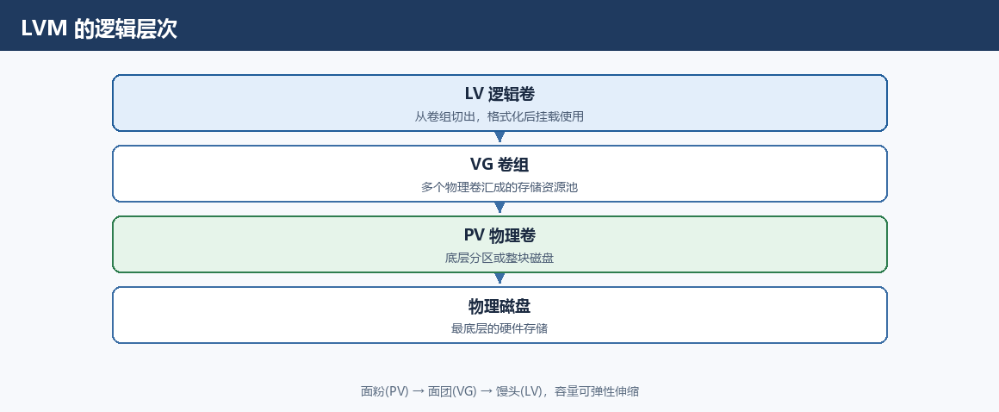

## 板块8 · RAID与LVM磁盘阵列技术

一块磁盘有两个绕不开的宿命：速度有上限，且终会损坏。RAID 用多块磁盘协同工作，要么提升性能，要么提供冗余，要么两者兼顾；LVM 则在磁盘与文件系统之间加了一层逻辑映射，让容量可以像橡皮筋一样动态伸缩。这个板块在分区与挂载知识的基础上，把存储从"能用"提升到"高可用、可弹性"。

### 8_1 技术背景与核心原理：用多块盘换性能与安全感

RAID 的基本思路是把多块磁盘组合成一个逻辑盘，数据按不同规则分布其上。不同规则形成不同级别，各自在容量利用率、读写性能、安全性、成本之间权衡。

理解 RAID 级度有个生活化比喻：把联系人的电话号码抄两份、多买一个电话本，安全性提高了，但成本也翻倍——这就是镜像冗余的本质。不同的 RAID 级别，就是在"多买几个本子"与"多快能翻到号码"之间做不同的取舍。

| 级别 | 原理 | 容量利用率 | 性能 | 安全性 |
| --- | --- | --- | --- | --- |
| RAID 0 | 条带化分布，并行读写 | 100% | 最高 | 最差，任一盘坏则数据全损 |
| RAID 1 | 镜像写入，多盘同内容 | 50% | 读快写略降 | 高，可坏一半盘 |
| RAID 5 | 分布式奇偶校验 | (n-1)/n | 读快写受校验影响 | 允许坏一块盘 |
| RAID 10 | 先镜像后条带 | 50% | 读写均优 | 高，兼顾性能与安全 |

RAID 0 只追求速度，没有冗余，适合临时数据；RAID 1 只追求安全，容量利用率低；RAID 5 在容量、性能、安全之间折中，允许坏一块盘；RAID 10 结合镜像的安全与条带的速度，是生产环境中综合表现优秀的方案，代价是磁盘利用率只有一半。

一个真实的教训说明了热备盘的必要性：有学生在做 RAID 1 实验时，一块盘损坏后开始修复，结果修复途中另一块盘也坏了，数据彻底丢失。解决办法是配置热备盘——平时待命，主盘故障时自动顶替并开始同步，为管理员争取到更换故障盘的时间。

```
常见 RAID 级别的数据分布示意
  RAID 0（条带）：  A1 A2 A3     数据分散，快但无备份
                   B1 B2 B3

  RAID 1（镜像）：  盘1: A B C   两盘内容完全一致
                   盘2: A B C

  RAID 5（校验）：  盘1: A1 A2 P  校验信息分布式存放
                   盘2: B1 P  B2
                   盘3: P  C1 C2

  RAID 10：        先两两镜像，再跨组条带化
```



### 8_2 实操一：部署与修复 RAID 阵列

部署 RAID 10 使用 mdadm 工具，完整流程如下：

1. 准备四块新磁盘，用 mdadm 创建 RAID 10 设备，命名为 /dev/md0。
2. 格式化该阵列设备为 Ext4，创建挂载目录并挂载。
3. 用 df 确认容量与挂载状态。
4. 把挂载信息写入 fstab，实现永久生效。

多块磁盘组合后需要一个统一设备名 /dev/md0，而不能沿用 sda、sdb 这类单盘命名。有个幽默的比喻：不能把班级命名为"/dev/sdbcde"那么长，组合盘需要自己的简洁名字。

修复实验是理解 RAID 价值的关键：用 mdadm 的 `-f` 参数模拟一块盘故障，观察阵列仍处于可用状态、数据仍可访问；用 `-r` 移除故障盘，用 `-a` 添加新盘，阵列自动重建。这个过程直观展示了冗余的意义——坏了一块盘，服务不中断。

更稳妥的方案是 RAID 5 加一块热备盘：用三块盘做 RAID 5，再加一块设为热备（`-x 1`）。模拟主盘故障后，热备盘自动顶替并开始同步数据，无需人工干预。这在机房里有三十多块磁盘时尤其重要——运维人员可以凭指示灯变红或闪烁黄灯定位故障盘，但要争取到更换时间，靠的正是热备机制。

删除阵列也有规范流程：先卸载，再停止阵列，清除每块盘的超级块信息，最后删除 fstab 中的挂载项。顺序颠倒可能留下残余元数据，导致下次创建阵列时报错。

**配置示例：创建 RAID 10 与故障修复**

用四块盘组建 RAID 10，格式化挂载后用 df 确认容量；再用 mdadm 的 -f 模拟坏盘、-r 移除、-a 加新盘，观察阵列自动重建。注意组合盘统一命名为 /dev/md0，而非沿用单盘名。

```
# 用四块盘创建 RAID 10
root@iaoexl:~# mdadm -C /dev/md0 -a yes -l 10 -n 4 /dev/sd{b,c,d,e}
mdadm: array /dev/md0 started.

# 格式化、挂载并确认容量
root@iaoexl:~# mkfs.ext4 /dev/md0
root@iaoexl:~# mkdir /raid10 && mount /dev/md0 /raid10
root@iaoexl:~# df -h /raid10
Filesystem      Size  Used Avail Use% Mounted on
/dev/md0         20G   45M   19G   1% /raid10

# 模拟一块盘故障，观察阵列仍可用
root@iaoexl:~# mdadm /dev/md0 -f /dev/sdb
mdadm: set /dev/sdb faulty in /dev/md0
root@iaoexl:~# mdadm -D /dev/md0 | grep -i state
  State : clean, degraded

# 移除故障盘并加入新盘，阵列自动重建
root@iaoexl:~# mdadm /dev/md0 -r /dev/sdb
root@iaoexl:~# mdadm /dev/md0 -a /dev/sdf
mdadm: added /dev/sdf
```

**配置示例：RAID 5 加备份盘（热备）与删除阵列**

用三块盘做 RAID 5，再用 `-x 1` 指定一块热备盘。模拟主盘故障后，热备盘会自动顶替并开始同步，无须人工干预。

```
# 1) 创建 RAID 5（3 块活动盘 + 1 块热备盘）
root@iaoexl:~# mdadm -Cv /dev/md0 -n 3 -l 5 -x 1 /dev/sdb /dev/sdc /dev/sdd /dev/sde
mdadm: array /dev/md0 started.

# 查看阵列，确认 Spare Devices 为 1
root@iaoexl:~# mdadm -D /dev/md0
     Raid Devices : 3
    Total Devices : 4
     Spare Devices : 1

# 2) 格式化、写入 fstab 并挂载
root@iaoexl:~# mkfs.ext4 /dev/md0
root@iaoexl:~# mkdir /RAID
root@iaoexl:~# echo "/dev/md0 /RAID ext4 defaults 0 0" >> /etc/fstab
root@iaoexl:~# systemctl daemon-reload
root@iaoexl:~# mount -a
root@iaoexl:~# df -h /RAID
/dev/md0    40G   24K   38G   1% /RAID

# 3) 模拟主盘故障，热备盘自动顶替并开始重建
root@iaoexl:~# mdadm /dev/md0 -f /dev/sdb
mdadm: set /dev/sdb faulty in /dev/md0
root@iaoexl:~# mdadm -D /dev/md0
    Rebuild Status : 29% complete
       3     8       64        0      active sync   /dev/sde
       0     8       16        -      faulty        /dev/sdb

# 4) 删除阵列：先卸载，再停止，最后清除每块盘的超级块
root@iaoexl:~# umount /dev/md0
root@iaoexl:~# mdadm -S /dev/md0
mdadm: stopped /dev/md0
root@iaoexl:~# mdadm --zero-superblock /dev/sdb
root@iaoexl:~# mdadm --zero-superblock /dev/sdc
root@iaoexl:~# mdadm --zero-superblock /dev/sdd
root@iaoexl:~# mdadm --zero-superblock /dev/sde
root@iaoexl:~# mdadm -D /dev/md0
mdadm: cannot open /dev/md0: No such file or directory
```

### 8_3 关键概念：LVM 的逻辑层

LVM 在磁盘分区与文件系统之间插入三个逻辑层，把"固定分区"变成"弹性资源池"。

| 层级 | 英文 | 含义 | 类比 |
| --- | --- | --- | --- |
| 物理卷 | PV | 底层物理分区 | 面粉 |
| 卷组 | VG | 多个 PV 组成的资源池 | 揉成的大面团 |
| 逻辑卷 | LV | 从 VG 中切出的可用空间 | 分成的馒头 |

这个"面粉—面团—馒头"的比喻揭示了两层抽象：PV 是原始材料，VG 把材料汇成池，LV 从池里按需取用。PE 是 LVM 的最小分配单元，LV 由若干 PE 组成。有了这层结构，扩容时只要从 VG 里再切一块给 LV，而不必动物理分区。



| 命令 | 作用 |
| --- | --- |
| pvcreate / pvdisplay / pvscan | 创建、查看、扫描物理卷 |
| vgcreate / vgdisplay / vgscan | 创建、查看、扫描卷组 |
| lvcreate / lvdisplay / lvscan | 创建、查看、扫描逻辑卷 |
| vgextend / vgreduce | 扩展、缩减卷组 |
| lvextend / lvreduce | 扩展、缩减逻辑卷 |
| resize2fs / xfs_growfs | 同步文件系统容量 |
| e2fsck | 检查文件系统完整性 |
| lvconvert | 管理快照 |

```
LVM 层次结构
  物理磁盘 ─► 分区 ─► PV ─► [ VG 资源池 ] ─► LV1 ─► 文件系统 ─► 挂载目录
                        PV ─┘              ├─ LV2
                        PV ─┘              └─ LV3（可快照）
   物理层          物理卷层      卷组层        逻辑卷层      文件系统层
```

### 8_4 实操二：LVM 的部署、扩容、缩容与快照

LVM 部署按"PV→VG→LV→格式化→挂载→写 fstab"的顺序进行。实验中用两块新磁盘创建 PV 与 VG，再切出一个约 148MB 的 LV，格式化后挂载到指定目录。

**配置示例：LVM 的创建与在线扩容**

LVM 部署按 PV→VG→LV→格式化→挂载的顺序进行。实验创建物理卷与卷组、切出逻辑卷并挂载，再用 lvextend 在线扩容，紧跟 resize2fs 同步文件系统，最后 df 确认容量变化。

```
# 创建物理卷与卷组
root@iaoexl:~# pvcreate /dev/sdb /dev/sdc
  Physical volume "/dev/sdb" successfully created.
root@iaoexl:~# vgcreate vg0 /dev/sdb /dev/sdc
  Volume group "vg0" successfully created

# 从卷组切出 150MB 的逻辑卷，格式化挂载
root@iaoexl:~# lvcreate -n lv0 -L 150M vg0
root@iaoexl:~# mkfs.ext4 /dev/vg0/lv0
root@iaoexl:~# mkdir /lv0 && mount /dev/vg0/lv0 /lv0

# 在线扩容到 300M：先扩 LV，再同步文件系统
root@iaoexl:~# lvextend -L 300M /dev/vg0/lv0
root@iaoexl:~# resize2fs /dev/vg0/lv0
root@iaoexl:~# df -h /lv0
Filesystem            Size  Used Avail Use% Mounted on
/dev/mapper/vg0-lv0   291M  2.1M  274M   1% /lv0

# 查看三层结构
root@iaoexl:~# pvdisplay
root@iaoexl:~# vgdisplay
root@iaoexl:~# lvdisplay
```

扩容与缩容有一个本质区别必须牢记：**扩容可以先在线后同步，缩容必须先卸载并检查**。扩容时先用 lvextend 扩展 LV，再用 resize2fs（Ext4）或 xfs_growfs（XFS）同步文件系统容量，最后 df 确认。缩容则要先卸载，用 e2fsck 检查完整性，再用 resize2fs 缩小文件系统、用 lvreduce 缩小 LV，且两处容量必须完全一致。

缩容的"容量一致"有个幽默的提醒：就像说好纹一只小猫咪，结果纹成了下山虎——前后不一致会造成数据损坏。还有个更贴切的比喻：缩小前先用 resize2fs"申报"容量变化，就像小孩先试探家长对文身的反应，确认没问题再真正动手。

快照是 LVM 的实用特性：创建一个与原 LV 等大的快照卷，写入测试数据后再用 lvconvert --merge 还原，原卷回到快照创建时的状态。两点限制要记住——快照容量需等同原卷，且仅一次有效，还原后自动删除。

删除 LVM 严格按"逻辑卷→卷组→物理卷"的顺序，先取消挂载并清理 fstab，再依次 lvremove、vgremove、pvremove。顺序反了会因为依赖关系而删除失败。

| 操作 | 关键顺序 |
| --- | --- |
| 扩容 | lvextend → 同步文件系统 → 验证 |
| 缩容 | 卸载 → e2fsck 检查 → resize2fs → lvreduce → 挂载 |
| 快照还原 | 创建等大快照 → 制造变化 → lvconvert --merge |
| 删除 | 卸载 → 清 fstab → lvremove → vgremove → pvremove |

下面三组示例沿用卷组 storage、逻辑卷 vo、挂载点 /iaoexl。

**配置示例：缩小逻辑卷（umount / e2fsck / resize2fs / lvreduce）**

缩容必须先卸载文件系统并检查完整性，且 resize2fs 与 lvreduce 指定的容量必须完全一致，否则会损坏数据。

```
# 1) 卸载并检查文件系统完整性
root@iaoexl:~# umount /iaoexl
root@iaoexl:~# e2fsck -f /dev/storage/vo
Pass 1: Checking inodes, blocks, and sizes
Pass 2: Checking directory structure
...
/dev/storage/vo: 11/73704 files (0.0% non-contiguous), 24683/299008 blocks

# 2) 先把文件系统缩小到 120M，再缩小逻辑卷（两者容量必须一致）
root@iaoexl:~# resize2fs /dev/storage/vo 120M
Resizing the filesystem on /dev/storage/vo to 122880 (1k) blocks.
root@iaoexl:~# lvreduce -L 120M /dev/storage/vo
  File system size (120.00 MiB) is equal to the requested size (120.00 MiB).
  Size of logical volume storage/vo changed from 292.00 MiB (73 extents) to 120.00 MiB (30 extents).

# 3) 重新挂载并确认容量
root@iaoexl:~# mount -a
root@iaoexl:~# df -h /iaoexl
/dev/mapper/storage-vo  108M   14K   99M   1% /iaoexl
```

**配置示例：逻辑卷快照（lvcreate -s / lvconvert --merge）**

快照卷需与原卷等大，且仅一次有效，还原后自动删除。

```
# 1) 写入一个待保护文件，再创建 120M 的快照卷
root@iaoexl:~# echo "Welcome to Linuxprobe.com" > /iaoexl/readme.txt
root@iaoexl:~# lvcreate -L 120M -s -n SNAP /dev/storage/vo
  Logical volume "SNAP" created.
root@iaoexl:~# lvdisplay
  LV snapshot status     active destination for vo
  COW-table size         120.00 MiB

# 2) 制造变化：写入 100M 新文件，观察快照占用率上升
root@iaoexl:~# dd if=/dev/zero of=/iaoexl/files count=1 bs=100M
104857600 bytes (105 MB, 100 MiB) copied
root@iaoexl:~# lvdisplay
  Allocated to snapshot  67.28%

# 3) 卸载后用 lvconvert --merge 还原，快照自动删除
root@iaoexl:~# umount /iaoexl
root@iaoexl:~# lvconvert --merge /dev/storage/SNAP
  Merging of volume storage/SNAP started.
  storage/vo: Merged: 100.00%

# 4) 重新挂载，数据回到创建快照时的状态
root@iaoexl:~# mount -a
root@iaoexl:~# ls /iaoexl
lost+found  readme.txt
root@iaoexl:~# cat /iaoexl/readme.txt
Welcome to Linuxprobe.com
```

**配置示例：删除逻辑卷（lvremove / vgremove / pvremove）**

严格按"逻辑卷 → 卷组 → 物理卷"顺序删除，先取消挂载并清理 fstab 中的挂载项。

```
# 1) 取消挂载，删除 fstab 中对应条目
root@iaoexl:~# umount /iaoexl
root@iaoexl:~# vim /etc/fstab

# 2) 依次删除逻辑卷、卷组、物理卷
root@iaoexl:~# lvremove /dev/storage/vo
Do you really want to remove active logical volume storage/vo? [y/n]: y
  Logical volume "vo" successfully removed.
root@iaoexl:~# vgremove storage
  Volume group "storage" successfully removed
root@iaoexl:~# pvremove /dev/sdb /dev/sdc
  Labels on physical volume "/dev/sdb" successfully wiped.
  Labels on physical volume "/dev/sdc" successfully wiped.
```

### 8_5 场景笔记方法：把阵列与逻辑卷记成"拓扑图 + 命令序列"

存储方案一旦复杂，文字描述很快失去全局感。建议每种方案都画一张拓扑图，标清成员磁盘、阵列名或卷组名、挂载点，再配一份命令序列。

| 记录项 | 记录内容 | 示例 |
| --- | --- | --- |
| 方案拓扑 | 成员盘与逻辑设备关系图 | 4 盘 → md0 → /raid10 |
| 设备名 | 阵列或卷组名称 | /dev/md0、vg0/vo |
| 文件系统 | 格式化类型 | Ext4 / XFS |
| 关键命令 | 完整命令序列 | mdadm -C /dev/md0 ... |
| 故障演练 | 模拟故障与恢复步骤 | -f 模拟坏盘、-a 添加新盘 |

扩容与缩容的笔记必须把"顺序"写清楚，尤其是缩容的"卸载—检查—缩小—缩减"四步，一步都不能颠倒或遗漏。快照笔记要注明容量要求与"一次性"限制。

RAID 与 LVM 的对比也值得记下来：RAID 侧重性能与冗余，LVM 侧重容量弹性，两者可以结合——先在底层做 RAID 保证数据安全，再在其上做 LVM 获得弹性，这是生产环境常见的高可用存储方案。

### 8_6 实用验证与排错：确认冗余与弹性真的有效

存储方案的价值不在配置完成那一刻，而在故障发生时。因此验证必须包含"破坏—恢复"环节。

```
存储方案验证流程
  部署配置 ──► 挂载验证 ──► 故障模拟 ──► 观察服务 ──► 恢复重建 ──► 再验证
     │            │            │            │            │          │
   mdadm/lvm    df -h       -f 模拟坏盘    数据仍可读     -a 加新盘  阵列正常
```

| 现象 | 排查方向 |
| --- | --- |
| 阵列无法启动 | 成员盘超级块是否残留旧信息 |
| 重启后卷组消失 | `/etc/lvm/archive` 是否有可还原的元数据 |
| 手动能组阵、重启又散 | `/etc/mdadm.conf` 是否写入、initramfs 是否重建 |
| 阵列降级但不重建 | 是否缺少热备盘或新盘未添加 |
| 扩容后 df 容量不变 | 是否忘记同步文件系统 |
| 缩容后数据异常 | 前后容量是否一致、是否卸载检查 |
| 快照还原失败 | 快照容量是否等同原卷、是否已用过 |

**元数据坏了怎么救：LVM 与阵列的恢复入口**

配置正确时的操作人人会做，难的是"扫描不到卷组""阵列开机没组起来"。这两种故障有固定入口，不需要重装。

LVM 的元数据不是只存在盘上，每次变更还会在 `/etc/lvm/backup/` 留一份当前版本、在 `/etc/lvm/archive/` 留一串历史版本。盘上的元数据被误操作覆盖时，靠这两份文件能把卷组"认"回来。

```
# 一、先看 LVM 眼里有没有东西
root@iaoexl:~# pvscan; vgscan; lvscan
  No volume groups found

# 二、看备份里有没有这个卷组的记录（-l 列出可用版本）
root@iaoexl:~# vgcfgrestore -l vg0
File:	/etc/lvm/archive/vg0_00003-1234567890.vg

# 三、停用后按备份还原元数据
root@iaoexl:~# vgchange -an vg0
root@iaoexl:~# vgcfgrestore -f /etc/lvm/archive/vg0_00003-1234567890.vg vg0
root@iaoexl:~# vgchange -ay vg0
root@iaoexl:~# lvs

# 四、盘上元数据彻底丢失时：用备份重建 PV 标签，UUID 必须与备份里一致
root@iaoexl:~# pvcreate --restorefile /etc/lvm/backup/vg0 --uuid <原UUID> /dev/sdb1
```

第三步之前必须 `vgchange -an`，原因很直接：还原元数据会改动设备映射，卷还在用时还原等于在文件系统正下方换地基。第四步的 `--uuid` 不能省，否则 LVM 认为这是一块新盘，备份里的映射关系对不上。

阵列侧的对应问题是"开机没自动组阵"。`mdadm --assemble` 手动能组起来、重启后又散，说明配置没落到 `/etc/mdadm.conf`，initramfs 里也就没有组装信息。

```
# 手动组阵并确认
root@iaoexl:~# mdadm --assemble --scan
root@iaoexl:~# cat /proc/mdstat

# 把扫描结果写进配置，再重建 initramfs，重启才会自动组
root@iaoexl:~# mdadm --detail --scan >> /etc/mdadm.conf
root@iaoexl:~# dracut --force

# 降级阵列换盘：先标记失败、移除，再加新盘
root@iaoexl:~# mdadm /dev/md0 --fail /dev/sdc1 --remove /dev/sdc1
root@iaoexl:~# mdadm /dev/md0 --add /dev/sdd1
root@iaoexl:~# cat /proc/mdstat        # 观察 recovery 百分比直到完成
```

一条经验极其重要：所有破坏性实验（模拟坏盘、缩容、快照还原）都必须在虚拟机中、且已保存快照的前提下进行。真实磁盘上的误操作无法回滚，而虚拟机的快照能让"搞砸了"变成一次无害的学习经历。

### 8_7 认证对标与进阶实战

RAID 与 LVM 属于认证体系中的进阶存储内容。LPIC-1 的 102 考试涉及 RAID 与逻辑卷，LFCS 与 RHCSA 都把 LVM 的创建与扩容列为高阶必考项，CompTIA Linux+ 也会考查磁盘冗余方案。这一板块是从"会用磁盘"迈向"会设计存储方案"的关键。

| 认证体系 | 与本主题相关的考查方向 | 核心能力要求 |
| --- | --- | --- |
| LPIC-1（102） | RAID 级别、逻辑卷管理 | 说明各 RAID 级别差异、管理 LVM |
| LFCS | 存储管理进阶 | 创建 RAID 阵列、扩展逻辑卷 |
| RHCSA（EX200） | 配置本地存储、创建与配置文件系统 | 建 PV/VG/LV、在线扩容、按 UUID 挂载 |
| RHCE 排障方向（EX342） | 恢复不当或损坏的 LVM 配置 | 用 `/etc/lvm/archive` 还原元数据、重建 PV 标签 |
| CompTIA Linux+ | 磁盘冗余、容错 | 按场景选择合适的 RAID 级别 |

一个真实教训说明了热备盘的价值：某台服务器做 RAID 5，一块盘故障后管理员才开始找备件，重建过程中第二块盘又坏了，数据全部丢失。RAID 5 只允许坏一块盘，重建期间阵列处于脆弱状态，此时最怕第二次故障。配置热备盘后，主盘故障的瞬间热备盘自动顶替并开始同步，把"脆弱窗口"从几天压缩到几小时。这提醒我们：RAID 不是保险箱，重建期间的二次故障才是真正的风险点。

阵列与逻辑卷的高频故障，多与顺序和同步有关。

| 现象 | 根因 | 定位命令 | 处置 |
| --- | --- | --- | --- |
| 扩容后容量没变 | 只扩了 LV 未同步文件系统 | df -h、lvdisplay | 执行 resize2fs 或 xfs_growfs |
| 阵列降级未重建 | 缺热备盘或新盘未加入 | mdadm -D | 添加热备或新盘触发重建 |
| 阵列无法组装 | 超级块残留旧元数据 | mdadm --examine | 清除旧超级块后重建 |
| 缩容后数据损坏 | 缩减顺序错误或容量不一致 | 检查文件系统 | 卸载、检查、按顺序操作 |

闯关任务按"阵列—逻辑卷—故障演练"三级递进，破坏性操作必须在虚拟机快照后进行。

```
  存储进阶闯关
  第一关 组建 RAID 1 并模拟坏盘与恢复
    │
  第二关 创建 LVM 并完成一次在线扩容
    │
  第三关 创建快照、修改数据、再还原验证
```

- 第一关：`mdadm -C` 创建，`-f` 模拟故障，`-r` 移除、`-a` 添加，观察重建。
- 第二关：`lvextend` 后必须跟一步文件系统同步，再用 `df -h` 确认。
- 第三关：`lvconvert --merge` 还原快照，确认数据回到创建时的状态。

进阶要理解条带、镜像与校验三种机制的取舍逻辑。条带（RAID 0）把数据切块分散写到多盘，并行提升吞吐，但没有冗余；镜像（RAID 1）把同样数据写到两块盘，读快写稳、容量减半；校验（RAID 5/6）用奇偶校验信息在坏盘时推算丢失数据，兼顾容量与安全，但重建时读压力大。RAID 10 把镜像与条带叠加，兼顾性能与安全，代价是容量利用率一半。LVM 则是另一维度的抽象：它在物理盘与文件系统之间插入逻辑层，让容量可以按需伸缩， RAID 保证"数据不丢"，LVM 保证"容量好用"，二者正交，生产环境常叠加使用。把各级别的"读性能/写性能/容错/利用率"做成四维对照表记入笔记，选型时一查便知。

### 8_8 要点回顾与能力自检

本板块讲清了 RAID 各级别在容量、性能、安全上的权衡，完成了 RAID 10 与 RAID 5 加热备盘的部署与修复，理解了 LVM 的 PV—VG—LV 层次，并掌握了部署、扩容、缩容、快照与删除的完整流程。核心规律是：扩容相对安全，缩容必须谨慎且顺序严格，任何破坏性操作都要先留退路。

自检问题：

1. RAID 0、1、5、10 各自的原理、容量利用率与适用场景是什么？
2. 为什么热备盘很重要？它在主盘故障时如何工作？
3. LVM 的 PV、VG、LV 三层分别是什么？"面粉—面团—馒头"比喻对应什么？
4. LVM 扩容与缩容在操作步骤上有什么本质区别？
5. 快照有哪些限制？删除 LVM 的正确顺序是什么？
