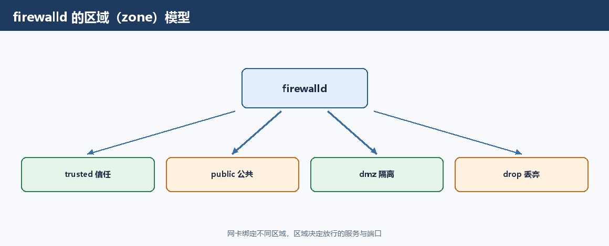
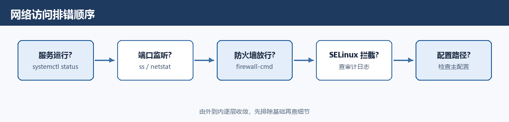

## 板块9 · Firewalld防火墙与网络安全

系统本身加固之后，要守住它与外界连接的边界。防火墙就是公网与内网之间的保护屏障，依据预设策略对进出流量进行过滤：符合规则的放行，全部不匹配的通常丢弃。这个板块讲清防火墙工具与真正防火墙的区别、firewalld 的区域模型、命令行与图形两种配置方式，并用一组真实需求驱动的实验把策略配置练熟；同时对照两代系统的服务管理差异，并把"云安全组加主机防火墙"的双层结构讲清，避免"端口放行了却仍不通"。防火墙管的是"包能不能进来"，包进来之后进程能不能读文件、能不能绑端口，归下一个板块的 SELinux 管——两件事经常被混为一谈，这里先把边界划清。

### 9_1 技术背景与核心原理：工具不是墙，策略才是

一个常见的概念混淆必须澄清：iptables 与 firewalld 都不是真正的防火墙，它们只是用来定义防火墙策略的管理工具。真正执行过滤的是内核层面的框架——iptables 把策略交给 netfilter，firewalld 把策略交给 nftables。从较新的系统版本开始，firewalld 取代 iptables 成为默认工具，这让熟悉旧工具的读者一度抵触。

理解这一层关系后，抵触就消解了：这些工具的配置思路一致，只要把其中一款学透，就足以应付日常工作。它们都基于同样的逻辑——按源地址、目标地址、端口、协议、应用等信息定制规则，流量经过时逐条匹配，命中即执行对应处理。

防火墙可以比作家里的防盗门：目的是保护家人与财产安全。策略则像门上的规则——什么样的访客可以进、什么样的要拦下。默认丢弃所有未匹配流量，是"宁可错拦、不可错放"的安全原则体现。

```
防火墙工作位置与策略匹配
  外部公网 ──► [ 防火墙：逐条匹配策略 ] ──► 内部网络
                    │
        匹配放行规则 ─┼─► 放行
        匹配拒绝规则 ─┼─► 拒绝
        全部不匹配 ───┴─► 默认丢弃
  iptables ─► netfilter（内核）   firewalld ─► nftables（内核）
```

### 9_2 关键概念：区域模型与两种生效模式

firewalld 的两大特色是动态更新与区域（zone）概念。区域是一套预设的策略集合，可根据场景快速切换。这个设计非常适合"一台笔记本在三个地方用"的场景：在家允许所有服务，在公司只允许文件共享，在咖啡厅只允许浏览网页。以往要反复手改规则，现在只需切换区域。

| 区域 | 默认策略要点 |
| --- | --- |
| trusted | 允许所有数据包 |
| home | 拒绝流入，除非与流出相关；放行 ssh、mdns 等 |
| internal | 等同 home |
| work | 拒绝流入，放行 ssh、ipp-client 等 |
| public | 默认区域，拒绝流入，放行 ssh、dhcpv6-client |
| external | 拒绝流入，放行 ssh |
| dmz | 隔离区，拒绝流入，放行 ssh |
| block | 拒绝所有流入 |
| drop | 丢弃所有流入 |



默认区域是全局通用策略，优先级低于网卡绑定的区域。有个贴切的比喻：食堂为所有人准备了一次性餐具（默认区域），环保主义者自带碗筷（网卡专属区域）——自带优先，没有才用统一的。这个"网卡区域优先于默认区域"的规则，是配置策略时必须先确认的前提。

两种生效模式是另一个高频踩坑点：

| 模式 | 参数 | 当前是否生效 | 重启后 |
| --- | --- | --- | --- |
| 运行时 Runtime | 默认 | 立即生效 | 失效 |
| 永久 Permanent | `--permanent` | 不立即生效 | 生效 |

永久模式设置的策略只有在系统重启或重新加载后才生效，需要手动执行 `--reload` 才能立即应用。很多"配置了却不生效"的问题，根源就是混淆了两种模式。配置前先想清楚"要临时测试还是长期生效"，是防火墙配置的第一习惯。

### 9_3 实操：firewall-cmd 常用实验

firewall-cmd 是命令行配置工具，参数多为长格式，好消息是它支持 Tab 补全，长参数也能补全，大幅降低输入负担。

| 参数 | 作用 |
| --- | --- |
| --get-zones | 列出所有可用区域 |
| --get-services | 列出预定义服务 |
| --get-active-zones | 查看正在使用的区域与网卡 |
| --get-default-zone | 查询默认区域 |
| --set-default-zone=区域 | 设置默认区域并永久生效 |
| --get-zone-of-interface=网卡 | 查询网卡绑定区域 |
| --change-interface=网卡 | 修改网卡所属区域 |
| --list-services / --list-ports | 列出允许的服务/端口 |
| --list-all | 显示当前区域全部配置 |
| --add-service / --remove-service | 放行/禁止服务 |
| --add-port / --remove-port | 放行/禁止端口 |
| --query-service / --query-port | 查询是否放行 |
| --add-rich-rule / --remove-rich-rule | 添加/删除复杂规则 |
| --reload | 重新加载使永久配置立即生效 |
| --panic-on / --panic-off | 开启/关闭应急模式 |
| --permanent | 设为永久生效 |

**配置示例：放行服务与端口**

放行流量有服务与端口两种方式，且要区分运行时与永久模式。实验先查默认区域，用 --add-service 放行 http、--add-port 放行 8080，再用富规则限定来源网段，永久配置需 reload 才生效。

```
# 查看默认区域与当前配置
root@iaoexl:~# firewall-cmd --get-default-zone
public
root@iaoexl:~# firewall-cmd --list-all
public (active)
  services: ssh dhcpv6-client

# 临时放行 http（运行时，重启失效）
root@iaoexl:~# firewall-cmd --add-service=http
success
root@iaoexl:~# firewall-cmd --query-service=http
yes

# 永久放行并重载使其立即生效
root@iaoexl:~# firewall-cmd --permanent --add-service=http
success
root@iaoexl:~# firewall-cmd --reload
success

# 放行自定义端口 8080
root@iaoexl:~# firewall-cmd --permanent --add-port=8080/tcp
root@iaoexl:~# firewall-cmd --reload

# 用富规则限制仅指定网段可访问 ssh
root@iaoexl:~# firewall-cmd --permanent --add-rich-rule='rule family="ipv4" source address="192.168.10.0/24" service name="ssh" accept'
root@iaoexl:~# firewall-cmd --reload
```

**配置示例：区域切换与应急模式**

查询网卡当前所属区域，再把网卡切换到 external 区域。注意网卡区域优先于默认区域，改默认区域并不会改变已绑定网卡的区域。

```
# 查询网卡当前所属区域
root@iaoexl:~# firewall-cmd --get-zone-of-interface=ens160
public

# 把网卡永久切换到 external 区域
root@iaoexl:~# firewall-cmd --permanent --zone=external --change-interface=ens160
The interface is under control of NetworkManager, setting zone to 'external'.
success
root@iaoexl:~# firewall-cmd --permanent --get-zone-of-interface=ens160
external

# 设置默认区域为 public
root@iaoexl:~# firewall-cmd --set-default-zone=public
Warning: ZONE_ALREADY_SET: public
success
root@iaoexl:~# firewall-cmd --get-default-zone
public
root@iaoexl:~# firewall-cmd --get-zone-of-interface=ens160
external

# 应急模式：一秒内切断一切网络连接，用完务必关闭
root@iaoexl:~# firewall-cmd --panic-on
success
root@iaoexl:~# firewall-cmd --panic-off
success
```

一组由真实需求驱动的实验串联如下。

配置前先查默认区域，这是必须的第一步——否则策略可能配到未生效的区域上。查询网卡绑定区域，因为服务器常有多块网卡，网关服务器一块对公网、一块对内网，两块网卡策略必然不同。修改网卡区域用 `--change-interface`，网卡名以实际为准，可用 ifconfig 查询。设置默认区域用 `--set-default-zone`，注意默认区域优先级低于网卡区域。

应急模式是一个很有意思的功能：`--panic-on` 能在一秒内切断一切网络连接。有人第一反应是"拔网线"，但如果人在异地、服务器在机房呢？应急模式正是为这种场景准备。切记它会切断一切连接，远程管理时按下回车前务必三思——否则把自己关在门外。

放行服务的实验展示了运行时与永久模式的差别：查询得知某服务默认未放行，用 `--permanent --add-service` 放行后，查询当前模式仍显示未放行，因为永久配置尚未加载；执行 `--reload` 后才真正生效。这个对照实验把两种模式的区别讲得极其清楚。

### 9_4 Iptables 规则与命令

iptables 是早期的防火墙管理工具，虽然新系统已默认改用 firewalld，但仍有大量企业沿用，理解它也有助于看透包过滤的本质。iptables 把用于处理流量的策略条目称为规则，多条规则组成一个规则链，规则链按数据包处理位置分为五类。

| 规则链 | 处理时机 |
| --- | --- |
| PREROUTING | 路由选择前处理数据包 |
| INPUT | 处理流入的数据包 |
| OUTPUT | 处理流出的数据包 |
| FORWARD | 处理转发的数据包 |
| POSTROUTING | 路由选择后处理数据包 |

iptables 按从上到下的顺序读取规则，命中即执行并结束匹配；全部未命中则执行默认策略。因此默认策略为拒绝时要设置允许规则，默认策略为允许时要设置拒绝规则，否则防火墙形同虚设。匹配成功后有四种处理动作。

| 动作 | 含义 |
| --- | --- |
| ACCEPT | 允许流量通过 |
| REJECT | 拒绝流量通过，并回复一条拒绝信息 |
| LOG | 记录日志信息 |
| DROP | 直接丢弃流量且不响应 |

REJECT 与 DROP 的差别很直观：REJECT 会明确回复"端口不可达"，发送方知道自己被拒绝；DROP 则默不作声，发送方只看到"响应超时"，甚至判断不出对方主机是否在线。

iptables 的常用参数如下。

| 参数 | 作用 |
| --- | --- |
| -P | 设置默认策略 |
| -F | 清空规则链 |
| -L | 查看规则链 |
| -A | 在规则链末尾添加新规则 |
| -I num | 在规则链头部添加新规则 |
| -D num | 删除指定规则 |
| -s | 匹配来源地址（IP/MASK），加叹号表示排除 |
| -d | 匹配目的地址 |
| -i 网卡名称 | 匹配从指定网卡流入的数据 |
| -o 网卡名称 | 匹配从指定网卡流出的数据 |
| -p | 匹配协议，如 TCP、UDP、ICMP |
| --dport num | 匹配目的端口号 |
| --sport num | 匹配来源端口号 |

**配置示例：iptables 规则链的基本管理**

iptables 属于较早期的工具，在较新的系统中已不是默认的防火墙管理工具，默认策略由 firewalld 接管；不过软件包仍在仓库中，命令照旧可用（底层已转为 iptables-nft 兼容层），企业里大量存量服务器也仍在沿用它。以下命令演示规则链的查看、清空、默认策略、追加、插入与删除。

```
# 查看规则链
root@iaoexl:~# iptables -L
Chain INPUT (policy ACCEPT)
target     prot opt source        destination

# 清空规则链
root@iaoexl:~# iptables -F

# 把 INPUT 规则链的默认策略设置为拒绝
root@iaoexl:~# iptables -P INPUT DROP

# 在规则链末尾追加：允许流入的 22 端口 TCP 流量
root@iaoexl:~# iptables -A INPUT -p tcp --dport 22 -j ACCEPT

# 在规则链头部插入：禁止 192.168.10.0/24 网段访问本机 sshd
root@iaoexl:~# iptables -I INPUT -s 192.168.10.0/24 -p tcp --dport 22 -j REJECT

# 删除 INPUT 规则链中的第 1 条规则
root@iaoexl:~# iptables -D INPUT 1
```

这段演示省略了一个生产环境必须补的规则。把 INPUT 默认策略改为 DROP 后，只有目的端口 22 的**新连接**被放行，本机发出的响应包与已建立的会话并不在放行范围内——对端能发出请求却收不到回应，表现出来就是"规则看着没问题、连接却不通"。因此实际配置的第一条规则通常是 `iptables -A INPUT -m conntrack --ctstate ESTABLISHED,RELATED -j ACCEPT`，先让已建立连接及其关联流量通过，再逐条放行新服务。

顺序同样有讲究：远程操作时若先执行 `-P INPUT DROP`，SSH 会话会在改完默认策略的瞬间断开，后面的放行命令再也没有机会执行。稳妥的做法是先加放行规则、确认能连，最后才收默认策略；或者在本地控制台操作，避免把自己关在门外。

### 9_5 跨版本实操：从 service 到 systemctl，从主机到云安全组

教材里的防火墙命令常被质疑"敲了没反应"，原因往往不在命令本身，而在版本与层级。CentOS 6 用 `service` 加 `chkconfig` 管服务、用 `iptables` 管规则；CentOS 7 之后统一为 `systemctl` 加 `firewalld`。同一句 `iptables` 命令在两个版本上表现一致，但服务管理与规则持久化的方式完全不同。

```
规则生效的两个层面
  云平台安全组（虚拟防火墙，包进不了主机）
        │  放行后才轮到主机
        ▼
  主机防火墙（firewalld / iptables，包进得了主机也进不了进程）
        ▼
  服务监听（ss -lntp 有无该端口）
```

这个三层顺序是排错的核心：端口不通先看服务有没有监听，再看主机防火墙，最后看云安全组。跳过任何一层都会白折腾——最常见的是主机上把 3306 放行了，云控制台安全组没开，外部依旧连不上。

**配置示例：两种服务管理方式与规则查看**

同样的意图，两代系统的写法并列如下。观察重点在于"临时生效"与"永久生效"如何分离：`firewall-cmd` 用 `--permanent` 写配置、`--reload` 才加载；老版本的 iptables 直接用 `service iptables save` 把当前规则落盘。

```
# ===== CentOS 7：firewalld =====
# 状态与自启（start 只管本次，enable 只管下次开机）
root@iaoexl:~# systemctl status firewalld
root@iaoexl:~# systemctl enable --now firewalld

# 查看运行状态与完整规则
root@iaoexl:~# firewall-cmd --state
running
root@iaoexl:~# firewall-cmd --list-all
public (active)
  target: default
  interfaces: ens160
  services: ssh dhcpv6-client
  ports: 9200/tcp 65001-65010/tcp
  masquerade: no
  rich rules:

# 端口增删（永久生效后必须 reload）
root@iaoexl:~# firewall-cmd --permanent --add-port=9200/tcp
root@iaoexl:~# firewall-cmd --permanent --add-port=65001-65010/tcp
root@iaoexl:~# firewall-cmd --reload
root@iaoexl:~# firewall-cmd --query-port=9200/tcp
yes
root@iaoexl:~# firewall-cmd --permanent --remove-port=9200/tcp && firewall-cmd --reload

# ===== CentOS 6：service + chkconfig + iptables =====
root@iaoexl:~# service iptables status
root@iaoexl:~# service iptables stop
root@iaoexl:~# chkconfig iptables off
root@iaoexl:~# vim /etc/sysconfig/iptables
-A INPUT -p tcp -m tcp --dport 2888 -j ACCEPT
root@iaoexl:~# service iptables restart
```

`firewall-cmd --list-all` 的输出值得逐个字段读一遍：`target` 是未匹配流量的默认动作，`interfaces` 说明这块网卡绑在哪个区域，`services` 是按服务名放行（背后是一组端口与协议的预定义），`ports` 是手工放行的端口或端口范围，`rich rules` 放的是带源地址、限速等条件的复杂规则。看不懂这个输出，就等于在黑盒里改配置。

一条实用规律：**凡是加了 `--permanent` 的命令，都必须跟一次 `--reload` 才生效**；不加 `--permanent` 的命令立即生效但重启即失效。想"立即生效且永久保留"，就两条都执行。

先关防火墙再部署服务，是老教程的默认动作，但它掩盖了真实的端口需求。稍微规范一点的做法是：部署前想清楚这个服务要开哪些端口（含被动模式的端口范围），一次性写进放行清单，然后用 `--reload` 加载并实测连通性。这样交付出去的机器，防火墙是"开着且够用"的状态，而不是"关着才能用"。

### 9_6 服务的访问控制列表

TCP Wrappers 是另一层访问控制机制，通过 /etc/hosts.allow（允许）与 /etc/hosts.deny（拒绝）两个文件控制哪些主机能访问本机服务。规则格式为"服务名:地址列表"，系统会先检查允许文件，再检查拒绝文件，因此允许策略优先生效。

**配置示例：用 hosts.deny 与 hosts.allow 控制 sshd 访问**

先在拒绝文件中禁止所有来源访问 sshd，客户端连接会被立即重置；再把指定网段加入允许文件，该网段的客户端即可正常登录。

```
# 拒绝所有主机访问 sshd 服务
root@iaoexl:~# vim /etc/hosts.deny
sshd:*
root@iaoexl:~# ssh 192.168.10.10
ssh_exchange_identification: read: Connection reset by peer

# 只允许 192.168.10. 网段的主机访问 sshd 服务
root@iaoexl:~# vim /etc/hosts.allow
sshd:192.168.10.
root@iaoexl:~# ssh 192.168.10.10
The authenticity of host '192.168.10.10 (192.168.10.10)' can't be established.
Are you sure you want to continue connecting (yes/no)? yes
root@192.168.10.10's password: 此处输入管理员密码
Last login: ...
```

### 9_7 Cockpit 驾驶舱管理工具

Cockpit 是一款通过浏览器管理系统的图形化工具，把服务状态、日志、资源占用等集中呈现，适合不习惯命令行的场景。安装启动后即可用浏览器访问，其管理的策略与命令行工具是同一套，二者等价。

**配置示例：安装启动 Cockpit 并禁止 root 登录**

Cockpit 提供浏览器图形化管理，安装启动并设为开机自启后即可访问。出于安全考虑，应在 disallowed-users 中写入 root 禁止管理员直接登录驾驶舱，把图形入口纳入统一管控。

```
# 安装 cockpit 服务程序
root@iaoexl:~# dnf install cockpit
Updating Subscription Management repositories.
...
Complete!

# 启动服务并设置为开机自启
root@iaoexl:~# systemctl start cockpit
root@iaoexl:~# systemctl enable cockpit.socket

# 在 disallowed-users 中写入 root，禁止用管理员账户登录驾驶舱
root@iaoexl:~# vim /etc/cockpit/disallowed-users
List of users which are not allowed to login to Cockpit
root
```

### 9_8 图形化工具与系统监控

除命令行外，firewalld 也提供图形界面工具，适合不习惯命令的场景；Cockpit 则能轻松监控系统的运行状态，把服务的启停、日志、资源占用集中呈现。图形工具与命令行工具修改的是同一套策略，二者等价，选择其一即可。

配置策略时有一条规范值得强调：即便不指定区域时命令会自动使用默认区域，也应显式加上 `--zone` 参数。因为一旦默认区域与网卡绑定区域不一致，省略区域就会导致配置落到错误的地方——看似配置成功，实际不生效。

```
firewalld 配置决策流程
  确认当前区域 ──► 明确目标：服务还是端口？ ──► 确定生效模式
       │                    │                      │
  get-default-zone    add-service / add-port   永久模式需 --reload
  get-active-zones    或 rich-rule 复杂规则     临时模式立即生效
       │
  网卡是否应用了其他区域（网卡区域优先）
```



### 9_9 场景笔记方法：把防火墙策略记成"需求—规则—验证"表

防火墙配置最忌"配完就忘为什么"。每条策略都应记录业务动机，否则日积月累后没人敢删，规则越来越多、越来越乱。

| 记录项 | 记录内容 | 示例 |
| --- | --- | --- |
| 业务需求 | 为什么要开这条规则 | 对外提供 Web 服务 |
| 区域/网卡 | 规则作用范围 | public / ens160 |
| 服务或端口 | 具体放行对象 | https / 8080/tcp |
| 生效模式 | 临时还是永久 | permanent + reload |
| 验证命令 | 用什么确认生效 | --query-service |

建议把每条规则写成"允许谁、访问什么、在哪个区域"的三要素形式，便于审阅。应急模式的注意事项要单独标注——这是会造成"自我隔离"的高风险操作，值得在笔记里用醒目方式提醒。

运行时与永久模式的区别建议做成对照卡片贴在笔记里，因为这是最高频的困惑来源。每次配置前对照一下"我现在要的是哪种"，能避免大量无效排查。

### 9_10 实用验证与排错：确认策略真的按预期工作

防火墙配置的验证要点是"从效果出发"：不是在防火墙里看有没有这条规则，而是从客户端实际访问，看服务是否可达。

```
防火墙验证流程
  查询当前区域与规则 ──► 配置策略 ──► 确认生效模式 ──► 客户端实测访问
        │                                                    │
   --list-all                                        能访问=成功，不能=回查
```

| 现象 | 排查方向 |
| --- | --- |
| 规则配了但不生效 | 是否用了永久模式却没 reload |
| 放行后仍无法访问 | 默认区域与网卡区域是否不一致 |
| 重启后规则丢失 | 是否漏了 --permanent |
| 远程突然断开 | 是否误开 panic 模式 |
| 服务本机可访问外部不可 | 防火墙是否未放行对应服务/端口 |

远程管理防火墙时有一条保命经验：修改 SSH 相关规则前，先确保新规则不会把自己锁在外面，或保留一个已登录的会话作为回退通道。因为在防火墙上犯错，代价往往是"连上去的通道也被一起切断"。

### 9_11 认证对标与进阶实战

防火墙是安全类认证的必考内容。LPIC-1 的网络与安全主题涉及 iptables 规则，LFCS、RHCSA 都要求用 firewalld 管理服务与端口放行，CompTIA Linux+ 把网络安全基础列为独立领域。 防火墙配置错了，服务再正确也访问不通，因此它是服务部署链条上不可跳过的一环。

| 认证体系 | 与本主题相关的考查方向 | 核心能力要求 |
| --- | --- | --- |
| LPIC-1（102） | 网络安全、iptables | 解释包过滤规则与链的概念 |
| LFCS | 防火墙管理 | 用 firewalld 放行服务与端口 |
| RHCSA | 防火墙配置 | 按区域管理服务与端口访问 |
| CompTIA Linux+ | 网络安全基础 | 说明防火墙、端口与协议的关系 |

一个真实事故起于对"运行时配置"的误解：管理员远程给服务器放行了一个端口，`firewall-cmd --add-port` 返回 success，测试也通了，就没加 `--permanent`。几周后服务器重启，端口规则消失，业务中断。原因就是运行时配置不写入配置文件，重启即失效。正确做法是加 `--permanent` 后用 `--reload` 让其立即生效，或先用运行时配置验证、再补永久配置。这个坑几乎每个运维都踩过一次。

防火墙相关故障，多数是规则、区域或模式三者之一出了问题。

| 现象 | 根因 | 定位命令 | 处置 |
| --- | --- | --- | --- |
| 端口放行后仍访问不通 | 规则未加 --permanent 或服务未监听 | firewall-cmd --list-all、ss | 补永久规则并确认服务监听 |
| 重启后规则消失 | 只改了运行时配置 | 查看永久配置 | 加 --permanent 并 reload |
| 特定来源被拒 | 区域规则或 rich rule 限制 | 查区域与富规则 | 核对来源地址与区域绑定 |
| 远程操作把自己锁在外面 | 应急模式或规则误配 | 控制台登录 | 远程改规则前先放行 SSH |

闯关任务按"识别—放行—加固"三级递进，远程操作务必保留应急通道。

```
  防火墙闯关
  第一关 查看当前默认区域与已放行服务
    │
  第二关 放行一个自定义端口并验证可访问
    │
  第三关 限制某服务只允许指定来源网段访问
```

- 第一关：`firewall-cmd --get-active-zones` 与 `--list-all` 看清现状。
- 第二关：`--add-port=端口/协议` 后从客户端验证，再补 `--permanent`。
- 第三关：用富规则（rich rule）按 source 地址限制，验证网段内外差异。

进阶要理解区域（zone）与信任级别的设计思想。firewalld 把网络接口与来源地址归入不同区域，每个区域预设一套放行规则，`public` 用于不信任的公共网络、`trusted` 用于完全信任、`dmz` 用于隔离区，网卡绑定的区域优先于默认区域，这就是"为什么改了默认区域却不生效"的答案。再往底层，firewalld 只是 iptables/nftables 规则的前端管理器，真正的包过滤由内核的 netfilter 框架完成，理解这一点就能明白：运行时模式改的是当前内核规则，永久模式改的是配置文件，二者需要 reload 才同步。把"区域—信任级别—运行时/永久"这三个维度画成一张表，防火墙的配置逻辑就清晰了。

### 9_12 要点回顾与能力自检

本板块澄清了管理工具与内核过滤框架的区别，讲清了 firewalld 的区域模型与运行时/永久两种模式，完成了查询区域、改网卡区域、应急模式、放行服务等实验，并强调了图形工具与显式写区域的规范。

自检问题：

1. iptables、firewalld 与真正的防火墙是什么关系？
2. firewalld 的区域解决什么问题？为什么说网卡区域优先于默认区域？
3. 运行时模式与永久模式的区别是什么？如何让永久配置立即生效？
4. 应急模式有什么作用？远程管理时为何要慎用？
5. 为什么建议显式写 --zone 参数？
