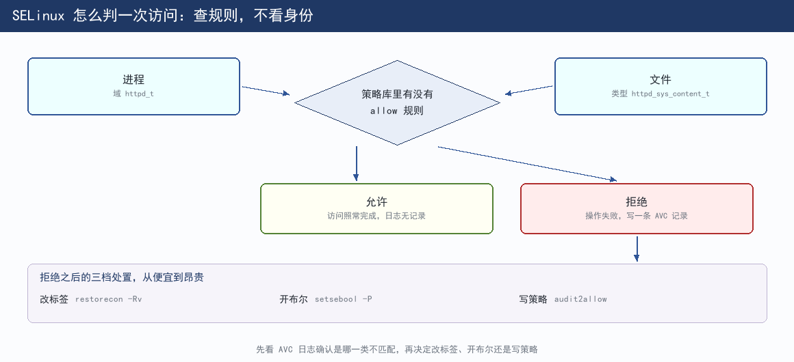

## 板块10 · SELinux安全子系统

配置全对、权限全给、防火墙也放行了，服务还是报 403——红帽系上这个经典场景，十有八九是 SELinux 拦的。很多人对它的第一反应是 `setenforce 0`，短期确实能通，代价是把整套强制访问控制关掉。真正省事的做法不是关掉它，而是弄懂它的判断依据：进程带"域"，文件带"类型"，策略里写着"哪个域能动哪个类型"，三者对不上就拒绝，并且把拒绝的理由写进审计日志。这个板块把这条判断链讲透，再把四类高频处置——改标签、开布尔、打端口标签、写策略——练成有依据的动作，而不是碰运气。

### 10_1 技术背景与核心原理：DAC 挡不住的那部分

传统 Unix 权限是自主访问控制（DAC）：文件有属主、属组、其他人三组权限位，谁拥有文件谁说了算。这套模型解决"不同用户之间互不干扰"，但有两个天然的窟窿。

第一个窟窿是 **root 无边界**。DAC 下 root 可以读写任何文件，于是任何一个以 root 运行的服务，一旦被攻破，攻击者就能拿到整台机器。第二个窟窿是 **权限随进程继承**。Web 服务器以 root 启动、再降权到 apache 用户，但它读过的文件、打开的端口、能执行的命令，在 DAC 眼里全是"合法"的——只要权限位允许。

强制访问控制（MAC）补的正是这两个窟窿。它的思路是：不问"你是谁"，只问"你属于哪个域、这个对象属于哪个类型、策略允不允许"。哪怕你是 root，只要 httpd 进程的域是 `httpd_t`，它就动不了标记为 `shadow_t` 的文件，也绑不了没被声明为 Web 端口的 8080。

```
两种访问控制的差别

  DAC：看身份        谁拥有 → 权限位怎么给 → 放行
  MAC：看标签        进程的域 → 目标的类型 → 策略里有没有 allow → 放行
                     ↑ 与用户是谁无关，root 也不例外
```

这个设计带来一个副作用：它把"配置正确"和"策略允许"变成了两件事。管理员改完 `DocumentRoot`，配置文件、权限、防火墙都对，却仍然 403——因为新目录的文件类型不是 `httpd_sys_content_t`。初期的挫败感基本都来自这里，理解之后就会明白：SELinux 不是在捣乱，它是在要求你把"这个目录归谁管"这件事显式声明出来。



### 10_2 关键概念：策略、域、类型与上下文

SELinux 的全部行为都由**策略**决定。红帽系默认加载 `targeted` 策略：只对网络服务、常用系统服务做强制约束，普通用户进程（`unconfined_t`）基本不受限。这个取舍很务实——把安全成本花在暴露面最大的服务上，而不是让所有人第一天就撞墙。

| 概念 | 作用对象 | 说明 | 查看方式 |
| --- | --- | --- | --- |
| 域（domain） | 进程 | 进程的"身份"，决定它能做什么 | `ps -Z`、`id -Z` |
| 类型（type） | 文件、目录、端口、进程 | 对象的分类标签，策略规则的操作对象 | `ls -Z`、`semanage port -l` |
| 上下文（context） | 进程与文件 | 四段式标签，域与类型都是它的组成部分 | `ls -Z`、`ps -Z` |
| 布尔值（boolean） | 策略开关 | 预置的可切换选项，不改策略即可放宽某类访问 | `getsebool -a` |
| 策略模块 | 整包规则 | 由 `selinux-policy-targeted` 提供，可用 `semodule` 增删 | `semodule -l` |

上下文是四段，用冒号分隔：

```
system_u : object_r : httpd_sys_content_t : s0
  用户      角色        类型（最关键）      敏感级别
```

四段里日常只需要关注第三段——**类型**。用户与角色在 targeted 策略下基本固定（文件用 `system_u`，进程用 `system_u` 或 `unconfined_u`），敏感级别 `s0` 是 MLS 的默认值，红帽系默认策略不做多级安全。判断"能不能访问"时，真正被拿来比对的是"进程的类型（即域）"与"文件的类型"。

进程域的命名规律很好记：服务名加 `_t`。httpd 的域是 `httpd_t`，vsftpd 是 `ftpd_t`，sshd 是 `sshd_t`。文件的类型则按用途分类，例如网站内容 `httpd_sys_content_t`、可写目录 `httpd_sys_rw_content_t`、用户家目录 `user_home_t`、SSH 密钥 `ssh_home_t`、密码文件 `shadow_t`。

两种模式描述的是"违反策略时怎么办"：

| 模式 | 违反策略时的行为 | 适用场景 | 切换命令 |
| --- | --- | --- | --- |
| Enforcing | 拒绝，并记录 AVC | 生产默认 | `setenforce 1` |
| Permissive | 放行，但记录 AVC | 上线前摸底、确认到底会拦什么 | `setenforce 0` |
| Disabled | 完全不加载策略 | 仅特殊场景，不推荐 | 改配置后重启 |

`Permissive` 的正确用法经常被误解。它不是"临时关掉好让业务跑通"，而是"先看清楚会拦什么"：切到 Permissive，跑一遍完整业务流程，再用 `ausearch` 把这段时间的 AVC 全捞出来，就知道上线到 Enforcing 后会缺哪些标签。这个顺序比"直接 enforcing 然后一个个救火"高效得多。

### 10_3 实操一：确认状态与切换模式

**实验目标**：把三种模式的切换练熟，并理解"临时"与"永久"的边界。

```
# 一、看当前状态（三行命令各看一层）
root@iaoexl:~# getenforce
Enforcing
root@iaoexl:~# sestatus
SELinux status:                 enabled
SELinuxfs mount:                /sys/fs/selinux
Current mode:                   enforcing
Mode from config file:          enforcing
Policy version:                 33
root@iaoexl:~# sestatus -v | head -12
# -v 会额外列出进程与文件系统的上下文，用于确认策略真的加载了

# 二、临时切换（立即生效，重启后回到配置文件的值）
root@iaoexl:~# setenforce 0
root@iaoexl:~# getenforce
Permissive
root@iaoexl:~# setenforce 1

# 三、永久修改（改配置，重启生效）
root@iaoexl:~# vim /etc/selinux/config
SELINUX=enforcing
SELINUXTYPE=targeted

# 四、完全不加载策略（仅排障用，且要重启）
#    在 GRUB 内核行末加 selinux=0，或把配置改为 SELINUX=disabled
```

从 `Disabled` 切回 `Enforcing` 是唯一需要额外动作的方向。原因很直接：策略没加载时，新建或修改的文件不会被赋予正确的标签，切回去以后满盘都是"错误标签"的文件，服务立刻大面积失败。正确做法是先触发一次全盘重打标签，再切模式。

```
# 一、先切到 permissive（避免重打标签期间服务全挂）
root@iaoexl:~# vim /etc/selinux/config
SELINUX=permissive

# 二、标记需要重打标签，然后重启（重启时自动 relabel，耗时与文件数成正比）
root@iaoexl:~# touch /.autorelabel
root@iaoexl:~# reboot

# 三、确认没有残留的 AVC 后，再切回 enforcing
root@iaoexl:~# ausearch -m AVC -ts today | tail
root@iaoexl:~# setenforce 1
```

还有一种更细的粒度：只把某个域设为宽容，其余仍强制。它适合"某个服务还在适配期，但不想让整机失去保护"的场景。

```
# 只让 httpd_t 这个域宽容，其他域照旧强制
root@iaoexl:~# semanage permissive -a httpd_t
root@iaoexl:~# semanage permissive -l
httpd_t
# 适配完成后撤销
root@iaoexl:~# semanage permissive -d httpd_t
```

### 10_4 实操二：文件上下文的查看、修改与恢复

上下文管理是 SELinux 日常操作的八成。核心原则一句话：**默认规则用 `semanage fcontext` 定义，已存在的文件用 `restorecon` 应用，`chcon` 只用于临时验证**。

**第一步：看清现状**

```
# 看文件与目录的上下文
root@iaoexl:~# ls -Zd /var/www/html
drwxr-xr-x. root root system_u:object_r:httpd_sys_content_t:s0 /var/www/html
root@iaoexl:~# ls -Z /var/www/html/index.html

# 看进程的域
root@iaoexl:~# ps -eZ | grep httpd
system_u:system_r:httpd_t:s0    1234 ?  00:00:00 httpd

# 看当前 shell 的身份
root@iaoexl:~# id -Z
unconfined_u:unconfined_r:unconfined_t:s0-s0:c0.c1023
```

**第二步：定义默认规则**

网站数据放在 `/web` 下，这个目录不在策略的默认清单里，所以它的类型是 `default_t` 之类，httpd 读不了。要让它"以后新建的文件也自动带正确标签"，必须写规则，而不是逐个 `chcon`。

```
# 加一条路径规则：/web 及其下所有内容都归 httpd_sys_content_t
root@iaoexl:~# semanage fcontext -a -t httpd_sys_content_t "/web(/.*)?"

# 确认规则已写入
root@iaoexl:~# semanage fcontext -l | grep "^/web"
/web(/.*)?            all files          system_u:object_r:httpd_sys_content_t:s0

# 让规则作用于已存在的文件
root@iaoexl:~# restorecon -Rv /web
Relabeled /web from unconfined_u:object_r:default_t:s0 to system_u:object_r:httpd_sys_content_t:s0
Relabeled /web/index.html from ...

# 干跑：只报告会改什么，不动手（上线前先看一眼）
root@iaoexl:~# restorecon -n -v /web
```

正则写法是关键。`/web(/.*)?` 表示 `/web` 本身以及它下面的任意路径；若只写 `/web`，只匹配目录本身，里面的文件不受影响；若写 `/web/.*`，则漏掉目录自身。这个细节导致过大量"规则加了却没效果"的误判。

若要"让 A 目录沿用 B 目录的规则"，用 `-e` 做等价映射，比手写类型更不容易错：

```
# /data/www 完全套用 /var/www 的上下文规则
root@iaoexl:~# semanage fcontext -a -e /var/www /data/www
root@iaoexl:~# restorecon -Rv /data/www

# 删掉一条规则（路径要写全，与添加时一致）
root@iaoexl:~# semanage fcontext -d "/web(/.*)?"
```

**第三步：`chcon` 的定位**

`chcon` 直接改标签，不写规则。它的效果会被下一次 `restorecon` 或系统重打标签覆盖，所以只适合"我现在就要验证一下是不是标签的问题"。

```
# 临时验证：先改，看服务是否恢复
root@iaoexl:~# chcon -t httpd_sys_content_t /web/index.html

# 确认是标签问题后，改为写规则 + restorecon，而不是继续 chcon
root@iaoexl:~# semanage fcontext -a -t httpd_sys_content_t "/web(/.*)?"
root@iaoexl:~# restorecon -Rv /web
```

一个高频困惑：为什么复制过去的文件标签是错的？因为不同复制方式对上下文的处理不同。

| 操作 | 上下文行为 | 是否需要 restorecon |
| --- | --- | --- |
| `cp`（普通复制） | 新文件按目标目录的默认规则生成 | 通常不需要 |
| `cp -a`、`cp --preserve=context` | 保留源文件的上下文 | 需要，否则带着源标签 |
| `mv` 同分区 | 只改目录项，标签原样保留 | 需要 |
| `tar` 解包 | 默认保留归档里的上下文 | 需要，或解包时加 `--selinux` |
| `rsync`（不带 `-X`） | 目标端按默认规则生成 | 通常不需要 |
| `scp` 到远端 | 远端按默认规则生成 | 通常不需要 |

规律可以概括为：**凡是"带着源标签过来"的方式，都要补一次 `restorecon`**。这解释了大量"从测试机拷到生产机就不工作"的案例——测试机目录类型和生产机不同，标签跟着文件一起搬过去了。

### 10_5 实操三：端口标签与布尔值

**端口标签**解决"进程能不能绑这个端口"。SELinux 给端口也分了类型，`http_port_t` 默认只包含 80、81、443、488、8008、8009、8443、9000 等，把 httpd 改到 8080 就会在绑定阶段被拒。

```
# 一、看某类端口都包含哪些
root@iaoexl:~# semanage port -l | grep -w http_port_t
http_port_t    tcp    80, 81, 443, 488, 8008, 8009, 8443, 9000

# 二、给 8080 打上 Web 端口标签
root@iaoexl:~# semanage port -a -t http_port_t -p tcp 8080

# 三、确认
root@iaoexl:~# semanage port -l | grep 8080
http_port_t    tcp    8080

# 四、撤销（端口已属于其他类型时，先 -d 再 -a，或用 -m 改）
root@iaoexl:~# semanage port -d -t http_port_t -p tcp 8080
```

`-a`（add）在端口已被占用时会报 `Port tcp/8080 already defined`，此时要判断：是它属于别的类型（用 `-m` 改），还是这条规则加过又忘了（用 `-d` 删）。这个报错本身不可怕，可怕的是有人转而去 `setenforce 0`。

**布尔值是策略预置的开关**，作用是"不写策略也能放宽某一类访问"。它成对出现：一个是当前值（runtime），一个是持久值（policy）。

```
# 一、查看与某服务相关的布尔值
root@iaoexl:~# getsebool -a | grep httpd
httpd_can_network_connect --> off
httpd_can_network_connect_db --> off
httpd_enable_homedirs --> off
httpd_read_user_content --> off
httpd_use_nfs --> off

# 二、看某个布尔值的官方说明（比猜名字靠谱）
root@iaoexl:~# semanage boolean -l | grep httpd_can_network_connect
httpd_can_network_connect  (off, off)  Allow httpd to can network connect

# 三、打开并持久化（-P 是关键，不加则重启失效）
root@iaoexl:~# setsebool -P httpd_can_network_connect on

# 四、确认持久值已变（括号里第二个才是持久值）
root@iaoexl:~# semanage boolean -l | grep httpd_can_network_connect
httpd_can_network_connect  (on, on)   Allow httpd to can network connect
```

几个必须记住的布尔值：

| 布尔值 | 打开后允许什么 | 典型场景 |
| --- | --- | --- |
| `httpd_can_network_connect` | httpd 主动连其他主机端口 | 反向代理到后端、转发到外部 API |
| `httpd_can_network_connect_db` | httpd 连数据库端口 | Web 直连 MySQL |
| `httpd_enable_homedirs` | 访问用户家目录下的站点 | 个人主页 `/~user` |
| `httpd_use_nfs` | 访问 NFS 挂载的站点目录 | 站点放在共享存储上 |
| `ftpd_anon_write` | 匿名用户可写 | FTP 上传目录 |
| `samba_export_all_rw` | Samba 可导出任意目录为可写 | 临时共享 |
| `ssh_sysadm_login` | 允许直接以 sysadm_r 登录 | 极少使用，慎开 |

布尔值与端口标签常被混用，这是最典型的误判之一。判断口诀：**"能不能绑端口"归端口标签，"能不能连出去"归布尔值，"能不能读这个文件"归文件类型**。三者管的不是一件事，改错对象自然没效果。

### 10_6 实操四：从 AVC 到结论

拒绝一定留证据。SELinux 把每次拒绝写成 AVC（Access Vector Cache）记录，进审计日志。排错的第一动作是把它捞出来，而不是猜。

```
# 一、直接看最近有没有拒绝
root@iaoexl:~# ausearch -m AVC,USER_AVC -ts recent

# 二、翻译成人话：缺什么权限、建议怎么改
root@iaoexl:~# ausearch -m AVC -ts today | audit2why
type=AVC msg=audit(1763500000.123:456): avc:  denied  { name_bind } for  pid=1234 comm="httpd"
  scontext=system_u:system_r:httpd_t:s0 tcontext=system_u:object_r:unreserved_port_t:s0 tclass=tcp_socket
	Was caused by:
		Missing type enforcement (TE) allow rule.
		You can use audit2allow to generate a loadable module to allow this access.

# 三、装 setroubleshoot-server 后，结论直接写进日志（含建议命令）
root@iaoexl:~# dnf install -y setroubleshoot-server
root@iaoexl:~# journalctl -t setroubleshoot -n 20
# 或一次汇总全部分析结果
root@iaoexl:~# sealert -a /var/log/audit/audit.log
```

读一条 AVC 要抓四个字段：`denied { 什么权限 }`、`comm=` 哪个进程、`scontext=` 源（进程域）、`tcontext=` 目标（对象类型）、`tclass=` 对象类别。上面那条的意思是：`httpd_t` 想对 `unreserved_port_t` 类型的 TCP 套接字执行 `name_bind`（绑定端口），被拒——结论是给 8080 打 `http_port_t` 标签，而不是开什么布尔值。

处置分三档，从便宜到昂贵，顺序不能颠倒：

| 档位 | 适用判断 | 命令 | 代价 |
| --- | --- | --- | --- |
| 改标签 | 对象放错位置/类型不对 | `semanage fcontext` + `restorecon`；端口用 `semanage port` | 最小，只影响这些对象 |
| 开布尔 | 策略已预置这类需求 | `setsebool -P` | 小，放宽一整类行为 |
| 写策略 | 确实是新需求，策略没覆盖 | `audit2allow -M mypol` + `semodule -i mypol.pp` | 最大，需评审，可能过度放宽 |

`audit2allow` 生成的规则是"把日志里出现过的拒绝全部放行"，它不判断这些访问是否该被允许。直接 `-M` 加载等于把审计结论当成设计结论，是安全事故的常见起点。用它之前先问三个问题：这个访问业务上真的需要吗？有没有更窄的布尔值或标签方案？生成的规则能不能收窄到具体类型？三个都过了，再加载。

```
# 生成模块（先看内容再决定）
root@iaoexl:~# ausearch -m AVC -ts today | audit2allow -M mypol
root@iaoexl:~# cat mypol.te
module mypol 1.0;
require { type httpd_t; type unreserved_port_t; class tcp_socket name_bind; }
allow httpd_t unreserved_port_t:tcp_socket name_bind;

# 加载与卸载
root@iaoexl:~# semodule -i mypol.pp
root@iaoexl:~# semodule -r mypol
```

### 10_7 场景笔记方法：把 SELinux 处置记成"四要素"卡

SELinux 的笔记如果只写"执行了 `setsebool -P xxx on`"，三个月后必然不知道为什么开、能不能关。有效记法固定四栏，每一栏都对应一个可复查的证据。

| 栏目 | 记录内容 | 示例 |
| --- | --- | --- |
| 现象 | 谁访问失败、报什么 | 浏览器访问 8080 端口，连接被重置 |
| AVC 关键字段 | 权限、源、目标、类别 | `name_bind`，`httpd_t` → `unreserved_port_t`，`tcp_socket` |
| 处置与依据 | 选了哪一档、为什么不选更宽的 | 打 `http_port_t` 标签；不开 `httpd_can_network_connect`，因为那是出方向 |
| 验证方式 | 怎么确认真的好了 | `semanage port -l \| grep 8080`；`curl -I` 返回 200 |

再加一条"策略侧变更清单"很有必要：这个板块的每一步处置都在改安全边界，把改过的标签规则与布尔值单独列出来，交接时对方一眼能看到"这台机器的策略被放宽过哪里"。

```
SELinux 处置记录（示例）

  现象：httpd 改到 8080，systemctl status 报 bind 失败
  AVC：denied { name_bind } httpd_t -> unreserved_port_t tcp_socket
  处置：semanage port -a -t http_port_t -p tcp 8080
  依据：端口类别不对，属"改标签"档，影响面最小
  验证：semanage port -l | grep 8080；ss -lntp | grep 8080
  回退：semanage port -d -t http_port_t -p tcp 8080
```

### 10_8 实用验证与排错：先分清是不是它

SELinux 排错最容易犯的错，是把所有"访问不了"都归给它。下面这张表按"最可能"到"最不可能"排列，每行都给出区分方法。

| 现象 | 是否 SELinux 所致 | 区分方法 | 处置 |
| --- | --- | --- | --- |
| 403 Forbidden，日志有 AVC | 是 | `ausearch -m AVC -ts recent` 有记录 | 按四要素改标签或开布尔 |
| 403 Forbidden，无 AVC | 多半不是 | 切 Permissive 后仍 403 | 查 `<Directory>` 的 Require、目录 `x` 权限 |
| 端口绑定失败 | 是 | `journalctl -u httpd` 里有 `Permission denied`，且 `semanage port -l` 无该端口 | 给端口打标签 |
| 数据库连接超时 | 可能是 | `getsebool httpd_can_network_connect` 为 off | 开布尔或改走 socket |
| 家目录站点 403 | 是 | `getsebool httpd_enable_homedirs` 为 off，目录类型为 `user_home_t` | 开布尔 + `restorecon` |
| 服务启动即退出 | 可能是 | `setenforce 0` 后能起，再 `setenforce 1` | 看 AVC，按需开布尔 |
| 文件读不到但权限是 777 | 是 | `ls -Z` 类型明显不对（如 `default_t`） | `restorecon -Rv` |

两个判断技巧值得记住。第一，**`setenforce 0` 是一个诊断动作，不是修复动作**：切过去问题消失，说明确实是 SELinux；切过去问题还在，就别在它身上耗时间。第二，**Permissive 下仍失败，一定是别的原因**，因为 Permissive 只记录不拦截。

还有一类"假 SELinux 问题"来自残留的策略改动：有人为了应急开过 `httpd_t` 的 permissive 或加载过 `audit2allow` 模块，事后忘了。排查这类历史债，用 `semanage permissive -l` 看有没有域被放宽，用 `semodule -l | grep -v selinux-policy` 看有没有自建模块。

### 10_9 认证对标与进阶实战

SELinux 在 RHCSA 考纲里被单列为"管理安全"模块的核心内容，要求相当具体：切换 enforcing 与 permissive 模式、查看文件与进程的上下文、恢复默认文件上下文、管理 SELinux 端口标签、使用布尔值调整策略。这五项正好对应本板块的四节实操，考场上不会让你"解释策略语言"，而是给你一个跑不通的服务，让你用这五把工具修好。

| 认证体系 | 与本主题相关的考查方向 | 核心能力要求 |
| --- | --- | --- |
| RHCSA（EX200） | 管理安全：模式、上下文、端口标签、布尔值 | 独立定位并修复一个被 SELinux 拦截的服务 |
| RHCE（EX294） | 用 Ansible 管理 SELinux | 用 `ansible.posix.selinux`、`seboolean`、`sefcontext` 模块批量配置 |
| RHCE 排障方向（EX342） | 发现并修复 SELinux 相关问题 | 从 AVC 反推根因，判断改标签还是改策略 |
| LFCS | 访问控制与安全强化 | 解释 MAC 与 DAC 的差别，配置基本策略 |

EX342 的考法更能体现深度：它给的故障往往不是"标签错了"这么直白，而是"某个自定义应用读不到配置""某服务在迁移后被拒""策略更新后旧模块冲突"。这时候需要的是从 AVC 的时间线反推"哪次变更引入了不匹配"，而不是逐个试命令。

闯关任务按"看—改—判"三级递进。

```
  SELinux 闯关
  第1关 把网站目录迁到 /web，在不关 SELinux 的前提下让它可访问
    │
  第2关 把 httpd 改到 8080，用端口标签修好，并说明为什么不用布尔值
    │
  第3关 给一条 AVC，判断该改标签、开布尔还是写策略，并给出回退命令
```

- 第1关：`semanage fcontext -a -t httpd_sys_content_t "/web(/.*)?"` + `restorecon -Rv /web`，用 `ls -Z` 与浏览器双重验证。
- 第2关：`semanage port -a -t http_port_t -p tcp 8080`，并在笔记里写清"布尔值管出方向、端口标签管绑定"。
- 第3关：给三条不同的 AVC（缺文件读权限、缺网络连接、缺绑定非标准端口），分别对应三种处置，各写一条回退命令。

进阶方向有两条。一条是**策略的可维护性**：把自定义标签规则写进 Ansible 任务或 RPM 的 `%post`，让新机器交付即带正确标签，而不是靠人记着敲 `semanage`。另一条是**容器场景的标签**：Podman 挂载主机目录时要加 `:z`（共享）或 `:Z`（私有）让 SELinux 重打标签，漏掉这个后缀是容器"挂载成功但读不到文件"的最常见原因。这两条都指向同一个原则——标签是配置的一部分，应该和配置文件一起被版本管理。

### 10_10 要点回顾与能力自检

本板块把 SELinux 从"神秘障碍"还原成一条可验证的判断链：策略决定规则，进程带域、文件带类型、端口带类型，三者匹配则放行，不匹配则拒绝并写 AVC。日常操作只有五件事——切模式、看上下文、恢复上下文、打端口标签、开布尔值。`chcon` 只用于临时验证，长期方案必须是 `semanage fcontext` 加 `restorecon`；`setsebool` 必须带 `-P` 才会持久；端口绑定问题归端口标签，出方向连接问题归布尔值，两者不能互换。排错先看 AVC 四要素，再按"改标签—开布尔—写策略"的顺序选代价最小的方案。

自检问题：

1. DAC 与 MAC 的差别在哪？为什么 root 在 SELinux 下也不再"无所不能"？
2. 上下文的四段分别是什么？日常真正起作用的是哪一段？
3. `setenforce 0` 与把配置改成 `SELINUX=permissive` 有何区别？各自何时生效？
4. 从 `Disabled` 切回 `Enforcing` 为什么必须先重打标签？不做的后果是什么？
5. `semanage fcontext -a` 之后为什么还要 `restorecon`？只做前者会怎样？
6. `chcon` 与 `semanage fcontext` 的本质区别是什么？为什么前者不能作为长期方案？
7. 为什么 `cp -a` 复制到网站目录的文件常常读不了，而普通 `cp` 却正常？
8. httpd 改到 8080 起不来，该改端口标签还是开布尔值？判断依据是什么？
9. `setsebool` 不加 `-P` 会怎样？怎么确认持久值已经改了？
10. 读一条 AVC 要抓哪四个字段？`audit2allow` 生成的模块为什么不能直接用？
