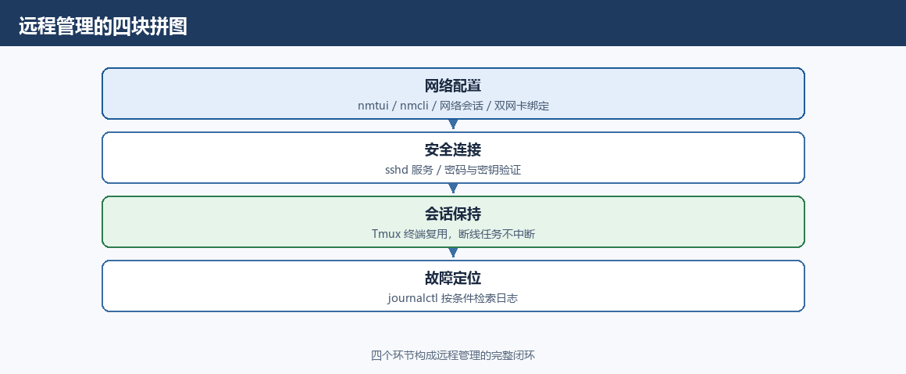
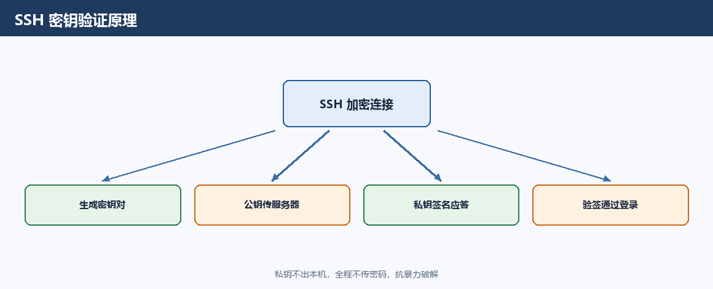

## 板块11 · SSH远程管理与系统日志

真实运维中最常见的场景是远程管理。这个板块从 IP 编址讲起——地址与掩码划出网段边界、网关提供跨网段出口、DNS 完成域名翻译，三者逐级叠加决定了一台机器能通到哪；再用 nmtui 与 nmcli 灵活配置网络、绑定双网卡实现负载均衡（并讲透七种绑定模式与链路监测的取舍），用 sshd 服务安全地远程登录主机，用 Tmux 保持会话不中断，最后用 journalctl 从日志中快速定位故障。掌握这些，才算真正具备了对 Linux 系统进行配置管理的能力。

### 11_1 技术背景与核心原理：远程管理的四块拼图

远程管理要依次解决四个问题：网络参数怎么配得灵活、怎么安全地连上去、连接断了怎么办、出了问题去哪里查。这四个问题对应四组技术，构成一个完整闭环。

网络配置方面，图形化的 nmtui 适合交互式设置，命令行的 nmcli 适合脚本化与批量操作，而"网络会话"机制让同一台机器能在不同场景间快速切换参数——在家用动态地址、在公司用静态地址，两套配置各存一个会话，用时切换即可。

远程登录方面，早期普遍使用明文传输的 telnet，用户名与密码在网络上裸奔；SSH 则对传输内容加密，成为远程管理的安全基石。SSH 提供密码验证与密钥验证两种方式，后者更安全，是生产环境的推荐做法。

会话保持方面，普通远程连接在断网时会中断，正在执行的任务可能半途而废。Tmux 这类终端复用器能让会话与连接解耦——断开连接后任务继续运行，重新连上后可接回原会话，实现"不间断远程管理"。

日志方面，系统与服务把运行事件记录下来，journalctl 能按服务、按时间、按级别灵活检索，是故障定位的“黑匣子”。

```
远程管理闭环
  网络配置(nmtui/nmcli) ─► 安全连接(SSH) ─► 会话保持(Tmux) ─► 故障定位(journalctl)
         │                     │                  │                  │
     参数灵活切换          加密/密钥验证       断线任务不中断       按条件检索日志
```



### 11_2 配置网卡与网络会话

动手配之前先弄清一张网卡上的几个参数各自解决什么问题，否则改完不知道为什么不通。IP 地址由网络位与主机位两部分组成，子网掩码就是划这条分界线的工具：`255.255.255.0` 表示前 24 位是网络位，同网段主机的网络位必须相同。

| 参数 | 解决什么 | 缺了它的典型现象 |
| --- | --- | --- |
| IP 地址 + 掩码 | 本机在网段内的身份，以及网段的边界 | 连网关都 ping 不通 |
| 网关 | 跨网段的出口 | 同网段通、跨网段不通 |
| DNS | 域名到 IP 的翻译 | 能 ping 通 IP，ping 不通域名 |

三个参数是逐级叠加的关系：只配 IP 与掩码，只能和同网段通信；加上网关，才能跨网段；再加上 DNS，才能用域名访问互联网。排错时按这个顺序逐级验证，就不会在"上不了网"这种模糊描述里打转。

同网段通信靠 ARP——用目标 IP 广播问"谁是 192.168.10.20"，对方回自己的 MAC，之后数据帧直接在交换机内转发。跨网段时 ARP 问的是网关的 MAC，数据先交给网关，再由它路由。理解这一点就能明白：网关地址必须与本机在同一网段，写一个不同网段的网关地址，系统根本发不出这个 ARP 请求。

命令行里有一套按层次排列的测试工具，从链路到应用逐层往上查。

| 命令 | 查的是哪一层 | 典型用法 |
| --- | --- | --- |
| `ping` | 网络层可达性 | `ping -c 4 192.168.10.10` |
| `ip route` | 本机路由表与默认网关 | `ip route` |
| `traceroute` | 路径上每一跳 | `traceroute www.iaoexl.com` |
| `mtr` | 逐跳延迟与丢包，持续观测 | `mtr -r -c 10 目标` |
| `host` | 域名解析结果 | `host www.iaoexl.com` |
| `dig` | 解析细节：应答、权威、耗时 | `dig www.iaoexl.com +short` |
| `ss -lntp` | 本机端口是否在监听 | `ss -lntp` |

`traceroute` 与 `mtr` 的差别在观测方式：前者一次跑完给一张表，后者持续刷新，能看出某一跳的丢包是偶发还是稳定——偶发通常是限速策略，稳定丢包才是链路故障。`host` 与 `dig` 查的是同一件事，`dig` 给的信息更多（应答码、权威服务器、查询耗时），排查解析问题时用它。

主机名解析是那三个参数之外的第四个要素，容易被漏掉。系统查一个名字时按 `/etc/nsswitch.conf` 里 `hosts:` 一行的顺序走，红帽系默认是 `files dns`——**先查 `/etc/hosts`，再问 DNS**。这意味着本地写一条静态映射，就能覆盖 DNS 的结果，也意味着 hosts 里写错一条，会出现"域名没错却解析到奇怪的地址"。

```
# 一、改主机名（三种名字要分清）
root@iaoexl:~# hostnamectl set-hostname server1.iaoexl.com
root@iaoexl:~# hostnamectl status
   Static hostname: server1.iaoexl.com
         Chassis: vm
      Machine ID: 3f2a...
# static 是持久的（写 /etc/hostname），transient 是内核里的临时值，pretty 只是给人看的描述

# 二、本地解析：格式是"地址 名字 [别名]"
root@iaoexl:~# vim /etc/hosts
192.168.10.10  server1.iaoexl.com  server1

# 三、验证顺序与结果：getent 会按 nsswitch 的顺序走，比 ping 更能反映真实解析
root@iaoexl:~# getent hosts server1
192.168.10.10  server1.iaoexl.com
root@iaoexl:~# hostnamectl status | head -3
```

一个经典坑：把主机名映射写成 `127.0.0.1 server1`，所有访问本机名的请求都落到环回地址上，服务明明监听在 192.168.10.10 却连不上。另一个是 `sudo` 报 `unable to resolve host`——主机名改了但 `/etc/hosts` 没跟着改，sudo 解析失败后仍会执行，只是每次都要等超时。两处一起改，这类报错就消失了。

nmtui 是文本界面工具，操作直观，适合快速修改网卡参数。nmcli 是命令行工具，功能更完整，适合查看网络信息与管理网络会话。

网络会话是这一板块的重点。同一块网卡可以保存多套配置，每套称为一个会话。典型用法是创建 company 与 house 两个会话：一个用静态地址应对公司网络，一个用动态地址应对家庭网络。需要时用 nmcli 启用对应会话，参数即刻切换；不再需要时用 delete 删除会话。

会话验证有个很实用的判断逻辑：若启用 company 会话成功、能获取动态地址，而 house 会话失败、拿不到地址，说明配置本身正确，问题出在外部网络环境。常见原因有三：家中设备通过拨号或共享网络而非直连路由器、上网前需通过学校或公司的认证页面、物理机防火墙拦截。这种"先证明自己没问题、再查外部"的思路，能快速划清责任边界。

双网卡绑定是另一个实用实验。把两块网卡绑定为轮询（round-robin）模式，对外呈现为一个逻辑接口，既提升带宽又提供冗余。绑定后即便一块网卡故障，网络仍能维持。

| 工具/命令 | 作用 |
| --- | --- |
| nmtui | 文本界面配置网络 |
| nmcli con show | 查看连接与会话 |
| nmcli con add | 创建网络会话 |
| nmcli con up / down | 启用/停用会话 |
| nmcli con delete | 删除会话 |
| ip addr show | 查看网卡与地址信息 |
| ip route show | 查看路由表与默认网关 |

**配置示例一：用 nmtui 配置静态地址并确认写入配置文件**

nmtui 是文本界面的交互式工具，执行后按提示选择"编辑连接"、选中网卡、把 IPv4 方式改为 Manual，填入地址 `192.168.10.10/24` 后保存。工具会把结果自动写入网卡配置文件，可直接查看确认：

```
root@iaoexl:~# nmtui

root@iaoexl:~# cat /etc/NetworkManager/system-connections/ens160.nmconnection
[connection]
id=ens160
type=ethernet
interface-name=ens160
[ipv4]
address1=192.168.10.10/24
method=manual
[ipv6]
method=auto
```

修改后需让服务重新读取配置，再验证连通性：

```
root@iaoexl:~# nmcli connection reload
root@iaoexl:~# nmcli connection up ens160
Connection successfully activated
root@iaoexl:~# ping -c 4 192.168.10.10
64 bytes from 192.168.10.10: icmp_seq=1 ttl=64 time=0.110 ms
64 bytes from 192.168.10.10: icmp_seq=2 ttl=64 time=0.196 ms
64 bytes from 192.168.10.10: icmp_seq=3 ttl=64 time=0.086 ms
64 bytes from 192.168.10.10: icmp_seq=4 ttl=64 time=0.064 ms
--- 192.168.10.10 ping statistics ---
4 packets transmitted, 4 received, 0% packet loss
```

**配置示例二：创建并切换网络会话**

公司用静态地址、家里用动态地址，各建一个会话，用时切换即可，无须反复改配置：

```
root@iaoexl:~# nmcli connection show
NAME    UUID                                  TYPE      DEVICE
ens160  f75b55fd-2891-3f5d-ba2c-adadbcd7505c  ethernet  ens160
lo      1b2c44f7-af47-4291-9997-d8de6cf5fa3f  loopback  lo

# 公司会话：静态地址，默认不自动激活
root@iaoexl:~# nmcli connection add con-name company ifname ens160 autoconnect no type ethernet ip4 192.168.10.88/24 gw4 192.168.10.1
Connection 'company' successfully added.

# 家庭会话：由外部 DHCP 自动分配，不指定地址
root@iaoexl:~# nmcli connection add con-name house type ethernet ifname ens160
Connection 'house' successfully added.

root@iaoexl:~# nmcli connection show
NAME     UUID                                  TYPE      DEVICE
ens160   f75b55fd-2891-3f5d-ba2c-adadbcd7505c  ethernet  ens160
lo       1b2c44f7-af47-4291-9997-d8de6cf5fa3f  loopback  lo
company  2040b650-edf6-4709-a1a3-4956ee0ffc2e  ethernet  --
house    52b64b23-fb88-4248-af74-6b67f1237d60  ethernet  --

# 启用公司会话后立即生效
root@iaoexl:~# nmcli connection up company
Connection successfully activated
root@iaoexl:~# ip -4 addr show ens160
2: ens160: <BROADCAST,MULTICAST,UP,LOWER_UP> mtu 1500 qdisc fq_codel state UP group default qlen 1000
    inet 192.168.10.88/24 brd 192.168.10.255 scope global noprefixroute ens160

# 切换到家庭会话
root@iaoexl:~# nmcli connection up house
Connection successfully activated
root@iaoexl:~# ip -4 addr show ens160
2: ens160: <BROADCAST,MULTICAST,UP,LOWER_UP> mtu 1500 qdisc fq_codel state UP group default qlen 1000
    inet 192.168.31.191/24 brd 192.168.31.255 scope global noprefixroute ens160

# 不再需要时删除会话
root@iaoexl:~# nmcli connection delete house
Connection 'house' successfully deleted.
root@iaoexl:~# nmcli connection delete company
Connection 'company' successfully deleted.
```

**配置示例三：绑定双网卡（balance-rr 轮询模式）**

先确认两块网卡名称，再依次创建 bond 设备、加入从属网卡、配置地址、启动验证。网卡名以实际环境为准，不要照抄：

```
# 1) 创建 bond 网卡，模式为 balance-rr（轮询）
root@iaoexl:~# nmcli connection add type bond con-name bond0 ifname bond0 bond.options "mode=balance-rr"
Connection 'bond0' successfully added.

# 2) 把两块物理网卡添加为从属网卡
root@iaoexl:~# nmcli connection add type ethernet slave-type bond con-name bond0-port1 ifname ens160 master bond0
Connection 'bond0-port1' successfully added.
root@iaoexl:~# nmcli connection add type ethernet slave-type bond con-name bond0-port2 ifname ens192 master bond0
Connection 'bond0-port2' successfully added.

# 3) 配置 bond0 的地址、网关、DNS 与手动方式
root@iaoexl:~# nmcli connection modify bond0 ipv4.addresses 192.168.10.10/24
root@iaoexl:~# nmcli connection modify bond0 ipv4.gateway 192.168.10.1
root@iaoexl:~# nmcli connection modify bond0 ipv4.dns 192.168.10.1
root@iaoexl:~# nmcli connection modify bond0 ipv4.method manual

# 4) 启动并查看设备状态
root@iaoexl:~# nmcli connection up bond0
Connection successfully activated
root@iaoexl:~# nmcli device status
DEVICE  TYPE      STATE      CONNECTION
ens160  ethernet  connected  ens160
ens192  ethernet  connected  bond0-port2
bond0   bond      connected  bond0
lo      loopback  connected  lo
```


启动后持续 `ping 192.168.10.10`，此时若在虚拟机设置中随机移除一块网卡，只会丢失一个数据包，另一块立即接管，服务不中断——这正是绑定技术的冗余价值。

**配置示例四：配置 IPv6 地址**

IPv6 不是"更长的 IPv4"，它在寻址、自动配置与网关发现上的规则都不同。地址 128 位，写成 8 组 16 位十六进制，缩写规则只有两条：每组前导零可省，连续的全零组可以用一次 `::` 代替——`::` 只能出现一次，出现两次就无法判断各自代表几组零。

| 地址类型 | 前缀 | 用途 | 示例 |
| --- | --- | --- | --- |
| 全局单播 | 2000::/3 | 可路由的公网地址 | `2001:db8:10::10` |
| 链路本地 | fe80::/10 | 同链路通信，每块网卡自动生成 | `fe80::5054:ff:fe12:3456` |
| 唯一本地 | fc00::/7 | 相当于 IPv4 私有地址 | `fd00:10::10` |
| 组播 | ff00::/8 | 一对多，路由器发现与邻居发现依赖它 | `ff02::1` |
| 环回 | ::1/128 | 本机 | `::1` |

```
# 一、静态配置（nmcli 的 ipv6.* 与 ipv4.* 完全对称）
root@iaoexl:~# nmcli connection modify ens160 ipv6.method manual
root@iaoexl:~# nmcli connection modify ens160 ipv6.addresses 2001:db8:10::10/64
root@iaoexl:~# nmcli connection modify ens160 ipv6.gateway 2001:db8:10::1
root@iaoexl:~# nmcli connection modify ens160 ipv6.dns 2001:db8:10::1
root@iaoexl:~# nmcli connection up ens160

# 二、验证：地址、路由、连通性
root@iaoexl:~# ip -6 addr show ens160
inet6 2001:db8:10::10/64 scope global
inet6 fe80::5054:ff:fe12:3456/64 scope link
root@iaoexl:~# ip -6 route
2001:db8:10::/64 dev ens160 proto kernel metric 100
default via 2001:db8:10::1 dev ens160 metric 100
root@iaoexl:~# ping -6 -c 2 2001:db8:10::1

# 三、按需关闭 IPv6（两处都要，否则已启用的接口不会回收地址）
root@iaoexl:~# vim /etc/sysctl.d/99-ipv6.conf
net.ipv6.conf.all.disable_ipv6 = 1
net.ipv6.conf.default.disable_ipv6 = 1
root@iaoexl:~# sysctl --system
```

四个高频坑值得先知道。第一，`fe80::` 开头的链路本地地址永远存在，`ip -6 addr` 里看到它不仅正常，还是邻居发现的基础；`ping -6 fe80::1` 必须带出口，写成 `ping -6 fe80::1%ens160`。第二，只配地址不配网关，表现为"能 ping 通同网段、出不去"，与 IPv4 的逐级叠加规律一致。第三，`ipv6.method` 取 `auto` 时会等路由通告（RA），没有 RA 的环境下会卡住并拿不到地址，此时应改 `manual` 或 `ignore`。第四，服务要监听 IPv6 需显式声明：httpd 写 `Listen [::]:80`，sshd 用 `AddressFamily any`，只写 `0.0.0.0` 的旧配置在新系统上不会自动双栈。

### 11_3 网卡绑定进阶：七种模式与链路监测

双网卡绑定不只是"叠加速度"，七种模式在带宽叠加、故障切换、交换机配合三方面各不相同。选错模式，轻则带宽没有提升，重则链路抖动、丢包。判断依据很明确：**能不能改交换机配置**。能改，用 802.3ad；不能改，用主备或自适应负载均衡。

| 模式 | 名称 | 带宽叠加 | 故障切换 | 交换机要求 | 适用判断 |
| --- | --- | --- | --- | --- | --- |
| 0 | balance-rr | 是 | 是 | 必须配端口聚合 | 追求带宽，可改交换机 |
| 1 | active-backup | 否 | 是 | 无 | 高可用优先，最省心 |
| 2 | balance-xor | 是 | 是 | 需哈希策略配合 | 会话稳定性要求较高 |
| 3 | broadcast | 否 | 极强 | 无 | 冗余开销大，极少使用 |
| 4 | 802.3ad | 是 | 是 | 必须配 LACP 聚合组 | 标准方案，企业主流 |
| 5 | balance-tlb | 出向是 | 是 | 无 | 无需改交换机，仅出向均衡 |
| 6 | balance-alb | 双向 | 是 | 无 | 无交换机条件下的最优解 |

模式 0 的代价常被忽略：同一会话的数据包可能从不同网卡发出，到达顺序可能颠倒，接收端要重传，吞吐反而下降。模式 1 资源利用率低——两块网卡也只当一块用，但它没有任何乱序风险，交换机也不用动，所以"稳"字优先的生产环境宁可牺牲带宽选它。

链路监测决定了"多久发现故障"，两种方式互斥，不能同时开启：

| 监测方式 | 参数 | 检测范围 | 局限 |
| --- | --- | --- | --- |
| MII 链路监测 | `miimon=100` | 本机网卡到交换机端口的物理链路 | 交换机上联断开时判定仍为正常 |
| ARP 监测 | `arp_interval=1000` 加 `arp_ip_target` | 经网关的端到端连通性 | 增加网关负担，配置更复杂 |

`miimon=100` 表示每 100 毫秒检查一次链路，这是主流默认值。它只能看到"我这根线到交换机端口这一段"，交换机到上游的链路断了，它察觉不到——这就是为什么关键业务在 MII 之外还要靠 ARP 监测补上端到端视角。

**配置示例：用 nmcli 配置主备绑定并指定主网卡**

命令行做法适合脚本化与远程操作，参数由 NetworkManager 直接写入 keyfile，不需要手工维护配置文件。要点有三：bond 接口自己持有 IP，从属网卡只声明归属、不配地址，主网卡通过 `primary` 参数指定。

```
# 一、创建 bond 接口，模式 1（主备），指定主网卡与链路监测
root@iaoexl:~# nmcli connection add type bond con-name bond0 ifname bond0 \
    bond.options "mode=active-backup,miimon=100,primary=ens160"

# 二、两块物理网卡作为从属接口加入 bond，自身不配地址
root@iaoexl:~# nmcli connection add type ethernet con-name bond0-port1 ifname ens160 master bond0
root@iaoexl:~# nmcli connection add type ethernet con-name bond0-port2 ifname ens192 master bond0

# 三、为 bond0 配置静态地址、网关与 DNS
root@iaoexl:~# nmcli connection modify bond0 ipv4.method manual \
    ipv4.addresses 192.168.10.10/24 ipv4.gateway 192.168.10.1 ipv4.dns 192.168.10.10
root@iaoexl:~# nmcli connection up bond0

# 四、确认模式、从属状态与当前活动网卡
root@iaoexl:~# cat /proc/net/bonding/bond0
Bonding Mode: fault-tolerance (active-backup)
Primary Slave: ens160 (primary_reselect always)
Currently Active Slave: ens160
MII Status: up
Slave Interface: ens160
MII Status: up
Slave Interface: ens192
MII Status: up
```

RHEL 9 起 ifcfg 格式被标记为弃用，新建连接一律写 keyfile；RHEL 10 已移除 network-scripts，`/etc/sysconfig/network-scripts/ifcfg-*` 不再生效。旧机器升级后要先把存量配置迁走，命令是 `nmcli connection migrate`，否则网络设置在重启后会丢失。

`/proc/net/bonding/bond0` 是排错的第一现场：模式是否如你所设、当前由哪块网卡承载、每块从属网卡的 MII 状态是 up 还是 down、有没有发生过切换，全在里面。切换后若发现流量没回到主网卡，多半是 `primary_reselect` 的策略问题，不是故障未恢复。

几个实践中的坑：老系统上 `network` 服务与 `NetworkManager` 同时运行会互相覆盖配置，锁定其中一个；虚拟机环境通常只能验证模式 1，因为虚拟交换机不实现 LACP，测模式 4 必须用真机加可配交换机；从属网卡残留 IP 会导致路由异常，现象是"能 ping 通网关但出不了网"。

### 11_4 远程控制服务 SSH

SSH 协议与 sshd 服务的组合，是远程管理的主体。实验分三部分：基础参数配置、安全密钥验证、远程传输命令。

基础配置中，服务程序的配置文件控制着监听端口、是否允许管理员直接登录、是否允许密码验证等关键参数。修改配置后需重启服务并设为开机自启，然后用防火墙放行对应服务——这个"改配置—重启—自启—放行"的四步，是服务配置的通用套路。

密钥验证是安全性的核心。原理是生成一对密钥：私钥留在客户端、公钥放到服务器。登录时服务器用公钥挑战、客户端用私钥应答，匹配则放行，全程无需传输密码。相比密码验证，密钥验证既能抵御暴力破解，又免去记忆复杂密码的负担。配置要点是关闭密码验证、只允许密钥验证，把安全等级提到最高。

| 命令 | 作用 |
| --- | --- |
| ssh 用户@地址 | 远程登录 |
| ssh-keygen | 生成密钥对 |
| ssh-copy-id | 把公钥部署到服务器 |
| scp | 加密的远程文件复制 |
| sftp | 加密的文件传输 |

远程传输命令 scp 与 sftp 都基于 SSH 加密，替代了不安全的 ftp 传输。scp 适合一次性复制文件，sftp 提供交互式传输环境。

```
SSH 密钥验证流程
  客户端 ──生成密钥对──► 私钥(客户端留存) + 公钥(部署到服务器)
     │
     ├─ 发起登录，服务器用公钥生成挑战
     │
     ├─ 客户端用私钥应答挑战
     │
     └─ 验证通过 → 登录成功（全程不传密码）
```



**配置示例四：配置 sshd 服务**

sshd 的主配置文件为 `/etc/ssh/sshd_config`。实验用两台机器：服务端 192.168.10.10、客户端 192.168.10.20。首次连接需输入 `yes` 确认主机指纹：

```
root@Client:~# ssh 192.168.10.10
The authenticity of host '192.168.10.10' can't be established.
ED25519 key fingerprint is SHA256:0R7Kuk/yCTlJ+E4G9y9iX/A/hAklHkALm5ZUgnJ01cc.
Are you sure you want to continue connecting (yes/no/[fingerprint])? yes
root@Server:~# exit
```

sshd 主配置文件的关键参数如下：

| 参数 | 作用 |
| --- | --- |
| Port 22 | 默认监听端口 |
| ListenAddress 0.0.0.0 | 监听的 IP 地址 |
| PermitRootLogin yes | 是否允许 root 直接登录 |
| StrictModes yes | 检查家目录与密钥文件权限，过宽则拒绝密钥登录 |
| MaxAuthTries 6 | 最大密码尝试次数 |
| PasswordAuthentication yes | 是否允许密码验证 |
| PermitEmptyPasswords no | 是否允许空密码登录 |

**配置示例：禁止 root 直接登录的 sshd_config 实例**

sshd 主配置文件中的 `Port 22` 决定监听端口，`PermitRootLogin` 决定是否允许管理员直接登录。把 `PermitRootLogin` 改为 no，并把安装系统时生成的单独允许配置注释掉，可以彻底禁止 root 远程登录；实验结束要记得改回，避免把自己锁在外面。

```
# 1) 编辑主配置文件，把第 40 行改为 PermitRootLogin no
root@Server:~# vim /etc/ssh/sshd_config
  ...
  39 #LoginGraceTime 2m
  40 PermitRootLogin no
  41 #StrictModes yes
  ...

# 2) 注释掉安装系统时允许 root 登录的单独配置
root@Server:~# vim /etc/ssh/sshd_config.d/01-permitrootlogin.conf
# PermitRootLogin yes

# 3) 重启服务并设为开机自启（重启前先验语法，避免改错后连不上）
root@Server:~# sshd -t
root@Server:~# systemctl restart sshd
root@Server:~# systemctl enable sshd

# 4) 客户端再用 root 登录，被拒绝
root@Client:~# ssh 192.168.10.10
root@192.168.10.10's password: 此处输入服务器管理员密码
Permission denied, please try again.

# 5) 实验后改回 yes 并重启，避免无法登录
root@Server:~# vim /etc/ssh/sshd_config
  40 PermitRootLogin yes
root@Server:~# systemctl restart sshd
```

**配置示例五：基于密钥的安全验证**

先在客户端生成密钥对，再把公钥传到服务端，最后修改配置关闭密码验证。注意顺序：先确认密钥登录可用，再关闭密码验证。

```
# 1) 客户端生成密钥对（一路回车即可；新版默认生成 ED25519，旧版为 RSA）
root@Client:~# ssh-keygen
Generating public/private ed25519 key pair.
Enter file in which to save the key (/root/.ssh/id_ed25519):
Enter passphrase (empty for no passphrase):
Your identification has been saved in /root/.ssh/id_ed25519
Your public key has been saved in /root/.ssh/id_ed25519.pub

# 2) 把公钥复制到服务端
root@Client:~# ssh-copy-id 192.168.10.10
Number of key(s) added: 1

# 3) 验证免密登录成功，再改服务端配置
root@Client:~# ssh 192.168.10.10
root@Server:~# exit

# 4) 服务端编辑 /etc/ssh/sshd_config，关闭密码验证
root@Server:~# vim /etc/ssh/sshd_config
PasswordAuthentication no

# 5) 重启服务、设为开机自启并放行防火墙
root@Server:~# systemctl restart sshd
root@Server:~# systemctl enable sshd
root@Server:~# firewall-cmd --permanent --add-service=ssh
root@Server:~# firewall-cmd --reload
```

**配置示例六：加密的远程传输命令**

scp 用于一次性复制，sftp 提供交互式传输环境，二者都基于 SSH 加密：

```
# 把本地文件复制到远端（加 -r 可复制目录）
root@Client:~# scp local.txt 192.168.10.10:/tmp/
local.txt        100%  512KB   1.2MB/s   00:00

# 把远端文件拉回本地
root@Client:~# scp 192.168.10.10:/var/log/messages ./

# 交互式传输
root@Client:~# sftp 192.168.10.10
sftp> put local.txt
sftp> get remote.txt
sftp> bye
```

一个必须强调的安全习惯：密钥验证配好并确认可用后，再关闭密码验证。顺序颠倒——先关密码、密钥又没配好——会把自己锁在门外。这个"先验证新通道、再关闭旧通道"的原则，和防火墙改动前保留回退会话是同一思路。

**配置示例七：三种端口转发**

SSH 的加密隧道不只用于登录，它可以把任意 TCP 连接封装进已认证的会话里，从而绕过网络边界或加密明文协议。三种转发方向不同，记牢"谁在听、连到谁"就不会混。

| 类型 | 参数写法 | 监听方 | 典型用途 |
| --- | --- | --- | --- |
| 本地转发 | `ssh -L 本地端口:目标地址:目标端口 跳板` | 本机 | 通过跳板访问内网数据库、Web 后台 |
| 远程转发 | `ssh -R 远端端口:目标地址:目标端口 服务端` | 远端服务器 | 把内网服务暴露到公网主机 |
| 动态转发 | `ssh -D 本地端口 跳板` | 本机 | 起一个 SOCKS5 代理，浏览器按需走代理 |

```
# 本地转发：把本机 13306 映射到内网数据库的 3306
root@Client:~# ssh -L 13306:192.168.10.30:3306 -N -f 192.168.10.10
root@Client:~# mysql -h 127.0.0.1 -P 13306 -u app -p
# 此时流量路径：Client → SSH 隧道 → 跳板 192.168.10.10 → 数据库 192.168.10.30

# 远程转发：把跳板机的 8080 反向映射到本机的 80
root@Client:~# ssh -R 8080:127.0.0.1:80 -N -f 192.168.10.10

# 动态转发：在本机 1080 起 SOCKS5 代理
root@Client:~# ssh -D 1080 -N -f 192.168.10.10
```

两个参数值得单独记：`-N` 表示只建隧道不执行远程命令，`-f` 表示转入后台。少了 `-N`，会话会给你一个远程 shell，关掉终端隧道就断。本地转发里 `目标地址` 是从**跳板机的视角**解析的，写 `127.0.0.1` 指的是跳板自己而不是你的本机，这是最容易搞反的一处。

**连接层的加固参数**

密钥与密码管的是"你是谁"，下面几项管的是"连接本身允不允许、能维持多久"。它们同样写在 `/etc/ssh/sshd_config` 里，改完都要 `sshd -t` 验语法再重启。

| 参数 | 建议值 | 解决什么问题 |
| --- | --- | --- |
| AllowUsers | `AllowUsers iaoexl` | 只放行白名单账号，即使密码泄露也登不进其他用户 |
| LoginGraceTime | `LoginGraceTime 30` | 缩小"连上但未认证"的挂起窗口，缓解连接耗尽 |
| ClientAliveInterval | `ClientAliveInterval 300` | 每 5 分钟发一次探测，清理掉线残留会话 |
| ClientAliveCountMax | `ClientAliveCountMax 2` | 连续两次无响应即断开，配合上一项生效 |
| MaxStartups | `MaxStartups 10:30:60` | 限制未认证并发连接数，削弱暴力破解的连接压力 |

`AllowUsers` 有一个反直觉的后果：一旦写下这一行，不在名单里的账号（包括 root）全部被拒，与 `PermitRootLogin` 的取值无关。所以它属于"最后一步"的收紧动作，加之前先确认名单里的账号能正常登录。反过来，如果只是想让某个账号彻底不能远程登录，改它的 shell 为 `/sbin/nologin` 比堆叠 sshd 参数更彻底——那一层根本不参与认证。

`ClientAliveInterval` 常被误当成"保持连接不断"的开关，实际作用相反：它让服务器主动探测客户端是否还活着，探测不到就回收会话。真正想防的是"客户端拔网线后，服务器上留着一个永不退出的会话占着资源"。

**客户端侧的三个省事写法**

反复敲一长串参数既慢又容易错，客户端配置文件 `~/.ssh/config` 可以把常用连接固化成别名：

```
root@Client:~# vim ~/.ssh/config
Host db                     # 之后直接 ssh db 即可
    HostName 192.168.10.30
    User app
    Port 22
    IdentityFile ~/.ssh/id_ed25519

Host jump                   # 需要经跳板时，一条 ProxyJump 替代手工隧道
    HostName 192.168.10.10
    User iaoexl
    ProxyJump none

Host inner                  # 经 jump 跳到内网主机，不必先登录跳板
    HostName 192.168.10.30
    User iaoexl
    ProxyJump jump
```

```
root@Client:~# chmod 600 ~/.ssh/config     # 权限过宽 ssh 会拒绝读取
root@Client:~# ssh inner                    # 自动经 jump 中转
```

`ProxyJump` 把"先 ssh 跳板、再从跳板 ssh 内网"的两步合成一条命令，比手工开 `-L` 隧道更接近日常用法；`-L` 适合需要长期驻留的端口映射，`ProxyJump` 适合临时进内网执行命令。`~/.ssh/config` 与私钥、`authorized_keys` 一样受权限检查约束，`600` 是安全的下限。

### 11_5 Tmux 与系统日志

Tmux 解决"断线任务中断"的痛点。核心概念是会话：在 Tmux 中启动任务后即使断开 SSH 连接，任务仍在服务器继续运行；重新连接后执行 attach 接回会话，能看到任务仍在继续。常用操作包括新建会话、查看会话列表、接入会话、离开会话（不终止）与终止会话。这与直接 SSH 执行任务形成鲜明对比——后者一旦断线，任务可能随之中断。

日志系统则把系统与服务产生的事件集中记录。journalctl 支持丰富检索：查看全部日志、按服务筛选、按时间范围筛选、实时跟踪最新日志、按优先级筛选错误等。

| journalctl 用法 | 作用 |
| --- | --- |
| journalctl | 查看全部日志 |
| journalctl -u 服务名 | 按服务筛选 |
| journalctl -b | 查看本次启动以来的日志 |
| journalctl -f | 实时跟踪最新日志 |
| journalctl -p 级别 | 按优先级筛选 |


**配置示例八：Tmux 保持远程会话**

新建会话、离开、接回、查看列表、终止的完整操作如下。`Ctrl+b` 是前缀键，按下后再按功能键：

```
root@Server:~# tmux new -s work            # 新建名为 work 的会话
# 在会话中执行长任务，然后按 Ctrl+b 再按 d 离开（任务继续运行）
[detached from work]
root@Server:~# tmux ls                     # 查看会话列表
work: 1 windows (created ...)
root@Server:~# tmux attach -t work         # 重新接回会话，任务仍在继续
root@Server:~# tmux kill-session -t work   # 不再需要时终止会话
```

**配置示例九：journalctl 检索日志**

journalctl 用于从 systemd 日志中快速定位问题。演示查看全部、按服务（-u）、按本次启动（-b）、实时跟踪（-f）、按错误级别（-p err）及按时间（--since）筛选等常用检索组合。

```
root@Server:~# journalctl                          # 查看全部日志
root@Server:~# journalctl -u sshd                  # 只看 sshd 服务的日志
root@Server:~# journalctl -b                       # 查看本次启动以来的日志
root@Server:~# journalctl -f                       # 实时跟踪最新日志
root@Server:~# journalctl -p err                   # 只看错误级别及以上
root@Server:~# journalctl -u sshd --since "today"  # 按时间范围筛选某服务
```

排错时的高效组合是：先 `systemctl status 服务名` 看服务大致状态，再用 `journalctl -u 服务名` 看该服务的详细日志，必要时加 `-f` 实时跟踪，边操作边看日志输出。这种"状态 + 日志"的组合能快速定位绝大多数服务故障。

**两套日志各管一段**

同一台机器上通常并存两套日志：systemd 的 journal 与传统的文本日志。它们来源相同（内核、服务、syslog 协议），但落点与生命周期完全不同。

| 维度 | journal（journald） | 文本日志（rsyslog 等） |
| --- | --- | --- |
| 默认位置 | `/run/log/journal`（内存，重启即失） | `/var/log/messages`、`/var/log/secure` |
| 结构 | 带字段的二进制，可按服务/优先级/启动轮次过滤 | 纯文本，只能靠 grep |
| 容量治理 | journald 自身的配额 | logrotate 按文件轮转 |
| 依赖服务 | systemd-journald | rsyslog（可不存在） |

一条 `systemctl restart httpd` 产生的记录，两套日志里都有。查"某次启动为什么失败"，用 journal 的 `-b` 按启动轮次筛最省事；查"三个月前谁在几点登录过"，得看 rsyslog 留下的 `/var/log/secure`——journal 默认只在内存里放，重启就没了。

**把 journal 变成可追溯、可封顶**

默认的 journal 有两个问题：重启即丢、以及只受"所在文件系统 10%、封顶 4G"的粗放限制。前者改存储位置，后者改配额。

```
# 一、开启持久化：建目录即可，journald 检测到就会写盘
root@Server:~# mkdir -p /var/log/journal
root@Server:~# systemctl restart systemd-journald

# 二、限制总量与保留期（写在 drop-in 里，不动主配置）
root@Server:~# mkdir -p /etc/systemd/journald.conf.d
root@Server:~# vim /etc/systemd/journald.conf.d/00-size.conf
[Journal]
SystemMaxUse=2G          # 磁盘 journal 总量上限
SystemKeepFree=5G        # 无论如何给系统留出的空闲空间
MaxRetentionSec=90day    # 超过 90 天的记录直接清掉

root@Server:~# systemctl restart systemd-journald

# 三、看清当前占用，必要时立即回收
root@Server:~# journalctl --disk-usage
Archived and active journals take up 1.6G in the file system.
root@Server:~# journalctl --vacuum-size=500M     # 压到 500M 以内
root@Server:~# journalctl --vacuum-time=30d      # 只保留最近 30 天
```

`SystemMaxUse` 与 `SystemKeepFree` 同时生效，取更严格的那个——这是"最多用多少"与"至少给别人留多少"的双重约束，只设前者在磁盘本来就紧张时会失效。`--vacuum-*` 只能删除已归档的文件，正在写入的那个不会被删，所以清理后实际占用会略高于设定值，属于预期行为。

第一步还有另一种等价写法：在 `journald.conf` 里设 `Storage=persistent`。它和"建 `/var/log/journal` 目录"是同一件事的两种表达——前者显式声明意图，后者靠 journald 启动时检测目录是否存在来推断；两者都生效时以配置为准。考场上两种都算对，但要能说清它们为什么等价，以及 `Storage=volatile` 会让日志回到纯内存这一反向效果。

**logrotate：给文本日志定一个封顶规则**

文本日志没有自动上限，一个疯狂写日志的应用几小时就能把 `/var/log` 撑满。logrotate 的职责是按"时间或大小"把当前日志改名归档、建一个新的空文件、按保留份数删掉最旧的，并可选压缩。

```
# 自定义应用的轮转规则：每天一次，最多留 14 份，超 100M 也提前切
root@Server:~# vim /etc/logrotate.d/myapp
/var/log/myapp/*.log {
    daily
    rotate 14
    size 100M
    compress
    delaycompress
    missingok
    notifempty
    copytruncate
}
```

| 指令 | 作用 | 常见误用 |
| --- | --- | --- |
| `daily` / `weekly` | 按时间触发 | 只写 `size` 不写时间，日志小就永远不切 |
| `rotate N` | 保留 N 份 | 只写 `rotate` 不写周期，N 的含义无从判断 |
| `compress` + `delaycompress` | 压缩归档，最近一份先不压 | 只写 `compress`，写日志的进程读到半截压缩包 |
| `missingok` / `notifempty` | 文件不存在/为空不报错 | 缺 `missingok`，日志被删后每次都记一条错误 |
| `create` + `postrotate` | 改名新建，通知进程重开 | 写了 `create` 却忘了 `postrotate`，进程继续写已归档的旧文件 |
| `copytruncate` | 复制后清空原文件 | 用在无法重开日志的进程之外，白白承担丢行风险 |

`create` 与 `copytruncate` 是这里唯一需要真正做判断的取舍，两者不能混用：

- `create` 把 `app.log` 改名为 `app.log.1`，再新建一个空的 `app.log`。此时进程手里仍握着旧文件的句柄，必须靠 `postrotate` 里的信号让它重新打开——**两个动作是一套，缺一不可**。漏了信号，进程会一直往 `app.log.1` 里写，磁盘上多出一个名字带编号却还在增长的"幽灵文件"，而 `app.log` 永远是空的。
- `copytruncate` 直接复制一份再把原文件截断为 0，句柄和 inode 都不变，进程完全无感。代价是复制完成到截断之间那一瞬间写入的日志会丢。用在**不支持重开日志**的程序上，是唯一的选项。

```
# nginx 支持 USR1 重开日志，用 create + postrotate，不丢行
root@Server:~# vim /etc/logrotate.d/nginx
/var/log/nginx/*.log {
    daily
    rotate 30
    compress
    delaycompress
    missingok
    notifempty
    create 0640 nginx nginx
    sharedscripts
    postrotate
        /usr/bin/systemctl reload nginx > /dev/null 2>&1 || true
    endscript
}
```

`create` 后面的属主属组必须与服务的运行身份一致——RHEL 系通常是 `nginx:nginx`，Debian 系是 `www-data:adm`。写错不会报错，但新生成的日志文件归了别人，服务下一次写入就被拒，表现为"轮转之后日志突然不更新了"。拿不准就先 `ls -l /var/log/nginx/` 看一眼现有文件的属主。

`sharedscripts` 在通配符匹配多个文件时才显出价值：没有它，`postrotate` 会按匹配到的文件个数重复执行，`access.log` 与 `error.log` 各触发一次 reload，服务会无谓地抖动两下。

改完规则不要直接等第二天，先验证：

```
# -d 只打印将要做什么，不动任何文件；先跑这个看有没有语法错、有没有被跳过
root@Server:~# logrotate -d /etc/logrotate.d/nginx

# -f 强制执行一次，确认归档生成、新文件建立、服务重开后继续写入
root@Server:~# logrotate -f /etc/logrotate.d/nginx
root@Server:~# ls -l /var/log/nginx/ | head
```

logrotate 自身由 `logrotate.timer`（或老系统的 `/etc/cron.daily/logrotate`）每天触发一次，不需要另建计划任务；重复配置反而会造成同一天切两次。判断日志该归谁管有个简单办法：`/var/log` 下的文本文件归 logrotate，`journalctl` 看到的归 journald，两边各设各的上限，不要试图用一种去管另一种。

### 11_6 场景笔记方法：把网络与远程配置记成"场景—参数—回退"卡

远程配置的笔记必须包含"回退方案"，因为一旦配置失误导致失联，笔记就是唯一的自救依据。

| 记录项 | 记录内容 | 示例 |
| --- | --- | --- |
| 场景 | 哪套网络环境 | 公司静态地址 |
| 会话名 | 网络会话名称 | company / house |
| 关键参数 | 地址、网关、DNS | 静态 IP 段 |
| 验证方法 | 如何确认切换成功 | ping 网关通 |
| 回退方案 | 配错如何恢复 | 用另一会话或控制台 |

SSH 配置的笔记要记录改了配置文件的哪些行、重启了哪些服务、防火墙放行了什么，四步缺一不可。密钥部署的笔记要说明公钥放到了哪个用户的哪个目录、权限如何设置——权限不对是密钥登录失败的常见原因。

Tmux 笔记建议做成快捷键速查卡，因为会话操作频繁且命令不易记。日志检索笔记要记录最常用的几条 journalctl 组合，形成条件反射式的排错工具箱。

### 11_7 实用验证与排错：确保连得上、断不了、查得到

验证分三段：网络是否通、连接是否安全、日志是否能查。

```
远程管理验证流程
  网络连通(ping) ─► 服务运行(status) ─► 防火墙放行 ─► 远程登录测试 ─► 日志可查(journalctl)
       │                │                  │               │               │
   确认地址正确     确认 sshd 运行     确认端口开放     密码/密钥验证    按服务筛选
```

| 现象 | 排查方向 |
| --- | --- |
| 会话切换后无地址 | 外部网络限制，非配置问题 |
| 远程连不上 | 网络、服务状态、防火墙三者依次查 |
| 密码正确仍拒绝 | 配置是否禁用了密码验证 |
| 密钥登录失败 | 公钥位置与权限是否正确 |
| 断线后任务丢失 | 是否在 Tmux 会话中运行 |
| 查不到日志 | 服务名是否正确、是否用 -u 筛选 |

最重要的一条经验：远程修改网络与 SSH 配置时，始终保留一条可用的连接或控制台通道，验证新配置成功后再关闭旧通道。失联是远程管理中最昂贵的错误，而预防它的成本只是一次谨慎的顺序安排。

### 11_8 认证对标与进阶实战

远程管理与日志排错是所有认证贯穿始终的能力。LPIC-1 的网络服务与日志主题、LFCS 的系统运维、RHCSA 的远程访问配置都包含 SSH，而journalctl 与日志分析更是排错的基本功。生产环境几乎都是"远程登录—配置—看日志"的循环，这块能力不过关，运维无从谈起。

| 认证体系 | 与本主题相关的考查方向 | 核心能力要求 |
| --- | --- | --- |
| LPIC-1（102） | 网络服务、系统日志 | 配置 SSH、管理日志轮转 |
| LFCS | 远程管理、日志排查 | 用密钥登录、用日志定位故障 |
| RHCSA（EX200） | 管理基础网络：IPv4/IPv6 地址、主机名解析、服务自启、firewalld | 双栈配置、按需启停、放行端口 |
| RHCSA（EX200） | SSH 密钥认证、journal 检索与持久化 | 免密登录、`journalctl -b -1` 查上次启动 |
| CompTIA Linux+ | 远程访问、日志分析 | 解释加密认证与日志分级 |

一个因操作顺序失误导致"把自己锁在门外"的事故很有代表性：管理员为了安全，直接编辑 sshd_config 关闭了密码登录，却没先确认密钥登录是否可用，重启服务后自己的终端被断开，密钥又没配好，只能跑到机房接显示器救场。正确的顺序是"先验证密钥可用，再关闭密码登录"，并保留一个已登录的会话作为应急通道，直到确认新配置无误。

远程与日志相关的高频问题，集中在认证、连通与日志定位三处。

| 现象 | 根因 | 定位命令 | 处置 |
| --- | --- | --- | --- |
| SSH 连接被拒 | 服务未运行、防火墙未放行、端口错 | systemctl status、ss、firewall-cmd | 逐项排查服务/端口/防火墙 |
| 密钥登录仍要密码 | 权限过宽或公钥未正确部署 | ls -ld ~/.ssh、查日志 | 设 .ssh 为 700、公钥 600 |
| 远程任务断线即中断 | 未用终端复用工具 | —— | 用 tmux/screen 保持会话 |
| 找不到错误信息 | 日志级别或时间范围不对 | journalctl -u 服务 --since | 按服务与时间精确过滤 |

闯关任务按"登录—加固—排错"三级递进。

```
  远程运维闯关
  第一关 配置密钥登录并验证免密可用
    │
  第二关 关闭密码登录、改端口，且不断开当前会话
    │
  第三关 故意制造服务故障，用 journalctl 定位根因
```

- 第一关：`ssh-keygen` 生成密钥对，公钥写入服务端 authorized_keys，验证免密。
- 第二关：先保留一个登录会话，改配置后用新会话验证成功，再关闭旧会话。
- 第三关：停掉某服务，用 `journalctl -u` 与 `systemctl status` 联合定位。

进阶要理解 SSH 的加密认证模型与 systemd 日志的结构。SSH 用非对称加密完成身份验证：客户端持有私钥、服务端保存公钥，登录时用私钥签名、服务端用公钥验签，整个过程私钥不出本机，比密码更抗暴力破解；首次连接还会记录主机公钥指纹防中间人攻击。systemd 日志方面，journalctl 按单元、优先级、时间三个维度检索，`-u 服务名` 定位到具体服务、`-p err` 只看错误、`--since` 限定时间窗，配合 `-f` 实时跟踪，排错时能快速从海量日志中收敛到问题行。把"认证—连通—服务—日志"做成一条固定排查链，遇到远程故障按顺序走一遍，绝大多数问题都能定位。

### 11_9 要点回顾与能力自检

本板块构成了远程管理的完整闭环：IPv4 与 IPv6 双栈的地址与掩码划出网段边界、网关提供跨网段出口、DNS 完成域名翻译，三者逐级叠加；nmtui/nmcli 与网络会话实现灵活配置，双网卡绑定提升带宽与冗余，SSH 以密钥验证与端口转发支撑安全连接和内网穿透，Tmux 保持会话不中断，journalctl 与 logrotate 分别治理二进制日志与文本日志。贯穿全程的原则是"先验证新通道、再关闭旧通道"。

自检问题：

1. 网络会话解决什么问题？会话切换失败时如何判断是配置问题还是环境问题？
2. 密钥验证相比密码验证的优势是什么？为什么要先验证密钥可用再关闭密码验证？
3. Tmux 如何让远程任务在断线后继续运行？
4. "改配置—重启—自启—放行"四步分别对应什么操作？
5. 用 journalctl 按服务查日志的命令是什么？它与 systemctl status 如何配合排错？
6. 只配 IP 与掩码、不配网关，能通什么、不能通什么？这个逐级验证的顺序为什么比"上不了网"的描述更有用？
7. 同网段与跨网段通信时，ARP 请求的目标分别是谁？为什么把网关配到别的网段就发不出数据？
8. `traceroute` 与 `mtr` 看到的丢包，什么情况属于限速策略而非链路故障？
9. 本地转发 `-L 13306:127.0.0.1:3306` 里的 `127.0.0.1` 指的是谁的地址？`-N` 与 `-f` 各起什么作用？
10. `AllowUsers` 与 `PermitRootLogin` 同时存在时，谁说了算？还漏了一个账号为什么登不上？
11. 日志占满磁盘时，如何判断该清 journald 还是该动 logrotate？`create` 配了却漏写 `postrotate`，会出现什么现象？
