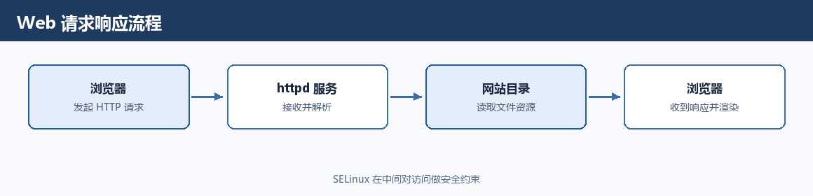
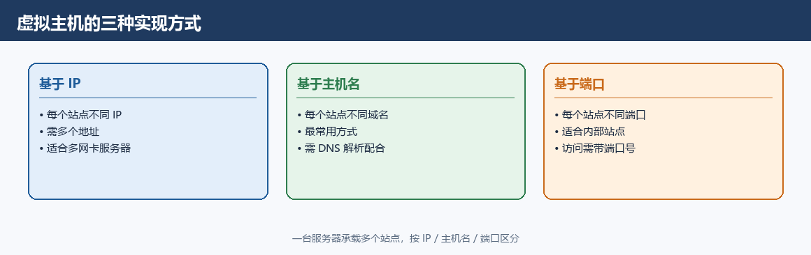
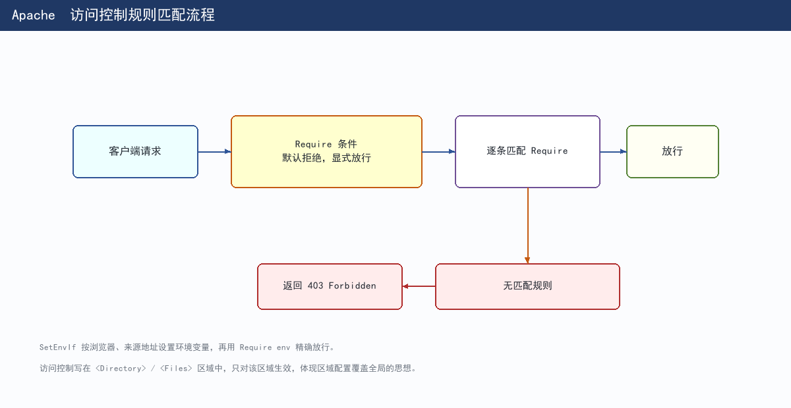

## 板块12 · Apache静态网站部署

网络服务部署以 Web 服务为典型起点，它最常见，也最能体现"配置服务"的一般规律。这个板块以 httpd 服务程序为主线，讲清 Web 服务的用途与主流程序对比、httpd 配置文件的结构、SELinux 的作用与配置，并完成基本部署、个人主页、密码认证、虚拟主机等一系列实用实验。掌握它，各类服务的配置会有很强的迁移性。

### 12_1 技术背景与核心原理：从"能访问"到"会配置"

Web 服务程序的职责是接收客户端的 HTTP 请求、返回网页内容。主流程序各有优势，httpd（Apache）以成熟稳定、配置清晰著称，Nginx 以高并发与低资源占用见长、常用于动态网站架构。这里选 httpd 作为学习服务配置的对象，因为它的配置文件结构最能体现"全局配置 + 区域配置"的通用思想。

配置httpd 的关键在于理解两类参数：全局配置参数影响整个服务，区域配置参数只作用于特定目录或站点。还有大量注释信息用于说明参数用途——读懂注释本身就是学习的一部分。这种"全局 + 局部 + 注释"的结构，在许多服务的配置中反复出现。

SELinux 是这一板块绕不开的主题。它是系统的一项安全强化机制，通过为进程与文件打上安全标签（域与上下文）来限制访问。初学时它常被视为"奇怪障碍"——配置明明正确却访问不了，往往就是 SELinux 在拦截。理解它的三种工作模式与策略管理，才能既不被它绊倒，又不以"关闭了事"牺牲安全。

| SELinux 模式 | 行为 |
| --- | --- |
| enforcing | 强制模式，拦截并记录违规行为 |
| permissive | 宽容模式，只记录不拦截 |
| disabled | 关闭 |

```
Web 服务请求响应流程
  浏览器 ──HTTP 请求──► httpd 服务 ──读取──► 网站目录文件
    ▲                     │                    │
    └──── HTTP 响应 ◄──────┴──── 返回内容 ◄──────┘
                    （SELinux 在中间对访问做安全约束）
```



### 12_2 关键概念：httpd 配置与站点要素

httpd 的主配置文件按功能分区，理解各区作用比记住每个参数更重要。

| 配置部分 | 作用 |
| --- | --- |
| 全局配置 | 定义服务运行用户、监听端口、日志位置等整体参数 |
| 区域配置 | 定义特定目录的访问权限、默认主页等 |
| 注释信息 | 说明参数用途与取值 |

部署一个站点，需要处理几个要素：网站数据放在哪个目录、默认首页叫什么、目录访问权限如何设置、服务以谁的身份运行。这些要素是所有 Web 服务配置的共性。

SELinux 的两个核心概念需要区分：SELinux 域作用于进程，安全上下文作用于文件。当网站数据放在非默认目录时，文件的上下文可能与 httpd 进程不匹配，导致访问被拒。解决办法是用 semanage 修改目录的上下文、用 restorecon 使其生效，或用 setsebool 调整相关布尔值。

| 命令 | 作用 |
| --- | --- |
| systemctl start/restart httpd | 启动/重启服务 |
| systemctl enable httpd | 设为开机自启 |
| firewall-cmd --add-service=http | 放行 HTTP 流量 |
| semanage fcontext | 修改文件默认上下文 |
| restorecon | 恢复文件上下文 |
| getsebool / setsebool | 查看/调整布尔值 |

### 12_3 实操：从基础部署到对外发布

实验按难度递进，从"能访问"一路做到"能对外发布"：基础部署与个人主页建立最小闭环，密码认证与访问控制解决"谁能看"，虚拟主机解决"一台机器放多个站点"，HTTPS 与伪静态解决"能不能上线"。

**基础部署**：安装 httpd，把网页文件放入默认网站目录，启动服务并放行防火墙，然后在本机浏览器访问验证。这个最简单的实验建立了"服务—目录—访问"的基本认知。

**个人用户主页功能**：开启后，每个系统用户都能在自己的家目录中维护一个个人网站。实验中要开启对应功能、创建用户家目录下的网站目录与文件、调整 SELinux 布尔值允许访问，最后用"地址/~用户名"的形式访问。这个实验把用户身份与 Web 服务联系起来。

**密码加密认证**：为特定目录设置用户名密码保护。要在配置中指定认证类型、认证文件与允许的用户，用 htpasswd 生成存放密码的认证文件。访问时弹出登录框，输入正确凭据才能进入。这是给网站加一道身份关卡。

**虚拟主机**：让一台服务器承载多个网站，是本节的重头戏，有三种实现方式。

| 类型 | 区分依据 | 适用场景 |
| --- | --- | --- |
| 基于 IP 地址 | 不同 IP | 服务器有多个地址 |
| 基于主机名 | 不同域名 | 同一地址承载多站点，最常用 |
| 基于端口号 | 不同端口 | 用端口区分不同站点 |

三种方式的配置结构相似，核心是为每个站点单独定义一段区域配置，指明网站根目录、主机名或端口。基于主机名的虚拟主机最常用，但要注意它与 DNS 解析配合——域名要能解析到服务器地址，才能按主机名区分请求。

```
虚拟主机：一台服务器，多个站点
                 ┌─ 站点A（域名A）→ 目录A
  客户端请求 ──► httpd ─┼─ 站点B（域名B）→ 目录B
                 └─ 站点C（端口C）→ 目录C
        依据 IP / 主机名 / 端口 决定把请求交给哪个站点
```



**配置示例：部署站点与基于主机名的虚拟主机**

部署 httpd 先安装、启动、设自启并放行防火墙，再放首页验证。基于主机名的虚拟主机按域名分别定义 VirtualHost 与目录；若用自定义目录，需 semanage 加 restorecon 修正 SELinux 上下文。

```
# 安装、启动、自启并放行防火墙
root@iaoexl:~# dnf install httpd
root@iaoexl:~# systemctl start httpd
root@iaoexl:~# systemctl enable httpd
root@iaoexl:~# firewall-cmd --permanent --add-service=http
root@iaoexl:~# firewall-cmd --reload

# 默认站点：把首页放入网站根目录
root@iaoexl:~# echo "Welcome to Linux" > /var/www/html/index.html
root@iaoexl:~# curl http://127.0.0.1
Welcome to Linux

# 基于主机名的虚拟主机：新建两个站点的配置与目录
root@iaoexl:~# mkdir -p /var/www/siteA /var/www/siteB
root@iaoexl:~# echo "Site A" > /var/www/siteA/index.html
root@iaoexl:~# echo "Site B" > /var/www/siteB/index.html
root@iaoexl:~# vim /etc/httpd/conf.d/vhost.conf
<VirtualHost 192.168.10.10:80>
  DocumentRoot /var/www/siteA
  ServerName www.sitea.com
</VirtualHost>
<VirtualHost 192.168.10.10:80>
  DocumentRoot /var/www/siteB
  ServerName www.siteb.com
</VirtualHost>

root@iaoexl:~# systemctl restart httpd

# 自定义目录时的 SELinux 处理
root@iaoexl:~# semanage fcontext -a -t httpd_sys_content_t "/webroot(/.*)?"
root@iaoexl:~# restorecon -Rv /webroot
```

**配置示例：用户个人主页与密码认证目录**

除了默认站点，httpd 还常做两类实验：为用户开启个人主页，以及给指定目录加密码认证。

```
# 一、开启用户个人主页（默认访问路径为 ~用户名）
root@iaoexl:~# vim /etc/httpd/conf.d/userdir.conf
  UserDir enabled
  UserDir public_html
root@iaoexl:~# systemctl restart httpd

# 普通用户建自己的网页目录（家目录需给其它用户执行权限）
root@iaoexl:~# su - iaoexl
[iaoexl@iaoexl ~]$ mkdir public_html
[iaoexl@iaoexl ~]$ echo "Tom's Home Page" > public_html/index.html
[iaoexl@iaoexl ~]$ chmod 755 /home/iaoexl
[iaoexl@iaoexl ~]$ exit
root@iaoexl:~# setsebool -P httpd_enable_homedirs on

# 访问个人主页
root@iaoexl:~# curl http://127.0.0.1/~iaoexl/
Tom's Home Page

# 二、给 /var/www/html/admin 目录加密码认证
root@iaoexl:~# mkdir -p /var/www/html/admin
root@iaoexl:~# echo "Admin Only" > /var/www/html/admin/index.html

# 用 htpasswd 创建认证用户（首次用 -c 创建，追加用户去掉 -c）
root@iaoexl:~# htpasswd -c /etc/httpd/passwd iaoexl
New password:
Re-type new password:
Adding password for user iaoexl

# 在主配置中对该目录启用基本认证
root@iaoexl:~# vim /etc/httpd/conf/httpd.conf
<Directory "/var/www/html/admin">
  AuthType Basic
  AuthName "Please input password"
  AuthUserFile /etc/httpd/passwd
  Require user iaoexl
</Directory>

root@iaoexl:~# systemctl restart httpd
# 无密码访问被拒（401），带密码访问成功
root@iaoexl:~# curl -I http://127.0.0.1/admin/
HTTP/1.1 401 Unauthorized
root@iaoexl:~# curl -u 'iaoexl:iaoexl@7#13' http://127.0.0.1/admin/
Admin Only
```

个人主页与密码认证是 httpd 的两个经典实验，前者依赖 `UserDir` 与 SELinux 的 `httpd_enable_homedirs` 布尔值，后者依赖 `htpasswd` 生成密码文件与 `<Directory>` 区域的认证指令。两者都体现了"区域配置覆盖全局配置"的思想。

**配置示例：基于来源与浏览器的访问控制**

访问控制用来限制哪些客户端可以访问特定目录，httpd 支持按来源地址、按浏览器标识等多种限制方式。实验先建立一个测试目录，再分别用不同条件限制访问。

```
# 准备测试目录与首页
root@iaoexl:~# mkdir /var/www/html/server
root@iaoexl:~# echo "Successful" > /var/www/html/server/index.html

# 一、按浏览器标识限制：用 SetEnvIf 给 Firefox 请求打标记，再按标记放行
root@iaoexl:~# vim /etc/httpd/conf/httpd.conf
<Directory "/var/www/html/server">
  SetEnvIf User-Agent "Firefox" ff=1
  Require env ff
</Directory>
root@iaoexl:~# systemctl restart httpd
# 用 Firefox 访问可见 Successful，其他浏览器返回 403

# 二、按来源地址限制：仅允许指定主机访问
root@iaoexl:~# vim /etc/httpd/conf/httpd.conf
<Directory "/var/www/html/server">
  Require ip 192.168.10.20
</Directory>
root@iaoexl:~# systemctl restart httpd
```

`Require env` 表示只放行带 `ff` 标记的请求，未匹配任何 `Require` 的访问一律被拒，符合"默认拒绝、显式放行"的最小权限原则。同类指令还有 `Require ip`（按来源网段放行）、`Require all granted`（放行全部）与 `Require all denied`（拒绝全部），都写在 `<Directory>` 区域内，作用范围只限该目录。修改配置后必须 `systemctl restart httpd` 才生效。

默认行为是"任一 `Require` 满足即放行"，要表达"同时满足"必须用 `<RequireAll>` 包裹；要表达"任一拒绝即拒绝"则用 `<RequireAny>` 与 `Require not` 组合。

`Order/Allow/Deny` 属于 2.2 时代的旧语法，由 `mod_access_compat` 提供；`Require` 属于 2.4 语法，由 `mod_authz_core` 提供。RHEL 8 起 httpd 为 2.4 分支，新配置应统一用 `Require`；同一个 `<Directory>` 里两套语法混写会直接报配置错误，只有迁移老配置时才需要临时加载兼容模块。



**改配置之前先验语法**

httpd 的配置文件读错一个引号就会整站起不来，而 `restart` 失败时线上服务已经停了。正确顺序是先验语法、再重启：

```
# -t 只解析配置不启动服务，语法有误会指出文件名与行号
root@iaoexl:~# httpd -t
Syntax OK

# 配置有误时的输出形如：
# AH00526: Syntax error on line 12 of /etc/httpd/conf.d/vhost.conf:
# Invalid command 'DocumentRoots', perhaps misspelled ...
```

`apachectl configtest` 与 `httpd -t` 等价，两者选其一即可。这一步在改虚拟主机、改访问控制、加 TLS 时尤其必要——这些配置块嵌套层级多，少一个 `</VirtualHost>` 往往要等到重启失败才发现。

**配置示例：启用 HTTPS**

HTTP 明文传输，登录口令与 Cookie 在链路上是裸奔的。生产站点必须上 TLS，实验环境用自签证书即可完成全部配置练习。RHEL 系的 `mod_ssl` 包会一并装上默认的自签证书，可以直接拿来跑通流程；要换成自己的域名证书，替换两个路径即可。

```
# 一、安装 mod_ssl，它会带来 /etc/httpd/conf.d/ssl.conf 与一套默认自签证书
root@iaoexl:~# dnf install mod_ssl

# 二、生成自己的自签证书（CN 必须与访问用的域名一致，否则浏览器报名称不匹配）
root@iaoexl:~# openssl req -new -x509 -nodes -days 365 \
  -out /etc/pki/tls/certs/sitea.crt \
  -keyout /etc/pki/tls/private/sitea.key \
  -subj "/C=CN/ST=Beijing/L=Beijing/O=Lab/CN=www.sitea.com"
root@iaoexl:~# chmod 600 /etc/pki/tls/private/sitea.key

# 三、为站点加 443 的虚拟主机段
root@iaoexl:~# vim /etc/httpd/conf.d/ssl-vhost.conf
<VirtualHost 192.168.10.10:443>
  ServerName www.sitea.com
  DocumentRoot /var/www/siteA
  SSLEngine on
  SSLCertificateFile    /etc/pki/tls/certs/sitea.crt
  SSLCertificateKeyFile /etc/pki/tls/private/sitea.key
</VirtualHost>

# 四、放行 https、验语法、重启、验证
root@iaoexl:~# firewall-cmd --permanent --add-service=https
root@iaoexl:~# firewall-cmd --reload
root@iaoexl:~# httpd -t && systemctl restart httpd
root@iaoexl:~# curl -kI https://www.sitea.com/
HTTP/1.1 200 OK
```

`curl -k` 里的 `-k` 是跳过证书校验，自签证书必然不被信任，不加会直接报错；换成正式 CA 签发的证书后就应该去掉 `-k`，否则等于没有验证。私钥文件权限必须是 `600` 且属主为 root，权限过宽 httpd 启动时会直接拒绝加载。

**配置示例：把 HTTP 全部跳到 HTTPS**

只开 443 不够，用户仍可能从旧链接走 80 端口进来。要么在 80 的虚拟主机里做整站跳转，要么用重写规则把请求改写到 443。

```
# 写法一：整站跳转，适合站点整体迁移到 HTTPS
root@iaoexl:~# vim /etc/httpd/conf.d/vhost.conf
<VirtualHost 192.168.10.10:80>
  ServerName www.sitea.com
  Redirect permanent / https://www.sitea.com/
</VirtualHost>

# 写法二：用重写规则跳转，适合需要排除个别路径（如 ACME 验证）的场景
<VirtualHost 192.168.10.10:80>
  ServerName www.sitea.com
  RewriteEngine On
  RewriteCond %{REQUEST_URI} !^/\.well-known/
  RewriteRule ^(.*)$ https://www.sitea.com$1 [R=301,L]
</VirtualHost>
```

`Redirect permanent` 返回 301，浏览器会缓存这个跳转，一旦跳错目标，用户端很难清掉——正式切换前先用 302 试运行，确认无误再改 301。

**配置示例：伪静态与前端路由**

动态站点（WordPress、各类 SPA 后台）需要把 `/article/123` 这类"看起来像目录"的地址交给 `index.php` 处理，这就是伪静态。它依赖 `mod_rewrite`，RHEL 系默认已加载，不需要额外装包。

```
# 网站根目录允许读取 .htaccess（若不打算用 .htaccess，可把规则直接写在此处）
root@iaoexl:~# vim /etc/httpd/conf.d/siteA.conf
<Directory "/var/www/siteA">
  AllowOverride All
  Require all granted
</Directory>

# 站点根目录下的 .htaccess：文件与目录存在就直接给，否则交给 index.php
root@iaoexl:~# vim /var/www/siteA/.htaccess
RewriteEngine On
RewriteBase /
RewriteCond %{REQUEST_FILENAME} !-f
RewriteCond %{REQUEST_FILENAME} !-d
RewriteRule . /index.php [L]
```

三条规则要连起来读：`RewriteCond` 是前置条件，`!-f` 与 `!-d` 表示"请求的路径不是真实文件、也不是真实目录"；满足条件的请求才轮到 `RewriteRule` 处理，`[L]` 表示匹配后停止后续规则。少了这两个条件，静态资源（css、js、图片）也会被丢给 PHP，页面会变成一片无样式的文本。

`AllowOverride All` 让 `.htaccess` 生效，代价是每个请求都要去逐级目录找这个文件，性能有损。生产环境更常见的做法是关掉 `AllowOverride`、把规则直接写进虚拟主机配置——规则集中、只解析一次，也避免了 `.htaccess` 被上传覆盖的风险。

### 12_4 场景笔记方法：把服务配置记成"四步通用模板"

服务配置的规律高度一致，值得沉淀成一套通用模板，供各类服务复用。

| 步骤 | 内容 | httpd 示例 |
| --- | --- | --- |
| 安装 | 安装服务程序软件包 | 安装 httpd |
| 配置 | 修改主配置文件参数 | 定义站点根目录与权限 |
| 放行 | 启动服务、设自启、防火墙放行 | enable + firewall-cmd |
| 验证 | 从客户端实际访问 | 浏览器访问站点 |

这套"安装—配置—放行—验证"四步，几乎适用于各类服务。把它做成笔记模板，每个服务只需填写具体内容，既快又不易漏步骤。

SELinux 相关的操作要单独记录：修改了哪个目录的上下文、调整了哪个布尔值、用了什么命令。因为"配置正确但访问被拒"时，SELinux 是首要怀疑对象，有记录才能快速定位。

虚拟主机的笔记建议画一张"站点—区分依据—目录"的三列表，把多个站点的配置并列呈现，避免相互混淆。

### 12_5 实用验证与排错：服务配置失败的定位顺序

Web 服务访问失败时，按"服务—端口—防火墙—SELinux—配置"的顺序排查，命中率最高。

```
Web 访问排错流程
  服务运行？─► 端口监听？─► 防火墙放行？─► SELinux 拦截？─► 配置路径正确？
  status       ss -tlnp     firewall-cmd   查审计日志       检查主配置
```

| 现象 | 排查方向 |
| --- | --- |
| 完全无法访问 | 服务是否启动、防火墙是否放行 http |
| 本机可访问外部不可 | 防火墙或监听地址问题 |
| 配置正确却 403 | SELinux 上下文或目录权限 |
| 虚拟主机都指向同一站点 | 主机名与 DNS 解析是否配合 |
| 认证页反复弹窗 | 认证文件路径与用户配置 |

一条很有价值的经验：每完成一个配置改动就立即验证一次，而不是全部改完再统一测试。这样一旦出错，问题一定在刚刚那一步，定位范围最小。渐进式验证比批量验证省时得多。

### 12_6 认证对标与进阶实战

Web 服务部署是服务类认证的必修课。LFCS 的"配置 Web 服务器"、CompTIA Linux+ 的常见服务管理都会涉及 httpd，LPIC-1 的 Web 服务主题虽然偏 Apache 通用配置，但与本板块的 httpd 一脉相承。要分清的是：RHCSA 并不考"搭一个网站"，它只考站点跑起来所依赖的两件事——端口放行与 SELinux 标签。Web 服务也是理解"服务配置通用规律"最好的样本。

| 认证体系 | 与本主题相关的考查方向 | 核心能力要求 |
| --- | --- | --- |
| LPIC-1（102） | Web 服务、Apache 配置 | 解释主配置结构与虚拟主机 |
| LFCS | Web 服务器配置 | 部署站点、配置目录访问控制 |
| RHCSA（EX200） | 管理安全与基础网络：放行 80/8080、给非标准端口打 `http_port_t` 标签 | 不关 SELinux 也能让站点监听 8080 |
| CompTIA Linux+ | 常见网络服务 | 说明 HTTP 服务与端口 80 的关系 |

一个几乎人人踩过的坑和 SELinux 有关：管理员把网站数据放到自定义目录，配置文件写对了、权限也给了，浏览器却始终返回 403。查了半天才发现是 SELinux 上下文不匹配——httpd 进程只能读取带有 `httpd_sys_content_t` 标签的文件，自定义目录默认没有这个标签。执行 `semanage fcontext` 加 `restorecon` 后立刻正常。这个案例说明：在启用 SELinux 的系统上，"配置正确却访问被拒"时，SELinux 是首要怀疑对象。

Web 服务的高频故障，可按"服务—端口—防火墙—SELinux—配置"的顺序逐层收敛。

| 现象 | 根因 | 定位命令 | 处置 |
| --- | --- | --- | --- |
| 完全无法访问 | 服务未启动或防火墙未放行 | systemctl status、firewall-cmd | 启动服务并放行 http |
| 本机可访问、外部不行 | 监听地址或防火墙限制 | ss -lntp、firewall-cmd | 改监听地址或放行端口 |
| 配置正确却 403 | SELinux 上下文或目录权限 | ls -Z、getenforce | 修正上下文、补执行权限 |
| 虚拟主机都指向同一站点 | DNS 与主机名未配合 | 检查请求 Host 与解析 | 确认域名解析到本机 |

**SELinux 拦截的判断入口**

"配置正确却 403" 时，先确认是不是 SELinux，而不是直接关掉它。两条命令足够定方向：`getenforce` 看模式，`ausearch -m AVC -ts recent` 看有没有拒绝记录。记录里 `scontext` 是进程的域、`tcontext` 是文件的类型，看到 `default_t` 或 `user_home_t` 出现在网站目录上，基本就是标签不匹配。完整的读日志方法、三档处置与端口标签用法在 SELinux 板块展开，Web 场景只需要常备两条命令：

```
# 给自定义站点目录定义默认类型，再应用到已存在的文件
root@iaoexl:~# semanage fcontext -a -t httpd_sys_content_t "/web(/.*)?"
root@iaoexl:~# restorecon -Rv /web
```

还有一个常被误判的情形：目录缺少 `x`（进入）权限时同样返回 403，但没有任何 AVC 记录。判断方法很简单——`getenforce` 为 `Permissive` 时仍然 403，就不是 SELinux 的问题，回头查 `<Directory>` 的 `Require` 与文件权限。

闯关任务按"部署—加固—多站点"三级递进。

```
  Web 服务闯关
  第一关 部署静态页面并从客户端访问成功
    │
  第二关 给目录加密码认证，验证匿名访问被拦
    │
  第三关 用主机名区分，配置两个虚拟主机
```

- 第一关：安装 httpd、放网页、启服务、放行防火墙，浏览器验证。
- 第二关：用 `htpasswd` 生成认证文件，配置目录认证，验证需凭据。
- 第三关：两段 VirtualHost 配不同 ServerName，配合本地解析验证。

进阶要理解 httpd 的配置继承与 SELinux 的工作机制。配置文件采用"全局配置 + 区域配置"的分层结构，`<Directory>`、`<VirtualHost>` 等容器内的指令只对该范围生效，未声明的继承上层——理解继承关系，才能判断某条指令到底影响了哪个站点。SELinux 方面，Web 场景只需要三件事：`semanage fcontext` 定义默认上下文、`restorecon` 应用、`getsebool -a` 查布尔开关；机制细节在 SELinux 板块，这里只需记住"进程的域能不能读这个类型"。把"配置三区 + 排错五步 + SELinux 三板斧"整理成一页速查表，Web 服务的多数场景都能覆盖。

### 12_7 要点回顾与能力自检

本板块以 httpd 为主线，建立了服务配置的通用范式：理解全局与区域配置、掌握 SELinux 的域与上下文、完成基础部署与个人主页、密码认证、三类虚拟主机实验，最后用 TLS、跳转与重写规则把站点推到可对外发布的状态。核心方法论是"安装—配置—放行—验证"四步模板与渐进式验证。

自检问题：

1. httpd 配置文件的三部分（全局、区域、注释）各起什么作用？
2. 自定义目录放站点数据后返回 403，怎么用两条命令判断是 SELinux 还是目录权限问题？
3. 服务配置的"四步通用模板"是什么？
4. 虚拟主机有哪三种实现方式？哪种最常用？
5. Web 服务访问失败时，应按什么顺序排查？
6. 自签证书的 CN 要与什么保持一致？为什么 `curl` 测试时要加 `-k`，正式证书又必须去掉？
7. `Redirect permanent` 与 `RewriteRule` 做跳转，各自的适用场景与风险是什么？
