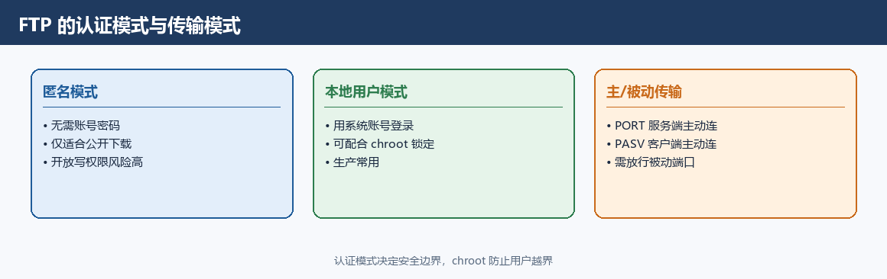
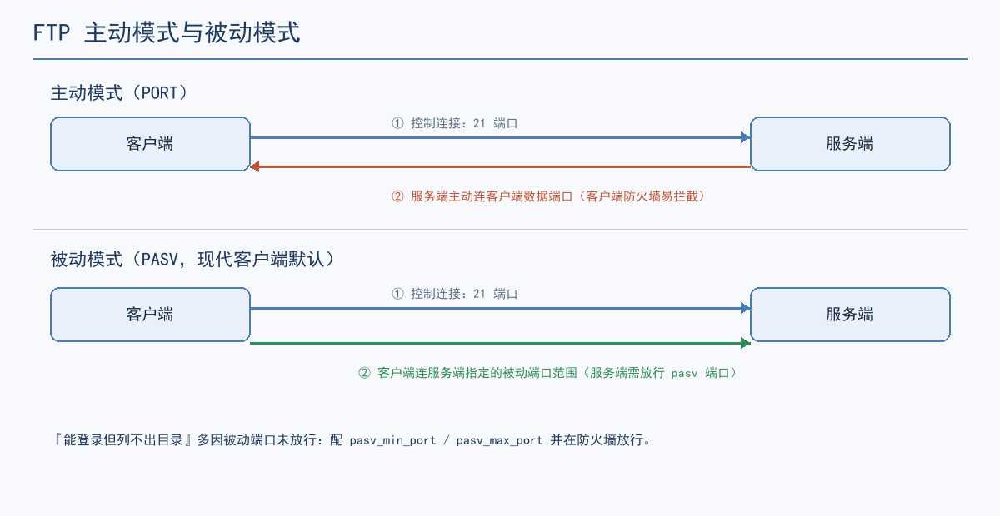
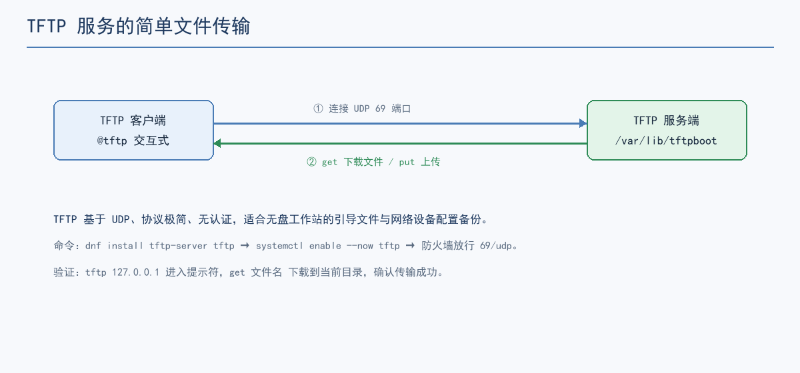

## 板块13 · VSFTPD文件传输服务

文件传输是另一种基础网络服务。这个板块讲清 FTP 协议与 vsftpd 服务程序，剖析主配置文件的关键参数，完成匿名开放、本地用户与虚拟用户三种认证模式的配置，练习 SELinux 配置，并延伸到 TFTP 简单文件传输协议。FTP 的配置同样印证了"安装—配置—放行—验证"这套通用流程，也带来"目录权限 + 认证模式"这组新的考量。

### 13_1 技术背景与核心原理：传输与共享的区别

FTP（文件传输协议）用于在客户端与服务器之间传输文件，它把"上传"和"下载"作为核心动作。要注意它与文件共享（Samba、NFS）的区别：传输是把文件搬来搬去，共享是把远程目录像本地一样挂载使用。前者适合"传一个文件过去"，后者适合"把远程目录当本地盘用"。

vsftpd 是"非常安全的 FTP 守护进程"，在安全性上做了大量设计。它支持三种认证模式，对应不同的安全等级与使用场景。

| 认证模式 | 特点 | 适用场景 |
| --- | --- | --- |
| 匿名开放 | 无需密码即可登录 | 公开文件下载，安全性最低 |
| 本地用户 | 用系统账户密码认证 | 内部使用，较安全 |
| 虚拟用户 | 独立账号库，PAM 认证后映射为宿主用户 | 给外部人员或项目开权限，最灵活 |

匿名模式最不安全，任何人都能免密登录，适合对安全要求不高的公开下载场景；本地用户模式用系统账户认证，既安全又配置简单，是内部文件服务的常用选择；虚拟用户模式把 FTP 账号与系统账号解耦，既不必为每个使用者建系统账户，又能做到一人一目录、一人一权限。

FTP 使用 21 端口作为控制端口。客户端工具方面，命令行可用 ftp，图形工具可选择 FileZilla、WinSCP、Cyberduck 等，后者的功能通常更强大、操作更直观。

```
FTP 传输模型
  客户端 ──控制连接(21)──► vsftpd 服务器
     │                         │
     └──数据连接────────────► 文件上传/下载
                              （匿名模式免密 / 本地用户模式认证）
```



FTP 的数据连接又有主动与被动之分：主动模式由服务端回连客户端端口，被动模式由客户端连服务端指定端口——后者是现代客户端的默认选择，也是"能登录却列不出目录"故障的常见根源。



### 13_2 关键概念：主配置文件参数

vsftpd 的主配置文件参数众多，按功能分组理解最有效。

| 参数类别 | 关键参数 | 作用 |
| --- | --- | --- |
| 监听设置 | listen、listen_address、listen_port | 监听方式与端口 |
| 全局限制 | max_clients、max_per_ip | 连接数限制 |
| 匿名配置 | anonymous_enable、anon_upload_enable、anon_root、anon_max_rate | 匿名访问权限与限速 |
| 本地用户 | local_enable、local_root、chroot_local_user、local_max_rate | 本地用户权限与禁锢 |
| 用户列表 | userlist_enable、userlist_deny | 用户白名单/黑名单 |
| 写入控制 | download_enable、anon_mkdir_write_enable、anon_other_write_enable | 下载与写入权限 |

几个关键参数需要特别理解。chroot_local_user 把用户禁锢在 FTP 目录内，防止其通过 FTP 访问系统其他位置——这是重要安全措施。anon_max_rate 与 local_max_rate 用于限速，单位是字节每秒，0 表示不限速。umask 类参数决定上传文件的默认权限。

配置的原则依然是"最小权限"：只开放业务必需的权限。例如公开下载只需开放匿名读，不应开放匿名上传与删除，否则服务器会成为任意丢垃圾的场所。

### 13_3 实操：两种认证模式与 TFTP

**匿名开放模式**：开启匿名访问、允许上传与建目录、设置匿名根目录与权限。实验中要调整目录权限让匿名用户可写，注意 SELinux 相关布尔值也可能需要开启。配置完成后用 ftp 客户端连接，测试上传、下载、建目录、删除等操作。

**本地用户模式**：关闭匿名访问、开启本地用户登录、设置本地根目录，通常配合 chroot 把用户禁锢在其目录内。用系统已有账户登录，测试文件操作。这种模式下的权限由系统账户与目录权限共同决定。

两种模式的配置差别集中在主配置文件的几行参数上，其余安装、放行与验证步骤完全一致。真正需要斟酌的是模式选择：匿名模式便利但开放，适合分发公开资料；本地用户模式借助系统账户认证，配合 chroot 禁锢后更安全，是生产环境的常见选择。

**TFTP**（简单文件传输协议）是本节延伸内容。它基于 UDP，实现简单、开销小，但不提供认证与可靠性保证，适合局域网内的简单文件传输，如网络设备配置文件的备份与恢复。它与 FTP 的定位不同：FTP 功能全面、适合通用传输，TFTP 极简、适合特定场景。



| 对比项 | FTP | TFTP |
| --- | --- | --- |
| 传输层 | TCP | UDP |
| 认证 | 支持 | 不支持 |
| 可靠性 | 高 | 无保证 |
| 适用场景 | 通用文件传输 | 简单、局域网内传输 |

```
两种认证模式的权限差异
  匿名模式：任何人 → 免密登录 → 受 anon_* 参数限制
  本地模式：系统账户 → 密码认证 → chroot 禁锢 + 系统权限
           安全性：低 ──────────────────────► 高
```

**配置示例：本地用户模式与 chroot 禁锢**

本地用户模式用系统账户认证，比匿名更安全。实验关闭匿名、开启本地用户与写权限，用 chroot 把用户禁锢在主目录，并配好 SELinux 布尔值与防火墙，最后用 ftp 客户端登录测试上传。

```
# 安装服务端与客户端
root@iaoexl:~# dnf install vsftpd ftp

# 编辑主配置文件，关闭匿名、开启本地用户与禁锢
root@iaoexl:~# vim /etc/vsftpd/vsftpd.conf
anonymous_enable=NO
local_enable=YES
write_enable=YES
chroot_local_user=YES
allow_writeable_chroot=YES
# 限定被动模式端口范围，否则客户端 ls 会卡在数据连接上
pasv_enable=YES
pasv_min_port=30000
pasv_max_port=31000

# 启动、自启并放行防火墙（控制端口与被动数据端口都要放）
root@iaoexl:~# systemctl restart vsftpd
root@iaoexl:~# systemctl enable vsftpd
root@iaoexl:~# firewall-cmd --permanent --add-service=ftp
root@iaoexl:~# firewall-cmd --permanent --add-port=30000-31000/tcp
root@iaoexl:~# firewall-cmd --reload

# SELinux 布尔值：允许本地用户写主目录
root@iaoexl:~# setsebool -P ftpd_full_access on

# 客户端登录验证
root@Client:~# ftp 192.168.10.10
Name: iaoexl
Password:
ftp> put test.txt
ftp> ls
ftp> bye
```

**配置示例：匿名开放模式与匿名上传**

匿名模式允许任何人免密访问，适合公开文件下载；若再开放匿名上传，需同时放开目录写权限、SELinux 布尔值与防火墙。

```
# 一、配置匿名访问与匿名上传
root@iaoexl:~# vim /etc/vsftpd/vsftpd.conf
anonymous_enable=YES
anon_upload_enable=YES
anon_mkdir_write_enable=YES
anon_other_write_enable=YES
local_enable=YES
write_enable=YES

# 匿名用户的根目录固定为 /var/ftp，它本身必须不可写，否则 vsftpd 拒绝启动；
# 可写的是其下的 pub 子目录，属主必须是 ftp（匿名用户映射到该账户）
root@iaoexl:~# mkdir -p /var/ftp/pub
root@iaoexl:~# chown -R ftp:ftp /var/ftp/pub
root@iaoexl:~# chmod 755 /var/ftp

# SELinux 允许匿名上传与完全访问
root@iaoexl:~# setsebool -P allow_ftpd_anon_write on
root@iaoexl:~# setsebool -P ftpd_full_access on
root@iaoexl:~# semanage fcontext -a -t public_content_rw_t "/var/ftp/pub(/.*)?"
root@iaoexl:~# restorecon -Rv /var/ftp/pub

root@iaoexl:~# systemctl restart vsftpd
root@iaoexl:~# firewall-cmd --permanent --add-service=ftp
root@iaoexl:~# firewall-cmd --reload

# 二、客户端匿名登录并上传（用户名填 anonymous，密码可直接回车）
root@Client:~# ftp 192.168.10.10
Name (192.168.10.10:root): anonymous
Password:
230 Login successful.
ftp> cd pub
ftp> put local.txt
226 Transfer complete.
ftp> ls
local.txt
ftp> bye
```

匿名模式的三个关键开关缺一不可：配置文件里的 `anon_upload_enable`、目录本身的写权限、SELinux 的 `allow_ftpd_anon_write` 布尔值。三者任一遗漏都会导致"能登录但传不上去"。这种模式便利但风险高，生产环境应谨慎开放并限制上传目录。

**配置示例：部署 TFTP 服务与文件传输**

TFTP 基于 UDP、使用 69 端口，不提供认证、也不保证可靠性，适合局域网内的简单文件传输，常用于网络设备配置文件的备份与恢复。由于没有认证环节，它的配置比 FTP 简单许多——安装服务端与客户端、启动服务、放行 69/udp 端口，即可开始传输。

```
# 安装 TFTP 服务端与客户端
root@iaoexl:~# dnf install tftp-server tftp

# 启动服务并设为开机自启
root@iaoexl:~# systemctl restart tftp.socket
root@iaoexl:~# systemctl enable tftp.socket

# TFTP 走 UDP 69 端口，防火墙放行该端口
root@iaoexl:~# firewall-cmd --zone=public --permanent --add-port=69/udp
root@iaoexl:~# firewall-cmd --reload

# 在默认下载目录放置测试文件（TFTP 根目录为 /var/lib/tftpboot）
root@iaoexl:~# echo "i love linux" > /var/lib/tftpboot/readme.txt

# 客户端连接、下载文件并查看结果
root@iaoexl:~# tftp 192.168.10.10
tftp> get readme.txt
tftp> quit
root@iaoexl:~# cat readme.txt
i love linux
```

TFTP 无认证、无可靠性保证，若需要安全与可靠，应改用 FTP 或基于 SSH 的加密传输；它的价值在于"极简"——一条 `get` 命令即可取回文件，便于设备配置的批量分发与备份。

服务的启停对象是 `tftp.socket` 而不是 `tftp`，这一点与大多数服务不同：TFTP 采用 socket 激活机制，systemd 先常驻监听 UDP 69，收到请求才临时拉起守护进程，请求结束即退出，因此不存在一个长期运行的 `tftp.service`。用 `systemctl restart tftp` 会提示找不到单元，正确写法是操作 socket 单元。

### 13_4 第三种模式：虚拟用户（PAM 加数据库认证）

匿名模式太开放，本地用户模式又让每个 FTP 使用者都拥有一个能登录系统的真实账户——这两者的缺口，正是虚拟用户要补的。虚拟用户只存在于 FTP 自己的账号库里，不在 `/etc/passwd`，不能登录 shell，却可以各自拥有独立目录与独立权限。

它的实现要靠三样东西配合：一张用户名密码库（Berkeley DB）、一段 PAM 认证配置（让 vsftpd 去查这张库）、一个"宿主用户"（虚拟用户在文件系统上的身份代表）。

```
虚拟用户的认证与落地
  客户端 ──用户名/密码──► vsftpd ──PAM──► pam_userdb.so ──查询──► vuser.db
                              │
                              └──映射为宿主用户 vsftpd──► 访问 /home/vsftpd/<虚拟用户名>
                                                          （目录权限由宿主用户决定）
```

关键认知：**FTP 权限最终落在宿主用户身上**。虚拟用户本身没有 uid，上传的文件属主是宿主用户；所以目录属主必须是宿主用户，否则一定出现"能登录、传不上"。

**配置示例：搭建虚拟用户模式的 FTP 服务**

顺序不能乱：先建宿主用户与日志，再写主配置，然后生成账号库、改 PAM、建个人目录，最后处理防火墙与 SELinux。PAM 那一步最容易出错——`pam_userdb.so` 的路径在 64 位系统上是 `/lib64/security/`，写成 `/lib/security/` 会直接认证失败。

```
# 一、创建宿主用户（禁止 shell 登录）与日志文件
root@iaoexl:~# useradd -d /home/vsftpd -s /sbin/nologin vsftpd
root@iaoexl:~# touch /var/log/vsftpd.log && chown vsftpd:vsftpd /var/log/vsftpd.log

# 二、主配置：开启 guest 模式并指向宿主用户
root@iaoexl:~# vim /etc/vsftpd/vsftpd.conf
anonymous_enable=NO
local_enable=YES
write_enable=YES
local_umask=022
chroot_local_user=YES
allow_writeable_chroot=YES
xferlog_enable=YES
xferlog_file=/var/log/vsftpd.log
# 关闭 IPv6 监听，避免 IPv4 起不来
#listen_ipv6=YES
guest_enable=YES
guest_username=vsftpd
virtual_use_local_privs=YES
user_config_dir=/etc/vsftpd/vconf
pasv_enable=YES
pasv_min_port=30000
pasv_max_port=31000

# 三、明文账号文件（一行用户名、一行密码），生成数据库后立即删除
root@iaoexl:~# vim /etc/vsftpd/vuser.txt
iaoexl
iaoexl@7#13
admin
iaoexl@7#13
root@iaoexl:~# dnf install -y libdb-utils
root@iaoexl:~# db_load -T -t hash -f /etc/vsftpd/vuser.txt /etc/vsftpd/vuser.db
root@iaoexl:~# chmod 600 /etc/vsftpd/vuser.db && rm -f /etc/vsftpd/vuser.txt

# 四、PAM 配置：注释原有内容，改为查数据库（注意 db= 后不带 .db 后缀）
root@iaoexl:~# vim /etc/pam.d/vsftpd
auth    required  /lib64/security/pam_userdb.so db=/etc/vsftpd/vuser
account required  /lib64/security/pam_userdb.so db=/etc/vsftpd/vuser

# 五、为每个虚拟用户建独立配置与目录，属主必须是宿主用户
root@iaoexl:~# mkdir -p /etc/vsftpd/vconf /home/vsftpd/iaoexl
root@iaoexl:~# vim /etc/vsftpd/vconf/iaoexl
local_root=/home/vsftpd/iaoexl
write_enable=YES
anon_upload_enable=YES
anon_mkdir_write_enable=YES
anon_other_write_enable=YES
root@iaoexl:~# chown -R vsftpd:vsftpd /home/vsftpd

# 六、放行控制端口与被动端口范围，重启服务
root@iaoexl:~# firewall-cmd --permanent --add-port=21/tcp
root@iaoexl:~# firewall-cmd --permanent --add-port=30000-31000/tcp
root@iaoexl:~# firewall-cmd --reload
root@iaoexl:~# systemctl enable --now vsftpd

# 七、客户端验证：登录、上传、越界测试
root@Client:~# ftp 192.168.10.10
Name: iaoexl
Password:
230 Login successful.
ftp> put note.txt
ftp> cd ..
550 Failed to change directory.
```

第七步的 `cd ..` 是必要的验证动作：返回 `550 Failed to change directory` 说明 chroot 生效，用户被锁在自己的目录里；如果这个命令成功执行并进入了 `/home/vsftpd`，说明 `chroot_local_user` 没起作用。

虚拟用户的配置项写在 `/etc/vsftpd/vconf/<用户名>` 里，文件名必须与用户名完全一致，否则该用户的个性化设置全部失效，退回全局配置。新增用户时要做三件事：账号库追加并重新 `db_load`、建对应的 vconf 文件、建目录并授权——少做任何一件，表现分别是"密码错""目录不对""传不上"。

| 现象 | 根因 | 定位与处置 |
| --- | --- | --- |
| 530 认证失败 | PAM 路径写错或 db 后缀被带上 | 检查 `/lib64/security/` 与 `db=` 参数 |
| 登录后进的是 / 或家目录 | vconf 文件名与用户名不一致 | 核对文件名大小写 |
| 能登录但无法上传 | 目录属主不是宿主用户 | `chown -R vsftpd:vsftpd` |
| 登录后立刻断开 | 未注释 `listen_ipv6` | 注释该行并重启 |
| `ls` 卡住 | 被动端口未放行 | 配 `pasv_min_port` 与 `pasv_max_port` 并放行 |

虚拟用户模式的价值在于"账号与系统账号解耦"：给外包人员、临时项目开 FTP 权限，不必在他离职后还要记得删系统账户；权限边界也清晰——即使某个虚拟用户被破解，攻击者拿到的只是宿主用户能触到的目录，而不是一个可登录的 shell。

### 13_5 场景笔记方法：把 FTP 配置记成"模式—参数—权限"表

FTP 配置的核心是"谁以什么权限访问哪个目录"，笔记应围绕这三要素组织。

| 记录项 | 记录内容 | 示例 |
| --- | --- | --- |
| 认证模式 | 匿名或本地用户 | 本地用户模式 |
| 目录设置 | 根目录与权限 | local_root、目录写权限 |
| 关键参数 | 影响行为的开关 | chroot_local_user=YES |
| SELinux 调整 | 改了哪些布尔值 | 允许 FTP 写入 |
| 验证操作 | 客户端测试了什么 | 上传、下载、删除各一次 |

匿名与本地两种模式的配置差异建议并列记录，形成对照表，避免混淆——尤其注意同名参数在不同模式下的作用不同。

参数误配的典型后果要单独记录：开放了 anon_other_write_enable 会让匿名用户能删除文件，忘记 chroot 会让本地用户越出 FTP 目录。这些"反面经验"比正面配置更值得记住。

### 13_6 实用验证与排错：从客户端确认权限符合预期

FTP 的验证必须用客户端实际操作，因为权限问题只有在"以特定身份做特定操作"时才会暴露。

```
FTP 验证流程
  服务启动 ─► 防火墙放行 ─► SELinux 调整 ─► 客户端连接 ─► 逐项测试权限
     │            │              │              │             │
  status      放行 ftp       布尔值设置      匿名/本地登录   上传/下载/删除
```

| 现象 | 排查方向 |
| --- | --- |
| 连接被拒 | 服务是否启动、防火墙是否放行 |
| 登录成功但无法上传 | 目录写权限、SELinux 布尔值 |
| 本地用户可越出目录 | 是否设置 chroot 禁锢 |
| 匿名用户能删文件 | 是否误开 other_write 权限 |
| 传输速度慢 | 是否设置了合理的限速参数 |

一条经验：配置完 FTP 后，用"不该有权限的身份"做"不该能做的情况"测试。比如用匿名用户尝试删除文件，如果删除成功，说明权限开放过头了。这种反向验证能发现正向测试发现不了的安全漏洞。

### 13_7 认证对标与进阶实战

文件传输服务在认证体系中属于网络服务模块。LPIC-1 的 FTP 服务主题、LFCS 的服务配置、CompTIA Linux+ 的常见网络服务都会涉及 FTP。虽然如今生产环境更推荐加密传输，但 FTP 仍是理解"认证模式 + 目录权限"组合的经典样本。

| 认证体系 | 与本主题相关的考查方向 | 核心能力要求 |
| --- | --- | --- |
| LPIC-1（102） | FTP 服务配置 | 配置匿名与本地用户访问 |
| LFCS | 网络服务管理 | 部署 FTP 服务并控制访问 |
| RHCSA（EX200） | 不考 FTP 部署，只考端口放行与相关布尔值 | 放行 21 端口，用 `getsebool` 判断是否要开 `ftpd_*` 开关 |
| CompTIA Linux+ | 文件传输协议 | 区分 FTP 与 TFTP、主动与被动模式 |

一个因认证模式选择不当引发的风险值得记住：某企业图方便开启了匿名上传，结果 FTP 服务器成了别人的"免费网盘"，塞满了来路不明的文件，还差点成为传播恶意软件的跳板。匿名模式只适合只读公开下载，开放写权限必须配合严格的目录隔离与审计。这提醒我们：认证模式不是功能选项，而是安全边界，开放前先问"谁该有写权限"。

FTP 服务的高频故障集中在认证、目录与被动模式三处。

| 现象 | 根因 | 定位命令 | 处置 |
| --- | --- | --- | --- |
| 登录失败 | 认证模式配置错或用户被限制 | 查配置与用户列表 | 核对认证模式与用户权限 |
| 登录成功但列不出目录 | 目录权限不足或属主不对 | ls -ld、查日志 | 修正属主与目录权限 |
| 能登录不能传 | 写权限未开或 SELinux 拦截 | getsebool | 开写权限、调布尔值 |
| 客户端卡在列目录 | 主动/被动模式与防火墙冲突 | 调整被动端口范围 | 配 pasv 端口并放行 |

闯关任务按"部署—认证—隔离"三级递进。

```
  FTP 服务闯关
  第一关 配置匿名只读下载并验证
    │
  第二关 配置本地用户可登录、可上传
    │
  第三关 用 chroot 把用户锁定在家目录
```

- 第一关：开启匿名访问，放入测试文件，用客户端下载验证。
- 第二关：开启本地用户模式与写权限，用系统账户登录上传。
- 第三关：配置 chroot_local_user，验证用户无法切换到上级目录。

进阶要理解 FTP 的两种连接模式与 chroot 的沙箱意义。FTP 同时用控制连接（命令）与数据连接（传文件）：主动模式由服务端主动连客户端的数据端口，客户端有防火墙时容易被拦；被动模式由客户端连服务端指定的端口，服务端需开放一段被动端口范围并在防火墙放行——多数现代客户端默认用被动模式，这也解释了"能登录但列不出目录"常与被动端口未放行有关。chroot 则把用户根目录"重定向"到其家目录，使用户看不到系统其他部分，是限制 FTP 用户越界的关键手段，但开启后用户家目录不能有写权限（否则某些版本会拒绝登录），通常在家目录下再建一个可写的子目录。把"认证模式 × 读写权限 × chroot × 主动被动"这四个维度做成一张组合表，FTP 的配置与排错就有了清晰坐标。

### 13_8 要点回顾与能力自检

本板块讲清了 FTP 传输与文件共享的区别、vsftpd 的匿名开放、本地用户与虚拟用户三种认证模式、主配置文件的关键参数、TFTP 的特点与适用场景，并用"四步模板"完成了配置。核心原则是最小权限与反向验证。

自检问题：

1. FTP 文件传输与 Samba/NFS 文件共享的本质区别是什么？
2. 匿名开放、本地用户与虚拟用户三种模式在安全性和适用场景上有何区别？
3. chroot_local_user 参数的作用是什么？为什么重要？
4. FTP 与 TFTP 在传输层、认证、可靠性上有何区别？
5. 虚拟用户为什么必须依赖一个宿主用户？目录属主设错会出现什么现象？
6. 为什么验证 FTP 时要做"反向测试"？
