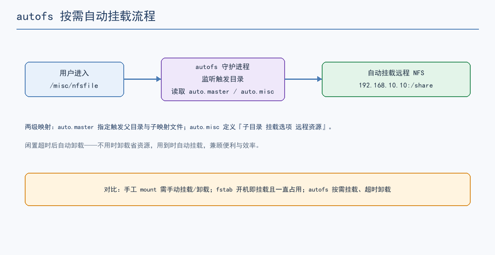
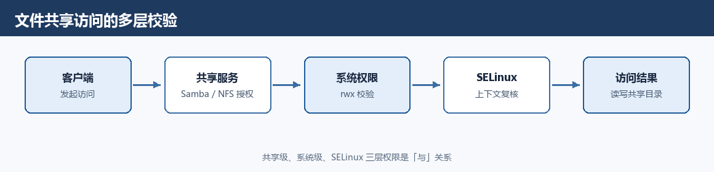

## 板块14 · Samba与NFS文件共享

文件传输是把文件搬来搬去，文件共享则是把远程目录挂载到本地，像操作本地文件夹一样使用它。Samba 解决 Linux 与 Windows 之间的文件共享，NFS 解决 Linux 与 Linux 之间的高效共享，autofs 则让挂载按需进行、闲置时自动卸载，提升资源利用率。这个板块把跨系统协作的最后一环补齐，也补上反向场景：Linux 如何挂载 Windows 上的共享目录。

### 14_1 技术背景与核心原理：传输 vs 共享，SMB vs NFS

先厘清两种资源交换方式：文件传输是把文件复制来复制去，两端各有一份；文件共享是让一端直接使用另一端的目录，只有一份数据。前者适合"把文件给你"，后者适合"我们一起用这份数据"。

Samba 基于 SMB 协议，其起源与 Windows 网络共享密切相关。SMB 最初是为局域网内文件与打印机共享设计的协议，Samba 让 Linux 系统也能加入这种共享体系，从而实现 Linux 与 Windows 的互操作。这是它在混合系统环境中不可替代的价值。

NFS（网络文件系统）则是 Unix/Linux 世界的原生共享方案，配置简洁、效率高，适合 Linux 系统之间共享目录。

| 方案 | 协议 | 主要场景 |
| --- | --- | --- |
| Samba | SMB | Linux 与 Windows 之间共享 |
| NFS | NFS | Linux 与 Linux 之间共享 |
| autofs | 配合 NFS 等 | 按需自动挂载 |

autofs 解决一个实际痛点：传统挂载在系统启动即建立连接，即便没人使用也一直占用资源。autofs 让目录在首次访问时才自动挂载、闲置一段时间后自动卸载，既节省带宽又提高硬件资源利用率。

```
文件共享的两种方式
  传输(FTP)：  服务器文件 ──复制──► 客户端副本   （两份数据）
  共享(Samba/NFS)：客户端直接挂载服务器目录      （一份数据）
                    客户端操作 ◄──映射──► 服务器目录
```

### 14_2 关键概念：Samba 服务构成与配置

Samba 服务由多个进程协同工作，主配置文件按区段组织。理解区段结构就能读懂配置。

| 配置区段 | 作用 |
| --- | --- |
| [global] | 全局设置：工作组、安全模式、日志等 |
| [homes] | 共享用户的家目录 |
| [自定义共享] | 定义具体的共享目录与访问权限 |

共享配置的关键参数是路径与权限：path 指定共享目录，read only / writable 控制读写，browseable 控制是否可见，valid users 限定可访问用户。安全模式决定认证方式，常用的是用户级认证（user），需要创建 Samba 专用账户并设置密码。

Samba 账户与系统账户是两套：Samba 用户必须先是系统用户，再用 smbpasswd 设置 Samba 密码。这种设计让共享认证与系统登录既关联又隔离。

| 命令/工具 | 作用 |
| --- | --- |
| smbpasswd | 设置 Samba 用户密码 |
| systemctl start smb | 启动 Samba 服务 |
| firewall-cmd --add-service=samba | 放行 Samba 流量 |
| mount -t cifs | 客户端挂载 Samba 共享 |
| showmount | 查看 NFS 共享 |

客户端访问方面，Windows 可直接在资源管理器输入地址访问共享，Linux 用 mount 挂载。Windows 访问常遇到凭据与安全策略问题，需要正确输入 Samba 账户密码。

```
Samba 共享配置结构
  [global]      全局：工作组、安全模式=user
  [homes]       自动共享每个用户的家目录
  [share]       自定义共享
      path = 共享目录路径
      writable = yes        允许写入
      browseable = yes      可见
      valid users = 指定用户
```

### 14_3 实操：Samba、NFS 与 autofs

**Samba 共享部署**：安装 Samba，创建用于共享的系统用户并用 smbpasswd 设密码，创建共享目录并设权限，编辑主配置文件定义共享段，启动服务、放行防火墙，最后分别从 Windows 与 Linux 访问共享。双端验证很有价值——它证明共享在异构环境中真正可用。

**NFS 共享部署**：在服务端安装 nfs-utils，编辑 exports 文件定义要共享的目录与允许访问的客户端网段，启动服务并放行防火墙；客户端用 mount 挂载远程共享目录到本机。NFS 配置的核心是 exports 文件中权限选项的设置，如读写（rw）、只读（ro）、同步（sync）等。

**autofs 自动挂载**：安装 autofs，配置主映射文件与子映射文件，定义"访问哪个目录时自动挂载哪个远程共享"，启动服务后，首次进入挂载点即自动挂载，闲置后自动卸载。用 df 观察挂载前后状态变化，可验证自动挂载确实生效。

autofs 的价值在于"按需"：一台可能挂载几十个远程目录的机器，若全部开机挂载会消耗大量连接资源，而 autofs 只在真正访问时才建立连接。



| 对比 | Samba | NFS |
| --- | --- | --- |
| 跨平台 | Linux ↔ Windows | 主要 Linux ↔ Linux |
| 认证 | Samba 账户密码 | 基于主机与权限 |
| 配置核心 | 共享段参数 | exports 文件 |
| 客户端挂载 | cifs 类型 | nfs 类型 |



**配置示例：Samba 与 NFS 共享部署**

Samba 与 NFS 分别面向跨平台与纯 Linux 共享。实验在服务端建共享账户与目录、配置 smb.conf 或 exports、启动服务并放行防火墙，再从客户端用 cifs 或 nfs 类型挂载，完成双端验证。

```
# ===== Samba：创建共享账户与目录 =====
root@iaoexl:~# dnf install samba
root@iaoexl:~# useradd -s /sbin/nologin iaoexl
root@iaoexl:~# smbpasswd -a iaoexl
New SMB password:
Added user iaoexl.
root@iaoexl:~# mkdir -p /share && chmod 777 /share
# 自定义目录必须打上 samba_share_t 标签，否则 SELinux 会拦住客户端访问
root@iaoexl:~# semanage fcontext -a -t samba_share_t "/share(/.*)?"
root@iaoexl:~# restorecon -Rv /share
root@iaoexl:~# vim /etc/samba/smb.conf
[share]
  path = /share
  writable = yes
  browseable = yes
  valid users = iaoexl

# 先验配置再重启：testparm 会解析 smb.conf 并列出生效的共享定义
root@iaoexl:~# testparm -s
Load smb config files from /etc/samba/smb.conf
Loaded services file OK.
Server role: ROLE_STANDALONE
[share]
	path = /share
	valid users = iaoexl
	read only = No
	browseable = Yes

root@iaoexl:~# systemctl restart smb
root@iaoexl:~# firewall-cmd --permanent --add-service=samba
root@iaoexl:~# firewall-cmd --reload
# 客户端挂载
root@Client:~# mount -t cifs //192.168.10.10/share /mnt -o username=iaoexl

# ===== NFS：导出目录并在客户端挂载 =====
root@iaoexl:~# dnf install nfs-utils
root@iaoexl:~# vim /etc/exports
/share  192.168.10.0/24(rw,sync,no_root_squash)
root@iaoexl:~# systemctl restart nfs-server
root@iaoexl:~# firewall-cmd --permanent --add-service=nfs
root@iaoexl:~# firewall-cmd --reload
# 客户端查看并挂载
root@Client:~# showmount -e 192.168.10.10
Export list for 192.168.10.10:
/share 192.168.10.0/24
root@Client:~# mount -t nfs 192.168.10.10:/share /mnt
```

`testparm -s` 只打印非默认项，输出短、便于核对——写了但没生效的参数（拼写错误、放在了错误的段落下）不会出现在结果里，这正是它的价值。它只检查配置文件本身，不检查 SELinux 标签与防火墙，所以 `testparm` 通过但客户端仍挂不上，问题一定在后面两层。排查共享是否可见，可以用 `smbclient -L //192.168.10.10 -U iaoexl` 列出共享列表，比直接 mount 更容易看出"共享根本没发布"与"发布了但认证失败"的区别。

这份配置里有两处是为了让实验一次跑通而做的简化，上线前必须改回去。一是 `chmod 777 /share`：任何人都能写，等于绕过了 Samba 的 `valid users`，生产环境应当按组授权，例如属组 `smbgrp`、权限 `2770`，再把 `iaoexl` 加进该组。二是 `no_root_squash`：它让客户端以 root 身份访问时，在服务端仍是 root，等于把服务端的最高权限交给了客户端；默认的 `root_squash` 会把这类访问压缩成 `nobody`，只有确实需要保留属主的场景（如无盘工作站的家目录）才打开它。

改完 `/etc/exports` 不必重启服务，`exportfs -rv` 就会重新读取并输出当前导出表，这比 `systemctl restart nfs-server` 对在用挂载的冲击小得多。

**配置示例：autofs 按需自动挂载远程 NFS**

autofs 用两级映射文件定义挂载规则：主映射文件 `/etc/auto.master` 指明"触发目录"与对应的子映射文件，子映射文件再写明进入哪个子目录时挂载什么资源。配置完成后无需手动 mount，首次进入触发目录才真正建立连接，闲置后自动卸载。

```
# 安装 autofs
root@iaoexl:~# dnf install autofs

# 主映射文件：/misc 目录由 /etc/auto.misc 这张子映射表管理（系统默认已有该行）
root@iaoexl:~# vim /etc/auto.master
/misc   /etc/auto.misc

# 子映射文件：进入 /misc/share 时自动挂载服务端导出的 /share；cd 条目用于光驱
root@iaoexl:~# vim /etc/auto.misc
share     192.168.10.10:/share
cd        -fstype=iso9660,ro,nosuid,nodev :/dev/cdrom

# 启动服务并设为开机自启
root@iaoexl:~# systemctl start autofs
root@iaoexl:~# systemctl enable autofs

# 验证：无需手动挂载，进入触发目录后 df 可见远程共享已挂上
root@iaoexl:~# cd /misc/share
root@iaoexl:~# df -h
192.168.10.10:/share  17G  3.7G   13G  23% /misc/share
```

子映射文件每行分三段：子目录名、挂载选项（可省略）、远程资源地址；触发目录 `/misc/share` 中的 `share` 就是子映射里的关键字。修改映射文件后需重启 autofs 生效，之后 `cd` 进入即挂载、离开一段时间即卸载，用 `df -h` 对比进入前后即可确认按需挂载确实发生。

**实验步骤：Windows 客户端访问 Samba 共享**

Windows 访问 Samba 共享通过图形界面完成，无需命令行：

1. 打开文件资源管理器，在地址栏输入 `\\192.168.10.10` 后回车。
2. 在弹出的凭据窗口输入 Samba 账户名（如 iaoexl）及对应密码。
3. 连接成功后可见共享目录（如 database），双击进入即可像本地文件夹一样读写。
4. 若需长期作为网络驱动器使用，可右键共享目录选择"映射网络驱动器"并指定盘符。

连接失败时，按顺序核对服务是否运行、防火墙是否放行 samba、账户密码是否正确，排查思路与 Linux 客户端挂载一致。

### 14_4 反向场景：Linux 挂载 Windows 的共享目录

前面讲的都是"Linux 做服务端、别人来访问"，实际运维里更常见的是反过来：公司文件服务器跑在 Windows Server 上，Linux 主机要把那个共享目录挂过来当本地盘用——跑备份脚本、给应用读配置、或者单纯方便拷贝。

这件事靠 SMB/CIFS 协议完成，客户端工具是 `cifs-utils`（它取代了早已废弃的 `smbfs`）。它和 NFS 挂载的差别在于认证：NFS 靠主机与 uid 信任，CIFS 要真的提交一套 Windows 账户密码，因此凭证管理成了重点。

```
Linux 访问 Windows 共享
  mount -t cifs //192.168.10.50/share /mnt/share -o credentials=/etc/cifs.cred
          │                │                          │
      协议与 UNC 路径    Windows 共享名            凭证文件（600 权限）
                                                     │
  Windows 侧需开启：Microsoft 网络客户端 + 文件与打印机共享 + 该账户的共享/NTFS 权限
```

**配置示例：用凭证文件挂载并写入 fstab 开机自动挂载**

把密码写在命令行或 fstab 里，等于把密码交给了 `ps` 和所有能读 `/etc/fstab` 的人。规范做法是单独建凭证文件、权限收到 600，fstab 里只引用文件路径。

```
# 一、安装客户端工具
root@iaoexl:~# dnf install -y cifs-utils samba-client

# 二、凭证文件：只有 root 可读
root@iaoexl:~# vim /etc/cifs.cred
username=iaoexl
password=iaoexl@7#13
domain=WORKGROUP
root@iaoexl:~# chmod 600 /etc/cifs.cred

# 三、先手工挂载排错，成功后再写 fstab
root@iaoexl:~# mkdir -p /mnt/share
root@iaoexl:~# mount -t cifs //192.168.10.50/share /mnt/share -o credentials=/etc/cifs.cred,uid=1000,gid=1000,dir_mode=0755,file_mode=0644
root@iaoexl:~# df -h /mnt/share
//192.168.10.50/share  100G   62G   38G  62% /mnt/share

# 四、写入 fstab 实现开机自动挂载（noauto 可改成自动，视网络就绪顺序而定）
root@iaoexl:~# vim /etc/fstab
//192.168.10.50/share /mnt/share cifs credentials=/etc/cifs.cred,uid=1000,gid=1000,dir_mode=0755,file_mode=0644,_netdev 0 0

# 五、验证 fstab 写法无误（先 umount 再 mount -a，避免"看似成功"）
root@iaoexl:~# umount /mnt/share && mount -a && mount | grep cifs
```

`uid`、`gid`、`file_mode`、`dir_mode` 这四个参数解决的是同一个问题：CIFS 协议不带 Linux 的属主权限信息，挂载后文件默认归 root、权限由服务端决定，普通用户读写会被拒。用它们把属主与权限"钉"成本地需要的值，程序才能正常读写。

`_netdev` 告诉 systemd 这是一个依赖网络的挂载，等网络就绪后再挂载。缺了它，开机时网络还没起来就去挂载，`mount -a` 失败，某些配置下会拖慢启动。

| 现象 | 常见根因 | 处置 |
| --- | --- | --- |
| `mount error(13): Permission denied` | 账户无共享权限或密码错 | 核对 NTFS 与共享两层权限 |
| `mount error(112): Host is down` | SMB 协议版本不匹配 | 加 `vers=2.0` 或 `vers=3.0` 明确版本 |
| 挂载成功但普通用户不能写 | 属主与权限未指定 | 补 `uid/gid` 与 `file_mode` |
| 开机启动卡住 | 缺 `_netdev` 或网络未就绪 | 加 `_netdev`，或改 `noauto` 手动挂载 |
| 文件名中文乱码 | 未指定字符集 | 加 `iocharset=utf8` |

还有一处容易忽略：Windows 端的安全策略会限制旧版 SMB 协议。较新的 Windows Server 默认禁用 SMBv1，而部分老客户端仍试图用 v1 协商，表现就是"能 ping 通、连不上共享"。显式指定 `vers=3.0` 通常能解决，如果服务端只开了 v1，那就该升级服务端而不是迁就客户端。

### 14_5 场景笔记方法：把共享配置记成"服务端—客户端—验证"链

共享涉及两端，笔记必须同时记录服务端配置与客户端挂载方式，只记一端会导致日后无法复现。

| 记录项 | 记录内容 | 示例 |
| --- | --- | --- |
| 服务端 | 共享目录与配置段 | [share] path、权限 |
| 认证 | Samba 用户或 NFS 授权网段 | smbpasswd 用户 |
| 客户端 | 挂载命令与地址 | mount -t nfs ... |
| 验证 | 双端访问测试 | Windows 访问 + Linux 挂载 |
| autofs | 触发目录与自动卸载 | 挂载前后 df 对比 |

Samba 账户与系统账户的"两套"关系容易混淆，笔记要说明创建顺序：先建系统用户，再 smbpasswd 设 Samba 密码。NFS 的 exports 权限选项也要记录含义，避免把 ro 配成 rw 造成误写。

autofs 笔记要画"触发目录 → 远程共享"的映射关系，并注明闲置卸载的时间设置——这是理解 autofs 行为的关键。

### 14_6 实用验证与排错：确保两端真正打通

共享配置的验证必须"从客户端来"，因为服务端配置正确不代表客户端能访问。

```
共享排错流程
  服务端服务运行 ─► 防火墙放行 ─► 共享目录权限 ─► 认证配置 ─► 客户端挂载访问
       │               │              │             │             │
    smb/nfs 状态    放行 samba/nfs   SElinux与rw  用户/网段授权    mount 与 df
```

| 现象 | 排查方向 |
| --- | --- |
| Windows 访问被拒 | Samba 账户密码、安全模式 |
| Linux 挂载失败 | 服务类型、网络连通、exports 授权 |
| 能访问但只读 | 目录权限或配置的 rw/ro |
| autofs 不自动挂载 | 映射文件路径与服务状态 |
| 挂载后权限异常 | 服务端与客户端权限的叠加 |

经验之谈：共享故障多数出在"权限的叠加"上——服务端共享权限、目录本地权限、SELinux 三者任一过严都会导致访问失败。排查时要三处一起看，而不是只盯着配置文件。

### 14_7 认证对标与进阶实战

文件共享是网络服务认证中的常见考点。LPIC-1 的 102 考试覆盖 Samba 与 NFS 配置，LFCS 把网络共享列为网络服务的一部分，CompTIA Linux+ 也会考查共享协议的选择。RHCSA 只考 NFS 的客户端一侧——挂载与 autofs 自动挂载，服务端搭建不在考纲内。理解 Samba 与 NFS 的适用边界，是按场景选方案的前提。

| 认证体系 | 与本主题相关的考查方向 | 核心能力要求 |
| --- | --- | --- |
| LPIC-1（102） | NFS/Samba 配置、autofs | 配置共享目录、设置访问权限 |
| LFCS | 网络文件共享 | 部署 Samba/NFS 并挂载使用 |
| RHCSA（EX200） | 创建与配置文件系统：NFS 挂载、autofs | 挂载远程共享并写进 fstab；配 autofs 做到访问即挂 |
| CompTIA Linux+ | 共享协议 | 区分 Samba 与 NFS 的适用平台 |

一个跨平台的真实场景说明了选型的意义：公司里 Windows 与 Linux 机器混用，起初用 NFS 共享，Windows 客户端访问困难；改用 Samba 后，Windows 用网上邻居、Linux 用挂载都能访问，问题迎刃而解。反过来，若全是 Linux 服务器之间共享，NFS 配置更简单、性能更好。结论很清晰：涉及 Windows 就选 Samba，纯 Linux 环境优先 NFS。

共享服务的高频故障，往往是"多层权限"叠加导致的。

| 现象 | 根因 | 定位命令 | 处置 |
| --- | --- | --- | --- |
| 共享访问被拒 | 服务端共享权限或本地权限不足 | 查配置、ls -ld | 同时检查共享级与系统级权限 |
| Samba 认证失败 | 用户非系统用户或密码未设 | pdbedit -L | 先建系统用户再设 Samba 密码 |
| 能挂载不能写 | 目录权限或只读选项 | mount、ls -ld | 补写权限、去掉 ro 选项 |
| 访问偶发中断 | SELinux 拦截或网络波动 | getenforce、查日志 | 调布尔值、检查网络 |

闯关任务按"Samba—NFS—自动挂载"三级递进。

```
  文件共享闯关
  第一关 用 Samba 共享目录，从 Windows 风格客户端访问
    │
  第二关 用 NFS 共享目录，在另一台 Linux 挂载
    │
  第三关 用 autofs 实现按需自动挂载与超时卸载
```

- 第一关：配置 Samba 共享段、建用户密码，用客户端访问验证读写。
- 第二关：配置 exports、启动服务，在客户端 mount 并写文件验证。
- 第三关：配置 autofs 触发目录，进入目录时自动挂载，超时后自动卸载。

进阶要理解"权限叠加"与 autofs 的价值。共享访问能否成功，取决于三道关：共享服务自身的访问控制（如 Samba 的 valid users、NFS 的导出选项）、系统的文件权限（rwx）、以及 SELinux 策略，三者是"与"的关系，任何一道拒绝都会失败——这也是排错必须逐层检查的原因。autofs 则解决了静态挂载的两个痛点：不访问时也占着连接、服务器宕机时可能导致本地卡住；它按需挂载、超时卸载，既省资源又提高容错。把"共享级 × 系统级 × SELinux"三层权限与"Samba × NFS"两种协议组合成一张对照表，文件共享的配置与排错就能做到不重不漏。

### 14_8 要点回顾与能力自检

本板块区分了传输与共享，讲清了 Samba 的 SMB 协议背景与配置结构、NFS 的 exports 配置、autofs 的按需挂载，并完成双端访问验证。核心经验是共享配置必须服务端与客户端一起看，权限是多层叠加的结果。

自检问题：

1. 文件传输与文件共享的本质区别是什么？
2. Samba 与 NFS 各自适合什么场景？
3. 为什么 Samba 用户必须先是系统用户？
4. autofs 解决了传统挂载的什么问题？
5. 共享访问失败时为什么要同时检查服务端权限、本地权限和 SELinux？
6. `testparm` 能查出哪一类错误、查不出哪一类？它通过之后仍挂不上共享，问题应该往哪两层找？
