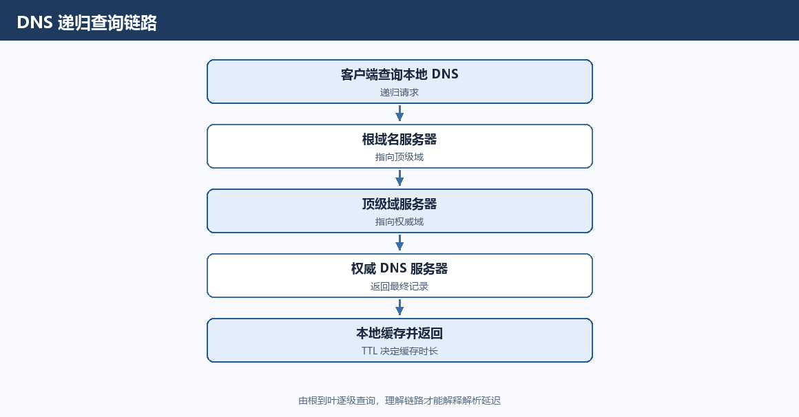
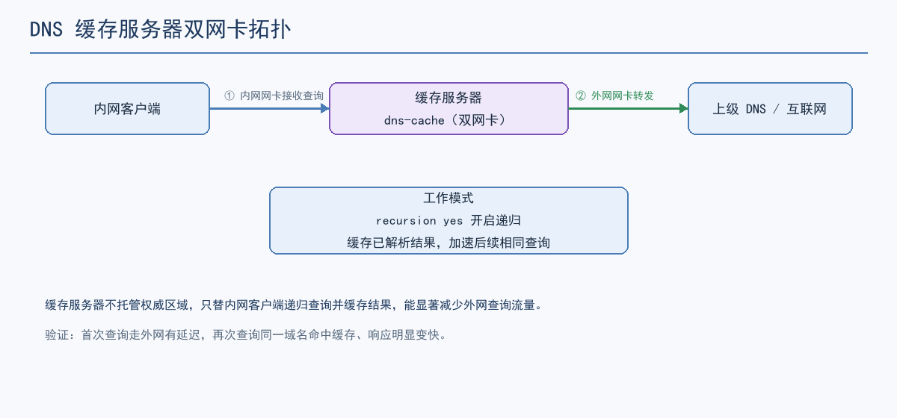
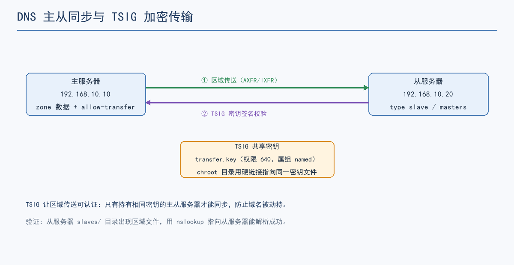

## 板块15 · BIND域名解析服务

DNS 是互联网的基础设施，几乎所有网络应用都依赖它——网站、邮件都要先把域名解析成地址才能通信。DNS 服务一旦故障，即便网站和邮件系统本身正常，用户也找不到它们。这个板块讲清 DNS 的正向与反向解析、BIND 服务的三个关键配置文件、主从服务器、缓存服务器、chroot 牢笼、TSIG 加密传输与分离解析，是网络服务板块中理论最深、也最能体现"基础设施"分量的一节。

### 15_1 技术背景与核心原理：把名字翻译成地址

DNS 的核心功能是域名与 IP 地址的相互映射。正向解析把域名翻译成地址，这是最常见的查询；反向解析把地址翻译成域名，常用于邮件服务器验证等场景。

域名系统采用分层结构，从根域、顶级域、二级域逐级向下，查询过程可能是递归或迭代的。理解分层与查询方式，才能明白为什么需要配置转发、为什么缓存能提升体验。

BIND 是全球使用最广泛的域名解析服务程序，绝大多数 DNS 服务器基于它搭建。正因为责任重大，部署 BIND 时强烈建议加 chroot 扩展包——俗称"牢笼机制"，它把服务限制在只能操作自身配置文件，即便服务被攻破，攻击者也无法触及系统其他部分。一个细节很能说明问题：主程序有数百 KB，而作为安全插件的 chroot 包只有几十 KB，用极小的代价换来极大的安全收益。

```
DNS 解析的基本方向
  正向解析：域名 ──────► IP 地址    （www.example.com → 192.168.x.x）
  反向解析：IP 地址 ────► 域名      （192.168.x.x → mail.example.com）

  查询方式：递归查询（服务器全程代办） / 迭代查询（服务器给出线索，客户端继续问）
```



### 15_2 关键概念：BIND 的三个配置文件

BIND 的配置看似复杂，实则由三个关键文件分工协作，理解各自职责就不会迷失。

| 文件 | 位置 | 作用 |
| --- | --- | --- |
| 主配置文件 | /etc/named.conf | 定义服务运行参数、全局设置、访问控制 |
| 区域配置文件 | /etc/named.rfc1912.zones | 保存域名与地址对应关系的"目录",指向具体数据文件 |
| 数据配置文件目录 | /var/named | 存放真实的域名与地址对应关系数据 |

主配置文件中两处地址修改最关键：listen-on 的地址改为 any，表示服务器上所有地址都提供解析服务；allow-query 改为 any，表示允许所有人发送查询请求。这两处不配错，服务才能对外提供查询。

区域配置文件像图书目录，每个区域条目指向一个数据文件；数据配置文件才是真正存放解析记录的地方。这种"主配置—区域索引—数据文件"的三层结构，让上千万条记录的管理变得可行——把所有记录塞进一个文件会严重制约效率且难以维护。

| 记录类型 | 作用 |
| --- | --- |
| NS | 域名服务器记录 |
| A | 正向解析记录，域名指向 IPv4 地址 |
| MX | 邮件交换记录 |
| PTR | 反向解析记录，地址指向域名 |
| CNAME | 别名记录 |

| 命令/工具 | 作用 |
| --- | --- |
| systemctl restart named | 重启域名服务 |
| nslookup / dig | 测试解析结果 |
| named-checkconf | 检查主配置语法 |
| tsig-keygen | 生成 TSIG 密钥 |

### 15_3 实操：从主服务器到分离解析

实验按能力递进展开，逐步构建一套完整的 DNS 体系。

**正向与反向解析**：在主服务器上编辑三个配置文件，建立正向区域（域名到地址）与反向区域（地址到域名），重启服务后用 nslookup 测试。复制正向解析模板文件时要加 -a 参数，让新文件继承原文件的属性与权限——否则权限不对会导致服务读不到文件。

**从服务器**：配置一台从服务器，从主服务器同步区域数据，实现冗余与负载分担。从服务器的数据文件从主服务器自动获取，这既减轻主服务器压力，又在主服务器故障时提供解析。

**缓存服务器**：只做查询缓存，不维护权威区域。它能显著提升用户查询体验——热门域名的解析结果被缓存，后续查询直接返回，免去反复迭代查询的开销。



**chroot 牢笼**：安装 bind-chroot 包，让服务运行在受限目录，增强安全性。

**TSIG 加密传输**：主从服务器之间同步区域数据时，需要防止数据被篡改或伪造。TSIG（事务签名）用密钥对区域传输加密。配置分五步：用 tsig-keygen 生成密钥、在主服务器创建密钥验证文件并设权限与硬链接、开启并加载主服务器的密钥验证、在从服务器做同样配置、开启从服务器的密钥验证。配置完成后，清空从服务器同步目录重启，没有正确密钥将无法获取数据，从而验证加密生效。密钥文件要设合适的属组与权限（如 640），这是安全细节。



**分离解析**：让不同地区的用户访问同一域名得到不同结果，从而就近访问最优节点。这是内容分发思路的雏形，也是大型网站提升访问体验的关键技术。

```
DNS 服务体系演进
  单台主服务器 ─► 主从架构（冗余+分担）─► 缓存服务器（加速）
                      │
                      ├─ chroot 牢笼（安全加固）
                      ├─ TSIG 加密（传输安全）
                      └─ 分离解析（就近访问）
```

**配置示例：搭建正向解析区域**

正向解析把域名翻译成 IP，是 DNS 最基础的服务。这组命令从安装 BIND 与 chroot 入手，依次放行监听与查询、定义正向区域、复制模板写入 A 记录，最后检查语法、重启服务并用 nslookup 验证。

```
# 安装 BIND 与 chroot 扩展
root@iaoexl:~# dnf install bind bind-chroot bind-utils

# 编辑主配置，允许监听并放行查询
root@iaoexl:~# vim /etc/named.conf
listen-on port 53 { any; };
allow-query     { any; };

# 在区域配置文件中定义正向区域
root@iaoexl:~# vim /etc/named.rfc1912.zones
zone "iaoexl.com" IN {
  type master;
  file "iaoexl.com.zone";
  allow-update { none; };
};

# 复制区域模板（-a 保留权限）并编辑记录
root@iaoexl:~# cp -a /var/named/named.localhost /var/named/iaoexl.com.zone
root@iaoexl:~# vim /var/named/iaoexl.com.zone
$TTL 1D
@   IN SOA  dns.iaoexl.com. root.iaoexl.com. ( 0 1D 1H 1W 3H )
    IN NS   dns.iaoexl.com.
dns IN A    192.168.10.10
www IN A    192.168.10.10

# 检查语法、重启服务、放行防火墙
# named-checkconf 只校验主配置与区域声明，区域文件本身要用 named-checkzone 单独验
root@iaoexl:~# named-checkconf
root@iaoexl:~# named-checkzone iaoexl.com /var/named/iaoexl.com.zone
zone iaoexl.com/IN: loaded serial 0
OK
root@iaoexl:~# systemctl restart named
root@iaoexl:~# firewall-cmd --permanent --add-service=dns
root@iaoexl:~# firewall-cmd --reload

# 验证正向解析
root@iaoexl:~# nslookup www.iaoexl.com 192.168.10.10
Name:   www.iaoexl.com
Address: 192.168.10.10
```

SOA 记录括号里的五个值依次是 serial、refresh、retry、expire、minimum，它们决定主从之间怎么"对表"：serial 是区域版本号，从服务器只比较这一个数字，因此每次改完记录必须把它加一，否则从服务器认为数据没变、拒绝重新同步；refresh 是从服务器主动查询更新的间隔；retry 是查询失败后的重试间隔，取值应小于 refresh；expire 是联系不上主服务器时旧数据还能撑多久，取值必须远大于 refresh；minimum 是否定应答的缓存时长。写成 `0 1D 1H 1W 3H` 就是"版本 0、每天比对一次、失败一小时后再试、七天联系不上就作废旧数据、否定缓存三小时"。实验环境从 0 起步无妨，真实环境建议用日期式编号（如 `2026111701`），手工加一时不易撞号。这五个值写错本身不会导致服务启动失败，但会让主从同步悄悄失效，是 DNS 里最容易被忽略的一处细节。

**配置示例：搭建反向解析区域与 MX 邮件记录**

正向解析是"域名查 IP"，反向解析是"IP 查域名"，用于邮件服务器反向验证等场景。两者配置方法对称，构成一套完整的 DNS 解析实验组合。

```
# 一、在区域配置文件中定义反向区域（网段要反写，并加 in-addr.arpa）
root@iaoexl:~# vim /etc/named.rfc1912.zones
zone "10.168.192.in-addr.arpa" IN {
  type master;
  file "192.168.10.arpa";
  allow-update { none; };
};

# 复制反向模板并编辑 PTR 记录
root@iaoexl:~# cp -a /var/named/named.loopback /var/named/192.168.10.arpa
root@iaoexl:~# vim /var/named/192.168.10.arpa
$TTL 1D
@   IN SOA  dns.iaoexl.com. root.iaoexl.com. ( 0 1D 1H 1W 3H )
    IN NS   dns.iaoexl.com.
10  IN PTR dns.iaoexl.com.
20  IN PTR www.iaoexl.com.

# 二、在正向区域文件中追加 MX 邮件记录与别名 CNAME
root@iaoexl:~# vim /var/named/iaoexl.com.zone
$TTL 1D
@   IN SOA  dns.iaoexl.com. root.iaoexl.com. ( 0 1D 1H 1W 3H )
    IN NS   dns.iaoexl.com.
    IN MX 10 mail.iaoexl.com.
dns IN A    192.168.10.10
www IN A    192.168.10.20
mail IN A   192.168.10.30
bbs IN CNAME www

# 语法检查与重启
root@iaoexl:~# named-checkconf
root@iaoexl:~# named-checkzone iaoexl.com /var/named/iaoexl.com.zone
zone iaoexl.com/IN: loaded serial 0
OK
root@iaoexl:~# systemctl restart named

# 验证反向解析、MX 记录与别名
root@iaoexl:~# nslookup 192.168.10.20 192.168.10.10
20.10.168.192.in-addr.arpa  name = www.iaoexl.com.
root@iaoexl:~# nslookup -type=MX iaoexl.com 192.168.10.10
iaoexl.com  mail exchanger = 10 mail.iaoexl.com.
root@iaoexl:~# nslookup bbs.iaoexl.com 192.168.10.10
bbs.iaoexl.com  canonical name = www.iaoexl.com.
```

反向区域的网段必须反写（192.168.10.0/24 写成 `10.168.192.in-addr.arpa`），记录类型是 PTR；MX 记录后的数字是优先级，数字越小越优先；CNAME 让一个域名指向另一个域名。三类记录配合，构成一套完整的 DNS 解析服务。

**配置示例：部署从服务器**

从服务器用 `type slave` 声明区域类型，用 `masters` 指向主服务器地址，数据文件由主服务器自动同步到 slaves 目录，无需手工编写；主服务器则要用 `allow-transfer` 指明允许同步的从服务器地址。

```
# ===== 主服务器：允许 192.168.10.20 同步区域数据 =====
root@iaoexl:~# vim /etc/named.rfc1912.zones
zone "iaoexl.com" IN {
  type master;
  file "iaoexl.com.zone";
  allow-transfer { 192.168.10.20; };
};
zone "10.168.192.in-addr.arpa" IN {
  type master;
  file "192.168.10.arpa";
  allow-transfer { 192.168.10.20; };
};
root@iaoexl:~# systemctl restart named
root@iaoexl:~# firewall-cmd --permanent --add-service=dns
root@iaoexl:~# firewall-cmd --reload

# ===== 从服务器：安装 BIND，放行监听与查询 =====
root@iaoexl:~# dnf install bind-chroot
root@iaoexl:~# vim /etc/named.conf
listen-on port 53 { any; };
allow-query     { any; };

# 声明从区域，数据文件放到 slaves 目录
root@iaoexl:~# vim /etc/named.rfc1912.zones
zone "iaoexl.com" IN {
  type slave;
  masters { 192.168.10.10; };
  file "slaves/iaoexl.com.zone";
};
zone "10.168.192.in-addr.arpa" IN {
  type slave;
  masters { 192.168.10.10; };
  file "slaves/192.168.10.arpa";
};
root@iaoexl:~# systemctl restart named
root@iaoexl:~# systemctl enable named

# 验证：从服务器自动同步到数据文件，并能对外解析
root@iaoexl:~# cd /var/named/slaves
root@iaoexl:~# ls
192.168.10.arpa  iaoexl.com.zone
root@iaoexl:~# nslookup www.iaoexl.com
Server:  192.168.10.20
Address: 192.168.10.20#53
Name:  www.iaoexl.com
Address: 192.168.10.10
```

`type slave` 与 `type master` 相对，从区域的数据完全是主区域的副本；主服务器修订记录后，从服务器会按序号自动重新同步，既分担查询压力，又在主服务器故障时提供解析。

**配置示例：TSIG 加密区域传输**

主服务器与从服务器之间同步区域数据默认不加密，可能被伪造或篡改。TSIG（事务签名）用共享密钥对传输做签名验证，只有持相同密钥的两端才能同步。配置要点：两端用同一份密钥、密钥文件属组设为 named 且权限为 640，并用硬链接让 chroot 内外访问到同一份数据。

```
# 一、生成密钥（主、从服务器使用同一份）
root@iaoexl:~# tsig-keygen -a hmac-md5 master-slave
key "master-slave" {
  algorithm hmac-md5;
  secret "FI4LX6fsycp0HJhK3bq8Iw==";
};

# 二、写入 chroot 目录的密钥文件，设属组与 640 权限，硬链接到 /etc
root@iaoexl:~# cd /var/named/chroot/etc
root@iaoexl:~# vim transfer.key
key "master-slave" {
  algorithm hmac-md5;
  secret "FI4LX6fsycp0HJhK3bq8Iw==";
};
root@iaoexl:~# chown root:named transfer.key
root@iaoexl:~# chmod 640 transfer.key
root@iaoexl:~# ln transfer.key /etc/transfer.key

# 三、主服务器加载密钥，只允许持密钥者同步
root@iaoexl:~# vim /etc/named.conf
include "/etc/transfer.key";
options {
  ...（省略部分输出信息）
  allow-transfer { key master-slave; };
};
root@iaoexl:~# systemctl restart named

# 四、验证：清空从服务器同步目录后重启，未配密钥时同步不到数据
root@iaoexl:~# rm -rf /var/named/slaves/*
root@iaoexl:~# systemctl restart named
root@iaoexl:~# ls /var/named/slaves/

# 五、从服务器做同样配置：密钥文件、属组权限、硬链接、加载密钥
root@iaoexl:~# cd /var/named/chroot/etc
root@iaoexl:~# vim transfer.key
key "master-slave" {
  algorithm hmac-md5;
  secret "FI4LX6fsycp0HJhK3bq8Iw==";
};
root@iaoexl:~# chown root:named transfer.key
root@iaoexl:~# chmod 640 transfer.key
root@iaoexl:~# ln transfer.key /etc/transfer.key
root@iaoexl:~# vim /etc/named.conf
include "/etc/transfer.key";
options {
  ...（省略部分输出信息）
  allow-transfer { key master-slave; };
};
root@iaoexl:~# systemctl restart named

# 六、再次清空并重启，此时从服务器可正常同步
root@iaoexl:~# rm -rf /var/named/slaves/*
root@iaoexl:~# systemctl restart named
root@iaoexl:~# ls /var/named/slaves/
192.168.10.arpa  iaoexl.com.zone
```

密钥文件属组设为 named、权限 640，保证 named 进程可读而其它用户不可读；用硬链接在 chroot 内外各放一个入口，使主配置文件 include 的 `/etc/transfer.key` 与 chroot 内是同一份数据。`allow-transfer { key master-slave; }` 用密钥验证取代了按 IP 的放行方式。

**实验步骤：部署缓存服务器**

缓存服务器不维护任何权威区域，只把用户经常查询的域名与地址结果保存在本机，供后续查询直接返回，从而提升内网访问固定站点的效率。它在企业出口和分支机构里相当常见：内网几百台终端只对一台缓存服务器发查询，未命中的部分再由它统一向上游要，既省带宽也让出网流量只有一个出口可查。

1. 准备双网卡环境：缓存服务器通常部署在企业内网，一块网卡按物理网络参数（DHCP 或手动指定地址与网关）连接外网，另一块连接内网客户端。
2. 按拓扑规划两台主机的地址，客户端把 DNS 指向缓存服务器的内网地址。
3. 在主配置文件 `/etc/named.conf` 中通过 `listen-on port 53 { any; };` 允许在所有地址监听、`allow-query { any; };` 放行查询，并保持 `recursion yes;` 开启递归查询——这是缓存生效的前提。
4. 配置向上级 DNS 服务器转发无法解析的请求，使本机缓存未命中时能向上查询并缓存结果。
5. 重启 named 服务并放行 dns 防火墙，在客户端查询外部域名，首次查询后再次查询同一域名应明显加快。

第 4 步的具体写法是在 `options` 段里加 `forwarders`：

```
root@iaoexl:~# vim /etc/named.conf
options {
    listen-on port 53 { any; };
    allow-query     { any; };
    recursion yes;
    forwarders { 223.5.5.5; 119.29.29.29; };   # 上游 DNS，可写多个
    forward only;                              # 只用转发，不自行迭代
};
root@iaoexl:~# named-checkconf
root@iaoexl:~# systemctl restart named
```

`forward only` 与 `forward first` 的区别值得记牢：`only` 表示只问上游，上游答不出来就直接返回失败；`first` 表示先问上游，上游不通时自己从根域开始迭代查询。内网有防火墙只放行了到上游的 53 端口时，用 `only` 行为可预期；上游不稳定、希望"转发失败还能自救"时，用 `first`。不写 `forward` 指令时默认为 `first`。

一个高频故障：转发配好、上游也通，但内网域名解析仍然超时，日志里出现 `validating ... no valid signature` 之类字样。这是 DNSSEC 校验在起作用——上游返回的应答签名校验不过（常见于内网自建域名与某些运营商的答复），named 就把它丢弃。确认是这一原因后，可以在 `options` 中加 `dnssec-validation no;` 关闭校验（内网环境可接受），或改为 `dnssec-validation auto;` 并保证根信任锚已更新。生产环境关闭 DNSSEC 前应清楚这意味着什么：解析结果不再有防篡改保证。

缓存服务器只加速查询、不产生权威数据，这与维护区域数据的主、从服务器定位不同。它也不做访问控制之外的安全防护——`allow-query { any; }` 意味着任何能连到 53 端口的人都能拿它当跳板，对外网暴露的递归服务器会迅速被利用做 DNS 放大攻击，所以缓存服务器只应对内网地址开放。

### 15_4 场景笔记方法：把 DNS 配置记成"三文件—记录—验证"卡

DNS 配置的复杂性来自文件多、关联多，笔记必须用一张关系图把三个文件串起来。

| 记录项 | 记录内容 | 示例 |
| --- | --- | --- |
| 主配置 | listen-on 与 allow-query | 均改为 any |
| 区域配置 | 区域名与指向的数据文件 | 正向区、反向区 |
| 数据文件 | 具体解析记录 | A、MX、PTR 记录 |
| 权限设置 | 文件属组与权限 | 复制用 cp -a |
| 验证 | 解析测试结果 | nslookup 输出 |

TSIG 配置的五步流程要逐步记录，尤其是密钥文件的权限设置与硬链接位置——这些细节错一步，加密就不生效。分离解析的笔记要画"不同来源用户 → 不同解析结果"的映射。

一个很有用的笔记习惯：把每次测试解析的命令与输出原样保存。因为 DNS 配置生效可能有延迟，保留输出能对比"刚改完"与"过一段时间后"的差异，判断是配置错误还是缓存未更新。

### 15_5 实用验证与排错：从解析结果反推配置

DNS 的验证非常直接：用 nslookup 或 dig 查询，看返回的记录是否符合预期。

```
DNS 排错流程
  服务运行？ ─► 主配置语法？ ─► 区域文件权限？ ─► 记录是否正确？ ─► 防火墙放行 DNS？
  named状态    named-checkconf   属组named/权限     A/PTR/MX 记录     放行 dns 服务
```

| 现象 | 排查方向 |
| --- | --- |
| 解析失败 | 服务是否运行、防火墙是否放行 DNS |
| 服务启动报错 | 用 named-checkconf 检查语法 |
| 能启动但查不到记录 | 数据文件权限或属组不对 |
| 从服务器同步不到数据 | TSIG 密钥配置或权限问题 |
| 解析结果是旧值 | 缓存未更新，等待或清理缓存 |

经验之谈：DNS 是最"讲道理"的服务——解析结果完全由配置文件决定，不会有意外的巧合。因此排错时不要猜，用 named-checkconf 查语法、用 nslookup 看结果、用日志看加载了哪些区域，逐步反推配置问题。复制模板文件用 cp -a 保留权限这个小细节，是很多"莫名其妙查不到记录"的真正原因。

### 15_6 认证对标与进阶实战

DNS 与 BIND 是网络类认证的重要组成。LPIC-1 的 102 考试包含 DNS 服务配置，LFCS 的服务管理也会涉及名称解析，CompTIA Linux+ 把 DNS 列为网络基础的核心协议。RHCSA 只考名称解析的客户端一侧：`/etc/hosts`、`/etc/resolv.conf` 与 `nmcli` 里的 DNS 设置，搭一台权威服务器不在考纲内。DNS 又是邮件、Web、集群等众多服务的前置依赖，理解它对排错至关重要。

| 认证体系 | 与本主题相关的考查方向 | 核心能力要求 |
| --- | --- | --- |
| LPIC-1（102） | DNS 服务、BIND 配置 | 配置正向/反向解析区域 |
| LFCS | 名称解析服务 | 部署并验证 DNS 解析 |
| RHCSA（EX200） | 管理基础网络：配置主机名解析 | 用 `nmcli` 或 `hostnamectl` 配好并能逐级验证 |
| CompTIA Linux+ | DNS 协议与记录 | 解释 A、PTR、CNAME、MX 记录 |

一个因 DNS 未就绪导致整站故障的案例很有代表性：新邮件服务器上线的第一步不是配 Postfix，而是先把 DNS 的 MX 与 A 记录配好并生效，否则邮件发不出去、也收不到。同样，Web 站点用域名访问、集群节点互相解析，都依赖 DNS。曾有团队忽略这一点，服务全部部署完才发现域名没解析，用户访问全靠 IP，返工成本很高。DNS 是网络服务的"地基"，必须先于上层服务就绪。

DNS 相关故障集中在解析链路与配置语法两处。

| 现象 | 根因 | 定位命令 | 处置 |
| --- | --- | --- | --- |
| 域名解析不到 | 正向区域缺记录或缓存未刷新 | nslookup、dig | 补 A 记录、清缓存 |
| 反向解析失败 | PTR 记录或反向区域配置错 | dig -x | 核对反向区域与 PTR |
| 服务启动失败 | named 配置语法错误 | named-checkconf | 修语法后再启动 |
| 解析结果不符预期 | 本地缓存或 DNS 指向错 | 检查 resolv.conf | 清缓存、核对 DNS 服务器 |

闯关任务按"正向—反向—安全"三级递进。

```
  DNS 服务闯关
  第一关 配置正向区域，解析域名到 IP
    │
  第二关 配置反向区域，实现 IP 反查域名
    │
  第三关 配置 TSIG 或 chroot 加固服务
```

- 第一关：建正向区域文件、加 A 记录，用 `nslookup` 验证。
- 第二关：建反向区域、加 PTR 记录，用 `dig -x` 验证反查。
- 第三关：启用 chroot 或配置 TSIG 密钥，验证服务仍正常解析。

进阶要理解 DNS 的递归查询过程与记录类型的分工。客户端发起查询后，本地 DNS 若不知道答案，会从根域名服务器开始，逐级询问顶级域、权威域服务器，直到拿到结果并缓存——这就是"递归 + 迭代"的组合，理解它能解释"为什么新记录要等一段时间才生效"（各级缓存的 TTL 未过期）。记录类型各有职责：A 记录把域名指向 IPv4、AAAA 指向 IPv6、CNAME 做别名、MX 指明邮件服务器、PTR 做反向解析、NS 指明权威服务器。chroot 则是把 BIND 关进一个受限目录，即使被攻破也只能触及该目录，是纵深防御的重要一环。把"查询链路 + 记录类型表 + 安全加固"三者连起来，DNS 就从背配置变成了理解体系。

### 15_7 要点回顾与能力自检

本板块讲清了 DNS 的正向与反向解析、BIND 的三个关键配置文件、主从与缓存架构（含转发器与 DNSSEC 校验的取舍）、chroot 牢笼、TSIG 加密传输与分离解析。核心方法论是"主配置—区域索引—数据文件"三层结构与"从解析结果反推配置"的排错思路。

自检问题：

1. 正向解析与反向解析分别做什么？各用什么记录类型？
2. BIND 的三个关键配置文件分别是什么？各自作用？
3. 为什么强烈建议安装 chroot 扩展包？
4. TSIG 解决了什么问题？配置时的关键安全细节是什么？
5. 分离解析的业务价值是什么？
6. `forward only` 与 `forward first` 的行为差别是什么？不写 `forward` 指令时默认是哪种？
7. 转发配置正确、上游也通，内网解析却超时——最可能与哪项安全校验有关？处置的两种方向各有什么代价？
