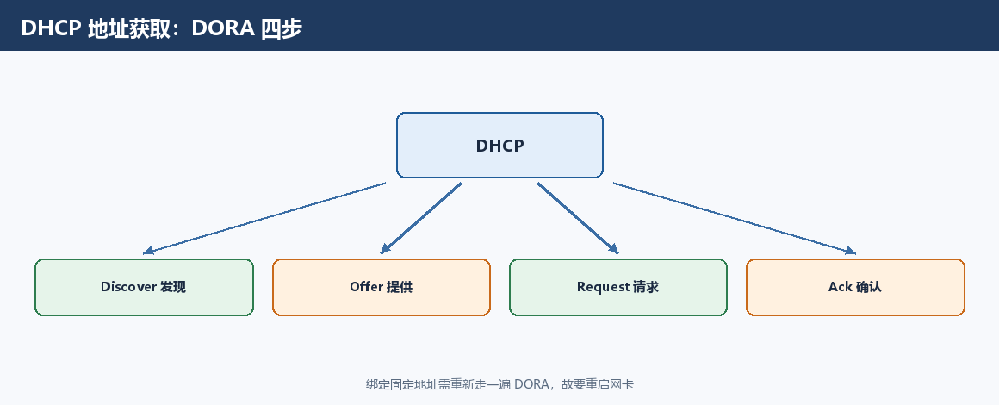

## 板块16 · DHCP动态地址管理

在一个有上百台设备的网络里，逐台手工配置地址、掩码、网关、DNS 是不可想象的负担。DHCP 让设备自动获取网络参数，既提升地址利用率、降低维护成本，还能为特定设备保留固定地址。这个板块讲清 DHCP 的作用与术语，并以新一代 Kea 服务程序为例，完成自动分配地址与 MAC 地址绑定两组实验。

### 16_1 技术背景与核心原理：让地址"自动发、按时收"

DHCP（动态主机配置协议）基于 UDP，仅在局域网内使用，负责为网络设备自动分配地址等参数。它的价值可以用一个咖啡厅的例子讲清：一家咖啡厅为顾客提供免费无线网络，内网网段最多容纳两百多台主机，但一天的客流远超这个数。若手工分配地址，顾客离开后地址不会自动释放，很快就不够用；而 DHCP 在顾客离开后收回地址供下一位使用，问题迎刃而解。这个场景把 DHCP 的两个核心优势——自动分配、按时回收——讲得非常透。

要理解 DHCP 配置，先掌握几个术语。

| 术语 | 含义 |
| --- | --- |
| 作用域 | 一个完整的 IP 地址段，DHCP 据此管理网络分配 |
| 超级作用域 | 统一管理同一物理网络中的多个逻辑子网 |
| 排除范围 | 从作用域中排除、不分配给客户端的地址 |
| 地址池 | 定义作用域并排除后，剩余可动态分配的地址范围 |
| 租约 | 客户端可使用所分配地址的时间 |
| 预约 | 保证特定设备总能获取到相同地址 |

这些术语构成了 DHCP 配置的词汇表：先划作用域，再排除保留地址，剩下的形成地址池，客户端在租约期内使用，特定设备通过预约获得固定地址。

一个值得注意的版本变化是：较新的系统已彻底移除传统的 dhcpd 服务，改用 ISC Kea 作为新一代 DHCP 服务程序。两者理论一致，但配置差别很大——Kea 用 JSON 格式的配置文件。对习惯了旧版的人来说，这是一个需要重新适应的变化。

```
DHCP 自动分配流程
  客户端广播请求 ─► DHCP 服务器 ─► 从地址池分配地址 + 掩码/网关/DNS
       ▲                                        │
       └──────── 租约到期前续租，离开后地址回收 ◄──┘
   特定设备：按 MAC 地址预约固定 IP
```



### 16_2 关键概念：Kea 配置文件与参数

Kea 提供 IPv4 服务的配置文件默认有数百行，但大多是注释。一个实用的处理技巧是：先备份原文件，再用 grep 过滤掉空行与注释，生成精简版配置，让结构一目了然。这个"精简配置看结构"的手法，在面对任何长配置文件时都适用。

| 参数 | 作用 |
| --- | --- |
| interfaces | 监听的网络接口 |
| subnet | IP 地址作用域 |
| pools | 动态分配的地址池范围 |
| reservations | 按 MAC 或标识符分配固定地址 |
| valid-lifetime | 租约有效期（秒） |
| routers | 客户端默认网关 |
| domain-name-servers | 客户端 DNS 服务器 |
| domain-name | 指定 DNS 域名 |
| host-reservation-identifiers | 保留地址时的依据类型 |
| hw-address | 客户端硬件（MAC）地址 |
| ip-address | 分配的固定地址 |
| lease-database | 租约信息数据库路径 |
| loggers | 日志记录参数 |

配置的主线是：定义监听接口 → 定义作用域与地址池 → 设定网关与 DNS → 按需添加预约 → 配置租约与日志。删掉用不到的示例段落（如客户端分类、动态 DNS 等）能让配置更清晰。

### 16_3 实操：自动分配与固定地址绑定

**自动管理 IP 地址**：精简 Kea 配置，删除不需要的租约计时示例、域名搜索、客户端分类等段落，保留并修改核心的 DNS 信息、作用域（如 192.168.10.0/24）、地址池范围（如 192.168.10.50 到 150）、网关等参数。重启 kea-dhcp4 服务后，客户端即可自动获取地址。验证时查看客户端拿到的地址是否落在地址池内。

**分配固定 IP 地址**：DHCP 中的"预约"确保特定设备总拿到相同地址，就像高档餐厅为客人留座、桌上放着"已预定"的小牌。绑定依据是设备的 MAC 地址——它在网卡上具有唯一性，不会冲突。在配置文件的 reservations 段写入 hw-address（MAC）与 ip-address（固定地址）的对应关系，重启服务。

这里有一个真实教学中反复出现的坑：有学员照着旧教程用 Windows 7/10 查看 MAC 地址，得到的是用减号分隔的格式（如 00-0C-29-...），而 Linux 与较新 Windows 系统中 MAC 用冒号分隔。格式不符导致绑定失败。解决办法是把减号换成冒号，或直接在本机系统查看 MAC。这个细节生动说明——**同样的信息在不同系统中表示格式可能不同，照搬前要先核对**。

地址绑定后不会立即生效，因为客户端已有租约未到期。要立即看到效果，需重启客户端网卡服务，让客户端重新请求地址。

| 对比 | 动态分配 | 固定预约 |
| --- | --- | --- |
| 依据 | 地址池 + 租约 | MAC 地址绑定 |
| 适用 | 普通移动设备 | 服务器、打印机等固定设备 |
| 配置段 | pools | reservations |
| 生效 | 自动获取 | 需重启客户端网卡立即生效 |

**配置示例：Kea 动态分配与固定预约**

Kea 用 JSON 格式配置，集中体现动态分配与固定预约两种地址管理方式。这组命令先备份并过滤精简默认配置，再写入作用域、地址池、网关与基于 MAC 的预约，检查语法后重启服务，由客户端验证获取结果。

```
# 安装 Kea 服务程序
root@iaoexl:~# dnf install kea

# 备份并精简配置：Kea 的示例配置用 // 作行注释，连同空行一并滤掉
root@iaoexl:~# cp /etc/kea/kea-dhcp4.conf /etc/kea/kea-dhcp4.conf.bak
root@iaoexl:~# grep -vE '^\s*(//|#)|^\s*$' /etc/kea/kea-dhcp4.conf.bak > /etc/kea/kea-dhcp4.conf

# 编辑核心配置（JSON 格式，内容见下）
root@iaoexl:~# vim /etc/kea/kea-dhcp4.conf
```

```json
{
  "Dhcp4": {
    "interfaces-config": { "interfaces": [ "ens160" ] },
    "subnet4": [ {
      "subnet": "192.168.10.0/24",
      "pools": [ { "pool": "192.168.10.50 - 192.168.10.150" } ],
      "option-data": [
        { "name": "routers", "data": "192.168.10.1" },
        { "name": "domain-name-servers", "data": "192.168.10.10" }
      ],
      "reservations": [ {
        "hw-address": "00:0c:29:e5:e7:33",
        "ip-address": "192.168.10.88"
      } ]
    } ]
  }
}
```

```
# 检查配置、重启服务、放行防火墙
root@iaoexl:~# kea-dhcp4 -t /etc/kea/kea-dhcp4.conf
Syntax check OK
root@iaoexl:~# systemctl restart kea-dhcp4
root@iaoexl:~# firewall-cmd --permanent --add-service=dhcp
root@iaoexl:~# firewall-cmd --reload

# 客户端重启网卡后立即获取
root@Client:~# nmcli connection up ens160
root@Client:~# ip addr show ens160 | grep inet
inet 192.168.10.88/24
```

网关指向 `.1`，DNS 指向运行 BIND 的 `.10`，这是全库统一的地址约定。`-t` 是配置自检参数，它只解析语法与必填项，不检查地址池是否与现有网段冲突——所以"检查通过"不等于"发得出地址"，这一步不能替代客户端验证。

### 16_4 场景笔记方法：把 DHCP 配置记成"作用域—参数—客户端验证"卡

DHCP 配置的核心是地址规划，笔记要先把网络参数一次性记清，再记配置。

| 记录项 | 记录内容 | 示例 |
| --- | --- | --- |
| 作用域 | 网段与掩码 | 192.168.10.0/24 |
| 地址池 | 动态分配范围 | .50 – .150 |
| 排除/网关/DNS | 关键网络参数 | 网关 .1、DNS .10 |
| 租约 | 有效期设置 | valid-lifetime |
| 预约 | MAC 与固定地址 | 某 MAC → .88 |
| 验证 | 客户端获取结果 | 查看地址是否在池内 |

MAC 地址格式差异这个坑要重点记录：不同系统查看 MAC 的分隔符不同（减号 vs 冒号），写入配置前必须统一为冒号格式。这类"格式陷阱"是笔记里最有复用价值的内容。

精简配置的命令也值得记下——备份原文件后过滤空行与注释。这里有个细节：注释符随文件格式而变，Kea 的 JSON 用 `//`，dhcpd 的配置用 `#`，正则写错就一条也滤不掉，反而以为文件本来就这么长。

### 16_5 实用验证与排错：从客户端地址反推服务端配置

DHCP 的验证核心是看客户端实际拿到的地址与参数。

```
DHCP 排错流程
  服务运行？ ─► 防火墙放行？ ─► 作用域/池正确？ ─► 网关/DNS 正确？ ─► 客户端重新请求
  kea状态      放行 dhcp       网段与范围         参数下发            重启网卡
```

| 现象 | 排查方向 |
| --- | --- |
| 客户端拿不到地址 | 服务运行状态、防火墙、地址池是否耗尽 |
| 地址不在预期网段 | 作用域配置错误 |
| 能上网但解析异常 | DNS 参数下发错误 |
| 固定地址绑定失败 | MAC 格式（冒号 vs 减号）、reservations 配置 |
| 绑定后地址未变 | 租约未到期，需重启客户端网卡 |

经验之谈：DHCP 问题多数能从"客户端拿到的地址"反推出来。地址段不对查作用域，拿不到查地址池与服务状态，固定绑定不生效查 MAC 格式。先看结果、再倒查配置，比盲改配置高效得多。

### 16_6 认证对标与进阶实战

DHCP 是网络服务认证的常见考点。LPIC-1 的 102 考试包含 DHCP 服务配置，LFCS 的服务模块也会涉及地址分配，CompTIA Linux+ 把 DHCP 列为网络基础协议。RHCSA 只考客户端如何拿到地址并配好，服务端搭建不在考纲内。理解 DHCP 的工作过程，是排查"客户端拿不到地址"类问题的前提。

| 认证体系 | 与本主题相关的考查方向 | 核心能力要求 |
| --- | --- | --- |
| LPIC-1（102） | DHCP 服务配置 | 配置作用域、地址池与固定地址 |
| LFCS | 网络服务管理 | 部署 DHCP 并验证地址分发 |
| RHCSA（EX200） | 管理基础网络：IPv4/IPv6 地址配置与验证 | 用 `nmcli` 配静态地址或确认 DHCP 租约，能逐级验证 |
| CompTIA Linux+ | DHCP 协议 | 解释 DORA 租约过程 |

一个真实事故说明了"同网段只能有一个 DHCP"的严重性：某员工在办公室私接了一台路由器，其内置 DHCP 开始给内网发地址，结果大量客户端拿到了错误网关，全网时断时通，排查许久才发现罪魁是那台小路由器。DHCP 通过广播响应请求，同网段多个服务会互相干扰，这正是生产环境严禁私接 DHCP 的原因。

DHCP 相关故障集中在地址池、租约与网络模式三处。

| 现象 | 根因 | 定位命令 | 处置 |
| --- | --- | --- | --- |
| 客户端拿不到地址 | 服务未启动、地址池耗尽或网段冲突 | systemctl status、查日志 | 启动服务、扩池、排查私接 DHCP |
| 拿到地址但上不了网 | 网关或 DNS 选项配错 | ip route、检查配置 | 修正 option routers/dns |
| 固定地址绑定失效 | MAC 格式或 reservations 段写错 | 核对 MAC 与 reservations | 修正 MAC 写法、重启客户端 |
| 客户机与服务端不通 | 网络模式或隔离设置不符 | ping、ip addr | 统一到同一隔离网段 |

闯关任务按"部署—绑定—排错"三级递进。

```
  DHCP 闯关
  第一关 配置地址池，让客户端自动获取地址
    │
  第二关 按 MAC 为指定客户端绑定固定地址
    │
  第三关 制造私接 DHCP 场景，观察并定位冲突
```

- 第一关：配置作用域、地址池、网关与 DNS，客户端续租后验证。
- 第二关：在 reservations 中把 MAC 绑定到固定 IP，重启网卡验证拿到固定地址。
- 第三关：在隔离网段观察两台 DHCP 的干扰，练习用日志定位冲突源。

进阶要理解 DORA 四步交互与租约机制。客户端获取地址经历 Discover（广播找服务）、Offer（服务提供地址）、Request（客户端请求使用该地址）、Ack（服务确认并下发租约）四个阶段，简称 DORA；租约有期限，到期前客户端会续租，否则地址回收。理解这一点，就能明白"绑定固定地址后要重启客户端网卡"——需要重新走一遍 DORA 才能拿到新地址。新一代 Kea 服务采用 JSON 配置、模块化架构，与传统的 dhcpd 语法差异明显，但 DORA 的底层逻辑一致；把握协议本质，换了实现也能快速上手。把 DORA 画成四步时序图，再标注每步的报文类型，DHCP 的排错就有了清晰的时间轴。

### 16_7 要点回顾与能力自检

本板块讲清了 DHCP 的自动分配与回收机制、六个核心术语、Kea 的 JSON 配置结构与关键参数，并完成自动分配与 MAC 绑定两组实验。核心经验是"从客户端地址反推服务端配置"与"核对 MAC 地址格式"。

自检问题：

1. DHCP 的作用域、地址池、租约、预约分别是什么？
2. 为什么说 DHCP 提升了地址利用率？用咖啡厅例子说明。
3. 新一代 Kea 服务与传统 dhcpd 在配置上有什么重大差异？
4. MAC 地址绑定失败时，最常见的格式问题是什么？
5. 为什么绑定固定地址后要重启客户端网卡？
