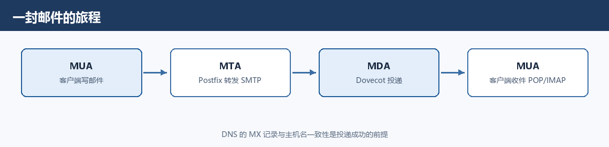

## 板块17 · Postfix与Dovecot邮件系统

电子邮件是日常工作生活中最常用的网络服务，也是协议角色最多的服务之一。这个板块讲清邮件系统的起源、SMTP/POP3/IMAP4 协议、MUA/MTA/MDA 三种角色，用 Postfix 提供发件、Dovecot 提供收件，搭建一套完整邮件系统，结合域名解析验证收发功能，介绍用户别名；再用 SASL 认证堵住"开放中继"这个致命缺口，并用协议级手工会话把排错做到看得见每一步返回码。这个板块综合了 DNS、防火墙、服务配置知识，是一次很好的阶段性整合。

### 17_1 技术背景与核心原理：一封邮件的旅程

理解邮件系统，先认识三种角色与几个协议。

| 角色 | 英文 | 作用 | 类比 |
| --- | --- | --- | --- |
| 邮件用户代理 | MUA | 用户收发邮件的客户端 | 写信人与收信人 |
| 邮件传输代理 | MTA | 服务器间转发邮件 | 邮局与运输系统 |
| 邮件投递代理 | MDA | 把邮件投递到用户信箱 | 投递员 |

| 协议 | 作用 |
| --- | --- |
| SMTP | 发送邮件，负责服务器间的传输 |
| POP3 | 从服务器下载邮件到本地 |
| IMAP4 | 在服务器端管理邮件，多设备同步 |

一封邮件的旅程是：发件人用 MUA 写好邮件，通过 SMTP 交给自己的 MTA；MTA 根据收件域名查询 DNS 找到对方服务器，把邮件转过去；对方的 MTA 收下后交给 MDA，MDA 投递到收件人的信箱；收件人用 MUA 通过 POP3 或 IMAP4 读取。

```
一封邮件的传递路径
  发件人MUA ──SMTP──► 发件方MTA ──DNS查MX──► 收件方MTA ──► MDA ──► 收件人信箱
                                                                      │
  收件人MUA ◄──POP3/IMAP4──────────────────────────────────────────┘
```



一个很实际的细节：信箱地址形如"用户名@域名"，若给出的是"用户名@地址"的 IP 形式，人们未必认得那是邮箱，甚至误认为是 SSH 连接信息。因此要检验邮件系统，必须先部署 DNS，为邮件服务器提供域名解析——这正是前面 DNS 板块知识的用武之地。系统默认发件服务也从早期程序替换为 Postfix，它减少了不必要的配置步骤，在稳定性与并发性上都有改进。

### 17_2 关键概念：Postfix 与 Dovecot 的分工

一套基础邮件系统需要发件与收件两种能力，由两个程序分工承担。

| 程序 | 协议 | 提供的能力 |
| --- | --- | --- |
| Postfix | SMTP | 发件服务 |
| Dovecot | POP3/IMAP4 | 收件服务 |

配置要点包括：服务器主机名必须与发信域名保持一致，否则邮件域与主机不匹配；DNS 中要配置 MX 记录指向邮件服务器，并配置相应的 A 记录；防火墙要放行 DNS 与 SMTP 等服务流量。

配置域名解析时，复制正向解析模板文件要加 -a 参数继承权限，与 DNS 板块一致。修改主机名后若未立即生效，可重启服务器或用 hostnamectl 立即设置。把服务器 DNS 指向本地地址，重启网卡使参数生效，然后用 ping 主机名验证——若能解析出地址，说明域名解析这一环打通了。

| 命令/工具 | 作用 |
| --- | --- |
| hostnamectl set-hostname | 立即设置主机名 |
| systemctl restart named | 重启域名服务 |
| systemctl restart postfix / dovecot | 重启邮件服务 |
| firewall-cmd --add-service=smtp | 放行邮件服务 |
| s-nail | 命令行查看邮件 |

### 17_3 实操：搭建与验证邮件系统

**部署基础邮件系统**：配置主机名与域名解析，安装并配置 Postfix 与 Dovecot，设置防火墙，创建邮件账户。这里涉及一个安全与便利的权衡：初学环境常允许明文密码登录以便客户端接入，但生产环境必须启用加密，否则凭据可能被窃听。

**客户端验证**：在客户端配置邮件账户，填入姓名、邮件地址与密码，通过 Outlook 或 Foxmail 等客户端测试。由于初学环境没有 SSL 加密服务，客户端默认尝试 SSL 登录会失败——此时按提示改用非加密方式验证即可。配置成功后发送一封测试邮件，在服务器上用 s-nail 查看，输入邮件前的编号即可看到完整内容。看到预期的邮件内容与主题，就证明整个系统收发正常。

**用户别名**：为邮件账户设置别名，让一个信箱可以有多个地址，或把发往某地址的邮件转发到另一账户。这在管理离职员工邮件、设置部门公共信箱时非常实用——不必为每个用途创建真实账户，用别名即可灵活控制。

| 验证环节 | 方法 | 预期 |
| --- | --- | --- |
| 域名解析 | ping 邮件主机名 | 解析出正确地址 |
| 发件 | 客户端发送测试邮件 | 发送成功 |
| 收件 | 服务器 s-nail 查看 | 看到邮件内容 |
| 别名 | 发往别名地址 | 投递到目标信箱 |

**配置示例：Postfix + Dovecot 基础邮件系统**

Postfix 发件、Dovecot 收件，主机名须与发信域名一致。这组命令依次设置主机名、安装服务、配置两者核心参数、创建账户并发测试邮件，最后放行防火墙并用 s-nail 端到端验证收发。

```
# 设置主机名（须与发信域名一致）
root@iaoexl:~# hostnamectl set-hostname mail.iaoexl.com

# 安装服务
root@iaoexl:~# dnf install postfix dovecot s-nail

# 配置 Postfix：域名、监听与网络段
root@iaoexl:~# vim /etc/postfix/main.cf
myhostname = mail.iaoexl.com
mydomain = iaoexl.com
myorigin = $mydomain
inet_interfaces = all
mydestination = $myhostname, $mydomain
mynetworks = 192.168.10.0/24, 127.0.0.0/8

# 配置 Dovecot：允许明文（仅实验环境）、可信网段与邮件目录
root@iaoexl:~# vim /etc/dovecot/dovecot.conf
protocols = imap pop3 lmtp submission
disable_plaintext_auth = no
login_trusted_networks = 192.168.10.0/24
root@iaoexl:~# vim /etc/dovecot/conf.d/10-mail.conf
mail_location = mbox:~/mail:INBOX=/var/mail/%u

# 创建邮件账户、建立收件目录并发测试邮件
root@iaoexl:~# useradd iaoexl && echo "iaoexl@7#13" | passwd --stdin iaoexl
root@iaoexl:~# su - iaoexl
[iaoexl@iaoexl ~]$ mkdir -p mail/.imap/INBOX
[iaoexl@iaoexl ~]$ exit
root@iaoexl:~# echo "Hello Linux" | mail -s "Test" iaoexl@iaoexl.com

# 启动服务并放行防火墙（SMTP 发件 + IMAP/POP3 收件）
root@iaoexl:~# systemctl restart postfix dovecot
root@iaoexl:~# systemctl enable postfix dovecot
root@iaoexl:~# firewall-cmd --permanent --add-service=smtp
root@iaoexl:~# firewall-cmd --permanent --add-service=imap
root@iaoexl:~# firewall-cmd --permanent --add-service=pop3
root@iaoexl:~# firewall-cmd --reload
root@iaoexl:~# su - iaoexl
[iaoexl@iaoexl ~]$ s-nail
& 1
Subject: Test
Hello Linux
```

**配置示例：为邮件系统配置 DNS 解析与 MX 记录**

邮件地址是"用户名@域名"的形式，要检验收发必须先让域名解析正常工作。在 DNS 正向解析数据文件中，除了 NS 与 A 记录，关键是要用 MX 记录指明"这个域的邮件由哪台服务器接收"，并给该服务器配一条 A 记录。

```
# 主配置：允许任意主机查询
root@iaoexl:~# vim /etc/named.conf
listen-on port 53 { any; };
allow-query     { any; };

# 区域配置：定义正向解析区域
root@iaoexl:~# vim /etc/named.rfc1912.zones
zone "iaoexl.com" IN {
        type master;
        file "iaoexl.com.zone";
        allow-update { none; };
};

# 数据文件：复制模板后加 -a 继承权限，再写入记录
root@iaoexl:~# cp -a /var/named/named.localhost /var/named/iaoexl.com.zone
root@iaoexl:~# vim /var/named/iaoexl.com.zone
$TTL 1D
@       IN SOA  iaoexl.com. root.iaoexl.com. (
                                        0       ; serial
                                        1D      ; refresh
                                        1H      ; retry
                                        1W      ; expire
                                        3H )    ; minimum
        NS      ns.iaoexl.com.
ns      IN A    192.168.10.10
@       IN MX 10 mail.iaoexl.com.
mail    IN A    192.168.10.10

# 重启服务并让网卡重新获取 DNS 配置，验证解析
root@iaoexl:~# systemctl restart named
root@iaoexl:~# systemctl enable named
root@iaoexl:~# nmcli connection up ens160
root@iaoexl:~# ping -c 4 mail.iaoexl.com
PING mail.iaoexl.com (192.168.10.10) 56(84) bytes of data.
64 bytes from mail.iaoexl.com (192.168.10.10): icmp_seq=1 ttl=64 time=0.040 ms
```

MX 记录后面的数字 10 是优先级，数值越小优先级越高；当域内有多台邮件服务器时，可据此决定投递顺序。

**配置示例：设置用户别名邮箱（/etc/aliases + newaliases）**

用户别名能把发往某个地址的邮件转交给真实账户，既可隐藏真实地址，也可用一个信箱收取多个名义地址的邮件。别名定义在 `/etc/aliases` 中，格式为"别名: 真实账户"。

```
# 查看已有的系统别名（bin、daemon 等系统账户的邮件都转给 root）
root@iaoexl:~# cat /etc/aliases
mailer-daemon:  postmaster
postmaster:     root
bin:            root
daemon:         root
adm:            root
...

# 新增一个虚构别名 iaoexl，邮件实际由 root 接收
root@iaoexl:~# vim /etc/aliases
iaoexl:        root

# 让新别名立即生效
root@iaoexl:~# newaliases

# 向别名地址发信，再用 root 查看
root@iaoexl:~# echo "Hello iaoexl" | mail -s "to iaoexl" iaoexl@iaoexl.com
root@iaoexl:~# s-nail
& 3
Subject: to iaoexl
To: <iaoexl@iaoexl.com>
Hello iaoexl
```

别名既可以是系统内已存在的本地用户（如 bin），也可以是完全虚构的名字（如 iaoexl），维护时只需改 `/etc/aliases` 并执行 `newaliases`，不必新建真实账户。

### 17_4 SMTP 认证与手工协议测试

一台不做认证的 SMTP 服务器，等于一台公开的中继器：任何人连上 25 端口，填一个不属于自己的发件人，就能借你的服务器给全世界发垃圾邮件。等你的 IP 被各大反垃圾组织列入黑名单，正常业务邮件也会一起发不出去。所以"能不能发"之外，必须先解决"谁能发"。

SMTP 协议诞生时没有认证机制，`AUTH` 是后来追加的扩展。Postfix 借助 Cyrus SASL 实现它：SASL 提供认证框架，`saslauthd` 负责拿提交的账号密码去校验系统账户或独立账号库。这条链路串起来，客户端才必须先登录才能发信。

```
带认证的发信流程
  客户端 ──EHLO──► 服务器返回能力列表（含 AUTH PLAIN LOGIN）
         ──AUTH──► saslauthd 校验通过
         ──MAIL FROM / RCPT TO / DATA──► 队列 ──► 投递
  未认证连接：只允许发给本域用户，拒绝向外部域中继
```

**配置示例：开启 SMTP 认证并做协议级测试**

配置分三处：SASL 的机制配置、Postfix 的认证开关、重启后确认 25 端口仍由 postfix 持有。改完不要急着用客户端试，先用 telnet 手工对话——客户端只会告诉你"发送失败"，而协议级对话能精确指出卡在认证还是中继。

```
# 一、SASL 机制配置：用 sasldb 存独立账号，不依赖系统用户
root@iaoexl:~# vim /etc/sasl2/smtpd.conf
pwcheck_method: auxprop
auxprop_plugin: sasldb
mech_list: PLAIN LOGIN

# 二、Postfix 开启认证，并限定"认证用户或本地网络"才可中继
root@iaoexl:~# postconf -e "smtpd_sasl_auth_enable = yes"
root@iaoexl:~# postconf -e "smtpd_sasl_type = cyrus"
root@iaoexl:~# postconf -e "smtpd_sasl_path = smtpd"
root@iaoexl:~# postconf -e "broken_sasl_auth_clients = yes"
root@iaoexl:~# postconf -e "smtpd_recipient_restrictions = permit_mynetworks, permit_sasl_authenticated, reject_unauth_destination"

# 三、为发信账户建立 SASL 账号（密码写入 sasldb，不落明文）
root@iaoexl:~# saslpasswd2 -c -u iaoexl.com iaoexl
root@iaoexl:~# sasldblistusers2

# 四、语法检查通过后再重启（check 只查语法，不影响运行中的服务）
root@iaoexl:~# postfix check
root@iaoexl:~# systemctl restart postfix saslauthd
root@iaoexl:~# systemctl enable saslauthd
```

第四步的 `postfix check` 值得养成习惯：配置写错一个参数名，Postfix 会拒绝启动，而报错只写进日志，终端上什么也看不到，很容易误判成"命令没执行"。

**配置示例：用 telnet 手工走一遍 SMTP 与 POP3 会话**

协议级测试的价值在于"看得见每一步的返回码"。SMTP 的 2xx 是成功、3xx 是继续、4xx 是临时失败、5xx 是永久拒绝；认证那一步提交的是 base64 编码后的用户名与密码，不是明文——这也是为什么纯 HTTP 环境里说"密码是 base64 加密"其实只是编码，必须靠 TLS 保护。

```
# 一、连上 25 端口，先看服务器宣告的能力
root@Client:~# telnet 192.168.10.10 25
220 mail.iaoexl.com ESMTP Postfix
ehlo iaoexl.com
250-mail.iaoexl.com
250-AUTH PLAIN LOGIN
250 8BITMIME

# 二、认证：用户名与密码分别做 base64 编码后逐行提交
auth login
334 VXNlcm5hbWU6
aWFvZXhs
334 UGFzc3dvcmQ6
aWFvZXhsQDcjMTM=
235 2.7.0 Authentication successful

# 三、发信：信封地址用尖括号，正文以单独一行点号结束
mail from:<iaoexl@iaoexl.com>
250 2.1.0 Ok
rcpt to:<iaoexl@iaoexl.com>
250 2.1.5 Ok
data
354 End data with <CR><LF>.<CR><LF>
subject: protocol test
this mail is sent by telnet
.
250 2.0.0 Ok: queued as 4Xy2Kq1
quit

# 四、收信：POP3 用 user/pass 认证，list 看邮件编号，retr 取回
root@Client:~# telnet 192.168.10.10 110
+OK Dovecot ready.
user iaoexl
+OK
pass iaoexl@7#13
+OK Logged in.
list
+OK 1 messages:
1 682
retr 1
+OK 682 octets
quit
```

如果想跳过手工编码，`printf 'iaoexl\0iaoexl\0iaoexl@7#13' | base64` 可一次生成 `AUTH PLAIN` 需要的整串，提交时写成 `auth plain <整串>` 一行即可。

协议测试通关后，客户端连不上就只剩三类原因：端口没放行、客户端强制 SSL 而服务端只有明文、账号密码错。逐项排除比反复改客户端配置高效得多。

| 端口 | 协议 | 用途 | 加密 |
| --- | --- | --- | --- |
| 25 | SMTP | 服务器之间投递、客户端提交 | 明文，可 STARTTLS |
| 587 | SMTP | 客户端提交（推荐） | 强制 STARTTLS |
| 110 | POP3 | 收信，下载后可选删除 | 明文 |
| 995 | POP3S | 收信，全程加密 | TLS |
| 143 / 993 | IMAP / IMAPS | 收信，服务端保留多端同步 | 明文 / TLS |

生产环境应只对外开 587、993、995，把 25 留给服务器间投递并配合 TLS 与 SPF、DKIM 记录；在内网实验里用明文 25/110 只是为了让抓包与排错直观，不能照搬到公网。

排错的主要依据是 `/var/log/maillog`，它按时间顺序记录连接、认证结果、队列 ID 和投递结果。用队列 ID 串起来看，就能判断邮件是"没进来"、"进来了但被拒"还是"进来了投不出去"：

| 现象 | 日志线索 | 处置 |
| --- | --- | --- |
| 客户端提示认证失败 | `SASL LOGIN authentication failed` | 确认 sasldb 有该账号、机制为 PLAIN LOGIN |
| 无法给外域发信 | `Relay access denied` | 检查是否已认证、`mynetworks` 是否含该网段 |
| 邮件进队列但不投递 | `status=deferred` 加具体原因 | 查 DNS/MX 解析、对端拒收策略 |
| 完全收不到 | `maillog` 无对应连接记录 | 查防火墙、25 端口监听、客户端指向的地址 |

### 17_5 场景笔记方法：把邮件系统记成"角色—协议—验证"表

邮件系统角色多、协议多，笔记要先用一张表把角色与协议对应清楚，再记配置。

| 记录项 | 记录内容 | 示例 |
| --- | --- | --- |
| 角色分工 | MUA/MTA/MDA 各由什么承担 | Postfix=MTA、Dovecot=MDA |
| 协议端口 | SMTP/POP3/IMAP 用途 | 发件用 SMTP |
| 域名配置 | 主机名、MX 与 A 记录 | mail 域与主机名一致 |
| 防火墙 | 放行哪些服务 | DNS、SMTP |
| 验证 | 端到端测试结果 | 测试邮件的主题与内容 |

"主机名必须与发信域名一致"是一个容易忽视却影响很大的点，笔记要重点标注。明文密码登录与加密的权衡也要记录——标注清楚"当前为实验环境允许明文，生产环境必须加密"，避免把实验配置带到生产。

用户别名的笔记要记录"别名 → 真实账户"的映射关系，以及别名的用途，便于日后维护。

### 17_6 实用验证与排错：端到端确认收发

邮件系统的验证必须端到端——从客户端发出，到服务器收到，全链路走通才算成功。

```
邮件系统排错流程
  域名解析？ ─► 主机名与域一致？ ─► 服务运行？ ─► 防火墙放行？ ─► 账户配置？ ─► 端到端收发
   ping/nslookup   hostname 检查    postfix/dovecot   smtp 服务       用户名密码
```

| 现象 | 排查方向 |
| --- | --- |
| 客户端连不上 | 服务状态、防火墙放行 |
| 发件失败 | 域名解析、MX 记录、主机名一致性 |
| 收不到邮件 | Dovecot 配置、账户密码 |
| SSL 登录失败 | 环境是否启用加密，改用非加密验证 |
| 邮件地址不被识别 | 缺少域名解析，只有地址形式 |

经验之谈：邮件系统故障常跨服务——看起来是邮件发不出去，根源可能是 DNS 没配好。因此排查要有全局视角，按"解析—服务—防火墙—账户"逐段确认，而不是只盯着邮件服务本身。这也是邮件系统作为综合性实验的价值所在。

### 17_7 认证对标与进阶实战

邮件系统是认证体系中的综合型考点，因为它同时考验 DNS、服务配置与安全加固。LPIC-1 的 102 考试包含邮件服务主题，LFCS 的服务配置、CompTIA Linux+ 的常见网络服务都会涉及 MTA。搭建邮件系统是对前面网络知识的一次全面调用。

| 认证体系 | 与本主题相关的考查方向 | 核心能力要求 |
| --- | --- | --- |
| LPIC-1（102） | 邮件服务、MTA 配置 | 说明 MUA/MTA/MDA 分工、配置 Postfix |
| LFCS | 服务配置与排错 | 部署邮件服务并验证收发 |
| RHCSA（EX200） | 不考邮件服务，只涉及服务启停与端口放行 | 用 `systemctl` 管服务、用 `firewall-cmd` 放行 25/143 并验证 |
| CompTIA Linux+ | 邮件协议 | 区分 SMTP、POP3、IMAP4 |

一个因主机名不一致导致邮件被退信的案例很典型：管理员配置 Postfix 时用了默认主机名，与发送域名不匹配，结果发出的邮件被对端当作垃圾邮件拒收。邮件系统对身份一致性极其敏感，服务器的正向与反向 DNS、主机名、发信域名必须相互印证，这套一致性是建立信任的基础。忽略它，邮件能发出去却进不了收件箱，排错无从下手。

邮件系统故障往往横跨多个服务，排查要有全局视角。

| 现象 | 根因 | 定位命令 | 处置 |
| --- | --- | --- | --- |
| 邮件发不出去 | DNS 未配 MX、主机名不一致 | dig MX、postconf | 补全 DNS 记录、统一主机名 |
| 收不到邮件 | Dovecot 未运行或协议错 | systemctl status | 启动服务、核对 POP/IMAP 配置 |
| 邮件进垃圾箱 | 反向解析或 SPF 缺失 | dig -x、查 SPF 记录 | 补 PTR 与 SPF 记录 |
| 认证失败 | 用户或密码配置错 | 查日志、测试账号 | 核对虚拟用户与密码 |

闯关任务按"DNS—收发—加固"三级递进。

```
  邮件系统闯关
  第一关 配置 DNS 的 MX 与 A 记录
    │
  第二关 用 Postfix + Dovecot 实现本地域内收发
    │
  第三关 配置 TLS 加密与反垃圾基础记录
```

- 第一关：在 DNS 中加 MX 与 A 记录，用 `dig` 验证解析。
- 第二关：配置 Postfix 投递、Dovecot 收取，用客户端测试域内收发。
- 第三关：启用 TLS，配置 SPF 与 PTR，验证加密与反垃圾设置。

进阶要理解邮件的完整旅程与各协议的职责边界。一封邮件从发出到送达，经过 MUA（写邮件）→ MTA（Postfix 转发）→ 可能的多个中继 → 接收方 MTA → MDA（投递到邮箱）→ MUA（收取阅读），每一环都可能失败。协议分工明确：SMTP 负责发送与中继（端口 25/587）、POP3 负责下载到本地（110/995）、IMAP4 负责在服务器端管理邮件并同步（143/993），IMAP 更适合多设备场景。SPF、DKIM、DMARC 这三类记录则是从域名层面证明"这封邮件确实来自我"，与 PTR 反向解析一起构成反垃圾体系。把"邮件旅程图 + 协议端口表 + 信任记录表"整理成三张图，邮件系统这个综合课题就有了清晰的骨架。

### 17_8 要点回顾与能力自检

本板块讲清了邮件系统的三种角色与三大协议、Postfix 发件与 Dovecot 收件的分工、域名解析与防火墙的配合、端到端收发验证与用户别名。它综合调用了 DNS、防火墙、服务配置等多板块知识。

自检问题：

1. MUA、MTA、MDA 分别是什么？举一封邮件的旅程说明三者关系。
2. SMTP、POP3、IMAP4 分别负责什么？
3. 为什么搭建邮件系统要先部署 DNS？
4. 为什么服务器主机名必须与发信域名一致？
5. 为什么邮件系统排错要有"跨服务"的全局视角？
