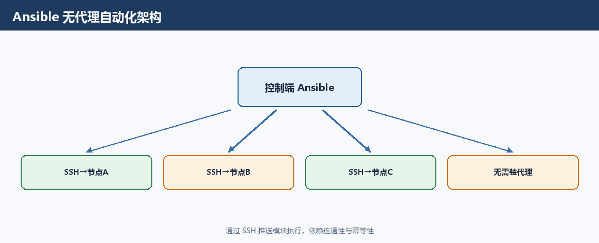

## 板块18 · Ansible自动化运维

逐台登录操作的方式在机器数量上升到成百上千台时就不现实了。Ansible 把重复性运维固化成可复用的剧本，让批量操作一次完成、结果一致、可反复执行。这个板块讲清 Ansible 的特点与术语、主机清单、临时命令、playbook 与角色，并通过逻辑卷创建的实战展示"幂等"与"失败处理"的工程思想。

### 18_1 技术背景与核心原理：把运维变成代码

Ansible 的诞生源于一个很朴素的抱怨：现有工具太复杂。它的设计者希望有一种"不需要在客户端装代理、用简单文本描述、拿来就能用"的自动化工具。今天的 Ansible 有几个鲜明特点：无代理（被管主机不需要预装客户端，靠 SSH 通信）、声明式（描述期望状态而非操作步骤）、易读（用 YAML 写剧本，接近自然语言）。

一个关于"角色"的比喻很贴切：角色就像汽车的刹车系统，把复杂功能封装起来，驾驶者只需踩刹车，不必知道内部机械结构。Ansible 的角色把变量、任务、模板、处理器等打包成可复用单元，一处编写、多处调用。

| 术语 | 含义 |
| --- | --- |
| 控制节点 | 运行 Ansible 的机器 |
| 被管节点 | 被配置的远程主机 |
| 清单 inventory | 被管主机的列表与分组 |
| 模块 module | 执行具体任务的最小单元 |
| 任务 task | 调用模块的一次操作 |
| 剧本 playbook | 由任务组成的可执行脚本 |
| 角色 role | 组织 playbook 的可复用结构 |

Ansible 的核心价值是幂等性：同一份剧本执行多次，结果与执行一次相同。这意味着可以放心地反复运行，不会因为重复执行造成意外——这是自动化运维可信赖的基础。

```
Ansible 工作方式
  控制节点 ──SSH──► 被管节点1 ─┐
          ──SSH──► 被管节点2 ─┼─ 并发执行模块任务
          ──SSH──► 被管节点N ─┘
     读取：清单 + playbook + 角色
     特点：无代理、声明式、幂等
```

### 18_2 关键概念：清单、模块与临时命令

**主机清单**定义管理哪些主机及其分组，默认文件是 `/etc/ansible/hosts`，按 `[组名]` 分段组织主机地址，主机行后可跟 `ansible_user`、`ansible_port` 这类连接变量。分组变量与主机变量更规范的做法是放进项目目录下的 `group_vars/组名.yml` 与 `host_vars/主机名.yml`，文件名与组名、主机名一一对应，Ansible 自动加载——这比把变量塞进清单更利于版本管理，也是 EX294 里组织多主机差异的默认手段。配置文件 ansible.cfg 可调整清单路径、并发数、是否检查主机密钥等常用行为。

**临时命令**适合一次性操作，语法是"ansible 目标 -m 模块 -a 参数"。常用模块覆盖了日常运维的绝大多数动作。

| 模块 | 作用 |
| --- | --- |
| ping | 测试连通性 |
| dnf / yum_repository | 软件包与仓库管理 |
| service | 服务启停与自启 |
| firewalld | 防火墙配置 |
| copy / file | 文件复制与属性管理 |
| template | 按主机差异渲染文件 |
| user / group | 用户与组管理 |
| cron | 计划任务 |
| command / shell | 执行命令 |
| setup | 收集主机信息 |
| debug | 输出调试信息 |
| lvg / lvol / filesystem | 逻辑卷与文件系统 |
| lineinfile / blockinfile | 按行或按块增删配置内容 |
| archive / unarchive | 打包与解包 |
| block / rescue | 失败处理 |

ansible-doc 用于查询模块用法，是随用随查的助手。`ansible` 命令的常用参数包括指定清单、指定用户、提权等。

**playbook** 用 YAML 编写，结构包含目标主机、变量、任务与处理器。处理器是一种特殊任务，只在被其他任务触发时才执行，常用于"配置变了才重启服务"这类场景——它让重启只在必要时发生，体现幂等思想。



### 18_3 实操：从剧本到角色

**批量安装与配置**：用临时命令批量 ping 所有主机验证连通，批量添加软件仓库、安装 mariadb。这些一次性操作用临时命令最快捷。

**playbook 实战**：编写 YAML 剧本批量安装 mariadb，理解 play 的 target、variable、task、handler 结构。执行时用 ansible-playbook，它能按顺序在多台主机上运行同一套任务。

**三种角色使用方式**：其一是加载系统内置角色，安装角色包后用 timesync 角色批量配置时间同步；其二从外部获取角色，通过 Ansible Galaxy 或指定链接安装他人分享的角色，如 nginx 角色；其三是自建角色，用 ansible-galaxy init 生成角色框架，实现一个 apache 角色——安装 httpd、启动服务、放行防火墙、并按主机生成个性化主页。自制角色最能体现"模板变量"的威力：同一个角色，不同主机得到不同内容的主页。

**逻辑卷批量创建**：用 lvg 与 lvol 模块批量创建卷组与逻辑卷，用 filesystem 模块格式化，再用 block/rescue/debug 处理失败情况。block 把一组任务打包，rescue 在其中任务失败时执行补救，debug 输出诊断信息——这套结构是从"脚本能跑"迈向"脚本健壮"的关键。

| 方式 | 特点 | 适用 |
| --- | --- | --- |
| 临时命令 | 一次性、快速 | 简单批量操作 |
| playbook | 有序任务集合 | 完整配置流程 |
| 内置角色 | 开箱即用 | 标准化配置（如时间同步） |
| 外部角色 | 复用社区成果 | 快速引入成熟方案 |
| 自建角色 | 高度定制 | 贴合自身业务 |

```
playbook 的逻辑结构
  playbook
   └─ play（针对哪组主机）
        ├─ vars      变量
        ├─ tasks     任务序列
        │    └─ notify ──触发──► handlers（必要时才执行，如重启服务）
        └─   block/rescue  失败处理区块
              └─ debug   诊断输出
```

**配置示例：清单、临时命令与 playbook**

清单定义管理哪些主机，临时命令适合一次性操作，playbook 承载完整配置流程。这组命令先建分组清单、用临时命令批量测试连通并安装软件，再编写带 notify 与 handler 的剧本，实现配置变更才重启。

```
# 定义主机清单
root@iaoexl:~# vim /etc/ansible/hosts
[webservers]
192.168.10.10
192.168.10.20

# 临时命令：批量测试连通
root@iaoexl:~# ansible all -m ping
192.168.10.10 | SUCCESS => {"changed": false, "ping": "pong"}
192.168.10.20 | SUCCESS => {"changed": false, "ping": "pong"}

# 临时命令：批量安装 httpd
root@iaoexl:~# ansible webservers -m dnf -a "name=httpd state=present"

# playbook：安装并启动服务，配置变更才重启
root@iaoexl:~# vim apache.yml
---
- name: deploy apache
  hosts: webservers
  become: yes
  tasks:
    - name: install httpd
      dnf: name=httpd state=present
    - name: copy config
      copy: src=httpd.conf dest=/etc/httpd/conf/httpd.conf
      notify: restart httpd
  handlers:
    - name: restart httpd
      service: name=httpd state=restarted

# 执行剧本
root@iaoexl:~# ansible-playbook apache.yml
```

`become: yes` 这一行不能省：装包、写 `/etc`、启服务都需要提权，而新版发行版默认禁止 root 直接登录，Ansible 通常以普通账户加 `sudo` 连过去。少了它，任务会以"权限不足"失败；加了它，当连接账户本身就是 root 时也不会产生副作用。这是 playbook 从"自己机器上能跑"到"换台机器也能跑"的第一道门槛。

**配置示例：变量、模板与角色**

当主机数量增多、配置出现差异，就要用变量与模板让 playbook 可复用；角色则把一套自动化拆成约定的目录结构，实现共享。

```
# 一、用变量文件管理差异化配置
root@iaoexl:~# vim vars.yml
---
package_name: httpd
listen_port: 8080

# 二、用 Jinja2 模板生成配置（变量用 {{ }} 占位）
root@iaoexl:~# vim httpd.conf.j2
Listen {{ listen_port }}
ServerName {{ ansible_fqdn }}

# 在 playbook 中引用变量文件与模板
root@iaoexl:~# vim site.yml
---
- name: configure web with variables
  hosts: webservers
  become: yes
  vars_files:
    - vars.yml
  tasks:
    - name: install package
      dnf:
        name: "{{ package_name }}"
        state: present
    - name: deploy config from template
      template:
        src: httpd.conf.j2
        dest: /etc/httpd/conf/httpd.conf
      notify: restart httpd
    - name: ensure service running
      service:
        name: "{{ package_name }}"
        state: started
        enabled: yes
    # 条件判断：只在清单中的第一台主机安装某个工具
    - name: install tool only on primary
      dnf:
        name: rsync
        state: present
      when: inventory_hostname == "192.168.10.10"
  handlers:
    - name: restart httpd
      service:
        name: "{{ package_name }}"
        state: restarted

root@iaoexl:~# ansible-playbook site.yml

# 四、用 ansible-galaxy 初始化角色目录结构
root@iaoexl:~# ansible-galaxy init apache_role
apache_role was created successfully
# 生成的目录含 defaults/vars/tasks/templates/handlers/meta 等
root@iaoexl:~# tree apache_role
apache_role/
├── defaults/main.yml     默认变量（优先级最低）
├── files/                待分发的静态文件
├── handlers/main.yml     处理器
├── meta/main.yml         角色元数据与依赖
├── README.md             角色说明
├── tasks/main.yml        任务清单
├── templates/            Jinja2 模板
├── tests/                测试剧本
└── vars/main.yml         角色变量（优先级高于 defaults）
```

把监听端口改成 8080 之后，还有一步不写进剧本就必然失败：SELinux 只允许 httpd 监听标记为 `http_port_t` 的端口，8080 不在其列，需先执行 `semanage port -a -t http_port_t -p tcp 8080`。这类"配置对了、策略挡了"的问题不出现在 Ansible 语法里，却是自动化落地时最常卡住的地方——模板生成的是配置，不是运行环境。

变量（`vars_files`）把"装什么包、监听什么端口"从任务逻辑中抽离，模板（`template` 模块 + Jinja2 语法）让每台主机生成带自身信息的配置（如 `ansible_fqdn` 是 Ansible 自动采集的变量），`when` 实现按主机差异执行，角色（`ansible-galaxy init`）则用约定目录把复杂自动化模块化。这四项能力是从"能写 playbook"到"能维护大规模自动化"的分水岭。

**配置示例：三类角色的获取与使用**

角色是打包好的可复用单元，按来源分三类：系统内置、外部获取、自建。

```
# ===== 一、系统内置角色：安装 rhel-system-roles 后直接调用 =====
root@iaoexl:~# dnf install rhel-system-roles
root@iaoexl:~# ansible-galaxy list
# /usr/share/ansible/roles
- rhel-system-roles.timesync, (unknown version)
- rhel-system-roles.storage, (unknown version)
...
# 复制 timesync 示例剧本并修改时间同步服务器
root@iaoexl:~# cp /usr/share/doc/rhel-system-roles/timesync/example-single-pool-playbook.yml timesync.yml
root@iaoexl:~# vim timesync.yml
---
- name: Example with single pool
  hosts: all
  vars:
    timesync_ntp_servers:
      - hostname: 2.pool.ntp.org
        pool: true
        iburst: true
  roles:
    - rhel-system-roles.timesync
root@iaoexl:~# ansible-playbook timesync.yml

# ===== 二、外部角色：从 Ansible Galaxy 获取 =====
# 方式1：按命名空间直接安装
root@iaoexl:~# ansible-galaxy role install nginxinc.nginx
- downloading role 'nginx', owned by nginxinc
- nginxinc.nginx (0.25.0) was installed successfully
# 方式2：用 requirements 文件按链接安装
root@iaoexl:~# vim nginx.yml
---
- src: https://www.linuxprobe.com/Software/ansible-role-nginx-0.25.0.tar.gz
  name: nginx-core
root@iaoexl:~# ansible-galaxy role install -r nginx.yml
- nginx-core was installed successfully

# ===== 三、自建角色：ansible-galaxy init 生成框架 =====
root@iaoexl:~# vim /etc/ansible/ansible.cfg
roles_path=/usr/share/ansible/roles:/etc/ansible/roles
root@iaoexl:~# cd /etc/ansible/roles
root@iaoexl:/etc/ansible/roles# ansible-galaxy init apache
- Role apache was created successfully
root@iaoexl:/etc/ansible/roles/apache# ls
defaults  files  handlers  meta  README.md  tasks  templates  tests  vars
# 任务清单：装包、启服务、放行防火墙、部署模板主页
root@iaoexl:/etc/ansible/roles/apache# vim tasks/main.yml
---
- name: one
  dnf:
    name: httpd
    state: latest
- name: two
  service:
    name: httpd
    state: started
    enabled: yes
- name: three
  firewalld:
    service: http
    permanent: yes
    state: enabled
    immediate: yes
- name: four
  template:
    src: index.html.j2
    dest: /var/www/html/index.html
# 模板用 Ansible 自动采集的 facts，为每台主机生成个性化主页
root@iaoexl:/etc/ansible/roles/apache# vim templates/index.html.j2
Welcome to {{ ansible_fqdn }} on {{ ansible_all_ipv4_addresses }}
# 用 playbook 调用自建角色
root@iaoexl:~# vim roles.yml
---
- name: 调用自建角色
  hosts: all
  become: yes
  roles:
    - apache
root@iaoexl:~# ansible-playbook roles.yml
```

三类角色的取舍：内置角色开箱即用、标准化程度高；外部角色复用社区成熟方案、上手最快；自建角色高度定制，最能贴合自身业务，但要遵守 `defaults/vars/tasks/templates/handlers/meta` 的目录约定。

**配置示例：创建和使用逻辑卷（lvg/lvol/filesystem + block/rescue）**

用 `lvg` 创建卷组、`lvol` 创建逻辑卷、`filesystem` 格式化，再用 `block/rescue` 把三步包成一个整体：任一步失败就执行 `rescue` 里的 `debug` 输出诊断信息。

```
root@iaoexl:~# vim lv.yml
---
- name: 创建和使用逻辑卷
  hosts: all
  tasks:
    - block:
        - name: one
          lvg:
            vg: research
            pvs: /dev/sdb
            pesize: 2M
        - name: two
          lvol:
            vg: research
            lv: data
            size: 150M
        - name: three
          filesystem:
            fstype: ext4
            dev: /dev/research/data
      rescue:
        - debug:
            msg: "Could not create logical volume of that size"
root@iaoexl:~# ansible-playbook lv.yml
TASK [one] *********************************************************************
fatal: [192.168.10.20]: FAILED! => {"changed": false, "msg": "Device /dev/sdb not found."}
changed: [192.168.10.22]
TASK [debug] *******************************************************************
ok: [192.168.10.20] => {"msg": "Could not create logical volume of that size"}
# 到成功的主机上确认逻辑卷已生成
root@iaoexl:~# lvdisplay
  --- Logical volume ---
  LV Path                /dev/research/data
  LV Name                data
  VG Name                research
  LV Size                150.00 MiB
```

这里 `block` 让"建卷组—建逻辑卷—格式化"三步成为一个整体：`/dev/sdb` 不存在的主机在第一步失败后中止块内剩余任务，转入 `rescue` 输出诊断；有磁盘的主机正常完成。要留意 `block` 并不具备回滚能力，它只是"失败即停、转去补救"，已经执行成功的步骤不会自动撤销——真要回到原状，得在 `rescue` 里自己写补偿任务（删卷组、清物理卷），这也是从"脚本能跑"迈向"脚本健壮"必须跨过的一步。

`block` 还有第三种搭配 `always`：夹在 `rescue` 之后的 `always` 段无论块内成功还是失败都会执行，用来放"无论如何都要收尾"的动作——解除临时挂载、删除中间文件、发送完成通知。三者的执行次序固定为 `rescue` 先于 `always`，写剧本时按"正常路径、补救路径、收尾路径"三层来想，比事后在每台机器上补命令干净得多。

`pesize` 还有一个硬约束：LVM 的物理扩展单元必须是 2 的幂（8 KiB 起），写 `150M` 会被 `vgcreate` 直接拒绝。取 `2M` 之后，`150M` 的逻辑卷正好是 75 个 PE，容量才与 `lvdisplay` 里的 `150.00 MiB` 完全对得上。

**配置示例：判断主机组名（when + groups）**

`inventory_hostname` 是当前主机的变量，`groups.组名` 是清单中该组的主机列表，两者配合可让同一份剧本按主机所属组写入不同内容。

```
root@iaoexl:~# vim issue.yml
---
- name: 修改文件内容
  hosts: all
  tasks:
    - name: one
      copy:
        content: 'Development'
        dest: /etc/issue
      when: "inventory_hostname in groups.dev"
    - name: two
      copy:
        content: 'Test'
        dest: /etc/issue
      when: "inventory_hostname in groups.test"
    - name: three
      copy:
        content: 'Production'
        dest: /etc/issue
      when: "inventory_hostname in groups.prod"
root@iaoexl:~# ansible-playbook issue.yml
TASK [one] ********************************************************************
changed: [192.168.10.20]
skipping: [192.168.10.21]
TASK [two] ********************************************************************
changed: [192.168.10.21]
skipping: [192.168.10.20]
TASK [three] ******************************************************************
changed: [192.168.10.22]
root@iaoexl:~# cat /etc/issue
Development
```

**配置示例：管理文件属性（file 模块）**

`file` 模块可创建目录、设置属主属组与权限、创建符号链接，`state` 参数描述期望的对象类型。

```
root@iaoexl:~# vim chmod.yml
---
- name: 管理文件属性
  hosts: dev
  tasks:
    - name: one
      file:
        path: /iaoexl
        state: directory
        owner: root
        group: root
        mode: '2775'
    - name: two
      file:
        src: /iaoexl
        dest: /iaoexl_link
        state: link
root@iaoexl:~# ansible-playbook chmod.yml
root@iaoexl:~# ls -ld /iaoexl
drwxrwsr-x. 2 root root 6 /iaoexl
root@iaoexl:~# ls -ld /iaoexl_link
lrwxrwxrwx. 1 root root 7 /iaoexl_link -> /iaoexl
```

权限 `2775` 的首位 2 是 setgid 位，保证目录内新建文件继承目录的属组，适合多人协作的共享目录。

**配置示例：管理密码库文件（ansible-vault）**

密码、密钥等敏感数据不能明文存进 playbook。`ansible-vault` 可加密整个变量文件，配合密码文件实现非交互式读取。

```
# 先写明文变量文件
root@iaoexl:~# vim locker.yml
---
pw_developer: Imadev
pw_manager: Imamgr

# 创建密码文件并收紧权限
root@iaoexl:~# vim /root/secret.txt
whenyouwishuponastar
root@iaoexl:~# chmod 600 /root/secret.txt

# 在配置中指定密码文件路径，避免每次交互输入
root@iaoexl:~# vim /etc/ansible/ansible.cfg
vault_password_file = /root/secret.txt

# 加密整个文件
root@iaoexl:~# ansible-vault encrypt locker.yml
Encryption successful
root@iaoexl:~# cat locker.yml
$ANSIBLE_VAULT;1.1;AES256
38666539353062343930633135306633613736386366633665...（密文省略）

# 编辑与查看加密文件（vault_password_file 已指向密码文件，不再询问）
root@iaoexl:~# ansible-vault edit locker.yml
---
pw_developer: Imadev
pw_manager: Imamgr
pw_production: Imaprod
root@iaoexl:~# ansible-vault view locker.yml
---
pw_developer: Imadev
pw_manager: Imamgr
pw_production: Imaprod

# 更换 vault 密码：先改密文，再同步改密码文件，顺序不能颠倒
root@iaoexl:~# ansible-vault rekey locker.yml
New Vault password:
Confirm New Vault password:
Rekey successful
root@iaoexl:~# vim /root/secret.txt     # 换成同一个新密码，否则下一步解密必失败
root@iaoexl:~# ansible-vault view locker.yml
```

改密的顺序值得单独记一句：`rekey` 只把密文换成新密钥，**不会**去动 `vault_password_file` 指向的那个文件。先改密文、后改密码文件，中间那一步的失败是可控的（重新改回即可）；反过来先改密码文件，此后所有用到该密码文件的操作都会以"解密失败"告终，而报错信息不会告诉你原因在密码文件。

敏感变量文件应始终以密文形式入库，只在运行时由 Ansible 解密读取；密码文件本身要设 `600` 权限，且不要与剧本一同提交。

### 18_4 现代写法：FQCN、循环与集合

能跑通的 playbook 与能维护的 playbook 之间，差的是几条书写规范。红帽从 Ansible 2.10 起把模块拆进"集合"（collection），官方课程与 EX294 的实操一路都用全限定名（FQCN）书写；到 RHEL 10 时代，自动化内容的运行方式也从"在控制节点装 ansible"转向"在容器化的执行环境里跑"。这一节把这三件事讲清楚。

**FQCN：模块的完整地址**

模块的全限定名由三段组成：命名空间、集合名、模块名。`ansible.builtin.dnf` 表示"ansible 命名空间下 builtin 集合里的 dnf 模块"，`ansible.posix.firewalld` 表示"posix 集合里的 firewalld 模块"。

| 短名（旧写法） | FQCN（推荐） | 所属集合 |
| --- | --- | --- |
| `dnf`、`yum` | `ansible.builtin.dnf` | builtin，随 ansible-core 安装；`yum` 自 ansible-core 2.17 起不再独立实现，已改为指向 `dnf` 的重定向 |
| `copy`、`template` | `ansible.builtin.copy`、`ansible.builtin.template` | builtin |
| `service` | `ansible.builtin.service` | builtin，管理任意 rc 脚本式服务 |
| `systemd` | `ansible.builtin.systemd_service` | builtin，2.14 起由 `systemd` 改名而来 |
| `firewalld` | `ansible.posix.firewalld` | posix，需单独安装 |
| `seboolean` | `ansible.posix.seboolean` | posix |
| `mount` | `ansible.posix.mount` | posix |
| `lvg`、`lvol`、`filesystem`、`parted` | `community.general.lvg` 等 | community.general，需单独安装 |

短名在多数环境下仍能解析，但有两个风险：一是同名模块可能来自不同集合，解析结果取决于安装了什么，换台控制节点行为就变；二是新版本会弃用部分短名。答案很直接——一律写全名。这里有一条容易踩空的边界：`lvg`、`lvol`、`filesystem` 这类模块根本不在 builtin 里，控制节点没装 `community.general` 时短名会直接报"couldn't resolve module"，而 FQCN 至少能让报错说清是哪个集合缺失。前文第 18_3 节的示例为便于对照短名与全名的关系仍按短名书写，落到实际项目与考场上，按本表逐条换成全名。

```
# 查某个 FQCN 的用法与参数
root@iaoexl:~# ansible-doc ansible.posix.firewalld

# 按关键词找模块，输出里带完整 FQCN
root@iaoexl:~# ansible-doc -l | grep -i firewall
```

**集合：模块的安装单元**

集合是"模块 + 角色 + 插件 + 文档"的打包单位。builtin 之外的集合要先装，装法有两种：命令行直接装，或用 `requirements.yml` 声明后批量装（后者才能进版本库、可复现）。

```
# 一、直接安装
root@iaoexl:~# ansible-galaxy collection install ansible.posix

# 二、声明式安装（推荐，写进仓库）
root@iaoexl:~# vim requirements.yml
collections:
  - name: ansible.posix
    version: ">=1.5.0"

root@iaoexl:~# ansible-galaxy collection install -r requirements.yml -p ./collections

# 三、确认已装
root@iaoexl:~# ansible-galaxy collection list | grep posix
```

playbook 里还可以用 `collections:` 关键字声明"本剧本优先从哪些集合解析短名"，但既然已经写了 FQCN，这一行就不必再加——两种方式混用反而让人搞不清模块到底来自哪。

**循环：一次写、批量做**

批量任务是自动化的起点。`loop` 是现在的标准写法，`with_items` 属于旧式写法，两者在"是否展平嵌套列表"上有细微差别，新剧本统一用 `loop`。

```
- name: 批量安装基础工具
  hosts: all
  become: yes
  vars:
    base_packages:
      - vim-enhanced
      - tar
      - chrony
  tasks:
    - name: install base packages
      ansible.builtin.dnf:
        name: "{{ item }}"
        state: present
      loop: "{{ base_packages }}"

    - name: 按清单创建共享目录并设定属组与权限
      ansible.builtin.file:
        path: "{{ item.path }}"
        state: directory
        group: "{{ item.group }}"
        mode: "{{ item.mode }}"
      loop:
        - { path: /data/dev, group: devops, mode: '2775' }
        - { path: /data/ops, group: ops, mode: '0755' }
        - { path: /data/log, group: root, mode: '0750' }
      loop_control:
        label: "{{ item.path }}"      # 输出只显示路径，避免刷屏
```

`dnf` 模块本身支持直接传列表（`name: "{{ base_packages }}"`），一次事务装完，比循环快得多。选循环还是选列表参数，判断标准是"这个模块是否支持批量"：支持就传列表，不支持才 `loop`。`loop_control.label` 是个小技巧，循环几十项时输出只显示关键字段，日志可读性差别很大。

**取回命令结果：register**

`command` 与 `shell` 的输出不会自动流进后续任务。要让"上一条命令的结果"参与判断，用 `register` 把整个返回结构接进变量，再取其中的字段——`rc`（退出码）、`stdout`、`stderr`、`stdout_lines`、`changed`。

```
- name: 按查询结果决定是否安装
  hosts: webservers
  become: yes
  tasks:
    - name: 查询 httpd 是否已安装
      ansible.builtin.command: rpm -q httpd
      register: httpd_check
      changed_when: false                        # 查询不改状态，别让它报 changed
      failed_when: httpd_check.rc not in [0, 1]  # rc=1 表示未安装，属正常分支

    - name: 未安装时才装
      ansible.builtin.dnf:
        name: httpd
        state: present
      when: httpd_check.rc != 0

    - name: 输出查询到的版本
      ansible.builtin.debug:
        var: httpd_check.stdout
```

三个细节决定了这段剧本是否可靠。`command` 默认被当作"可能改变状态"的任务，跑一次报一次 `changed`，加 `changed_when: false` 才守得住幂等语义；`rpm -q` 在未安装时退出码为 1，不写 `failed_when` 的话这一任务会被判失败并终止该主机的后续任务，`failed_when: rc not in [0, 1]` 把这种"预期的非零"放行；`debug` 用 `var:` 而非 `msg:`，能完整打印结构体，排查时比在 `{{ }}` 里拼字符串清楚得多。

**错误控制：failed_when、changed_when 与 ignore_errors**

三种手段各解决一件事，混用就会埋坑。`failed_when` 重新定义"什么算失败"，用于退出码与业务语义不一致的场合——`grep` 没匹配到返回 1，并不代表出错；`changed_when` 重新定义"什么算变更"，是保持幂等的关键；`ignore_errors: true` 只是让失败不中止后续任务，它并不改变任务状态，recap 里照样计入 `failed`，用多了会把真问题埋进"看起来跑完了"的假象里。

**从 ansible-playbook 到 ansible-navigator**

`ansible-playbook` 依赖控制节点上装好 ansible-core、集合、Python 依赖与各类插件。节点一多，"我这台机器能跑、他那台报缺模块"就成了常态。`ansible-navigator` 用容器化的执行环境（Execution Environment，EE）解决这个问题：playbook 在一个预装好全部依赖的容器镜像里执行，控制节点只需要一个 navigator 客户端。

执行环境、默认输出模式、产物目录这些偏好不靠每次敲参数，而是写进项目根目录的 `ansible-navigator.yml`，与剧本一起入库：

```
root@iaoexl:~# vim ansible-navigator.yml
---
ansible-navigator:
  execution-environment:
    image: registry.redhat.io/ansible-automation-platform-25/ee-supported-rhel9:latest
    pull:
      policy: missing          # 本地没有才拉取，离线考场用 missing 或 never
  mode: stdout                 # 非交互输出，便于重定向与进 CI
  playbook-artifact:
    enable: true
    save-as: "{playbook_dir}/artifacts/{playbook_name}-{time_stamp}.json"
  logging:
    level: warning
```

```
# 一、以非交互模式执行（CI 里常用，输出与 ansible-playbook 类似）
root@iaoexl:~# ansible-navigator run site.yml -m stdout

# 二、语法检查与试运行同样支持
root@iaoexl:~# ansible-navigator run site.yml -m stdout --syntax-check
root@iaoexl:~# ansible-navigator run site.yml -m stdout --check --diff

# 三、看执行环境里到底有哪些集合
root@iaoexl:~# ansible-navigator collections -m stdout
```

对考试与日常运维的意义可以概括成一句：**playbook 只描述"要什么状态"，运行环境负责"拿什么工具实现"**。这也解释了为什么 EX294 把 navigator 列进工具链——它让"在我机器上能跑"这个借口失效了。

**幂等性怎么验**

新写一个剧本，第一遍跑出 `changed` 是正常的；连着跑第二遍，理想结果是 `changed=0`。若不是零，说明某个任务用了 `command`/`shell` 这类"每次都执行"的模块，需要用 `creates`、`when` 或改用专用模块补上判断条件。

```
# 第二遍执行应只剩 ok 与 skipped
root@iaoexl:~# ansible-playbook site.yml
PLAY RECAP *********************************************************
servera  : ok=9  changed=0  unreachable=0  failed=0  skipped=2  rescued=0
```

### 18_5 场景笔记方法：把自动化内容记成"目标—模块—幂等"表

Ansible 笔记的重点是记录"这段自动化想达到什么状态"以及"用什么模块实现"，而非逐行抄写 YAML。

| 记录项 | 记录内容 | 示例 |
| --- | --- | --- |
| 自动化目标 | 期望的最终状态 | 所有主机装好 mariadb |
| 目标主机 | 清单中的组 | webservers 组 |
| 核心模块 | 用到的模块，一律记全名 | `ansible.builtin.dnf`、`ansible.builtin.service`、`ansible.posix.firewalld` |
| 幂等设计 | 哪些操作可安全重跑 | 用 state 参数描述期望状态 |
| 失败处理 | block/rescue 的补救 | 失败时输出 debug 信息 |

角色的笔记建议画一张目录结构图，标清 vars、tasks、templates、handlers 各放什么，因为自建角色时目录约定是必须掌握的。三类角色获取方式也并列记录，方便按场景选择。

"notify + handler"这个组合值得单独记：它保证配置变化时才重启服务，是幂等思想的典型体现。把这个模式和它的价值记下来，比记住具体 YAML 语法更重要。

### 18_6 实用验证与排错：确认批量操作真正生效

Ansible 的验证分两层：执行层面看哪些任务成功、哪些失败、哪些"已变更"；结果层面到被管节点确认状态符合预期。

```
Ansible 验证流程（任一步失败即停在原地，修好再往下走）

  「1」 连通性    ansible all -m ping
  「2」 语法检查  ansible-playbook site.yml --syntax-check
  「3」 试运行    ansible-playbook site.yml --check --diff
  「4」 正式执行  ansible-playbook site.yml
  「5」 结果验证  到被管节点确认端口、服务与配置状态
```

`--syntax-check` 只解析剧本语法，不连主机；`--check` 会真连主机、真读状态，但把"要做的变更"打印出来而不执行；`--diff` 常与 `--check` 连用，把配置文件将被改成什么样直接显示出来——三者串起来，等于上线前的三道闸。`--limit 主机名` 则把一次全量执行缩小到单台，用于先在小范围验证再放开。

| 现象 | 排查方向 |
| --- | --- |
| 部分主机不可达 | SSH 连通、清单地址、凭据 |
| 提权失败 | 是否配置 become 与密码 |
| 模块报错 | 用 ansible-doc 核对模块参数 |
| 执行成功但状态没变 | 期望状态参数是否写对 |
| 重复执行产生副作用 | 是否用了command/shell而破坏幂等 |

经验之谈：先用 `--check` 试运行，看会发生什么变更但不真正执行，是 Ansible 特有的安全网。正式执行后重点关注"变更数"——反复执行同一剧本却总是报告变更，往往意味着幂等性被破坏，通常是用了 command/shell 模块做了本可用专用模块完成的事。

### 18_7 认证对标与进阶实战

自动化运维是现代认证体系的新增重点。RHCE 考试几乎完全围绕 Ansible 展开，LFCE 的高级系统管理包含自动化配置，LFCS 也引入了基础自动化内容，CompTIA Linux+ 开始覆盖配置管理概念。Ansible 已从"加分技能"变成"核心技能"。

| 认证体系 | 与本主题相关的考查方向 | 核心能力要求 |
| --- | --- | --- |
| RHCE（EX294） | Ansible 核心组件、Playbook、角色与集合、Vault | 全流程用 FQCN 书写、能解释并验证幂等 |
| RHCE（EX294） | 变量与事实、用 register 取回命令结果、条件与错误处理 | 用 register 驱动分支，用 block/rescue/always 收口失败 |
| RHCE（EX294） | 现代工作流：ansible-navigator、ansible-navigator.yml、Git | navigator 跑剧本、说清执行环境解决什么问题 |
| RHCE（EX294） | 用模块完成 RHCSA 的常规任务：包与仓库、服务、防火墙、存储、归档、计划任务、用户与安全 | 把一道手工题改写成幂等任务 |
| LFCE | 自动化配置管理 | 用 Ansible 批量部署与编排 |
| LFCS | 基础自动化 | 理解幂等与简单 playbook |
| CompTIA Linux+ | 配置管理 | 说明自动化的价值与幂等性 |

一个体现幂等性价值的场景很有说服力：管理员写了个"追加一行配置"的脚本，每执行一次就多一行，跑十次就有十行重复配置，配置越来越乱。改用 Ansible 的 lineinfile 模块后，无论执行多少次，结果都保证配置只有一行——这就是幂等性，"执行多次与执行一次结果一致"。幂等让自动化可以放心重复运行，是自动化工具区别于普通脚本的关键。

Ansible 使用中的高频问题集中在连通、权限与幂等三处。

| 现象 | 根因 | 定位命令 | 处置 |
| --- | --- | --- | --- |
| 主机不可达 | SSH 不通或清单地址错 | ansible all -m ping | 检查 SSH 与 inventory |
| 提示权限不足 | 远程用户无 sudo 权限 | 检查 become 配置 | 配置 become 与 sudo |
| 每次都报告 changed | 模块写法破坏幂等 | 检查命令类模块 | 改用声明式模块 |
| 变量未按预期取值 | 变量优先级覆盖 | ansible-inventory --list | 理清变量优先级顺序 |

闯关任务按"连通—编排—角色—结果驱动"四级递进。

```
  Ansible 闯关
  第一关 配置清单，ping 通所有受管主机
    │
  第二关 写 playbook 批量安装并启动服务
    │
  第三关 用 handlers 实现配置变更后才重启
    │
  第四关 用 register 接住命令结果，据此决定后续任务
```

- 第一关：编写 inventory，用 `ansible all -m ping` 验证连通。
- 第二关：用 `dnf`/`service` 模块安装启动服务，连跑两次验证幂等。
- 第三关：配置变更触发 notify，观察 handlers 仅在变化时执行。
- 第四关：用 `command` 查询某个包的版本并 `register` 结果，未安装才装、已安装则跳过，全程 `changed` 次数符合预期。

三条书写规范值得当作硬性要求：模块一律写 FQCN、集合依赖写进 `requirements.yml` 而不是手工装、剧本先 `--syntax-check` 再 `--check --diff` 最后正式执行。这三条加起来，能消掉"换台控制节点就跑不起来"和"跑之前不知道会改什么"这两类最常见的事故。

进阶要理解 Ansible 的无代理架构与变量优先级。它通过 SSH 推送模块到受管主机执行，无需在目标机安装客户端，这降低了部署门槛，但也意味着依赖 SSH 连通与 Python 环境。play 的执行顺序、handlers 的触发时机（仅在任务报告 changed 时运行、且在所有任务结束后统一执行）是编排的关键。

变量来源众多——清单变量、主机变量、play 变量、角色变量、extra-vars 等，优先级从低到高依次覆盖，冲突时高优先级生效，理解优先级才能解释"为什么变量值不是我写的那个"。block/rescue 则提供了类似编程语言的异常处理，让 playbook 在失败时能执行回滚。把"执行流程 + handlers 时机 + 变量优先级"三点吃透，Ansible 的疑难问题大多能迎刃而解。

### 18_8 要点回顾与能力自检

本板块讲清了 Ansible 无代理、声明式、幂等的特点，主机清单与临时命令，playbook 的 YAML 结构，三种角色使用方式，以及用逻辑卷实战展示的失败处理。现代写法部分补齐了 FQCN、集合、`loop`、`register` 与 `ansible-navigator` 的用法——它们是 EX294 实操的基本要求，也是把剧本从"能跑"推到"可交付"的分界线。核心工程思想是幂等性与健壮性。

自检问题：

1. Ansible 有哪些特点？为什么说它"无代理"？
2. 什么是幂等性？为什么它对自动化运维很重要？
3. playbook 的 play 通常包含哪些部分？handlers 何时执行？
4. 获取与使用角色有哪三种方式？
5. block/rescue 结构解决什么问题？为什么反复执行总报告变更值得警惕？
6. 为什么要写 FQCN？`ansible.posix.firewalld` 里的三段各代表什么？短名在什么情况下会解析到错误的模块？
7. `loop` 与 `with_items` 该用哪个？什么情况下根本不需要循环？
8. `ansible-playbook` 与 `ansible-navigator` 的本质差别在哪？执行环境解决了什么问题？
9. 第二遍执行得到 `changed=2`，说明什么？怎么定位是哪两个任务？
10. `register` 接住的返回结构里，`rc`、`stdout`、`stdout_lines` 各是什么？为什么查询类任务要配 `changed_when: false`？
11. `failed_when`、`changed_when`、`ignore_errors` 分别改变哪一件事？为什么 `ignore_errors` 不能用来"修好"一个失败任务？
