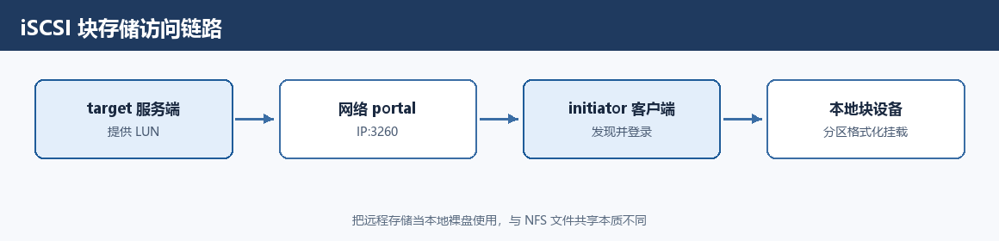

## 板块19 · iSCSI网络存储

常规的存储都在本机，iSCSI 让存储跨越网络：把远端的块设备映射到本地，像使用本地磁盘一样分区、格式化、挂载。它是存储区域网络思想的落地，能把分散的存储集中管理、按需分配。这个板块讲清 iSCSI 的背景与优势，用 RAID 5 加备盘准备底层存储，配置服务端与 Linux/Windows 两类客户端，完成远程存储访问。

### 19_1 技术背景与核心原理：把 SCSI 命令搬上网络

磁盘接口经历了 IDE、SATA、SCSI 等演进。SCSI 是一种高性能接口，但传统上受限于物理连接距离。iSCSI 的思路是：把 SCSI 命令封装在 TCP/IP 网络中传输，从而突破物理限制，让远程存储像本地磁盘一样被访问。

| 优势 | 说明 |
| --- | --- |
| 突破距离 | 存储可以放在网络的另一端 |
| 成本低 | 复用现有 IP 网络，无需专用存储网络 |
| 易扩展 | 集中管理存储资源，按需分配给多台主机 |
| 局限 | 性能受网络带宽与延迟影响 |

iSCSI 采用客户端—服务端模型：服务端把本地块设备"发布"出去，客户端"发现并登录"后获得一块远程磁盘。

| 角色 | 名称 | 作用 |
| --- | --- | --- |
| 服务端 | target | 提供存储资源 |
| 客户端 | initiator | 发起访问、使用存储 |
| 管理工具 | targetcli | 配置服务端 |
| 管理工具 | iscsiadm | 配置客户端 |

服务端配置涉及几个核心概念：backstore 是实际提供的块设备，target 是存储目标，LUN 是逻辑单元、客户端实际看到的设备，ACL 是访问控制列表、限定哪些客户端可访问，portal 是监听的地址与端口。默认使用 3260 端口。

```
iSCSI 访问模型
  [服务端 target]                         [客户端 initiator]
  RAID设备(/dev/md0) ──发布为──► LUN ──发现/登录──► 本地块设备
        │                         │                    │
   targetcli 配置            ACL 允许的名称      格式化+挂载使用
   portal 192.168.x.x:3260
```



一个非常好记的操作口诀是："先发现，再登录，最后挂载并使用"——这是客户端使用远程存储的标准三步。

### 19_2 实操一：准备底层存储与配置服务端

**创建 RAID 磁盘阵列**：先用四块磁盘创建带热备盘的 RAID 5 阵列 /dev/md0。之所以在 iSCSI 前先做 RAID，是因为远程存储一旦出问题影响面更大，底层冗余很有必要。记录阵列的 UUID 非常重要——设备识别顺序可能变化，用 UUID 才能稳定挂载，这与前面存储板块的经验一致。

**配置 iSCSI 服务端**：用 targetcli 进入交互配置，依次创建共享块设备、target、LUN、ACL 与 portal。ACL 中要写入允许访问的客户端 initiator 名称——这是访问控制的关键，只有名称匹配的客户端才能登录。配置完成后用防火墙放行 3260 端口。targetcli 的配置会保存到配置文件，重启服务后依然有效。

| targetcli 操作 | 作用 |
| --- | --- |
| ls / cd | 查看/进入配置目录 |
| create | 创建 backstore、target、LUN、ACL |
| /iscsi/.../tpg1/acls | 配置允许访问的客户端名称 |
| /iscsi/.../tpg1/portals | 配置监听地址与端口 |
| exit / saveconfig | 退出并保存配置 |

**配置示例：创建 RAID5 磁盘阵列（准备底层存储）**

iSCSI 发布的本质是一块块设备，远程存储一旦损坏影响面更大，因此先用四块磁盘做带热备盘的 RAID 5。用 mdadm 创建 `/dev/md0`，`-n 3` 是活动盘数、`-l 5` 是 RAID 级别、`-x 1` 表示留一块热备盘。

```
root@iaoexl:~# mdadm -Cv /dev/md0 -n 3 -l 5 -x 1 /dev/sdb /dev/sdc /dev/sdd /dev/sde
mdadm: layout defaults to left-symmetric
mdadm: chunk size defaults to 512K
mdadm: size set to 20954112K
mdadm: Defaulting to version 1.2 metadata
mdadm: array /dev/md0 started.

root@iaoexl:~# mdadm -D /dev/md0
/dev/md0:
           Version : 1.2
        Raid Level : raid5
        Array Size : 41908224 (39.97 GiB 42.91 GB)
     Used Dev Size : 20954112 (19.98 GiB 21.46 GB)
      Raid Devices : 3
     Total Devices : 4
             State : clean
    Active Devices : 3
   Working Devices : 4
    Failed Devices : 0
     Spare Devices : 1
            Layout : left-symmetric
        Chunk Size : 512K
    Number   Major   Minor   RaidDevice State
       0       8       16        0      active sync   /dev/sdb
       1       8       32        1      active sync   /dev/sdc
       4       8       48        2      active sync   /dev/sdd
       3       8       64        -      spare   /dev/sde
```

`mdadm -D /dev/md0` 要看的关键信息是 `State : clean`（阵列正常）、`Active Devices : 3`（三块盘在岗）与 `Spare Devices : 1`（热备盘就绪）。服务端后续发布给客户端的正是这块 `/dev/md0`。

### 19_3 实操二：配置 Linux 与 Windows 客户端

**Linux 客户端**：先设置本机 initiator 名称，使其与服务端 ACL 中允许的名称一致；用 iscsiadm 执行发现（discovery）找到远程 target，再执行登录（login）获得本地块设备；随后像本地磁盘一样格式化、挂载。写入 fstab 时要用 UUID 并加 `_netdev` 选项——`_netdev` 告诉系统这是网络设备，要等网络就绪后再挂载，否则开机时可能因网络未起而挂载失败。这个细节是网络存储与本地存储的重大区别。

**Windows 客户端**：用系统自带的 iSCSI 发起程序，先发现目标，修改发起程序名称使其匹配服务端 ACL，连接目标后在磁盘管理中初始化磁盘、新建简单卷即可使用。Windows 侧的体验更图形化，但与 Linux 侧遵循同样的"名称匹配 → 发现 → 连接"逻辑。

| 步骤 | Linux 客户端 | Windows 客户端 |
| --- | --- | --- |
| 身份设置 | 修改 initiator 名称 | 修改发起程序名称 |
| 发现 | iscsiadm discovery | iSCSI 发起程序发现 |
| 登录 | iscsiadm login | 连接目标 |
| 使用 | 格式化 + 挂载 + fstab | 初始化磁盘 + 新建卷 |
| 关键选项 | UUID + _netdev | 名称需匹配 ACL |

```
客户端使用三步口诀
  「1」 发现（discovery）  ── 找到远程 target
    │
  「2」 登录（login）      ── 建立会话，生成本地块设备
    │
  「3」 挂载使用           ── 格式化、挂载、写入 fstab
```

**配置示例：iSCSI 服务端与客户端**

iSCSI 由服务端发布、客户端发现登录。这组命令先用 targetcli 创建后端存储、target、LUN、ACL 与门户并放行 3260 端口，客户端再设名称、发现登录远程盘，格式化挂载后用 UUID 与 _netdev 写入 fstab。

```
# ===== 服务端：用 targetcli 发布存储 =====
root@iaoexl:~# targetcli
> /backstores/block create name=disk dev=/dev/md0
> /iscsi create wwn=iqn.2006-01.com.iaoexl:server
> /iscsi/iqn.../tpg1/luns create /backstores/block/disk
> /iscsi/iqn.../tpg1/acls create wwn=iqn.2006-01.com.iaoexl:client
> /iscsi/iqn.../tpg1/portals create 192.168.10.10
> saveconfig
> exit
root@iaoexl:~# firewall-cmd --permanent --add-port=3260/tcp
root@iaoexl:~# firewall-cmd --reload

# ===== 客户端：设置名称、发现、登录、挂载 =====
root@Client:~# vim /etc/iscsi/initiatorname.iscsi
InitiatorName=iqn.2006-01.com.iaoexl:client
root@Client:~# systemctl restart iscsid

# 发现并登录
root@Client:~# iscsiadm -m discovery -t st -p 192.168.10.10
192.168.10.10:3260,1 iqn.2006-01.com.iaoexl:server
root@Client:~# iscsiadm -m node -l
Logging in to [iface: default, target: iqn...]
Login successful.

# 确认远程盘已被识别为本地块设备
root@Client:~# ls -l /dev/sdb
brw-rw----. 1 root disk 8, 16 /dev/sdb
root@Client:~# file /dev/sdb
/dev/sdb: block special (8/16)

# 像本地盘一样格式化并挂载（该设备容量较小，直接格式化即可，无须再分区）
root@Client:~# mkfs.xfs /dev/sdb
root@Client:~# mkdir /iscsi
root@Client:~# mount /dev/sdb /iscsi
root@Client:~# blkid | grep /dev/sdb
/dev/sdb: UUID="075956f7-ec81-420e-8e11-e165a4e2fb66" TYPE="xfs"
root@Client:~# vim /etc/fstab
UUID="075956f7-ec81-420e-8e11-e165a4e2fb66" /iscsi  xfs  defaults,_netdev  0 0
root@Client:~# mount -a

# 用完可断开会话
root@Client:~# iscsiadm -m node -T iqn.2006-01.com.iaoexl:server -u
Logging out of session [sid: 1, target: iqn...]
Logout successful.
```

**ACL 不等于认证：补上 CHAP**

上面的 ACL 只做了一件事——比对 initiator 名称是否在允许列表里。但这个名字是明文写在客户端配置文件中、并在登录时明文发出的，任何人只要知道它，就能伪造成合法客户端登录进来。也就是说，ACL 挡的是"配错"而不是"恶意"，真正能挡住冒名的是 CHAP。

CHAP 的原理是共享密钥加随机挑战：服务端发一个随机数，客户端用密钥做哈希后回传，服务端用同样的密钥算一遍比对。密钥本身从不在链路上传输，因此抓包也拿不到。它是单向认证（服务端验客户端）；再配一组反向密钥就构成双向认证，让客户端也能确认对面不是假冒的存储。

```
# ===== 服务端：给指定 ACL 设单向 CHAP =====
root@iaoexl:~# targetcli
> /iscsi/iqn.2006-01.com.iaoexl:server/tpg1/acls/iqn.2006-01.com.iaoexl:client
> set auth userid=iaoexl password=iaoexl@7#13
> saveconfig
> exit

# 需要双向认证时再补一组反向凭据（两端都要配）
> set auth mutual_userid=iaoexl mutual_password=iaoexl@7#13
```

```
# ===== 客户端：在 iscsid.conf 中写入同一组凭据 =====
root@Client:~# vim /etc/iscsi/iscsid.conf
node.session.auth.authmethod = CHAP
node.session.auth.username   = iaoexl
node.session.auth.password   = iaoexl@7#13

# 双向认证时再加：
node.session.auth.username_in = iaoexl
node.session.auth.password_in = iaoexl@7#13

# 发现阶段也可能要求认证，这一段与上面是分开的，容易漏
discovery.sendtargets.auth.authmethod = CHAP
discovery.sendtargets.auth.username   = iaoexl
discovery.sendtargets.auth.password   = iaoexl@7#13
```

这里有一个非常容易卡住的坑：`iscsid.conf` 只在**新发现**目标时被读取写入记录，已经发现过的目标，其参数被固化在 `/var/lib/iscsi/nodes/` 下，改配置文件对它毫无作用——重新登录仍旧报认证失败。两种处置方式，任选其一：

```
# 方式一：直接更新已记录节点的参数（推荐，不动发现记录）
root@Client:~# iscsiadm -m node -T iqn.2006-01.com.iaoexl:server \
  -o update -n node.session.auth.authmethod -v CHAP
root@Client:~# iscsiadm -m node -T iqn.2006-01.com.iaoexl:server \
  -o update -n node.session.auth.username -v iaoexl
root@Client:~# iscsiadm -m node -T iqn.2006-01.com.iaoexl:server \
  -o update -n node.session.auth.password -v 'iaoexl@7#13'

# 方式二：删掉节点记录，重新发现
root@Client:~# iscsiadm -m node -T iqn.2006-01.com.iaoexl:server -o delete
root@Client:~# iscsiadm -m discovery -t st -p 192.168.10.10
```

密码里有 `@`、`!`、`$` 这类字符时，命令行上要用单引号裹住，否则会被 shell 先行解释，变成"配置看着没错、就是认证不过"的怪现象。另外 CHAP 密钥不宜过短，较严格的实现要求至少 12 位，两端必须完全一致，大小写也算不同。

验证是否真的生效，看登录日志里有没有认证失败的记录：

```
root@Client:~# iscsiadm -m node -l
root@Client:~# journalctl -u iscsid -n 30 | grep -i 'auth\|chap\|login'
```

反向验证更有说服力：故意把客户端密码改错一位，登录应当被拒绝。这一步能确认"认证确实在起作用"，而不是因为服务端根本没开认证、配了也白配。

### 19_4 场景笔记方法：把网络存储记成"服务端—客户端—标识"链

iSCSI 配置涉及两端且强依赖标识匹配，笔记要把各种"名称"和"UUID"记全，这是排错的关键线索。

| 记录项 | 记录内容 | 示例 |
| --- | --- | --- |
| 底层存储 | RAID 级别与 UUID | RAID5 + 热备，md0 |
| 服务端 | target 名称、LUN、portal | iqn 名称、端口 3260 |
| ACL | 允许的客户端名称 | 客户端 iqn |
| 客户端 | initiator 名称 | 需与 ACL 一致 |
| 挂载 | UUID 与 _netdev | fstab 条目 |

initiator 名称与 ACL 名称必须一致，这是最常见的失败点，笔记要用醒目方式标注两侧的对应关系。fstab 中用 UUID 加 `_netdev` 的写法要原样记录并注明原因——防止开机网络未就绪时挂载失败。

"先发现、再登录、最后挂载"的口诀值得记在笔记首页，作为客户端操作的标准流程。

### 19_5 实用验证与排错：从客户端块设备反推链路

iSCSI 的验证核心是确认客户端真正获得并使用了远程存储。

```
iSCSI 排错流程
  服务端target配置？ ─► 端口放行？ ─► 名称匹配ACL？ ─► 发现成功？ ─► 登录成功？ ─► 挂载使用
       targetcli       3260防火墙     initiator名称    discovery      login        df -h
```

| 现象 | 排查方向 |
| --- | --- |
| 发现不到目标 | 服务端配置、网络连通、端口放行 |
| 登录被拒 | 客户端名称与 ACL 不匹配 |
| 看不到块设备 | 是否成功登录会话 |
| 开机挂载失败 | fstab 是否用 UUID 与 _netdev |
| 设备名变化 | 未用 UUID 导致识别顺序问题 |

经验之谈：iSCSI 的问题多数出在"名称"上——target 名称、initiator 名称、ACL 允许的名称，三者要对应正确。登录被拒时，第一反应就应核对客户端 initiator 名称是否与 ACL 完全一致，而不是盲目重配服务端。

### 19_6 认证对标与进阶实战

网络存储属于认证体系的高阶内容。LPIC-1 的 102 考试涉及网络存储概念，LFCE 的高级管理包含 iSCSI 配置，CompTIA Linux+ 要求区分块存储与文件存储；红帽侧它不在 EX200 与 EX294 的考纲内，而是往 RHCA 的集群与存储方向走。iSCSI 是把本地存储经验迁移到网络场景的桥梁。

| 认证体系 | 与本主题相关的考查方向 | 核心能力要求 |
| --- | --- | --- |
| LPIC-1（102） | 网络存储概念 | 区分块存储与文件存储 |
| LFCE | iSCSI 配置 | 部署 target 与 initiator |
| RHCA 集群与存储方向（EX436 一类） | 集群文件系统背后的共享块设备 | 挂载并持久化网络存储，写清 `_netdev` 与启动顺序 |
| CompTIA Linux+ | 存储协议 | 说明 iSCSI 与 NFS 的差异 |

一个因 fstab 配置不当导致系统启动卡住的故障很有代表性：管理员把 iSCSI 远程盘写进 fstab 时只写了 UUID，没加 `_netdev` 选项。某次开机时网络还没就绪，系统就急着挂载网络盘，结果卡在启动阶段许久。加上 `_netdev` 后，系统知道这是依赖网络的设备，会等网络起来再挂载，问题解决。这个细节说明：网络存储与普通本地盘的一个关键区别，就是挂载时机依赖网络。

iSCSI 故障集中在发现、认证与挂载三处。

| 现象 | 根因 | 定位命令 | 处置 |
| --- | --- | --- | --- |
| 发现不到 target | 门户地址或端口错、防火墙拦截 | iscsiadm -m discovery | 核对 portal、放行 3260 |
| 登录被拒 | ACL 未允许客户端 IQN | 查 target ACL | 添加客户端 IQN 到允许列表 |
| 挂载后重启失效 | fstab 缺 _netdev 或 UUID 变化 | 查 fstab | 用 UUID 并加 _netdev |
| 设备名漂移 | 多块网络盘识别顺序变 | lsblk、blkid | 一律用 UUID 挂载 |

闯关任务按"服务端—客户端—持久化"三级递进。

```
  iSCSI 闯关
  第一关 配置 target，创建 LUN 并设 ACL
    │
  第二关 客户端发现、登录并挂载远程盘
    │
  第三关 配置开机自动挂载并重启验证
```

- 第一关：创建后端存储与 target，绑定 LUN，允许客户端 IQN。
- 第二关：客户端 discovery 后 login，用 `lsblk` 看到新盘，分区挂载。
- 第三关：用 UUID 加 `_netdev` 写入 fstab，重启验证自动挂载。

进阶要理解 iSCSI 的块存储本质与命名体系。iSCSI 把 SCSI 指令封装在 TCP/IP 中传输，让远程存储看起来像一块本地裸盘，因此可以在上面分区、格式化——这与 NFS 的文件级共享有本质区别：iSCSI 给的是"盘"，NFS 给的是"目录"。概念上，target 是服务端提供的存储资源，initiator 是客户端，LUN 是具体的逻辑单元，IQN 是各方唯一标识，portal 是访问入口（IP:端口），ACL 用 IQN 控制谁能访问。理解这些概念的关系，就知道排查登录失败要优先核对 IQN 与 ACL。

多路径（multipath）则能进一步提升可用性，在多条网络路径间做故障切换与负载均衡。把"块存储 vs 文件存储"与"target/initiator/LUN/IQN/portal"两组对照记清楚，网络存储的核心就掌握了。

### 19_7 要点回顾与能力自检

本板块讲清了 iSCSI 把 SCSI 命令搬上网络的原理、target/initiator 模型、服务端 targetcli 配置、Linux 与 Windows 客户端接入，以及"先发现、再登录、最后挂载"的口诀。核心经验是名称匹配与 UUID + _netdev 挂载，而名称匹配只挡配置失误，真正的身份校验得靠 CHAP。

自检问题：

1. iSCSI 的核心思想是什么？它有何优势与局限？
2. target、initiator、LUN、ACL、portal 分别是什么？
3. 客户端使用远程存储的三步口诀是什么？
4. 为什么 fstab 中要用 UUID 并加 _netdev 选项？
5. iSCSI 登录被拒时，应优先核对什么？
6. ACL 已经在用，为什么还需要 CHAP？它比按名称放行多挡住了什么？
7. 已经发现过的目标，改 `iscsid.conf` 为什么不起作用？两种正确的处置方式是什么？
