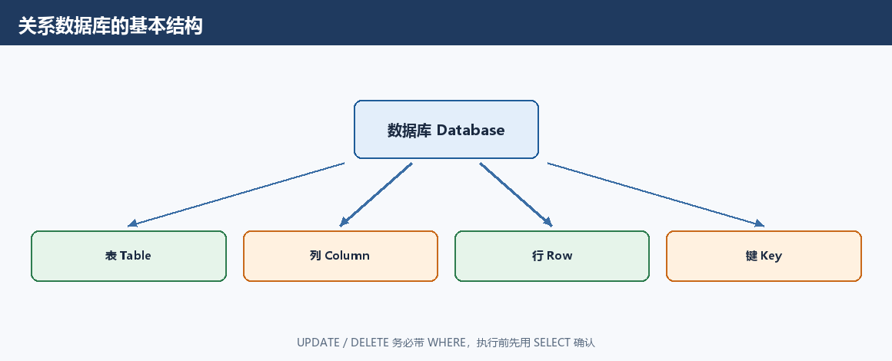
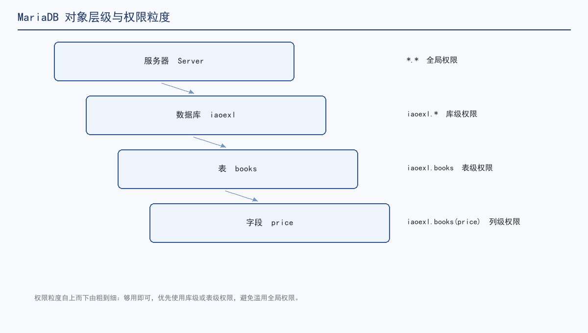
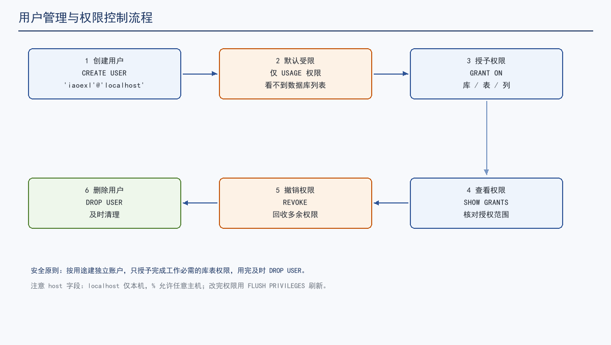
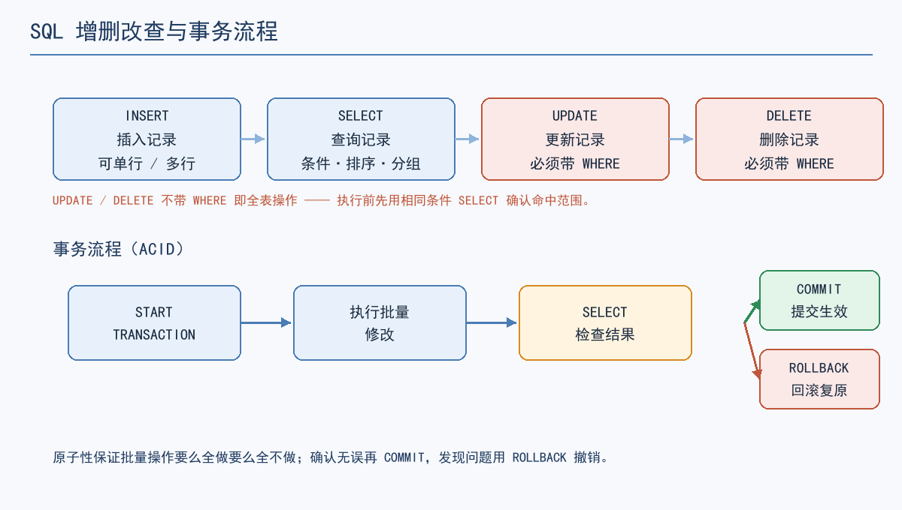
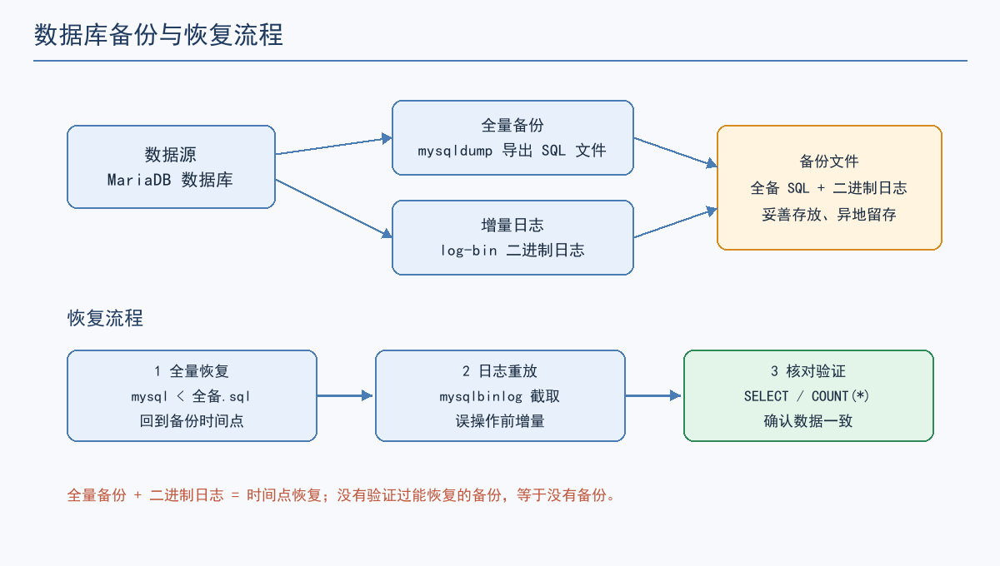

## 板块20 · MariaDB数据库管理

数据库是存放结构化数据的核心组件，几乎所有动态应用都离不开它。这个板块讲清数据库与数据库管理系统的基本理论、MariaDB 的特性、安装与安全加固、用户与权限管理、库表设计、记录增删改查、事务与索引视图，以及备份恢复，并落到运维现场最常遇到的两件事：一致性备份与库改名迁移。学完这一板块，你不只会写几条查询语句，还能独立完成一套数据库从安装、授权、建表到备份恢复的全流程管理。

### 20_1 技术背景与核心原理：从 MySQL 到 MariaDB

MySQL 项目被收购后，逐渐从纯粹的开源走向闭源，促使众多企业与发行版转向 MariaDB。MariaDB 由 MySQL 的原始作者主导开发，以作者的女儿 Maria 命名，凭借开源特性与稳定性迅速占据市场，成为 MySQL 的热门替代品，两者在操作命令上高度兼容——学会 MariaDB，MySQL 的大部分操作可以无缝迁移。

关系数据库的概念可以用表格理解：一个数据库由一个或多个表组成，表头是列名，列是具有相同数据类型的数据集合，行描述一个具体事物，每个单元格是具体的值，键用于唯一标识某条记录。这种结构让数据的组织、查询与维护变得规范高效。

| 概念 | 含义 | 表格类比 |
| --- | --- | --- |
| 数据库 database | 一个或多个表的集合 | 一个工作簿 |
| 表 table | 数据的二维结构 | 一张工作表 |
| 列/字段 column | 同类数据的集合 | 表头与整列 |
| 行/记录 row | 一个具体事物 | 一行数据 |
| 值 value | 单元格内容 | 一个格子 |
| 键 key | 唯一标识记录 | 主键列 |

一个真实的对比故事很能说明数据库的价值：某运维团队早期用一张电子表格管理上千台服务器的资产，随着字段增加、多人同时修改，很快出现字段被误改、版本互相覆盖、查一台机器要翻半天的问题。迁移到 MariaDB 后，一条带条件的 SELECT 就能精确查出目标机器，UPDATE 只改符合条件的行，每次变更还能通过事务回滚。电子表格适合"看"，数据库适合"多人、大量、可追溯地管"。

SQL 语言按用途分为四类，这个概念决定了后面所有命令的归类：

| 分类 | 全称 | 作用 | 代表命令 |
| --- | --- | --- | --- |
| DDL | 数据定义语言 | 定义库、表等结构 | CREATE、ALTER、DROP |
| DML | 数据操作语言 | 操作表中的记录 | INSERT、UPDATE、DELETE、SELECT |
| DCL | 数据控制语言 | 管理用户与权限 | GRANT、REVOKE |
| TCL | 事务控制语言 | 管理事务 | COMMIT、ROLLBACK、START TRANSACTION |

数据库命令与 Linux 命令有个显著区别：每条 SQL 语句以分号结尾。这是初学者最容易忘记的一点——忘了分号，语句不会执行，只会在提示符里继续等待。

```
关系数据库的结构
  数据库 iaoexl
   └─ 表 mybook
        ┌──────┬───────┬────────┐
        │ name │ price │ pages  │  ← 列名（字段）
        ├──────┼───────┼────────┤
        │ 书A  │  59   │  320   │  ← 行（记录）
        │ 书B  │  45   │  240   │
        └──────┴───────┴────────┘
        每个单元格是一个值，name 可作键
```



### 20_2 关键概念：数据库对象、数据类型与权限模型

数据库里的对象是分层的：一个 MariaDB 服务下有多个数据库，每个库有多张表，每张表由若干字段和记录构成。权限也可以按这个层级授予——可以给整个服务器、某个库、某张表甚至某个字段授权，粒度越细越安全。

```
对象层级与权限粒度
  服务器 Server              ← 全局权限 *.*
    └─ 数据库 iaoexl         ← 库级权限 iaoexl.*
         └─ 表 mybook        ← 表级权限 iaoexl.mybook
              └─ 字段 price  ← 列级权限（最小粒度）
```



建表时要为每个字段指定数据类型。类型选得合适，既省空间又保证数据合法；选错了会导致截断或精度丢失。

| 类型族 | 常用类型 | 适用场景 | 注意点 |
| --- | --- | --- | --- |
| 整数 | INT、BIGINT、TINYINT | 数量、编号、页码 | UNSIGNED 可扩大正数范围 |
| 小数 | DECIMAL(6,2)、FLOAT | 价格、金额 | 金额用 DECIMAL 避免浮点误差 |
| 定长字符 | CHAR(15) | 长度固定的编码、状态 | 固定占位，较短 |
| 变长字符 | VARCHAR(50)、TEXT | 标题、正文 | 按实际长度存，省空间 |
| 日期时间 | DATE、DATETIME、TIMESTAMP | 生日、创建时间 | TIMESTAMP 会随时区转换 |
| 枚举 | ENUM('A','B') | 状态、类别等有限取值 | 限定范围，防脏数据 |

约束是写在字段上的规则，用于保证数据的完整性：

| 约束 | 作用 |
| --- | --- |
| NOT NULL | 字段不可为空 |
| DEFAULT | 不填时使用默认值 |
| PRIMARY KEY | 主键，唯一且非空，一张表一个 |
| UNIQUE | 取值唯一，可为空 |
| AUTO_INCREMENT | 自动递增，通常配合主键 |
| FOREIGN KEY | 外键，关联另一张表的主键 |

生产环境不能一直用管理员账户操作数据库，应为不同使用者创建专用账户并分配合理权限——这与应用层的最小权限原则一脉相承。创建用户用 `CREATE USER '用户名'@'主机' IDENTIFIED BY '密码'`，其中主机字段决定了这个账户能从哪里连接：`localhost` 只允许本机连接，`%` 允许任意主机，也可以写成具体网段。用 SELECT 查询系统库 `mysql.user` 可以看到用户列表，密码字段显示为加密后的值。

| 命令 | 作用 |
| --- | --- |
| SHOW databases | 显示已有数据库 |
| CREATE database 名称 | 创建数据库 |
| USE 数据库名 | 切换到指定数据库 |
| SHOW tables | 显示当前库中的表 |
| CREATE TABLE 表名(...) | 创建表并定义字段与约束 |
| DESCRIBE 表名 | 描述表结构 |
| ALTER TABLE 表名 ... | 修改表结构 |
| INSERT INTO ... VALUES(...) | 插入记录 |
| SELECT ... FROM ... WHERE ... | 按条件查询记录 |
| UPDATE 表名 SET ... WHERE ... | 更新记录 |
| DELETE FROM 表名 WHERE ... | 删除记录 |
| CREATE USER ... | 创建用户 |
| GRANT ... ON ... TO ... | 授权 |
| SHOW GRANTS FOR ... | 查看用户权限 |
| REVOKE ... FROM ... | 撤销权限 |
| FLUSH PRIVILEGES | 刷新权限表 |

### 20_3 实操一：安装初始化与安全加固

刚装好的 MariaDB 默认配置并不适合直接上生产：root 通过 unix_socket 认证，本机可免密登录，匿名账户和测试库可能存在，root 还可能被允许远程登录。安全加固就是把这些默认口子逐一收紧。

**配置示例：安装、启动、登录与安全加固**

刚装好的 MariaDB 默认存在本地免密登录、匿名账户等隐患，必须先加固再使用。这组命令完成安装、启动自启、确认端口监听与防火墙放行，并演示首次 socket 登录及安全向导的逐项设置。

```
# 安装服务端与客户端
root@iaoexl:~# dnf install mariadb-server mariadb
...
Complete!

# 启动服务并设为开机自启
root@iaoexl:~# systemctl restart mariadb
root@iaoexl:~# systemctl enable mariadb
Created symlink /etc/systemd/system/multi-user.target.wants/mariadb.service.

# 确认 3306 端口已监听
root@iaoexl:~# ss -lntp | grep 3306
LISTEN 0 80 0.0.0.0:3306 0.0.0.0:* users:(("mariadbd",pid=1823,fd=23))

# 若需远程访问，在防火墙放行 mysql 服务
root@iaoexl:~# firewall-cmd --permanent --add-service=mysql
success
root@iaoexl:~# firewall-cmd --reload
success

# 首次以 root 登录（unix_socket 认证，本机 root 无需密码）
root@iaoexl:~# mariadb -u root
Welcome to the MariaDB monitor.  Commands end with ; or \g.
MariaDB [(none)]>
```

登录确认无误后退出，回到 shell 执行安全配置向导。脚本在 MariaDB 10.4 之后改名为 `mariadb-secure-installation`，`mysql_secure_installation` 仍以兼容链接保留。同一时期客户端工具也统一为 `mariadb-*` 前缀，`mysql`、`mysqldump`、`mysqladmin` 作为兼容链接继续可用；新写的脚本建议直接用 `mariadb`、`mariadb-dump`、`mariadb-admin`，避免在新版本上被提示弃用。向导逐项询问，除第一项直接回车外，其余都选默认的 Y：

```
root@iaoexl:~# mariadb-secure-installation
NOTE: Running ALL parts of this script is RECOMMENDED.

Enter current password for root (enter for none):   ← 初始为空，直接回车
Set root password? [Y/n] y
New password:
Re-enter new password:
Password updated successfully!
Remove anonymous users? [Y/n] y                      ← 删除匿名账户
... Success!
Disallow root login remotely? [Y/n] y                ← 禁止 root 远程登录
... Success!
Remove test database and access to it? [Y/n] y       ← 删除测试库
... Success!
Reload privilege tables now? [Y/n] y                 ← 刷新权限使其生效
... Success!
All done!
```

加固完成后，root 的认证方式由 socket 改为密码，再登录就必须输入口令。也可以用 `mariadb-admin` 直接修改：

```
root@iaoexl:~# mariadb-admin -u root -p password 'iaoexl@7#13'
Enter password:                                       ← 输入旧密码
root@iaoexl:~# mariadb -u root -p
Enter password:                                       ← 输入新密码
MariaDB [(none)]> SELECT VERSION();
+--------------------------+
| VERSION()                |
+--------------------------+
| x.y.z-MariaDB            |
+--------------------------+
1 row in set (0.000 sec)
```

一个真实的安全教训：某测试环境的 MariaDB 安装后没做安全加固，root 空密码且监听在所有地址，几天后被自动化扫描发现，攻击者创建了一个隐藏账户用来挖矿，CPU 长期跑满却查不出业务原因。事后复盘发现，根源就是跳过了安全配置向导这一步。安全加固不是可选项，而是安装流程的一部分。

### 20_4 实操二：用户管理与权限控制

用 root 账户做日常操作风险极高，正确做法是按用途创建专用账户，并只授予完成工作必需的权限。用户管理包含创建、查看、改密、重命名、删除五个动作，权限管理包含授权、查看、撤销三个动作。

| 需求 | 命令 |
| --- | --- |
| 创建用户 | CREATE USER 'iaoexl'@'localhost' IDENTIFIED BY 'iaoexl@7#13'; |
| 查看用户 | SELECT User,Host FROM mysql.user; |
| 修改密码 | ALTER USER 'iaoexl'@'localhost' IDENTIFIED BY 'iaoexl@7#13'; |
| 重命名用户 | RENAME USER '旧用户名'@'localhost' TO '新用户名'@'localhost'; |
| 删除用户 | DROP USER 'iaoexl'@'localhost'; |
| 查看权限 | SHOW GRANTS FOR 'iaoexl'@'localhost'; |
| 刷新权限 | FLUSH PRIVILEGES; |

**配置示例：用户的创建、授权、查看与撤销**

生产环境应创建专用账户并只授予必需权限。这组命令演示 CREATE USER 建账户、查询用户列表、用 GRANT 授予库级与表级权限、SHOW GRANTS 查看，再到 REVOKE 撤销与 DROP USER 删除的完整生命周期。

```
MariaDB [(none)]> CREATE USER 'iaoexl'@'localhost' IDENTIFIED BY 'iaoexl@7#13';
Query OK, 0 rows affected (0.001 sec)

# 新用户默认只有 USAGE 权限，连数据库列表都看不到
MariaDB [(none)]> SELECT User,Host FROM mysql.user;
+--------+-----------+
| User   | Host      |
+--------+-----------+
| root   | localhost |
| iaoexl | localhost |
+--------+-----------+
2 rows in set (0.000 sec)

# 授予指定库的所有权限
MariaDB [(none)]> GRANT ALL ON iaoexl.* TO 'iaoexl'@'localhost';
Query OK, 0 rows affected (0.001 sec)

# 也可以只授予特定表的读与插入权限（更精细）
MariaDB [(none)]> GRANT SELECT, INSERT ON iaoexl.mybook TO 'iaoexl'@'localhost';
Query OK, 0 rows affected (0.001 sec)

# 查看授权结果
MariaDB [(none)]> SHOW GRANTS FOR 'iaoexl'@'localhost';
+-------------------------------------------------------------------------+
| Grants for iaoexl@localhost                                             |
+-------------------------------------------------------------------------+
| GRANT USAGE ON *.* TO `iaoexl`@`localhost`                              |
| GRANT ALL PRIVILEGES ON `iaoexl`.* TO `iaoexl`@`localhost`              |
| GRANT SELECT, INSERT ON `iaoexl`.`mybook` TO `iaoexl`@`localhost`       |
+-------------------------------------------------------------------------+
3 rows in set (0.000 sec)

# 撤销插入权限并刷新
MariaDB [(none)]> REVOKE INSERT ON iaoexl.mybook FROM 'iaoexl'@'localhost';
Query OK, 0 rows affected (0.001 sec)
MariaDB [(none)]> FLUSH PRIVILEGES;

# 用完及时删除账户
MariaDB [(none)]> DROP USER 'iaoexl'@'localhost';
Query OK, 0 rows affected (0.001 sec)
```

权限粒度从大到小依次是全局 `*.*`、库 `iaoexl.*`、表 `iaoexl.mybook`、列 `iaoexl.mybook(price)`。授权时遵循"够用即可"：只读报表账户给 SELECT，录入账户给 INSERT 与 UPDATE，绝不给不需要的 DROP 或文件权限。



一个权限管理的故事：某公司给实习生账户授予了 `GRANT ALL ON *.*`，实习生在练习时误执行了 `DROP DATABASE`，把测试库连同共享的模拟数据一起删掉。事后整改把账户权限收紧到"只能操作以自己名字命名的库"，并规定生产库账户由 DBA 单独申请。权限过大不是便利，而是随时可能引爆的隐患。

### 20_5 实操三：数据库与表的创建和管理

库表管理属于 DDL 范畴，核心动作是创建、查看、修改、删除。建表时除了字段名，还要同时考虑类型、约束、存储引擎与字符集。

| 需求 | 命令 |
| --- | --- |
| 创建库并指定字符集 | CREATE DATABASE iaoexl CHARACTER SET utf8mb4 COLLATE utf8mb4_unicode_ci; |
| 查看库 | SHOW DATABASES; |
| 查看建库语句 | SHOW CREATE DATABASE iaoexl; |
| 切换库 | USE iaoexl; |
| 建表 | CREATE TABLE 表名(字段定义) ENGINE=InnoDB CHARSET=utf8mb4; |
| 查看表结构 | DESCRIBE 表名; |
| 查看建表语句 | SHOW CREATE TABLE 表名\G |
| 加字段 | ALTER TABLE 表名 ADD 字段定义; |
| 改字段类型 | ALTER TABLE 表名 MODIFY 字段定义; |
| 改字段名 | ALTER TABLE 表名 CHANGE 旧名 新名 类型; |
| 删字段 | ALTER TABLE 表名 DROP COLUMN 字段名; |
| 改表名 | ALTER TABLE 旧名 RENAME TO 新名; |
| 删表 | DROP TABLE 表名; |
| 删库 | DROP DATABASE 库名; |

**配置示例：建库、建表、改表与删表**

库表管理属于 DDL，核心是创建、查看、修改与删除。这组命令先建 utf8mb4 字符集的库，再创建含自增主键、DECIMAL 价格与枚举分类的表，用 DESCRIBE 查看结构，最后演示 ALTER 改字段与删表。

```
MariaDB [(none)]> CREATE DATABASE iaoexl CHARACTER SET utf8mb4 COLLATE utf8mb4_unicode_ci;
Query OK, 1 row affected (0.001 sec)

MariaDB [(none)]> USE iaoexl;
Database changed

# 建表：主键自增、标题非空、价格用 DECIMAL、类别用枚举
MariaDB [iaoexl]> CREATE TABLE books (
    ->   id       INT UNSIGNED AUTO_INCREMENT PRIMARY KEY,
    ->   title    VARCHAR(50) NOT NULL,
    ->   price    DECIMAL(6,2) DEFAULT 0.00,
    ->   pages    INT,
    ->   category ENUM('技术','文学','生活') DEFAULT '技术'
    -> ) ENGINE=InnoDB CHARSET=utf8mb4;
Query OK, 0 rows affected (0.012 sec)

MariaDB [iaoexl]> DESCRIBE books;
+----------+-----------------------------+------+-----+---------+----------------+
| Field    | Type                        | Null | Key | Default | Extra          |
+----------+-----------------------------+------+-----+---------+----------------+
| id       | int(10) unsigned            | NO   | PRI | NULL    | auto_increment |
| title    | varchar(50)                 | NO   |     | NULL    |                |
| price    | decimal(6,2)                | YES  |     | 0.00    |                |
| pages    | int(11)                     | YES  |     | NULL    |                |
| category | enum('技术','文学','生活')  | YES  |     | 技术    |                |
+----------+-----------------------------+------+-----+---------+----------------+
5 rows in set (0.001 sec)

# 增加字段、修改类型、改字段名
MariaDB [iaoexl]> ALTER TABLE books ADD publisher VARCHAR(30);
MariaDB [iaoexl]> ALTER TABLE books MODIFY pages INT UNSIGNED;
MariaDB [iaoexl]> ALTER TABLE books CHANGE publisher press VARCHAR(30);

# 删除字段与删除表（删表不可恢复，务必确认）
MariaDB [iaoexl]> ALTER TABLE books DROP COLUMN press;
MariaDB [iaoexl]> DROP TABLE IF EXISTS books;
```

建表有个真实的坑：某团队把价格字段设为 FLOAT，录入 19.99 后求和，结果出现 `599.99998` 这样的误差，财务对账怎么都对不上。改成 DECIMAL(6,2) 后问题消失。涉及金额、精度的数据一律用 DECIMAL，这是数据库设计的硬规矩。

### 20_6 实操四：记录增删改查与事务

增删改查（CRUD）是数据库日常操作的核心。SELECT 的写法最丰富，条件、排序、分组、聚合、多表关联都围绕它展开；UPDATE 与 DELETE 则必须带 WHERE，否则就是全表操作。

| 需求 | 命令 |
| --- | --- |
| 插入单行 | INSERT INTO books (title,price) VALUES ('Linux Probe',59); |
| 插入多行 | INSERT INTO books (title,price) VALUES ('A',59),('B',45); |
| 基础查询 | SELECT * FROM books; |
| 条件查询 | SELECT * FROM books WHERE price > 50; |
| 模糊查询 | SELECT * FROM books WHERE title LIKE '%Linux%'; |
| 排序 | SELECT * FROM books ORDER BY price DESC; |
| 分组统计 | SELECT category, COUNT(*) FROM books GROUP BY category; |
| 聚合函数 | SELECT COUNT(*), AVG(price), MAX(price) FROM books; |
| 限制条数 | SELECT * FROM books LIMIT 3; |
| 多表关联 | SELECT b.title FROM books b JOIN author a ON b.id=a.book_id; |
| 更新 | UPDATE books SET price=49 WHERE title='Linux Probe'; |
| 删除 | DELETE FROM books WHERE title='Linux Probe'; |
| 清空表 | TRUNCATE TABLE books; |

**配置示例：完整的增删改查与事务回滚**

增删改查是日常操作核心，SELECT 写法最丰富。这组命令演示 INSERT 插入、条件排序分组聚合查询、先 SELECT 确认范围再 UPDATE/DELETE，并用事务包裹批量调价，检查后可 ROLLBACK 回滚。

```
# 插入几条记录（主键自增，不必手动给 id）
MariaDB [iaoexl]> INSERT INTO books (title,price,pages,category) VALUES
    -> ('Linux Probe',59,320,'技术'),
    -> ('C语言入门',45,240,'技术'),
    -> ('散文集',32,180,'文学');
Query OK, 3 rows affected (0.002 sec)

# 查询全部
MariaDB [iaoexl]> SELECT * FROM books;
+----+-------------+-------+-------+----------+
| id | title       | price | pages | category |
+----+-------------+-------+-------+----------+
|  1 | Linux Probe | 59.00 |   320 | 技术     |
|  2 | C语言入门   | 45.00 |   240 | 技术     |
|  3 | 散文集      | 32.00 |   180 | 文学     |
+----+-------------+-------+-------+----------+
3 rows in set (0.001 sec)

# 条件、排序、聚合、分组
MariaDB [iaoexl]> SELECT title,price FROM books WHERE price>40 ORDER BY price DESC;
+-------------+-------+
| title       | price |
+-------------+-------+
| Linux Probe | 59.00 |
| C语言入门   | 45.00 |
+-------------+-------+
MariaDB [iaoexl]> SELECT category, COUNT(*) AS cnt, AVG(price) AS avg_price
    -> FROM books GROUP BY category;
+----------+-----+-----------+
| category | cnt | avg_price |
+----------+-----+-----------+
| 技术     |   2 | 52.000000 |
| 文学     |   1 | 32.000000 |
+----------+-----+-----------+

# 更新与删除（先 SELECT 确认命中范围，再执行）
MariaDB [iaoexl]> SELECT * FROM books WHERE title='Linux Probe';
MariaDB [iaoexl]> UPDATE books SET price=49 WHERE title='Linux Probe';
Query OK, 1 row affected (0.001 sec)
MariaDB [iaoexl]> DELETE FROM books WHERE title='散文集';
Query OK, 1 row affected (0.001 sec)

# 事务：批量调价，确认无误后提交，有问题则回滚
MariaDB [iaoexl]> START TRANSACTION;
Query OK, 0 rows affected (0.000 sec)
MariaDB [iaoexl]> UPDATE books SET price=price*0.9 WHERE category='技术';
Query OK, 2 rows affected (0.001 sec)
MariaDB [iaoexl]> SELECT * FROM books;              ← 检查调价结果
MariaDB [iaoexl]> ROLLBACK;                          ← 不满意则回滚，数据复原
Query OK, 0 rows affected (0.001 sec)
```



事务的 ACID 特性在这里得到直观体现：原子性保证一次批量调价要么全成功要么全不生效，一致性保证数据始终合法，隔离性让并发操作互不干扰，持久性保证提交后即使断电也不丢失。执行批量修改前先 `START TRANSACTION`，检查通过再 `COMMIT`，发现问题 `ROLLBACK`，这是比"直接改、错了再补救"可靠得多的工作方式。

### 20_7 实操五：索引、视图与备份恢复

当数据量增大，查询会变慢，索引是提升检索效率的首要手段；视图可以把复杂查询封装成一张"虚拟表"，简化重复查询；备份与恢复则是数据安全的最后防线。

| 需求 | 命令 |
| --- | --- |
| 创建普通索引 | CREATE INDEX idx_title ON books(title); |
| 创建唯一索引 | CREATE UNIQUE INDEX idx_name ON books(title); |
| 查看索引 | SHOW INDEX FROM books; |
| 删除索引 | DROP INDEX idx_title ON books; |
| 创建视图 | CREATE VIEW v_tech AS SELECT title,price FROM books WHERE category='技术'; |
| 使用视图 | SELECT * FROM v_tech; |
| 删除视图 | DROP VIEW v_tech; |
| 备份单库 | mariadb-dump -u root -p iaoexl > /backup/iaoexl.sql |
| 备份多库 | mariadb-dump -u root -p --databases iaoexl hr > /backup/two.sql |
| 备份全部库 | mariadb-dump -u root -p --all-databases > /backup/full.sql |
| 备份单表 | mariadb-dump -u root -p iaoexl books > /backup/books.sql |
| 仅备份结构 | mariadb-dump -u root -p --no-data iaoexl > /backup/schema.sql |
| 压缩备份 | mariadb-dump -u root -p iaoexl \| gzip > /backup/iaoexl.sql.gz |
| 恢复 | mariadb -u root -p iaoexl < /backup/iaoexl.sql |
| 库内恢复 | MariaDB [iaoexl]> SOURCE /backup/iaoexl.sql; |

**配置示例：索引、视图与多种备份恢复方式**

索引提升检索效率，视图封装复杂查询，备份恢复守护数据安全。这组命令先建索引与视图并查看效果，再用 mariadb-dump 备份单库，模拟删库后重建导入恢复，最后用 COUNT(*) 核对记录数确认恢复成功。

```
# 建索引并查看
MariaDB [iaoexl]> CREATE INDEX idx_title ON books(title);
Query OK, 0 rows affected (0.015 sec)
Records: 0  Duplicates: 0  Warnings: 0
MariaDB [iaoexl]> SHOW INDEX FROM books;
+-------+------------+-----------+--------------+-------------+
| Table | Non_unique | Key_name  | Column_name  | Index_type  |
+-------+------------+-----------+--------------+-------------+
| books | 1          | idx_title | title        | BTREE       |
+-------+------------+-----------+--------------+-------------+

# 建视图并查询（视图本身不存数据，数据仍来自基表）
MariaDB [iaoexl]> CREATE VIEW v_tech AS
    -> SELECT title,price FROM books WHERE category='技术';
MariaDB [iaoexl]> SELECT * FROM v_tech;
+-------------+-------+
| title       | price |
+-------------+-------+
| Linux Probe | 49.00 |
| C语言入门   | 45.00 |
+-------------+-------+

# 回到 shell 备份
root@iaoexl:~# mkdir -p /backup
root@iaoexl:~# mariadb-dump -u root -p iaoexl > /backup/iaoexl.sql
Enter password:
root@iaoexl:~# ls -lh /backup/iaoexl.sql
-rw-r--r-- 1 root root 2.4K /backup/iaoexl.sql

# 模拟数据丢失：删库后重建并恢复
MariaDB [(none)]> DROP DATABASE iaoexl;
root@iaoexl:~# mariadb -u root -p -e "CREATE DATABASE iaoexl CHARACTER SET utf8mb4"
root@iaoexl:~# mariadb -u root -p iaoexl < /backup/iaoexl.sql
Enter password:
MariaDB [iaoexl]> SELECT COUNT(*) FROM books;      ← 核对记录数，确认恢复成功
+----------+
| COUNT(*) |
+----------+
|        2 |
+----------+
1 row in set (0.001 sec)
```

时间点恢复依赖二进制日志。在配置文件的 `[mysqld]` 段启用 `log-bin=mysql-bin` 并重启服务后，所有数据变更都会记录到日志中。当发生误操作，可以先用全量备份恢复到最近一次备份点，再用 `mysqlbinlog` 把备份点之后、误操作之前的变更重放回来：

```
# 启用二进制日志（/etc/my.cnf.d 下的 server 配置）
[mysqld]
log-bin=mysql-bin
server-id=1

# 导出指定时间段的增量日志并重放（时间按实际误操作时点替换）
root@iaoexl:~# mysqlbinlog --start-datetime="起始时间" --stop-datetime="误操作前时间" \
    /var/lib/mysql/mysql-bin.000001 > /tmp/inc.sql
root@iaoexl:~# mariadb -u root -p < /tmp/inc.sql
```



一个靠二进制日志挽回损失的故事：某工程师在下午误删了一张订单表，当天凌晨的全量备份里没有这几小时的新订单。团队先用凌晨备份恢复，再从二进制日志中截取出"凌晨备份之后、误删之前"的所有 INSERT 语句重放，最终只丢失误删瞬间极少量数据。这个故事说明：全量备份 + 二进制日志的组合，才能把损失降到最低；只做全量备份，就意味着必然丢失最后一次备份之后的数据。

### 20_8 运维实战：一致性备份与库改名迁移

备份这件事的难点不在"敲一条命令"，而在"恢复出来的数据能不能用"。用 `mariadb-dump` 备份时，如果有写入正在发生，导出的表可能一张早一张晚，恢复后外键对不上、金额合计对不上。解决这个问题的关键参数是 `--single-transaction`：它在一个可重复读事务里取快照，让所有表都停在同一时刻，且不需要锁表。

| 参数 | 作用 | 不加的后果 |
| --- | --- | --- |
| `--single-transaction` | 用事务快照保证一致性 | 并发写入时备份数据不自洽 |
| `--routines` | 导出存储过程与函数 | 恢复后业务逻辑缺失 |
| `--events` | 导出定时事件 | 定时任务全部消失 |
| `--triggers` | 导出触发器（默认已开） | 级联逻辑失效 |
| `--opt` | 打包启用一批优化开关 | 备份慢、恢复慢 |
| `--default-character-set=utf8mb4` | 明确字符集 | 中文乱码 |

注意 `--single-transaction` 只对 InnoDB 有效。MyISAM 表不支持事务，备份期间仍有写入就会不一致，这也是把老库从 MyISAM 迁到 InnoDB 的一个实际理由。

**配置示例：定时全量备份加过期清理**

Linux 侧用 `date` 生成时间戳、用 `find` 清理老备份；Windows 侧没有 `date` 的这种格式化，靠字符串截取拼时间戳，清理则用 `forfiles`。两边逻辑相同：先删过期、再备份、命名带时间戳。

```
# 一、Linux：手工执行一次，确认参数与权限正确
root@iaoexl:~# mkdir -p /backup/mysql
root@iaoexl:~# mariadb-dump --single-transaction --routines --events \
>   --default-character-set=utf8mb4 -uroot -p iaoexl > /backup/mysql/iaoexl_$(date +%Y%m%d%H%M).sql

# 二、清理 30 天前的备份，再写入定时任务
root@iaoexl:~# find /backup/mysql -name '*.sql' -mtime +30 -delete
root@iaoexl:~# crontab -e
30 2 * * * /usr/bin/mariadb-dump --single-transaction --routines --events -uroot -p'iaoexl@7#13' iaoexl > /backup/mysql/iaoexl_$(date +\%Y\%m\%d).sql && find /backup/mysql -name '*.sql' -mtime +30 -delete

# 三、Windows 侧：批处理备份并清理（密码不要明文长期留在脚本里，建议改用配置文件）
C:\> type backup_mysql.bat
@echo off
rem 删除 30 天前的备份
forfiles /p "D:\MySQL\backup" /m backup_*.sql -d -30 /c "cmd /c del /f @path"
rem 用日期时间拼时间戳
set "Ymd=%date:~0,4%%date:~5,2%%date:~8,2%%time:~0,2%%time:~3,2%%time:~6,2%"
"D:\mysql\bin\mariadb-dump" --opt --single-transaction=TRUE --routines --events ^
  --default-character-set=utf8mb4 --user=root --password=iaoexl@7#13 ^
  --host=127.0.0.1 --protocol=tcp --port=3306 ivms > "D:\MySQL\backup\backup_%Ymd%.sql"
```

定时任务里的 `%` 必须写成 `\%`，否则 cron 会把它当作换行符处理，任务静默失败且不留痕迹——这是 crontab 里最典型的坑。另外，密码写在命令里会被 `ps` 看到，生产环境应改用 `~/.my.cnf` 或 `--defaults-extra-file` 指定的凭证文件，并把权限设为 600。

只有全量备份还不够：两次全备之间的数据丢失无法接受时，要保留二进制日志，恢复时"全备 + 重放 binlog 到故障点前一刻"。这套组合拳的可行性取决于 `log-bin` 是否开启，没开就只剩全备这一个恢复点。

**配置示例：把数据库改名（跨库迁移的正确姿势）**

`RENAME DATABASE` 命令从 5.1.23 起被官方移除，原因是它在旧版本里可能丢数据。现在改名只能靠"新建库 + 迁移表"，而两种存储引擎的迁移方式完全不同。

```
# 一、先建目标库，字符集与源库保持一致，避免迁移后中文变问号
MariaDB [(none)]> CREATE DATABASE iaoexl_new CHARACTER SET utf8mb4 COLLATE utf8mb4_general_ci;

# 二、InnoDB：用 RENAME TABLE 批量迁移（一条语句迁移多表是原子的）
MariaDB [(none)]> RENAME TABLE iaoexl.books TO iaoexl_new.books,
    -> iaoexl.readers TO iaoexl_new.readers;

# 三、MyISAM：停服务后直接改目录名（元数据与数据文件一起搬）
root@iaoexl:~# systemctl stop mariadb
root@iaoexl:~# mv /var/lib/mysql/iaoexl /var/lib/mysql/iaoexl_new
root@iaoexl:~# systemctl start mariadb

# 四、迁移后必须补的对象：触发器、存储过程、函数、事件不会随表走
MariaDB [(none)]> SHOW TRIGGERS FROM iaoexl_new;
MariaDB [(none)]> SHOW PROCEDURE STATUS WHERE Db='iaoexl_new';

# 五、核对表数量与行数，再决定是否删除旧库
MariaDB [(none)]> SELECT COUNT(*) FROM information_schema.tables WHERE table_schema='iaoexl_new';
MariaDB [(none)]> DROP DATABASE iaoexl;
```

`RENAME TABLE` 只处理表本身。视图会跟着表引用失效、触发器不会迁移、存储过程与函数留在原库、事件调度器里的定义还指向旧库名——迁移后逐项核对，是这类操作必须补的一步，否则业务跑起来才发现定时任务根本没执行。

| 场景 | 做法 | 风险点 |
| --- | --- | --- |
| 同实例改名 | RENAME TABLE 批量迁移 | 触发器/过程/事件需手工重建 |
| 跨实例迁移 | 导出 + 导入，再改应用连接 | 字符集与排序规则不一致 |
| 大库在线迁移 | 主从复制切换 | 切换窗口与数据校验 |
| 误删恢复 | 全备 + binlog 时间点恢复 | 必须有 `log-bin` 且未被清理 |

### 20_9 场景笔记方法：把数据库操作记成"结构—语句—结果"表

数据库笔记的价值在于保存表结构与常用语句，便于日后复用。

| 记录项 | 记录内容 | 示例 |
| --- | --- | --- |
| 表结构 | 字段名、类型、约束 | id INT AUTO_INCREMENT PRIMARY KEY |
| 常用语句 | 带完整分号的 SQL | SELECT * FROM books WHERE price>40; |
| 用户与权限 | 创建了哪些用户、授了什么权、粒度多大 | iaoexl@localhost 仅 books 表 SELECT |
| 索引与视图 | 建索引的字段、视图的定义 | idx_title(title)、v_tech |
| 备份策略 | 备份命令、周期与存放位置 | 每日全备 + 二进制日志 |
| 恢复演练 | 恢复步骤与验证结果 | 导入后 COUNT(*) 核对 |

SQL 语句要原样记录包括分号，这是与 Linux 命令笔记最大的不同。WHERE 子句的重要性要重点标注——"UPDATE/DELETE 必带 WHERE"是数据库笔记里最值得用醒目方式写下的规则。备份与恢复的笔记要成对记录，并注明恢复演练的结果。表结构的变更（增加字段、修改类型）也要记下，因为它是数据演进的历史。

### 20_10 实用验证与排错：确认数据操作符合预期

数据库的验证非常明确：执行操作后用 SELECT 看结果是否符合预期。

```
数据库排错流程
  服务运行？ ─► 能登录？ ─► 用户有权限？ ─► 语句语法？ ─► 用SELECT验证结果
  mysqld状态    用户名密码    GRANT授权      分号/关键字     结果是否符合预期
```

| 现象 | 排查方向 |
| --- | --- |
| 语句不执行只换行 | 忘记加分号 |
| 提示 ERROR 1045 拒绝访问 | 用户名、密码或 host 字段不匹配 |
| 提示 ERROR 1049 未知数据库 | 库名写错，或当前用户看不到该库 |
| 提示 ERROR 1064 语法错误 | 关键字、括号或分号有误 |
| 提示 ERROR 1062 重复键 | 主键或唯一索引冲突 |
| 提示权限不足 | 用户未被授予相应权限，用 SHOW GRANTS 查看 |
| 看不到数据库列表 | 用户权限受限，属正常现象 |
| 误改了多条记录 | UPDATE/DELETE 的 WHERE 条件不当 |
| 查询越来越慢 | 缺少索引，用 EXPLAIN 检查执行计划 |
| 恢复后数据不全 | 备份文件不完整或恢复库选错 |

经验之谈：执行 UPDATE 与 DELETE 前，先用相同 WHERE 条件做一次 SELECT，确认命中的正是想操作的那几条记录——这是防止误操作的黄金习惯。数据库误操作往往无法像文件那样从回收站恢复，预防远胜于补救。

### 20_11 认证对标与进阶实战

数据库管理在认证体系中是独立的技能域。LPIC-1 的 102 考试包含 SQL 基础，LFCE 的高级管理涉及数据库运维，CompTIA Linux+ 也会考查数据库基本概念。需要说清的是：数据库不在 EX200 与 EX294 的考纲内——EX294 只要求用模块完成 RHCSA 级的系统任务，不涉及数据库部署；但真实岗位里它出现得极频繁，所以这里仍按可交付标准写全。专业 DBA 另有专门认证，Linux 运维必须掌握的是安装、用户权限与备份恢复这三件基础能力。

| 认证体系 | 与本主题相关的考查方向 | 核心能力要求 |
| --- | --- | --- |
| LPIC-1（102） | SQL 基础、数据库概念 | 执行增删改查、理解表结构 |
| LFCE | 数据库运维 | 配置用户权限、备份恢复 |
| CompTIA Linux+ | 数据库基础 | 解释关系模型与 SQL 语句 |

一个因 WHERE 条件遗漏造成的惨痛教训在运维圈广为流传：有人想把某条测试记录删掉，执行 `DELETE FROM 表` 时忘了带 WHERE 条件，整张表被清空，只能靠昨晚的备份恢复，丢失了一整天数据。`UPDATE` 与 `DELETE` 不带 WHERE 就是全表操作——执行前先用相同的 WHERE 条件跑一遍 `SELECT`，确认命中的正是目标行，这是数据库操作的安全底线。

数据库相关故障集中在连接、权限与数据一致性三处。

| 现象 | 根因 | 定位命令 | 处置 |
| --- | --- | --- | --- |
| 无法连接数据库 | 服务未运行、端口或防火墙限制 | systemctl status、ss | 启动服务、放行端口 |
| 用户看不到数据库 | 用户未授权或只用 localhost 登录 | SHOW GRANTS | GRANT 授权、注意 host 字段 |
| 修改影响范围过大 | WHERE 条件缺失或写错 | 先 SELECT 验证 | 加精确条件、必要时事务回滚 |
| 查询性能下降 | 缺少索引或索引失效 | EXPLAIN、SHOW INDEX | 建合适索引、优化 WHERE |
| 数据丢失 | 无备份或备份未验证 | 检查备份任务 | 定期备份并做恢复演练 |

闯关任务按"建库—授权—备份"三级递进。

```
  数据库闯关
  第一关 建库建表并插入、查询数据
    │
  第二关 创建用户并只授权指定库的读写权限
    │
  第三关 备份数据库、删库后恢复验证
```

- 第一关：用 CREATE 建库建表，INSERT 插入、SELECT 查询确认。
- 第二关：CREATE USER 后用 GRANT 授权，用新用户连接验证权限边界。
- 第三关：用 mariadb-dump 备份，DROP 后重新导入，核对数据一致。

进阶要理解关系模型、事务与备份策略的完整体系。表、行、列构成关系模型的基本结构，键（主键、外键）用于唯一标识与关联，SQL 则是对关系进行操作的声明式语言——告诉数据库"要什么"，而非"怎么做"，这与逐条命令的 shell 思维不同。事务是数据库可靠性的核心，ACID 指原子性、一致性、隔离性、持久性，批量修改放进事务才能出错可回滚。索引本质上是以空间换时间的结构，常用 B+ 树实现，用 EXPLAIN 可以看查询是否走了索引。

备份方面，逻辑备份（mariadb-dump）可读性强、适合小库，物理备份速度快、适合大库，全量备份配合二进制日志才能做时间点恢复——无论哪种，都要定期做恢复演练，没验证过的备份等于没有备份。把"SQL 分类 + 事务 ACID + 索引原理 + 备份策略"整理成一页，数据库基础就体系化了。

### 20_12 要点回顾与能力自检

本板块讲清了数据库与关系模型、MariaDB 的背景、安装与安全加固、用户与权限管理、库表设计与字段类型、记录增删改查、事务与索引视图、备份与恢复。核心纪律是"SQL 语句带分号"与"UPDATE/DELETE 必带 WHERE"。

自检问题：

1. MariaDB 为什么会成为 MySQL 的热门替代品？
2. 关系数据库中的表、列、行、键分别对应表格的什么？
3. SQL 语句与 Linux 命令在书写上有什么显著区别？
4. 安装 MariaDB 后，安全加固向导做了哪几件事，为什么每件都必要？
5. 新建用户默认看不到数据库列表的原因是什么？如何用 GRANT 解决？
6. 金额字段为什么要用 DECIMAL 而不是 FLOAT？
7. UPDATE 与 DELETE 前为什么必须先用 SELECT 确认 WHERE 条件？
8. 事务的 ACID 分别指什么？什么时候应该用事务？
9. 索引的作用是什么？为什么不是越多越好？
10. 全量备份配合二进制日志为什么能实现时间点恢复？
