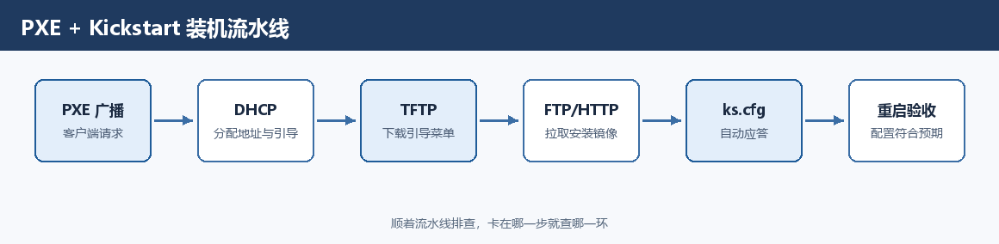

## 板块21 · PXE与Kickstart无人值守装机

常规装机是"一次一台、人工应答"，面对几十上百台机器时，这种方式低效且容易因人为差异导致环境不一致。PXE 与 Kickstart 的组合实现无人值守安装：客户端通过网络启动，自动获取地址、引导文件与安装镜像，并按应答文件自动完成所有安装问答，全程无须人工干预。这个板块是对 DHCP、TFTP、FTP、防火墙等多个前置知识的综合调用。

### 21_1 技术背景与核心原理：把装机变成一条流水线

光盘安装的场景适合少量机器，但当数量上升到几十上百台，逐台插盘、逐台点选的重复劳动会让人崩溃，而且每台的选择可能略有差异，导致环境不一致。无人值守装机要解决的就是"批量、自动、一致"三个诉求。

方案由几个组件拼成一条流水线，各司其职。

| 组件 | 作用 | 类比 |
| --- | --- | --- |
| PXE | 让客户端支持网络启动 | 从网络而不是光盘开机 |
| DHCP（Kea） | 为客户端分配地址并告知引导文件位置 | 告诉客户端"去哪里取启动程序" |
| TFTP | 传输引导文件与驱动 | 传输"启动所需的那一小段" |
| SYSLinux | 提供网络引导程序与菜单 | 开机后的第一屏选择界面 |
| FTP（vsftpd） | 传输完整安装镜像 | 传输"安装所需的一大堆" |
| Kickstart | 自动应答安装过程中的所有问答 | 代替人点击"下一步"的清单 |

PXE 负责"把机器启动到安装程序"，Kickstart 负责"替人回答所有安装问题"，两者结合，客户端开机后即可自动完成安装。

```
PXE + Kickstart 装机流水线
  客户端开机 ──DHCP──► 获取IP + 引导文件位置
       │
       ├──TFTP──► 下载 pxelinux.0 / vmlinuz / initrd.img
       │
       ├──启动安装菜单 ──加载 ks.cfg 应答文件
       │
       └──FTP──► 拉取安装镜像 ──► 自动应答 ──► 自动安装 ──► 自动重启
```



### 21_2 实操：部署相关服务程序

部署按"地址—引导—镜像—应答"的顺序展开，本质是先把流水线每一环搭好。

**配置 DHCP 服务**：编辑 Kea 配置，除了常规的地址池与网关，还要指定引导文件名（pxelinux.0）与 TFTP 服务器地址，让客户端拿到地址后知道去哪里取启动程序。注意同一网段不能有第二个 DHCP 服务，否则客户端可能拿到错误地址——这是虚拟机环境里最常见的干扰源。

**配置 TFTP 服务**：TFTP 基于 UDP、无需认证，适合为尚未安装系统的客户端提供引导文件。安装并启动 tftp 服务，放行防火墙。

**配置 SYSLinux 服务**：把 SYSLinux 提供的引导文件与光盘中的 PXE 引导文件复制到 tftp 根目录，创建 default 配置文件，指定安装菜单、内核与初始化镜像，并在其中指明 Kickstart 应答文件的位置。default 文件里的自动安装参数是让流程"无人值守"的关键。

**配置 vsftpd 服务**：开启匿名访问，把光盘镜像内容复制到 FTP 根目录，使安装源（BaseOS、AppStream）与应答文件可通过 FTP 获取。默认的 21 端口与 `/var/ftp/pub` 目录自带正确的 SELinux 上下文，无需额外放行；只有把 FTP 改到非标准端口时，才需要为该端口打上 `ftp_port_t` 标签——布尔值管的是"能不能连出去"，管不了"能不能被连进来"，两件事不能混用。

**创建 Kickstart 应答文件**：把系统生成的 anaconda-ks.cfg 复制为 ks.cfg 放到 FTP 目录并赋予读权限，然后编辑其中的网络配置、安装源、软件包、分区、时区、密码、自动重启等参数。这份文件就是"安装问答的标准答案"，其内容决定了装出来的系统是什么样。

| 配置文件 | 作用 |
| --- | --- |
| kea-dhcp4.conf | 地址分配、引导文件、TFTP 地址 |
| pxelinux.cfg/default | 启动菜单与自动安装参数 |
| ks.cfg | 安装应答标准答案 |
| vsftpd.conf | FTP 匿名访问设置 |

**配置示例：关键配置文件**

无人值守装机靠几个关键配置文件串起流水线。这组命令依次在 Kea 指定引导文件与 TFTP 地址、准备 TFTP 引导文件、编写启动菜单指向安装源与 ks.cfg，再把镜像与应答文件放入 FTP 并启动服务。

```
# 1) Kea DHCP：在 subnet4 中加入引导文件与 TFTP 地址
root@iaoexl:~# vim /etc/kea/kea-dhcp4.conf
"boot-file-name": "pxelinux.0",
"next-server": "192.168.10.10",

# 2) 准备 TFTP 目录：复制引导文件
root@iaoexl:~# cp /usr/share/syslinux/pxelinux.0 /var/lib/tftpboot/
root@iaoexl:~# cp /media/cdrom/images/pxeboot/{vmlinuz,initrd.img} /var/lib/tftpboot/
root@iaoexl:~# mkdir /var/lib/tftpboot/pxelinux.cfg

# 3) 启动菜单：指定安装源与应答文件
root@iaoexl:~# vim /var/lib/tftpboot/pxelinux.cfg/default
default linux
label linux
  kernel vmlinuz
  append initrd=initrd.img inst.repo=ftp://192.168.10.10/pub ks=ftp://192.168.10.10/pub/ks.cfg

# 4) 准备 FTP 安装源与应答文件
root@iaoexl:~# cp -r /media/cdrom/* /var/ftp/pub/
root@iaoexl:~# cp /root/anaconda-ks.cfg /var/ftp/pub/ks.cfg
root@iaoexl:~# chmod 644 /var/ftp/pub/ks.cfg

# 5) 启动相关服务
root@iaoexl:~# systemctl restart kea-dhcp4 tftp.socket vsftpd
```

**配置示例：安装并配置 Kea DHCP 服务**

除了地址池与网关，Kea 的配置里还要告诉客户端"引导文件名"和"TFTP 服务器地址"，这两项是 PXE 能启动的关键。

```
root@iaoexl:~# dnf install -y kea
...
Complete!
root@iaoexl:~# vim /etc/kea/kea-dhcp4.conf
{
  "Dhcp4": {
    "interfaces-config": {
      "interfaces": [ "ens160" ]
    },
    "subnet4": [
      {
        "id": 1,
        "subnet": "192.168.10.0/24",
        "pools": [
          { "pool": "192.168.10.100 - 192.168.10.200" }
        ],
        "option-data": [
          { "name": "routers", "data": "192.168.10.1" },
          { "name": "boot-file-name", "data": "pxelinux.0" },
          { "name": "tftp-server-name", "data": "192.168.10.10" }
        ]
      }
    ]
  }
}
root@iaoexl:~# systemctl restart kea-dhcp4
root@iaoexl:~# systemctl enable kea-dhcp4
root@iaoexl:~# systemctl status kea-dhcp4
● kea-dhcp4.service - Kea DHCPv4 Server
     Active: active (running)
```

`boot-file-name` 指定客户端该取哪个引导程序，`tftp-server-name` 指定去哪台服务器取——少了任何一个，客户端拿到地址后也不知道下一步该做什么。

这两项在 Kea 里有两种等价写法：写在 `option-data` 里（如上，对应 DHCP 选项 67 与 66），或写成 `subnet4` 层级的 `boot-file-name` 与 `next-server` 字段。前者随选项下发、便于按客户端类差异化，后者更简短、与旧版 dhcpd 的 `filename`/`next-server` 语义对齐。同一份配置里任选其一即可，两种写法混用会让客户端收到两份相互覆盖的同义选项。

**配置示例：安装 TFTP 与 SYSLinux 并准备引导文件**

TFTP 负责传输"启动所需的一小段"，SYSLinux 提供引导程序与菜单。把两者提供的文件都放进 tftp 根目录，再写好 default 菜单。

```
root@iaoexl:~# dnf install -y tftp-server
root@iaoexl:~# systemctl restart tftp.socket
root@iaoexl:~# systemctl enable tftp.socket

root@iaoexl:~# dnf install -y syslinux
root@iaoexl:~# cd /var/lib/tftpboot
root@iaoexl:/var/lib/tftpboot# cp -r /usr/share/syslinux/* .
root@iaoexl:/var/lib/tftpboot# cp /media/cdrom/images/pxeboot/* .
root@iaoexl:/var/lib/tftpboot# mkdir pxelinux.cfg
root@iaoexl:/var/lib/tftpboot# vim pxelinux.cfg/default
DEFAULT auto
LABEL auto
    KERNEL vmlinuz
    APPEND initrd=initrd.img inst.ks=ftp://192.168.10.10/pub/ks.cfg inst.stage2=ftp://192.168.10.10/pub inst.repo=ftp://192.168.10.10/pub quiet
```

`APPEND` 一行把应答文件位置与安装源一次写全：`inst.ks` 指向 ks.cfg，安装程序据此自动应答；`inst.repo` 指向安装源，`quiet` 减少启动刷屏。

**UEFI 客户端：换一套引导程序，其余不变**

`pxelinux.0` 是 BIOS 时代的产物，它依赖 BIOS 中断读盘、只能引导传统模式。近十年的机器默认走 UEFI，这类客户端拿到 `pxelinux.0` 会直接卡住或报 "No bootfile found"——不是配置错了，是引导程序与固件类型根本不匹配。

UEFI 的引导链是三段式：`shimx64.efi`（被微软签名的引导壳，用于通过 Secure Boot）→ `grubx64.efi`（真正的引导器）→ `grub.cfg`（菜单）→ 内核与 initrd。三样东西都要放在 TFTP 根目录。

```
# 一、装引导程序包，并复制到 TFTP 根目录
root@iaoexl:~# dnf install -y shim-x64 grub2-efi-x64
root@iaoexl:/var/lib/tftpboot# cp /boot/efi/EFI/redhat/shimx64.efi .
root@iaoexl:/var/lib/tftpboot# cp /boot/efi/EFI/redhat/grubx64.efi .

# 二、写 UEFI 用的菜单（注意是 linuxefi / initrdefi，不是 linux / initrd）
root@iaoexl:/var/lib/tftpboot# vim grub.cfg
set default=0
set timeout=5

menuentry 'Auto Install RHEL' {
    linuxefi vmlinuz inst.ks=ftp://192.168.10.10/pub/ks.cfg inst.repo=ftp://192.168.10.10/pub quiet
    initrdefi initrd.img
}
```

`grub.cfg` 必须放在 TFTP 根目录，文件名固定——grub 启动后会按编译进去的前缀去找它，改名字就找不到。`linuxefi` 与 `initrdefi` 是 UEFI 版的命令，写成 BIOS 版的 `linux`/`initrd` 会报 "unknown command"。

**让 DHCP 按客户端类型发不同的引导文件**

混合环境里，同一网段既有 BIOS 老机也有 UEFI 新机，而 DHCP 一次只能回一个引导文件名。区分依据是客户端在请求里带的架构标识（option 93）：`0000` 表示 BIOS，`0007`（部分固件报 `0009`）表示 x64 UEFI。Kea 用客户端类做分支：

```
root@iaoexl:~# vim /etc/kea/kea-dhcp4.conf
{
  "Dhcp4": {
    "client-classes": [
      {
        "name": "pxe-uefi",
        "test": "option[93].hex == 0x0007 or option[93].hex == 0x0009",
        "boot-file-name": "shimx64.efi"
      }
    ],
    "subnet4": [ {
      "subnet": "192.168.10.0/24",
      "boot-file-name": "pxelinux.0",
      "next-server": "192.168.10.10"
    } ]
  }
}
root@iaoexl:~# kea-dhcp4 -t /etc/kea/kea-dhcp4.conf
```

匹配到 `pxe-uefi` 类的客户端拿到 `shimx64.efi`，其余落到子网默认值 `pxelinux.0`。类的顺序有意义：Kea 按配置文件里的先后顺序求值，第一个匹配上的类生效，所以将来若再加 iPXE 链式引导，那个类必须排在架构类前面，否则客户端会被反复送回自己的引导器。如果确认环境只有 UEFI 机器，把子网的 `boot-file-name` 直接改成 `shimx64.efi` 即可，不必写客户端类。

三个常见的卡点，都与"文件对不上"有关：

| 现象 | 原因 | 处置 |
| --- | --- | --- |
| UEFI 客户端停在 "No bootfile" | DHCP 发的是 pxelinux.0 | 按架构分支或整体改为 shimx64.efi |
| 取到 shim 后立刻重启 | 缺 grubx64.efi 或 grub.cfg | 三个文件齐备，cfg 放在 TFTP 根 |
| Secure Boot 报签名错误 | 用了自编译或非发行版签名的 grub/内核 | 用发行版原版文件，或关闭 Secure Boot |

最后一条值得多一句：Secure Boot 校验的是签名链，`shimx64.efi` 与 `grubx64.efi` 必须来自发行版官方包；自行编译的引导器即使功能正常，也会被固件拒绝。实验环境图省事可以关掉 Secure Boot，生产环境则应保留并坚持用签名文件。

**配置示例：安装 vsftpd 并准备安装源**

FTP 负责传输"安装所需的一大堆"——完整镜像。开启匿名访问后，把光盘内容复制进 FTP 根目录即可作为安装源。

```
root@iaoexl:~# dnf install -y vsftpd
root@iaoexl:~# vim /etc/vsftpd/vsftpd.conf
anonymous_enable=YES
root@iaoexl:~# systemctl restart vsftpd
root@iaoexl:~# systemctl enable vsftpd

# 把光盘镜像内容复制到 FTP 的 pub 目录（后续所有 ftp:// 路径都以 /pub 为根）
root@iaoexl:~# cp -r /media/cdrom/* /var/ftp/pub/

# 默认 21 端口、镜像放在 /var/ftp/pub 时，SELinux 无需额外调整；
# 只有把 FTP 换到非标准端口时，才需要给该端口打上 ftp_port_t 标签
root@iaoexl:~# semanage port -a -t ftp_port_t -p tcp 2121
```

**配置示例：Kickstart 应答文件 ks.cfg 具体内容**

把系统安装后自动生成的 anaconda-ks.cfg 复制为应答文件并赋予读权限，再按需编辑网络、安装源、软件包、分区、时区和账户等条目。这份文件就是"安装问答的标准答案"。

```
root@iaoexl:~# cp ~/anaconda-ks.cfg /var/ftp/pub/ks.cfg
root@iaoexl:~# chmod +r /var/ftp/pub/ks.cfg
root@iaoexl:~# vim /var/ftp/pub/ks.cfg
# Generated by Anaconda
#version=RHEL9
# 使用图形安装
graphical
%addon com_redhat_kdump --disable
%end
# 键盘布局与语言
keyboard --vckeymap=us --xlayouts='us'
lang en_US.UTF-8
# 网络：DHCP 获取地址并激活网卡
network  --bootproto=dhcp --device=ens160 --onboot=on --ipv6=auto --activate
network  --hostname=iaoexl.com
# 安装源
repo --name="BaseOS" --baseurl=ftp://192.168.10.10/pub/BaseOS
repo --name="AppStream" --baseurl=ftp://192.168.10.10/pub/AppStream
# 软件包组
%packages
@^graphical-server-environment
%end
# 安装完成后重启，首次启动运行初始化代理
reboot
firstboot --enable
# 分区：仅使用 sda，自动分区，不清除已有分区表
ignoredisk --only-use=sda
autopart
clearpart --none --initlabel
# 时区
timezone Asia/Shanghai --utc
# 账户：加密的 root 密码与管理员用户（密码字段为加密后的哈希）
rootpw --iscrypted --allow-ssh $6$...（sha512 加密后的密码哈希）
user --groups=wheel --name=iaoexl --iscrypted --password=$6$...（同上） --gecos="iaoexl"
```

Kickstart 必须覆盖安装程序会问的每一个问题：漏了分区规则会停下等人确认，漏了账户密码则无法登录，软件包组写错则装出来的系统缺少预期环境——这也是"装完配置与预期不符"类故障的根源。

### 21_3 自动部署客户机

新建客户端虚拟机时，几个设置要匹配方案：使用仅主机网络（与服务端同一隔离网段，避免干扰外部网络）、稍后安装操作系统、磁盘类型与引导模式符合 BIOS 要求。开机后客户端应自动获取地址、加载引导、拉取镜像并按应答文件安装，全程无须人工点击。成功的标志是：客户端从开机到安装完成自动走完，重启后得到一台配置符合应答文件预期的新系统。

### 21_4 实用验证与排错：顺着流水线逐段确认

若客户端卡在某一步，按"DHCP → TFTP → FTP → Kickstart"的流水线顺序逐段排查，看卡在哪个环节。

```
客户端自动安装验证流程
  开机 ─► 拿到IP？(DHCP) ─► 加载到菜单？(TFTP/SYSLinux) ─► 拉到镜像？(FTP)
           │                    │                         │
        查DHCP配置           查引导文件路径            查FTP匿名与目录
                                                           │
                                          安装自动完成？(ks.cfg) ──► 重启验收
```

| 现象 | 排查方向 |
| --- | --- |
| 客户端拿不到地址 | DHCP 服务、网段冲突、网络模式 |
| 拿到地址但加载不了菜单 | TFTP 服务、引导文件路径、防火墙 |
| 菜单出现但装不下去 | FTP 访问、安装源路径、SELinux 布尔值 |
| 安装到一半停下等人 | ks.cfg 应答不完整 |
| 装完配置与预期不符 | ks.cfg 参数错误 |

经验之谈：无人值守装机的排错要"顺着流水线走"——客户端卡在哪一步，问题基本就在那一步或它之前。先确认 IP、再确认引导、再确认镜像、最后确认应答，逐段推进，不要跳步猜测。

### 21_5 场景笔记方法：把装机方案记成"组件—配置—卡点"表

无人值守装机涉及多个服务，笔记要把每个组件的配置要点与可能的卡点对应起来。

| 组件 | 配置要点 | 常见卡点 |
| --- | --- | --- |
| DHCP | 地址池、引导文件、TFTP 地址 | 网段内有第二个 DHCP |
| TFTP | 引导文件目录、防火墙 | 文件路径不对 |
| SYSLinux | default 文件、ks.cfg 位置 | 自动安装参数缺失 |
| FTP | 匿名访问、镜像目录 | SELinux 拦截 |
| Kickstart | 安装源、分区、时区、密码 | 应答不完整导致停顿 |

流水线的顺序图要画在笔记里，并标注每一段的验证方法——这是排错时"卡在哪查哪"的依据。Kickstart 文件的关键参数要单独记录，因为它直接决定装出什么样的系统，是方案的核心。

一个很有价值的笔记习惯：记录"客户端在哪一步卡住"与"最终查明的原因"的对应关系，积累成一张故障对照表。这类经验在下次搭建时能极大缩短排错时间。

### 21_6 认证对标与进阶实战

无人值守装机是运维自动化的高阶综合技能。LFCE 的批量部署会涉及 Kickstart，LPIC-1 的 102 考试包含系统安装自动化概念，CompTIA Linux+ 也会考查网络引导。红帽侧它不在 EX200 与 EX294 的考纲内，但与 Ansible 组合起来的"装完即纳管"流程是规模化交付的常见做法。PXE + Kickstart 把"装机"从手工重复劳动变成标准化流水线，是规模化运维的起点。

| 认证体系 | 与本主题相关的考查方向 | 核心能力要求 |
| --- | --- | --- |
| LPIC-1（102） | 安装自动化 | 说明网络引导与应答文件的作用 |
| LFCE | 批量部署 | 配置 PXE 与 Kickstart 环境 |
| CompTIA Linux+ | 网络引导 | 解释 PXE 引导流程 |

一个真实场景凸显了标准化的价值：某数据中心要上线五十台服务器，若每台手工安装、逐个配置，至少要两天且容易出错；采用 PXE + Kickstart 后，几十台机器同时上电，从获取地址到安装完成全程无人值守，几小时就全部就绪，且配置完全一致。标准化的意义不只是省时间，更在于消除"每台机器都不一样"带来的隐性故障。

无人值守装机的故障，基本沿"DHCP → TFTP → 安装源 → 应答文件"这条流水线分布。

| 现象 | 根因 | 定位命令 | 处置 |
| --- | --- | --- | --- |
| 客户端拿不到地址 | DHCP 未启动、网段冲突 | 查服务与网段 | 重启 DHCP、排除私接服务 |
| 加载不了引导菜单 | TFTP 路径错或防火墙拦截 | 查引导文件路径 | 修正路径、放行 TFTP |
| 拉不到安装镜像 | FTP/HTTP 访问失败 | 测试安装源地址 | 检查匿名访问与目录 |
| 装到一半停下等人 | ks.cfg 应答不完整 | 检查应答文件 | 补全必答项 |

闯关任务按"组件—应答—全链路"三级递进。

```
  无人值守装机闯关
  第一关 搭建 DHCP + TFTP 引导环境
    │
  第二关 编写 Kickstart 应答文件并放入安装源
    │
  第三关 客户端全自动安装并核对结果
```

- 第一关：配置 DHCP 指向引导文件，TFTP 放置引导菜单，验证客户端能进菜单。
- 第二关：用工具生成或手写 ks.cfg，覆盖分区、语言、包、账户等必答项。
- 第三关：新建客户端全自动安装，重启后核对分区、账户、软件与预期一致。

进阶要理解 PXE 引导的完整链路与 Kickstart 的应答逻辑。客户端上电后，网卡的 PXE 固件广播请求地址，DHCP 应答中除了 IP 还包含引导文件名与 TFTP 服务器地址；客户端从 TFTP 下载引导程序，加载内核与 initrd，再由内核挂载安装源（FTP/HTTP/NFS）、读取 ks.cfg 按应答自动完成分区、格式化、装包与配置。整条链路任何一环断裂，安装都会停在相应阶段——这正是"顺着流水线排查"的原因。Kickstart 的本质是把交互式安装的所有提问预先回答，因此必须覆盖安装程序会问的每一个问题，遗漏任何一个都会导致中途停下等人。把这条链路画成时序图，并标注每步依赖的服务，无人值守装机的排错就能做到"卡在哪一步就查哪一环"。

### 21_7 要点回顾与能力自检

本板块讲清了 PXE 网络启动与 Kickstart 自动应答的组合原理、六个组件的分工（PXE 引导、DHCP、TFTP、SYSLinux、FTP、Kickstart）、各服务的配置要点、Kickstart 应答文件的制作、BIOS 与 UEFI 两套引导链的差异，以及客户端自动安装与按流水线排错的方法。它综合调用了 DHCP、TFTP、FTP、防火墙、SELinux 等多板块知识。

自检问题：

1. PXE 与 Kickstart 各自负责什么？为什么两者要结合？
2. 无人值守装机涉及哪些组件？各自作用是什么？
3. 为什么同一网段不能有第二个 DHCP 服务？
4. Kickstart 应答文件的作用是什么？它决定什么？
5. 客户端装到一半停下等人，最可能是什么原因？
6. BIOS 与 UEFI 客户端需要哪两套不同的引导程序？各自的菜单文件与内核加载命令有什么区别？
7. 同一网段混用 BIOS 与 UEFI 机器时，DHCP 靠什么区分？Secure Boot 开启时对引导文件有什么额外要求？
