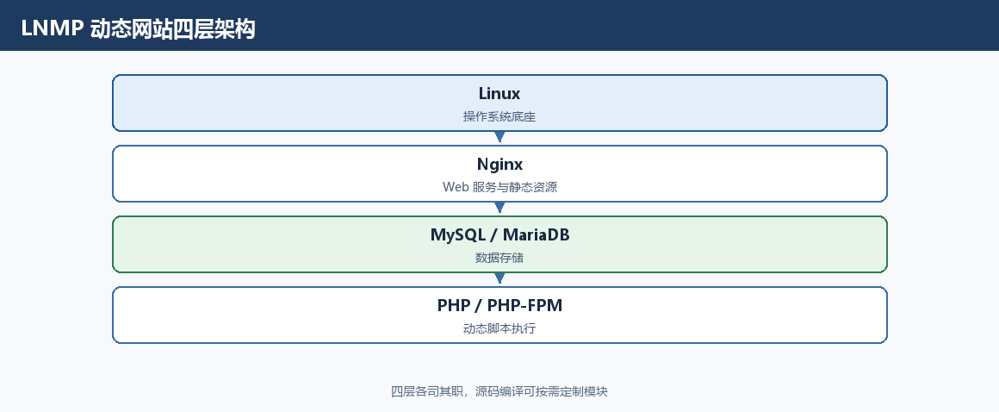
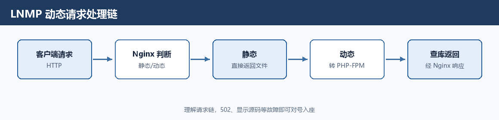

## 板块22 · LNMP动态网站架构

这是全库的压轴板块，把编译、服务、数据库、网络等知识融会贯通，搭建一套完整的动态网站环境。LNMP 是 Linux + Nginx + MySQL + PHP 的组合，具有免费、高效、可扩展、资源消耗低的特点。与软件仓库安装方式不同，这里采用源码包手工编译安装，让你掌握"当软件只有源码时"也能独立部署的能力，最后用 WordPress 验证整套架构。

### 22_1 技术背景与核心原理：为什么还要学源码编译

前面的服务几乎都用软件仓库（dnf）安装，那是最省事的方式。但现实中仍有很多软件只提供源码包，如果只会 dnf，面对这类软件就束手无策——只能等待第三方打包，或寻找替代品，这会造成知识短板。因此掌握源码编译，是从"会用现成包"迈向"能装任何软件"的关键一步。

源码包有两点明显优势：其一，可移植性好，几乎能在任何 Linux 系统上编译安装，而 RPM 包是针对特定系统与架构编写的；其二，编译过程能针对本机环境优化，运行效率更高，相当于"量体裁衣"。代价是过程烦琐、耗时较长。

安装方式的选择有清晰的优先顺序：能用软件仓库就用 dnf；仓库没有就找合适的 RPM 包；实在没有资源，才用源码包。

| 方式 | 优势 | 劣势 | 选择顺序 |
| --- | --- | --- | --- |
| 软件仓库 dnf | 自动解决依赖，最快 | 版本可能偏旧 | 首选 |
| RPM 包 | 针对系统打包，较省心 | 受系统架构限制 | 次选 |
| 源码包 | 可移植、可优化 | 编译耗时、依赖自理 | 备选 |

源码安装有固定的五步流程，掌握它就掌握了所有源码软件的安装套路。

```
源码安装五步流程
  「1」 下载并解压源码包        tar xzvf / tar xvf
    │
  「2」 编译前配置 ./configure  检查依赖、指定安装路径(--prefix)
    │
  「3」 生成二进制 make         按 Makefile 编译
    │
  「4」 安装 make install       复制到安装目录
    │
  「5」 清理 make clean         删除编译临时文件
```

其中 ./configure 阶段会检查源码、依赖关系、编译器等，并可用 --prefix 指定安装路径；make 依据生成的 Makefile 编译；make install 才真正安装。configure 与 make 耗时较长，是因为它要针对当前系统"量身"制定安装方案并编译——这正是源码包慢于 RPM 包的根本原因。

### 22_2 实操准备：编译环境与源码获取

**编译环境**：源码编译需要 C、C++、Perl 编译器与常见开发库，因此要先安装开发工具包组与相关开发库。若条件允许，适当增大虚拟机内存能加快编译；由于要从网络获取多个源码包，需把虚拟机设为 DHCP 自动获取并确认能访问外网。

**获取源码**：把所需源码包统一下载到一个专门的目录（如 /lnmp）便于管理。涉及的组件包括：rpcsvc-proto（Nginx 与 MySQL 都会调用的支持包）、PCRE（正则库，解压后放到指定目录供 Nginx 调用）、Nginx、MySQL、PHP 与 WordPress。用 wget 下载并逐一解压。

PCRE 是个特例——它不需要单独编译安装，只需解压后放到 /usr/local/src 供 Nginx 编译时调用。这说明源码安装并非千篇一律，要根据各软件的实际要求灵活处理。

```
LNMP 组件与依赖
           WordPress（动态网站程序）
                  │
        ┌─────────┼─────────┐
      Nginx      PHP      MySQL
        │         │          │
      PCRE    php-fpm    rpcsvc-proto
        └─────────┼──────────┘
            开发工具包组（gcc/g++/perl等）
```



### 22_3 配置 Nginx、MySQL 与 PHP

**配置 Nginx**：编译安装后要修改配置文件三处——指定运行网站服务的用户与组、在首页文件列表中加入 index.php、启用虚拟主机段并正确设置网站根目录与 fastcgi 脚本参数（SCRIPT_FILENAME 要指向正确路径，否则访问会报 404）。源码安装的服务默认不由 systemctl 管理，需要用服务自带工具操作；把命令目录加入 PATH 变量后即可直接用 nginx 命令。还要把函数库目录加载进系统，否则 nginx 无法运行。最后放行防火墙的 http 服务，浏览器访问服务器地址应看到欢迎页面。

**配置 MySQL**：为安全起见，创建专门的系统用户运行数据库，并把它的终端设为 nologin，防止黑客通过该用户登录。解压后把程序移到 /usr/local，创建 data 目录存放数据，用 mysqld 初始化并授权——初始化会生成一个临时密码，务必保存。与 Nginx 类似，把命令目录加入 PATH。由于源码安装的 MySQL 没有启动文件，需要手写 systemd 服务文件，才能用 systemctl 管理。MySQL 8.4 的官方二进制包基于 glibc 2.28，RHEL 8 及以上可直接运行，不再需要旧版那种 libtinfo 兼容链接。此外要修改 mysqld 的 SELinux 安全上下文为 bin_t，服务才能启动。

**配置 PHP**：编译时的关键是依赖与模块参数——用 --prefix 指定路径，用 --with-mysqli 等参数开启数据库支持模块。编译安装后复制 php.ini 与 php-fpm 配置文件模板并改名生效。同样手写 php-fpm 的 systemd 服务文件并加入启动项。

| 服务 | 特殊处理 |
| --- | --- |
| Nginx | 改配置三处、加入 PATH、加载函数库、放行 http |
| MySQL | nologin 用户、初始化保存临时密码、手写服务文件、函数库链接、SELinux 上下文 |
| PHP | 编译开启数据库模块、复制配置文件模板、手写服务文件 |

三个服务都涉及"源码安装不被 systemctl 管理"这一共性问题，解决办法都是手写 systemd 服务文件——这是源码部署相比仓库安装多出的额外工作，也是必须掌握的技能。

```
LNMP 请求处理链路
  浏览器 ──HTTP──► Nginx ──PHP请求──► php-fpm ──► PHP 解析
                    │                              │
                    └──静态资源直接返回            └──► MySQL 读写数据
```



**配置示例：源码编译的通用流程（以 Nginx 为例）**

源码安装遵循五步流程，Nginx 是典型范例。这组命令先装编译工具与依赖，再解压源码、configure 指定路径、make 编译安装，随后加入 PATH、加载函数库、放行防火墙并用 curl 验证欢迎页。

```
# 安装编译工具与依赖库（--with-http_ssl_module 需要 openssl-devel）
root@iaoexl:~# dnf install gcc gcc-c++ make pcre-devel zlib-devel openssl-devel

# 源码安装五步
root@iaoexl:~# cd /lnmp
root@iaoexl:~# tar xzvf nginx-1.30.6.tar.gz
root@iaoexl:~# cd nginx-1.30.6
root@iaoexl:~# ./configure --prefix=/usr/local/nginx --with-http_ssl_module
checking for GCC... yes
configure: created /lnmp/nginx-1.30.6/Makefile
root@iaoexl:~# make
root@iaoexl:~# make install

# 加入 PATH 后直接启动
root@iaoexl:~# echo 'export PATH=$PATH:/usr/local/nginx/sbin' > /etc/profile.d/nginx.sh
root@iaoexl:~# nginx
root@iaoexl:~# firewall-cmd --permanent --add-service=http
root@iaoexl:~# firewall-cmd --reload
root@iaoexl:~# curl http://127.0.0.1
Welcome to nginx!
```

编译报错时，从报错信息的末尾往前读——最后一个错误往往是根因，前面的多是连带信息。缺少依赖时，报错通常提示缺少某个头文件，安装对应的 `-devel` 开发包后重新 configure 即可。

**配置示例：MySQL 8.4 源码编译与初始化**

源码版 MySQL 与仓库安装差别较大：要自己创建运行用户、初始化数据目录并保存临时密码，还要手写 systemd 服务文件。

```
# 创建不可登录的系统用户运行数据库
root@iaoexl:~# useradd mysql -M -s /sbin/nologin

# 解压并移到 /usr/local，建立数据目录
root@iaoexl:~# cd /lnmp
root@iaoexl:/lnmp# tar xvf mysql-8.4.13-linux-glibc2.28-x86_64.tar.xz
root@iaoexl:/lnmp# mv mysql-8.4.13-linux-glibc2.28-x86_64 mysql
root@iaoexl:/lnmp# mv mysql /usr/local
root@iaoexl:/usr/local/mysql# mkdir data
root@iaoexl:/usr/local/mysql# chown -R mysql:mysql /usr/local/mysql

# 初始化：生成一个临时密码，务必记下来
root@iaoexl:/usr/local/mysql/bin# ./mysqld --initialize --user=mysql --basedir=/usr/local/mysql --datadir=/usr/local/mysql/data
... A temporary password is generated for root@localhost: （临时密码）

# 命令目录加入 PATH
root@iaoexl:~# vim ~/.bash_profile
PATH=$PATH:$HOME/bin:/usr/local/nginx/sbin:/usr/local/mysql/bin
export PATH
root@iaoexl:~# source ~/.bash_profile

# 源码安装没有启动文件，手写 systemd 服务单元
root@iaoexl:~# vim /usr/lib/systemd/system/mysqld.service
[Unit]
Description=MySQL 8.4 Server
After=network.target
[Service]
User=mysql
Group=mysql
ExecStart=/usr/local/mysql/bin/mysqld
LimitNOFILE = 5000
[Install]
WantedBy=multi-user.target
root@iaoexl:~# systemctl daemon-reload

# 修改 mysqld 的 SELinux 上下文后启动
root@iaoexl:~# semanage fcontext -a -t bin_t /usr/local/mysql/bin/mysqld
root@iaoexl:~# restorecon -v /usr/local/mysql/bin/mysqld
root@iaoexl:~# systemctl start mysqld
root@iaoexl:~# systemctl enable mysqld

# 用临时密码登录后，立即改成自己的密码
root@iaoexl:~# mysql -u root -p
mysql> ALTER USER 'root'@'localhost' IDENTIFIED BY 'iaoexl@7#13';
```

初始化产生的临时密码作用只有一个：让用户首次登录数据库并设置自己的新密码，不能直接拿去搭网站。`/usr/local/mysql` 是程序文件目录，`/usr/local/mysql/data` 才是数据库文件目录，两者不可混用。

### 22_4 部署 WordPress 与整体验证

三个组件就绪后，部署 WordPress 验证整套架构：解压博客程序到网站根目录，设置合适的权限，在浏览器中按向导完成安装——填写数据库名、用户与密码，WordPress 会连接 MySQL 建表。安装完成后能看到博客前台与后台，即证明 Linux + Nginx + MySQL + PHP 四层全部打通。

验证要分层进行：先确认每个服务单独可用（nginx 欢迎页、mysql 能登录、php-fpm 运行），再确认它们协同工作（WordPress 能安装并访问）。任一层出问题，回到该层单独排查。

**配置示例：初始化 MySQL、编译 PHP 与部署 WordPress**

三部分组件中，Nginx 已编译完成，还需初始化 MySQL 数据库、编译带数据库连接能力的 PHP，最后部署博客程序验证全链路。

数据库有两种走法，选其一即可，不要在同一台机器上同时安装源码版 MySQL 与仓库版 MariaDB——两者都占用 3306 端口，会互相抢占。上一示例的源码安装适合需要特定小版本或定制编译参数的场合；下面这段仓库安装更省事，适合只想快速把网站跑起来的场景。

```
# 一、走仓库安装路线：部署 MariaDB 并初始化（已按上一示例源码安装 MySQL 则跳过本段）
root@iaoexl:~# dnf install mariadb-server mariadb
root@iaoexl:~# systemctl start mariadb && systemctl enable mariadb
root@iaoexl:~# mariadb-secure-installation      ← 设置 root 密码、删匿名用户与测试库
root@iaoexl:~# mariadb -u root -p
MariaDB [(none)]> CREATE DATABASE wordpress;
MariaDB [(none)]> CREATE USER 'iaoexl'@'localhost' IDENTIFIED BY 'iaoexl@7#13';
MariaDB [(none)]> GRANT ALL ON wordpress.* TO 'iaoexl'@'localhost';
MariaDB [(none)]> FLUSH PRIVILEGES;
MariaDB [(none)]> exit

# 二、编译 PHP（--with-mysqli 等参数开启数据库支持模块）
root@iaoexl:~# dnf install libxml2-devel oniguruma-devel sqlite-devel libcurl-devel openssl-devel
root@iaoexl:~# cd /lnmp && tar xzf php-8.4.27.tar.gz && cd php-8.4.27
root@iaoexl:~# ./configure --prefix=/usr/local/php --enable-fpm --with-mysqli \
    --with-curl --with-pdo-mysql --with-pdo-sqlite --enable-mysqlnd --with-openssl --with-zlib
root@iaoexl:~# make && make install

# 复制主配置与 php-fpm 配置模板
root@iaoexl:~# cp php.ini-development /usr/local/php/lib/php.ini
root@iaoexl:~# cd /usr/local/php/etc
root@iaoexl:/usr/local/php/etc# mv php-fpm.conf.default php-fpm.conf
root@iaoexl:/usr/local/php/etc# mv php-fpm.d/www.conf.default php-fpm.d/www.conf

# 禁用高危函数，降低网站被入侵后执行系统命令的风险
root@iaoexl:~# vim /usr/local/php/lib/php.ini
disable_functions = passthru,exec,system,chroot,chgrp,chown,shell_exec,proc_open,proc_get_status,popen,ini_alter,ini_restore,dl,openlog,syslog,readlink,symlink,pcntl_exec,stream_socket_server

# 源码安装需手写 php-fpm 的 systemd 服务单元
root@iaoexl:~# vim /usr/lib/systemd/system/php-fpm.service
[Unit]
Description=The PHP FastCGI Process Manager
After=network.target
[Service]
Type=simple
ExecStart=/usr/local/php/sbin/php-fpm --nodaemonize --fpm-config /usr/local/php/etc/php-fpm.conf
ExecReload=/bin/kill -USR2 $MAINPID
PrivateTmp=true
Restart=on-failure
[Install]
WantedBy=multi-user.target
root@iaoexl:~# systemctl daemon-reload
root@iaoexl:~# systemctl start php-fpm
root@iaoexl:~# systemctl enable php-fpm
root@iaoexl:~# ss -lntp | grep 9000
LISTEN 127.0.0.1:9000 users:(("php-fpm",pid=2100))

# 三、配置 Nginx 把 .php 请求转发给 php-fpm
root@iaoexl:~# vim /usr/local/nginx/conf/nginx.conf
location / {
    root   html;
    index  index.php index.html;
}
location ~ \.php$ {
    root           html;
    fastcgi_pass   127.0.0.1:9000;
    fastcgi_index  index.php;
    fastcgi_param  SCRIPT_FILENAME  $document_root$fastcgi_script_name;
    include        fastcgi_params;
}
root@iaoexl:~# nginx -t                     # 先验语法，再让配置生效
nginx: configuration file /usr/local/nginx/conf/nginx.conf test is successful
root@iaoexl:~# nginx -s reload

# 四、部署 WordPress 并按向导安装
root@iaoexl:~# cd /lnmp && tar xzvf wordpress.tar.gz
root@iaoexl:~# cp -r wordpress/* /usr/local/nginx/html/
# 源码编译的 nginx 不会自动创建运行用户，先建用户再把目录交给它
root@iaoexl:~# useradd nginx -M -s /sbin/nologin
root@iaoexl:~# chown -R nginx:nginx /usr/local/nginx/html
root@iaoexl:~# vim /usr/local/nginx/html/wp-config.php
define('DB_NAME', 'wordpress');
define('DB_USER', 'iaoexl');
define('DB_PASSWORD', 'iaoexl@7#13');
define('DB_HOST', '127.0.0.1');

# 验证：浏览器访问服务器地址，应出现 WordPress 安装向导
root@iaoexl:~# curl http://127.0.0.1/index.php | grep -i wordpress
```

编译 PHP 时最容易漏的是数据库连接扩展——没有 `--with-mysqli`，WordPress 会报"无法连接数据库"；`fastcgi_pass` 的地址要与 php-fpm 监听地址一致；网站目录属主要有写权限，否则 WordPress 无法上传附件。这三处是 LNMP 故障最高发的位置。

**改完配置先验语法，再让配置生效**

Nginx 有一个与其他服务不同的脾气：配置写错时 `reload` 不会报错退出，而是保留旧配置继续跑，只在错误日志里记一笔。等到你发现改动"没生效"时，可能已经排查了半天。所以顺序永远是 `nginx -t` 在前。

```
# -t 解析配置并检查引用的文件是否存在，不改变运行状态
root@iaoexl:~# nginx -t
nginx: [emerg] unknown directive "fastcgi_pass" in /usr/local/nginx/conf/nginx.conf:46
nginx: configuration file /usr/local/nginx/conf/nginx.conf test is failed

# -T 在 -t 的基础上把合并后的完整配置打印出来，确认 include 到底加载了什么
root@iaoexl:~# nginx -T | grep -n fastcgi_pass
```

三条命令各管一件事，混用会出问题：`nginx -t` 只检查；`nginx -s reload` 平滑重载（老进程处理完手头请求再退出，连接不中断）；`nginx -s stop` 是快速停止，正在处理的请求会被直接掐断。生产环境做配置变更，用 reload 不用 restart——nginx 的主进程会先启动新的 worker、再让旧 worker 优雅退出，用户侧感知不到。

如果 `nginx -t` 报的错在文件里根本找不到对应内容，多半是 `include` 进来的另一个文件有问题，或者路径相对于编译时指定的 prefix 而非当前目录。`nginx -T` 打印的是合并后的最终结果，用它来确认"我改的那一行到底有没有被加载"最省事。

| 验证层级 | 检查内容 | 通过标志 |
| --- | --- | --- |
| Nginx | 浏览器访问服务器地址 | 显示欢迎页 |
| MySQL | 用初始化密码登录 | 进入数据库提示符 |
| PHP | php-fpm 运行状态 | 进程正常 |
| 整合 | 安装并访问 WordPress | 前台后台可用 |

### 22_5 场景笔记方法：把源码编译记成"依赖—参数—报错"档案

源码编译最容易"卡在依赖"和"忘了当时怎么解决的"，笔记要重点记录这两类信息。

| 记录项 | 记录内容 | 示例 |
| --- | --- | --- |
| 软件版本 | 每个源码包的确切版本 | 便于复现 |
| 编译参数 | configure 完整参数 | --prefix、--with-* |
| 依赖清单 | 缺什么装什么 | 开发库包名 |
| 特殊处理 | 非常规步骤 | PCRE 不编译、函数库链接 |
| 报错与解决 | 错误信息与对策 | 缺库 → 装对应 devel 包 |

每条"报错—解决"记录都极有价值，因为源码编译的错误信息往往晦涩，下次遇到同样的错，有档案可查能省下大量时间。建议原样保留报错的关键行，并记下安装的包名与执行顺序。

三个服务的 systemd 服务文件内容要原样存档，尤其是 ExecStart 的路径——手写服务文件时路径写错是常见故障。SELinux 相关的操作（如修改上下文、调整布尔值）也要记录。

### 22_6 实用验证与排错：源码环境的特有故障

源码部署的故障除了通用问题，还有几类特有现象。

```
源码部署排错流程
  编译报错？ ─► 服务能否启动？ ─► 命令能否找到？ ─► SELinux拦截？ ─► 整合访问？
  看缺什么依赖   看服务文件与路径   看PATH配置     看上下文/审计   分层逐项验证
```

| 现象 | 排查方向 |
| --- | --- |
| configure 报错 | 缺少依赖库，装对应开发包 |
| make 报错 | 源码或编译器问题，看具体报错行 |
| 服务启不来 | systemd 服务文件 ExecStart 路径、函数库 |
| 命令找不到 | 命令目录未加入 PATH |
| nginx 访问 404 | SCRIPT_FILENAME 路径配置错误 |
| MySQL 改不了上下文 | semanage/restorecon 操作 |

经验之谈：源码编译的报错几乎都能在报错信息的最后几行找到线索——通常明确写着"缺少什么"。养成从报错末尾往前读的习惯，比从头到尾翻日志高效得多。另外，编译环境一旦调通，用笔记把"依赖清单 + 参数 + 报错档案"完整保存，下次部署同类环境几乎是照方抓药。

### 22_7 认证对标与进阶实战

LNMP 动态网站架构是源码编译与服务集成的综合考验。LFCE 的高级系统管理涉及源码构建与服务定制，LPIC-1 的 102 考试包含编译安装的知识点，CompTIA Linux+ 也会考查服务协同。红帽侧的"服务集成"已不在 EX294 考纲内（EX294 只考用 Ansible 完成 RHCSA 级任务），但这套链路仍是把编译、服务、数据库、网络串成完整交付能力的压轴场景。

| 认证体系 | 与本主题相关的考查方向 | 核心能力要求 |
| --- | --- | --- |
| LPIC-1（102） | 软件编译安装 | 用 configure/make/make install 构建软件 |
| LFCE | 服务定制集成 | 编译 Nginx/PHP 并手写服务单元 |
| CompTIA Linux+ | 服务协同 | 解释 LNMP 各组件的分工 |

一个源码编译排错的典型经历很有代表性：编译时报错刷屏，新手从第一行开始逐字读，越读越慌；有经验的工程师直接从报错信息的末尾往前看，因为编译失败往往由最后一个错误引发，前面的多是连带信息。果然，末尾写着"缺少 PCRE 库"，装上开发包后重新编译一次通过。这个经验——"编译报错从末尾往前读"——能省下大量无效时间。

LNMP 架构的故障集中在编译、服务协同与路径配置三处。

| 现象 | 根因 | 定位命令 | 处置 |
| --- | --- | --- | --- |
| configure 报错 | 缺依赖库或开发包 | 看报错末尾 | 安装对应 -devel 包 |
| 服务无法启动 | 未写 systemd 单元或路径错 | systemctl status | 手写单元文件、核对路径 |
| 访问 PHP 显示源码 | Nginx 未把请求交给 PHP-FPM | 检查 fastcgi 配置 | 配 SCRIPT_FILENAME 与 fastcgi_pass |
| 动态页报 502 | PHP-FPM 未运行或 socket 错 | ss、查日志 | 启动 PHP-FPM、核对通信方式 |

闯关任务按"编译—集成—验证"三级递进。

```
  LNMP 闯关
  第一关 源码编译安装 Nginx 并手写服务单元
    │
  第二关 编译 PHP 与 FPM，与 Nginx 集成
    │
  第三关 部署动态站点并连接数据库验证
```

- 第一关：按"配置—编译—安装"五步构建，写 systemd 单元后用 systemctl 管理。
- 第二关：编译 PHP 启用 FPM，配置 Nginx 通过 fastcgi_pass 转发 PHP 请求。
- 第三关：部署动态程序，配置数据库连接，通过浏览器完成端到端验证。

进阶要理解 LNMP 各组件的分工与请求处理链。Linux 是底座，Nginx 负责接收 HTTP 请求与提供静态资源，PHP-FPM 作为 FastCGI 进程管理器负责执行动态脚本，MySQL/MariaDB 负责数据存储，四者各司其职又相互协作。一个动态请求的完整链路是：客户端请求 → Nginx 判断是静态还是动态 → 静态直接返回文件，动态则通过 fastcgi_pass 转给 PHP-FPM → PHP 脚本执行、必要时查询数据库 → 结果经 Nginx 返回客户端。理解这条链，就能定位 502（PHP-FPM 没接住）、显示源码（没转给 FPM）、数据库错误（PHP 与库连接配置错）等各类问题。

源码编译相比包安装的价值在于可定制——按需求启用模块、指定安装路径、获得最新版本，代价是要自己解决依赖与服务管理。把"请求处理链 + 编译五步 + 常见故障表"三者结合，动态网站架构就从"照着做"变成"懂原理地做"。

### 22_8 选购服务器主机：让站点真正跑起来

站点由域名、站点源代码和服务器主机构成，服务器主机用来存放代码并把网页内容展示给用户。主机形态不同，成本、维护责任和适用规模差异很大，选型要按站点规模与自身维护能力来定。

| 主机类型 | 特点 | 维护责任 | 适用规模 |
| --- | --- | --- | --- |
| 虚拟主机 | 在一台服务器上划分磁盘空间，仅提供基础的站点访问与存储传输功能，成本极低 | 几乎无须维护站点以外的服务 | 小型站点 |
| VPS | 用 OpenVZ/Xen/KVM 等虚拟化出多台独立主机，各有独立 IP 与操作系统，资源相互隔离 | 使用者需具备一定的系统维护能力 | 小型网站 |
| ECS（云服务器） | 建立在集群服务器上，各节点保存镜像备份，安全稳定、弹性伸缩、按用量付费 | 服务商负责底层硬件与基础设施 | 各类规模网站 |
| 独立服务器（租用） | 按月/季/年向机房租用硬件，硬件由机房维护，使用者自行装软件、部署站点 | 使用者负责软件与站点部署 | 大中型网站 |
| 独立服务器（托管） | 自购硬件交给机房代管，控制权与自主性最强 | 使用者自行维护和修理硬件 | 大中型网站 |

选择供应商时还要注意口碑，警惕限制功能、强制广告、隐藏扣费等行为。对创业初期的小站点而言，ECS 通常是性价比较高的选择：费用可控、性能足够，又省去了硬件维护的负担。

### 22_9 要点回顾与能力自检

本板块讲清了源码安装的五步流程与选择顺序、LNMP 各组件的编译与配置、手写 systemd 服务文件、SELinux 处理、WordPress 整合验证、主机选型，以及源码环境的排错方法与配置校验顺序。它是全库知识的综合演练，把编译、服务、数据库、网络、安全串成一条完整的工程链路。

自检问题：

1. 源码安装相比 RPM 包有哪些优势？安装方式的优先顺序是什么？
2. 源码安装的五个固定步骤是什么？
3. 为什么源码安装的服务需要手写 systemd 服务文件？
4. Nginx 配置中 SCRIPT_FILENAME 配错会导致什么现象？
5. 源码编译报错时，为什么要从报错信息的末尾往前读？
6. 虚拟主机、VPS、ECS 和独立服务器在维护责任上有何区别？
7. Nginx 配置写错时，`reload` 为什么不报错？正确的改配置顺序是什么？`-t`、`-T`、`-s reload` 各做什么？
