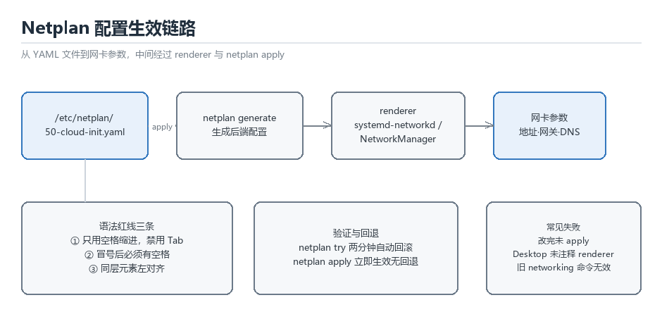
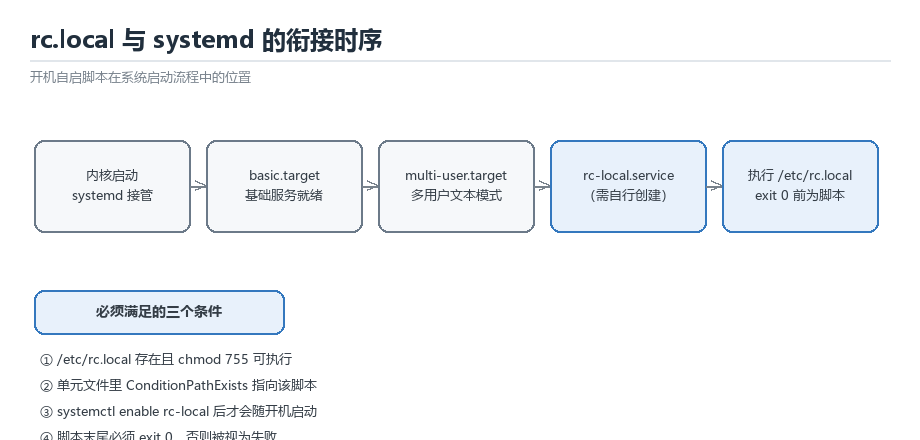

## 板块0 · 学习路径和建议

Ubuntu 与红帽系站在同一条内核之上，但在"配置写在哪里、谁去读它"这件事上分道扬镳。红帽系把网卡参数交给 NetworkManager 的连接配置（RHEL 9 起为 keyfile，更早为 ifcfg）；Ubuntu 则在中间插了一层声明式的 Netplan。不理解这一层，照抄红帽系的配置必然无效，照抄 Ubuntu 的 yaml 又常在缩进上报错。这个专项只处理这类"迁移摩擦"，把 Ubuntu 侧的配置入口、语法约束与开机自启机制讲透。

### 0_1 学习路径

三个主题各自独立：网络配置解决"机器怎么连上网"，开机脚本解决"开完机之后自动做什么"，包管理与防火墙解决"工具换了怎么接着干活"。建议按"先建模、再配地址、后校验、末自启"的顺序推进，每一步都以可观测的输出作为通过标准，而不是以"文件改完了"作为完成。

| 阶段 | 目标 | 验证方式 |
| --- | --- | --- |
| 一 · 建立模型 | 说清 Netplan 与 `/etc/network/interfaces` 的替代关系 | 能指出本机 `/etc/netplan/` 下哪个文件真正在生效 |
| 二 · 配静态地址 | 用 yaml 描述固定地址、网关与 DNS | `ip addr`、`ip route` 输出与设计值一致 |
| 三 · 退回动态地址 | 用 `dhcp4` 让地址由服务端下发 | apply 后能拿到租约并 ping 通外网 |
| 四 · 安全生效 | 区分 `apply` 与 `try` 的适用场合 | 远程改配置不因断连而失联 |
| 五 · 开机自启 | 让一段脚本在启动末期执行一次 | `systemctl status` 显示 active，脚本产物存在 |
| 六 · 换工具 | 用 apt 装包、用 ufw 放行，习惯从红帽系迁移过来 | 能说清 `update` 与 `upgrade` 的分工、`ufw status` 与端口的实际可达性 |

### 0_2 使用建议与边界声明

本专项的结论以 Ubuntu 24.04 LTS 为基准版本，对应 Netplan 1.x 的写法。字段层面存在版本漂移：`gateway4` 从 20.04 起被标记弃用，24.04 起应统一改为 `routes`；`netplan try` 的确认窗口、`netplan get` 子命令也是在后来的版本才补齐。遇到与描述不符时，以本机 `netplan --help` 的实际输出为准。

| 项目 | 说明 |
| --- | --- |
| 版本范围 | 17.10 起改用 Netplan；18.04 用 `gateway4`，20.04 起推荐 `routes`，24.04 起以 `routes` 为标准；apt 与 ufw 的命令在 20.04~24.04 之间稳定 |
| 与主知识库分工 | 主库以红帽系为主线讲通用网络原理与 ifcfg 写法，本专项只补 Ubuntu 侧差异 |
| 实验环境 | VMware 桥接或 NAT 均可，网卡名按 `ens33` 约定；改动前先打快照 |
| 不涉及内容 | 无线、bonding、VLAN、NetworkManager 图形化配置 |
| 风险提示 | 通过 SSH 修改网络配置，一旦地址写错即刻失联，务必使用 `netplan try` 或保留控制台 |

有一点必须先说清：这两个主题都不是"记住命令"型知识。Netplan 的价值在于把"期望状态"与"如何实现"拆开，rc.local 的价值在于理解 systemd 的启动顺序——把机制想明白，命令自然写得出来；只记命令，换个版本就会失效。

## 板块1 · Netplan：声明式网络配置的由来

Ubuntu 在 17.10 版本上做了一次并不显眼的替换，却让大量沿用旧教程的人第一次配置就失败。原因不在于命令写错，而在于配置文件的入口已经整体换掉了。

### 1_1 为什么 `/etc/network/interfaces` 不再生效

早期 Debian 系用 `ifupdown` 管理网络：`/etc/network/interfaces` 描述每块网卡的地址，`ifup`/`ifdown` 按文件内容启停接口。这套机制简单直接，但只认静态描述，没有状态管理，也无法与桌面环境的网络管理组件协同。

Ubuntu 17.10 起默认不再使用 ifupdown。此时继续编辑 `/etc/network/interfaces` 并不会报错，文件也还在，但它不再被任何服务读取——**配置写了，无人执行**。这是最容易误判的一种失败：没有报错信息，只有"改完没反应"。

替代方案就是 Netplan。它随系统预装，入口固定在 `/etc/netplan/` 目录。判断一台机器属于哪一代，只需看这个目录是否存在且非空，比记版本号更可靠。

```
    旧模型（ifupdown）                     新模型（netplan）
┌──────────────────────────┐        ┌──────────────────────────┐
│ /etc/network/interfaces  │        │ /etc/netplan/*.yaml      │
│         │                │        │         │                │
│         ▼                │        │         ▼  generate      │
│   ifup / ifdown 直接配置  │        │   渲染为后端配置          │
│         │    内核        │        │         │                │
└─────────┼────────────────┘        │         ▼  apply         │
          ▼                         │   后端服务下发到内核      │
     内核网络栈                      └──────────────────────────┘
```

差别不在文件格式，而在中间多了一层。这一层带来两个后果：一是 yaml 只是"意图"，必须经过一次渲染和下发才生效；二是同一份意图可以交给不同的后端执行。

### 1_2 声明层与渲染层：yaml 到底交给了谁

Netplan 自己不配置网卡。它读取 yaml，翻译成某个网络管理服务的原生配置，再让那个服务去干活。这个"某个服务"就是 `renderer`。

| renderer | 生成的产物 | 适用场景 | 典型表现 |
| --- | --- | --- | --- |
| systemd-networkd | `/run/systemd/network/*.network` | 服务器、无图形界面 | `systemctl status systemd-networkd` 活跃 |
| NetworkManager | NM 的连接配置 | 桌面版、需要无线或图形化管理 | `nmcli connection show` 能看到对应连接 |

不写 `renderer` 时由 Netplan 按系统默认推断：服务器镜像通常落到 systemd-networkd，桌面镜像通常落到 NetworkManager。这也解释了一个流传很广的"怪现象"：在桌面版上按教程改完 yaml，`netplan apply` 毫无反应，把 `renderer: NetworkManager` 那一行注释掉之后立刻生效。

其本质不是"注释掉才能用"，而是两套组件在抢同一块网卡。桌面版的 NetworkManager 会用自己的连接配置覆盖 netplan 下发的结果，只有当 netplan 明确接管该接口，配置才会稳定保留。理解了这层竞争关系，就不必死记那条注释。



### 1_3 文件名与优先级：为什么每台机器的 yaml 名字都不一样

`/etc/netplan/` 下的文件名并非固定，它由安装方式决定。

| 环境 | 默认文件 | 生成者 |
| --- | --- | --- |
| 桌面版安装 | `01-network-manager-all.yaml` | 安装器，整体交给 NetworkManager |
| 服务器版安装 | `50-cloud-init.yaml` | cloud-init 首次启动时写入 |
| 云厂商镜像 | `50-cloud-init.yaml` | 同上，随镜像分发 |

`50-cloud-init.yaml` 这个命名值得警惕：文件由 cloud-init 生成，在某些数据源下会被重新渲染。手改之后短期有效，重建实例或重启 cloud-init 相关服务可能被覆盖回去。

多个 yaml 同时存在时，Netplan 按文件名字典序依次读取，编号小的先读，同名字段由后面的文件覆盖，不同字段则合并。这就是前缀数字的意义——它不是装饰，而是优先级。要新增一份自己的配置，用 `99-custom.yaml` 这类靠后的编号更稳妥；要彻底接管，则应当清理掉原有文件而不是与之并存。

一个实操细节：Netplan 会检查 yaml 的文件权限，权限过宽时给出警告。保持 `600` 可以避免这类噪音干扰真正的错误信息。

## 板块2 · 地址配置：静态与动态两种写法

Netplan 的地址配置只有两种基本形态：要么自己声明地址，要么让 DHCP 下发。所有复杂配置都是这两者的组合。

### 2_1 静态地址的完整字段

一份可用的静态配置需要回答四个问题：哪块网卡、什么地址、出口在哪、找谁解析域名。对应到 yaml 就是 `ethernets` 下的网卡名、`addresses`、`routes`（旧写法为 `gateway4`）、`nameservers`。

```
root@iaoexl:~# vim /etc/netplan/50-cloud-init.yaml
```

```yaml
network:
    ethernets:
        ens33:                              # 网卡名称，必须与 ip addr 显示一致
            dhcp4: no                       # 关闭 IPv4 动态获取
            dhcp6: no                       # 关闭 IPv6 动态获取
            addresses: [192.168.10.10/24]   # 地址与掩码必须写在一起
            routes:
                - to: default               # 目标写 default 表示默认路由
                  via: 192.168.10.2         # 下一跳地址
            nameservers:
                addresses: [114.114.114.114, 8.8.8.8]   # DNS 列表
    version: 2
```

`version: 2` 不是可选装饰，缺失时 Netplan 会拒绝解析。缩进层级体现归属关系：`ens33` 与 `version` 同级，因为一个属于 `ethernets`、一个属于 `network`；`dhcp4` 等字段整体比 `ens33` 深一级。

掩码写成 `192.168.10.10/24` 的形式，而不是单独的 `netmask` 字段，这是 Netplan 与 ifcfg 写法最直观的差异之一。地址必须带前缀长度：写成裸 IP 时，不同版本的处理并不一致——较老的版本按 /32 补齐，较新的版本直接拒绝解析。两种结果都不是你想要的，所以每次都要写全。

### 2_2 网关写法的版本差异：gateway4 与 routes

`gateway4` 只支持 IPv4，也只支持单一默认网关，语义受限。20.04 起它被标记为弃用，24.04 的 Netplan 1.x 已按 `routes` 组织路由。旧教程里的写法只剩两行：

| 写法 | 形态 | 适用版本 | 备注 |
| --- | --- | --- | --- |
| `gateway4` | 单个 IPv4 地址 | 18.04~22.04 可用 | 已弃用，apply 时提示但仍生效 |
| `routes` + `to: default` | 路由条目列表 | 20.04 起推荐，24.04 起标准 | 可同时表达多条路由与 IPv6 |
| `gateway6` | 单个 IPv6 地址 | 同 `gateway4` | 同样处于弃用通道 |

旧写法就是在 `addresses` 之后加一行，代价是只能表达一个 IPv4 网关：

```yaml
            gateway4: 192.168.10.2          # 旧写法：仅 IPv4、仅单网关
```

`routes` 是列表，天然支持多条默认路由、策略路由与 IPv6，字段含义也更直白：`to` 是目标网段，`via` 是下一跳。

新装系统一律用 `routes`；只有维护 18.04、20.04 的存量配置时才会遇到 `gateway4`，迁移时把它替换成一条 `to: default` 即可。两者不要混写，同一接口上同时出现会被视为冲突。

### 2_3 动态地址与混合场景

退回 DHCP 只需保留一个开关，其余字段全部删掉：

```yaml
network:
    ethernets:
        ens33:
            dhcp4: yes                  # 由 DHCP 服务端下发地址、网关、DNS
            dhcp6: yes
    version: 2
```

这里有一个容易忽略的点：`dhcp4: yes` 时如果仍保留 `addresses` 或 `gateway4`，Netplan 会把静态值一并写入，最终结果取决于后端服务的合并规则，表现为"地址是静态的但 DNS 是动态的"这类难以解释的组合。切换模式时应当把旧字段清干净，而不是注释掉了事。

双网卡场景下，两块网卡不能都声明默认网关，否则路由表会出现两条等价默认路由，出口随机。正确做法是只让其中一块承担默认路由，另一块仅声明地址与网段路由。这一点与红帽系需要设置 `DEFROUTE` 是同一个问题的两种表达。

## 板块3 · 语法红线、生效与验证

Netplan 的报错信息不算友好，多数失败都发生在解析阶段，与网络本身无关。掌握三条语法约束和三个命令的分工，可以省掉大半排错时间。

### 3_1 YAML 的三条硬规则

| 规则 | 错误示例 | 正确做法 | 失败表现 |
| --- | --- | --- | --- |
| 只用空格，禁用 Tab | 用 Tab 缩进 `dhcp4` | 统一用空格，通常 4 个 | 报 "found character that cannot start any token" |
| 冒号后必须有空格 | `dhcp4:no` | `dhcp4: no` | 整行被当作一个键，解析失败 |
| 同级必须左对齐 | `addresses` 比 `gateway4` 多缩进一格 | 同层字段列首对齐 | 报字段不属于该节点，或配置被静默忽略 |

缩进的空格数量本身不重要——2 个、4 个都能解析——重要的是**同一层级的元素必须对齐**，且子级必须比父级深。混用 2 空格与 4 空格是新手最常见的翻车方式：单看每一行都合法，整体层级却错位。

还有一条不属于语法但同样致命：中文全角冒号与全角空格。从文档复制配置时尤其容易带入，肉眼几乎看不出差异，解析器会直接拒绝。

### 3_2 apply、try 与 generate 的分工

三个子命令对应三个阶段，误用其中一个就会得到"改了没生效"或"改完就失联"的结果。

| 命令 | 动作 | 是否影响当前网络 | 适用场合 |
| --- | --- | --- | --- |
| `netplan generate` | 仅把 yaml 渲染为后端配置 | 不影响 | 校验语法，安全 |
| `netplan try` | 应用配置并等待确认，超时自动回滚 | 短暂影响 | 远程操作、不确定配置是否正确 |
| `netplan apply` | 立即应用，不回滚 | 直接影响 | 本地控制台、配置已验证 |

`netplan try` 默认给出约两分钟的确认窗口，期间按回车接受，不操作则自动还原。这是远程改网络唯一可靠的自保手段：配置写错导致 SSH 断开时，等到超时，旧配置自动回来，连接恢复。

`netplan apply` 不会回滚。地址写错、网关指向不存在的下一跳，命令依然返回成功，只是网络不通了。所以它适合已经验证过的配置，而不是第一次上手时的试验。

```
   编辑 yaml ──► netplan generate ──► netplan try ──► 回车确认 ──► 写入生效
                      │                    │
                  语法错误则终止      超时未确认则回滚
```

还有个反复出现的坑：改完 yaml 直接 `reboot`，以为重启会读新配置。多数情况下确实会，但如果同时存在多份 yaml 或 cloud-init 在启动时重写文件，重启后的结果可能与手工 apply 时不同。判断依据是重启后重新执行一次 `netplan get`（新版可用）或直接看 `ip addr`，而不是相信文件内容。

### 3_3 验证链路与常见故障对照

验证应当由内向外：先确认网卡状态与地址，再确认路由，最后确认名字解析与外部连通。跳过前两步直接 ping 外网，失败时无法区分是地址问题还是 DNS 问题。

```
root@iaoexl:~# ip addr show ens33
```

```text
2: ens33: <BROADCAST,MULTICAST,UP,LOWER_UP> mtu 1500
    inet 192.168.10.10/24 brd 192.168.10.255 scope global ens33
```

```bash
# 查看默认路由是否指向设计中的网关
root@iaoexl:~# ip route
default via 192.168.10.2 dev ens33 proto static
192.168.10.0/24 dev ens33 proto kernel scope link src 192.168.10.10

# 先测网关，再测外网域名，逐层排除
root@iaoexl:~# ping -c 4 192.168.10.2
root@iaoexl:~# ping -c 4 114.114.114.114
root@iaoexl:~# ping -c 4 baidu.com
```

| 现象 | 最可能的原因 | 处理方向 |
| --- | --- | --- |
| apply 报解析错误 | 缩进错位、Tab、冒号后缺空格 | 用 `netplan generate` 定位到具体行 |
| 命令成功但地址未变 | 改的不是生效文件，或被其他 yaml 覆盖 | 核对目录内全部 yaml 与文件名顺序 |
| 地址正确但无法出网 | 默认网关缺失或写错 | 看 `ip route` 是否有 `default` |
| 能 ping IP 不能解析域名 | `nameservers` 未配置或被 DHCP 覆盖 | 检查 `resolvectl status` 或解析配置 |
| 桌面版改完无反应 | NetworkManager 仍接管该接口 | 调整 `renderer` 或改用 nmcli 管理 |
| 旧命令 restart networking 无效 | ifupdown 已不参与启动 | 改用 `netplan apply` |

最后一行的现象在仍有 ifupdown 残留的 18.04、20.04 上尤其迷惑人：桌面版执行 `service networking restart` 可能仍有返回，服务器版则直接报服务不存在。前者给了"命令成功"的假象，实际上 yaml 根本没有被读取。

## 板块4 · rc.local：在 systemd 世界里复活一个老约定

"开机跑一段脚本"是最朴素的需求，`/etc/rc.local` 曾经是它的标准答案。这个约定在 systemd 上不再自动成立，但需求没有消失，于是有了几种补偿方案。

### 4_1 传统 rc.local 的执行位置

SysV 时代，系统按运行级别依次启动服务，`rc.local` 被安排在最后一个执行。它的位置决定了它可以依赖前面所有服务已经就绪——这也是大量老脚本敢在里面直接操作网络和数据库的原因。

```
BIOS/UEFI ─► Bootloader ─► Kernel ─► systemd (PID 1)
                                          │
                     ┌────────────────────┴────────────────────┐
                 sysinit.target                          basic.target
                     │                                        │
                     └──────────► multi-user.target ◄──────────┘
                                        │
                                 rc-local.service
                                 （WantedBy=multi-user.target）
                                        │
                                  /etc/rc.local
                                        │
                                    exit 0
```

进入 systemd 后，`multi-user.target` 承接了旧运行级别 3 的位置，`rc-local.service` 挂在它下面，因此"最后执行"这一语义得以保留——前提是这个 unit 存在且被启用。



### 4_2 手工补一个 service 单元

多数现代发行版不再预置可用的 rc-local 单元：有的系统里 `/etc/rc.d/rc.local` 文件存在但没有执行权限，有的系统里 unit 文件有 `[Unit]` 段却缺少 `[Install]` 段，无法 enable。两种情况的共同结果是——文件写了，开机不跑。

补全需要三步：写 unit、写脚本、给权限并启用。

```
root@iaoexl:~# vim /etc/systemd/system/rc-local.service
```

```ini
[Unit]
Description=/etc/rc.local Compatibility
ConditionPathExists=/etc/rc.local

[Service]
Type=forking
ExecStart=/etc/rc.local start
TimeoutSec=0
StandardOutput=tty
RemainAfterExit=yes
SysVStartPriority=99

[Install]
WantedBy=multi-user.target
```

```
root@iaoexl:~# vim /etc/rc.local
```

```bash
#!/bin/sh -e
#
# rc.local
#
# 脚本在每次进入多用户运行级时执行一次
# 成功返回 0，失败返回其他值
#
cd /data/app && docker-compose up -d
exit 0
```

```bash
# 缺少执行权限时服务会以 203/EXEC 失败
root@iaoexl:~# chmod 755 /etc/rc.local

# 新增 unit 文件后必须重载，否则 systemd 不认识它
root@iaoexl:~# systemctl daemon-reload

# 启用并立即启动，验证脚本本身没问题
root@iaoexl:~# systemctl enable rc-local
root@iaoexl:~# systemctl start rc-local
root@iaoexl:~# systemctl status rc-local
```

几个字段的含义值得单独说明。`Type=forking` 表示 `ExecStart` 启动的进程会自己转入后台并让父进程退出，这与 `docker-compose up -d` 的行为吻合；若脚本里的命令是前台阻塞的，`forking` 会让 systemd 一直等到超时。`RemainAfterExit=yes` 让 rc.local 执行完后服务仍显示 active，否则会变成 inactive 甚至 failed，看起来像启动失败。`SysVStartPriority` 只是给旧脚本的排序提示，在新体系里影响有限。

### 4_3 为什么不建议长期依赖 rc.local

| 局限 | 具体表现 |
| --- | --- |
| 无依赖表达 | 只能"尽量晚"，无法声明"必须在数据库之后" |
| 无失败重试 | 脚本失败即结束，没有重启策略 |
| 日志归属模糊 | 输出走 tty，排查时不易检索 |
| 单点串行 | 所有逻辑堆在一个文件，任一命令失败影响后续 |
| 上游态度 | 相关兼容层被视为过渡设施，可用性随版本波动 |

`#!/bin/sh -e` 里的 `-e` 也会放大问题：任何一条命令返回非零，脚本立即退出，后面的步骤全部不执行。如果前面是一条"检测失败即返回非零"的判断语句，整段逻辑就会被静默截断。老脚本迁移过来后"只跑了一半"，多半是这个原因。

### 4_4 三个替代方案的取舍

| 方案 | 依赖控制 | 失败处理 | 上手成本 | 适用场景 |
| --- | --- | --- | --- | --- |
| rc-local.service | 仅有排序提示 | 无 | 低，兼容老脚本 | 临时迁移、单机小脚本 |
| 原生 service 单元 | 完整（After/Requires） | 可配 Restart | 中 | 长期运行的服务、需要开机拉起 |
| cron `@reboot` | 无，与启动过程并行 | 无 | 最低 | 一次性、与系统服务无依赖的任务 |

原生单元是正解。它把"要做什么"和"什么时候做"分开声明，`After=network-online.target` 表达依赖，`Restart=on-failure` 表达容错，日志自动进 journal，`journalctl -u 单元名` 一条命令就能回溯。代价是要理解 unit 语法，而这部分知识在主知识库的服务管理板块里已经讲过，迁移成本并不高。

`cron @reboot` 的优势是极简：一行任务，不需要写 unit。但它与启动过程并行执行，既不等待网络就绪，也没有任何失败可见性——任务没跑，系统不会有任何提示。只适合"跑不跑都不影响业务"的辅助动作。

```
   一次性、无依赖 ──► cron @reboot
        │
   需要顺序、需要重试 ──► 原生 service 单元
        │
   已有老脚本、短期过渡 ──► rc-local.service
```

## 板块5 · 包管理与防火墙：换一套工具，换一套习惯

红帽系用户接手 Ubuntu，最先撞上的不是网络，而是装包。命令长得像，语义却不同，尤其是那条被无数人踩过的 `apt update`。

### 5_1 apt 的四个动作，别混成一个

`dnf update` 一条命令同时做两件事：刷新元数据、升级已装包。apt 把这两件事拆成了两条命令，于是从红帽系迁移过来的人常犯一个错——直接敲 `apt upgrade`，得到"0 upgraded, 0 newly installed"，误以为系统是最新的，其实只是本地索引还停在几天前。

```
# 一、刷新索引：只下载"有哪些包、什么版本"的清单，不动已装软件
root@ubuntu:~# apt update

# 二、升级已装包：只升不删，遇到必须卸载才能满足的依赖会跳过
root@ubuntu:~# apt upgrade

# 三、允许为满足依赖而卸载包，用于大版本迁移
root@ubuntu:~# apt full-upgrade        # 旧称 dist-upgrade，两者等价

# 四、清理不再被依赖的包与缓存
root@ubuntu:~# apt autoremove --purge
root@ubuntu:~# apt clean
```

| 动作 | 做什么 | 红帽系对应 |
| --- | --- | --- |
| `apt update` | 刷新仓库索引 | `dnf makecache` |
| `apt upgrade` | 升级已装包，不删包 | `dnf upgrade --best` 的保守面 |
| `apt full-upgrade` | 升级并允许卸载冲突包 | `dnf distro-sync` |
| `apt autoremove` | 清掉没人依赖的孤儿包 | `dnf autoremove` |

`apt upgrade` 与 `full-upgrade` 的差别不是"彻底程度"，而是**允不允许删包**。日常小版本更新用前者，风险低；跨版本或换内核系列时用后者，它可能为了装上新的依赖而移除旧包——所以执行前先看它列出的 "The following packages will be REMOVED" 清单，那里面常有你还在用的东西。

`--purge` 的作用是连配置文件一起删。不加它，`autoremove` 会把包卸掉却留下 `/etc` 下的配置，重装时旧配置又被捡回来，表现为"重装之后行为还和以前一样"。

### 5_2 查包与修依赖：dpkg 的三条命令

apt 负责"从仓库取包并解决依赖"，dpkg 负责"操作本地的 .deb"。两者的关系类似 dnf 与 rpm。日常最常用的是三条查询命令：

```
# 一、列出已装包（配合 grep 定位）
root@ubuntu:~# dpkg -l | grep nginx

# 二、看某个包装了哪些文件（找配置模板、找二进制路径）
root@ubuntu:~# dpkg -L nginx-common | head

# 三、反查某个文件属于哪个包（对应红帽系的 rpm -qf）
root@ubuntu:~# dpkg -S /usr/sbin/nginx
nginx-core: /usr/sbin/nginx
```

`dpkg -i 包.deb` 能装本地包，但它**不解决依赖**，缺库时会停在 "dependency problems prevent configuration" 的半配置状态。此时不要反复 `dpkg -i`，一条命令补齐：

```
root@ubuntu:~# apt install -f      # 读取 dpkg 的未完成状态，从仓库补依赖并完成配置
```

这条命令是修复"装到一半"的通用手段：先 `apt install -f` 让系统自愈，再处理仍然报错的包。反过来，如果某个 .deb 与仓库版本冲突，更稳的做法是用 `apt install ./包.deb`（带路径的写法会走 apt 的依赖解析），而不是 `dpkg -i`。

### 5_3 防火墙：ufw 是 firewalld 的极简表亲

Ubuntu 默认用 ufw 管理主机防火墙。它没有区域概念，只有"默认策略 + 例外规则"，学习成本远低于 firewalld，代价是表达能力也弱。

```
# 一、先看清现状，再动手（默认策略最关键）
root@ubuntu:~# ufw status verbose
Status: active
Logging: on (low)
Default: deny (incoming), allow (outgoing), disabled (routed)
New profiles: skip

# 二、按端口或服务名放行；服务名来自 /etc/services 与 ufw 内置的应用配置
root@ubuntu:~# ufw allow 22/tcp
root@ubuntu:~# ufw allow 'Nginx Full'      # 一次放行 80 与 443
root@ubuntu:~# ufw delete allow 22/tcp     # 按原样写规则即可删除

# 三、启用（首次启用会提示可能中断 SSH，确认前先确保 22 已放行）
root@ubuntu:~# ufw enable
root@ubuntu:~# systemctl enable ufw
```

| 需求 | ufw | firewalld |
| --- | --- | --- |
| 放行服务 | `ufw allow 'Nginx Full'` | `firewall-cmd --add-service=http` |
| 放行端口 | `ufw allow 8080/tcp` | `firewall-cmd --add-port=8080/tcp` |
| 限制来源 | `ufw allow from 192.168.10.0/24 to any port 3306` | rich rule 或 zone |
| 生效方式 | 立即生效 | 需 `--reload` 或加 `--permanent` |
| 查看规则 | `ufw status numbered` | `firewall-cmd --list-all` |

两处容易出问题的地方。一是**顺序与持久化**：firewalld 要区分 runtime 与 permanent，ufw 则是即时生效并自动持久化，改错了只能再 `delete` 一次，不能靠重启回退。二是**容器绕过**：Docker 会直接往 nat 表写转发规则，发布端口时并不经过 ufw 的过滤链，所以 `ufw status` 显示 3306 未放行，容器映射出去的端口照样能被外部访问。要堵住这条路，得在 Docker 的 `daemon.json` 里关掉自动改 iptables（`"iptables": false`），再自己维护转发规则，而不是指望 ufw。

## 板块6 · 要点回顾与能力自检

### 6_1 结论浓缩

Ubuntu 侧的网络配置问题，几乎都能归结为一句话：**配置入口换了，执行者换了，而操作者还在改旧文件**。`/etc/network/interfaces` 已退出舞台，`/etc/netplan/*.yaml` 是唯一入口；yaml 只是意图，必须经 `netplan apply` 渲染下发；文件名前缀决定优先级，改动前先确认哪份文件真正生效。

rc.local 的问题则是另一句话：**约定还在，机制没了**。systemd 不再默认提供可用的 rc-local 单元，需要自己补 unit、给脚本执行权限、重载并启用，三者缺一不可。更长的解法是写原生 service 单元，把依赖与容错显式表达出来。

包管理的问题属于第三句：**命令像，语义不像**。`apt update` 只刷索引、`apt upgrade` 才升级，两条合起来才等价于红帽系的一条 `dnf update`；`dpkg -i` 只落地不解决依赖，缺库要用 `apt install -f` 补齐。这些差异不会报错，只会让人误判"系统已是最新"或"包装好了"。

防火墙则是**减法的代价**：ufw 用"默认拒绝 + 例外"覆盖了八成场景，但没有区域，也没有 runtime/permanent 的分层，改错只能删规则；更隐蔽的是容器会绕过它，`ufw status` 干净不代表端口没对外开着。

| 高频误操作 | 后果 | 正确动作 |
| --- | --- | --- |
| 改 yaml 后未 apply | 配置停留在文件里，网络无变化 | `netplan apply` 或 `netplan try` |
| 只改 yaml 未清旧字段 | 静态与动态参数混存，结果不可预期 | 切换模式时删净旧键 |
| 桌面版忽略 renderer 冲突 | apply 无效果 | 明确接口由谁接管 |
| rc.local 未给执行权限 | 服务 203/EXEC 失败 | `chmod 755 /etc/rc.local` |
| 新增 unit 未 daemon-reload | systemd 报单元不存在 | `systemctl daemon-reload` |
| 脚本缺 `exit 0` | 服务被判定 failed | 末尾补 `exit 0` |
| 只跑 `apt upgrade` 不先 `apt update` | 索引陈旧，显示"无包可升" | 先 `apt update` 再升级 |
| `dpkg -i` 报依赖缺失后反复重试 | 包停在半配置状态 | `apt install -f` 补齐 |
| 以为 ufw 能挡住容器端口 | 端口实际已对外可达 | 改 Docker 的 iptables 行为 |

### 6_2 能力自检

1. 在一台 Ubuntu 上，如何在不看版本号的前提下判断它使用 Netplan 还是 ifupdown？判断依据是什么？
2. `/etc/netplan/` 下同时存在 `01-network-manager-all.yaml` 与 `99-custom.yaml`，同名网卡字段冲突时谁生效？为什么？
3. `netplan try` 与 `netplan apply` 的本质区别是什么？通过 SSH 修改地址时应选哪个，理由何在？
4. 桌面版按教程改完 yaml 后 `netplan apply` 无任何效果，最可能的原因是什么？如何验证这一判断？
5. 手工补完 `rc-local.service` 并 `chmod 755 /etc/rc.local` 后，开机脚本仍未执行，还应检查哪两处？
6. `apt update` 与 `apt upgrade` 各做什么？为什么只执行后者会得出"系统已是最新"的错误结论？
7. `apt upgrade` 与 `apt full-upgrade` 的分界线是什么？执行前该看哪一行输出？
8. 一台 Ubuntu 上 `ufw status` 显示 3306 未放行，外部却能连上容器里的数据库，原因是什么？
