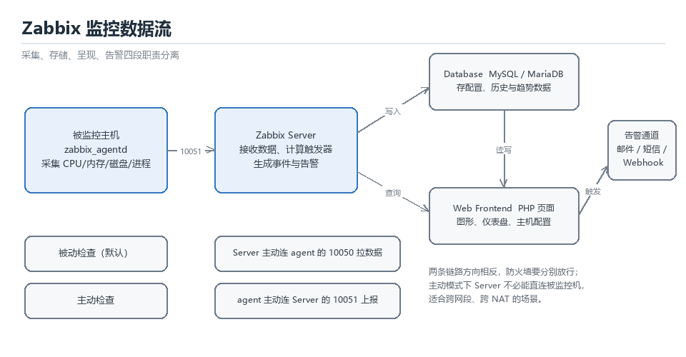
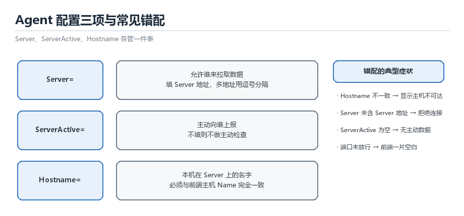
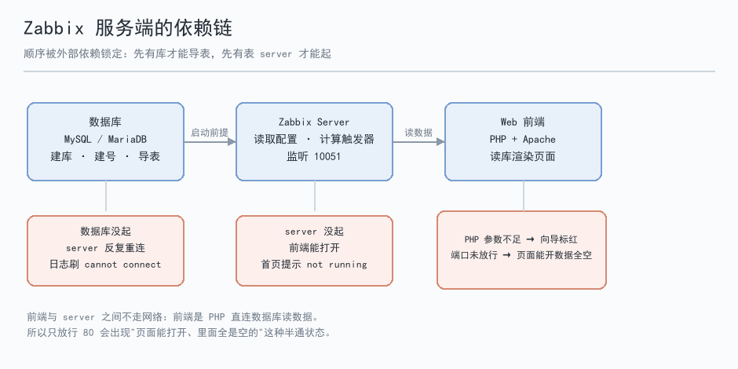

## 板块0 · 学习路径和建议

Zabbix 的安装教程在网络上极多，但绝大多数只给出"照着敲"的命令序列。真正让人卡住的往往不是某一步命令，而是命令之间的因果关系：为什么数据库要先建库再导表、为什么 agent 的 `Hostname` 必须和网页上填的一字不差、为什么服务全绿了图形却没有数据。这个专项按"先建模、再部署、后接入、末排错"的顺序把这些因果关系讲清楚，让每一步失败都能定位到具体环节，而不是靠重装碰运气。

### 0_1 学习路径

三个阶段各自对应一类问题：板块1 解决"监控系统由谁拼成"，板块2 解决"服务端如何立起来"，板块3 与板块4 解决"数据为什么进不来、警报为什么不响"。每个阶段都以可观测的证据作为通过标准。

| 阶段 | 目标 | 验证方式 |
| --- | --- | --- |
| 一 · 建立模型 | 说清 agent、server、database、frontend 各自的职责与端口 | 能在纸上画出一次指标采集的完整路径 |
| 二 · 搭服务端 | 完成仓库导入、前置条件处理、数据库初始化、前端参数调整 | 浏览器打开前端向导，所有前置检查项为 OK |
| 三 · 调参数 | 按内存比例配数据库缓冲池，按监控规模配服务端缓存 | 参数改动在 `SHOW VARIABLES` 与日志中都得到印证 |
| 四 · 接入被监控机 | 安装 agent 并正确填写三个关键参数 | 前端主机列表显示"已启用"的绿色可用性图标 |
| 五 · 验证数据链 | 从服务状态一路验证到触发器告警 | `zabbix_get` 有返回值，最新数据与图形都有点 |
| 六 · 排错与选型 | 用端口、日志、缓存三个视角定位故障 | 能对"无数据"的四种典型原因给出判断依据 |

### 0_2 使用建议与边界声明

本专项的部署步骤以 Zabbix 7.0 LTS 的 LAMP 组合为基准，这是"服务端与前端装在同一台机器、PHP 跑在 Apache 模块里"的典型形态。更早的 3.x 在前端环境与目录结构上差异较大，版本演进见板块2 的对照表；遇到与本机不符之处，以发行版仓库里实际可装的包名为准。

| 项目 | 说明 |
| --- | --- |
| 版本范围 | 3.0 与 3.4 为最早的 LAMP 形态；5.0 起前端要求 PHP 7.2；7.0 为当前 LTS，要求 PHP 8.0 且以 agent2 为主 |
| 与主知识库分工 | 主库讲服务管理、软件包、防火墙的通用操作，本专项只讲这些操作在监控场景下的组合顺序 |
| 实验环境 | 两台虚拟机即可：服务端 192.168.10.10，被监控机 192.168.10.20，同网段互通 |
| 时间基准 | 前端时区与主机时区必须一致，否则图形横轴会整体偏移 |
| 风险提示 | 关闭 SELinux 与防火墙只适用于内网实验环境，生产环境应改为精确放行端口 |

有一点必须先纠正：Zabbix 不是"装完就有图"的软件。它默认不采集任何指标，必须由人在前端为主机绑定模板，模板再决定 agent 执行哪些 key。理解"配置驱动采集"这一点，后面所有"装了但没数据"的困惑都会迎刃而解。

## 板块1 · 三层结构与两种检查方向

监控系统的复杂度不在安装，而在于数据从被监控机出发、经过若干环节、最终变成一条告警，中间任何一环缺失都会表现为"页面上什么都没有"。先把这条链路上的角色认全，再看命令。

### 1_1 采集、存储、呈现：三个角色不能混为一谈

Zabbix 把职责切成四块，虽然初学时常装在一台机器上，但逻辑边界清晰。

| 角色 | 组件 | 职责 | 默认端口 |
| --- | --- | --- | --- |
| 采集端 | `zabbix_agentd` | 在被监控机上执行具体检查项，返回文本或数值 | 10050 |
| 服务端 | `zabbix_server` | 调度采集任务、求值触发器、执行告警动作 | 10051 |
| 存储 | MySQL / MariaDB | 保存配置、历史数据、趋势数据 | 3306（本机可只监听回环） |
| 呈现 | Apache + PHP | 提供 Web 界面，读写数据库 | 80 |

判断故障出在哪一层，有个简单办法：直接问采集端要数据。如果 `zabbix_get` 能拿到值，说明采集端和网络都没问题，故障在服务端或前端；拿不到值，问题就在 agent 或网络。



存储层为什么要独立成一层，值得多说一句。Zabbix 每采集一个指标就产生一行历史记录，几十台主机、几百个监控项，一天下来就是百万级行数。把这份写入压力放在 Web 进程里，页面会随数据量增长越来越慢，所以历史数据必须交给专门的数据库进程，前端只负责查询。

### 1_2 被动检查与主动检查：谁发起连接

这是 Zabbix 最容易被误解的一点。两种检查方向相反，配置项也不同，混用就会出错。

```
   被动检查（server 拉）                    主动检查（agent 推）
┌──────────┐   :10050   ┌──────────┐   ┌──────────┐   :10051   ┌──────────┐
│  server  │ ─────────► │  agent   │   │  agent   │ ─────────► │  server  │
│ 轮询调度  │ ◄───────── │ 应答数值  │   │ 定时自查  │ ◄───────── │  trapper │
└──────────┘            └──────────┘   └──────────┘            └──────────┘
   Server= 白名单          等连接         ServerActive= 目标
```

| 维度 | 被动检查 | 主动检查 |
| --- | --- | --- |
| 连接发起方 | 服务端 | agent |
| 端口方向 | 服务端 → 被监控机 10050 | 被监控机 → 服务端 10051 |
| 关键配置 | `Server=` | `ServerActive=` 与 `Hostname=` |
| 适用场景 | 主机数量少、网络可达 | 主机多、被监控机在 NAT 或防火墙后 |
| 典型故障 | agent 未监听 10050 | `no active checks on server` |

被动模式下，`Server=` 起到白名单作用：只有列表里的地址才能连进来取数。因此填错 `Server` 的直接后果是服务端被拒绝，而不是 agent 报错，这种"静默失败"需要靠日志发现。

主动模式下，agent 定期连服务端，问"我该采集什么"。它自报家门用的是 `Hostname`，服务端据此匹配前端里登记的主机名。这个字符串是纯粹的文本比对，不做 DNS 解析，也不区分大小写之外的任何语义。



两者可以同时启用。常见做法是保留被动检查用于临时排查（可以随时 `zabbix_get` 验证），同时启用主动检查承担日常采集，减轻服务端轮询压力。

### 1_3 端口与连通性：把所有"连不上"归结为四行命令

| 端口 | 协议 | 归属 | 放行方向 |
| --- | --- | --- | --- |
| 10050 | TCP | agent | 允许服务端访问被监控机 |
| 10051 | TCP | server | 允许被监控机与 proxy 访问服务端 |
| 80 | TCP | httpd | 允许管理员浏览器访问 |
| 3306 | TCP | mariadbd | 仅本机，不对外放行 |

验证连通性不必等到装完，装完包就可以逐条测。用 `ss -lntp` 看监听、用 `telnet` 或 `nc` 看端口通不通，比在网页上反复刷新快得多。旧版安装流程里常见"直接关掉 firewalld 与 SELinux"的做法，在实验环境里省事，但它掩盖了一个事实：生产环境真正需要放行的只有上面这四行。

## 板块2 · 服务端部署：LAMP 之上的一层

Zabbix 服务端不自带 Web 运行环境，它依赖现成的 Apache、PHP、数据库。安装顺序因此被外部依赖锁定：先有数据库，才能导表；先有表，server 才能启动；先有 PHP，前端才能打开。



### 2_1 仓库与包的选择

官方提供的 `zabbix-release` 包只做一件事：把对应版本的 yum/dnf 仓库地址写进系统。导入之后，`zabbix-server-mysql`、`zabbix-web-mysql`、`zabbix-agent` 这些包才能被解析到。

```
root@iaoexl:~# dnf install -y https://repo.zabbix.com/zabbix/7.0/rhel/9/x86_64/zabbix-release-latest-7.0.el9.noarch.rpm
root@iaoexl:~# dnf clean all                                                      # 清缓存，避免旧元数据干扰
root@iaoexl:~# dnf install -y zabbix-server-mysql zabbix-web-mysql zabbix-apache-conf zabbix-agent
```

包名里的 `mysql` 不是笔误，它表示"编译时链接了 MySQL 客户端库"。同一时期还存在 `zabbix-server-pgsql` 分支，选哪个取决于后端数据库，两者不能混装。

版本差异必须提前知道，否则会照着旧教程装出跑不起来的环境。

| 版本 | 前端运行环境 | 数据库下限 | 采集端 | 形态变化 |
| --- | --- | --- | --- | --- |
| 3.0 / 3.4 | PHP 5.4 起，LAMP 一体 | MySQL 5.5 | agent（C 语言） | 前端与 server 同机，`zabbix-web` 元包 |
| 5.0 | PHP 7.2 | MySQL 5.7 / MariaDB 10.3 | agent 与 agent2 并存 | 前端要求抬高，`always_populate_raw_post_data` 已移除 |
| 6.0 | PHP 7.2.5 | MySQL 8.0 / MariaDB 10.5 | agent2 优先 | 部分旧宏与旧模板被移除 |
| 7.0 | PHP 8.0 | MySQL 8.0 / MariaDB 10.5 | agent2 默认 | 采集端以 Go 重写，单进程多插件 |

3.x 时代的 `always_populate_raw_post_data -1` 在 PHP 7 之后已无意义，照着老教程加上去只会让 Apache 启动失败。这类"照抄报错"的根源不在 Zabbix，而在 PHP 版本已经换代。同样被换掉的还有导表文件：旧版的单一 `create.sql.gz` 在新版拆成 `server.sql.gz` 与 `proxy.sql.gz`，只装服务端时找不到前者的名字，会让整段部署停在导表这一步。

### 2_2 前置条件：SELinux、防火墙与 PHP 扩展

装包之前有三件事必须先处理，它们不解决就会出现"包都装了、服务也起来了、页面就是打不开"的局面，而且报错信息往往指向别处。

**SELinux** 是最常见的隐形拦截者。老教程的通行做法是 `sed` 把 `SELINUX=enforcing` 改成 `disabled` 再重启，这确实能跑通，代价是整个系统的强制访问控制被关掉。更精确的做法是只放开需要的那一项，而不是把整道门拆了。

| 做法 | 命令 | 适用场景 |
| --- | --- | --- |
| 关闭 SELinux | 改 `/etc/selinux/config` 为 `disabled` 后重启 | 纯实验环境，图省事 |
| 临时宽容 | `setenforce 0` | 只为确认"问题是不是 SELinux 引起的"，重启即失效 |
| 允许 Apache 连网络 | `setsebool -P httpd_can_network_connect on` | 前端需要主动连数据库或外部接口 |
| 给目录打标签 | `semanage fcontext -a -t httpd_sys_content_t "/站点目录(/.*)?"` 再 `restorecon -Rv` | 站点放在 `/var/www` 之外 |
| 查拒绝记录 | `ausearch -m avc -ts recent` | 已确认被拦，要看拦了什么 |

判断思路很直接：先 `setenforce 0` 试一次，问题消失就说明是 SELinux，此时再从上面几条里挑一条精确的放开，而不是永远停在宽容模式。`setenforce 0` 只是应急开关，重启就恢复，不能当作解决方案。

**防火墙** 要放行三个端口，它们的方向不同，少放一个就会出现半通不通的现象。

| 端口 | 用途 | 方向 | 不放行的现象 |
| --- | --- | --- | --- |
| 80 | 前端页面 | 用户 → 服务端 | 浏览器打不开 |
| 10051 | server 接收数据 | agent → 服务端 | 主机列表里没有数据，报 "no active checks" |
| 10050 | 被动检查 | 服务端 → agent | 主动检查正常、被动检查全超时 |

前端与 server 之间不走网络，前端是 PHP 直连数据库读数据，所以只放 80 是不够的——页面能打开，但所有数据都是空的。

**PHP 扩展** 是最容易被"装个 php 就行"误导的一步。Zabbix 前端依赖一组扩展，缺哪个就在安装向导的第一屏标红，且提示文字直接写着扩展名，照着装即可。

| 扩展 | 作用 | 缺失时的现象 |
| --- | --- | --- |
| `php-mysqlnd` | 连接数据库 | 向导第一步就红，提示 mysql 扩展缺失 |
| `php-gd` | 生成图表 | 图形页面空白，只剩坐标轴 |
| `php-bcmath` | 任意精度计算 | 提示 bcmath 未安装，向导无法继续 |
| `php-mbstring` | 多字节字符 | 中文主机名、中文模板名显示为乱码 |
| `php-xml` 系列 | 模板导入导出 | 导入 XML 模板报解析错误 |
| `php-ldap` | LDAP 认证 | 无法对接域账号（不用可不装） |
| `php-snmp` | SNMP 监控项 | SNMP 类监控项采集失败（不用可不装） |

一条命令把必需项装齐，`--skip-broken` 让有冲突的包跳过而不是整批中断——这在依赖关系复杂的旧仓库里很实用，但装完必须回头核对哪些被跳过了，否则会出现"打了一半补丁"的状态。

```
root@iaoexl:~# dnf install -y httpd php php-mysqlnd php-gd php-bcmath php-mbstring \
>   php-xml php-xmlrpc php-ldap php-snmp php-common php-ctype php-session php-gettext --skip-broken
root@iaoexl:~# php -m | grep -E 'mysqlnd|gd|bcmath|mbstring|xml'    # 装完核对，缺哪个补哪个
root@iaoexl:~# systemctl enable httpd && systemctl start httpd
```

`php -m` 列出的是 PHP 实际加载的模块，比 `rpm -q` 更可信——包装上了不等于模块被启用，配置文件里可能被注释掉。这一步值得养成习惯，尤其在用第三方源装 PHP 的环境里。

### 2_3 数据库：从初始化到参数调优

Zabbix 7.0 要求数据库不低于 MariaDB 10.5 或 MySQL 8.0，RHEL 9/10 仓库里的 MariaDB 已经满足，无需引入第三方数据库源。MariaDB 10.4 起 root 默认通过 unix_socket 认证，本机无需口令即可登录，这与"安装后生成临时密码"的 MySQL 路径是两套流程，不要混用。

**配置示例：初始化 MariaDB 并导入 Zabbix 表结构**

顺序不能乱：先装服务并完成安全初始化，再建库建号，最后导表。安全初始化会顺手清掉匿名用户、禁止 root 远程登录、删除测试库，这几步在对外提供服务的机器上是必须的。

```
# 一、装 MariaDB 并启动
root@iaoexl:~# dnf install -y mariadb-server
root@iaoexl:~# systemctl enable --now mariadb

# 二、安全初始化：设 root 口令、删匿名用户、禁 root 远程、删测试库
root@iaoexl:~# mariadb-secure-installation
Enter current password for root (enter for none):   # 初始走 socket，直接回车
Set root password? [Y/n] y
New password:
Re-enter new password:
Remove anonymous users? [Y/n] y
Disallow root login remotely? [Y/n] y
Remove test database and access to it? [Y/n] y
Reload privilege tables now? [Y/n] y

# 三、建库、建号、导表（顺序固定）
root@iaoexl:~# mariadb -u root -p
MariaDB> CREATE DATABASE zabbix CHARACTER SET utf8mb4 COLLATE utf8mb4_bin;
MariaDB> CREATE USER 'iaoexl'@'localhost' IDENTIFIED BY 'iaoexl@7#13';
MariaDB> GRANT ALL PRIVILEGES ON zabbix.* TO 'iaoexl'@'localhost';
MariaDB> FLUSH PRIVILEGES;
MariaDB> EXIT;
root@iaoexl:~# cd /usr/share/doc/zabbix-server-mysql*
root@iaoexl:/usr/share/doc/zabbix-server-mysql# zcat server.sql.gz | mariadb -u iaoexl -p zabbix
root@iaoexl:~# mariadb -u iaoexl -p -e "SHOW TABLES FROM zabbix" | wc -l
```

字符集必须是 `utf8mb4` 与 `utf8mb4_bin`：Zabbix 6.0 起前端与后端都按四字节字符设计，仍用旧教程里的 `utf8`/`utf8_bin` 建库，导入会在索引长度或排序规则上报错，事后改字符集还要重建全部表。

安全初始化里的"是否禁止 root 远程登录"，回答 y 之后就只能从本机管理。确实需要远程管理时，正确做法是另建管理账号并限定来源 IP，而不是把 root 放开。

导表文件名也要看清：7.0 的包里服务端与代理各自一份，`server.sql.gz` 建监控主表，`proxy.sql.gz` 只在部署代理时使用，拿错文件会出现"表建了一半、server 起不来"。

**参数调优** 的目标只有一个：让热点数据尽量留在内存里，不去读盘。InnoDB 的关键参数都围绕这件事，其中最重要的一个占了绝对权重。

| 参数 | 8GB 内存机器的取值 | 作用 |
| --- | --- | --- |
| `innodb_buffer_pool_size` | `6G` | 缓存数据页与索引页，最重要的一个 |
| `innodb_log_buffer_size` | `16M` | 写日志的缓冲区 |
| `innodb_log_file_size` | `64M` | 重做日志文件大小，影响崩溃恢复时间 |
| `innodb_flush_log_at_trx_commit` | `2` | 每秒刷盘，兼顾性能与安全 |
| `innodb_flush_method` | `O_DIRECT` | 绕过系统缓存，避免双重缓存 |
| `innodb_file_per_table` | `1` | 每表独立表空间，便于单表维护 |
| `max_connections` | `500` | 最大连接数，按前端并发估算 |
| `character_set_server` | `utf8mb4` | 服务端默认字符集，须与建库一致 |

若后端换成 MySQL 8.0.30 及以上，`innodb_log_file_size` 已被 `innodb_redo_log_capacity` 取代，照抄旧行只会得到弃用警告；MariaDB 10.x 仍沿用前者。

`innodb_buffer_pool_size` 的经验值是物理内存的 70%~80%，剩下的留给系统本身、其他进程与连接开销。这个值有两条硬性约束：必须是整数，因为按 G 分配时无法表示 3.2G；受 `innodb_buffer_pool_instances` 影响，单个实例不应小于 1G。内存 16GB 的机器给 12G，日志缓冲区与日志文件按比例翻倍到 32M 与 128M，是同一套比例的自然延伸。

**配置示例：写入调优参数并让 MariaDB 生效**

参数写进 `/etc/my.cnf` 的 `[mysqld]` 段，改完必须重启才生效。这里同时演示了两个老版本参数在新版上的正确处理方式——它们是最容易照抄出错的地方。

```
root@iaoexl:~# vim /etc/my.cnf

[mysqld]
innodb_buffer_pool_size = 6G
innodb_buffer_pool_instances = 4
innodb_log_buffer_size = 16M
innodb_log_file_size = 64M
innodb_flush_log_at_trx_commit = 2
innodb_flush_method = O_DIRECT
innodb_file_per_table = 1
max_connections = 500
character_set_server = utf8mb4
collation_server = utf8mb4_bin

root@iaoexl:~# systemctl restart mariadb
root@iaoexl:~# systemctl status mariadb --no-pager | head -5
root@iaoexl:~# mariadb -u root -p -e "SHOW VARIABLES LIKE 'innodb_buffer_pool_size'"
+--------------------------+------------+
| Variable_name            | Value      |
+--------------------------+------------+
| innodb_buffer_pool_size  | 6442450944 |
+--------------------------+------------+
```

查询返回的是字节数，6442450944 除以 1024 三次正好是 6G，用它验证参数是否真的生效，比看配置文件可靠。

有几个参数在网络上的旧教程里频繁出现，在 MySQL 8.0 与 MariaDB 10.x 上会让服务直接启动失败，属于必须知道的版本陷阱。

| 旧写法 | 状态 | 新版上的正确做法 |
| --- | --- | --- |
| `innodb_status_file = 1` | 5.6 起弃用，5.7 已移除 | 用 `innodb_status_output = ON` 与 `innodb_status_output_locks = ON` |
| `innodb_support_xa = 0` | 5.7.10 起移除，XA 始终启用 | 删除该行，不需要替代 |
| `query_cache_size = 16M` | 5.7.20 起弃用，8.0 移除 | 删除；需要缓存改用应用层或代理 |
| `max_tmp_tables` | 5.7 起弃用 | 删除，由 `tmp_table_size` 控制 |

照抄这些行，`systemctl start mariadb` 会失败并报 `unknown variable`，错误信息会明确指出是哪个参数，但如果没有预期，很容易误判成"MySQL 装坏了"。判断方法很简单：配置里的参数名在 `SHOW VARIABLES` 里查不到，或者文档里标了 removed，就说明这一行不该存在。

### 2_4 服务端参数：几个缓存决定能撑多少台

`zabbix_server.conf` 里有几十个参数，日常需要动的其实只有两类：连数据库的四个基础项，和决定容量的几个缓存。前者不配对就起不来，后者给不够就在数据量上来之后开始丢数据。

| 参数 | 作用 | 8GB 机器的起点值 |
| --- | --- | --- |
| `DBHost` / `DBName` / `DBUser` / `DBPassword` | 数据库连接四要素 | 按实际填写 |
| `CacheSize` | 配置缓存：主机、监控项、触发器 | `512M` |
| `HistoryCacheSize` | 待写入的历史数据 | `128M` |
| `HistoryIndexCacheSize` | 历史数据索引 | `128M` |
| `TrendCacheSize` | 趋势数据缓存 | `128M` |
| `ValueCacheSize` | 触发器求值时取历史值的缓存 | `256M` |
| `Timeout` | 等待 agent 或 SNMP 响应的秒数 | `30` |

这几个缓存都是启动时一次性分配的共享内存段，不是动态增长的。这带来两个后果：设小了不会立刻报错，而是在数据量增长后开始出现 `cache is full` 之类的日志，或者触发器计算滞后；设大了会与数据库抢物理内存，在内存紧张的机器上反而拖慢整体。调整的方向应该由现象决定——配置项多（主机和监控项数量大）就加 `CacheSize`，写入量大（采集频率高）就加 `HistoryCacheSize`，触发器多且依赖历史数据就加 `ValueCacheSize`。

`Timeout` 默认 30 秒，看起来很大，实际在大批量采集时会成为性能瓶颈：server 是并发地等每个 agent 响应，一个不响应的 agent 会占住一个采集进程整整 30 秒。被监控机跨网段或网络质量差时，把这个值调到 5~10 秒能显著提升采集效率，代价是慢响应会被误判为不可达。

需要监控 VMware 虚拟化平台时，还要额外启用采集器，默认是关闭的。

| 参数 | 取值 | 说明 |
| --- | --- | --- |
| `StartVMwareCollectors` | `2` | 采集实例数，0 表示不采集 |
| `VMwareCacheSize` | `256M` | VMware 数据缓存 |
| `VMwareTimeout` | `300` | 等 VMware 服务响应的秒数 |

`StartVMwareCollectors` 与要监控的 ESXi 主机数量有关，官方给的经验是"受管主机数小于 10 时给 2，10 到 100 之间给 5"，它不是越大越好——每个采集器都要独立建连并缓存数据，实例过多会让 `VMwareCacheSize` 迅速吃满。

**配置示例：改服务端参数并确认生效**

改完配置不宜直接重启了事，先用前台模式跑一次能看到完整报错。Zabbix 5.0 之后提供了 `-T` 做配置检查，3.x 没有这个开关，只能靠前台启动加日志判断。

```
root@iaoexl:~# cp /etc/zabbix/zabbix_server.conf /etc/zabbix/zabbix_server.conf.bak
root@iaoexl:~# vim /etc/zabbix/zabbix_server.conf

DBHost=localhost
DBName=zabbix
DBUser=iaoexl
DBPassword=iaoexl@7#13
CacheSize=512M
HistoryCacheSize=128M
HistoryIndexCacheSize=128M
TrendCacheSize=128M
ValueCacheSize=256M
Timeout=30
StartVMwareCollectors=2
VMwareCacheSize=256M
VMwareTimeout=300

root@iaoexl:~# zabbix_server -c /etc/zabbix/zabbix_server.conf -f     # 前台跑一次，报错直接打在屏幕上
root@iaoexl:~# systemctl restart zabbix-server
root@iaoexl:~# grep -E "CacheSize|Timeout" /etc/zabbix/zabbix_server.conf | grep -v '^#'
CacheSize=512M
HistoryCacheSize=128M
ValueCacheSize=256M
Timeout=30
```

配置文件的默认状态是"所有参数都被注释、注释里写着默认值"。直接改注释行不会生效，必须新起一行写参数名与值，或者把原有行首的 `#` 去掉。这是"改了配置却没变化"的最常见原因。

### 2_5 前端参数：PHP 的三道硬性门槛

Zabbix 前端是普通 PHP 应用，但它的页面要一次渲染成百上千行监控数据，默认的 PHP 限制不够用。安装向导的第一屏就是环境检查，任何一项标红都无法继续。

| 参数 | 3.x 建议值 | 作用 | 不足时的现象 |
| --- | --- | --- | --- |
| `max_execution_time` | 600 | 单次请求最长执行时间 | 大页面渲染超时，白屏 |
| `memory_limit` | 256M | 单请求可用内存 | 图表页报内存耗尽 |
| `post_max_size` | 32M | 表单提交上限 | 导入模板失败 |
| `upload_max_filesize` | 32M | 上传文件上限 | 导入 XML 报错 |
| `date.timezone` | Asia/Shanghai | 时区 | 向导直接报时区未设置 |

三个上限是相互约束的：`memory_limit` 应大于 `post_max_size`，`post_max_size` 应大于 `upload_max_filesize`，否则超限请求会在进入 PHP 之前就被丢弃，日志里连错误都没有。

时区这一项最容易被忽略。PHP 不允许在未指定时区的情况下做任何日期运算，因此未设置 `date.timezone` 时前端会直接拒绝进入下一步。它的影响不止于向导：数据库里存的是 UTC 时间戳，前端按 PHP 时区换算显示，两边不一致，图形横轴就会整体平移若干小时。

配置写在 Apache 的站点片段里，随虚拟主机生效，改完重启 `httpd` 而不是重启 PHP。

```
root@iaoexl:~# vim /etc/httpd/conf.d/zabbix.conf
root@iaoexl:~# systemctl restart httpd && systemctl restart zabbix-server    # 前端与后端分别重启
root@iaoexl:~# systemctl enable zabbix-server httpd mariadb                 # 三者都要开机自启
```

### 2_6 启动顺序与首屏确认

依赖是单向的：数据库 → 服务端 → 前端。数据库没起来，server 会反复重连并在日志里刷 `cannot connect to database`；server 没起来，前端照样能打开，只是首页会提示 "Zabbix server is not running"。

```
root@iaoexl:~# systemctl start mariadb && systemctl start zabbix-server && systemctl start httpd
root@iaoexl:~# ss -lntp | grep -E '10051|:80|3306'        # 三个端口都应在监听
root@iaoexl:~# tail -f /var/log/zabbix/zabbix_server.log  # 观察是否有报错
```

首屏确认只有两个要点：向导里的环境检查全绿，登录后仪表板右上角显示 "Zabbix server is running: Yes"。前者证明 PHP 与数据库通了，后者证明 server 进程活着并且拿到了数据库连接。

浏览器打开 `http://192.168.10.10/zabbix` 就进入安装向导，六步走完即完成初始化。每一步都可能卡住，且卡住的原因各不相同。

| 步骤 | 内容 | 卡住的典型原因 |
| --- | --- | --- |
| 1 | 欢迎页，选择语言 | 无 |
| 2 | 环境检查：PHP 版本、扩展、参数 | 扩展缺失或 `date.timezone` 未设，标红项无法跳过 |
| 3 | 数据库连接 | 密码或库名错，页面停在本步不前 |
| 4 | 服务端名称 | 可填中文，作为这套监控平台的显示名 |
| 5 | 配置汇总 | 上一步填错会在这里显形，可回退修改 |
| 6 | 完成 | 写配置文件，之后该目录应设为只读 |

第 2 步是唯一不能跳过的硬门槛：标红的项必须真的解决，刷新页面才会变绿，改 PHP 配置后需要重启 `httpd` 而不是只刷新浏览器。第 3 步的数据库连接信息就是前面建的那个专用账号，不是 root——用 root 也能连上，但那等于把数据库的最高权限交给了 Web 应用。

第 4 步的"Name"填的是监控平台自身的名字，支持中文，会显示在页面左上角与告警信息里。这一项不影响功能，但一套面向多部门的监控系统，名字取得清楚能省掉很多"这个系统是干什么的"的追问。

登录用默认的 `Admin` 账号，初始口令按发行版文档获取，首次登录后立即改为统一口令 `iaoexl@7#13`。改成中文界面的路径是 `Administrator` → `Users` → 选中 `Admin` → `Language` 选 `Chinese (zh_CN)` → `Update`，刷新后生效。仪表板右上角会显示 `Zabbix server is running`，值为 `Yes` 才算真正部署成功——这一项显示 `No` 时，前端能打开但所有数据都是空的，说明 PHP 与数据库通了、server 与数据库没通。

**配置示例：用命令行确认部署真的闭环**

前端的绿色对勾是给人看的，命令行的证据更可靠。这组检查从进程、端口、数据库三个角度交叉验证，任一处不通都能立刻定位。

```
# 一、三个服务都在跑
root@iaoexl:~# systemctl is-active mariadb zabbix-server httpd
active
active
active

# 二、端口都在听
root@iaoexl:~# ss -lntp | grep -E ':80|:10051|:3306'
LISTEN 0 128 0.0.0.0:80      *:*  users:(("httpd",...))
LISTEN 0 128 0.0.0.0:10051   *:*  users:(("zabbix_server",...))
LISTEN 0 80  127.0.0.1:3306  *:*  users:(("mariadbd",...))

# 三、server 确实连上了数据库，日志里没有报错
root@iaoexl:~# tail -20 /var/log/zabbix/zabbix_server.log | grep -iE 'error|cannot'
root@iaoexl:~#
root@iaoexl:~# mariadb -u iaoexl -p -e "SELECT COUNT(*) FROM zabbix.hosts"    # 至少有一条（本地 server）
```

`systemctl is-active` 一次查多个服务时按行输出，顺序与参数一致，比逐个 `status` 快。`ss` 那一行 `127.0.0.1:3306` 说明数据库只监听本地，这是安全初始化的结果，也意味着 Zabbix 必须与服务端同机——如果数据库在另一台机器上，需要改 `bind-address` 并重新授权来源地址，否则 server 永远连不上。

## 板块3 · 采集端接入：三个参数决定成败

agent 的安装只有三步：导仓库、装包、改配置。真正消耗时间的几乎都在第三步，而且集中在三个参数上。它们分别回答"谁能来取数""我向谁汇报""我叫什么名字"。

### 3_1 三个参数的准确含义

| 参数 | 回答的问题 | 填错的表现 |
| --- | --- | --- |
| `Server=` | 允许哪些地址来拉取数据 | 服务端被拒，日志出现 "connection from ... rejected" |
| `ServerActive=` | 主动检查向哪个地址汇报 | 前端提示 "no active checks on server" |
| `Hostname=` | 我以什么身份被识别 | 主机列表里可用性图标变灰，数据不进库 |

```
root@iaoexl:~# vim /etc/zabbix/zabbix_agentd.conf
```

```
Server=192.168.10.10              # 服务端地址，多个用逗号分隔
ServerActive=192.168.10.10:10051  # 主动检查目标，必须带端口
Hostname=web-node-01              # 与前端添加主机时的 Name 完全一致
```

一个被监控机对应一个 `Hostname`，它在 Zabbix 里就是主键。同一台机器不能注册两次，两台机器的 `Hostname` 也不能重复——重复时后注册的会覆盖前者的数据，表现为"两台机器图形一模一样"，这是很隐蔽的一类错误。

### 3_2 Hostname 错配为什么报 "no active checks"

这个报错经常被误解成"服务端没配好"。实际链路是：agent 连上服务端 10051，报出自己的 `Hostname`，服务端拿这个字符串去 `hosts` 表里查，查不到对应记录，就无法下发监控项清单，于是 agent 在日志里写 "no active checks on server"。

```
  agent 启动
      │
      ▼
  读取 Hostname ──► 连接 ServerActive:10051
      │                    │
      │                    ▼
      │            服务端按名字查 hosts 表
      │                    │
      │          ┌─────────┴─────────┐
      │       查到                  查不到
      │          │                     │
      ▼          ▼                     ▼
   正常采集   下发监控项列表      记录 no active checks
```

服务端这边是真的没配好——只不过缺的不是配置项，而是"这台机器的登记记录"。所以修法不在 agent 侧反复改配置，而在前端把主机的 `Name` 与 agent 的 `Hostname` 对齐，或者反过来。

如果机器装的是 `zabbix-agent2`，这一段的判断仍然成立，但排查动作要换：agent2 是 Go 重写的单进程实现，配置里多了 `Plugins.xxx` 这类插件段，把旧 agent 的配置文件整体拷过去会因未知参数而直接启动失败。它的日志同样会打印 `Hostname` 匹配结果，只是格式不同，用 `journalctl -u zabbix-agent2` 查看。

顺带说清 `HostnameItem` 的作用。某些环境里每台机器的主机名不规范，可以在前端为主机登记一个逻辑名称，再让 agent 用 `HostnameItem=system.hostname` 自动取值。但自动取值的前提是系统主机名本身已经规范，否则只是把问题挪了个位置。

### 3_3 五步验证法

装完之后不要直接看图形，按下面的顺序验证，每一步都能把故障范围缩小一半。

| 步骤 | 命令 | 通过标准 | 失败说明 |
| --- | --- | --- | --- |
| 一 · 服务状态 | `systemctl status zabbix-agent` | active (running) | 配置语法错，看 journal |
| 二 · 端口监听 | `ss -lntp \| grep 10050` | 有 LISTEN 行 | agent 未启动或改过端口 |
| 三 · 被动取数 | `zabbix_get -s 192.168.10.20 -k system.cpu.load[all,avg1]` | 返回一个浮点数 | 网络、防火墙或 `Server=` 白名单 |
| 四 · 前端最新数据 | 监测中 → 最新数据 | 有值且有刷新时间 | 模板未绑定或监控项被禁用 |
| 五 · 触发器 | 监测中 → 触发器 | 状态正常，无未知 | 表达式引用了不存在的监控项 |

`zabbix_get` 是最有价值的一条命令，它绕开了服务端和前端，直接验证 agent 能不能干活。它需要单独安装 `zabbix-get` 包，装在服务端即可。

```
root@iaoexl:~# dnf install -y zabbix-get
root@iaoexl:~# zabbix_get -s 192.168.10.20 -p 10050 -k system.cpu.load[all,avg1]   # 期望返回类似 0.15
```

如果这一步失败而前三步都通过，基本只剩两个原因：服务端的源地址不在 agent 的 `Server=` 列表里，或者中间设备的策略阻断了 10050。用 `tcpdump` 在被监控机上抓包，能立刻区分"包没到"和"包到了被拒"。

## 板块4 · 排错与指标设计

排错靠的是把现象映射到环节，而不是逐个配置项乱试。指标设计则是另一件事：它决定这套监控能不能在故障发生前给出信号。

### 4_1 四类典型故障的定位路径

| 现象 | 最可能原因 | 判定方法 | 处理 |
| --- | --- | --- | --- |
| agent 起不来 | 配置文件语法错、`Hostname` 为空、端口被占 | `journalctl -u zabbix-agent -n 50` | 按日志行号修配置 |
| 前端显示主机不可达 | 10050 不通、`Server=` 未含服务端地址 | `zabbix_get` 直连测试 | 放行端口或补白名单 |
| 图形无数据但最新数据有值 | 监控项历史留存周期为 0、前端时区偏差 | 查看监控项配置与 PHP 时区 | 调整留存天数、统一时区 |
| 触发器不告警 | 动作未启用、媒介未配置、用户未绑媒介 | 报表 → 动作日志 | 补媒介与用户关联 |

第一类故障有一个容易忽略的细节：agent 以非 root 身份运行，但某些 key 需要读 `/proc` 之外的信息。权限不足时它不会崩溃，只会在取该项时返回空值——于是表现为"服务正常、某项永远没数据"。

第三类值得展开。Zabbix 对每个监控项分别设置"保留历史"与"保留趋势"两个天数。历史数据用于看细节，趋势数据用于看长期曲线。把历史设成 0 表示不存明细，此时图形切换到时长期视图仍有曲线，但最近一小时的细粒度点是没有的。很多人以为自己"没有数据"，其实只是看错了时间范围。

告警不发则是配置链断了一环。完整链条是：触发器表达式为真 → 触发器关联动作 → 动作条件匹配 → 动作操作用户 → 用户绑定媒介 → 媒介类型配置正确。任何一环缺失都不会报错，只会安静地什么都不做。

```
  触发器为真 ──► 动作启用？ ──► 条件匹配？ ──► 用户有媒介？ ──► 媒介可用？
       │              │              │               │              │
       └──────────────┴──────────────┴───────────────┴──────────────┘
                                    任一为"否" ──► 静默丢弃
```

### 4_2 指标怎么选：可用性、容量、性能三条线

只监控 CPU 使用率是新手最典型的偏差。CPU 高本身不是故障，它可能是业务繁忙的正常表现；而 CPU 一直不高、磁盘却写满，机器照样会挂。选指标要按"会不会挂、还能撑多久、现在快不快"三个问题来组织。

| 线索 | 回答的问题 | 典型指标 | 告警思路 |
| --- | --- | --- | --- |
| 可用性 | 机器还活着吗 | agent 可用性、ICMP 响应、服务端口 | 连续 3 次取不到即告警 |
| 容量 | 还能撑多久 | 磁盘使用率、inode 使用率、连接数 | 阈值 80% 预警、90% 严重 |
| 性能 | 现在快不快 | CPU 负载、内存可用量、磁盘 IO 等待 | 持续 5 分钟超基线才告警 |

可用性指标最应该先配。它的语义最简单：只要 agent 汇报不了，就是有问题。这条线能覆盖断电、宕机、网络中断、agent 崩溃四类故障，成本极低。

容量指标要盯住增长趋势而不是绝对值。磁盘从 60% 涨到 70% 用了三个月，和一周内涨到 70%，风险完全不同。Zabbix 的趋势数据正好用来做这件事，看斜率比看当前值有用。

性能指标最需要"基线"意识。同一台机器在白天和凌晨的负载差异可能是十倍，固定阈值必然误报。可行的做法是先观察一到两周，把正常波动范围记下来，再把阈值设在范围之外，并为触发器加上"持续 N 次"的条件过滤掉瞬时尖峰。

模板是这些指标的载体。Zabbix 内置的 `Template OS Linux` 已经覆盖了 CPU、内存、磁盘、网卡、进程数等常用项，接入主机时绑定它即可获得几十个监控项和一批预置触发器。自建监控项应是在模板不够用时才做的事，而不是一上手就手工添加。

## 板块5 · 要点回顾与能力自检

### 5_1 结论浓缩

Zabbix 的安装过程之所以容易失败，是因为它把四个独立组件串成了一条依赖链，而错误往往在下游才显现。**采集端只负责执行 key，服务端只负责调度与求值，数据库只负责存，前端只负责显示**——四者的边界清楚了，任何异常都能被归到某一层。

| 高频误操作 | 后果 | 正确动作 |
| --- | --- | --- |
| `Hostname` 与前端 `Name` 不一致 | 报 no active checks，无数据 | 两边逐字符对齐 |
| `ServerActive` 未写端口 | 主动检查连不上 | 写成 `IP:10051` |
| 建库未指定 utf8 | 中文主机名乱码 | `CHARACTER SET utf8` |
| PHP 未设 `date.timezone` | 向导拒绝进入下一步 | 在站点配置中指定时区 |
| 只放开 agent 端口 | 前端打不开 | 80 与 10051 一并放行 |
| 只监控 CPU | 磁盘写满无预警 | 补齐可用性、容量两条线 |
| 关掉 SELinux 了事 | 系统失去强制访问控制 | 只放开 `httpd_can_network_connect` 与目录标签 |
| 少装 `php-bcmath` | 向导标红，无法继续 | 按提示补齐扩展后重启 `httpd` |
| 照抄 `innodb_status_file` | 数据库启动报 unknown variable | 改用 `innodb_status_output` |
| 改注释行而非新增行 | 配置不生效 | 参数必须单独成行且不带 `#` |
| 缓存参数给太小 | 数据量上来后 `cache is full` | 按监控规模加 `CacheSize` 与 `HistoryCacheSize` |

还有一条隐性前提：NTP 时间同步。Zabbix 用时间戳对齐数据，服务端与被监控机相差几分钟，图形就会出现空档或错位，而所有服务状态都显示正常。这类问题不会报错，只能靠比对两端 `date` 输出发现。

### 5_2 能力自检

1. 服务端与 agent 都在运行，前端却提示主机不可达，你会用哪一条命令把故障范围从"整条链路"缩小到"agent 本身"？
2. `Server` 与 `ServerActive` 分别控制什么方向的连接？只填其中一个会出现什么现象？
3. agent 日志出现 "no active checks on server"，问题出在 agent 配置还是服务端数据？为什么修法不在此处？
4. 前端"最新数据"里有值、图形页面却是空白，最可能的两个原因是什么？如何逐一排除？
5. 一台只监控了 CPU 使用率的机器，在磁盘写满导致服务不可用时为什么不会告警？应补哪两类指标？
6. `innodb_buffer_pool_size` 为什么建议取物理内存的 70%~80%，又为什么必须是整数？给到 100% 会发生什么？
7. 服务端日志出现 `cache is full` 与出现 `cannot connect to database`，分别说明哪一层出了问题、该动哪个参数？
