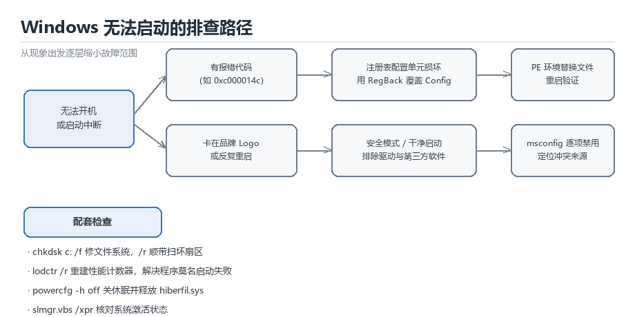

## 板块0 · 学习路径和建议

### 0_1 学习路径

Windows 主机的故障大多不是"系统坏了"，而是配置被改、空间被占满、某个后台组件被第三方软件替换。所以这个专项的重心不是背命令，而是建立"现象—机制—动作"的对应关系：看到 C 盘爆满，能说出空间去哪了；看到安装程序报"已创建挂起操作"，能说出是谁在等重启。

学习顺序按"进得去、看得懂盘、管得住自启、查得清故障"推进。每一步都在虚拟机上验证，确认现象与说明一致再往下走。

| 阶段 | 目标 | 验证方式 |
| --- | --- | --- |
| 一、账户与登录 | 说清自动登录的凭据存在哪里、代价是什么 | 完成免密登录后，再用 `netplwiz` 恢复成需要密码 |
| 二、磁盘与启动介质 | 判断空间被谁占用，会用 chkdsk 两级修复 | 把实验盘占用推高到 90%，再清理回 60% 以下 |
| 三、服务与任务 | 把脚本托管到正确的自启位置，会用干净启动做二分 | 用 `msconfig` 定位一个被禁用的第三方服务 |
| 四、故障与诊断 | 掌握注册表快照恢复、计数器重建、证据留存 | 在快照机上复现 0xc000014c 并恢复启动 |

### 0_2 使用建议与边界声明

适用范围为 Windows 7、Windows 10 与 Windows Server 2016 及以上。Windows 11 与 Server 2022 把部分入口从控制面板迁到了"设置"应用，但 `netplwiz`、`msconfig`、`diskmgmt.msc`、`slmgr.vbs`、`lodctr` 这些老工具都还在，排障时仍然是最快的路径。

这个专项只处理 Windows 主机自身。防火墙策略的通用模型、SSH 服务端配置、用户与权限体系属于 Linux 板块的内容；Windows 的电源计划、定时开关机、BIOS 定时唤醒由另一个专项负责，这里只在计划任务处一句带过。两边界面相似、机制完全不同，不要把参数互相套用。

实验环境要求：全程使用虚拟机，改注册表、动磁盘、改启动配置之前先打快照。覆盖 `C:\Windows\System32\Config` 下的文件一旦选错，系统将无法启动，也没有回收站可退。删除任何目录前，先确认它不属于正在运行的服务。

风险集中在三处：自动登录把凭据以可逆形式留在本机，物理接触即等于账户失守；彻底关闭防火墙只应存在于隔离调试窗口内，并且必须记录恢复时间；`chkdsk /r` 与 `powercfg -h off` 都会引起重启或功能变化，操作前要告知使用者。

## 板块1 · 账户、登录与授权状态

### 1_1 自动登录的实现与代价

Windows 的登录分两段：Winlogon 负责收集凭据，LSA 负责校验。所谓自动登录，是把用户名和口令预先交给 Winlogon，让它在开机时替你填表。凭据落在注册表 `HKLM\SOFTWARE\Microsoft\Windows NT\CurrentVersion\Winlogon` 下的 `AutoAdminLogon`、`DefaultUserName`、`DefaultPassword` 三个值里，其中 `DefaultPassword` 在多数版本中是可直接读取的明文。

这意味着自动登录不是"免验证"，而是"把验证材料放在桌上"。任何能读注册表、能离线挂载系统盘的访问者，都等于拿到了账户。

| 步骤 | 操作 | 要点 |
| --- | --- | --- |
| 1 | `Win+R` 输入 `netplwiz` | 也可用 `control userpasswords2`，两者同一面板 |
| 2 | 选中账户，取消"要使用本计算机，用户必须输入用户名和密码" | 确认时需连续输入两次该账户口令 |
| 3 | 重启验证 | 若仍停在登录界面，检查账户是否属于域或是否启用了快速启动 |

### 1_2 复选框消失的处理

Windows 10 2004 之后默认启用"无密码体验"，系统认为用户会用 Windows Hello 或 PIN 登录，于是把这个复选框藏了起来。旧文档里的注册表开关依然有效：把 `DevicePasswordLessBuildVersion` 置为 0，面板就恢复成传统形态。

```reg
Windows Registry Editor Version 5.00

[HKEY_LOCAL_MACHINE\SOFTWARE\Microsoft\Windows NT\CurrentVersion\PasswordLess\Device]
"DevicePasswordLessBuildVersion"=dword:00000000
```

改完要重新打开 `netplwiz`，面板在进程启动时读取该值，不重开就看不到变化。这一步的本质是"让系统退回密码登录模型"，与自动登录本身无关——复选框只是被隐藏，不是被删除。

### 1_3 免密登录的适用边界

自动登录在值班机、叫号屏、监控大屏、产线工控机上很常见：这些机器开机后必须无人值守地进入桌面并拉起业务程序。它不适合任何存放敏感数据或能访问内网的终端。

| 场景 | 建议 | 理由 |
| --- | --- | --- |
| 展示大屏、叫号机 | 可用 | 无交互需求，数据敏感度低，物理位置受控 |
| 办公终端 | 不建议 | 凭据可被读取，等于共享账户，审计失去意义 |
| 服务器 | 禁止 | 远程会话与本地会话混淆，责任无法追溯到人 |
| 需要跑 GUI 程序的无人值守机 | 有条件可用 | 优先用计划任务的"不管用户是否登录都运行"，而不是自动登录 |

对第四类场景，更稳的做法是保留登录界面，把程序交给计划任务以指定账户运行；只有程序强依赖交互式桌面会话（如某些采集软件）时才退回到自动登录，并同时限制该机的网络访问范围。

### 1_4 授权状态核查

排查"功能不可用""提示未激活""桌面右下角水印"时，先确认授权状态，再动其他配置。`slmgr.vbs` 是系统自带的软件许可管理脚本，只读查询不需要联网。

```cmd
C:\> slmgr.vbs /xpr          # 只显示激活到期状态，最常用
C:\> slmgr.vbs /dlv          # 详细授权信息：版本、剩余次数、密钥类型
C:\> slmgr.vbs /ato          # 尝试联机激活（需要网络与有效密钥）
```

| 输出关键词 | 含义 | 处置 |
| --- | --- | --- |
| permanently activated | 永久激活 | 无需处理 |
| 将于某日期过期 | 订阅或 KMS 授权 | 确认能否续期，排查 KMS 服务器可达性 |
| 通知模式 | 未激活，功能受限 | 检查密钥与激活服务器，不要先怀疑系统损坏 |

授权问题与性能问题容易混淆：未激活的系统会限制个性化设置，但不影响磁盘、网络与服务，排障时不要把它当成根因。

## 板块2 · 磁盘空间与启动介质

### 2_1 C 盘空间的构成

C 盘不是被"系统"占满的，而是被几类可预期的对象占满：更新缓存、组件存储的历史版本、休眠文件、页面文件、用户目录、以及不断增长的日志与临时文件。先按体积排序找到大头，再决定清理还是迁移。

| 路径 | 内容 | 能否直接删 | 说明 |
| --- | --- | --- | --- |
| `C:\Windows\SoftwareDistribution\Download` | 已下载的更新包 | 可以 | 删前先停 `wuauserv`，否则文件被占用 |
| `C:\Windows\winsxs\Backup` | 组件备份 | 可以 | 只删 Backup 子目录，`winsxs` 本体绝不能删 |
| `C:\Windows\Temp`、`%TEMP%` | 临时文件 | 大部分可以 | 占用中的文件跳过即可，不必强删 |
| `C:\hiberfil.sys` | 休眠镜像 | 只能通过命令关 | 大小约等于内存的 40%~100% |
| `C:\pagefile.sys` | 页面文件 | 只能调整 | 建议保留，大小按内存与转储需求定 |
| `C:\Windows\Installer` | 安装缓存 | 不可手删 | 删了会导致程序无法修复与卸载 |

清理顺序应是：先清更新缓存与临时文件，再看休眠与页面文件，最后才考虑迁移用户数据。反过来做，往往腾出几百兆后又立刻被填满。

系统自带的磁盘清理支持预设项目，适合批量部署时统一执行：

```cmd
C:\> cleanmgr /sageset:1        # 勾选要清理的项目，写入注册表
C:\> cleanmgr /sagerun:1        # 按预设静默执行，可放进计划任务
```

### 2_2 临时目录与用户数据的迁移

把临时目录挪到非系统盘，能同时缓解空间压力与减少系统盘碎片。改的是环境变量，不是文件夹属性，改完新开的进程才生效。

```cmd
C:\> setx TEMP "D:\Temp" /M     # /M 表示系统级，需管理员权限
C:\> setx TMP  "D:\Temp" /M
```

用户目录（桌面、下载、文档）通过文件夹属性的"位置"选项卡迁移，系统会自动搬运文件并更新注册表指向，比手工剪切安全。若只想让某个固定路径的程序缓存落到别的盘，可用目录联接：

```cmd
C:\> mklink /J "C:\AppCache" "D:\AppCache"    # 目录联接，对应用透明
```

目录联接的风险在于删除时容易误删目标内容：删联接点只删链接，但很多工具会递归删除，等于把 D 盘数据一起清掉。做之前先确认备份策略。

### 2_3 磁盘管理与卷操作

`diskmgmt.msc` 是磁盘管理的直接入口，比从服务器管理器逐层点进去快得多。图形界面的每一列都有含义：磁盘编号、分区样式、文件系统、状态、容量、可用空间。

| 操作 | 前置条件 | 常见失败原因 |
| --- | --- | --- |
| 初始化磁盘 | 磁盘显示为"未初始化" | 选择了错误的分区样式（MBR 上限 2TB） |
| 联机 | 磁盘状态为"脱机" | 该盘被其他节点或存储策略占用 |
| 分配盘符 | 卷存在但无盘符 | 盘符已被占用，或卷处于隐藏状态 |
| 扩展卷 | 右侧有相邻的未分配空间 | 未分配空间在左侧，或中间隔着其他分区 |
| 压缩卷 | 文件系统支持且碎片不多 | 可压缩量远小于预期，因为存在不可移动文件 |

"扩展卷灰色不可用"是最常见的困惑，根因几乎总是空间位置不对：Windows 只能向右扩展，左侧的空闲空间必须先转成独立分区或借助第三方工具搬移。

### 2_4 chkdsk 的两级修复

`chkdsk` 修的是文件系统元数据与物理扇区，不修用户数据内容。它有两个档位，代价差别很大。

| 参数 | 作用 | 是否锁卷 | 适用 |
| --- | --- | --- | --- |
| `chkdsk C:` | 只检查，报告问题 | 否 | 例行巡检 |
| `chkdsk C: /f` | 修复文件系统错误 | 是 | 出现"文件或目录损坏且无法读取" |
| `chkdsk C: /r` | 定位坏扇区并抢救可读信息，隐含 `/f` | 是 | 怀疑盘面故障、反复出现读写错误 |
| `chkdsk C: /scan` | NTFS 在线扫描 | 否 | 想在不重启的前提下先看一眼 |

系统盘被占用时无法立即锁卷，命令会提示"是否在下次启动时检查"，选是则写入排程，重启时在图形界面出现之前执行。`/r` 会逐扇区读取，容量越大耗时越长，机械盘上几个小时很常见，安排窗口时要留足时间。

坏扇区被标记后，数据未必救得回来，`/r` 的价值在于把坏块隔离，防止后续写入继续落在坏道上。若同一块盘短期内反复报错，应直接更换，而不是继续修。

### 2_5 休眠文件与快速启动

`hiberfil.sys` 是休眠时把内存整体写入磁盘得到的镜像文件。它同时被"快速启动"复用：关机时系统把内核会话写入该文件，下次开机直接读回，从而跳过部分初始化。

```cmd
C:\> powercfg -h off            # 关闭休眠：删除 hiberfil.sys，同时使快速启动失效
C:\> powercfg -h on             # 恢复休眠与快速启动
C:\> powercfg -h -size 40       # 保留休眠但把文件压到内存的 40%
```

| 状态 | hiberfil.sys | 快速启动 | 适用 |
| --- | --- | --- | --- |
| `-h off` | 不存在 | 不可用 | 系统盘紧张、服务器不需要休眠 |
| `-h on`（默认） | 内存的 40%~100% | 可用 | 普通办公终端 |
| `-h -size 40` | 固定为内存的 40% | 可用 | 想省空间又要保留快速启动 |

关闭休眠后，"关机"变成真正的完全关机，开机时间会变长，但双系统共享分区、外设识别异常、远程唤醒后状态不一致这类问题也会随之减少。服务器场景通常直接关掉。

## 板块3 · 服务、任务与自启

### 3_1 自启位置的四个层次

"开机自启"不是单一机制，而是四条并行的加载路径，触发时机与权限各不相同。排查自启项时漏掉任何一层，都会得出"已经禁用却还在运行"的错误结论。

| 位置 | 触发时机 | 作用域 | 特点 |
| --- | --- | --- | --- |
| 注册表 `Run` / `RunOnce` | 用户登录后 | 当前用户或全部用户 | 最容易写，也最容易被恶意程序利用 |
| 启动文件夹 | 用户登录后 | 当前用户或全部用户 | 放快捷方式或脚本，直观 |
| 计划任务 | 按触发器，可早于登录 | 可指定任意账户 | 支持"不管用户是否登录都运行" |
| 服务 | 系统启动阶段 | 本机 | 权限最高，失败不影响登录 |

排查顺序建议从权限低的往权限高的看：先看启动文件夹与 `Run`，再看计划任务，最后看服务。服务层被第三方软件替换时，往往表现为"功能正常但行为异常"，例如某监控程序把系统服务换成了自己的版本。

### 3_2 用启动文件夹托管批处理

启动文件夹有两个，区别在作用域：`C:\ProgramData\Microsoft\Windows\Start Menu\Programs\StartUp` 对所有用户生效，`%APPDATA%\Microsoft\Windows\Start Menu\Programs\Startup` 只对当前用户生效。服务器上给运维脚本用前者，避免换账户后失效。

```bat
@echo off
rem 固定工作目录：由启动项拉起时，工作目录往往不是脚本所在目录
cd /d D:\script

rem /min 最小化启动，避免挡住桌面
start "" /min D:\app\collector.exe

rem 留痕，便于确认是否真的执行过
echo %date% %time% start >> "D:\script\boot.log"
```

注释必须独占一行或用 `rem`。批处理里 `::` 只是"一种写法不规范的标签"，放在命令行尾部不会被当成注释：`cd /d D:\script :: 说明` 会把 `:: 说明` 一起当作路径，直接报"系统找不到指定的路径"；`echo` 那行则会把注释文字一并写进日志。这是从 Linux Shell 迁移过来时最容易踩的一处。

三条容易被忽略的约束：工作目录取决于启动方式——双击运行时是脚本所在目录，由计划任务或启动文件夹拉起时通常是 `C:\Windows\System32`，所以脚本里应当显式 `cd /d`；带 GUI 的程序会阻塞后续语句，需要 `start` 异步拉起；控制台窗口在无人值守机上很碍眼，应最小化或交给计划任务隐藏运行。

### 3_3 干净启动定位第三方冲突

现象是点击图标无响应、资源管理器反复重启、安装程序卡在中途，而事件日志里没有明确错误。这类问题多由第三方服务或启动项引起，干净启动的作用是"只留微软自己的东西"，把嫌疑范围一次缩小。

```cmd
C:\> msconfig        # 打开系统配置
```

三步操作：常规选项卡选"有选择的启动"并取消"加载启动项"；服务选项卡先勾"隐藏所有 Microsoft 服务"再全部禁用；启动选项卡跳转任务管理器禁用全部启动项。重启后若问题消失，说明是第三方组件所致，再用一半一半的方式逐步恢复，几轮即可锁定具体项。

| 现象 | 根因方向 | 处置 |
| --- | --- | --- |
| 干净启动后正常，恢复后复现 | 第三方服务或启动项冲突 | 二分恢复，定位到具体项后卸载或换版本 |
| 干净启动后依旧异常 | 系统组件损坏或驱动问题 | 转 `sfc /scannow`、`dism` 修复或驱动回退 |
| 禁用服务后网络、打印异常 | 误禁了非微软的关键服务 | 逐项恢复，不要一次全开 |

干净启动是诊断手段，不是长期状态。定位完成后必须恢复正常启动，否则杀毒、备份、监控都会失效。

### 3_4 挂起操作阻塞安装

安装程序启动时报"上一次安装已创建挂起操作，需要重启"，重启后依旧报同样的话，说明有个待执行的改名/删除任务卡在队列里。队列项就是注册表里的 `PendingFileRenameOperations`，由会话管理器在下次启动早期执行。

```reg
Windows Registry Editor Version 5.00

[HKEY_LOCAL_MACHINE\SYSTEM\CurrentControlSet\Control\Session Manager]
"PendingFileRenameOperations"=-
```

`=-` 表示删除该值。执行前必须确认没有正在进行的安装或更新：这个队列可能属于一个还没跑完的补丁，清掉它会让那次安装处于半完成状态。正确顺序是先正常重启一次，看提示是否消失；仍然存在再清理队列。

### 3_5 计划任务承载周期作业

比启动文件夹更适合生产环境的做法是计划任务：它有触发器、有运行账户、有历史记录、有失败重试。

```cmd
C:\> schtasks /create /tn "NightClean" /tr "D:\script\clean.bat" /sc daily /st 02:00 /ru SYSTEM
C:\> schtasks /query /tn "NightClean" /v /fo list      # 查看上次运行结果与返回码
C:\> schtasks /run   /tn "NightClean"                  # 立即手动触发一次
```

| 维度 | 启动文件夹 | 计划任务 |
| --- | --- | --- |
| 触发条件 | 仅登录时 | 时间、开机、空闲、事件 |
| 无用户登录时 | 不执行 | 可执行（选"不管用户是否登录"） |
| 运行账户 | 登录用户 | 任意账户，含 SYSTEM |
| 可观测性 | 基本没有 | 有历史记录与返回码 |

需要定时关机的场合也用同一机制：动作填 `shutdown /s /t 60`，到点前可用 `shutdown /a` 撤销。电源与唤醒的完整方案属于另一个专项，这里只借用它作为"计划任务调用系统命令"的例子。

### 3_6 时间同步

域环境里时间偏差超过 5 分钟会直接导致 Kerberos 认证失败；非域环境里，偏差会让日志排序错乱，让"先发生什么"这个问题无法回答。Windows 自带时间服务，配置一次即可长期生效。

```cmd
C:\> w32tm /query /status                                  # 查看当前时间源与偏差
C:\> w32tm /config /manualpeerlist:192.168.10.10 /syncfromflags:manual /update
C:\> w32tm /resync /force                                  # 立即强制同步一次
C:\> net stop w32time && net start w32time                 # 配置后重启服务
```

| 检查项 | 命令 | 期望结果 |
| --- | --- | --- |
| 时间源 | `w32tm /query /source` | 显示内网 NTP 或域控制器 |
| 偏差 | `w32tm /stripchart /computer:192.168.10.10` | 偏差在秒级以内 |
| 服务状态 | `sc query w32time` | `RUNNING`，启动类型自动 |

内网有统一时间源时优先指向它，不要各自去连公网地址：出口策略、时区、可达性任何一环出问题，都会让一批机器同时漂移。

## 板块4 · 启动故障与诊断工具

### 4_1 配置单元损坏与 0xc000014c

`0xc000014c` 的含义是注册表配置单元损坏或丢失，系统在启动早期读不到 `SYSTEM` 配置单元，于是连驱动加载都无法完成。此时系统自带的启动修复基本无效，因为修复程序本身也要读注册表。

关键在那两个目录的分工：`Config` 下是活跃的配置单元，系统每次启动都读写它；`RegBack` 是系统定期生成的一致性快照，属于"上一次已知良好"的副本。用快照覆盖活跃文件，等于把注册表回退到备份时点。

```
0xc000014c 无法启动
  BIOS/UEFI ─► PE 启动盘 ─► 挂载系统盘
                                │
                                ▼
   C:\Windows\System32\Config\         活跃配置单元（已损坏）
                                ▲
                                │ 覆盖（先备份原有文件）
   C:\Windows\System32\Config\RegBack\ 定期快照（SYSTEM/SOFTWARE/SAM/SECURITY/DEFAULT）
                                │
                                ▼
                          重启 ─► 正常启动
```



操作步骤：用另一台机器制作 PE 启动盘，故障机设为 U 盘启动，进入 PE 后定位到 `C:\Windows\System32\Config\RegBack`，把其中的 `SYSTEM` 复制到上一级 `Config` 覆盖同名文件，重启选择正常启动。覆盖前先把原有文件改名留档，恢复失败时还能退回原状态。

| 现象 | 根因 | 处置 |
| --- | --- | --- |
| 0xc000014c，安全模式同样失败 | `SYSTEM` 配置单元损坏 | 用 `RegBack\SYSTEM` 覆盖 |
| `RegBack` 目录为空 | 较新版本默认不再写快照 | 只能从其他同版本机器取，或重装后恢复数据 |
| 覆盖后出现 0xc000000f | 覆盖了不匹配的配置单元 | 换回备份，改用同版本同补丁级别的文件 |
| 反复出现同类错误 | 磁盘坏道或突然断电 | 先 `chkdsk /r`，再考虑更换磁盘 |

`RegBack` 为空是近几年的常见坑：系统为节省空间默认关闭了周期性备份。要重新打开，把 `HKLM\SYSTEM\CurrentControlSet\Control\Session Manager\Configuration Manager` 下的 `EnablePeriodicBackup` 置为 1，重启后系统才会重新生成快照。等出问题才想起备份，已经来不及——这条设置应当在上线时就确认。

### 4_2 性能计数器重建

性能监视器打不开、显示"计数器不存在"、依赖性能数据的监控程序报错，通常是计数器注册表项与磁盘上的定义文件不同步。常见诱因是优化工具批量禁用服务、系统更新中途失败、注册表被清理软件改动。

```cmd
C:\> lodctr /r        # 从系统备份重建计数器注册表项，需管理员权限
C:\> lodctr /r        # 连跑两次：第一次重建映射，第二次校验是否真的写回
C:\> winmgmt /resyncperf    # 重建 WMI 性能适配器，配合使用
```

`lodctr /r` 不是"重启计数器"，而是拿系统自带的一份计数器定义重建注册表映射。所以它对"定义文件还在、注册表项坏了"的情况有效；如果定义文件本身被杀毒软件删掉，需要先修复系统文件再执行。

### 4_3 运行历史与开始菜单痕迹

`Win+R` 下拉列表为空、灰色不可选，不是系统故障，而是两个隐私开关被关掉了。系统把"最近使用的应用与打开项"当作可收集数据，关掉采集自然就没有历史。

| 开关 | 位置 | 作用 |
| --- | --- | --- |
| 允许 Windows 跟踪应用启动 | 设置 → 隐私 → 常规 | 记录启动行为，供开始菜单与搜索排序 |
| 显示最常用的应用 | 个性化 → 开始 | 在开始菜单展示高频项 |

两处都开启后，新的运行记录才会被保存，之前的历史不会追溯生成。企业环境里这些开关可能被组策略统一关闭，改本地设置无效时应检查策略。

### 4_4 上帝模式的本质

把新建文件夹重命名为一个带 CLSID 的名字，资源管理器就会把它渲染成"所有设置项的聚合视图"：

```text
GodMode.{ED7BA470-8E54-465E-825C-99712043E01C}
```

原理是资源管理器识别文件夹名里的 CLSID，转去查询注册表中该 CLSID 对应的 shell 命名空间扩展，于是显示的不是目录内容，而是注册过的控制面板项列表。它不产生任何新功能，只是把分散在多层菜单里的入口平铺到一页，适合排障时快速跳转。

需要注意两点：名字必须以 `.{` 开头并以 `}` 结尾，后缀部分只是显示名，可以换成中文；删除时按普通文件夹删除即可，不会影响系统。

### 4_5 防火墙的彻底关闭与恢复

Windows 防火墙按三个配置文件分别管理：域、专用、公用。系统根据当前网络位置自动选择配置文件，所以只关一个往往"看起来没关"。要彻底放通，三个都要处理。

```cmd
C:\> netsh advfirewall set allprofiles state off     # 三个配置文件一起关闭
C:\> netsh advfirewall show allprofiles state        # 确认状态为 OFF
C:\> netsh advfirewall set allprofiles state on      # 恢复
```

图形路径是"高级安全 Windows Defender 防火墙 → 属性"，逐个配置文件把防火墙状态设为关闭；域环境里还可以用组策略统一下发。三者分开设计的原因是移动设备：笔记本在家、在公司、在咖啡厅对应不同信任级别，策略理应不同。

关闭防火墙只应作为定位手段：先在隔离窗口内关闭，验证端口是否通，确认问题在防火墙后立刻恢复，再用放行规则替代全关。长期关闭的机器在内网横向移动中几乎没有抵抗力，且不会有任何告警。Linux 侧对应的是 firewalld 的区域与 `--add-port`，思路一致，命令不同。

### 4_6 症状与动作速查

| 症状 | 最可能的根因 | 第一步动作 |
| --- | --- | --- |
| 开机报 0xc000014c | `SYSTEM` 配置单元损坏 | PE 下用 `RegBack\SYSTEM` 覆盖 |
| 装软件报"已创建挂起操作" | 存在待执行的改名队列 | 先正常重启，仍在再清 `PendingFileRenameOperations` |
| 点图标无响应、资源管理器闪退 | 第三方服务或启动项冲突 | `msconfig` 干净启动做二分 |
| 性能监视器无数据 | 计数器注册表项损坏 | `lodctr /r` 连续执行两次 |
| C 盘持续减少 | 更新缓存、休眠文件、日志增长 | 按体积排序定位，先清缓存再动休眠 |
| 时间偏差导致认证失败 | 时间源不可达或未配置 | `w32tm /query /status` 后指向内网源 |

## 板块5 · 要点回顾与能力自检

### 5_1 关键结论

- 自动登录是把凭据写进注册表换取免交互，安全代价必须与场景匹配；服务器与办公终端不应使用。
- 清理 C 盘要按"缓存 → 休眠/页面文件 → 用户数据"的顺序，`winsxs` 与 `Installer` 属于不可手删的区域。
- `chkdsk /f` 修元数据，`/r` 额外扫描坏扇区并隐含修复，系统盘需要排程到重启时执行。
- `powercfg -h off` 一次动作产生两个结果：删除 `hiberfil.sys`、快速启动失效。
- 自启有四层，排查要由低权限到高权限；干净启动是诊断手段，不能长期保留。
- `0xc000014c` 的救援依赖 `RegBack` 快照，而新系统默认不再生成快照，备份要提前开启。

### 5_2 能力自检

1. 一台值班大屏机需要开机直接进桌面跑监控程序，说明你会怎么配、配完还要做哪两项限制。
2. `netplwiz` 里没有"用户必须输入用户名和密码"复选框，写出两条可能原因及各自的验证方式。
3. C 盘只剩 3 GB，给出一个不删用户数据、不影响系统更新的清理顺序，并说明每一步的预期回收量级。
4. 一台机器点击任何快捷方式都无响应，用干净启动定位到某个第三方服务后，说明如何确认它就是根因，以及最终处置方式。
5. 开机报 `0xc000014c`，而 `RegBack` 目录是空的，说明这个现象为什么会出现，以及此时还有哪些可选路径。
