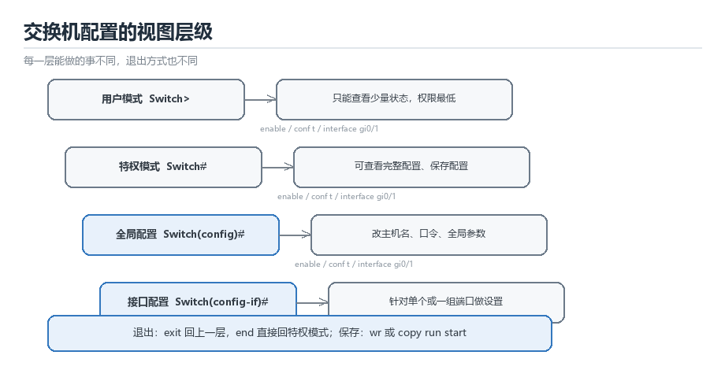

## 板块0 · 学习路径和建议

### 0_1 学习路径

交换机与防火墙的配置体系其实很小：一套视图层级、一组查看命令、一套保存机制，再加上少量与业务强相关的功能（端口安全、远程登录、NAT）。难点不在命令数量，而在"当前处在哪一层、这条命令作用在哪一层"。很多人配不下去，是因为提示符变了却没意识到上下文已经切换。

学习顺序按"认清提示符 → 配得对 → 守得住接入 → 打得通边界"推进。命令必须在真机或模拟器上敲一遍，看提示符的变化，比看十遍文档有效。

| 阶段 | 目标 | 验证方式 |
| --- | --- | --- |
| 一、视图与提示符 | 看到提示符就知道当前权限与作用范围 | 不看键盘完成四层视图的进入与逐层退出 |
| 二、基础配置与保存 | 改主机名、口令，并把配置写进启动配置 | 断电重启后配置仍在 |
| 三、接入层加固 | 绑定 MAC、关闭闲置口，且不误伤在用终端 | 换一台终端接入被阻断，恢复原终端后正常 |
| 四、远程与边界访问 | 配通 SSH，理解并解决内网访问公网映射 | 内网终端用公网地址访问内部服务成功 |

### 0_2 使用建议与边界声明

适用对象为迈普 MP 系列交换机（命令风格接近 Cisco）与 H3C Comware V7 设备（S 系列交换机、F1050 等防火墙）。两家语法有差异：迈普用 `>`、`#`、`(config)#` 表示层级，H3C 用 `<H3C>`、`[H3C]`、`[H3C-GigabitEthernet0/1]`，同一功能的关键字也可能不同。迁移时先查该型号的命令手册，不要凭印象替换。

这个专项只讲设备侧的配置。Linux 主机侧的地址、路由、firewalld 策略、SSH 服务端在 Linux 板块中；主机与设备的对接问题，需要两侧一起看。设备上的"用户"与 Linux 的用户体系没有可比性，权限级别是本地概念。

实验要求：优先用模拟器（H3C 的 HCL、迈普的配套模拟环境）完成命令练习，涉及端口安全的实验再上真机。console 线接入前确认波特率，改配置前先 `show run` 并备份到内网 TFTP（例如 192.168.10.10），改完立刻保存。

风险提示：`shutdown` 打在堆叠口或上行口上会直接断网，且只能靠 console 现场恢复；端口安全的保护动作一旦触发，合法终端也会被阻断；关闭 Telnet 前必须先确认 SSH 已经可用，否则会把自己锁在设备外面。

## 板块1 · 命令行视图与配置持久化

### 1_1 四级视图与权限边界

设备的命令行是分层的，每一层能改的东西不同。低层只能看，高层才能改，改具体对象还要再进一层。这个设计的意义是防止误操作：在全局层敲接口命令会报错，而不是悄悄改到某个端口上。

```
Switch>              用户模式：只能执行少量查看与测试命令
   │ enable
Switch#              特权模式：查看完整配置、保存、重启、调试
   │ configure terminal
Switch(config)#      全局配置模式：主机名、口令、路由、VLAN
   │ interface gigabitethernet 0/1
Switch(config-if)#   接口模式：只影响当前端口
```



| 视图 | 迈普提示符 | H3C 提示符 | 退出方式 |
| --- | --- | --- | --- |
| 用户模式 | `Switch>` | `<H3C>` | 迈普 `disable` 逐级退；H3C `quit` 断开连接 |
| 特权模式 | `Switch#` | 无独立对应，`system-view` 之前即此层 | 迈普 `disable` 回用户模式 |
| 全局配置 | `Switch(config)#` | `[H3C]` | `exit` 或 `quit` 回上一层 |
| 接口配置 | `Switch(config-if)#` | `[H3C-GigabitEthernet0/1]` | `quit` 逐层退 |

H3C 的入口是 `system-view`：在 `<H3C>` 下敲入后提示符变成 `[H3C]`，此时已在全局配置层。它与迈普"先 `enable` 再 `conf t`"的两步不同：H3C 没有单独的特权层，查看与配置的边界靠权限级别（0~3）划分，而不是靠视图划分。这一点在排错时很关键——在 H3C 上敲不动命令，多半是级别不够，而不是没进特权层。

退出同样分三档，别记混：`quit`（迈普亦写作 `exit`）只退一层；H3C 上 `return` 从任意配置层直接退回用户视图 `<H3C>`，迈普与 Cisco 风格的对应命令是 `end`，回到特权模式 `Switch#`。无论哪种，退出都不会保存配置——`return` 跳得再快，也不能替代 `wr`。

### 1_2 信息采集的固定顺序

排障时信息采集要有顺序，否则会在无关的表项里打转。合理顺序是物理层、MAC 层、端口层、配置层：先确认链路起来了，再看地址学到了没有，再看端口处于什么状态，最后核对配置是否符合预期。

| 目的 | 迈普 | H3C |
| --- | --- | --- |
| 查看完整运行配置 | `show run` | `display current-configuration` |
| 端口状态与所属 VLAN | `show interface switchport brief` | `display interface brief` |
| 全部 MAC 地址表 | `show mac-address all` | `display mac-address` |
| 查单个 MAC | `show mac-address xxxx.xxxx.xxxx` | `display mac-address xxxx-xxxx-xxxx` |
| 接口收发包与错误计数 | `show interface gi 0/1` | `display interface GigabitEthernet0/1` |

MAC 地址表能回答"这个终端到底接在哪个口"，是定位私接设备最快的手段。接口计数里的 CRC 错误、丢弃计数持续增长，通常指向线缆、光模块或双工不匹配，而不是配置问题。

### 1_3 配置的三种状态

改配置时最容易犯的错，是把"当前生效"当成"已经保存"。设备里同时存在三份东西：内存里的运行配置、启动时加载的启动配置、以及 flash 里的配置文件。只有写进启动配置，掉电才不会丢。

| 状态 | 存放位置 | 掉电后 | 查看命令 |
| --- | --- | --- | --- |
| 运行配置 | 内存 | 丢失 | `show run` / `display current-configuration` |
| 启动配置 | NVRAM 或 flash | 保留 | `show startup-config` / `display saved-configuration` |
| 配置文件 | flash | 保留 | `dir` 查看文件名与大小 |

```text
Switch# wr                                  # 迈普：写入启动配置，按提示确认
Switch# write memory                        # 等价写法，部分版本支持
# H3C：强制保存，不再逐次确认
[H3C] save force
[H3C] quit
<H3C> display saved-configuration           # 确认启动配置已更新
```

保存之前先确认当前配置是对的。把错误配置写进启动配置，等于把故障固化下来，下一次重启才爆发，排查成本更高。批量变更前把运行配置备份到内网 TFTP，出问题时可以整份回灌。

```text
<H3C> tftp 192.168.10.10 put flash:/startup.cfg sw1-backup.cfg
```

### 1_4 主机名与口令的写法

主机名决定登录后第一眼看到的信息，多台设备同型号时，没有主机名几乎无法分辨自己在哪台上操作。口令分两类：进入特权层的口令，和登录线路的口令。

```text
! 命名体现位置与用途
Switch(config)# hostname hz-monitor-sw-1
! 对明文口令做弱加密
hz-monitor-sw-1(config)# service password-encryption
! 0 表示按明文录入
hz-monitor-sw-1(config)# user admin password 0 iaoexl@7#13
hz-monitor-sw-1(config)# enable password 0 iaoexl@7#13
hz-monitor-sw-1(config)# line con 0
! console 走本地用户库
hz-monitor-sw-1(config-con)# login local
hz-monitor-sw-1(config-con)# exit
hz-monitor-sw-1(config)# line vty 0 4
hz-monitor-sw-1(config-line)# login local
```

| 命令 | 作用 | 需要注意 |
| --- | --- | --- |
| `service password-encryption` | 把配置文件里的明文口令转成可逆密文 | 只是"防窥"，不是安全加密，能还原 |
| `password 0` | 按明文录入 | 配置里 `0` 前缀即表示明文 |
| `password 7` 或加密录入 | 存密文 | 强度取决于算法，别把它当强保护 |
| `enable password` 与 `enable secret` | 前者弱、后者强 | 同时存在时以 `secret` 为准 |

不要把真实口令写进任何共享文档或脚本。设备配置备份文件里含口令密文，备份目录的访问权限要按敏感数据对待。

## 板块2 · 接入层端口安全

### 2_1 端口安全解决什么问题

接入层端口默认是"谁插上谁用"：任何设备接入都能学到 MAC、拿到地址。会议室、前台、宿舍的墙上网口因此成为最常见的私接点，接一台家用路由器就可能引入环路、私建 DHCP、MAC 地址表被大量无关条目填满。

端口安全做的事很简单：限制每个端口能学到的 MAC 数量，并把学到的 MAC 固定下来，超出或不符合就执行保护动作。

```
终端 A ──► 端口 gi0/5 ──► 交换机
                │
                ├─ 学习 MAC-AAAA ─► 写入地址表（sticky 时同时写入运行配置）
                └─ 第二个不同 MAC 出现 ─► 触发保护动作
```

| 要素 | 含义 | 典型取值 |
| --- | --- | --- |
| 最大 MAC 数 | 该端口允许学习的地址上限 | 接终端取 1，接 AP 或小交换机按实际设备数 |
| 绑定方式 | 手工指定或自动粘滞 | sticky 适合终端经常更换的场合 |
| 保护动作 | 超限后的处理 | 丢弃、告警、或直接关闭端口 |

### 2_2 sticky MAC 的配置

sticky（粘滞）的含义是：第一个学到的 MAC 自动转成静态绑定写入配置，不需要管理员逐个抄地址。换机器时必须先解绑，这正是它"能管住私接"的原因。

```text
Switch(config)# interface gigabitethernet 0/1-0/24
! 每口只允许 1 个 MAC
Switch(config-if-range)# port-security maximum 1
Switch(config-if-range)# port-security permit mac-address sticky # 首个 MAC 自动固化
Switch(config-if-range)# port-security enable
Switch(config-if-range)# exit
```

最大数取 1 的意义在于端口用途唯一：一个信息点位对应一台终端。台式机、打印机、摄像头都符合这个前提。一旦有人在这个口接上家用路由器或小交换机，第二个 MAC 立刻触发保护，端口被限制，问题在网络侧显性化，而不是悄无声息地扩散。

反过来，如果这个口本来就要接 AP 或下联小交换机，上限 1 会直接把正常业务掐断。上线前必须确认端口用途，这比配置本身更重要。

### 2_3 解绑与常见故障

换终端、换网卡、重装系统导致 MAC 变化时，端口会因为"陌生 MAC"被拦住。处置的第一步不是删配置，而是确认这台机器该不该出现在这个口上。

```text
Switch(config)# interface gigabitethernet 0/1
Switch(config-if)# no port-security maximum 1
Switch(config-if)# no port-security permit mac-address sticky
Switch(config-if)# port-security disable
Switch(config-if)# exit
```

| 现象 | 根因 | 处置 |
| --- | --- | --- |
| 换电脑后该口不通，其他口正常 | 旧 MAC 仍被粘滞绑定 | 先解绑再重新启用，让新 MAC 重新学习 |
| 整个端口进入 err-disabled | 超限触发关闭类保护动作 | 排查私接设备后，先恢复端口再启用安全 |
| 配置看似正确但终端时通时断 | 上限设得过小，或终端有多网卡 | 按实际设备数调整上限 |
| 重启后绑定全部消失 | 配置未保存 | `wr` 写入启动配置 |

保护动作的具体命名各家不同，有的叫 protect、restrict、shutdown，差别在于是否告警、是否关闭端口。选 shutdown 类动作最严格，也最容易造成"莫名其妙断网"，入门实验建议先用告警类动作观察一段时间。

### 2_4 关闭闲置端口

楼里预留的墙上网口常年不接线，却始终处于可接入状态，这是最容易被忽略的攻击面：任何人找到它就能接入内网。关闭闲置端口不增加任何成本，效果却是把可用入口收敛到实际在用的那些。

```text
Switch(config)# interface fastethernet 0/22-0/24
! 百兆预留口
Switch(config-if-range)# shutdown
Switch(config-if-range)# exit
Switch(config)# interface gigabitethernet 0/2-0/4
! 千兆预留口
Switch(config-if-range)# shutdown
Switch(config-if-range)# exit
```

操作前必须核对三件事：这些口确实没有接线、不是堆叠口或上行口、不在链路聚合组里。批量 `shutdown` 打到聚合口上，会让整条上联中断，而且现象是"整栋楼断网"，很容易慌乱中反复重启设备。

关闭不等于禁用，端口随时可以 `no shutdown` 恢复。建议在变更记录里写明关闭的范围与日期，半年后回看时还能判断哪些口是人为关闭的。

## 板块3 · 远程登录与认证

### 3_1 三种认证方式

H3C 的登录线路支持三种认证方式，选哪一种决定了"凭据从哪里来"。这是最容易配错的地方：方式选错，后面的用户、口令、权限全部不会生效。

| 方式 | 凭据来源 | 适用 | 风险 |
| --- | --- | --- | --- |
| `password` | 直接配在线路下的口令 | 单机、临时调试 | 所有登录者共用一个口令，无法追溯 |
| `scheme` | 本地用户库或远端 AAA | 生产环境 | 配置项多，用户与服务类型要对应 |
| `none` | 不认证 | 实验室 | 任何人接入即得权限，绝不可用于生产 |

`scheme` 模式要求用户名、口令、服务类型、权限级别四者匹配，缺一项就会登录失败。常见错误是建了用户却只给了 `telnet` 服务，然后用 SSH 登录，表现为"密码正确但被拒绝"。

### 3_2 vty 与 aux 的作用域

`vty` 是虚拟终端线路，对应远程连接；`aux` 对应 console 口，也就是插着配置线的那一路。两者配置方法几乎一样，作用范围完全不同：改 `vty` 影响远程登录，改 `aux` 影响现场接线登录。

| 线路 | 物理入口 | 并发数 | 典型认证 |
| --- | --- | --- | --- |
| `vty 0 4` | 网络（Telnet/SSH） | 5 个会话 | `scheme`，按用户区分权限 |
| `aux 0` | console 口 | 1 个会话 | `password` 或 `scheme` |

console 口也必须设口令。物理接触设备的人如果可以直接进入特权模式，前面所有的远程认证都失去意义。机房门禁与 console 口令是两道独立的防线，不能相互替代。

```text
[H3C] user-interface vty 0 4
# 走本地用户库
[H3C-ui-vty0-4] authentication-mode scheme
# 只允许 SSH 接入
[H3C-ui-vty0-4] protocol inbound ssh
[H3C-ui-vty0-4] quit
[H3C] user-interface aux 0
[H3C-ui-aux0] authentication-mode password
[H3C-ui-aux0] set authentication password simple iaoexl@7#13
[H3C-ui-aux0] user privilege level 3
```

### 3_3 本地用户与权限级别

H3C 的权限级别是 0 到 3，数字越大能做的事越多。级别不匹配时，用户能登录但敲不动命令，提示"权限不足"，看起来像命令不存在。

```text
[H3C] local-user iaoexl
# simple 为明文录入
[H3C-luser-manage-iaoexl] password simple iaoexl@7#13
[H3C-luser-manage-iaoexl] service-type ssh
[H3C-luser-manage-iaoexl] authorization-attribute level 3
[H3C-luser-manage-iaoexl] quit
```

| 级别 | 可执行范围 | 适用角色 |
| --- | --- | --- |
| 0 | 查看类、部分诊断命令 | 只读巡检 |
| 1 | 常规查看与部分配置 | 一线运维 |
| 2 | 多数配置命令 | 设备管理员 |
| 3 | 全部命令，含管理与调试 | 网络负责人 |

`service-type` 与线路的 `protocol inbound` 必须一致：线路只放 SSH，用户却只授权了 telnet，结果是能连上但登录失败。这类问题不看配置对比很难发现，建议把两者写进同一份检查清单。

### 3_4 SSH 与 Telnet 的取舍

Telnet 在明文信道里传输口令与全部操作内容，同网段的任何人抓包即可还原。SSH 对信道加密并校验主机密钥，代价是需要生成密钥对、首次连接要确认指纹。

```text
# 生成主机密钥，SSH 服务依赖它
[H3C] public-key local create rsa
[H3C] ssh server enable
# 过渡期保留，验证 SSH 可用后再关
[H3C] telnet server enable
# H3C 的线路配置入口
[H3C] user-interface vty 0 4
[H3C-ui-vty0-4] protocol inbound ssh
```

| 维度 | Telnet | SSH |
| --- | --- | --- |
| 传输 | 明文 | 加密 |
| 默认端口 | 23 | 22 |
| 凭据泄露风险 | 高，抓包即可见 | 低 |
| 前置条件 | 无 | 需生成密钥对 |
| 适用 | 隔离的实验网段 | 任何生产环境 |

迁移顺序必须是"先开 SSH 并验证，再关 Telnet"。反过来操作，一旦 SSH 配置有误，就只能到现场用 console 恢复。关闭命令是 `undo telnet server enable`，同时把线路的 `protocol inbound` 收紧到 `ssh`。

同一件事在迈普上是另一套写法：线路入口用 `line vty 0 4` 而不是 `user-interface vty 0 4`，提示符变成 `(config-line)#`，关闭 Telnet 用 `no telnet server enable` 或直接删掉相应服务项。这类"同义不同形"的对照值得单独记一页，迁移设备时按厂商分栏，比凭印象套用安全得多。

## 板块4 · 边界访问与 NAT Hairpin

### 4_1 内网访问公网映射为什么不通

典型场景：内部有一台服务发布到公网地址，外网用户访问正常，内网用户用同一个公网地址访问却打不开。原因在 NAT 的处理路径上——地址转换只对"从外网接口进来"的流量做，内网终端发往公网地址的包从内网接口进来，命不中转换表。

```
外网用户 ──► 公网接口 ──► [DNAT 转换] ──► 内网服务器 ──► 回程经设备 ──► 正常
内网用户 ──► 内网接口 ──► 目的地址仍是公网 IP，未命中转换 ──► 包被丢弃或绕行
                                        │
                                 会话表里没有对应表项
```

即使设备把包转了进去，服务器回包时会按自己的路由表直接回给内网终端，源地址是内网地址，终端却在等公网地址的回应，三次握手对不上号。这就是"路径不对称"。

### 4_2 开启 NAT Hairpin

Hairpin（发夹）的作用是让内网侧访问公网映射地址的流量也走一遍转换：进去时把目的地址换成服务器内网地址，回来时把源地址换回公网地址，两端都以为自己在跟对方通信。

H3C F1050 在 Web 界面的 NAT 配置中开启 NAT Hairpin，并选择对应的公网接口应用；命令行形态为在接口或全局 NAT 策略中启用 hairpin 功能，具体关键字随版本不同，配置前查该版本命令参考。

| 场景 | 未开启 Hairpin | 开启后 |
| --- | --- | --- |
| 外网访问公网地址 | 正常 | 正常 |
| 内网访问公网地址 | 超时或连接被拒 | 正常 |
| 内网访问服务器内网地址 | 正常 | 正常 |
| 会话表规模 | 较小 | 翻倍，需关注会话上限 |

### 4_3 验证与常见误配

验证方法很直接：在内网终端上用公网地址访问服务，同时看设备的 NAT 会话表里是否出现对应表项。

```text
# 查看会话，确认源/目的地址的转换关系
[H3C] display nat session verbose
# 核对策略是否命中预期接口
[H3C] display nat policy
C:\> tracert 203.0.113.10                # 内网终端侧确认路径是否经过出口设备
```

| 现象 | 根因 | 处置 |
| --- | --- | --- |
| 内网用域名打不开、用内网 IP 正常 | 域名解析到公网地址，Hairpin 未生效 | 开启 Hairpin，或在内网 DNS 上做地址改写 |
| 开启后仍不通 | 应用在了错误的接口，或策略顺序被更靠前的规则拦截 | 核对接口与策略顺序 |
| 开启后部分终端正常、部分异常 | 终端缓存了旧的 ARP 或连接 | 清缓存后重试，确认会话表有表项 |
| 语音、视频类业务出现单通 | 双向转换不对称 | 检查该业务是否被单独的策略绕过 |

另一种更省事的做法是内网 DNS 分离解析：内网查询同一个域名时返回内网地址，流量根本不经过出口设备。代价是维护两套解析记录，改地址时容易漏改一处。

## 板块5 · 要点回顾与能力自检

### 5_1 关键结论

- 视图层级决定命令的生效范围，提示符变了就说明上下文变了；`quit` 逐层退，H3C 的 `return` 退回用户视图、迈普的 `end` 退回特权模式，退出不等于保存。
- 运行配置在内存，启动配置才扛得住掉电；改完不保存，重启即回到改之前。
- 端口安全的核心是两个参数：每口允许的 MAC 上限与绑定方式；上限取 1 的前提是"一个信息点一台终端"。
- 关闭闲置端口是成本最低的攻击面收敛手段，但必须先排除上行口、堆叠口与聚合口。
- 认证方式三选一，`scheme` 要求用户名、口令、服务类型、权限级别四者对应；console 口同样要设口令。
- Telnet 明文、SSH 加密，迁移顺序永远是"先开 SSH 验证，再关 Telnet"。
- 内网访问公网映射不通源于 NAT 只处理外网入方向，Hairpin 让内网流量也走一次转换，代价是会话表翻倍。

### 5_2 能力自检

1. 拿到一台陌生设备，只看到 `[H3C]` 提示符，说明当前处在哪一层、能改什么、如何退到只看不改的状态。
2. 一台交换机改完 VLAN 后忘记保存，三小时后机房断电，说明重启后配置会变成什么样，以及如何避免同类问题。
3. 会议室网口启用了 sticky 绑定、上限 1，某天接了一台无线 AP 后整层断网，说明故障链条与正确的配置方式。
4. 只允许 SSH 登录、禁止 Telnet，写出完整的配置顺序，并说明为什么不能先关 Telnet。
5. 内网终端用公网地址访问内部网站超时，用内网地址正常，说明两条可能的解决路径及各自的取舍。
