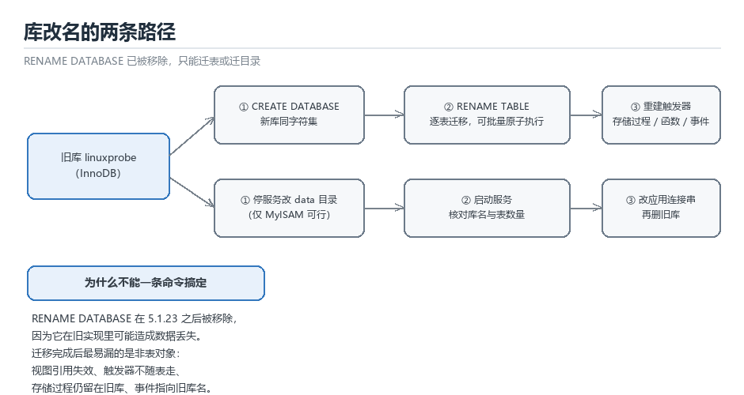

## 板块0 · 学习路径和建议

### 0_1 学习路径

Windows 平台上的数据库运维有两件事绕不开：备份能不能还原，以及迁移改名会不会丢对象。前者靠参数与验证，后者靠对存储引擎和对象归属的理解。两者都不是"点几下界面"能解决的，需要知道每条命令背后在做什么。

学习顺序按"备得下来、还原得回、迁得过去、连得上"推进。每个环节都要在实验库上真实执行一遍，尤其是还原与改名，只有亲手做过一次，才知道哪些对象没有跟过来。

| 阶段 | 目标 | 验证方式 |
| --- | --- | --- |
| 一、逻辑备份 | 说清一致性快照的成立条件，写出可用的备份脚本 | 备份过程中对表执行写入，还原后数据不缺不重 |
| 二、自动化与清理 | 备份可定时执行、失败可发现、旧文件自动清理 | 手动改系统时间后确认旧备份被清理 |
| 三、库改名 | 判断引擎，选择物理改名或逐表迁移 | 改名后表数量、行数、对象清单与原库一致 |
| 四、SQL Server 远程访问 | 打通协议、端口、认证三层 | 从 192.168.10.50 用 SSMS 连上 192.168.10.20 |

### 0_2 使用建议与边界声明

MySQL 部分适用于 5.6、5.7 与 8.0。5.6 与 5.7 的默认字符集是 latin1 或 utf8，8.0 默认 utf8mb4，备份参数里的字符集必须与库实际一致，否则还原后中文变问号。SQL Server 部分以 2008 R2 为基线，2012 之后的界面与默认值有变化，但协议、端口、认证三层结构不变。

这个专项讲的是 Windows 上的部署、备份、迁移与连通性排查。SQL 语法、索引与事务、用户权限模型属于数据库基础内容，主知识库的 MariaDB 板块已经覆盖，这里不重复。Linux 上的同类操作思路一致，路径与权限写法不同。

实验要求：准备一台虚拟机装 MySQL，SQL Server 另用一台，两者的内存需求都不低，不要挤在同一台机器上。所有操作先在实验库执行。改名与迁移之前必须有可用备份，并且验证过这份备份能还原——没验证过的备份只能算"文件"，不能算"退路"。

风险提示：`mysqldump` 在大库上会长时间占用 I/O，`--single-transaction` 不锁表但会撑大 undo；物理改名必须停服务，运行中改目录会导致实例崩溃；SQL Server 改协议后必须重启服务，重启会中断现有连接。

## 板块1 · MySQL 逻辑备份与自动化

### 1_1 一致性快照是怎么拿到的

`mysqldump` 默认逐表读取，边读边写 SQL 文本。如果没有额外措施，读第一张表时和读最后一张表时，数据库已经不是同一个状态，备份出来的数据互相矛盾——比如订单表有新订单，订单明细表却没有对应记录。

`--single-transaction` 解决的就是这个问题。它在备份开始时开启一个可重复读事务，并立即建立一致性快照，之后所有表的读取都基于这个快照时点。InnoDB 靠多版本并发控制（MVCC）让读取看到历史版本，因此不需要给表加锁，业务写入照常进行。

```
备份开始
  │  START TRANSACTION WITH CONSISTENT SNAPSHOT
  ▼
快照时点 T0 ──────────────────────────────► 备份结束
  │            ▲                    ▲
  │      业务写入（不阻塞）      业务写入（不阻塞）
  └─ 所有表都读 T0 时刻的版本，彼此一致
```

成立条件有三个：所有表必须是 InnoDB；备份期间不能有 DDL（改表结构会让快照失效或报错）；不能有长事务把 undo 撑爆。库里有 MyISAM 表时，快照对它无效，那一部分仍然是不一致的。

### 1_2 --opt 到底做了什么

`--opt` 是一组参数的合集，而且在多数版本里默认就开着，所以它经常被当成"什么都不做"。实际它同时打开了建表前删表、批量插入、写完后重建索引等行为，直接影响备份文件的大小与还原速度。

| 参数 | 作用 | 影响 |
| --- | --- | --- |
| `--add-drop-table` | 建表语句前加 `DROP TABLE IF EXISTS` | 还原时覆盖同名表，不会因表已存在而失败 |
| `--extended-insert` | 多行合并成一条 INSERT | 文件更小、还原更快 |
| `--disable-keys` | 导入时先关索引，结束后重建 | 大批量导入显著加速 |
| `--lock-tables` | 备份每张表时加读锁 | 与 `--single-transaction` 冲突，后者会自动关闭它 |
| `--quick` | 逐行取出，不在客户端缓存整表 | 大表不会撑爆客户端内存 |
| `--set-charset` | 文件头写入字符集设置 | 避免还原时字符集错乱 |

`--opt` 与 `--single-transaction` 同时出现不会打架：启用后者时，`--lock-tables` 被自动禁用，锁表的语义由事务快照替代。真正会打架的是 `--skip-opt` 加手工参数，那种写法需要自己补齐每一项。

### 1_3 对象范围：不写就丢的东西

默认情况下，`mysqldump` 只导表结构和数据。存储过程、函数、事件调度器里的任务不在其中，而它们往往是业务逻辑的核心。备份文件看起来完整，还原后应用却报"存储过程不存在"。

| 参数 | 导出内容 | 不写的后果 |
| --- | --- | --- |
| `--routines` | 存储过程与自定义函数 | 应用调用时报对象不存在 |
| `--events` | 事件调度器中的定时任务 | 定时作业静默消失，直到业务该跑的时候才发现 |
| `--triggers` | 触发器 | 默认开启，除非显式 `--skip-triggers` |
| `--default-character-set` | 连接字符集 | 与库不一致时中文变问号 |
| `--databases` | 附带 `CREATE DATABASE` | 不加时只导表，还原要自己先建库 |

```cmd
C:\> "D:\mysql\bin\mysqldump" --single-transaction --routines --events --triggers ^
     --default-character-set=utf8mb4 --databases appdb > D:\backup\appdb.sql
```

`--databases` 与单库参数还有一个区别：加了它，文件里会写 `USE appdb;`，可以直接灌入；不加则所有表名不带库前缀，还原时必须先 `USE` 到目标库，否则会建到当前库下。

### 1_4 批处理脚本的工程化写法

能跑一次的脚本和能跑一年的脚本，差别在错误处理、路径引号、口令存放与日志。下面这版在原素材基础上补上了这几处。

```bat
@echo off
setlocal
set BACKUP_DIR=D:\MySQL\mysql_backup
set MYSQL_BIN=D:\mysql\bin

rem 用 PowerShell 取时间戳，避免 %date% 受区域格式影响
for /f %%i in ('powershell -NoProfile -Command "Get-Date -Format yyyyMMddHHmmss"') do set Ymd=%%i

rem 先清理 30 天前的备份，再执行本次备份
forfiles /p "%BACKUP_DIR%" /m backup_*.sql /d -30 /c "cmd /c del /f @path"

"%MYSQL_BIN%\mysqldump.exe" --defaults-extra-file=D:\MySQL\backup.cnf ^
  --single-transaction --routines --events --default-character-set=utf8mb4 ^
  --databases appdb > "%BACKUP_DIR%\backup_%Ymd%.sql"

if errorlevel 1 (
  echo %date% %time% backup failed >> "%BACKUP_DIR%\backup.log"
  exit /b 1
)
echo %date% %time% backup ok >> "%BACKUP_DIR%\backup.log"
```

| 做法 | 原因 |
| --- | --- |
| 口令放进 `backup.cnf` 的 `[client]` 段 | 写在命令行会出现在进程列表里，任何本地用户可见 |
| 路径全部加双引号 | 目录含空格时命令会被截断 |
| 判断 `errorlevel` 并写日志 | 备份失败不会自动通知，只能靠日志发现 |
| 用 PowerShell 生成时间戳 | `%date:~0,4%` 依赖系统区域格式，换机器就错位 |

`backup.cnf` 需要限制访问权限，只允许运行备份的账户读取。它里面的口令是明文，等同于数据库凭据。

### 1_5 旧备份清理与计划任务

`forfiles /d -30` 的含义是"最后修改时间早于或等于 30 天前"，配合 `/m backup_*.sql` 只删自己的文件，不会误伤同目录的其他内容。用 `/c "cmd /c del /f @path"` 是因为 `forfiles` 自身没有删除动作，只能调用命令处理每个匹配项。

| 参数 | 含义 | 常见误用 |
| --- | --- | --- |
| `/p` | 起始目录 | 路径含空格未加引号，扫描到错误目录 |
| `/m` | 文件名通配 | 写成 `*.*`，把日志与配置文件一起删 |
| `/d -30` | 30 天前 | 误以为 `-30` 是"保留 30 天"，方向搞反 |
| `/c` | 对每个文件执行的命令 | 漏掉 `cmd /c`，`del` 不是独立可执行文件 |

计划任务里最关键的一项是"起始于"目录，留空时脚本的工作目录是 `C:\Windows\System32`，所有相对路径都会失效。运行账户选 SYSTEM 可以避免登录状态依赖，但网络路径访问会受限，备份目录应放在本地盘。

```cmd
C:\> schtasks /create /tn "MySQLBackup" /tr "D:\script\mysql_backup.bat" ^
     /sc daily /st 02:30 /ru SYSTEM
```

### 1_6 还原验证

备份的价值只在还原那一刻体现。验证不是"看文件大小对不对"，而是真的灌进一个空实例，比对对象与数据。

先要说清一个前提：前面用了 `--databases`，备份文件里就带上了 `CREATE DATABASE IF NOT EXISTS appdb` 与 `USE appdb`，它只能还原成名为 `appdb` 的库。想把数据灌进 `appdb_verify` 这种异名库，必须另做一份不带 `--databases` 的副本——否则命令一路返回成功，数据却全进了 `appdb`，核对时看到一片空表，会误判成"备份是坏的"。

```cmd
C:\> rem 方案一：还原到独立实例，最接近真实的故障恢复场景
C:\> mysql -uroot -p --default-character-set=utf8mb4 < D:\backup\appdb.sql

C:\> rem 方案二：在本机异名校验，先做一份不带 --databases 的副本
C:\> mysqldump -uroot -p --single-transaction --routines --events ^
     --default-character-set=utf8mb4 appdb > D:\backup\appdb_nodb.sql
C:\> mysql -uroot -p -e "CREATE DATABASE appdb_verify"
C:\> mysql -uroot -p --default-character-set=utf8mb4 appdb_verify < D:\backup\appdb_nodb.sql
```

方案二用的是同一份数据的另一种导出形态，适合在单机上快速比对；方案一才验证了"整份备份文件能否独立还原"。两者都要做一次，只做方案二等于只测了一半——建库语句、字符集设置这些只在完整文件里才出现。

```sql
mysql> SELECT COUNT(*) FROM information_schema.tables
    -> WHERE table_schema='appdb_verify';          -- 表数量应与原库一致
mysql> SELECT routine_type, COUNT(*) FROM information_schema.routines
    -> WHERE routine_schema='appdb_verify' GROUP BY routine_type;   -- 存储过程与函数
mysql> SELECT COUNT(*) FROM information_schema.events
    -> WHERE event_schema='appdb_verify';          -- 事件任务
mysql> CHECKSUM TABLE appdb_verify.orders;         -- 与源库比对
```

若走方案一，把上面四条里的 `appdb_verify` 换成 `appdb` 即可。还原前还有一条纪律：目标实例上不能有同名的在用库，`--add-drop-table` 会在无提示的情况下覆盖同名表。

| 验证项 | 通过标准 | 不通过时的方向 |
| --- | --- | --- |
| 表数量 | 与原库一致 | 备份漏库或还原到了错误的库 |
| 行数 | 关键表一致 | 快照未生效，或备份期间有大批量写入 |
| 存储过程/函数 | 数量一致 | 漏了 `--routines` |
| 事件 | 数量一致 | 漏了 `--events`，或事件调度器未开启 |
| 字符集 | 中文正常显示 | `--default-character-set` 与库不一致 |

## 板块2 · MySQL 库改名的两条路径

### 2_1 RENAME DATABASE 为什么不存在

早期版本提供过 `RENAME DATABASE`，5.1.23 之后被移除。移除的原因不是"没人用"，而是它做不到原子且完整的改名：改名过程中如果中断，会留下一个半新半旧的库；库级的对象与授权不会随之更新，视图、存储过程里写死的库名仍然指向旧库；跨存储引擎时行为也不一致。

```sql
mysql> RENAME DATABASE appdb TO appdb_new;
ERROR 1064 (42000): You have an error in your SQL syntax ...
```

现在能做的只有两条路：物理目录改名（仅适用于 MyISAM 这类每表独立文件的引擎），或逐表 `RENAME TABLE` 迁移（适用于 InnoDB）。选哪条取决于表的引擎，而不是取决于哪个更省事。

### 2_2 先确认引擎，再选路径

混合引擎的库在现实中很常见：早期表是 MyISAM，后来新增的表用 InnoDB。这种情况下不能用单一方案，只能逐表判断，或者统一转成 InnoDB 后再整体迁移。

```sql
mysql> SELECT engine, COUNT(*) AS tables, SUM(data_length+index_length)/1024/1024 AS mb
    -> FROM information_schema.tables
    -> WHERE table_schema='appdb' GROUP BY engine;
```

| 引擎 | 能否物理改名 | 迁移方式 | 注意 |
| --- | --- | --- | --- |
| MyISAM | 可以 | 停服务后改 data 下的目录名 | 依赖表名与文件名一致 |
| InnoDB | 不可以 | `RENAME TABLE` 逐表迁移 | 支持一次多表，原子完成 |
| MEMORY | 不可以 | 重建表结构 | 数据本就不持久，无需迁移 |
| 混合 | 分表处理 | 先转引擎再统一迁移 | 转换本身需要时间与空间 |

### 2_3 MyISAM：停服务后改目录

MyISAM 的每张表对应三个文件（`.frm` 结构、`.MYD` 数据、`.MYI` 索引），库就是 `data` 目录下的一个子目录。改目录名等于改库名，但必须让实例先停下来。

```cmd
C:\> net stop MySQL80                        # 停止实例，释放所有文件句柄
C:\> move "D:\mysql\data\appdb" "D:\mysql\data\appdb_new"
C:\> net start MySQL80
```

为什么不改完再停？因为运行中的实例在内存里缓存了表名与目录的映射，直接改目录会导致后续访问报"表不存在"，甚至写入时在旧路径重建文件，形成两份数据。

Windows 上还要注意 `lower_case_table_names`：该值为 1 时表名统一转小写存储，改成含大写的库名后，应用里的大小写写法可能与实际目录不匹配。改名后先用 `SHOW DATABASES` 与 `SHOW TABLES` 核对实际名称，再去改应用配置。

### 2_4 InnoDB：逐表迁移

InnoDB 的表结构、数据、索引都在共享或独立的表空间里，文件名与库名没有直接对应关系，改目录没有意义。可行的方法是建新库，再用 `RENAME TABLE` 把表一张张搬过去。

```sql
mysql> CREATE DATABASE appdb_new DEFAULT CHARACTER SET utf8mb4 COLLATE utf8mb4_general_ci;
mysql> RENAME TABLE appdb.orders      TO appdb_new.orders,
    ->              appdb.order_items TO appdb_new.order_items,
    ->              appdb.customers   TO appdb_new.customers;
```

```
 rename 前                        rename 后
 appdb/                           appdb_new/
   orders        ──RENAME──►        orders
   order_items   ──RENAME──►        order_items
   customers     ──RENAME──►        customers
   （触发器随表移动，定义中的库名不自动改）
   存储过程 / 函数 / 事件 / 视图 ──► 仍留在 appdb，需手工重建
```



一条语句里写多张表，整个操作作为一个原子单位提交：要么全成功，要么全不动。这比逐条执行安全，中途失败不会留下"一半在新库、一半在旧库"的局面。表很多时按依赖顺序分批，先搬被引用的表，再搬有外键的表。

### 2_5 不跟着走的东西

`RENAME TABLE` 只搬表本身。下面这些对象要么不随之迁移，要么移过去也会失效，必须逐项处理。

| 对象 | 是否跟随 | 处理方式 |
| --- | --- | --- |
| 表数据与索引 | 跟随 | 无需处理 |
| 触发器 | 随表移动，但定义里的库名与 DEFINER 不改写 | 迁移前删除，在新库按新库名重建 |
| 存储过程、函数 | 不跟随（库级对象） | 导出定义，改库名后在新库创建 |
| 事件 | 不跟随 | 同上，注意事件调度器开关状态 |
| 视图 | 不跟随，且定义中常写死旧库名 | 重新创建，检查 `SELECT` 里的库前缀 |
| 库级授权 | 不跟随 | 对新库重新 `GRANT` |
| 自增计数器 | 跟随（物理迁移时保留） | 若用导出再导入，需手工重置 `AUTO_INCREMENT` |

触发器是最容易踩的一项：表搬过去了，触发器定义里的 `appdb.` 前缀还指向旧库，写入时可能报错或作用到错误的表。所以流程里要显式先删触发器，搬完再重建。

```sql
mysql> SHOW TRIGGERS FROM appdb;                          -- 迁移前导出清单
mysql> SELECT routine_name FROM information_schema.routines
    -> WHERE routine_schema='appdb';                      -- 存储过程与函数清单
mysql> SHOW EVENTS FROM appdb;                            -- 事件清单
```

### 2_6 收尾检查

迁移完成后，旧库通常还在，但已经是空壳。不要立即删除，保留一段时间作为对照与回退依据。

| 检查项 | 命令 | 通过标准 |
| --- | --- | --- |
| 表数量 | `SELECT COUNT(*) FROM information_schema.tables WHERE table_schema='appdb_new'` | 与原库一致 |
| 行数 | 逐表 `SELECT COUNT(*)` 或 `CHECKSUM TABLE` | 关键表一致 |
| 触发器 | `SHOW TRIGGERS FROM appdb_new` | 数量与定义正确 |
| 存储过程/函数 | `information_schema.routines` | 数量一致、`DEFINER` 有效 |
| 授权 | `SHOW GRANTS FOR 'iaoexl'@'%'` | 已包含新库 |
| 应用连接 | 改连接串后跑一笔业务 | 读写正常，无"对象不存在" |

## 板块3 · SQL Server 部署与远程访问

### 3_1 安装前的依赖与选项

SQL Server 2008 R2 依赖特定版本的 Visual C++ 运行库，缺了会在安装中途报错，而且错误信息与运行库无关，容易误判为安装包损坏。先装 `Visual C++ 2008 SP1 Redistributable`，再运行安装程序。

| 选项 | 推荐取值 | 理由 |
| --- | --- | --- |
| 安装类型 | 全新安装 | 升级安装会继承旧实例的配置问题 |
| 实例 | 默认实例 | 端口固定 1433，客户端连接串简单 |
| 服务账户 | `NT AUTHORITY\SYSTEM` 或专用低权账户 | SYSTEM 省事但权限过大，生产建议专用账户 |
| 身份验证 | 混合模式 | 需要非域客户端或应用账号登录时必选 |
| 排序规则 | 与既有系统一致 | 不一致会导致跨库查询与临时表报排序规则冲突 |

服务账户的选择是安全与便利的取舍：`NT AUTHORITY\SYSTEM` 在本地拥有近乎无限的权限，一旦数据库服务被攻破，影响面是整个系统；专用账户需要逐个授予"作为服务登录""替换进程级令牌"等权限，配置麻烦但边界清晰。

### 3_2 身份验证模式

Windows 身份验证依赖域或本地账户，凭据由操作系统传递，不在连接串里出现密码。混合模式同时允许 SQL 登录，`sa` 是内置的最高权限账户。

| 模式 | 凭据形式 | 适用 | 风险 |
| --- | --- | --- | --- |
| 仅 Windows | 系统令牌 | 纯域环境、内部应用 | 跨域或非域客户端无法连接 |
| 混合模式 | 系统令牌或 SQL 账户 | 有外部应用、跨网段访问 | `sa` 若弱口令，等于把最高权限暴露在 1433 上 |

安装完成后要改认证模式，需在实例属性里切换并重启服务。`sa` 账户建议改名或禁用，日常管理使用单独的 sysadmin 账户，应用连接使用仅有业务库权限的账户。

### 3_3 远程访问的三个层次

"本地能连、远程连不上"几乎总能拆成三层：协议没启用、端口没通、认证被拒。按层排查，比反复重装客户端有效得多。

```
客户端 ──► 网络可达 ──► 1433/1434 端口 ──► 协议启用 ──► 实例监听 ──► 认证通过
              │                │                  │              │
          ping / tracert    防火墙规则        TCP/IP 属性    登录名与密码
```

| 层次 | 检查点 | 操作位置 |
| --- | --- | --- |
| 协议 | 实例协议的 `TCP/IP` 是否为"已启用" | SQL Server 配置管理器 → 网络配置 |
| 端口 | `IP1`、`IPALL` 的 TCP 端口是否为 1433 | 同上，双击 TCP/IP 查看属性 |
| 服务 | 改完协议必须重启 SQL 服务 | 配置管理器或 `services.msc` |
| 主机防火墙 | 入站规则是否放行 1433 | 高级安全 Windows Defender 防火墙 |
| 命名实例 | 客户端需能解析实例名，或用 `端口号` 直连 | SQL Browser 服务（UDP 1434） |

```cmd
C:\> netstat -ano | findstr :1433          # 确认实例正在监听 1433
C:\> telnet 192.168.10.20 1433             # 从客户端验证端口可达
C:\> sqlcmd -S 192.168.10.20,1433 -U iaoexl -P iaoexl@7#13 -Q "SELECT 1"
```

命名实例（如 `SQLEXPRESS`）默认使用动态端口，客户端靠 SQL Browser 服务查询实际端口。很多环境为了省事关掉了 Browser，客户端就只能用"地址,端口"的写法直连。要么固定端口并放行，要么保持 Browser 可用，两条路选一条。

### 3_4 典型报错与处置

| 报错 | 含义 | 处置 |
| --- | --- | --- |
| 错误 26：定位服务器/实例时出错 | 找不到实例，或端口不通 | 确认实例名与端口，检查防火墙与 Browser |
| 错误 40：无法打开到 SQL Server 的连接 | TCP 连接建立失败 | 确认 `TCP/IP` 已启用并重启过服务 |
| 错误 18456：用户登录失败 | 认证被拒，与网络无关 | 检查登录名、认证模式、账户是否启用 |
| 超时但能 ping 通 | 端口被过滤 | 检查主机防火墙与中间设备策略 |
| 本地 SSMS 正常、远程失败 | 协议或端口问题 | 按协议、端口、防火墙顺序查 |

18456 与 26 的区别很关键：前者说明网络已经通了，问题在账号；后者说明包根本没到实例。把这两类分开，可以省掉大量无效的账号排查。

## 板块4 · 要点回顾与能力自检

### 4_1 关键结论

- `--single-transaction` 用一致性快照替代锁表，前提是全 InnoDB、无 DDL、无长事务。
- `--opt` 默认开启，包含 `--lock-tables`，与 `--single-transaction` 同时使用时后者自动关闭锁表。
- 不写 `--routines --events` 会静默丢失存储过程、函数与事件任务，备份看起来完整但还原后业务不可用。
- 备份脚本要把口令放进受限的配置文件，路径加引号，判断返回码并写日志。
- `forfiles /d -30` 是"清理 30 天前"，不是"保留 30 天"。
- `RENAME DATABASE` 已被移除；MyISAM 走停服务改目录，InnoDB 走 `RENAME TABLE`，且库级对象需要重建。
- SQL Server 远程访问分协议、端口、认证三层，18456 是认证问题，26 与 40 是连通性问题。

### 4_2 能力自检

1. 一个库同时有 InnoDB 与 MyISAM 表，用 `--single-transaction` 备份，说明备份的一致性边界在哪里，以及如何改进。
2. 备份文件还原后应用报"存储过程不存在"，说明缺了哪个参数，并给出补做的方法。
3. 写一个每天 2:30 执行、保留 30 天、失败可发现的备份方案，说明每个关键参数的用途。
4. 要把一个 200 张表的 InnoDB 库改名，说明操作顺序、`RENAME TABLE` 的原子性优势，以及哪几类对象需要额外重建。
5. SQL Server 本地能连、远程报错误 26，列出三个最可能的检查点及各自的验证命令。
