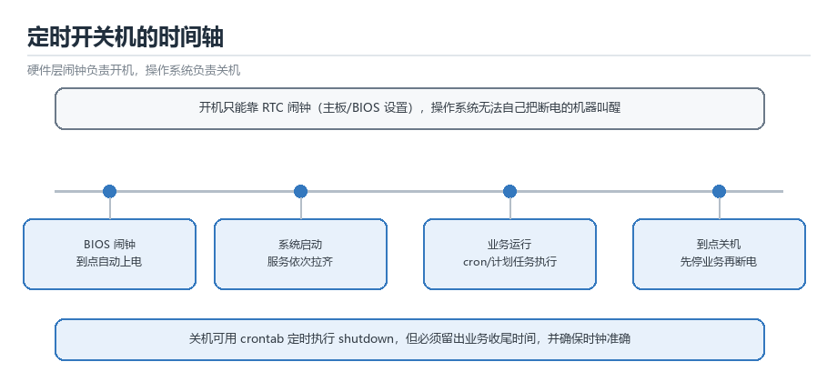

## 板块0 · 学习路径和建议

这一组内容看起来分散：一条命令读温度，几个 BIOS 选项设开机，一行 crontab 定关机。但它们共享同一个前提——机器的运行状态由硬件时钟和传感器这两套底层设施支撑，操作系统只是读取者。不理解这一点，就会出现"温度读不到就以为驱动坏了""定时开机设了却不生效"这类误判。这个专项把传感器的数据来源和开关机的时间基准讲清楚，让操作有据可依。

### 0_1 学习路径

建议按"先观测、再判读、后控制"推进。观测是拿到温度与转速，判读是知道什么数值算异常，控制是让机器在指定时刻自己开关。三步顺序不能颠倒：没有稳定的观测，就无法验证定时任务是否真的起了作用。

| 阶段 | 目标 | 验证方式 |
| --- | --- | --- |
| 一 · 装上传感器 | 用 lm_sensors 读出 CPU 与风扇数据 | `sensors` 输出含 `Package id` 与转速行 |
| 二 · 会看读数 | 分清核心温度、封装温度、阈值的关系 | 能指出 high 与 crit 分别意味着什么 |
| 三 · 联合判读 | 把温度与负载、转速放在一起看 | 能对"高温但风扇不转"给出判断 |
| 四 · 设定时开机 | 在 BIOS 中配置 RTC 闹钟 | 关机后到点自动上电 |
| 五 · 设定时关机 | 用 crontab 或计划任务定时下电 | 日志显示在预定时刻执行 |

### 0_2 使用建议与边界声明

本专项的命令以 RHEL/CentOS 7 与 Debian/Ubuntu 两条线为基准，两者的软件包名不同（`lm_sensors` 与 `lm-sensors`），探测后的模块加载方式也不同，文中并列给出。BIOS 菜单项名称因厂商与固件版本差异极大，文中给出的是常见的英文项名与所在层级，实际操作时以本机固件为准。

| 项目 | 说明 |
| --- | --- |
| 版本范围 | lm_sensors 3.x；systemd 体系的 `shutdown`；Windows 7 及以上 |
| 与主知识库分工 | 主库讲 cron 语法与 systemd 服务管理，本专项只讲它们用于开关机时的特殊约束 |
| 实验环境 | 物理机才能读出真实温度；虚拟机只适合练习命令格式 |
| 前提条件 | BIOS 中的电源管理（ACPI/APM）需开启，否则定时开机项可能根本不存在 |
| 风险提示 | 远程执行关机命令前确认无人正在使用，且不要在生产时段做首次测试 |

有一条边界必须先声明：定时开机与定时关机是两套完全独立的机制，不共享任何配置。关机任务写在操作系统里，开机任务写在主板的固件里。把两者当成一件事来配，是最常见的理解偏差。

## 板块1 · 温度从哪来：lm_sensors 与传感器探测

CPU 温度不是操作系统"算"出来的，而是主板上的传感芯片测出来、由内核驱动读出来的。`lm_sensors` 这个工具包做的工作只有两件：识别机器上有哪些传感芯片，以及把芯片寄存器里的原始数值换算成可读的摄氏度与转速。

### 1_1 安装与交互式探测

两条发行版线的包名只差一个连字符，但探测之后的动作不同。

```
root@iaoexl:~# yum install -y lm_sensors        # RHEL/CentOS 系
root@iaoexl:~# apt-get install -y lm-sensors    # Debian/Ubuntu 系
```

装完必须运行一次探测。它会逐个地址嗅探 I2C 与 ISA 总线，询问是否加载对应驱动。

```
root@iaoexl:~# sensors-detect
```

交互过程中会对每一类芯片提问，全程回车取默认值即可。唯一需要留意的是最后一段输出，它会告诉你探测到了哪些芯片、建议加载哪些模块，以及是否要写入配置文件。

| 发行版 | 模块持久化位置 | 生效方式 |
| --- | --- | --- |
| RHEL/CentOS 7 | `/etc/sysconfig/lm_sensors` | `systemctl restart lm_sensors` 或重启 |
| Debian/Ubuntu | `/etc/modules` 或 `/etc/modules-load.d/*.conf` | 前者由 kmod 的开机脚本加载，后者由 `systemd-modules-load` 加载；临时验证直接 `modprobe coretemp` |

探测的本质是"试"。它并不知道这块主板装的是哪颗芯片，只能按已知的地址表逐个访问，有应答就认为找到了。因此出现误判并不奇怪：某些地址上挂着别的设备，被当成温度传感器加载后，读出的会是一个恒定不变的荒谬数值。判断依据是——真实的温度会随负载小幅波动，而误识别出来的值长期纹丝不动。

### 1_2 读数怎么读：三类数值的含义

```
root@iaoexl:~# sensors
```

```
coretemp-isa-0000
Adapter: ISA adapter
Package id 0:  +45.0°C  (high = +80.0°C, crit = +100.0°C)
Core 0:        +43.0°C  (high = +80.0°C, crit = +100.0°C)
Core 1:        +44.0°C  (high = +80.0°C, crit = +100.0°C)

acpitz-acpi-0
Adapter: ACPI interface
temp1:        +27.8°C  (crit = +105.0°C)

it8728-isa-0290
Adapter: ISA adapter
fan1:        1200 RPM  (min =  300 RPM)
in0:          +1.10 V  (min =  +0.00 V, max =  +3.00 V)
```

| 字段 | 含义 | 判读要点 |
| --- | --- | --- |
| `Package id 0` | CPU 封装整体温度 | 反映散热器底座与硅脂状态 |
| `Core N` | 单个核心温度 | 各核差异超过 10℃ 说明散热不均 |
| `high` | 告警阈值 | 达到后 CPU 开始降频 |
| `crit` | 临界阈值 | 达到后触发硬件级保护性断电 |
| `fan1 ... RPM` | 风扇转速 | 与温度联动看，单看无意义 |
| `in0 ... V` | 供电电压 | 偏离标称值说明电源或主板异常 |

`high` 与 `crit` 的差别值得记住：`high` 是"该降速了"，`crit` 是"马上要保护性关机了"。前者是性能问题，后者是可用性问题。看到温度逼近 `crit`，机器随时可能自己断掉，这时任何软件层面的排查都来不及。

`acpitz` 那一行通常明显低于 `coretemp`。它不是 CPU 温度，而是主板 ACPI 区域的一个参考点，位置在芯片组附近。把它当成 CPU 温度是新手最常见的误读——27℃ 看起来很"健康"，但真正的核心温度可能已经在 80℃。

封装温度与核心温度的关系也值得一看。正常情况下两者相差 2 至 5℃；如果封装温度比所有核心都高出十几度，多半是散热器与顶盖接触不良，硅脂已经干结。

### 1_3 虚拟机里为什么读不到温度

在 VMware、Hyper-V、KVM 的客户机里运行 `sensors-detect`，通常探测不到 `coretemp`，只有一条 `acpitz`，且数值长期不变。

原因不在配置。温度是物理传感器的读数，虚拟化层把 CPU、内存、磁盘抽象成虚拟设备，但不会把宿主机的传感芯片透传给客户机——那会让客户机看到的是"别人的硬件"。客户机里能拿到的温度，最多是虚拟 ACPI 表里写死的一个占位值。

| 环境 | 能否读到真实温度 | 原因 |
| --- | --- | --- |
| 物理机 | 能 | 传感芯片直连，驱动可读 |
| 虚拟机 | 否 | 传感器不透传，仅有占位值 |
| 云主机 | 否 | 同上，且不暴露宿主机硬件 |
| 容器 | 否 | 与宿主机共享内核，看到的是宿主机的值 |

所以在虚拟机里练习这一节，目标只是熟悉命令与输出格式，不要试图判断"这台机器散热好不好"。真要评估散热，必须在物理机上做，并且让 CPU 处于持续负载状态，否则读数只是空闲态的基线。

## 板块2 · 温度不是唯一信号：与负载联合判读

单看一个温度数字，几乎无法得出任何结论。45℃ 在空闲时算偏高，在满载时算优秀。判读必须把三个量放在一起：当前负载、当前温度、当前转速。三者构成一个闭环，缺一个就会误判。

### 2_1 绝对温度与温升

| 场景 | 空闲温度 | 满载温度 | 结论 |
| --- | --- | --- | --- |
| 正常风冷 | 35~45℃ | 65~80℃ | 温升 30℃ 左右属正常范围 |
| 散热不良 | 55~60℃ | 90℃ 以上 | 空闲就偏高，说明静态散热已失效 |
| 硅脂干结 | 40℃ | 95℃ 并降频 | 温升异常大，接触热阻高 |
| 环境温度高 | 50℃ | 85℃ | 整体平移，机房空调可能是主因 |

比绝对温度更有信息量的是**温升**：满载温度减去空闲温度。温升过大意味着热量从芯片传到散热器的路径有问题，与风扇无关。温升正常但两者都高，则是环境温度或机箱风道的问题。

另一个易被忽略的量是降频。温度到达 `high` 后 CPU 会主动降低频率，此时温度反而会稳住不再上升，看起来"温度不高"。如果没有同时观察频率，就会得出"散热没问题"的错误结论。

```
root@iaoexl:~# grep 'cpu MHz' /proc/cpuinfo | head -4      # 对比标称频率是否被拉低
root@iaoexl:~# uptime                                       # 负载均值，作为温度的背景
```

### 2_2 风扇转速骤降比高温更危险

温度上升是渐进的，有足够时间反应；风扇停转是突发的，几十秒内就能冲到临界值。

| 现象 | 可能原因 | 紧急程度 |
| --- | --- | --- |
| 温度升高且转速同步升高 | 负载增加，散热系统正常响应 | 低 |
| 温度升高但转速不变 | 风扇老化、PWM 控制失效、风道堵塞 | 高 |
| 温度不高但转速满速 | 温度传感器失准，风扇按错误值狂转 | 中 |
| 转速读到 0 而温度正常 | 部分芯片不报转速，需换用其他接口读 | 低，先确认是否误报 |

判读的关键是"联动"：正常机器上温度与转速应当同向变化。温度上去了转速没动，说明控制回路断了；这种情况下温度会一路走高直到降频，而人往往在听到风扇"很安静"时才意识到不对。

服务器上还有一层：机箱风扇通常由 BMC 统一管理，操作系统读到的转速只是 BMC 汇报的副本。此时 `sensors` 的读数与 BMC 网页上的读数可能不一致，以 BMC 为准。带外管理口的好处正在于此——操作系统已经挂了，BMC 仍能看到转速和温度。

### 2_3 用一条命令做持续记录

单次读数只能说明此刻，判断趋势需要连续采样。不需要装监控系统，一条循环加时间戳就够。

```
root@iaoexl:~# while true; do echo "$(date +%H:%M:%S) $(sensors | grep 'Package id' | awk '{print $4}')"; sleep 60; done >> /var/log/cpu-temp.log
```

这条命令每分钟追加一行，跑一天就能看出温度的日周期：业务高峰在几点、空调停机时段温度是否抬升。有了这份基线，再设阈值才不会拍脑袋。它依附于当前终端，断开 SSH 就会终止，长期运行要放进 `tmux`、写成 systemd 服务，或干脆交给 cron 每分钟触发一次单条采集。

如果机器上已经有 sysstat，用 `sar` 把负载与温度对齐更方便——同一时间轴上既有 CPU 使用率又有温度，关联关系一目了然。单独一份温度日志没有意义，必须与负载数据并排才能解释。

## 板块3 · 定时开机：BIOS 里的 RTC 闹钟

定时开机不归操作系统管。机器关着的时候，操作系统的所有定时器都停摆，cron 不会执行，systemd 也不会醒来。唯一还在工作的部件是主板上那颗靠纽扣电池维持的实时时钟（RTC），它带一个闹钟寄存器，到点就拉高电源信号。

```
  22:00 关机 ──► 操作系统停止，cron 全部失效
                    │
                    ▼
              RTC 继续走时（纽扣电池供电）
                    │
  08:00 闹钟到点 ──► 主板电源管理电路拉高上电信号
                    │
                    ▼
              电源上电 ──► BIOS 自检 ──► 引导操作系统
```

这条链路上任何一环缺失，开机就不会发生：BIOS 里没设闹钟、闹钟被清空、RTC 时间本身是错的。

### 3_1 Dell 服务器的 Auto On Time

Dell 的选项位于 `Power Management` 之下，名为 `Auto On Time`。

| 选项 | 取值 | 说明 |
| --- | --- | --- |
| Auto On | Disabled / Every Day / Weekdays / Select Day | 选择重复规律 |
| Time | HH:MM AM/PM | 上电时刻，按 BIOS 当前时间解释 |

`Select Day` 允许指定一周中的某几天，适合只在工作日开机的场景。设置完成后必须保存并真正断电一次（不是重启）才能验证——重启不经过 RTC 闹钟这条路径。

### 3_2 通用主板的 Wake Up on Alarm

其他厂商的固件把同类功能放在 `Power` 或 `APM Configuration` 下，名称多为 `Wake Up on Alarm`、`RTC Alarm`、`Resume by RTC Alarm`。

| 字段 | 常见取值 | 注意事项 |
| --- | --- | --- |
| Wake Up on Alarm | Enabled / Disabled / By OS | 选 By OS 时由操作系统设置闹钟，固件不干预 |
| Date / Day | 具体日期或每天 | 部分固件只支持"每月某日" |
| Hour / Minute / Second | 00~23 / 00~59 / 00~59 | 秒级精度通常无意义 |

`By OS` 这个取值容易被误选。它的含义是"固件不管，交给操作系统写 RTC 闹钟寄存器"，而 Linux 侧要用 `rtcwake` 才会去写。选了它却没配 `rtcwake`，结果就是既不开机也不报错。



### 3_3 三个让定时开机失效的隐性原因

第一是 CMOS 电池耗尽。RTC 靠纽扣电池维持，电池没电后断电即丢时间，闹钟自然无效。表现是每次断电后开机，BIOS 时间都回到一个固定日期。

第二是时区错位。BIOS 时间通常是本地时间，而 Linux 默认把硬件时钟当 UTC 解释。若系统按 UTC 写入、BIOS 按本地时间读取，闹钟会整整差一个时区（东八区即 8 小时）。判断方法是比对 `date` 与 `hwclock --show` 的输出。

第三是电源被彻底切断。机箱电源开关关掉、或插排断电，主板只剩电池供电，RTC 仍在走，但部分主板在此状态下不响应闹钟。要求"到点必开"的场景，应保证主板始终有市电。

## 板块4 · 定时关机：调度器与电源状态

关机任务与开机任务相反，它依赖操作系统活着，因此天然属于 cron、计划任务这类调度器的职责范围。写法本身不难，难点在于关机前的业务缓冲，以及"关机"究竟该关到什么程度。

### 4_1 Linux：crontab 的写法与停业务

```
root@iaoexl:~# crontab -e
```

```
30 21 * * * /sbin/shutdown -h now     # 每天 21:30 关机
```

五个时间字段依次是分、时、日、月、周。`30 21 * * *` 表示每天 21 点 30 分。时间写成 `*` 的位置表示"每个"，`*/5` 表示"每 5 个单位"。

`shutdown -h` 在 systemd 体系下等价于 `--poweroff`：停服务、卸文件系统、再断电，一条命令走完全流程。真正"只停机不断电"的是 `-H`（halt），这个区别在虚拟化环境里会被放大——`-H` 之后虚拟机仍处于"已开机"状态，宿主机看得到却再也连不上，容易被误判成系统卡死。它与 Windows 的 `-h`（休眠）更是两回事，跨平台照抄参数会得到完全相反的效果。

直接在 21:30 执行 `now` 有一个问题：业务可能正在写数据，进程被强杀会导致文件损坏或事务回滚。更稳妥的写法是提前若干分钟广播并给缓冲。

| 写法 | 行为 | 适用场景 |
| --- | --- | --- |
| `shutdown -h now` | 立即断电 | 无业务的测试机 |
| `shutdown -h +10` | 10 分钟后停止，期间可 `-c` 取消 | 有人在用的机器 |
| `shutdown -h 21:30` | 指定绝对时刻 | 与 cron 二选一，避免重复 |
| `systemctl poweroff` | 直接走 systemd 关机流程 | 脚本里调用，输出更规整 |

需要先停业务的机器，应当把停止动作写在关机之前，而不是指望关机过程去善后。

```
root@iaoexl:~# crontab -l
```

```
25 21 * * * systemctl stop nginx && sync      # 提前 5 分钟停服务并落盘
30 21 * * * /sbin/shutdown -h now             # 再关机
```

`sync` 这一步不能省。停服务只保证进程退出，页缓存里的脏数据仍要由内核回写；关机流程虽然也会做这件事，但显式执行一次能让"业务已停、数据已落盘"成为可验证的状态。

### 4_2 Windows：shutdown 参数族与计划任务

Windows 没有 cron，定时动作交给"任务计划程序"。真正执行动作的还是 `shutdown.exe`，所以先要把参数记准。

| 参数 | 作用 | 易错点 |
| --- | --- | --- |
| `-s` | 关机 | 与 `-r` 互斥 |
| `-r` | 关机并重启 | 常被误用于"关机" |
| `-h` | 休眠 | 不是关机，唤醒后会话仍在 |
| `-l` | 注销当前用户 | 不关机 |
| `-a` | 取消待执行的关机 | 只在倒计时内有效 |
| `-t 秒` | 设置倒计时 | 默认 30 秒 |
| `-f` | 强制关闭未响应的程序 | 可能丢失未保存数据 |
| `-m \\计算机名` | 操作远程计算机 | 需要相应权限 |
| `-i` | 打开远程关机图形界面 | 必须是第一个参数 |

`-i` 必须是首个参数这条限制很实在：写成 `shutdown -s -i` 会被解析成"关机"，界面不会出现。

计划任务的配置分三步：触发器设周期与时刻，操作选"启动程序"，程序填 `shutdown.exe`、参数填 `-s -t 60`。参数里的倒计时给了用户一个反悔窗口，配合 `shutdown -a` 可以取消。

与 Linux 一样，Windows 的定时关机也应先停业务。常见做法是让计划任务先运行一个批处理，依次停止 IIS 站点或数据库服务，最后再调用 `shutdown`。任务计划支持"仅在用户登录时运行"与"不管用户是否登录都运行"两种模式，服务器上应选后者，否则注销后任务不触发。

### 4_3 休眠、待机与服务器为什么不该休眠

三种状态常被混为一谈，实际差别很大。

| 状态 | 内存供电 | 数据落盘 | 恢复速度 | 网络是否保持 |
| --- | --- | --- | --- | --- |
| 关机（S5） | 断 | 已落盘 | 需完整引导 | 断 |
| 待机（S3） | 保持 | 不落盘 | 秒级 | 断 |
| 休眠（S4） | 断 | 写入 hiberfil.sys | 十几秒 | 断 |
| 运行（S0） | 保持 | — | — | 通 |

休眠把内存内容整体写入磁盘的 `hiberfil.sys`，唤醒时再读回。这个文件在 Windows 8 之后默认采用"精简"模式，约为物理内存的 40%，改用完整模式则接近内存容量；关闭休眠用 `powercfg -h off`，同时会删除该文件并释放空间。

服务器不建议启用休眠，理由有三条。其一，休眠期间网络完全中断，监控系统会判定主机宕机并触发告警，运维需要在每次休眠时屏蔽告警。其二，部分网卡与驱动在 S4 恢复后不会重新协商链路，表现为"开机了但连不上"。其三，休眠依赖磁盘上的镜像文件，双系统或分区调整后镜像失效，机器会直接进入冷启动，原本的会话全部丢失。

对于"夜间不用、白天要用"的场景，正确的做法是定时关机加定时开机，而不是休眠。关机状态最干净，没有残留状态需要恢复。

### 4_4 时间同步：所有定时动作的共同前提

cron 按系统时间触发，RTC 闹钟按硬件时钟触发，两者都建立在一个假设上：机器知道现在几点。

长期运行的机器，晶振误差每天可能累积数秒，一个月就是几分钟。这个偏差对定时关机的后果比想象中严重——关机任务一天只有一次机会，错过就要等到明天。如果机器比真实时间快了几分钟，它会在 21:24 就关机；慢了则可能拖到 21:36，而那时人已经离开。

```
root@iaoexl:~# timedatectl                                          # 查看同步状态与时区
root@iaoexl:~# systemctl status chronyd                             # 确认时间服务在跑
root@iaoexl:~# hwclock --show                                       # 硬件时钟，与 date 比对
```

`timedatectl` 输出里的 `System clock synchronized: yes` 是判断依据。为 `no` 时，说明没有可用的时间源，此时所有 cron 任务都在一个漂移的时钟上执行。

时区同样要统一。服务器建议统一用 UTC 存储、按需显示，避免夏令时切换时出现"任务执行两次或跳过一小时"。国内无夏令时，用 `Asia/Shanghai` 也可以，但前提是所有机器一致——一台 UTC 一台本地时间，跨机协作的定时任务必然错位。

## 板块5 · 要点回顾与能力自检

### 5_1 结论浓缩

温度与开关机这两件事，本质上都是"操作系统之外的设施在起作用"。温度来自主板传感芯片，操作系统只是读取者；定时开机来自 RTC 闹钟，操作系统那时根本没运行；定时关机虽然靠 cron，但它的可靠性最终取决于时钟是否准确。把责任边界认清，就不会在错误的地方找原因。

| 高频误操作 | 后果 | 正确动作 |
| --- | --- | --- |
| 在虚拟机里判断散热 | 读数恒定，结论无效 | 换物理机，加负载再测 |
| 把 `acpitz` 当 CPU 温度 | 低估核心温度十几度 | 看 `Package id` 与 `Core N` |
| 只看温度不看转速 | 风扇停转时误判正常 | 温度与转速联动判读 |
| 用 cron 实现定时开机 | 关机后任务不存在 | 改在 BIOS 设 RTC 闹钟 |
| 关机前不停业务 | 数据未落盘，文件损坏 | 先 `systemctl stop` 再 `sync` |
| 忽略时间同步 | 任务在错误时刻执行 | 确认 `timedatectl` 显示已同步 |
| 服务器启用休眠 | 网络中断、告警误报 | 关机替代休眠 |

还有一条贯穿全篇的判断方法：**任何"设了却不生效"的定时动作，先查时钟，再查配置**。时钟错了，配置再对也没用；时钟对了，配置错了才有意义去逐项核对。

### 5_2 能力自检

1. 在一台虚拟机上执行 `sensors-detect` 只探测到 `acpitz`，这是配置错误还是环境限制？依据是什么？
2. `Package id 0` 与 `Core 0` 的读数相差 15℃，最可能指向哪一类硬件问题？为什么不是软件问题？
3. 机器温度持续上升而风扇转速读数不变，应该优先怀疑哪三个环节？
4. 已用 crontab 配置了每天 21:30 关机，但机器在 21:22 就关了，排查顺序应该是什么？
5. 一台服务器需要每天 8:00 自动开机、22:00 自动关机，这两个动作分别配置在哪一层？为什么不能都用 cron 实现？
