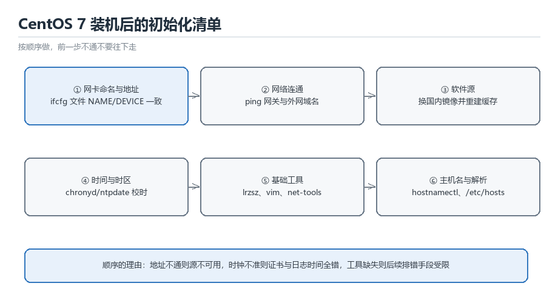

## 板块0 · 学习路径和建议

CentOS 7 是一个过渡色彩很重的版本：内核升到 3.10，init 换成了 systemd，网卡命名改成了可预测规则，但大量存量文档仍停留在 CentOS 6 的写法上。于是初学者最常遇到的不是"不会配"，而是"按教程配完没反应"。这个专项聚焦四类摩擦点——网卡名、启动目标、最小化装机后的收尾、DNS 覆盖——它们共同的特征是：**旧经验在新机制下静默失效**。

### 0_1 学习路径

五个主题的依赖关系是清楚的：网卡名决定配置文件叫什么，地址配置决定后续能否联网，联网之后才能换源、校时、装工具，而 DNS 又是"能 ping 通 IP 却打不开网页"的最后一道关卡。启动流程一板块穿插在中间，它不解决具体配置，但决定了故障发生时你能否判断"该查哪一层"。

| 阶段 | 目标 | 验证方式 |
| --- | --- | --- |
| 一 · 统一命名 | 把网卡名改回 `eth0`，理解为何要改 | `ip addr` 显示 `eth0`，且地址未丢失 |
| 二 · 固定入口 | 让系统默认进入文本界面 | `systemctl get-default` 返回 `multi-user.target` |
| 三 · 读懂启动链 | 分清 BIOS、GRUB、init 各管哪一段，掌握 SysV 服务管理 | 能对着 `rc3.d` 里的链接说出启动顺序，`chkconfig --list` 可用 |
| 四 · 打通网络 | 配静态地址并验证连通性 | `ping` 网关、公网 IP、域名三级通过 |
| 五 · 收尾加固 | 换源、校时、装传文件工具 | `yum repolist` 有输出，时间与标准时间一致 |
| 六 · 收口解析 | 让 DNS 配置在重启后依然有效 | 重启后 `ping 域名` 仍成功 |

### 0_2 使用建议与边界声明

本专项以 CentOS 7 最小化安装为基准环境，涉及的命令与路径在该版本上可直接执行；启动流程与 SysV 服务管理一板块会下探到 CentOS 6 的语境，因为在那里这些机制才是默认的主角。需要提醒的是，CentOS 7 已结束常规维护，新项目不应再以其为主力平台；这里的内容价值在于"读懂存量系统"，以及理解 RHEL 系从 SysV 向 systemd 迁移时留下的痕迹。

| 项目 | 说明 |
| --- | --- |
| 版本范围 | 主要 CentOS 7 / RHEL 7；启动流程与 SysV 部分覆盖 CentOS 6 |
| 与主知识库分工 | 主库讲通用原理与服务配置，本专项只处理装机后的兼容性调整 |
| 实验环境 | 虚拟机最小化安装，网卡名常见 `ens33`（VMware）或 `enp0s3`（VirtualBox） |
| 不涉及内容 | 图形桌面调优、SELinux 策略编写、内核编译 |
| 风险提示 | 修改网卡名与 grub 参数需重启，操作前打快照；远程机器改网络务必保留控制台 |

有一条边界需要提前划定：网卡改名是"为兼容旧脚本"的妥协，不是最佳实践。可预测命名解决的问题真实存在——多网卡机器上 `eth0` 与 `eth1` 的顺序会因探测顺序而漂移，改回 `eth0` 相当于用稳定性换可读性。

## 板块1 · 网卡命名：可预测规则的由来与回退

装完系统执行 `ifconfig`，看到 `enp0s3` 而不是 `eth0`，这是很多人对 CentOS 7 的第一印象。这个变化不是随意的改名，而是一套有明确目的的命名规范。

### 1_1 从 eth0 到 ens33：命名规则解决了什么问题

传统命名按内核探测顺序分配：第一块网卡 `eth0`，第二块 `eth1`。问题在于"探测顺序"并不稳定——增删一块网卡、更换插槽、升级内核，都可能让原有编号整体平移。对一台绑定了固定 IP 的服务器，这意味着配置文件指向了错误的物理口。

systemd 引入的可预测命名改为按硬件拓扑位置命名，只要网卡插在同一个位置，名字就永远不变。

| 名称形态 | 构成含义 | 常见环境 |
| --- | --- | --- |
| `eth0` | 传统内核顺序命名 | CentOS 6 及更早 |
| `eno1` | 主板板载（onboard）第 1 块 | 品牌服务器 |
| `ens33` | 热插拔槽位（slot）33 | VMware 虚拟机 |
| `enp0s3` | PCI 总线 0、槽位 3 | VirtualBox 虚拟机 |
| `enp3s0f0` | 总线 3、槽位 0、功能 0 | 多口网卡 |

前缀本身也承载信息：`en` 表示以太网，`wl` 表示无线，`ww` 表示蜂窝网络。理解了编码规则，看到任何网卡名都能大致判断它的物理位置，这比记住 `eth0` 更有用。

### 1_2 关闭规则：两个内核参数与一次 grub 重生成

回退需要同时关闭两套命名机制，缺一不可。

| 参数 | 作用 | 只关一个的后果 |
| --- | --- | --- |
| `net.ifnames=0` | 关闭 systemd 的可预测命名 | 若 biosdevname 仍在，可能得到 `em1` 而非 `eth0` |
| `biosdevname=0` | 关闭 Dell 主导的 biosdevname 命名 | 若 ifnames 仍在，名字仍是 `ens33` |

参数追加到 `/etc/default/grub` 的 `GRUB_CMDLINE_LINUX` 变量末尾：

```
root@iaoexl:~# vim /etc/default/grub
```

```ini
GRUB_TIMEOUT=5
GRUB_TERMINAL_OUTPUT="console"
GRUB_CMDLINE_LINUX="crashkernel=auto rhgb quiet net.ifnames=0 biosdevname=0"
```

改完文件并不算生效——`/etc/default/grub` 只是输入，真正被引导程序读取的是生成后的 `grub.cfg`。必须重新生成：

```bash
# BIOS 引导的机器写这个路径
root@iaoexl:~# grub2-mkconfig -o /boot/grub2/grub.cfg
```

这里有一个照抄必然失败的坑：UEFI 引导的机器，生成的配置文件不在 `/boot/grub2/grub.cfg`，而在 `/boot/efi/EFI/centos/grub.cfg`。写错路径时命令照样返回成功，重启后参数却没进内核命令行，网卡名自然不变。判断引导方式看 `/sys/firmware/efi` 目录是否存在即可。

验证参数是否真的生效，不要只看网卡名，直接看内核命令行：

```bash
root@iaoexl:~# cat /proc/cmdline
```

如果输出里没有 `net.ifnames=0`，说明 grub 那一步没成功，后面改 ifcfg 全是白费。

### 1_3 ifcfg 的一致性：NAME、DEVICE 与文件名

改名的第二步是配置文件本身。CentOS 7 里 `/etc/sysconfig/network-scripts/ifcfg-*` 的文件名、`NAME`、`DEVICE` 三者必须一致，network 服务按 `DEVICE` 去找物理设备，按文件名和 `NAME` 标识连接。

```
root@iaoexl:~# mv /etc/sysconfig/network-scripts/ifcfg-ens33 \
                        /etc/sysconfig/network-scripts/ifcfg-eth0
root@iaoexl:~# vim /etc/sysconfig/network-scripts/ifcfg-eth0
```

```ini
TYPE=Ethernet
BOOTPROTO=static
NAME=eth0                     # 连接名，必须与新网卡名一致
DEVICE=eth0                   # 绑定的物理设备名，最关键的一行
ONBOOT=yes                    # 开机自动激活
IPADDR=192.168.10.10
NETMASK=255.255.255.0
GATEWAY=192.168.10.2
DNS1=114.114.114.114
```

只改文件名、不改 `DEVICE`，是最典型的半成品操作。表现是：`systemctl restart network` 报 `Device eth0 does not seem to be present, delaying initialization`，或者服务看似成功但地址没配上。原因很直接——文件说自己属于 `eth0`，内容却还指向 `ens33`，而这个设备已经不存在了。

```
 /etc/default/grub ──grub2-mkconfig──► grub.cfg ──reboot──► 内核命名为 eth0
                                                                 │
                                                                 ▼
              ifcfg-eth0（DEVICE=eth0）──► network 激活 ──► 地址生效
```

整条链路必须贯通。任何一环缺失，最终表现都是"网卡名没变"或"改名后没网"，而两者的排查方向完全不同：前者查 grub，后者查 ifcfg。

## 板块2 · 默认启动目标：target 与运行级别的映射

CentOS 7 不再有 `/etc/inittab`，也就不再有 `id:3:initdefault:` 这一行可以改。开机进文本还是进图形，改的是一个符号链接指向的 target。

### 2_1 multi-user.target 与 runlevel 3 的对应关系

systemd 用 target 表达"系统到达某个状态"，一个 target 可以聚合多个 unit。旧的运行级别被保留为兼容层，但只是同义词。

| 旧运行级别 | systemd target | 含义 |
| --- | --- | --- |
| 0 | `poweroff.target` | 关机 |
| 1 / s | `rescue.target` | 单用户救援模式 |
| 2 | `multi-user.target` | 多用户，无网络服务等级区分 |
| 3 | `multi-user.target` | 多用户文本界面（最常用） |
| 4 | `multi-user.target` | 保留，与 3 等价 |
| 5 | `graphical.target` | 图形界面 |
| 6 | `reboot.target` | 重启 |

`runlevel3.target` 与 `runlevel5.target` 并不是独立的 target，而是指向 `multi-user.target` 和 `graphical.target` 的软链接。这解释了一个常见困惑：为什么用 `runlevel3.target` 和用 `multi-user.target` 改完，效果完全一样。

### 2_2 set-default 与软链接两种做法

三条路径都能达到目的，优先级不同。

| 做法 | 命令 | 特点 |
| --- | --- | --- |
| systemctl 原生命令 | `systemctl set-default multi-user.target` | 推荐，自动维护链接，幂等 |
| 软链接指向 `multi-user.target` | 手工 `ln -sf` | 可行，需自行处理旧链接 |
| 软链接指向 `runlevel3.target` | 手工 `ln -sf` | 可行，依赖兼容链接存在 |

推荐做法只需一条命令：

```bash
# 设为开机进入文本界面，等价于旧运行级别 3
root@iaoexl:~# systemctl set-default multi-user.target

# 需要恢复图形界面时改回
root@iaoexl:~# systemctl set-default graphical.target
```

手工做法需要两步，且必须先删再建：

```bash
root@iaoexl:~# rm -f /etc/systemd/system/default.target
root@iaoexl:~# ln -sf /lib/systemd/system/multi-user.target /etc/systemd/system/default.target
```

`rm -f` 不能省。若目标位置已有链接且不加 `-f`，`ln` 会在链接内部再建一个链接，形成 `default.target/default.target` 这样的嵌套；加了 `-f` 则直接覆盖。看起来都能用，但嵌套结构在排查时会带来很大困扰。

### 2_3 验证与常见误操作

改完不重启也可以先验证链接指向：

```bash
root@iaoexl:~# systemctl get-default
multi-user.target
```

`get-default` 读的是实际生效的默认 target，比 `ls -l /etc/systemd/system/default.target` 更可靠——后者只告诉你链接指向哪里，不告诉你这个 target 是否真的存在。

| 误操作 | 现象 | 原因 |
| --- | --- | --- |
| 改 `/etc/inittab` | 无任何变化 | CentOS 7 不再读取该文件 |
| 手工建链接未删旧链接 | 出现嵌套链接 | `ln` 默认在目录内创建 |
| 设了 `rescue.target` | 开机进单用户，要求输 root 密码 | 误把救援模式当文本模式 |

`systemctl isolate multi-user.target` 是"立刻切换"而非"修改默认"，两者常被混淆：`isolate` 只影响当前这次运行，重启后仍按 `default.target` 走。

## 板块3 · 从加电到登录：启动链路上的七个环节

理解启动顺序的价值不在于背步骤，而在于故障分级：机器停在某个阶段，就能立刻知道该查哪一层。BIOS 阶段停了，操作系统还没上场；GRUB 阶段停了，问题在引导配置或分区表；内核起来后停了，问题在内核参数或根文件系统。

```
加电 ─► BIOS/UEFI 自检 ─► 读 MBR 引导代码 ─► GRUB 加载
     ─► 内核 + initramfs ─► 挂载根文件系统
     ─► 1 号进程按运行级别启动服务 ─► mingetty 等待登录
```

### 3_1 七个环节各自负责什么

| 环节 | 做的事 | 卡在这里的现象 |
| --- | --- | --- |
| BIOS/UEFI 自检 | 初始化硬件，按启动顺序找引导设备 | 黑屏、找不到启动设备 |
| MBR 引导代码 | 前 446 字节，跳转到活动分区的引导记录 | `Missing operating system` |
| GRUB | 读配置文件，显示菜单，装载内核 | `grub>` 提示符、菜单不出现 |
| 内核 + initramfs | 探测硬件，加载根文件系统所需的驱动 | 卡在 `dracut` 提示、找不到根设备 |
| 挂载根文件系统 | 按 `root=` 参数挂载根分区 | `Kernel panic - not syncing` |
| 1 号进程 | init/systemd 接管，启动各项服务 | 停在某个服务的启动行不动 |
| 登录终端 | mingetty/getty 拉起登录提示 | 服务都起来了但没有登录界面 |

initramfs 这一步最容易被忽略。它是一个临时的内存文件系统，里面装着挂载根分区所必需的驱动——如果根分区在 RAID 或 LVM 上，而 initramfs 里没有对应的模块，内核就找不到根设备，报 `Unable to mount root fs`。这也是为什么换主板、加阵列卡之后系统起不来，要重建 initramfs 而不是改 GRUB。

GRUB 的两个版本差别很大，配置文件位置完全不同，照着旧教程找文件是新手最常犯的错。

| 对比 | GRUB Legacy（0.97） | GRUB 2 |
| --- | --- | --- |
| CentOS 版本 | 5、6 | 7 及以后 |
| 主配置 | `/boot/grub/grub.conf` | `/boot/grub2/grub.cfg` |
| 分区表示 | `(hd0,0)` | `(hd0,msdos1)` 或 `(hd0,gpt1)` |
| 修改方式 | 直接编辑 grub.conf | 改 `/etc/default/grub` 后 `grub2-mkconfig` 重新生成 |
| 重装引导 | `grub-install /dev/sda` | `grub2-install /dev/sda` |

GRUB 2 的主配置是生成出来的，手工编辑它只是临时的，下次内核更新执行 `grub2-mkconfig` 就会被覆盖——这是"改了 grub.cfg 却不生效"或"生效一次后又变回去"的根因。

### 3_2 运行级别与 rcN.d 的 S/K 链接

SysV 用 0 到 6 七个运行级别表达"系统该处于什么状态"，每个级别对应一个脚本目录。

| 级别 | 含义 | 备注 |
| --- | --- | --- |
| 0 | 关机 | 不能设为默认 |
| 1 | 单用户模式 | 只挂根分区，不启网络，可用于重置 root 密码 |
| 2 | 多用户，不启 NFS | 部分发行版与 3 等价 |
| 3 | 完整多用户字符界面 | 服务器常用 |
| 4 | 保留未使用 | |
| 5 | 图形界面 | |
| 6 | 重启 | 不能设为默认 |

默认级别写在 `/etc/inittab` 的一行里：`id:5:initdefault:`。把这行的数字改成 0 或 6，系统开机就会立刻关机或无限重启——这是 `/etc/inittab` 最危险的一处编辑，改前务必确认是 3 或 5。

真正的服务脚本放在 `/etc/rc.d/init.d/`，而 `/etc/rc.d/rc0.d` 到 `rc6.d` 里放的是指向它们的符号链接，命名规则是 `S` 或 `K` 加两位数字加服务名。

```
rc3.d 目录里的链接含义
  S10network ──► ../init.d/network      S 开头 = 启动，数字越小越先执行
  S55sshd    ──► ../init.d/sshd
  K90network ──► ../init.d/network      K 开头 = 停止，数字越小越先停止
```

`S` 与 `K` 后面的两位数字决定顺序，不是任意编号。同理，关机时先停依赖方、再停被依赖方，所以停止脚本的数字顺序与启动相反。手工在这些目录里建链接是可行的，但容易漏改多个级别，`chkconfig` 就是为替代这个手工动作而生的。

### 3_3 chkconfig、ntsysv 与 xinetd

`chkconfig` 管的是"某个服务在哪些运行级别自启"，它通过增删 rcN.d 里的链接来生效，并不修改脚本本身。

```
root@centos6:~# chkconfig --list                       # 列出所有服务在各级别的开关
root@centos6:~# chkconfig --list sshd                  # 只看一个服务
root@centos6:~# chkconfig sshd on                      # 在默认级别开启自启
root@centos6:~# chkconfig --level 23 sshd on           # 只在级别 2、3 开启
root@centos6:~# chkconfig sshd off                     # 关闭自启，不影响当前运行状态
root@centos6:~# chkconfig --add myservice              # 把自写脚本纳入管理，需含 chkconfig 头
root@centos6:~# ntsysv                                 # 文本界面批量勾选
```

`chkconfig` 与 `service` 分工明确：`chkconfig` 管开机时启不启，`service` 管现在启不启。改了 `chkconfig` 之后服务仍在运行，这是正常的，两者本来就是两件事。

自写脚本要被 `chkconfig --add` 接受，头部必须有 shebang 加两行固定注释：`chkconfig` 行声明在哪些级别启动、启停序号各是多少，`description` 行说明用途。缺了这两行会报"服务不支持 chkconfig"。

```
#!/bin/bash
# chkconfig: 2345 80 20          # 级别、启动序号、停止序号
# description: my demo service   # 必需，缺了加不进去
# processname: mydemo            # 可选，多数情况下按脚本名推断
```

`xinetd` 是另一套机制，它自己不常驻每个服务，而是统一监听端口，有连接进来才临时拉起对应程序。配置放在 `/etc/xinetd.d/`，每个服务一个文件，`disable = no` 表示启用。

| 机制 | 常驻方式 | 适合的服务 | 典型代表 |
| --- | --- | --- | --- |
| init.d 脚本 | 服务进程常驻 | 长期运行、有状态的 | sshd、httpd、mysqld |
| xinetd 托管 | 按连接临时启动 | 低频、轻量的 | telnet、tftp |

xinetd 的优势是省资源——一百个低频服务不必常驻一百个进程；代价是每次连接多一次启动开销，且不适合有会话状态的服务。这也是它后来被 systemd 的 socket 激活取代的原因，思路完全一样。

### 3_4 rc.local：启动链的最后一站

`/etc/rc.d/rc.local` 在所有级别脚本执行完之后运行，是管理员放自定义启动命令的地方。CentOS 6 上它通常已存在、带 shebang 也可执行，往里追加命令即可；CentOS 7 上文件在但没有执行权限，不加 `chmod +x` 会被静默跳过——"写在 rc.local 里没生效"绝大多数是这个原因。

```
# 文件已存在且带 #!/bin/bash，只追加要执行的命令，不要再写一遍 shebang
root@centos6:~# cat >> /etc/rc.d/rc.local << 'EOF'
/usr/local/bin/mystart.sh >> /var/log/mystart.log 2>&1
EOF
root@centos6:~# chmod +x /etc/rc.d/rc.local
root@centos6:~# tail -3 /etc/rc.d/rc.local
```

用 `>>` 向已有脚本追加 shebang 是个常见的坏操作：它会把 `#!/bin/bash` 写到文件中间，变成一行普通注释，不报错也不起作用。判断文件里是否已有 shebang，`head -1 /etc/rc.d/rc.local` 一眼就能看到。

在 systemd 系统上，`rc.local` 变成了一个普通的 service 单元（`rc-local.service`），只有在文件存在且可执行时才会被拉起。这解释了为什么同样的内容在 CentOS 6 上能用、在 CentOS 7 上不生效：不是内容错了，而是触发条件多了一层。

新系统更推荐写一个正经的 service 单元，因为它能声明依赖关系、能配置失败重试、能用 `systemctl status` 查看状态。`rc.local` 的优点是简单，缺点是它不参与依赖排序——如果某条命令需要在网络就绪之后执行，`rc.local` 无法保证，只能自己加 `sleep` 等待，这是不可靠的。

## 板块4 · 最小化安装后的初始化清单

最小化安装只给一个能登录的系统：没有网络配置向导，没有常用工具，时间可能是 UTC。这一节按依赖顺序把该做的事排成一条线。



### 4_1 先网络后一切：静态地址与连通性验证

```
root@iaoexl:~# cd /etc/sysconfig/network-scripts/
root@iaoexl:~# vim ifcfg-ens33
```

```ini
TYPE=Ethernet
BOOTPROTO=static              # 静态地址；若用 DHCP 则写 dhcp
NAME=ens33
DEVICE=ens33
ONBOOT=yes                    # 最小化安装常默认为 no，不改则开机不启用
IPADDR=192.168.10.10
NETMASK=255.255.255.0
GATEWAY=192.168.10.2
DNS1=114.114.114.114
```

```bash
root@iaoexl:~# systemctl restart network
root@iaoexl:~# ip addr show ens33
```

`ONBOOT=no` 是最小化安装最常见的"配了不生效"。文件内容完全正确，但开机时 network 服务按 `ONBOOT` 判断是否激活该连接，值为 `no` 就直接跳过。手工 `ifup` 能通、重启就断，症状极具迷惑性。

连通性验证要分层，一次只测一跳：

```bash
# 第一跳：本机网卡与网关的链路
root@iaoexl:~# ping -c 2 192.168.10.2

# 第二跳：路由与出口是否正常，用 IP 绕过 DNS
root@iaoexl:~# ping -c 2 114.114.114.114

# 第三跳：域名解析是否正常
root@iaoexl:~# ping -c 4 www.baidu.com
```

第一跳失败查地址与掩码，第二跳失败查网关与路由，第三跳失败查 DNS。把这三步混在一起 ping 域名，只会得到"网络不通"这一个无用结论。

### 4_2 换源：阿里源替换与缓存重建

官方源在国内访问缓慢，替换为镜像源能显著缩短 `yum` 的等待时间。

```bash
# 安装下载工具，最小化系统通常没有 wget
root@iaoexl:~# yum install wget -y

# 整体备份原仓库目录，而不是逐个文件改
root@iaoexl:~# mv /etc/yum.repos.d /etc/yum.repos.d.backup4comex
root@iaoexl:~# mkdir /etc/yum.repos.d

# 写入镜像站提供的仓库文件
root@iaoexl:~# wget -O /etc/yum.repos.d/CentOS-Base.repo \
                       http://mirrors.aliyun.com/repo/Centos-7.repo

# 清空旧缓存并重建，让新源生效
root@iaoexl:~# yum clean all
root@iaoexl:~# yum makecache
```

CentOS 7 已于 2024 年 6 月终止支持，公共镜像站的 `centos/7` 目录陆续下线，原来的 `Centos-7.repo` 可能直接返回 404。遇到这种情况，把仓库文件里的 `mirrorlist` 注释掉、`baseurl` 改为 vault 地址（如 `https://mirrors.aliyun.com/centos-vault/7.9.2009/`），再执行 `yum clean all && yum makecache`。仍在生产环境运行的 CentOS 7 应尽快迁移到 RHEL、Rocky Linux 或 AlmaLinux，换源只能延缓而不能消除停止维护带来的补丁缺口。

备份目录的命名有讲究：**不能以 `.repo` 结尾，也不能留在 `/etc/yum.repos.d/` 内部**。yum 会扫描该目录下所有 `.repo` 文件，若备份目录名是 `yum.repos.d.bak.repo`，其中的旧仓库定义会被一并加载，表现为"换源后仍然从旧地址下载"或"同一软件包出现重复源"报错。`backup4comex` 这种后缀正是为了避开这个陷阱。

`yum clean all` 与 `yum makecache` 必须成对执行。只换文件不清缓存，`yum` 仍会用旧索引去新地址找包，报 `Cannot find a valid baseurl`；清了缓存不重建，第一次安装会因无索引而变慢甚至失败。

验证换源结果，`yum repolist` 的仓库列表应全部指向镜像站。

### 4_3 时区与 NTP 校时

最小化安装的系统时钟常为 UTC，日志时间与本地时间差 8 小时，排查问题时极易误判。

```bash
# 安装 ntp 套件，其中包含一次性校时工具 ntpdate
root@iaoexl:~# yum -y install ntp

# 移除默认时区文件，改为指向上海时区
root@iaoexl:~# rm -rf /etc/localtime
root@iaoexl:~# ln -s /usr/share/zoneinfo/Asia/Shanghai /etc/localtime

# 一次性跳变校时，-u 表示走未特权端口，避免与 ntpd 冲突
root@iaoexl:~# ntpdate -u ntp1.aliyun.com
```

`rm` 之后再 `ln` 是必要的：`/etc/localtime` 原本是一个文件而非链接，直接 `ln -sf` 在某些情况下会生成 `localtime/localtime` 的嵌套结构，时区反而不生效。不确定时区文件路径时，也可以用 `tzselect` 交互选择。

这里有个版本差异值得注意：CentOS 7 默认安装的是 `chrony` 而非 `ntpd`。如果 `chronyd` 正在运行，`ntpdate` 可能报 `the NTP socket is in use`，因为它占用了对应的端口。处理方式是先停掉再校时，或者干脆改用 `chronyc` 体系。

| 工具 | 工作方式 | 适用场景 |
| --- | --- | --- |
| `ntpdate` | 一次性跳变，立刻对齐 | 初始化收尾、临时纠偏 |
| `ntpd` | 持续小幅调整，缓慢收敛 | 需要长期守护的服务器 |
| `chronyd` | 持续调整，对间歇性离线更友好 | CentOS 7 默认，虚拟机首选 |

### 4_4 定时校时与文件传输工具

一次性校时只解决当下，长期运行还需要定期纠偏。用 cron 每十分钟对一次：

```bash
root@iaoexl:~# crontab -e
```

```cron
# 每 10 分钟校时一次，输出丢弃，避免 cron 反复发邮件
*/10 * * * * /usr/sbin/ntpdate -u ntp1.aliyun.com >/dev/null 2>&1
```

```bash
# 启用并立即启动定时任务服务
root@iaoexl:~# systemctl enable crond
root@iaoexl:~# systemctl restart crond
root@iaoexl:~# systemctl status crond
```

`>/dev/null 2>&1` 不是可有可无的装饰。cron 会把任务的任何输出当作邮件内容投递，每十分钟一封，很快会把 `/var/spool/mail/root` 撑大，也会淹没真正需要关注的告警。

另一条容易忽略的前提：`/usr/sbin/ntpdate` 在 cron 环境里必须写绝对路径。cron 的 `PATH` 只有 `/usr/bin:/bin`，而 `ntpdate` 装在 `/usr/sbin` 下，写成裸命令会静默失败——任务照常执行，只是每次都找不到命令。

传文件工具用 `lrzsz`，装完即可在支持的终端里直接用：

```bash
root@iaoexl:~# yum -y install lrzsz

# 把服务器上的文件下载到本地（终端会弹出保存对话框）
root@iaoexl:~# sz /etc/sysconfig/network-scripts/ifcfg-ens33

# 从本地上传到服务器当前目录
root@iaoexl:~# rz
```

`rz`/`sz` 依赖终端模拟器的协议支持，PuTTY 原生不支持，需要额外组件；Xshell、SecureCRT、MobaXterm 可以直接使用。通过跳板机或 `tmux` 会话中使用时也常失效，此时应改用 `scp` 或 `sftp`。

## 板块5 · DNS 与 resolv.conf 的覆盖关系

"能 ping 通 114.114.114.114，却 ping 不通域名"是最经典的一类故障。多数人第一反应是改 `/etc/resolv.conf`，改完当场有效，重启又失效——因为那个文件不归你管。

### 5_1 谁在写 /etc/resolv.conf

打开这个文件，首行往往写着 `# Generated by NetworkManager`。这行注释就是答案：文件由 NetworkManager 根据当前激活连接的配置生成，任何手工修改都会在下次连接激活时被覆盖。

```
   ifcfg-ens33（DNS1=...）
           │
           ▼
   NetworkManager 读取连接配置 ──► /etc/resolv.conf ◄── 手工修改被覆盖
                                          │
                                          ▼
                             应用程序解析域名（glibc）
```

理解这条链路，就能解释三种看似矛盾的现象：改完立即生效（应用层读的是当前文件）、重启后失效（NM 重新生成）、`systemctl restart network` 后也失效（连接重新激活触发重写）。

### 5_2 两种正确的落点

| 方案 | 做法 | 优点 | 代价 |
| --- | --- | --- | --- |
| 写进 ifcfg | `DNS1=`、`DNS2=` | 随连接持久，重启不丢 | 需重启连接生效 |
| 关闭托管 | `PEERDNS=no` 后自行维护 | 完全掌控文件内容 | 需自行保证内容正确 |

推荐第一种，配置集中在一处：

```ini
# /etc/sysconfig/network-scripts/ifcfg-ens33 片段
DNS1=114.114.114.114
DNS2=8.8.8.8
PEERDNS=yes                   # 允许 NM 将 DNS 写入 resolv.conf
```

第二种适合需要手工维护多个 `nameserver` 或配合本地解析服务的场景：把 `PEERDNS` 设为 `no`，NetworkManager 便不再改写该文件，此时手工编辑才有意义。

临时验证可以直改文件，但要清楚它只在这一轮有效：

```bash
root@iaoexl:~# vim /etc/resolv.conf
```

```text
# Generated by NetworkManager
nameserver 8.8.8.8
nameserver 8.8.4.4
```

### 5_3 排错顺序

DNS 问题应当由内向外逐层确认，每一层都有独立的验证手段。

| 层级 | 检查命令 | 判断依据 |
| --- | --- | --- |
| 配置文件 | `cat /etc/resolv.conf` | 是否有 `nameserver` 行，地址是否可达 |
| 连接配置 | `nmcli connection show ens33` | `ipv4.dns` 是否有值 |
| 解析行为 | `nslookup www.baidu.com` | 是否返回 A 记录，是否超时 |
| 上游可达 | `ping -c 2 114.114.114.114` | DNS 服务器本身能否连通 |

`nslookup` 若报 `connection timed out; no servers could be reached`，说明请求根本没发出去，问题在配置；若报 `server can't find`，说明请求到了但对方无此记录，问题在上游。这两种报错的排查方向完全相反，混为一谈会浪费大量时间。

还有一个隐蔽因素：`/etc/nsswitch.conf` 里的 `hosts` 行决定了解析顺序。默认是 `files dns`，即先查 `/etc/hosts` 再查 DNS。如果 `/etc/hosts` 里有一条过期的静态记录，域名会解析到错误地址，而 `resolv.conf` 看起来完全正常。

## 板块6 · 要点回顾与能力自检

### 6_1 结论浓缩

CentOS 7 的这一批"兼容性调整"，本质都是在处理同一件事：**新机制已经接管，旧入口还留在原地**。`eth0` 改不回来，是因为内核参数没进 grub.cfg；开机还进图形，是因为 `/etc/inittab` 早已不被读取；DNS 重启失效，是因为文件由 NetworkManager 托管。找到"谁真正在读这份配置"，问题就解决了一半。

启动链路的知识是配套的定位工具。七个环节按顺序往下走，卡在第几环就查第几层：BIOS 之后停住查引导设备与分区表，GRUB 之后停住查配置与引导文件，内核起来后停住查 initramfs 与根分区的挂载参数。旧系统的服务自启有两套机制并存——`chkconfig` 管 rcN.d 里的链接，`service` 管当前运行状态，两者互不替代；`rc.local` 排在最末，不参与依赖排序，所以需要等待网络的动作不能靠它。

| 高频误操作 | 后果 | 正确动作 |
| --- | --- | --- |
| 只改 `/etc/default/grub` | 参数未进引导配置，重启无效 | `grub2-mkconfig` 重新生成 |
| UEFI 机器写 BIOS 路径 | 生成到无效文件，网卡名不变 | 写到 `/boot/efi/EFI/centos/grub.cfg` |
| 只改 ifcfg 文件名 | network 报设备不存在 | 同步改 `NAME` 与 `DEVICE` |
| `ONBOOT=no` 未改 | 开机不激活，重启断网 | 设为 `yes` |
| 备份目录以 `.repo` 结尾 | 旧源仍被加载，换源无效 | 备份目录不放在仓库目录内 |
| cron 里写裸 `ntpdate` | 静默失败，时间不同步 | 写绝对路径 `/usr/sbin/ntpdate` |
| 直接改 `/etc/resolv.conf` | 重启或重连后被覆盖 | 写 `DNS1=` 到 ifcfg |
| 手工编辑 GRUB 2 的 `grub.cfg` | 下次生成配置时被覆盖 | 改 `/etc/default/grub` 后重生成 |
| `inittab` 默认级别写成 0 或 6 | 开机即关机或无限重启 | 只写 3 或 5 |
| `rc.local` 忘加执行权限 | 内容被静默跳过 | `chmod +x /etc/rc.d/rc.local` |

### 6_2 能力自检

1. `net.ifnames=0` 与 `biosdevname=0` 为何必须同时设置？只设其中一个会得到什么结果？
2. 改完 grub 参数并重启，`ip addr` 显示的仍是 `ens33`，应按什么顺序定位是 grub 环节还是 ifcfg 环节出了问题？
3. `runlevel3.target` 与 `multi-user.target` 是什么关系？为什么两条不同的命令会产生完全相同的效果？
4. 最小化安装后配好静态地址，`ifup` 能通但重启后断网，最可能的原因是什么？
5. 手工把 `nameserver` 写入 `/etc/resolv.conf`，重启后丢失，正确的持久化落点在哪里？
6. 机器停在 `grub>` 提示符与停在 `Kernel panic - not syncing` 这两种情况，分别该从哪一层查起？
7. `chkconfig sshd off` 之后 `sshd` 仍在运行，这是配置没生效还是正常现象？为什么？
